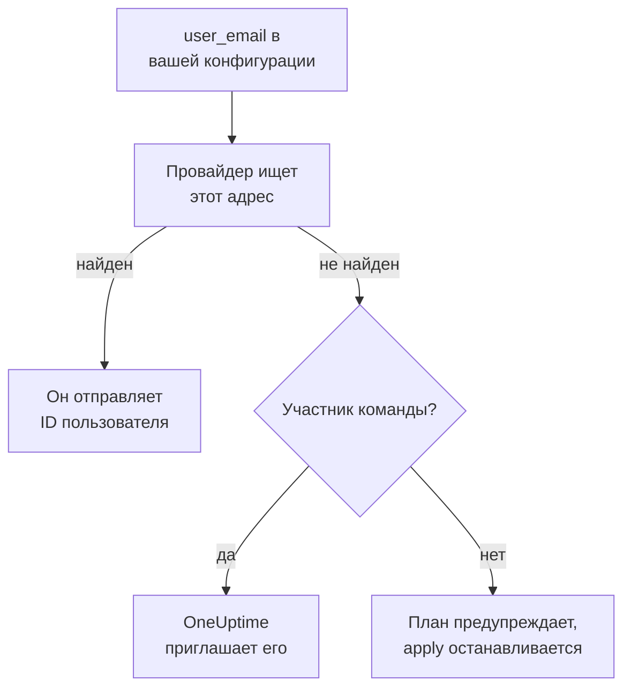

# Люди и команды

Храните в конфигурации Terraform, кто есть в вашем проекте: команды и их участников, кто дежурит и кто чем владеет. Называйте каждого человека по адресу электронной почты: провайдер находит его и приглашает всех, кто в проекте впервые.

:::cards
- [Люди по адресу электронной почты](#люди-по-адресу-электронной-почты): Атрибут рядом с каждым ID пользователя.
- [Как принять человека](#как-принять-человека): Пригласите кого-то и дайте ему команду, дежурства и то, чем он будет владеть.
- [Как отпустить человека](#как-отпустить-человека): Уберите кого-то, и что OneUptime убирает вместе с ним.
- [Импорт участников, которые уже есть](#импорт-участников-которые-уже-есть): По их команде и их адресу.
:::

## Как это работает

Провайдер ищет адрес среди людей проекта API-ключа: его участников и людей, приглашённых в него. Он отправляет в API ID найденного человека. Участник команды, названный адресом, которого ни у кого в проекте нет, вместо этого приглашает этот адрес.



Поиск идёт только в собственном проекте API-ключа. Никто за его пределами никогда не находится, и провайдер не может узнать, есть ли у адреса учётная запись где-то ещё.

## Перед началом

- **API-ключ, которому можно читать команды проекта.** Через них провайдер находит людей.
- **Чтобы добавить кого-то нового, ключ, которому можно приглашать людей.** См. [Приглашение пользователей](/docs/permissions/inviting-people).

## Люди по адресу электронной почты

Каждый ресурс, который называет человека, принимает его адрес электронной почты рядом с его ID пользователя. Укажите одно из двух:

| ID пользователя | Адрес электронной почты |
| --- | --- |
| `user_id` | `user_email` |
| `owner_users` | `owner_user_emails` |
| `assigned_to_user_id` | `assigned_to_user_email` |
| `override_user_id` | `override_user_email` |

Адрес находится без учёта регистра и хранится в state так, как вы его написали. ID пользователя заполняется, чтобы другие ресурсы могли на него ссылаться.

## Как принять человека

Эта конфигурация добавляет в команду Alice, которая в проекте впервые, даёт ей дежурства с первого дня и делает Bob, который уже есть в проекте, владельцем монитора:

```hcl title="people.tf"
resource "oneuptime_team" "sre" {
  name        = "SRE"
  description = "Site reliability engineering"
}

# New to the project: OneUptime invites her.
resource "oneuptime_team_member" "alice" {
  team_id    = oneuptime_team.sre.id
  user_email = "alice@example.com"
}

resource "oneuptime_on_call_policy_schedule" "weekly" {
  name     = "SRE weekly"
  timezone = "UTC"
}

resource "oneuptime_on_call_schedule_layer" "weekly" {
  on_call_duty_policy_schedule_id = oneuptime_on_call_policy_schedule.weekly.id
  name                            = "Weekly"
  starts_at                       = "2030-01-07T09:00:00Z"
  hand_off_time                   = "2030-01-14T09:00:00Z"
}

# Named through her membership, so she is invited first.
resource "oneuptime_on_call_schedule_layer_user" "alice" {
  on_call_duty_policy_schedule_id       = oneuptime_on_call_policy_schedule.weekly.id
  on_call_duty_policy_schedule_layer_id = oneuptime_on_call_schedule_layer.weekly.id
  user_id                               = oneuptime_team_member.alice.user_id
}

resource "oneuptime_monitor" "api" {
  name         = "Public API"
  monitor_type = "Manual"
}

# In the project already: named by his address.
resource "oneuptime_monitor_user_owner" "api" {
  monitor_id = oneuptime_monitor.api.id
  user_email = "bob@example.com"
}
```

`terraform apply` приглашает Alice по электронной почте, как это делает приглашение из панели управления. OneUptime создаёт ей учётную запись, если её нет. `has_accepted_invitation` остаётся `false`, пока она не примет приглашение, и то, что она его примет, не изменение в плане. Тот, кто уже есть в проекте, сразу попадает в новую команду.

Чтобы поставить на дежурство человека, которого приглашает эта конфигурация, или сделать его владельцем, сошлитесь на его членство через `user_id = oneuptime_team_member.<name>.user_id`: тогда Terraform пригласит его раньше, чем назовёт где-то ещё. Адрес, которого ни у кого в проекте нет, даёт предупреждение в плане и ошибку при apply.

## Как найти человека

Источник данных `oneuptime_user` ищет человека по `email`, `name` или `id` и читает его ID пользователя, имя, вошёл ли он в проект и команды, в которых он состоит:

```hcl
data "oneuptime_user" "alice" {
  email = "alice@example.com"
}

output "alice_teams" {
  value = data.oneuptime_user.alice.team_ids
}
```

## Как отпустить человека

Уберите членства человека из конфигурации и примените её. Выйдя из своей последней команды проекта, он выходит из проекта, и OneUptime снимает его со всех графиков дежурств, правил эскалации и замен, а также с того, чем он владеет: со всего, кроме завершившихся инцидентов, оповещений и событий обслуживания. Уберите в том же изменении блоки, которые его называют, иначе следующий план создаст их снова для человека, которого уже нет в проекте.

Его учётная запись OneUptime остаётся при нём: он покидает только проект. Команда, которая должна сохранить участника, не отпускает последнего, кто принял приглашение.

## Импорт участников, которые уже есть

Ни один экран не показывает ID членства, поэтому импортируйте его по ID его команды и адресу человека:

```bash
terraform import oneuptime_team_member.alice 6b1d1c2e-4f3a-4b5c-8d6e-7f8091a2b3c4/alice@example.com
```

Адрес остаётся таким, каким вы его написали, поэтому пишите его так же, как в конфигурации. Собственный ID членства тоже его импортирует, и тогда адрес читается из OneUptime, в нижнем регистре.

## Когда человек меняет адрес

Человек, который меняет адрес в OneUptime, остаётся для Terraform тем же человеком: ничего не меняется, пока вы не напишете новый адрес, а тогда меняется только `user_email`.

## Устранение неполадок

:::details План говорит, что адреса ещё нет в этом проекте
Ни у кого в проекте и ни у кого из приглашённых нет такого адреса. Сначала пригласите человека через `oneuptime_team_member`. Если это членство в той же конфигурации, сошлитесь на него через `user_id = oneuptime_team_member.<name>.user_id` вместо адреса. Если человек сменил адрес в OneUptime, используйте новый.
:::

:::details Apply говорит, что пользователь уже приглашён в эту команду
Человек уже в команде. Импортируйте это членство вместо того, чтобы создавать его, как в разделе [Импорт участников, которые уже есть](#импорт-участников-которые-уже-есть).
:::

## Дальнейшие шаги

:::cards
- [Импорт ресурсов](/docs/terraform/importing-resources): Переведите остальную часть проекта под управление Terraform.
- [Приглашение пользователей](/docs/permissions/inviting-people): Как работают приглашения в OneUptime.
- [Примеры](/docs/terraform/examples): Готовые конфигурации для распространённых ресурсов.
:::
