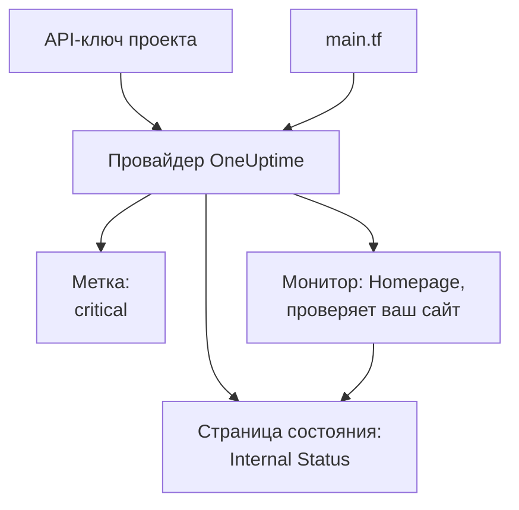

# Быстрый старт

Это руководство примерно за десять минут проведёт вас от нуля до проекта OneUptime под управлением Terraform. Вы создадите API-ключ, направите Terraform на свой проект и примените метку, монитор, который проверяет ваш сайт, и закрытую страницу состояния, которая его показывает. Затем вы измените один из них и всё уберёте.

:::cards
- [Перед началом](#перед-началом): Terraform, проект и тариф с API-ключами.
- [Создание первых ресурсов](#создание-первых-ресурсов): От API-ключа до применённого плана за шесть шагов.
- [Изменение ресурса](#изменение-ресурса): Отредактируйте конфигурацию, запустите план и примените.
- [Устранение неполадок](#устранение-неполадок): Ошибки, на которых может остановиться первый запуск.
:::



## Перед началом

- **Terraform 1.5 или новее либо OpenTofu 1.6 или новее.** С OpenTofu запускайте `tofu` везде, где это руководство запускает `terraform`.
- **Проект OneUptime** на [oneuptime.com](https://oneuptime.com) или на вашем собственном OneUptime, в котором вы можете создавать API-ключи.
- **В OneUptime Cloud — тариф Growth или выше.** API-ключи проекта работают только на нём.

## Создание первых ресурсов

:::steps
### Создайте API-ключ проекта

В панели управления OneUptime откройте **Настройки проекта → Расширенный → Ключи API** и нажмите **Создать: API-ключ**. Укажите **Имя**, например `terraform`, и в поле **Доступ** выберите **Администратор проекта**: Terraform создаёт, читает, изменяет и удаляет все виды записей, которыми управляет, а **Администратор проекта** может делать всё это. Для более узкого ключа выберите **Выбрать разрешения позже** и добавьте на странице ключа только нужные разрешения.

Ключ истекает через год. Чтобы выбрать другую дату, откройте **Дополнительные поля** перед созданием или измените дату позже на странице ключа. Когда ключ создан, открывается его страница: скопируйте **API-ключ** из карточки **Сведения о ключе API**.

### Сделайте ключ доступным для Terraform

Поместите ключ в переменную окружения `ONEUPTIME_API_KEY` оболочки, в которой вы запускаете Terraform, чтобы он никогда не попал в файл:

:::tabs
@tab Linux
```bash
export ONEUPTIME_API_KEY="<your-api-key>"
```
@tab macOS
```bash
export ONEUPTIME_API_KEY="<your-api-key>"
```
@tab Windows
```powershell
$env:ONEUPTIME_API_KEY = "<your-api-key>"
```
:::

### Направьте Terraform на OneUptime

Создайте пустую папку, а в ней файл с именем `main.tf`:

```hcl title="main.tf"
terraform {
  required_providers {
    oneuptime = {
      source  = "oneuptime/oneuptime"
      version = "{{TERRAFORM_PROVIDER_VERSION}}"
    }
  }
}

provider "oneuptime" {
  # The API key comes from ONEUPTIME_API_KEY.
  # On a self-hosted OneUptime, add your OneUptime's address:
  # oneuptime_url = "https://oneuptime.example.com"
}
```

На OneUptime с собственным хостингом прочитайте [Настройка собственного хостинга](/docs/terraform/self-hosted), прежде чем выбирать версию провайдера.

### Опишите ресурсы

Добавьте эти блоки в `main.tf`. Они читают два статуса монитора, с которых начинается каждый проект, и создают метку, монитор, который проверяет `https://example.com` каждые пять минут (укажите там свой сайт), и закрытую страницу состояния, которая показывает монитор:

```hcl title="main.tf"
data "oneuptime_monitor_status" "operational" {
  name = "Operational"
}

data "oneuptime_monitor_status" "offline" {
  name = "Offline"
}

resource "oneuptime_label" "critical" {
  name        = "critical"
  description = "Resources that page on-call when down"
  color       = "#FF5733"
}

resource "oneuptime_monitor" "homepage" {
  name                = "Homepage"
  description         = "Checks that the homepage responds"
  monitor_type        = "Website"
  monitoring_interval = "*/5 * * * *"
  labels              = [oneuptime_label.critical.id]

  monitor_steps = [{
    monitor_destination      = "https://example.com"
    monitor_destination_type = "URL"
    request_type             = "GET"

    criteria = [
      {
        name                  = "Offline"
        description           = "The homepage does not respond"
        filter_condition      = "Any"
        change_monitor_status = true
        monitor_status_id     = data.oneuptime_monitor_status.offline.id

        filters = [
          {
            check_on    = "Is Online"
            filter_type = "False"
          }
        ]
      },
      {
        name                  = "Online"
        description           = "The homepage responds"
        filter_condition      = "All"
        change_monitor_status = true
        monitor_status_id     = data.oneuptime_monitor_status.operational.id

        filters = [
          {
            check_on    = "Is Online"
            filter_type = "True"
          }
        ]
      }
    ]
  }]
}

resource "oneuptime_status_page" "internal" {
  name                  = "Internal Status"
  description           = "Status of our internal services"
  page_title            = "Service Status"
  is_public_status_page = false
}

resource "oneuptime_status_page_resource" "homepage" {
  status_page_id = oneuptime_status_page.internal.id
  monitor_id     = oneuptime_monitor.homepage.id
  display_name   = "Homepage"
}

output "monitor_id" {
  value = oneuptime_monitor.homepage.id
}
```

`monitor_steps` монитора говорят, что он проверяет и что означает каждый результат: после каждой проверки его статус задаёт первый совпавший критерий. Каждая часть объяснена в разделе [Шаги монитора](/docs/terraform/monitor-steps).

### Запустите план и примените

:::tabs
@tab Terraform
```bash
terraform init
terraform plan
terraform apply
```
@tab OpenTofu
```bash
tofu init
tofu plan
tofu apply
```
:::

`init` скачивает провайдер. План заканчивается строкой `Plan: 4 to add, 0 to change, 0 to destroy.` Введите `yes`, чтобы применить его; когда всё готово, Terraform выводит ID нового монитора.

### Проверьте панель управления

В панели управления OneUptime:

- **Мониторы** показывает `Homepage` с меткой `critical`. Его первая проверка приходит в течение нескольких минут.
- **Страницы состояния** показывает `Internal Status`, которая показывает `Homepage`.
- **Настройки проекта → Базовый → Метки** показывает `critical` в заданном вами цвете.

Снова запустите `terraform plan`. Он отвечает `No changes.`: в OneUptime ровно то, что сказано в конфигурации.
:::

## Изменение ресурса

Меняйте конфигурацию, а не панель управления. Задайте `color` метки равным `"#2ECC71"` в `main.tf`, затем запустите план и примените:

```bash
terraform plan
terraform apply
```

План заканчивается строкой `Plan: 0 to add, 1 to change, 0 to destroy.`: метка изменяется на месте. Изменение, которое кто-то вносит в панели управления в ресурс под управлением Terraform, появляется в следующем плане, и его применение возвращает то, что сказано в конфигурации.

## Уборка

Если это была проба, удалите то, что создала конфигурация:

```bash
terraform destroy
```

Это удаляет метку, монитор, страницу состояния и её ресурс. Два статуса монитора остаются: источники данных их только читают.

## Устранение неполадок

:::details Сообщение «Missing API Key»
Провайдер не нашёл API-ключ. Экспортируйте `ONEUPTIME_API_KEY` в оболочке, в которой вы запускаете Terraform, или задайте `api_key` в блоке провайдера и запустите команду снова.
:::

:::details Сообщение «the OneUptime API returned status 400: Invalid API Key»
Ключ введён с ошибкой, истёк или удалён либо принадлежит другому OneUptime, чем тот, на который указывает `oneuptime_url`. Скопируйте ключ ещё раз с его страницы или создайте новый.
:::

:::details Сообщение «the OneUptime API returned status 402: API keys need the Growth plan»
В OneUptime Cloud API-ключи проекта работают только на тарифе Growth или выше. Повысьте тариф проекта в **Настройки проекта → Биллинг и счета → Биллинг**, и тот же ключ снова заработает.
:::

:::details Сообщение «the OneUptime API returned status 422: You do not have permissions to create Monitor»
У ключа нет разрешения на этот вид записей. На странице ключа выдайте ему **Администратор проекта** или разрешение, названное в сообщении.
:::

:::details Сообщение «No monitor status matches {name = "Offline"}»
Статусы мониторов вашего проекта называются иначе. Используйте имена, которые вы видите в **Мониторы → Настройки → Статус монитора**, или найдите статус по `is_offline_state = true`.
:::

## Дальнейшие шаги

:::cards
- [Полное руководство](/docs/terraform/complete-guide): Аутентификация, структура проекта, источники данных, state и обновления.
- [Шаги монитора](/docs/terraform/monitor-steps): Решите, что проверяет монитор и что означает каждый результат.
- [Примеры](/docs/terraform/examples): Готовые конфигурации для распространённых ресурсов.
- [Импорт ресурсов](/docs/terraform/importing-resources): Передайте под управление Terraform то, что вы создали в панели управления.
:::
