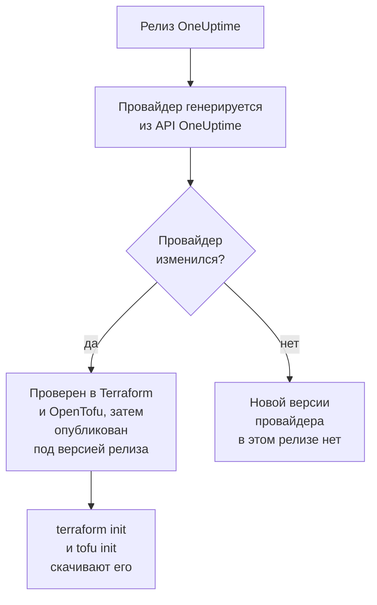

# Использование реестра

Провайдер OneUptime публикуется в [Terraform Registry](https://registry.terraform.io/providers/oneuptime/oneuptime) и в [OpenTofu Registry](https://search.opentofu.org/provider/oneuptime/oneuptime/latest). `terraform init` и `tofu init` скачивают его оттуда: вручную устанавливать ничего не нужно. Эта страница рассказывает, что публикуется, как нумеруются версии и как перейти на более новую.

:::cards
- [Что публикуется](#что-публикуется): Провайдер для каждой платформы, его справочник и его версии.
- [Как нумеруются версии](#как-нумеруются-версии): Версия провайдера – это релиз OneUptime, который его опубликовал.
- [Файл блокировки](#файл-блокировки): Версия и контрольные суммы, которые устанавливает каждая машина.
- [Переход на более новую версию](#переход-на-более-новую-версию): Прочитайте, что изменилось, скачайте её и запустите план.
:::

## Что публикуется

Каждый релиз OneUptime генерирует провайдер из собственного API OneUptime. Если провайдер изменился, релиз публикует его под версией релиза, как только он пройдёт сквозные тесты в Terraform и в OpenTofu:



| Что | Где |
| --- | --- |
| Провайдер для Linux, macOS, Windows, FreeBSD, OpenBSD и Solaris | Скачивается командами `terraform init` и `tofu init`, с контрольными суммами, которые подписывает OneUptime |
| Справочник по каждому ресурсу и источнику данных со всеми их атрибутами | Документация реестра, сгруппированная по продуктам: мониторы, страницы состояния, инциденты, дежурства и остальные |
| Руководство по использованию провайдера с OpenTofu | Руководства реестра |
| Каждая версия, начиная с самой новой | Список версий в реестре |

Справочник говорит, что такое каждый атрибут. Эта документация показывает, как использовать их вместе: начните с [Обзор Terraform](/docs/terraform/index).

## Как нумеруются версии

Версия провайдера – это версия релиза OneUptime, который его опубликовал: провайдер {{TERRAFORM_PROVIDER_MAJOR}}.0.20 вышел с OneUptime {{TERRAFORM_PROVIDER_MAJOR}}.0.20. Релиз, в котором провайдер не изменился, его не публикует, поэтому в версиях есть пропуски, и ограничение, называющее одну точную версию, может назвать версию, которой не существует. Вместо этого пишите диапазон:

| Вы используете | Ограничение | Terraform устанавливает |
| --- | --- | --- |
| OneUptime Cloud | `{{TERRAFORM_PROVIDER_VERSION}}` | Самый новый провайдер {{TERRAFORM_PROVIDER_MAJOR}}.x |
| OneUptime с собственным хостингом | Диапазон, который заканчивается версией вашего OneUptime, например `>= {{TERRAFORM_PROVIDER_MAJOR}}.0, <= {{TERRAFORM_PROVIDER_MAJOR}}.0.40` | Самый новый провайдер, который не новее вашего OneUptime |

На OneUptime с собственным хостингом провайдер новее вашего OneUptime может отправлять настройки, которых у вашего OneUptime ещё нет: [Настройка собственного хостинга](/docs/terraform/self-hosted#выберите-версию-провайдера) показывает, как написать для него диапазон.

```hcl title="main.tf"
terraform {
  required_providers {
    oneuptime = {
      source  = "oneuptime/oneuptime"
      version = "{{TERRAFORM_PROVIDER_VERSION}}"
    }
  }
}
```

Адрес источника не называет реестр: Terraform читает его из Terraform Registry, а OpenTofu из OpenTofu Registry, которые публикуют одни и те же версии.

## Файл блокировки

`terraform init` записывает выбранную версию и контрольные суммы своих загрузок в `.terraform.lock.hcl`. Закоммитьте этот файл: тогда каждая машина и каждый запуск CI устанавливают ровно эту версию, пока вы не выберете другую. Контрольные суммы охватывают все платформы, которые публикует реестр, поэтому один файл блокировки одинаково подходит машинам с Linux, macOS и Windows.

```hcl title=".terraform.lock.hcl"
provider "registry.terraform.io/oneuptime/oneuptime" {
  version     = "{{TERRAFORM_PROVIDER_MAJOR}}.0.20"
  constraints = "{{TERRAFORM_PROVIDER_VERSION}}"
  hashes = [
    "h1:...",
    "zh:...",
  ]
}
```

Файл блокировки называет реестр. OpenTofu пишет `registry.opentofu.org/oneuptime/oneuptime` там, где Terraform пишет `registry.terraform.io/oneuptime/oneuptime`, поэтому смена инструмента меняет файл блокировки: `init` заменяет запись и просит закоммитить изменение.

## Переход на более новую версию

:::steps
### Прочитайте, что изменилось

[Релизы OneUptime](https://github.com/OneUptime/oneuptime/releases) рассказывают, что изменил каждый релиз, включая провайдер. [Релизы провайдера](https://github.com/OneUptime/terraform-provider-oneuptime/releases) ссылаются на изменения с предыдущего.

### Скачайте её

```bash
terraform init -upgrade
```

`init -upgrade` берёт самую новую версию, которую допускает ваше ограничение, выводит её и обновляет `.terraform.lock.hcl`. Ограничение `{{TERRAFORM_PROVIDER_VERSION}}` берёт каждый релиз {{TERRAFORM_PROVIDER_MAJOR}}.x; для новой основной версии нужно новое ограничение.

### Запустите план перед применением

Выполните `terraform plan` и применяйте, только когда он пуст или показывает ожидаемые изменения. Закоммитьте обновлённый файл блокировки.
:::

На OneUptime с собственным хостингом сначала обновите OneUptime, затем поднимите конец диапазона провайдера.

## Где находится код

Провайдер генерируется из API OneUptime в [основном репозитории OneUptime](https://github.com/OneUptime/oneuptime), и каждая версия собирается из релиза, который её опубликовал. Его собственный репозиторий, [OneUptime/terraform-provider-oneuptime](https://github.com/OneUptime/terraform-provider-oneuptime), содержит то, что написал генератор, поэтому изменения вносятся в основной репозиторий: сообщайте о проблемах, в том числе в документации, на [github.com/OneUptime/oneuptime/issues](https://github.com/OneUptime/oneuptime/issues).

## Дальнейшие шаги

:::cards
- [Настройка собственного хостинга](/docs/terraform/self-hosted): Диапазон версий для вашего собственного OneUptime и зеркало для машин без интернета.
- [OpenTofu](/docs/terraform/opentofu): Тот же провайдер и та же конфигурация, с `tofu`.
- [Полное руководство](/docs/terraform/complete-guide): Аутентификация, структура проекта, источники данных, state и обновления.
- [Устранение неполадок](/docs/terraform/troubleshooting): Частые ошибки и способы их исправить.
:::
