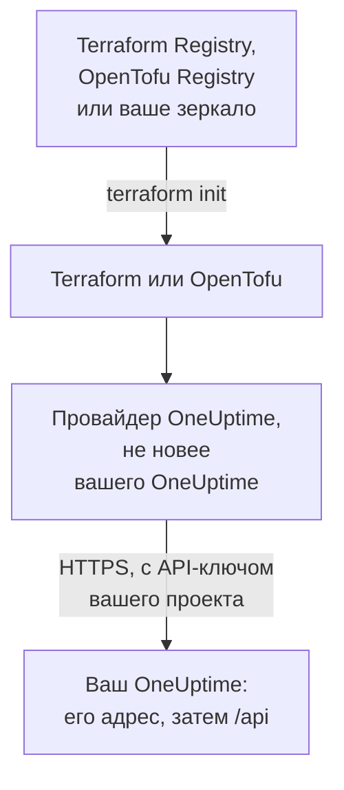

# Настройка собственного хостинга

Провайдер работает с вашим собственным OneUptime так же, как с OneUptime Cloud: те же ресурсы, те же атрибуты и те же API-ключи проекта. Что задаёте вы: адрес вашего OneUptime, подходящую ему версию провайдера и, там, где они нужны, зеркало для машин без доступа к интернету и доверие к частному центру сертификации.

:::cards
- [Направьте провайдер на ваш OneUptime](#направьте-провайдер-на-ваш-oneuptime): Его адрес и API-ключ вашего проекта.
- [Выберите версию провайдера](#выберите-версию-провайдера): Самый новый провайдер, который не новее вашего OneUptime.
- [Без доступа к интернету](#без-доступа-к-интернету): Сделайте зеркало провайдера в своей сети.
- [TLS и сертификаты](#tls-и-сертификаты): Частный центр сертификации, прокси и обычный HTTP.
:::



## Направьте провайдер на ваш OneUptime

Задайте в `oneuptime_url` адрес, по которому вы открываете панель управления: схему и хост, без пути. Провайдер добавляет `https://`, когда у адреса нет схемы, и `/api` в конце, поэтому `https://oneuptime.example.com` отправляет каждый запрос на `https://oneuptime.example.com/api`.

```hcl title="main.tf"
terraform {
  required_providers {
    oneuptime = {
      source  = "oneuptime/oneuptime"
      version = "{{TERRAFORM_PROVIDER_MATCHING}}"
    }
  }
}

provider "oneuptime" {
  oneuptime_url = "https://oneuptime.example.com"
  # The API key comes from the ONEUPTIME_API_KEY environment variable.
}
```

Адрес может приходить и из переменной окружения `ONEUPTIME_URL`, чтобы одна конфигурация могла указывать на несколько установок:

```bash
export ONEUPTIME_URL="https://oneuptime.example.com"
export ONEUPTIME_API_KEY="<your-api-key>"
```

Адрес – это хост, на котором обслуживается ваша установка: `HOST` и `HTTP_PROTOCOL` в `config.env` с Docker Compose и `host` и `httpProtocol` в values чарта Helm.

Ключ – это API-ключ проекта, которым вы управляете, созданный в панели управления вашего OneUptime в **Настройки проекта → Расширенный → Ключи API**, как в OneUptime Cloud. Мастер-ключ API OneUptime с собственным хостингом не принадлежит ни одному проекту, поэтому создание с ним завершается ошибкой `ProjectId required`.

> [!TIP]
> Ваш OneUptime пишет этот блок за вас. Откройте любой ресурс или список в панели управления, затем **Для разработчиков** и **Terraform** в его боковом меню: показанный там блок провайдера содержит адрес вашего OneUptime и подходящий ему диапазон версий.

## Выберите версию провайдера

Используйте самый новый опубликованный провайдер, который не новее вашего OneUptime. Версии провайдера следуют версиям OneUptime: релиз OneUptime, который меняет провайдер, публикует его под собственным номером версии, а провайдер новее вашего OneUptime может отправлять настройки, которых у вашего OneUptime ещё нет.

Поэтому пишите диапазон, который заканчивается версией вашего OneUptime, как это делает панель управления. Блок выше использует `{{TERRAFORM_PROVIDER_MATCHING}}`, диапазон для того OneUptime, с которого взята эта документация: когда вы читаете её на своём OneUptime, этот диапазон – ваш. Иначе впишите свою версию:

:::steps
### Узнайте версию вашего OneUptime

Спросите её у вашего OneUptime:

```bash
curl https://oneuptime.example.com/version
```

Ответ – JSON вида `{"version":"{{TERRAFORM_PROVIDER_MAJOR}}.0.40","commit":"..."}`. Как главный администратор вы также можете открыть метку редакции в заголовке панели администратора: см. [Узнайте свою текущую версию](/docs/installation/upgrading#узнайте-свою-текущую-версию).

### Впишите её в диапазон

Диапазон начинается с основной версии и заканчивается вашей. Для OneUptime {{TERRAFORM_PROVIDER_MAJOR}}.0.40:

```hcl title="main.tf"
terraform {
  required_providers {
    oneuptime = {
      source  = "oneuptime/oneuptime"
      version = ">= {{TERRAFORM_PROVIDER_MAJOR}}.0, <= {{TERRAFORM_PROVIDER_MAJOR}}.0.40"
    }
  }
}
```

Terraform берёт самый новый провайдер из диапазона. Релиз OneUptime, который не менял провайдер, его не публикует, и диапазон пропускает версии, которых не существует.

### Скачайте провайдер

Выполните `terraform init`. Он выводит установленную версию и записывает её в `.terraform.lock.hcl`.
:::

При обновлении сначала обновите OneUptime. Затем поднимите конец диапазона до его новой версии и выполните `terraform init -upgrade`.

## Без доступа к интернету

Когда машины, на которых работает Terraform, не могут достучаться до реестра, один раз скопируйте провайдер в свою сеть и направьте Terraform на копию.

:::steps
### Сделайте зеркало провайдера

На машине с доступом к интернету, в папке с вашей конфигурацией, скачайте провайдер для каждой платформы, на которой работают ваши машины. Без `-platform` команда скачивает провайдер только для своей платформы:

:::tabs
@tab Terraform
```bash
terraform providers mirror -platform=linux_amd64 -platform=darwin_arm64 /srv/terraform-mirror
```
@tab OpenTofu
```bash
tofu providers mirror -platform=linux_amd64 -platform=darwin_arm64 /srv/terraform-mirror
```
:::

Папка содержит провайдер под адресом реестра, например `registry.terraform.io/oneuptime/oneuptime/`. Скопируйте её в свою сеть.

### Направьте Terraform на зеркало

Напишите файл конфигурации CLI, который устанавливает провайдер OneUptime из папки, а всё остальное как обычно:

:::tabs
@tab Terraform
```hcl title="mirror.tfrc"
provider_installation {
  filesystem_mirror {
    path    = "/srv/terraform-mirror"
    include = ["registry.terraform.io/oneuptime/oneuptime"]
  }
  direct {
    exclude = ["registry.terraform.io/oneuptime/oneuptime"]
  }
}
```
@tab OpenTofu
```hcl title="mirror.tfrc"
provider_installation {
  filesystem_mirror {
    path    = "/srv/terraform-mirror"
    include = ["registry.opentofu.org/oneuptime/oneuptime"]
  }
  direct {
    exclude = ["registry.opentofu.org/oneuptime/oneuptime"]
  }
}
```
:::

Укажите его в `TF_CLI_CONFIG_FILE`, которую читают и Terraform, и OpenTofu: `export TF_CLI_CONFIG_FILE=/etc/terraform/mirror.tfrc`.

### Инициализируйте

Выполните `terraform init`: он устанавливает провайдер из зеркала. Он предупреждает, что в файле блокировки теперь есть контрольные суммы только для этой платформы. Чтобы записать их для всех платформ, выполните `terraform providers lock` с теми же параметрами `-platform` на машине с доступом к интернету и закоммитьте `.terraform.lock.hcl` вместе с конфигурацией.
:::

Обновляйте зеркало каждый раз, когда поднимаете диапазон версий.

## TLS и сертификаты

Провайдер проверяет сертификат вашего OneUptime по хранилищу доверенных сертификатов машины, на которой работает Terraform, и настройки, позволяющей пропустить проверку, нет. Если сертификат выдан частным центром сертификации, добавьте этот центр в хранилище доверенных сертификатов каждой машины и каждого CI-раннера, где работает Terraform:

:::tabs
@tab Debian / Ubuntu
```bash
sudo cp my-ca.crt /usr/local/share/ca-certificates/
sudo update-ca-certificates
```
@tab RHEL / Fedora
```bash
sudo cp my-ca.crt /etc/pki/ca-trust/source/anchors/
sudo update-ca-trust
```
:::

В Linux, где менять хранилище доверенных сертификатов нельзя, например в CI-контейнере, задайте `SSL_CERT_FILE` с файлом, в котором есть ваш центр сертификации и публичные центры. В macOS и Windows добавьте центр сертификации в системное хранилище сертификатов.

- **Прокси.** Провайдер отправляет запросы через прокси из `HTTPS_PROXY`, кроме запросов к хостам из `NO_PROXY`. Обратный прокси перед OneUptime должен пропускать без изменений каждый путь `/api` и заголовок `APIKey`.
- **Обычный HTTP.** Адрес `http://` работает для тестовой установки. API-ключ передаётся с каждым запросом, поэтому для всего остального используйте HTTPS.

## Устранение неполадок

:::details Сообщение «x509: certificate signed by unknown authority»
Машина, на которой работает Terraform, не доверяет сертификату вашего OneUptime: добавьте свой центр сертификации, как показано в [TLS и сертификаты](#tls-и-сертификаты).
:::

:::details Сообщение «invalid character '<' looking for beginning of value»
Вместо API ответила веб-страница: в `oneuptime_url` есть путь, или ответил прокси. Задайте в нём только адрес вашего OneUptime.
:::

:::details Сообщение «no available releases match the given constraints»
Ни один опубликованный провайдер не подходит под ограничение версии, например ограничение, которое называет одну версию, так и не опубликованную OneUptime. Напишите диапазон, как показано в [Выберите версию провайдера](#выберите-версию-провайдера).
:::

:::details Сообщение «ProjectId required»
Ключ – это мастер-ключ API, который не принадлежит ни одному проекту. Создайте API-ключ проекта в **Настройки проекта → Расширенный → Ключи API**.
:::

В [Устранение неполадок](/docs/terraform/troubleshooting) собраны остальные ошибки и то, что означает каждая.

## Дальнейшие шаги

:::cards
- [Быстрый старт](/docs/terraform/quick-start): Создайте API-ключ и примените первые ресурсы.
- [Использование реестра](/docs/terraform/registry): Где публикуется провайдер и как нумеруются версии.
- [Устранение неполадок](/docs/terraform/troubleshooting): Частые ошибки и способы их исправить.
- [Обновление](/docs/installation/upgrading): Обновите свой OneUptime, прежде чем поднимать диапазон провайдера.
:::
