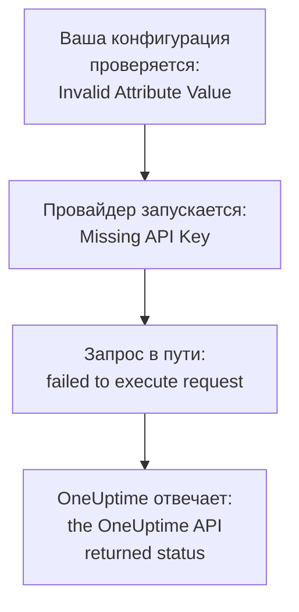

# Устранение неполадок

Найдите в таблице ниже сообщение, которое вывел Terraform, или то, что вы увидели: каждая строка ведёт к решению. Разделы после таблицы объясняют каждую ошибку, сгруппированные по тому, откуда она берётся.

:::cards
- [Найдите свою ошибку](#найдите-свою-ошибку): Все сообщения и симптомы с этой страницы и их решения.
- [API-ключи, разрешения и тарифы](#api-ключи-разрешения-и-тарифы): Когда OneUptime отклоняет ключ провайдера.
- [Планы, которые не успокаиваются](#планы-которые-не-успокаиваются): Изменения, которые возвращаются, и ресурсы, которые покидают state.
- [Подключение к OneUptime с собственным хостингом](#подключение-к-oneuptime-с-собственным-хостингом): Адрес, сертификаты и прокси.
:::

## Найдите свою ошибку

| Сообщение или симптом | Что делать |
| --- | --- |
| `Missing API Key` | Передайте провайдеру его ключ: см. [`Missing API Key` или `Invalid API Key`](#missing-api-key-или-invalid-api-key) |
| `Invalid API Key` | Скопируйте ключ ещё раз или создайте новый: см. [`Missing API Key` или `Invalid API Key`](#missing-api-key-или-invalid-api-key) |
| `ProjectId required` | Используйте API-ключ проекта, а не мастер-ключ: см. [`ProjectId required`](#projectid-required) |
| `You do not have permissions to create Monitor` | Выдайте ключу разрешение, названное в сообщении: см. [Ключу не хватает разрешения](#ключу-не-хватает-разрешения) |
| `API keys need the Growth plan` | Верните проект на тариф Growth: см. [Требуется оплата](#требуется-оплата) |
| `402` для одного ресурса или одной настройки | Повысьте тариф или оставьте настройку по умолчанию: см. [Требуется оплата](#требуется-оплата) |
| `This project has been blocked` | Попросите главного администратора разблокировать проект: см. [Заблокированный проект](#заблокированный-проект) |
| `references records that are not in this project` | Используйте ID записи вашего собственного проекта: см. [ID из другого проекта](#id-из-другого-проекта) |
| `Not Found` или `Ambiguous Match` от источника данных | Исправьте аргументы поиска: см. [Поиск, который не находит ничего или находит несколько](#поиск-который-не-находит-ничего-или-находит-несколько) |
| `Cannot import non-existent remote object` | Проверьте ID и разрешения ключа: см. [Импорт ресурсов](/docs/terraform/importing-resources#устранение-неполадок) |
| `Provider produced inconsistent result after apply` | Обновите провайдер: см. [Несогласованный результат после apply](#несогласованный-результат-после-apply) |
| План создаёт ресурс, который вы не добавляли | Ключ больше не может его читать, и OneUptime ответил `404`: верните ключу доступ на чтение, затем импортируйте ресурс через `terraform import`: см. [Ресурс покидает state, и следующий apply создаёт его снова](#ресурс-покидает-state-и-следующий-apply-создаёт-его-снова) |
| `priority` или `order` меняется после apply | Дайте каждому номер, которого больше ни у кого нет: см. [Приоритет или порядок, который сдвигается](#приоритет-или-порядок-который-сдвигается) |
| `Invalid Configuration for Read-Only Attribute` | Уберите атрибут из конфигурации: см. [Атрибуты только для чтения](#атрибуты-только-для-чтения) |
| `has been renamed to` | Переименуйте тип ресурса с помощью блока `moved`: см. [Переименованный тип ресурса](#переименованный-тип-ресурса) |
| Монитор, созданный через Terraform, никогда не показывает свои проверки | Обновите OneUptime: см. [Мониторы, созданные до ID шагов](#мониторы-созданные-до-id-шагов) |
| `must contain at least 1 elements` | Не указывайте атрибут вместо того, чтобы оставлять его пустым: см. [Пустые значения](#пустые-значения) |
| JSON из панели управления в файле `.tf` | Запишите его на HCL: см. [JSON из панели управления](#json-из-панели-управления) |
| `no available releases match the given constraints` | Используйте диапазон версий, а не одну точную версию: см. [Версия, которая так и не была опубликована](#версия-которая-так-и-не-была-опубликована) |
| `x509: certificate signed by unknown authority` | Доверьтесь своему центру сертификации: см. [Сертификаты](#сертификаты) |
| `invalid character '<' looking for beginning of value` | Направьте `oneuptime_url` на сам ваш OneUptime: см. [Веб-страница вместо API](#веб-страница-вместо-api) |
| `connection refused` или `Client.Timeout exceeded` | Проверьте адрес, сеть и прокси, если он есть: см. [Соединения, которые не устанавливаются](#соединения-которые-не-устанавливаются) |

## Как читать ошибку

Ошибка называет шаг, на котором произошёл сбой, а её сообщение говорит, откуда она взялась:



- Ошибка, которая возникает до какого-либо запроса, например `Invalid Attribute Value`, касается вашей конфигурации: провайдер проверяет её, прежде чем обращаться к OneUptime.
- `failed to execute request` означает, что запрос так и не получил ответа: см. [Подключение к OneUptime с собственным хостингом](#подключение-к-oneuptime-с-собственным-хостингом).
- `the OneUptime API returned status` – это ответ OneUptime: статус и сообщение после него говорят, что OneUptime отклонил.

Провайдер называет, что он делал: `Unable to create monitor` и `Unable to update monitor` для изменения и `Unable to parse label response`, когда он читает ресурс. Чтение, которое OneUptime отклоняет, сообщается с заголовком `Parse Error`, но сообщение после него – это ответ OneUptime, а не проблема разбора.

## API-ключи, разрешения и тарифы

### `Missing API Key` или `Invalid API Key`

`Missing API Key` останавливает провайдер до того, как он сделает какой-либо запрос: не задан ни `api_key` в блоке провайдера, ни переменная окружения `ONEUPTIME_API_KEY`. Экспортируйте переменную в оболочке, в которой вы запускаете Terraform, или передайте ключ в переменной с пометкой `sensitive`.

`Invalid API Key` – это ответ OneUptime на ключ, которого он не знает: введённый с ошибкой, истёкший или удалённый, либо ключ другого OneUptime, чем тот, на который указывает `oneuptime_url`. Скопируйте ключ ещё раз с его страницы в **Настройки проекта → Расширенный → Ключи API** или создайте новый.

### `ProjectId required`

Провайдеру нужен API-ключ проекта, которым он управляет: именно оттуда берётся проект. Мастер-ключ API OneUptime с собственным хостингом не принадлежит ни одному проекту, поэтому любое создание с ним завершается ошибкой `ProjectId required`. Создайте API-ключ проекта, как в [Создайте API-ключ проекта](/docs/terraform/quick-start#создайте-api-ключ-проекта), и используйте его.

### Ключу не хватает разрешения

`You do not have permissions to create Monitor` и похожие сообщения приходят со статусом `422`: ключу нельзя делать это с записями этого вида. Они называют разрешения, которые бы это позволили. Откройте страницу ключа в **Настройки проекта → Расширенный → Ключи API** и выдайте ему одно из них или **Администратор проекта**. Импорту нужно только разрешение на чтение.

### Требуется оплата

- **402 Payment Required на каждый запрос** — `API keys need the Growth plan...`: в OneUptime Cloud проект находится ниже **Growth**, а API-ключи проекта, включая ключ провайдера, ниже него перестают работать. Каждый вызов провайдера отклоняется, включая `terraform plan`, пока проект не вернётся на Growth; тогда тот же ключ снова заработает, и в конфигурации ничего менять не нужно. Повысьте тариф в **Настройки проекта → Биллинг и счета → Биллинг** или пока управляйте проектом в панели управления. См. [API-ключи и SCIM ниже их плана](/docs/api-reference/api-reference#api-ключи-и-scim-ниже-их-плана).
- **402 Payment Required** — вы достигли лимита своего тарифа OneUptime, или конфигурация включает настройку, которой нет в вашем тарифе (закрытую страницу состояния, отчёты по электронной почте, публичную панель, список разрешённых IP-адресов...), неважно, создаёт ли `terraform apply` ресурс с ней или меняет его позже. Terraform показывает сообщение OneUptime как есть. Повысьте тариф или сократите конфигурацию.

Возврат такой настройки к значению по умолчанию, который выключает функцию, работает на любом тарифе, поэтому конфигурация, выключающая платные функции, применяется после окончания пробного периода или понижения тарифа.

То же касается ресурсов, которые продаёт ваш тариф и которые проект сохраняет после понижения тарифа, - провайдеров SSO, подключений SCIM, API-ключей, расписаний дежурств, а также правил и сводок для Slack и Microsoft Teams: ниже тарифа (пока проект ещё на Growth, который нужен самому ключу провайдера) те, что у проекта уже есть, можно по-прежнему читать (поэтому `terraform plan` и `import` работают), удалять (поэтому удаление их из конфигурации или `terraform destroy` применяется) и выключать, если у них есть атрибут `is_enabled`. Создание, изменение или повторное включение по-прежнему отвечает 402.

Другим ресурсам, которые продаёт ваш тариф, например шаблонам, настраиваемым полям и группам мониторов, тариф по-прежнему нужен для чтения, поэтому план, который их обновляет, отвечает 402; удалить их всё же можно, например через `terraform destroy -refresh=false`.

Разрешения API-ключа ниже Growth не удаляются по одному, ведь удаление блокирующего разрешения дало бы ключу больше доступа: выполните `terraform state rm` для ресурсов разрешений, затем уничтожьте ключ, и его разрешения уйдут вместе с ним.

### Заблокированный проект

`This project has been blocked. Please contact your administrator.` приходит со статусом `403`: главный администратор заблокировал проект, и пока он его не разблокирует, в проекте не действует никто, кроме главного администратора, в том числе API-ключи проекта.

## Записи и поиск

### ID из другого проекта

Каждый ID, который называет ресурс, - метки монитора, страница состояния группы страницы состояния, площадка сетевого устройства, команды правила эскалации - должен быть записью проекта, к которому относится ваш API-ключ. ID записи другого проекта, несуществующий ID и ID записи, которую ключу нельзя читать, получают одинаковый ответ, в котором названы поле и ID:

```text
This network device references records that are not in this project: Network Site "…". Please pick values from this project and try again.
```

Обычно это значит, что ID скопирован из конфигурации или state другого проекта, либо запись удалена вне Terraform. Ссылайтесь на запись через её ресурс или источник данных в той же конфигурации (`oneuptime_label.critical.id`), а не через буквальный ID, и примените снова. Человек, указанный как пользователь, должен быть участником проекта.

### Поиск, который не находит ничего или находит несколько

Источник данных находит ровно одну запись или останавливает план. `Not Found` говорит, что ни у одной записи нет такого `id` или ни одна не подходит под заданные вами аргументы; `Ambiguous Match` говорит, что подходит несколько. Исправьте аргументы, задайте больше аргументов, чтобы сузить поиск до одной записи, или ищите запись по `id`. Правила описаны в [Читайте то, что уже существует](/docs/terraform/complete-guide#чтение-того-что-уже-есть).

## Планы, которые не успокаиваются

### Несогласованный результат после apply

`Provider produced inconsistent result after apply` означает, что провайдер вернул не те значения, которые запланировал. Старые провайдеры делали так со значениями, которые вычисляет сервер: значениями по умолчанию, которые сервер добавляет внутри `monitor_steps`, метками времени, которые сервер записывал иначе, обёрнутыми значениями вроде `probe_version` и атрибутами, которые сервер поддерживает в актуальном состоянии, например временем последнего heartbeat монитора входящих запросов. Ещё они читали десятичное число как null, когда API присылал его текстом, поэтому каждый apply правила цвета полос страницы состояния падал на `uptime_percent_greater_than_or_equal_to`. Текущие провайдеры справляются со всем этим: метки времени сравниваются как моменты времени, списки меток являются множествами, числа читаются обратно так, как вы их записали, а атрибут, который вы не задали, сохраняет запланированное значение, пока следующее обновление не прочитает серверное.

:::steps
1. Обновите провайдер: оставьте `version = "{{TERRAFORM_PROVIDER_VERSION}}"` в требовании к провайдеру и выполните `terraform init -upgrade`.
2. Примените снова. Ресурс, который неудачный apply оставил помеченным как tainted, заменяется один раз, и после этого планы пусты. Чтобы вместо этого сохранить ресурс как есть, сначала снимите с него пометку по его адресу: `terraform untaint oneuptime_status_page_history_chart_bar_color.operational`.
:::

Если текущий провайдер по-прежнему так падает, сообщите об этом на [github.com/OneUptime/oneuptime/issues](https://github.com/OneUptime/oneuptime/issues), указав версию провайдера, тип ресурса, самый маленький блок `resource`, который падает, и ошибку целиком. Ошибка называет атрибут, значение которого изменилось, и это самое полезное, что можно прислать.

### Ресурс покидает state, и следующий apply создаёт его снова

Чтение по ID отвечает `404` как для записи, которой не существует, так и для записи, которую API-ключу нельзя читать: API ничего не говорит о записи, которую вам не показывает. Terraform принимает `404` при обновлении за ресурс, удалённый вне Terraform. Он убирает ресурс из state, и следующий `terraform apply` создаёт его снова, рядом с тем, который всё ещё существует.

Так бывает, когда ключ, который управляет ресурсом, больше не может его читать: его разрешение на чтение ограничили метками, которых нет у ресурса, или ресурсами, которыми владеют его команды, или блокировка отняла у него ресурс - либо изменились метки или владельцы ресурса.

**Перед планом:**

- Дайте ключу для каждого типа ресурсов, которым он управляет, разрешение на чтение, которое охватывает каждый управляемый им ресурс: с областью **Все** или с ограничением метками, которые есть у этих ресурсов. Разрешения ключа на изменение и удаление действуют только на то, что он может читать.
- Читайте план перед применением: ресурс, запланированный к созданию, который вы не добавляли, – это ресурс, который ключ больше не может читать.

**Когда state уже потерял ресурс:** верните ключу доступ на чтение, затем [импортируйте](/docs/terraform/importing-resources) ресурс вместо применения, чтобы Terraform взял существующий ресурс, а не создал второй. Если копия уже создана, удалите ту, которая вам не нужна.

### Приоритет или порядок, который сдвигается

Статусы мониторов, состояния и серьёзности инцидентов и оповещений и другие списки, которые вы упорядочиваете в панели управления, хранят каждый номер один раз. Номер, которого больше ни у кого нет, сохраняется как записан. Номер, который уже есть у другого элемента, занимается, а элементы на пути сдвигаются на одно место вниз, как при перетаскивании в панели управления. Поэтому два элемента, настроенные с одинаковым номером, меняются местами при каждом apply.

Дайте каждому свой номер с промежутками между ними, например `101`, `102` и `103`, и меняйте порядок тех, которыми управляет Terraform, в Terraform, а не перетаскиванием в панели управления.

### Атрибуты только для чтения

`Invalid Configuration for Read-Only Attribute` останавливает план, когда конфигурация задаёт атрибут, который пишет только OneUptime. Кто создал запись и кто её архивировал, решил или подтвердил, записывается по запросу: это вошедший в систему человек, а для запроса с API-ключом - никто, и именно так входит Terraform. Поэтому `created_by_user_id` и любой другой атрибут, оканчивающийся на `_by_user_id`, можно прочитать из ресурса или источника данных, но нельзя задать. То же относится к `archived_at`: установка `is_archived` записывает время архивации ресурса, а повторное применение без изменений сохраняет это время. Уберите атрибут из блока ресурса; больше ничего в ресурсе не меняется.

### Переименованный тип ресурса

`has been renamed to` предупреждает, что у типа ресурса новое имя. Типы ресурсов теперь сохраняют слова вроде IoT и vCenter целыми: `oneuptime_iot_fleet` и `oneuptime_vcenter`, тогда как старые провайдеры их разбивали (`oneuptime_io_t_fleet`, `oneuptime_v_center`). Старые имена продолжают работать как устаревшие псевдонимы. Чтобы перейти, ничего не заменяя, переименуйте ресурс в конфигурации и сообщите Terraform, что он перемещён:

```hcl
resource "oneuptime_iot_fleet" "factory" {
  name = "Factory floor"
}

moved {
  from = oneuptime_io_t_fleet.factory
  to   = oneuptime_iot_fleet.factory
}
```

После этого `terraform plan` показывает перемещение и никаких других изменений. Перемещение между типами ресурсов требует Terraform 1.8 или новее либо OpenTofu 1.12 или новее; в более старой версии оставьте старое имя, оно продолжает работать. Источники данных переименованы так же: измените имя, и больше ничего.

### Мониторы, созданные до ID шагов

ID внутри шагов монитора - каждого шага, критерия, шаблона инцидента и оповещения - выдаёт сервер. Старые версии OneUptime выдавали ID только критериям, причём новый набор при каждой записи, поэтому монитор, записанный через API, как и каждый монитор, созданный провайдером, сохранялся с шагом без ID. Его пробы по-прежнему его проверяли, и его статус по-прежнему менялся, но страница монитора не находила его проверки, его инциденты не могли разрешиться сами, а каждый `terraform apply`, который менял `monitor_steps`, отрывал открытые инциденты от их критериев.

Текущий OneUptime выдаёт каждому из них ID при создании, сохраняет их при каждом apply и дописывает недостающие у существующих мониторов при обновлении. В вашей конфигурации ничего не меняется: ID по-прежнему писать не нужно. Инцидент, оставленный открытым старым поведением, закрывается при следующем восстановлении монитора, если критерий, который его открыл, всё ещё на месте; инцидент, критерий которого заменил более ранний apply, нужно один раз разрешить вручную.

## Конфигурация, которую отклоняет провайдер

### Пустые значения

Провайдер отклоняет пустой список, словарь или текст в `monitor_steps` и его частях, например `monitor_steps = []`, `request_headers = {}` или `request_body = ""`:

```text
Attribute monitor_steps list must contain at least 1 elements, got: 0
```

Вместо этого не указывайте атрибут: атрибут, которого нет, не задан. В разделе [Шаги монитора](/docs/terraform/monitor-steps) перечислено, что принимает каждая часть.

### JSON из панели управления

JSON, который панель управления и API показывают для ресурса, – это то, что отправляет API, а не конфигурация Terraform: имена атрибутов в Terraform пишутся в snake_case, значения записываются иначе, а многие поля принадлежат серверу. Вставленный в файл `.tf`, он не работает.

- Чтобы взять ресурс под управление, [импортируйте его](/docs/terraform/importing-resources): страница **Terraform** панели управления напишет конфигурацию за вас.
- Чтобы написать новый, начните с [Примеры](/docs/terraform/examples).
- Для шагов монитора пишите типизированный атрибут `monitor_steps`, который описан в [Шаги монитора](/docs/terraform/monitor-steps): уберите обёртки `{_type, value}`, запишите ключи camelCase в snake_case и не указывайте ни одного `id`.

## Версии и реестр

### Версия, которая так и не была опубликована

`no available releases match the given constraints` означает, что ни одна опубликованная версия не подходит под ограничение версии. Не каждый релиз OneUptime публикует провайдер: релиз, в котором провайдер не изменился, не публикует ничего, поэтому ограничение, называющее одну точную версию, может назвать версию, которой не существует. Используйте вместо этого диапазон:

```hcl
terraform {
  required_providers {
    oneuptime = {
      source  = "oneuptime/oneuptime"
      version = "{{TERRAFORM_PROVIDER_VERSION}}"
    }
  }
}
```

На OneUptime с собственным хостингом ограничьте диапазон версией вашего OneUptime, как показано в [Настройка собственного хостинга](/docs/terraform/self-hosted#выберите-версию-провайдера). [Использование реестра](/docs/terraform/registry#как-нумеруются-версии) объясняет, как нумеруются версии.

## Подключение к OneUptime с собственным хостингом

### Сертификаты

`x509: certificate signed by unknown authority` означает, что машина, на которой работает Terraform, не доверяет сертификату, который предъявляет ваш OneUptime, обычно сертификату частного центра сертификации. Провайдер проверяет его по хранилищу доверенных сертификатов этой машины. Добавьте туда свой центр сертификации на каждой машине и каждом CI-раннере, где работает Terraform: см. [TLS и сертификаты](/docs/terraform/self-hosted#tls-и-сертификаты). Настройки, позволяющей пропустить проверку, нет.

### Веб-страница вместо API

`invalid character '<' looking for beginning of value` означает, что ответила веб-страница там, где провайдер ожидал API: в `oneuptime_url` есть путь после хоста, например `/dashboard`, или вместо OneUptime ответил прокси перед ним. Задайте в `oneuptime_url` только адрес вашего OneUptime, например `https://oneuptime.example.com`: провайдер сам добавит `/api`.

### Соединения, которые не устанавливаются

`failed to execute request` с `connection refused`, `no such host` или `Client.Timeout exceeded` означает, что ответ не пришёл. Проверьте, что адрес и порт верны и доступны оттуда, где работает Terraform, и задайте `HTTPS_PROXY`, если машина выходит в интернет через прокси. Провайдер ждёт каждый ответ до 60 секунд. Он повторяет чтение или удаление до трёх раз, когда ответ не приходит или ответ – `429`, `502`, `503` или `504`, но никогда не повторяет создание или изменение: если создание не удалось таким образом, посмотрите в панели управления, прежде чем применять снова, вдруг оно всё же выполнилось.

## Больше подробностей

Провайдер пишет свои предупреждения в журнал Terraform. Запустите команду с `TF_LOG_PROVIDER=WARN`, чтобы их увидеть, и с `TF_LOG_PATH`, чтобы сохранить их в файл:

```bash
TF_LOG_PROVIDER=WARN TF_LOG_PATH=terraform.log terraform plan
```

`OneUptime rejected a column in the select; dropping it and retrying` называет столбец, который OneUptime не захотел отдавать ключу провайдера, обычно из-за отсутствия разрешения. Этот атрибут остаётся пустым в state, поэтому может показываться как изменение в каждом плане.

## Всё ещё не получается?

Откройте issue на [github.com/OneUptime/oneuptime/issues](https://github.com/OneUptime/oneuptime/issues), указав версию провайдера (`terraform version` выводит её после `init`), блок ресурса и ошибку целиком. Провайдер генерируется из кода OneUptime, поэтому его issues ведутся в основном репозитории.

## Дальнейшие шаги

:::cards
- [Импорт ресурсов](/docs/terraform/importing-resources): Возьмите под управление то, что вы создали в панели управления, и исправьте ошибки импорта.
- [Настройка собственного хостинга](/docs/terraform/self-hosted): Адрес, версия и сертификаты вашего собственного OneUptime.
- [Полное руководство](/docs/terraform/complete-guide): Аутентификация, источники данных, state и обновления.
- [Шаги монитора](/docs/terraform/monitor-steps): Все атрибуты проверок монитора.
:::
