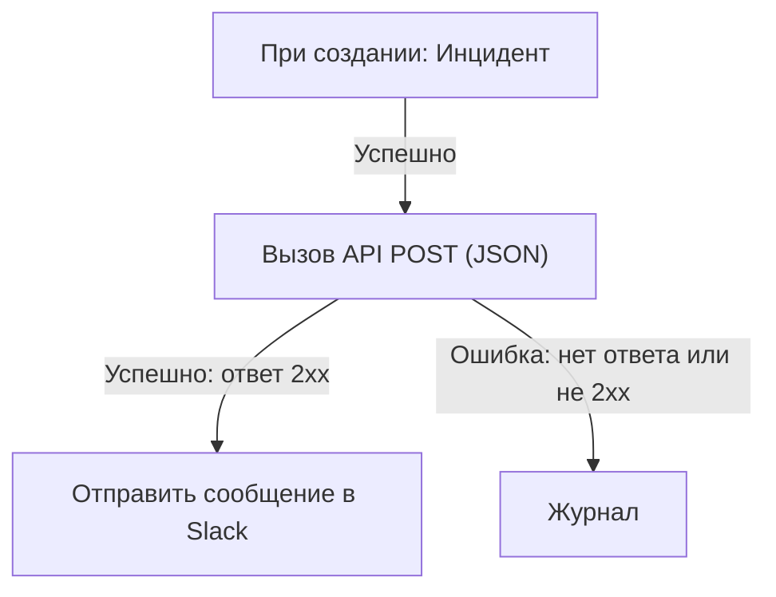
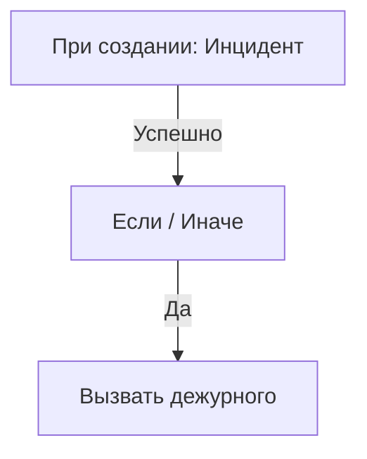

# Компоненты рабочего процесса

Компоненты — это блоки, которые вы добавляете после триггера. Каждый делает одно дело — отправляет сообщение, вызывает API, проверяет условие, изменяет запись OneUptime — и затем выбирает один из своих выходов, ведущий к соединённым с ним блокам. Эта страница — каталог: что нужно каждому блоку, что он возвращает и когда выбирает каждый выход.

Держать её открытой во время работы приходится редко. Настройки каждого блока заканчиваются разделом **How to use**: что делает блок, шаги по его настройке, пример, построенный по вашему рабочему процессу, и ошибки, которые часто допускают. О добавлении и соединении блоков см. [Создание рабочего процесса](/docs/workflows/authoring).

:::cards
- [Отправить сообщение](#slack): Slack, Microsoft Teams, Discord, Telegram, IRC, Mattermost и электронная почта.
- [Вызвать API](#api): Отправьте запрос в любой HTTP API и прочитайте ответ.
- [Добавить логику](#conditions): Ветвление по значению, преобразование данных, ожидание или запись в журнал.
- [Работать с записями OneUptime](#компоненты-данных-oneuptime): Находите, создавайте, обновляйте и удаляйте мониторы, инциденты и многое другое.
:::

## Какой компонент выбрать?

| Чтобы…                                                        | Используйте                                                       |
| ------------------------------------------------------------- | ----------------------------------------------------------------- |
| Опубликовать в чате                                           | [Slack](#slack), [Microsoft Teams](#microsoft-teams), [Discord](#discord), [Telegram](#telegram), [IRC](#irc) или [Mattermost](#mattermost) |
| Отправить письмо через собственный почтовый сервер            | [Email](#email)                                                   |
| Вызвать человека, команду или дежурного | [Paging](#paging) |
| Вызвать любой другой API или собственный сервис               | [API](#api)                                                       |
| Кратко изложить, классифицировать или набросать текст         | [Generate Text with AI](#generate-text-with-ai)                   |
| Пойти по одному или другому пути в зависимости от значения    | [Conditions](#conditions)                                         |
| Пойти по одному из нескольких путей в зависимости от значения | [Switch / Case](#switch-case)                                     |
| Продолжить, только когда так скажут несколько строк JavaScript | [Check With JavaScript](#check-with-javascript) |
| Преобразовать данные между двумя блоками                      | [JSON](#json) или [Custom Code](#custom-code)                     |
| Подождать перед следующим блоком                              | [Sleep](#sleep)                                                   |
| Запустить другой рабочий процесс                              | [Execute Workflow](#execute-workflow)                             |
| Читать или изменять инциденты, мониторы и другие записи       | [Компоненты данных OneUptime](#компоненты-данных-oneuptime)         |
| Открывать, подтверждать и решать инциденты или оповещения по проблемам другого инструмента | [Инциденты и оповещения из других инструментов](#инциденты-и-оповещения-из-других-инструментов) |
| Подтвердить или закрыть проблему в Zabbix | [Zabbix](#zabbix) |
| Попросить человека одобрить исправление облака OpenStack | [Propose an OpenStack fix](#propose-an-openstack-fix) |

Специализированный блок лучше универсального: блок Slack знает ограничения Slack, а блок записи знает поля записи, поэтому ошибки и журналы у них понятнее, чем у блока **API**, выполняющего ту же работу.

## Как работает каждый блок

Блок выполняется, когда предыдущий блок выбирает выход, соединённый с ним. Он читает свои настройки, делает свою работу и затем выбирает один из своих выходов. Дальше выполняются только блоки, соединённые с этим выходом.



- **Настройки** — то, что вы заполняете. Настройки с пометкой **(Необязательно)** можно оставить пустыми. Реже используемые настройки свёрнуты в **Дополнительные поля**.
- **Выходные данные** — точки на нижнем крае. У большинства блоков есть **Успешно** и **Ошибка**; у [Conditions](#conditions) — **Да** и **Нет**, а у [Switch / Case](#switch-case) — по одному на каждый вариант и ещё **По умолчанию**.
- **Returns** — значения, которые блок передаёт последующим блокам, например **Тело ответа** у API. Последующий блок читает значение через `{{local.components.<block ID>.returnValues.<value ID>}}`; кнопка **{ }** в настройке вставляет его за вас. См. [Переменные](/docs/workflows/variables#выходные-данные-компонентов-данные-от-предыдущих-блоков).

Блок, выбравший **Ошибка**, передаёт сбой блокам, подключённым к **Ошибка**, и запуск продолжается там. Если к **Ошибка** ничего не подключено, запуск завершается неудачей: всё остальное, что он делал, продолжает выполняться, затем он заканчивается со статусом **Ошибка**, а запись блока на вкладке **Шаги** запуска объясняет почему. А вот обязательная настройка, оставленная пустой, или настройка, которая никогда не сможет работать, останавливает запуск с ошибкой.

## API

Выполните HTTP-запрос к любому URL. Для каждого метода есть свой блок: **Вызов API GET (JSON)**, **Вызов API POST (JSON)**, **Вызов API PUT (JSON)**, **Вызов API PATCH (JSON)** и **Вызов API DELETE (JSON)**.

| Настройка           | Что делает                                                                                                                           |
| ------------------- | ------------------------------------------------------------------------------------------------------------------------------------ |
| **URL**             | Адрес для вызова, `http` или `https`.                                                                                                |
| **Тело запроса**    | JSON для отправки. Обычно он нужен только запросам `POST`, `PUT` и `PATCH`.                                                          |
| **Заголовки запроса** | Заголовки для отправки, например ключ API. В **Дополнительные поля**. Их значения скрываются в журнале запуска.                      |
| **Разрешить самоподписанные сертификаты** | В **Дополнительные поля**, по умолчанию выключено. Если включено, блок принимает любой сертификат, который показывает сервер, так что самоподписанный работает, но блок не проверяет ни имя хоста, ни срок действия, и любой на сетевом пути сможет прочитать запрос вместе с его заголовками и изменить ответ. |
| **Сертификат ЦС** | В **Дополнительные поля**, пока **Разрешить самоподписанные сертификаты** выключено. Сертификат в формате PEM того ЦС, который подписал сертификат сервера, или собственный сертификат сервера, если он самоподписанный. Тогда блок доверяет только этому сертификату и по-прежнему проверяет имя хоста и срок действия. |

| Выход       | Когда                                                                                          |
| ----------- | ---------------------------------------------------------------------------------------------- |
| **Успешно** | Сервер ответил статусом 2xx.                                                                   |
| **Ошибка**   | Запрос не удался: сервер недоступен или ответил другим статусом.                               |

В любом случае блок возвращает **Статус ответа**, **Заголовки ответа** и **Тело ответа**, а также **Ошибка** с причиной, если запрос не удался. Чтобы прочитать поле JSON-ответа, добавьте его имя к ссылке, как в `{{local.components.api-get-1.returnValues.response-body.id}}`.

Блок читает не больше 10 МБ ответа. Ответ большего размера не читается: блок выбирает **Ошибка** с причиной.

Перенаправления не выполняются, поэтому указывайте блоку адрес, который отвечает. Запросы отправляются из OneUptime: URL, который указывает на частный сетевой адрес, отклоняется, если администратор собственной установки этого не разрешил, и запуск останавливается с причиной. См. [Исходящий доступ в сеть](/docs/workflows/configuration#исходящий-доступ-в-сеть).

Сервер, чей сертификат он подписал сам или подписал ваш собственный ЦС, отклоняется, пока блок ему не доверяет: блок выбирает **Ошибка**, ничего не отправляется, и **Ошибка** говорит, что изменить. Вставьте сертификат, которым он подписан, в **Сертификат ЦС**: сертификат ЦС или собственный сертификат сервера, если он самоподписанный. Тогда блок проверяет сертификат сервера по нему, включая имя хоста и срок действия, так что сервер, который лишь выдаёт себя за ваш, по-прежнему отклоняется. Включайте **Разрешить самоподписанные сертификаты**, только если не можете вставить сертификат. И то и другое действует только на запрос этого блока, никогда на другой блок, другой запрос OneUptime или подключение к исходящему прокси. Сервер с таким сертификатом обычно находится в вашей собственной сети, до которой блок доходит, только если администратор собственной установки разрешил частные сетевые адреса, как описано выше.

**Вызов API GET по ID (JSON)** читает один элемент по ID, пришедшему откуда-то ещё, например по ключу задачи, который прислал вебхук. Поставьте `{id}` в его **URL** туда, где должен быть ID, как в `https://your-domain.atlassian.net/rest/api/3/issue/{id}`, а сам ID — в **ID**. Блок подставляет ID, только если это простой ID — не больше 200 букв, цифр, дефисов и подчёркиваний, — и всё равно кодирует его процентами: всё остальное, например `x/../users`, выбирает **Ошибка** ещё до отправки запроса, так что текст извне не может направить запрос в другое место. В остальном он работает как **Вызов API GET (JSON)** и возвращает те же значения.

## AI

### Generate Text with AI

Генерирует один текстовый ответ по промпту и необязательному JSON-контексту. Блок использует LLM-провайдера проекта по умолчанию или глобального провайдера установки, если у проекта его нет. Провайдеры настраиваются централизованно в **Настройки проекта → ИИ → Провайдеры LLM**; их ключи и конечные точки никогда не являются настройками блока.

| Настройка                 | Что делает                                                                                                                                                        |
| ------------------------- | ----------------------------------------------------------------------------------------------------------------------------------------------------------------- |
| **Системные инструкции**   | Необязательные указания о роли, тоне и ограничениях модели.                                                                                                      |
| **Промпт**                | Задача. Отправляется ровно в том виде, в каком вы её написали, поэтому Markdown подойдёт, и она может содержать переменные и значения из предыдущих блоков.      |
| **Контекст**               | Необязательный JSON, который вы сознательно отправляете. Добавляется после явной метки конца сообщения и рассматривается как недоверенные данные.                 |
| **Температура**           | В **Дополнительные поля**. Вариативность от `0` до `1`; по умолчанию `0.2` — для предсказуемой автоматизации. Текущие модели Claude, Opus 4.7 и новее и все модели Claude 5, сами выбирают параметры сэмплирования: OneUptime не передаёт им **Температура**, поэтому на них она не влияет. |
| **Максимум выходных токенов** | В **Дополнительные поля**. От `1` до `4096`; по умолчанию `1024`.                                                                                                |

System Instructions, Prompt и сериализованный Context вместе ограничены 50 000 символов. Изображение, встроенное в них в формате base64, например скриншот синтетического монитора в описании инцидента, перед подсчётом заменяется короткой пометкой вроде `[image omitted: PNG, 340 KB]`, потому что модель читает текст, а не изображения. Журнал запуска сообщает, что было опущено. Запрос к провайдеру длится не более 60 секунд и выполняется один раз. Одновременно на проект может выполняться не более трёх ИИ-запросов из рабочих процессов.

Он возвращает **Ответ** (сгенерированный текст), **Провайдер** и **Модель** (кто ответил), **Всего токенов** и **Токены завершения** (расход по данным провайдера), **ID журнала LLM** (запись вызова в журналах ИИ) и **Ошибка**.

Соедините **Успешно** с блоками, которые используют ответ, а **Ошибка** — с запасным вариантом: ошибки проверки, доступа, провайдера, бюджета, биллинга и тайм-аута идут по этому пути. Блок не передаёт никаких инструментов, поэтому модель не может сама обращаться к OneUptime, вызывать API или изменять данные.

> [!WARNING]
> Вывод модели — недоверенный текст. Проверяйте его, прежде чем он попадёт к клиентам, и никогда не позволяйте свободному тексту ИИ в одиночку решать разрушительное действие. Что отправляется провайдеру, что записывается в журнал и сколько это стоит, описано в разделе [Компоненты AI](/docs/workflows/configuration#компоненты-ai).

## Slack

Публикует сообщение в канал Slack через входящий вебхук.

| Настройка                      | Что делает                                                                                                                                                                                                   |
| ------------------------------ | ------------------------------------------------------------------------------------------------------------------------------------------------------------------------------------------------------------ |
| **URL входящего веб-перехватчика Slack** | Вебхук канала, в который нужно публиковать. Должен начинаться с `https://hooks.slack.com/services/`. Инструкция Slack по [созданию вебхука](https://api.slack.com/messaging/webhooks) займёт несколько минут. |
| **Текст сообщения**               | Текст для отправки. Отправляется ровно в том виде, в каком вы его написали, поэтому используйте форматирование Slack: `*bold*`, `_italic_`, `~strikethrough~` и `<https://example.com|a link>`. Текст длиннее одной секции Slack (3000 символов) отправляется несколькими секциями; после десяти секций он обрезается и заканчивается на "… (truncated — see OneUptime for the full text)". |

**Успешно** срабатывает, когда Slack принял сообщение, а **Ошибка** — когда Slack его отклонил, с причиной от Slack в **Ошибка**. Эти блоки публикуют через вебхук из своих настроек, а не через подключение Slack вашего проекта.

## Microsoft Teams

Публикует сообщение в канал Microsoft Teams. Блок называется **Отправить сообщение в Teams**.

| Настройка                      | Что делает                                                                                                                                                                                                                                    |
| ------------------------------ | --------------------------------------------------------------------------------------------------------------------------------------------------------------------------------------------------------------------------------------------- |
| **URL входящего вебхука Teams** | Вебхук канала, в который нужно публиковать, — URL `https` на `office.com`, `office365.com`, `logic.azure.com` или `environment.api.powerplatform.com`. Инструкция Microsoft показывает, как [создать его с помощью Teams Workflows](https://support.microsoft.com/en-us/teams/apps-service/create-incoming-webhooks-with-workflows-for-microsoft-teams). |
| **Текст сообщения**               | Текст для отправки. Сообщение больше, чем принимает входящий вебхук (около 12 000 символов, считая в отправляемом виде), обрезается и заканчивается на "… (truncated — see OneUptime for the full text)".                                       |

## Discord

Публикует сообщение в канал Discord через входящий вебхук.

| Настройка                        | Что делает                                                                                                                                         |
| -------------------------------- | -------------------------------------------------------------------------------------------------------------------------------------------------- |
| **URL входящего вебхука Discord** | Вебхук канала — URL `https` на `discord.com` или `discordapp.com`.                                                                                 |
| **Текст сообщения**                 | Текст для отправки. Сообщение длиннее 2000 символов, предела Discord, обрезается и заканчивается на "… (truncated — see OneUptime for the full text)". |

## Telegram

Отправляет сообщение в чат Telegram с помощью бота.

| Настройка              | Что делает                                                                                                                                         |
| ---------------------- | -------------------------------------------------------------------------------------------------------------------------------------------------- |
| **Токен бота Telegram** | Токен, который BotFather выдал вашему боту, например `123456789:ABCdef…`. Токен в любом другом виде останавливает запуск, и сам токен в журнал не записывается. |
| **ID чата**            | Чат для публикации: его ID или `@username` канала. Сначала добавьте бота в группу или канал. Чтобы писать человеку, он должен сам начать чат с ботом. |
| **Текст сообщения**       | Текст для отправки. Сообщение длиннее 4096 символов, предела Telegram, обрезается и заканчивается на "… (truncated — see OneUptime for the full text)". |

Когда Telegram отклоняет сообщение, срабатывает **Ошибка** с причиной от Telegram.

## IRC

Публикует сообщение в канал IRC в любой сети IRC: Libera.Chat, OFTC или на вашем собственном сервере. У IRC нет вебхуков, поэтому блок сам подключается к серверу, входит в канал, отправляет сообщение и выходит.

| Настройка        | Что делает                                                                                                                                                                                                                                         |
| ---------------- | -------------------------------------------------------------------------------------------------------------------------------------------------------------------------------------------------------------------------------------------------- |
| **IRC-сервер**   | Имя хоста сервера, например `irc.libera.chat`. Только имя: без `ircs://` и без порта.                                                                                                                                                              |
| **Канал**      | Канал для публикации, например `#ops`. Это должен быть канал: никнейм, введённый здесь, отклоняется, а не получает личное сообщение.                                                                                                                |
| **Текст сообщения** | Текст для отправки. Каждая строка отправляется отдельным сообщением IRC, а длинная строка разбивается, чтобы поместиться. Сообщение отправляется не более чем 15 строками IRC: более длинное обрезается, и его последняя строка об этом говорит. В IRC нет Markdown, поэтому текст отправляется как есть; собственные коды форматирования IRC, например жирный шрифт и цвета, работают. |

В **Дополнительные поля**:

| Настройка                                | Что делает                                                                                                                                                                                                         |
| ---------------------------------------- | ------------------------------------------------------------------------------------------------------------------------------------------------------------------------------------------------------------------ |
| **Ник**                             | От кого сообщение. По умолчанию `OneUptime`. Если никнейм занят, блок пробует его с добавленным подчёркиванием или цифрой, а затем с таким символом вместо последних символов — для сервера, который не принимает более длинный никнейм. |
| **Порт**                                 | Порт сервера. По умолчанию `6697` или `6667`, если включён **Отключить TLS**.                                                                                                                                        |
| **Отключить TLS**                          | Блок подключается по TLS и проверяет сертификат сервера. Включайте это только для сервера, который не поддерживает TLS; пароль, если он есть, тогда отправляется незашифрованным. Чтобы доверять сертификату вашего собственного центра сертификации, собственная установка вместо этого задаёт `NODE_EXTRA_CA_CERTS`. |
| **Ключ канала**                          | Ключ канала, у которого он есть (режим `+k`).                                                                                                                                                                      |
| **Отправлять без входа**                 | Публикует, не входя в канал, чтобы канал не видел, как блок приходит и уходит. Работает только там, где канал принимает сообщения извне (без режима `+n`).                                                         |
| **Пароль сервера**                      | Пароль, который сервер или ваш баунсер запрашивает при подключении.                                                                                                                                               |
| **Имя пользователя SASL** и **Пароль SASL**    | Вход в вашу учётную запись в сетях, использующих SASL, например Libera.Chat, которая требует его для подключений с некоторых облачных и VPN-адресов. Заполните оба поля или ни одного.                              |

**Успешно** срабатывает, когда сервер принял каждую строку. Блок проверяет это, попросив сервер ответить на ping после последней строки: сервер отвечает по порядку, поэтому отказ в сообщении, если он есть, придёт раньше. Баунсер вроде ZNC сам отвечает на ping, поэтому блок ещё секунду ждёт ответа от сети за ним.

**Ошибка** срабатывает, когда сервер недоступен, отклоняет подключение, никнейм, пароль или канал либо отклоняет сообщение. Он передаёт причину словами самого сервера, если тот их дал. А вот отсутствующие **IRC-сервер**, **Канал** или **Текст сообщения** или настройка, которая никогда не смогла бы работать, останавливают запуск.

Каждое выполнение блока — отдельное подключение, а сети IRC ограничивают, как часто один адрес может подключаться: поток сообщений может быть отклонён с причиной вроде "Reconnecting too fast" и идёт по **Ошибка**, как любой другой отказ. Для рабочего процесса, который может срабатывать много раз в минуту, собирайте всё, что нужно сказать, в одно сообщение или отправляйте через собственный сервер.

Храните пароли в [секретных глобальных переменных](/docs/workflows/variables#глобальные-переменные) и используйте переменную в настройке; в журналах запусков они скрыты в любом случае. Подключения к loopback (`localhost`, `127.0.0.1`), link-local и адресам облачных метаданных отклоняются. В OneUptime Cloud отклоняется и сервер с частным сетевым адресом или имя, которое в него разрешается. Собственные установки могут обращаться к серверу IRC в своей сети, если `DATA_SOURCE_BLOCK_PRIVATE_ADDRESSES` не равно `true`.

## Mattermost

Публикует сообщение в канал Mattermost через входящий вебхук — в Mattermost Cloud или на вашем собственном сервере.

| Настройка                           | Что делает                                                                                                                                                                                                                                                                         |
| ----------------------------------- | ---------------------------------------------------------------------------------------------------------------------------------------------------------------------------------------------------------------------------------------------------------------------------------- |
| **URL входящего вебхука Mattermost** | Вебхук, через который публикуется сообщение, в том виде, в каком Mattermost показывает его в разделе Integrations, Incoming Webhooks: адрес сервера, затем `/hooks/` и ID вебхука. Инструкция Mattermost показывает, как [его создать](https://docs.mattermost.com/developers/integrate/webhooks/incoming). |
| **Текст сообщения**                    | Текст для отправки. Отправляется ровно в том виде, в каком вы его написали, а Mattermost понимает Markdown: `**bold**`, `_italic_`, ссылки, таблицы и эмодзи вроде `:rotating_light:`. Сообщение в Mattermost вмещает до 16 383 символов: более длинное обрезается, чтобы поместиться, и заканчивается на "… (truncated — see OneUptime for the full text)". |

В **Дополнительные поля**:

| Настройка    | Что делает                                                                                                                                                                                                    |
| ------------ | ------------------------------------------------------------------------------------------------------------------------------------------------------------------------------------------------------------- |
| **Канал**  | Публикует не в собственный канал вебхука, а в другое место: имя канала в том виде, в каком оно указано в его URL, например `town-square`, или `@` и имя пользователя для личного сообщения. Вебхук, привязанный к своему каналу, отклоняет любой другой. |
| **Имя пользователя** | Имя, под которым публикуется сообщение. Mattermost использует его только там, где системный администратор разрешил интеграциям переопределять имена пользователей.                                            |
| **URL значка** | Изображение, с которым публикуется сообщение, — адрес `https`. Mattermost использует его только там, где системный администратор разрешил интеграциям переопределять фото профиля.                            |

**Успешно** срабатывает, когда Mattermost принял сообщение. **Ошибка** срабатывает, когда сервер недоступен или Mattermost отклоняет сообщение, и передаёт причину от Mattermost. А вот отсутствующие **URL входящего вебхука Mattermost** или **Текст сообщения**, URL, не принадлежащий входящему вебхуку, или настройка, которая никогда не смогла бы работать, останавливают запуск.

Храните URL вебхука в [секретной глобальной переменной](/docs/workflows/variables#глобальные-переменные): любой, у кого он есть, может публиковать в канал. В журналах запусков он скрыт в любом случае. Сообщение отправляется из OneUptime, а перенаправления не выполняются. Вебхук на адресе loopback (`localhost`, `127.0.0.1`), link-local или облачных метаданных отклоняется, как и вебхук на частном сетевом адресе, если только администратор собственной установки не разрешил его через `ALLOW_PRIVATE_NETWORK_WEBHOOKS` или `PRIVATE_NETWORK_WEBHOOK_ALLOWLIST`. См. [Доступ к частной сети](/docs/self-hosted/private-network-access).

## Email

Отправляет письмо через SMTP-сервер, который вы указываете в блоке. Блок называется **Отправить письмо**.

| Настройка                               | Что делает                                                                                            |
| --------------------------------------- | ----------------------------------------------------------------------------------------------------- |
| **Email отправителя**                          | Отправитель, например `Alerts <alerts@company.com>`.                                                  |
| **Адрес получателя**                            | Адрес получателя. Несколько адресов разделяйте запятыми или точками с запятой.                        |
| **Тема**                             | Тема письма.                                                                                          |
| **Текст письма**                          | Сообщение, отправляемое как HTML.                                                                     |
| **SMTP-хост** и **Порт SMTP**           | Почтовый сервер для подключения.                                                                      |
| **Имя пользователя SMTP** и **Пароль SMTP**   | Необязательны. Заполните оба или ни одного.                                                           |
| **Использовать неявный TLS**                    | Включите для неявного TLS, обычно на порту 465. Оставьте выключенным для STARTTLS, обычно на порту 587. |

**Успешно** срабатывает, когда SMTP-сервер принял сообщение. **Ошибка** срабатывает, когда SMTP-хост отклонён, сервер недоступен или он отклоняет сообщение, и передаёт сообщение об ошибке. А вот отсутствующие **Адрес получателя**, **Email отправителя**, **SMTP-хост** или **Порт SMTP** останавливают запуск.

Блок подключается напрямую к серверу из своих настроек. Он не использует настройки [SMTP](/docs/emails/smtp) вашего проекта или собственный почтовый сервер OneUptime, и письма, которые он отправляет, не появляются в журналах уведомлений. Чтобы проверить, что он сделал, смотрите [Запуски](/docs/workflows/runs-and-logs) рабочего процесса.

Подключения к loopback (`localhost`, `127.0.0.1`), link-local и адресам облачных метаданных отклоняются. В OneUptime Cloud отклоняется и SMTP-хост с частным сетевым адресом или имя, которое в него разрешается. Собственные установки могут обращаться к почтовому серверу в своей сети, если `DATA_SOURCE_BLOCK_PRIVATE_ADDRESSES` не равно `true`. Отклонённый хост идёт по выходу **Ошибка**, и ничего не отправляется.

## Paging

Вызов людей из рабочего процесса: каждому звонят, отправляют SMS, push-уведомление или письмо — так, как заданы его собственные правила дежурства, — пока кто-нибудь не подтвердит. Для каждого способа указать, кого вызвать, есть свой блок. На панели **Добавить компонент** введите в поиске `page`.

| Блок                        | Кого он вызывает |
| --------------------------- | ---------------- |
| **Вызвать пользователей**              | Людей, которых вы назвали. |
| **Вызвать команду**             | Каждого участника команды. |
| **Вызвать дежурного** | Того, кто дежурит по расписанию дежурства в момент выполнения блока. |
| **Запустить политику дежурства**  | Политику дежурства, которая вызывает по своим правилам эскалации и повторяется так, как настроена. |

Первые три вызывают всех названных сразу и больше никого. Для эскалации используйте **Запустить политику дежурства**.

Чтобы вызывать только при выполнении условия, поставьте перед блоком [If / Else](#conditions) и подключите к блоку тот выход, который должен вызывать. Если путей больше двух, [Switch / Case](#switch-case) выбирает путь для каждого значения, и каждый путь может вызывать кого-то своего.



Когда вы создаёте рабочий процесс, среди шаблонов в разделе **Дежурство** есть готовый такой процесс и ещё один, который вызывает по серьёзности через **Выбор / Вариант**. Диалог **Создать рабочий процесс** спрашивает, кого вызывает каждый блок вызова шаблона, поэтому рабочий процесс открывается уже с выбранными людьми. На блоке вызова, который вы добавили в Конструкторе, написано **Click to set up**, пока вы не выберете, кого он вызывает.

| Настройка | Что делает |
| --------- | ---------- |
| **Пользователи**, **Команды**, **Расписания дежурств** или **Политики дежурств** | Кого вызвать: у каждого блока та настройка, которая соответствует его названию. Выберите по имени или нажмите **{ }** в конце строки, чтобы добавить значение из предыдущего блока. Значение может содержать один ID или несколько, а для **Пользователи** — адрес электронной почты. |
| **Тема вызова** | О чём вызов: **Новое оповещение**, **Инцидент** или **Оповещение**. Подтверждение вызова подтверждает и его. |
| **Заголовок** и **Сообщение** | Для нового оповещения. OneUptime создаёт из них оповещение, и оно остаётся среди ваших оповещений, как любое другое. |
| **ID инцидента** или **ID оповещения** | Для инцидента или оповещения, которое уже есть, — обычно того, с которого начался рабочий процесс: `{{local.components.incident-on-create-1.returnValues.model._id}}`. |
| **Вызвать как** | Для уже существующего инцидента или оповещения, в разделе **Дополнительные поля**. **Получатели** берут его на себя. **Наблюдатели** держат в курсе, пока реагируют другие: подтверждение их вызова означает только, что они его видели, а инцидент или оповещение не подтверждается. |
| **Серьёзность** | Для нового оповещения, в разделе **Дополнительные поля**. Определяет, какие из правил дежурства каждого человека его вызывают. Если оставить пустым, берётся самая высокая серьёзность проекта. |

Блок, добавленный в рабочий процесс, который начинается с инцидента или оповещения, уже настроен на вызов по этой записи, поэтому спрашивает только, кого вызвать.

**Успешно** выполняется, как только вызван хотя бы один человек или запущена одна политика. **Ошибка** выполняется, когда не вызван никто, и значение **Ошибка** блока говорит почему, например что по расписанию никто не дежурит. **Сводка** одним предложением сообщает, кого вызвали и кого пропустили, — его можно сразу отправить в канал, — а **Вызванные пользователи** перечисляет вызванных людей.

Тех, кто отсутствует, не вызывают: вместо них вызывают того, кого их переопределение пользователя называет заменой. Того, кого политика дежурства или другой вызов уже вызывает по тому же поводу, не вызывают ещё раз, и он всё равно остаётся в **Вызванные пользователи**: если этот вызов закончится без его ответа, вызов блока сам вызовет его. Один вызов называет не больше 100 людей, команд и расписаний. См. [Как связываются с каждым человеком](/docs/on-call/escalation-rules#как-связываются-с-каждым-человеком).

Вызов, за которым нет политики дежурства, показан среди запусков политик как **Прямой вызов**: в журналах дежурства инцидента или оповещения, в его ленте и его канале Slack или Microsoft Teams, а также в журналах каждого вызванного человека. Он остаётся открытым 30 минут и дальше, пока ещё уходят вызовы. Если к тому времени никто не подтвердил, он завершается, никого больше не вызывая.

> [!WARNING]
> **Запустить рабочий процесс** вызывает людей по-настоящему, включён рабочий процесс или нет, и **Run just this step** тоже. На время проверки укажите себя.

## Custom Code

Выполняет несколько строк JavaScript, когда другие блоки не могут сделать то, что нужно. Блок называется **Выполнить собственный JavaScript**.

| Настройка           | Что делает                                                                                                                           |
| ------------------- | ------------------------------------------------------------------------------------------------------------------------------------ |
| **Код JavaScript** | Ваш код. То, что он возвращает через `return`, становится **Значение** блока. Можно использовать `await`.                              |
| **Аргументы**       | Объект JSON со значениями для кода, который читает их как `args`. Помещайте сюда переменные и значения из предыдущих блоков; сам код их прочитать не может. |

```json title="Arguments"
{ "title": "{{local.components.incident-on-create-1.returnValues.model.title}}" }
```

```javascript title="JavaScript Code"
const words = args.title.split(" ");

return {
  shortTitle: words.slice(0, 5).join(" "),
  wordCount: words.length,
};
```

Последующий блок читает короткий заголовок как `{{local.components.javascript-1.returnValues.returnValue.shortTitle}}`.

Код выполняется в песочнице с `args`, `console.log` (записывается в журнал запуска), `axios` для HTTP-запросов, `crypto` и `sleep`. У него нет файловой системы и процесса, а его запросы подчиняются тем же правилам для адресов, что и блок API. По умолчанию у него 5 секунд; собственная установка меняет это через `WORKFLOW_SCRIPT_TIMEOUT_IN_MS`.

**Успешно** срабатывает с возвращённым **Значение**, а **Ошибка** — когда код выбрасывает исключение или исчерпывает время, с сообщением в **Ошибка**. Для более тяжёлых скриптов используйте [Runbook](/docs/runbooks/index).

## Check With JavaScript

Выполняет несколько строк JavaScript, а затем идёт по **Да** или **Нет** в зависимости от того, что они вернули: блок [Custom Code](#custom-code) и [If / Else](#conditions) после него в одном блоке. Используйте его, когда для решения мало одного сравнения, например чтобы прочитать, что прислал другой инструмент, и пропустить то, чего рабочий процесс касаться не должен.

| Настройка           | Что делает |
| ------------------- | ---------- |
| **Код JavaScript** | Ваш код. `return true` ведёт к **Да**. Чтобы ещё и передать значения, верните объект с `proceed: true`, значениями и `reason`. |
| **Аргументы**       | JSON-объект со значениями для кода, который читает их как `args`, как в **Выполнить собственный JavaScript**. |

```javascript title="JavaScript Code"
if (args.environment !== "production") {
  return { proceed: false, reason: "Not production, so nothing was sent." };
}

return { proceed: true, title: args.title.toUpperCase() };
```

Только `true` или объект, у которого `proceed` равно `true`, ведёт к **Да**: всё остальное ведёт к **Нет**, даже число или текст. Блок возвращает **Значение** — то, что вернул код; следующий блок читает его как `{{local.components.javascript-check-1.returnValues.returnValue.title}}`, — и **Причина** — `reason` из кода или одной фразой то, что он вернул; вкладка **Шаги** запуска показывает его рядом с выбранным выходом.

Код выполняется так же, как его выполняет **Выполнить собственный JavaScript**: в той же песочнице, с теми же `args`, `console.log` и `axios` и с тем же ограничением по времени. Если он выбрасывает исключение или исчерпывает время, блок выбирает **Ошибка**.

## JSON

Преобразует текст в JSON и обратно или объединяет два объекта JSON.

| Блок             | Принимает                                | Возвращает                                                                                                 |
| ---------------- | ---------------------------------------- | ---------------------------------------------------------------------------------------------------------- |
| **JSON в текст** | **JSON**, объект                         | **Текст**: объект в виде строки. Удобно, когда следующий блок ожидает текст.                                |
| **Текст в JSON** | **Текст**, который может быть многострочным | **JSON**: разобранный объект, чтобы вы могли читать его поля. Используйте для JSON, пришедшего текстом.  |
| **Объединить JSON**   | **JSON 1** и **JSON 2**                  | **JSON**: один объект с ключами обоих. Если ключ есть в обоих, побеждает **JSON 2**.                       |

**Текст в JSON** идёт по **Ошибка**, когда текст не является JSON. Отсутствующие входные данные или входные данные **Объединить JSON**, которые не являются объектом, останавливают запуск.

## Conditions

Ветвление по сравнению. На панели **Добавить компонент** этот блок называется **Если / Иначе** и находится в разделе **Популярные**. Чтобы выбрать один из более чем двух путей, используйте [Switch / Case](#switch-case).

Его настройки читаются как предложение: **Если** *проверяемое значение* *сравнение* *значение для сравнения*, продолжить по **Да**, иначе по **Нет**. Под настройками условие пересказывается словами, чтобы вы видели, что оно говорит то, что вы имеете в виду. На холсте блок тоже показывает своё условие, например *Если environment is equal to “production”*.

| Настройка          | Что делает                                                                                                                               |
| ------------------ | ---------------------------------------------------------------------------------------------------------------------------------------- |
| **Проверяемое значение** | Обычно значение из предыдущего блока. Нажмите **{ }** в поле, чтобы выбрать его, или введите `{{`.                                       |
| **Сравнение**     | Как сравнивать, словами. Сравнения перечислены ниже.                                                                                     |
| **Сравнить с**   | То, с чем сравнивать, введённое или выбранное так же. **пусто**, **не пусто**, **истинно** и **ложно** его не используют.               |
| **Сравнивать как**     | Свёрнуто под сравнением: **Текст**, **Число** или **Истина / Ложь**. Выберите **Текст**, чтобы упорядочивать даты, записанные как `2026-10-01`, или **Число**, чтобы `200` и `200.0` считались равными. |

Сравнения:

- **равно** и **не равно**;
- для текста: **содержит**, **не содержит**, **начинается с** и **заканчивается на**;
- для чисел: **больше чем**, **больше или равно**, **меньше чем** и **меньше или равно**;
- **пусто** и **не пусто**, которые проверяют, есть ли значение вообще;
- **истинно** и **ложно**.

Числовые сравнения сравнивают числа, а текстовые — текст, поэтому **Сравнивать как** нужен редко. Значения сравниваются так:

- Как текст регистр имеет значение: `Error` — это не `error`.
- Как число текст, который не является числом, считается `0`. Настройки предупреждают о таком введённом значении.
- Как истина или ложь истиной считается только `true`.
- **пусто** выполняется, если значения нет совсем, текст пустой, список или объект пустые или значения не было у предыдущего блока, например поля, которое вебхук не прислал. `0` и `false` — это значения, поэтому они не пустые.

**Да** выполняется, когда условие выполнено, а **Нет** — когда нет. Блоки, настроенные до того, как настройки получили эти названия, работают в точности как раньше. Один старый вариант больше не предлагается: сравнивать значение как **Null** или **Не определено**, что игнорировало, что значение содержит. Блок, который всё ещё его использует, сообщает об этом при открытии; чтобы проверить отсутствие значения, выберите **пусто**.

## Switch / Case

Выбор одного из нескольких путей в зависимости от значения. На панели **Добавить компонент** этот блок называется **Выбор / Вариант** и находится в разделе **Популярные**.

Он по очереди, сверху вниз, сравнивает одно значение с каждым своим вариантом и продолжает по первому подходящему варианту или по **По умолчанию**, если не подошёл ни один. Выполняется только один путь: значение, которое подходит двум вариантам, идёт по первому из них.

| Настройка          | Что делает |
| ------------------ | ---------- |
| **Проверяемое значение** | Значение, с которым сравнивается каждый вариант, обычно из предыдущего блока. Нажмите **{ }** в поле, чтобы выбрать его, или введите `{{`. |
| **Варианты**          | Сравнение и значение для каждого пути, проверяемые сверху вниз. Нажмите **Добавить вариант**, чтобы добавить ещё один, и перетащите вариант за маркер, чтобы переместить его. В блоке может быть не больше 25 вариантов. |

Каждый вариант — это выход на холсте, названный по своему значению: вариант с **равно** `production` — это выход *production*, а вариант с **больше чем** `500` — выход *is greater than 500*. **По умолчанию** всегда последний выход. Подключите каждый выход к тому, что должно выполняться дальше.

Вариант подходит ровно тогда, когда [If / Else](#conditions) с тем же сравнением и значением выбрал бы **Да**: сравнения те же, и значения сравниваются так же. **Сравнивать как** свёрнуто под вариантами, с выбором для каждого варианта.

Когда вы удаляете вариант, у которого есть связь, настройки показывают, к каким блокам он вёл, а **Вернуть** возвращает вариант. При сохранении связь удаляется вместе с вариантом. Проверки Конструктора указывают на вариант, к которому ничего не подключено, и на вариант, который никогда не выбирается, потому что вариант выше проверяет то же самое.

Запуск, который идёт по выходу, к которому ничего не подключено, включая **По умолчанию**, заканчивается там без ошибки. Вкладка **Шаги** запуска показывает, какой вариант подошёл и почему, например *Case 2 matched: the value is equal to “staging”. Case 1 did not.*

## Sleep

Приостанавливает запуск перед следующим блоком, чтобы дать другой системе время догнать или выполнить действие позже.

**Дни**, **Часы**, **Минуты** и **Секунды** складываются. Самое долгое ожидание — 30 дней: более долгое сокращается до 30 дней, и журнал запуска об этом сообщает.

Пока он ждёт, запуск откладывается со статусом **Ожидание** и подхватывается снова, когда время истекло, поэтому долгое ожидание ничего не задерживает. Запуск, рабочий процесс которого за это время был выключен или архивирован, отменяется при пробуждении. Тестовый запуск, начатый, пока рабочий процесс был выключен, не отменяется из-за того, что он выключен.

## Log

Записывает значение в журнал запуска. Больше он ничего не меняет, поэтому это самый простой способ посмотреть, что содержало значение.

**Значение** — то, что нужно записать. Оно может быть многострочным и содержать значения из предыдущих блоков, например `{{local.components.webhook-1.returnValues.request-body}}`. Закончив, блок выбирает **Исходящий**.

## Execute Workflow

Запускает другой рабочий процесс в том же проекте. Ваш рабочий процесс продолжает работу, не дожидаясь, пока другой завершится.

| Настройка     | Что делает                                                                                                                                |
| ------------- | ----------------------------------------------------------------------------------------------------------------------------------------- |
| **Рабочий процесс**  | Рабочий процесс, который нужно запустить. Он должен быть включён и, чтобы получать аргументы, иметь триггер **Вручную**.                    |
| **Аргументы** | JSON для передачи. Триггер Manual другого рабочего процесса передаёт каждый ключ отдельным значением: с `{"customerId": "42"}` он читает `{{local.components.manual-1.returnValues.customerId}}`. |

**Исходящий** срабатывает, как только другой рабочий процесс поставлен в очередь. **Ошибка** срабатывает, когда это невозможно: его не существует, он выключен или архивирован, либо его запуск создал бы цикл.

Используйте его, чтобы делиться общей логикой: соберите рабочий процесс «опубликовать в канал инцидента» один раз и запускайте его из каждого рабочего процесса, которому он нужен. Цепочка рабочих процессов, запускающих друг друга, не может замкнуться на себя и имеет глубину не больше 10. См. [Конфигурация и безопасность](/docs/workflows/configuration#ограничение-на-вызов-других-рабочих-процессов).

## Инциденты и оповещения из других инструментов

Ведите один инцидент или одно оповещение на каждую проблему, о которой сообщает другой инструмент, сопоставляя их по собственному ID этого инструмента. На **Инцидент из другого инструмента** и **Оповещение из другого инструмента** построены шаблоны для Zabbix, Huntress, Jira и Dynamics 365, и они подходят для любого инструмента, который умеет вызывать [триггер Webhook](/docs/workflows/triggers#webhook) рабочего процесса. На панели **Добавить компонент** они находятся в группе **Из других инструментов**.

Каждый запуск передаёт блоку одно событие: **Что произошло** и **Внешний ID** — ID проблемы в инструменте. Блок ищет запись, которая хранит этот ID, и делает то, что говорит **Что произошло**:

| What Happened | Что делает блок |
| ------------- | --------------- |
| `open`, `problem`, `firing`, `triggered` или `created` | Открывает инцидент или создаёт оповещение из **Заголовок**, **Описание** и **Серьёзность**, если ни одна запись ещё не хранит этот ID. |
| `acknowledge` или `acknowledged` | Переводит запись в ваше первое состояние подтверждения, с **Заметка** как причиной в её истории. |
| `resolve`, `resolved`, `recovery`, `ok` или `closed` | Переводит запись в ваше первое состояние решения, с **Заметка** как причиной в её истории. |
| `note`, `update` или `comment` | Добавляет **Заметка** к записи как личную заметку. |
| Название одного из ваших состояний | Переводит запись в это состояние. Пишите `state:` перед названием, совпадающим с одним из этих слов, например `state: Open`. |

| Выход | Когда |
| ----- | ----- |
| **Открыт**, а у блока для оповещений **Создано** | Он открыл новую запись. Подключите сюда блок вызова, чтобы вызывала только новая проблема. |
| **Обновлено** | Он перевёл запись в другое состояние или добавил заметку. |
| **Без изменений** | Делать было нечего: ни одна запись не хранит этот ID, запись уже в этом состоянии или дальше, или **Что произошло** пусто. |
| **Ошибка** | Ему не удалось прочитать или изменить запись. Если сюда ничего не подключено, запуск завершается неудачей. |

Запись движется только вперёд, а решённая не движется вовсе, поэтому, когда её меняют оба инструмента, ни один не отменяет того, что сделал другой. Она хранит ID в пользовательском поле — `externalId`, если **Поле внешнего ID** не называет другое, — и записывается только это поле, так что остальные пользовательские поля записи сохраняют свои значения. По ID, который хранит запись, новая никогда не открывается, даже когда эта запись решена: используйте ID, новый для каждой проблемы, как ID события Zabbix или номер отчёта Huntress. Чтобы вместо этого действовать по собственному ID записи, как шаблоны Jira делают с ID из меток задачи, укажите его в **ID инцидента** или **ID оповещения**.

**Серьёзность** называет одну из ваших серьёзностей по имени или ID, без учёта регистра, или по её месту среди них: `most severe`, `middle` или `least severe`. Так собственные уровни инструмента распределяются по серьёзностям, которые вы назвали сами. Если оставить пустым или не назвать ни одной из них, берётся самая высокая, и журнал запуска об этом говорит. Новый инцидент не попадает на ваши страницы статуса, и их подписчики о нём не узнают, потому что текст другого инструмента написан для пользователей этого инструмента: включите **Показывать на страницах статуса**, чтобы его показать.

В разделе **Дополнительные поля** **Причина** — это причина в истории записи, когда она меняет состояние, и тогда **Заметка** добавляется рядом как личная заметка — для инструмента, который что-то сообщает, когда подтверждает или решает. **Пользовательские поля** даёт новой записи дополнительные пользовательские поля в виде JSON-объекта, **Метки** — ID её меток через запятую, а **Затронутые ресурсы** — ресурсы, к которым она относится, как в **Создать: Инцидент (одна запись)**. **Заметка вместо устранения** добавляет заметку и оставляет решение записи вашей команде. Блок возвращает **Сводка** — одной фразой, что он сделал, — и саму запись, так что следующий блок читает её ID как `{{local.components.incident-from-another-tool-1.returnValues.record._id}}`.

## Zabbix

Подтверждает или закрывает проблему в Zabbix или добавляет к ней сообщение через API Zabbix. Блок называется **Обновить проблему Zabbix**, и [шаблоны Zabbix](/docs/integrations/zabbix) с его помощью отправляют в Zabbix то, что происходит в OneUptime.

| Настройка | Что делает |
| --------- | ---------- |
| **URL Zabbix** | Адрес, по которому вы открываете Zabbix, например `https://zabbix.example.com`. Запросы идут на его `api_jsonrpc.php`. |
| **API-токен** | API-токен пользователя Zabbix, которому можно подтверждать, комментировать и закрывать проблемы. Храните его в секретной переменной. |
| **ID события** | ID события проблемы, обычно тот, что инцидент или оповещение хранит в своих пользовательских полях. |
| **Что сделать** | `acknowledge`, `close` или `message`. Если оставить пустым, Zabbix не обновляется. |
| **Сообщение** | Что Zabbix сохраняет на проблеме, не больше 2048 символов: более длинное сообщение обрезается. |
| **Zabbix 6.0** | В разделе **Дополнительные поля**. Zabbix 6.0 читает токен из тела запроса, а не из заголовка `Authorization`: включите это для него и выключите после обновления, потому что Zabbix 7.2 и новее отклоняют токен в теле. |

Чтобы подтвердить или закрыть, блок сначала читает проблему. Проблема, которую Zabbix уже решил или уже подтвердил, когда больше вы ничего не просите, остаётся как есть, и блок выбирает **Без изменений** — как и для проблемы, которой в Zabbix нет или которую пользователь токена не видит. Проблема, триггер которой не разрешает закрывать проблемы вручную, вместо этого подтверждается, а её сообщение говорит, что она останется открытой, пока Zabbix не увидит восстановление.

**Обновлено** срабатывает, когда Zabbix принял обновление, а **Ошибка** — когда до Zabbix не удалось достучаться или он отклонил обновление, с причиной от Zabbix: на отклонённый запрос Zabbix отвечает успешным статусом, поэтому блок читает, что ответил Zabbix, а не статус. Он возвращает **Сводка** — одной фразой, что он сделал.

## OpenStack

### Propose an OpenStack fix

Просит человека одобрить одно изменение облака OpenStack, о котором говорит оповещение или инцидент. Само изменение блок никогда не вносит. Исправление ждёт на оповещении или инциденте и в каналах, куда он пишет, так же, как предложенное OneUptime AI, при любом режиме исправлений облака. Рабочий процесс не может одобрить то, что сам предложил.

Ему не нужна модель ИИ, и он проходит те же правила, что и исправление, которое предлагает OneUptime AI: политику команд, цели записи и защищённые цели агента и чтение агентом того, чего касается изменение. Эвакуация хоста, который ещё работает, или такая, которую агент не может прочитать целиком, не предлагается.

| Настройка | Что делает |
| --------- | ---------- |
| **ID оповещения** | Оповещение, для которого предназначено исправление, обычно ID, который вернул ваш триггер. Заполните это поле или **ID инцидента**, и облако определится по тому, с чем связана запись. |
| **ID инцидента** | Инцидент, для которого предназначено исправление, обычно ID, который вернул ваш триггер. Заполните это поле или **ID оповещения**. |
| **Команда** | Изменение, которое нужно предложить, в той единственной записи, которую принимает OneUptime. См. [изменения, которые может вносить исправление](/docs/telemetry/openstack#исправления). Может использовать значения из предыдущих блоков и читается после их подстановки. |
| **Почему** | То, что первым читает человек, одобряющий исправление. Если оставить пустым, там указано, какой рабочий процесс его запросил. |
| **ID облака OpenStack** | В разделе **Дополнительные поля**. Только для записи, связанной с несколькими облаками или ни с одним. |

Он возвращает **ID предложения** (исправление, ожидающее одобрения), **Уровень** (Safe или Riskier, как OneUptime оценивает команду) и **Уже ожидает** (true, если то же изменение в этом облаке уже ожидало, поэтому второе не добавлено).

**Успешно** срабатывает, как только человека попросили, не дожидаясь его ответа. **Ошибка** срабатывает, когда ничего не предложено, с причиной в **Ошибка**: команда отклонена, исправления в этом облаке ещё не разрешены или рабочие процессы проекта предложили 20 исправлений за последний час.

Шаблон [Propose taking a failing OpenStack compute service out of scheduling](/docs/workflows/authoring) — с чего можно начать.

## Компоненты данных OneUptime

Для каждого типа записей в OneUptime (мониторы, инциденты, оповещения, страницы статуса, политики дежурства и многие другие) на панели **Добавить компонент** есть эти компоненты: в разделе **Ресурсы OneUptime** нажмите на тип записи (**Просмотреть все ресурсы** содержит те, что не показаны) или найдите тип по названию. Каждое название формируется из типа записи, поэтому набор для Monitor выглядит так:

| Компонент                | Что делает                                                                     |
| ------------------------ | ------------------------------------------------------------------------------ |
| **Найти: Монитор (одна запись)**     | Читает одну запись, подходящую под запрос.                                     |
| **Найти: Мониторы (несколько записей)**   | Читает список записей, подходящих под запрос.                                  |
| **Создать: Монитор (одна запись)**   | Добавляет одну запись из объекта JSON.                                         |
| **Создать: Мониторы (несколько записей)** | Добавляет несколько записей из массива JSON.                                   |
| **Обновить: Монитор (одна запись)**   | Применяет данные для записи к одной подходящей записи.                         |
| **Обновить: Мониторы (несколько записей)** | Применяет данные для записи к подходящим записям, не больше **Лимит**.         |
| **Удалить: Монитор (одна запись)**   | Удаляет одну подходящую запись.                                                |
| **Удалить: Мониторы (несколько записей)** | Удаляет подходящие записи, не больше **Лимит**.                                |

Тот же набор даёт четыре триггера — **При создании: Монитор**, **При обновлении: Монитор**, **При создании или обновлении: Монитор** и **При удалении: Монитор**. См. [Триггеры](/docs/workflows/triggers#триггеры-событий-oneuptime).

Тип предлагает только те компоненты, которые допускает его модель. У типа только для чтения есть два компонента Find и ничего больше, поэтому если вы не находите **Удалить: Монитор (одна запись)** на панели, этот тип такого не допускает.

Так рабочий процесс читает и изменяет данные OneUptime. Например, вебхук из вашего CI-инструмента может с помощью **Создать: Инцидент (одна запись)** открыть инцидент с подробностями о сбое.

Эти компоненты действуют как Администратор проекта в проекте, которому принадлежит рабочий процесс: то, что Администратор проекта делать нельзя или что не входит в ваш план, отклоняется, а журнал запуска объясняет причину. См. [Что могут делать шаги рабочего процесса](/docs/workflows/configuration#что-могут-делать-шаги-рабочего-процесса).

### Объявление инцидента по шаблону

**Создать: Инцидент (одна запись)** может объявить инцидент по одному из ваших [шаблонов инцидентов](/docs/incidents/settings#шаблоны-инцидентов): выберите его в **Шаблон инцидента**, первой настройке шага. Шаблон заполняет все поля, которые опускает **JSON-объект**, — заголовок, описание, серьёзность, начальное состояние, мониторы и другие ресурсы, политики дежурства, метки, страницы статуса и пользовательские поля, — а его владельцы становятся владельцами инцидента. Всё, что вы задаёте в **JSON-объект**, имеет приоритет над шаблоном, включая состояние, поэтому при выбранном шаблоне в **JSON-объект** нужно только то, что должно отличаться, и его можно оставить пустым.

Инцидент записывает шаблон, по которому он объявлен, в `createdIncidentTemplateId`. Этот столбец задаёт сам OneUptime: шаг, который передаёт его в **JSON-объект**, отклоняется, а его журнал запуска отсылает вас к **Шаблон инцидента**. Шаблон из другого проекта или удалённый шаблон заставляет шаг пойти по выходу **Ошибка**, а на плане, в который не входят шаблоны инцидентов, шаг отклоняется с указанием нужного плана. См. [Как применяется шаблон](/docs/incidents/settings#как-применяется-шаблон).

### Связывание ресурсов, которых касается запись

У **Создать: Инцидент (одна запись)** и **Создать: Оповещение (одна запись)** есть настройка **Затронутые ресурсы**: хосты, сетевые устройства, кластеры, базы данных или сервисы, которых касается запись, по имени, адресу или ID через запятую — набранные вручную или взятые из предыдущего шага, например хост, который называет оповещение из другого инструмента. Каждая запись ищется во всех видах ресурсов, которые может содержать запись, как целое значение и без учёта регистра: по имени, сетевое устройство — ещё и по адресу, по которому его опрашивают, или по DNS-имени, хост — по имени, которое сообщает его агент, или по одному из его IP-адресов, а облачный ресурс — по ID у его провайдера. Каждый ресурс, с которым совпала запись, связывается, вдобавок к тому, что уже связывают **JSON-объект** и шаблон, — до 50 из первых 25 записей.

Запись, которая ни с чем не совпала, не останавливает шаг: запись всё равно создаётся, а журнал запуска говорит, что связала каждая запись и какие ни с чем не совпали. Архивные ресурсы не связываются. Мониторы не ищутся: укажите их в **JSON-объект** (`monitors` у инцидента, `monitorId` у оповещения), потому что связь монитора с инцидентом приостанавливает его мониторинг.

### Кто владеет ею с самого начала

У **Создать: Инцидент (одна запись)** и **Создать: Оповещение (одна запись)** есть настройки **Пользователи-владельцы** и **Команды-владельцы**: люди и команды, которым запись принадлежит с момента создания. Выберите их или возьмите из предыдущего шага: идентификатор или адрес электронной почты пользователя, идентификатор команды, несколько через запятую или список. Владельцы записи узнают о её создании примерно через минуту после него, все владельцы, которые у неё есть к тому времени: выбранные здесь всегда среди них, а владельцы, которых добавляет более поздний шаг, пропускают это, если тот шаг выполняется больше чем через минуту, и вместо них уведомляются Владельцы проекта.

Шаг спрашивает как Администратор проекта в проекте рабочего процесса, можно ли ему их добавить, до того как запись сохранена: владельцы, которых он добавить не может, приводят к отказу в создании. Тот, кто не состоит в проекте, или команда, которая не принадлежит проекту, пропускаются, и журнал запуска говорит об этом: запись всё равно создаётся. Владельцы, добавленные так, не получают уведомления о том, что их добавили: уведомление о создании записи — то, которое они получают.

## Работа с записями

Каждое поле компонента данных использует собственные имена **столбцов** записи — те же имена, что и в API, а не подписи в форме панели. Столбец ID — `_id`. Написание `id` принимается как псевдоним везде, где можно ввести имя столбца, но запись возвращает `_id`, поэтому на выходе читайте именно его:

```json
{ "_id": "00000000-0000-0000-0000-000000000000" }
```

**Запрос** определяет, с какими записями работает компонент. Ключи — это столбцы, значения — то, чему они должны соответствовать:

```json
{ "monitorType": "Website", "isEnabled": true }
```

Запрос всегда ограничен проектом, в котором выполняется рабочий процесс. Записи другого проекта недоступны, и добавлять проект в запрос самостоятельно не нужно.

**JSON-объект** в Create One, **JSON-массив** в Create Many и **Данные (JSON-объект)** в компонентах Update несут поля для записи с теми же ключами:

```json
{ "name": "Checkout API", "monitorType": "Website" }
```

Ключ, который не является столбцом, игнорируется, а не отклоняется, — журнал запуска перечисляет отброшенные, поэтому смотрите туда, когда поле не записалось. **Передаваемые поля** в компонентах Find и триггерах выбирается из списка; **Изменить как JSON** показывает там те же ключи столбцов со значением `true`: `{"_id": true, "name": true}`. Поля связанной записи указываются под её ключом, как в `{"monitor": {"name": true}}`: `{"monitor": true}` передаёт только её идентификатор.

**Настраиваемые поля** — это один столбец, `customFields`, в котором значение каждого пользовательского поля хранится под его именем. Компоненты Update меняют только те пользовательские поля, которые вы указали, а все остальные сохраняют своё значение:

```json
{ "customFields": { "Notification Count": 1 } }
```

задаёт **Notification Count** и оставляет остальные пользовательские поля записи как были. Задайте пользовательскому полю `null`, чтобы очистить его, или задайте `null` самому `customFields`, чтобы очистить их все. Два рабочих процесса, которые одновременно обновляют разные пользовательские поля одной записи, сохраняют оба изменения. Это относится только к компонентам Update: API OneUptime записывает `customFields` целиком, поэтому запрос к нему должен включать каждое пользовательское поле, которое вы хотите сохранить.

Каждое настраиваемое поле проекта показано как отдельное поле везде, где компонент называет поля записи: в полях, которые записывает компонент, с элементом управления его типа и собственными вариантами раскрывающегося списка; в условиях запроса; в значениях, которые может использовать следующий шаг; и в полях, за которыми следит триггер, так что рабочий процесс может запускаться при изменении одного настраиваемого поля. Настраиваемое поле-файл загружается в запись, поэтому это единственный тип, который остаётся в JSON.

Вводить эти ключи вручную приходится редко. В настройках компонента **Add a field** (или **Add a condition** в запросе) показывает столбцы модели по названиям вместе с типом значения, который принимает каждый. Ищите по названию, по ключу столбца или по тому, что делает поле, и нажмите **Enter**, чтобы добавить лучшее совпадение. При создании первыми идут поля, без которых запись не создать, затем основные поля модели (те, что она заполняет сама, если вы их не укажете), а затем остальные.

Поле, которое указывает на другую запись, например серьёзность инцидента, показывает записи проекта по именам: выберите одну, и её ID будет записан за вас. Список записей, например метки инцидента, работает так же. Чтобы вместо этого использовать значение из предыдущего шага, нажмите `{ }` рядом со списком.

Поля, которые OneUptime заполняет сам, не предлагаются при записи: `_id` записи, **Создано**, **Обновлено**, **Создал пользователь**, слаги, номера записей и статусы уведомлений. Кто и когда создал, архивировал или разрешил запись, рабочий процесс никогда не задаёт: запись, созданная рабочим процессом, создана никем, значение одного из этих полей, которое рабочий процесс передаёт вместе с другими полями, игнорируется, а Update, который не передаёт ничего другого, завершается ошибкой с сообщением, называющим их. Обновление предлагает только поля, которые можно менять после создания записи. Запрос по-прежнему предлагает ID, отметки времени и **Создал пользователь**, потому что по ним удобно фильтровать. **Deleted At** не предлагается нигде: записи удаляются полностью, поэтому оно всегда пусто.

**Пропустить** и **Лимит** — два числовых поля в Find Many, Update Many и Delete Many, в **Дополнительные поля**: `Skip: 0` с `Limit: 100` берёт первые сто совпадений. По умолчанию **Лимит** равен `10`, а в Update Many и Delete Many он ограничивает, сколько записей действительно изменяется, а не только сколько возвращается. Поэтому `Items Deleted: 10` означает, что удалено десять записей, а не что совпало десять. Увеличьте **Лимит**, если нужно изменить больше десяти.

Delete One и Delete Many по запросу никогда не опустошают историю. Для событий статуса монитора, а также для истории состояний инцидентов, оповещений, событий обслуживания и эпизодов они никогда не удаляют текущее состояние записи и сохраняют каждое событие статуса монитора, которое охватывает часть последних 90 дней, чтобы страница статуса никогда не показывала монитор серым. Журнал запуска сообщает, сколько записей сохранено. Чтобы удалить одно конкретное событие, запросите его по `_id`.

**Успешно** и **Ошибка** говорят, выполнился ли запрос, а не что он нашёл. Запрос, которому ничего не соответствует, возвращает `0` и всё равно выходит через **Успешно** — это не ошибка. Чтобы ветвиться в зависимости от того, нашлось ли что-то, прочитайте возвращённое количество в блоке **Если / Иначе**.

## Что дальше

:::cards
- [Переменные](/docs/workflows/variables): Передавайте значения между блоками и держите секреты вне их.
- [Запуски](/docs/workflows/runs-and-logs): Посмотрите, что каждый блок получил и вернул в запуске.
- [Конфигурация и безопасность](/docs/workflows/configuration): Ограничения, разрешения и то, что могут делать шаги.
:::
