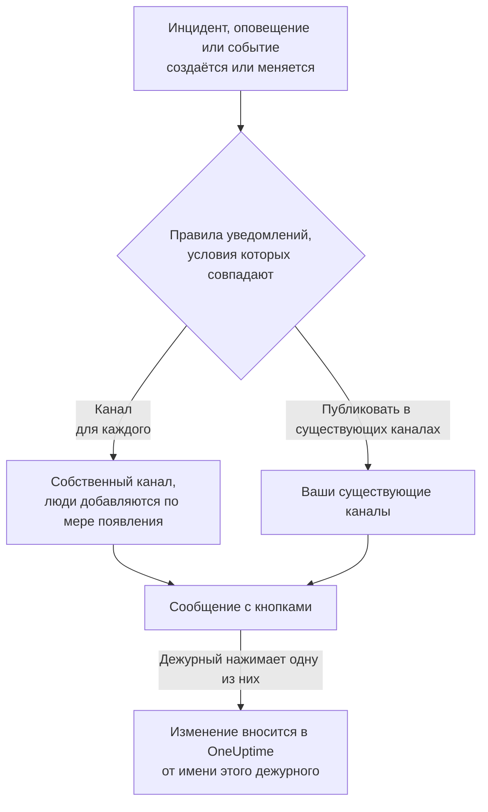

# Mattermost

Подключите OneUptime к своему серверу Mattermost, чтобы публиковать в ваших каналах инциденты, оповещения, эпизоды, плановое обслуживание, мониторы и обновления дежурств, давать каждому инциденту собственный канал и позволять дежурным подтверждать, устранять, добавлять заметки и менять состояние, не выходя из Mattermost.

:::cards
- [Подключение Mattermost](#подключение-mattermost): Создайте для OneUptime учётную запись бота, затем подключите проект с её токеном.
- [Подключение своей учётной записи](#подключение-своей-учётной-записи-mattermost): Свяжите свою учётную запись Mattermost со своей учётной записью OneUptime.
- [Правила уведомлений](#правила-уведомлений): Решите, какие события и куда публикуются и какие получают собственный канал.
- [Действия из Mattermost](#действия-с-инцидентами-оповещениями-и-событиями-из-mattermost): Кнопки в сообщениях OneUptime.
- [Сеть и самостоятельное размещение](#сеть-и-самостоятельное-размещение): К чему должен иметь доступ каждый сервер.
:::

## Как это работает

Это работает благодаря двум подключениям:

- **Подключение проекта**, выполняется один раз: учётная запись бота на вашем сервере Mattermost, в команде, в которой публикует OneUptime. Бот публикует сообщения, создаёт каналы и добавляет в них людей.
- **Собственное подключение каждого человека**: его учётная запись Mattermost, связанная с его учётной записью OneUptime. Кнопки действуют от имени этого человека, с его правами в проекте.

Одна команда Mattermost может быть подключена к нескольким проектам, например к рабочему и тестовому. Кнопка действует в проекте той записи, к которой относится её сообщение.

## Перед началом

- **Роль, которой разрешено подключать проект:** **Владелец проекта**, **Администратор проекта** или **Участник проекта**. Для отключения нужна роль **Владелец проекта** или **Администратор проекта**.
- **Сервер Mattermost**, на котором вы можете создать учётную запись бота, или администратор Mattermost, который может создать её для вас. Подходят и Mattermost Cloud, и Mattermost на собственном сервере.
- **Тариф Growth в OneUptime Cloud** для правил уведомлений и сводок.

Для Mattermost на сервере OneUptime ничего настраивать не нужно: каждый проект подключает свой сервер Mattermost и свою учётную запись бота.

## Подключение Mattermost

:::steps
### Создайте учётную запись бота в Mattermost

В Mattermost откройте **System Console** > **Integrations** > **Bot Accounts** и убедитесь, что **Enable Bot Account Creation** включено. Затем перейдите в **Integrations** > **Bot Accounts** > **Add Bot Account**, назовите бота `oneuptime` и сохраните. Mattermost показывает токен доступа бота только один раз: скопируйте его.

### Добавьте бота в свою команду

Добавьте бота в команду, в которой должен публиковать OneUptime, так же, как добавили бы человека: **Main Menu** > **Invite People**, и пригласите `@oneuptime`. OneUptime создаёт каналы и публикует только в этой команде.

### Подключите проект

В OneUptime откройте **Настройки проекта** > **Рабочее пространство** > **Mattermost** и нажмите **Подключиться к Mattermost**. Введите адрес своего сервера, например `https://chat.example.com`, и токен доступа бота. Прежде чем что-либо сохранить, OneUptime проверяет токен на вашем сервере. Если бот состоит в нескольких командах, OneUptime спросит, в какой из них публиковать. Пока ни одно рабочее пространство не подключено, раздел **Рабочее пространство** в меню «Инциденты», «Оповещения», «Плановое обслуживание», «Мониторы» и «Дежурство» содержит **Подключить рабочее пространство**, который тоже ведёт сюда.

### Добавьте правило уведомлений

Откройте **Инциденты** > **Рабочее пространство** > **Mattermost** и создайте правило, например такое, которое создаёт канал Mattermost для каждого нового инцидента со всеми, кто над ним работает. См. [Правила уведомлений](#правила-уведомлений).
:::

Токен доступа бота хранится только на сервере OneUptime, в зашифрованном виде вместе с другими секретами проекта, и больше никогда не показывается. Адрес сервера, команда и имя пользователя бота видны всем в проекте на странице настроек Mattermost.

Проект подключается к одной команде Mattermost. Чтобы перенести его в другую команду или на другой сервер, сначала отключите его: **Настройки проекта** > **Рабочее пространство** > **Mattermost**, затем **⋯** > **Отключить Mattermost**. Отключение отключает и собственные учётные записи Mattermost всех участников. Ваши правила уведомлений и сводки сохраняются на случай повторного подключения.

## Подключение своей учётной записи Mattermost

В Mattermost нет страницы входа, на которую OneUptime мог бы вас направить, поэтому бот OneUptime вместо этого отправляет вашей учётной записи Mattermost личное сообщение со ссылкой:

:::steps
1. Откройте **Настройки пользователя** > **Рабочее пространство** > **Mattermost**. OneUptime ищет учётную запись Mattermost с вашим адресом электронной почты. Если он её находит, нажмите **Отправить ссылку @your-username**. Если нет, нажмите **Отправить мне ссылку** и введите своё имя пользователя Mattermost.
2. Откройте в Mattermost личное сообщение от бота OneUptime и нажмите **Connect my account**.
3. Ссылка открывает OneUptime, и он подключает вашу учётную запись.
:::

Откройте ссылку в том же браузере, в котором вы её запросили: она работает только там, только один раз и только 15 минут. Это доказывает, что запросивший её человек владеет обеими учётными записями, поэтому никто не может подключить чужую учётную запись Mattermost. Если вы не запрашивали ссылку, не обращайте на неё внимания: ничего не подключается, пока её не откроют в браузере, в котором её запросили.

Подключение вашей учётной записи относится к этому проекту. В другом проекте, подключённом к той же команде Mattermost, подключите её и там.

## Правила уведомлений

Правило уведомлений определяет, какие события публикуются в Mattermost и куда. У каждого продукта свои правила, в разделе **Рабочее пространство** > **Mattermost** его меню: **Инциденты** (с **Инцидент Эпизоды** и вкладкой **Сводка**), **Оповещения** (с **Оповещение Эпизоды** и **Сводка**), **Плановое обслуживание**, **Мониторы**, **Дежурство** и **События безопасности**. Они работают так же, как правила Slack: об условиях, назначениях и о том, кто присоединяется к каналу, см. [Правила уведомлений](/docs/workspace-connections/slack#правила-уведомлений).

Канал, который создаёт правило, называется по своей записи: инцидент INC-42 получает `inc-42`. Mattermost принимает строчные буквы, цифры, `-` и `_`, до 64 символов, причём название должно начинаться и заканчиваться буквой или цифрой, а форма правила показывает название, пока вы печатаете. Если канал с таким названием уже есть, например архивный, OneUptime добавляет `-2`, `-3` и так далее. Приватный инцидент, приватное оповещение или приватный эпизод получает приватный канал.

Чтобы публиковать в существующий канал, введите его название так, как оно указано в его адресе, например `incidents` для `chat.example.com/team/channels/incidents`, или его отображаемое имя. OneUptime сам вступает в публичный канал, когда впервые публикует в нём. В приватный канал добавьте бота в Mattermost до того, как правило начнёт в него публиковать.

Люди присоединяются к каналу правила по подключённой ими учётной записи Mattermost, а иначе — по учётной записи Mattermost с их адресом электронной почты, если ваш сервер показывает боту адреса электронной почты (**System Console** > **Site Configuration** > **Users and Teams** > **Show Email Address**). Всех, кого не удалось добавить, OneUptime называет в одном сообщении в канале, со ссылкой для подключения учётной записи.

**Тестовое правило** в строке правила публикует тестовое сообщение этого правила в указанные им каналы, как и для Slack.

Сообщения OneUptime никого не уведомляют тем, что цитируют: имя или описание, содержащее `@channel`, `@here` или `@someone`, показывается как написано, и упоминание ни до кого не доходит.

## Действия с инцидентами, оповещениями и событиями из Mattermost

В сообщениях OneUptime есть кнопки и меню **More actions** для того, что нужно не всем. Каждая кнопка действует от вашего имени, с вашими правами в проекте, и отвечает в сообщении, которое видите только вы.

| Запись | Кнопки и меню |
| --- | --- |
| **Инцидент** | **Acknowledge**, **Resolve**, **Add Note**, а в меню **Change Severity** и **Change State** |
| **Оповещение** | **Acknowledge**, **Resolve**, **Add Note**, **Change State**, **Execute On-Call Policy** |
| **Эпизод инцидента, эпизод оповещения** | **Acknowledge**, **Resolve**, **Add Note**, **Change State**, **Execute On-Call Policy** |
| **Плановое обслуживание** | **Mark as Ongoing**, **Mark as Complete**, **Add Note**, **Change State** |

**Add Note**, **Change State**, **Change Severity** и **Execute On-Call Policy** открывают форму в Mattermost. Заметка к инциденту или событию планового обслуживания может быть публичной, показанной на странице статуса, или приватной; заметка к приватному инциденту всегда приватная, как и заметка к оповещению. В каждом сообщении есть и ссылка, которая открывает его запись в OneUptime, — для всего остального.

Если ваша учётная запись Mattermost ещё не подключена, кнопка сообщит об этом и даст ссылку на **Настройки пользователя** > **Рабочее пространство** > **Mattermost**. Подключите учётную запись, затем нажмите кнопку снова.

Каждое нажатие записывается в **Настройки проекта** > **Уведомления** > **Журналы уведомлений**, на вкладке **Рабочее пространство**, вместе с тем, кто нажал.

## Сеть и самостоятельное размещение

Два сервера обращаются друг к другу:

- **OneUptime обращается к вашему серверу Mattermost**, чтобы публиковать, создавать каналы и добавлять людей. В OneUptime Cloud ваш сервер Mattermost должен быть доступен из интернета. Самостоятельно размещённый OneUptime может обращаться к серверу Mattermost в частной сети, как только его администратор разрешит частные адреса с помощью `ALLOW_PRIVATE_NETWORK_WEBHOOKS` или `PRIVATE_NETWORK_WEBHOOK_ALLOWLIST`. OneUptime никогда не обращается к адресу на собственной машине или к адресу облачных метаданных и никогда не следует перенаправлениям.
- **Ваш сервер Mattermost обращается к OneUptime**, когда кто-то нажимает кнопку или отправляет форму: `https://<your OneUptime>/api/mattermost/interactive` и `/api/mattermost/dialog`. Если адрес OneUptime частный, добавьте его хост в **System Console** > **Environment** > **Developer** > **Allow untrusted internal connections to** в Mattermost, иначе кнопки не будут работать.

Каждая кнопка, которую публикует OneUptime, несёт подпись для команды Mattermost, в которой она опубликована, и подпись проверяется при нажатии: нажатие, которое OneUptime не подписывал, или нажатие из другой команды ничего не делает.

## Устранение неполадок

| Что вы видите | Что делать |
| --- | --- |
| **Mattermost did not accept the access token** | Скопируйте токен бота ещё раз. Mattermost показывает его только один раз: при необходимости создайте новый в **Integrations** > **Bot Accounts**. |
| **The bot account is not a member of any team** | Добавьте бота в свою команду в Mattermost, затем подключитесь снова. |
| **OneUptime could not reach the Mattermost server** | Проверьте адрес и то, что у OneUptime есть к нему доступ. См. [Сеть и самостоятельное размещение](#сеть-и-самостоятельное-размещение). |
| **The bot is not a member of the private Mattermost channel** | Добавьте бота в этот канал в Mattermost. |
| Кнопка ничего не делает, или Mattermost сообщает, что не смог выполнить действие | Mattermost не может связаться с OneUptime. См. [Сеть и самостоятельное размещение](#сеть-и-самостоятельное-размещение). |
| Личное сообщение со ссылкой не приходит | Проверьте имя пользователя и то, что бот состоит в команде, в которой состоите вы. |
