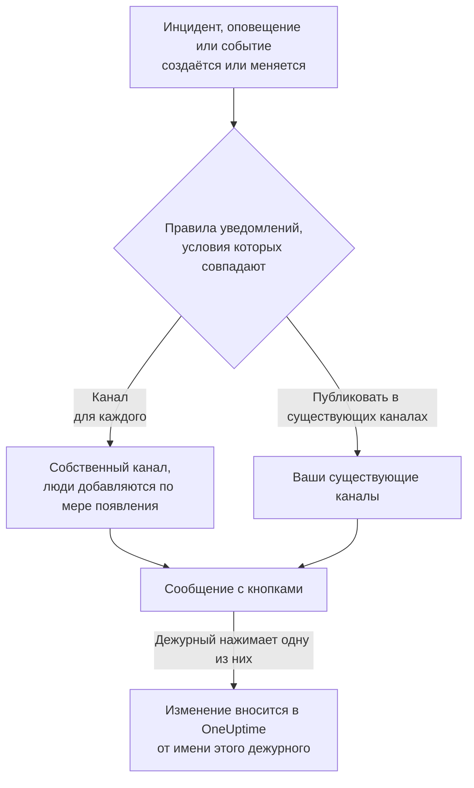

# Mattermost

Подключите OneUptime к своему серверу Mattermost, чтобы публиковать в ваших каналах инциденты, оповещения, эпизоды, плановое обслуживание, мониторы и обновления дежурств, давать каждому инциденту собственный канал и позволять дежурным подтверждать, устранять, добавлять заметки и менять состояние, не выходя из Mattermost.

:::cards
- [Подключение Mattermost](#подключение-mattermost): Создайте для OneUptime учётную запись бота, затем подключите проект с её токеном.
- [Подключение своей учётной записи](#подключение-своей-учётной-записи-mattermost): Свяжите свою учётную запись Mattermost со своей учётной записью OneUptime.
- [Правила уведомлений](#правила-уведомлений): Решите, какие события и куда публикуются и какие получают собственный канал.
- [Кто в канале записи](#кто-в-канале-записи): Посмотрите, кто в нём, вступите в него и добавьте людей прямо со страницы записи.
- [Действия из Mattermost](#действия-с-инцидентами-оповещениями-и-событиями-из-mattermost): Кнопки в сообщениях OneUptime.
- [Сеть и самостоятельное размещение](#сеть-и-самостоятельное-размещение): К чему должен иметь доступ каждый сервер.
:::

## Как это работает

Это работает благодаря двум подключениям:

- **Подключение проекта**, выполняется один раз: учётная запись бота на вашем сервере Mattermost, в командах, в которых публикует OneUptime. Бот публикует сообщения, создаёт каналы и добавляет в них людей.
- **Собственное подключение каждого человека**: его учётная запись Mattermost, связанная с его учётной записью OneUptime. Кнопки действуют от имени этого человека, с его правами в проекте.

Одна команда Mattermost может быть подключена к нескольким проектам, например к рабочему и тестовому. Кнопка действует в проекте той записи, к которой относится её сообщение.

## Перед началом

- **Роль, которой разрешено подключать проект:** **Владелец проекта**, **Администратор проекта** или **Участник проекта**. Для отключения нужна роль **Владелец проекта** или **Администратор проекта**.
- **Сервер Mattermost**, на котором вы можете создать учётную запись бота, или администратор Mattermost, который может создать её для вас. Подходят и Mattermost Cloud, и Mattermost на собственном сервере.
- **Тариф Growth в OneUptime Cloud** для правил уведомлений и сводок.

Для Mattermost на сервере OneUptime ничего настраивать не нужно: каждый проект подключает свой сервер Mattermost и свою учётную запись бота.

## Подключение Mattermost

:::steps
### Создайте учётную запись бота в Mattermost

В Mattermost откройте **System Console** > **Integrations** > **Bot Accounts** и убедитесь, что **Enable Bot Account Creation** включено. Затем перейдите в **Integrations** > **Bot Accounts** > **Add Bot Account**, назовите бота `oneuptime` и сохраните. Mattermost показывает токен доступа бота только один раз: скопируйте его.

### Добавьте бота в свою команду

Добавьте бота в каждую команду, в которой должен публиковать OneUptime, так же, как добавили бы человека: **Main Menu** > **Invite People**, и пригласите `@oneuptime`. OneUptime создаёт каналы и публикует только в тех командах, в которых состоит бот.

### Подключите проект

В OneUptime откройте **Настройки проекта** > **Рабочее пространство** > **Mattermost** и нажмите **Подключиться к Mattermost**. Введите адрес своего сервера, например `https://chat.example.com`, и токен доступа бота. Прежде чем что-либо сохранить, OneUptime проверяет токен на вашем сервере. Если бот состоит в нескольких командах, OneUptime спросит, какая из них будет командой по умолчанию: в ней создаёт свои каналы правило уведомлений, в котором не указана команда. Пока ни одно рабочее пространство не подключено, раздел **Рабочее пространство** в меню «Инциденты», «Оповещения», «Плановое обслуживание», «Мониторы» и «Дежурство» содержит **Подключить рабочее пространство**, который тоже ведёт сюда.

### Добавьте правило уведомлений

Откройте **Инциденты** > **Рабочее пространство** > **Mattermost** и создайте правило, например такое, которое создаёт канал Mattermost для каждого нового инцидента со всеми, кто над ним работает. См. [Правила уведомлений](#правила-уведомлений).
:::

Токен доступа бота хранится только на сервере OneUptime, в зашифрованном виде вместе с другими секретами проекта, и больше никогда не показывается. Адрес сервера, команды и имя пользователя бота видны всем в проекте на странице настроек Mattermost.

Проект подключается к одному серверу Mattermost. Чтобы перенести его на другой сервер, сначала отключите его: **Настройки проекта** > **Рабочее пространство** > **Mattermost**, затем **⋯** > **Отключить Mattermost**. Отключение отключает и собственные учётные записи Mattermost всех участников и удаляет их методы уведомлений Mattermost и правила дежурства, которые их используют. Ваши правила уведомлений и сводки сохраняются на случай повторного подключения.

## Несколько команд

OneUptime работает в каждой команде вашего сервера Mattermost, в которой состоит его бот:

1. В Mattermost добавьте бота в каждую команду, которая должна пользоваться OneUptime, так же, как добавили бы человека: откройте команду, затем **Main Menu** > **Invite People**.
2. Карточка **Команды Mattermost** в разделе **Настройки проекта** > **Рабочее пространство** > **Mattermost** перечисляет эти команды, первой — команду по умолчанию. Нажмите **Обновить** после добавления бота в ещё одну команду.

- **Какую команду использует правило.** Правила уведомлений выбирают в поле **Команда Mattermost** команду, в которой находятся их каналы. Если поле пустое, правило создаёт свой канал в команде по умолчанию, а указанные в нём каналы ищет сначала там, затем в остальных командах бота.
- **Какую команду использует сводка.** Сводки на вкладке **Сводка** в **Инциденты** и **Оповещения** тоже выбирают в поле **Команда Mattermost** команду, в которой находятся их каналы. Если поле пустое, сводка ищет свои каналы сначала в команде по умолчанию, затем в остальных командах бота.
- **Команда по умолчанию.** Это команда, к которой вы подключили проект. Кнопка **Назначить по умолчанию** на карточке делает командой по умолчанию другую команду; она доступна ролям, которым разрешено подключать проект.
- **Где работает OneUptime.** Кнопки в сообщениях OneUptime и формы, которые они открывают, работают в каждой из этих команд. В команде, из которой удалили бота, кнопка лишь сообщает, что команда больше не подключена.
- **Команда по умолчанию, из которой удалили бота.** Карточка сообщает об этом. Верните бота в Mattermost или назначьте по умолчанию другую команду.
- **Команда, которую называет правило и из которой удалили бота.** Карточка правила сообщает об этом, и правило не использует вместо неё другую команду. Верните бота в эту команду в Mattermost или выберите в правиле другую команду: его форма по-прежнему показывает прежний выбор, чтобы его можно было изменить.

## Подключение своей учётной записи Mattermost

В Mattermost нет страницы входа, на которую OneUptime мог бы вас направить, поэтому бот OneUptime вместо этого отправляет вашей учётной записи Mattermost личное сообщение со ссылкой:

:::steps
1. Откройте **Настройки пользователя** > **Рабочее пространство** > **Mattermost**. OneUptime ищет учётную запись Mattermost с вашим адресом электронной почты. Если он её находит, нажмите **Отправить ссылку @your-username**. Если нет, нажмите **Отправить мне ссылку** и введите своё имя пользователя Mattermost.
2. Откройте в Mattermost личное сообщение от бота OneUptime и нажмите **Connect my account**.
3. Ссылка открывает OneUptime, и он подключает вашу учётную запись.
:::

Откройте ссылку в том же браузере, в котором вы её запросили: она работает только там, только один раз и только 15 минут. Это доказывает, что запросивший её человек владеет обеими учётными записями, поэтому никто не может подключить чужую учётную запись Mattermost. Если вы не запрашивали ссылку, не обращайте на неё внимания: ничего не подключается, пока её не откроют в браузере, в котором её запросили.

Подключение вашей учётной записи относится к этому проекту. В другом проекте, подключённом к той же команде Mattermost, подключите её и там.

## Вызовы в Mattermost

Чтобы получать вызовы личным сообщением во время дежурства, добавьте Mattermost как один из своих методов уведомлений:

:::steps
1. Подключите свою учётную запись Mattermost (см. [Подключение своей учётной записи Mattermost](#подключение-своей-учётной-записи-mattermost)).
2. Откройте **Настройки пользователя** > **Методы уведомлений**, перейдите на вкладку **Приложения рабочего пространства** и нажмите **Добавить аккаунт Mattermost**.
3. Нажмите **Send Test Message** в её строке. Сообщение придёт личным сообщением от бота проекта.
:::

После добавления она сразу включается в ваши правила дежурства, так что с этого момента вызовы приходят вам в Mattermost. Какие вызовы она получает, можно изменить в **Настройки пользователя** > **Как со мной связаться**. Каждый вызов содержит ссылку для подтверждения и ссылку для эскалации. При отключении вашей учётной записи Mattermost этот метод и правила дежурства, которые его используют, удаляются.

## Правила уведомлений

Правило уведомлений определяет, какие события публикуются в Mattermost и куда. У каждого продукта свои правила, в разделе **Рабочее пространство** > **Mattermost** его меню: **Инциденты** (с **Эпизоды инцидентов** и вкладкой **Сводка**), **Оповещения** (с **Эпизоды оповещений** и **Сводка**), **Плановое обслуживание**, **Мониторы**, **Дежурство**, **События безопасности** и **SLOs**. Они работают так же, как правила Slack: об условиях, назначениях, обновлениях, которые публикует правило, и о том, кто присоединяется к каналу, см. [Правила уведомлений](/docs/workspace-connections/slack#правила-уведомлений). Сообщения о дежурстве такие же, как в Slack, — одна строка при каждой передаче смены: см. [Сообщения о дежурстве](/docs/workspace-connections/slack#сообщения-о-дежурстве). Время в сообщении, например окончание смены дежурства, показано в UTC: Mattermost не может показать его в часовом поясе каждого читателя.

Канал, который создаёт правило, называется по своей записи: инцидент INC-42 получает `inc-42`. Mattermost принимает строчные буквы, цифры, `-` и `_`, до 64 символов, причём название должно начинаться и заканчиваться буквой или цифрой, а форма правила показывает название, пока вы печатаете. Если канал с таким названием уже есть, например архивный, OneUptime добавляет `-2`, `-3` и так далее. Приватный инцидент, приватное оповещение или приватный эпизод получает приватный канал.

Чтобы публиковать в существующий канал, введите его название так, как оно указано в его адресе, например `incidents` для `chat.example.com/team/channels/incidents`, или его отображаемое имя. OneUptime сам вступает в публичный канал, когда впервые публикует в нём. В приватный канал добавьте бота в Mattermost до того, как правило начнёт в него публиковать. Если бот состоит в нескольких командах, правило также выбирает команду, в которой находятся его каналы: см. [Несколько команд](#несколько-команд).

Люди присоединяются к каналу правила по подключённой ими учётной записи Mattermost, а иначе — по учётной записи Mattermost с их адресом электронной почты, если ваш сервер показывает боту адреса электронной почты (**System Console** > **Site Configuration** > **Users and Teams** > **Show Email Address**). Всех, кого не удалось добавить, OneUptime называет в одном сообщении в канале, со ссылкой для подключения учётной записи.

У инцидента, оповещения, эпизода или события запланированного обслуживания с собственным каналом в заголовке его страницы в OneUptime, рядом с кнопками состояний, есть **Открыть в Mattermost**. Кнопка открывает этот канал в новой вкладке, на вашем сервере Mattermost. Если у записи два собственных канала, кнопка перечисляет оба. У записи, у которой есть каналы ещё и в Slack или Microsoft Teams, вместо этого одна кнопка **Открыть канал**, которая перечисляет их все. Существующие каналы, в которые публикуют ваши правила, не предлагаются.

**Протестировать правило** в строке правила публикует тестовое сообщение этого правила в указанные им каналы, как и для Slack.

Сообщения OneUptime никого не уведомляют тем, что цитируют: имя или описание, содержащее `@channel`, `@here` или `@someone`, показывается как написано, и упоминание ни до кого не доходит.

## Кто в канале записи

У инцидента, оповещения, эпизода или события запланированного обслуживания с собственным каналом Mattermost на его странице в OneUptime есть карточка **Канал Mattermost**. Карточка показывает канал ссылкой, которая открывает его на вашем сервере Mattermost, приватный ли он и кто в нём, вас первым. С карточки, без администратора Mattermost:

- **Присоединиться к каналу** добавляет вас, если вас нет в канале.
- **Добавить людей** открывает список людей и команд проекта: выберите человека, чтобы добавить его, или команду, чтобы добавить всех её участников.

Бот OneUptime добавляет их так же, как добавляет людей в канал правила. Бот остаётся в каналах, которые создаёт, поэтому это работает и для приватного канала, из которого все вышли. Запись, у которой есть ещё и каналы в Slack или Microsoft Teams, показывает их все на одной карточке **Каналы чата**.

- **Кто может добавлять людей.** Тот, кто может редактировать запись: **Владелец проекта**, **Администратор проекта**, **Участник проекта**, **Администратор инцидентов** и **Участник инцидентов** для инцидента или **Edit Incident** в пользовательской роли, и такое же разрешение для оповещения, эпизода или события (например, **Edit Alert**). Все остальные видят, кто в канале и как туда попасть.
- **Кого можно добавить.** Того, кого OneUptime находит в Mattermost, по подключённой учётной записи, а иначе по адресу электронной почты, если ваш сервер показывает адреса боту, и кто состоит в команде канала. Можно добавить и гостевую учётную запись из этой команды: Mattermost позволяет участникам канала добавлять гостей. Карточка называет тех, кого не удалось добавить, и почему.
- **Что записывается.** Кто был добавлен и кем: в ленте записи (**Участник добавлен в канал**) и в **Настройки проекта** > **Уведомления** > **Журналы уведомлений**, на вкладке **Рабочее пространство**.
- **Архивный канал.** Карточка по-прежнему показывает, кто в нём, и никого не добавляет, пока канал не разархивируют в Mattermost.
- **Канал, из которого удалили бота.** Mattermost показывает людей канала только тем, кто в нём состоит, даже у публичного канала, поэтому карточка говорит, что не видит канал. Любой его участник может вернуть бота в Mattermost. В публичный канал OneUptime также сам вернётся, когда в следующий раз опубликует там сообщение.
- **Как убрать человека.** OneUptime только добавляет людей: удалите человека из канала в Mattermost.

## Действия с инцидентами, оповещениями и событиями из Mattermost

В сообщениях OneUptime есть кнопки и меню **More actions** для того, что нужно не всем. Каждая кнопка действует от вашего имени, с вашими правами в проекте, и отвечает в сообщении, которое видите только вы.

| Запись | Кнопки и меню |
| --- | --- |
| **Инцидент** | **Acknowledge**, **Resolve**, **Add Note**, а в меню **Change Severity** и **Change State** |
| **Оповещение** | **Acknowledge**, **Resolve**, **Add Note**, **Change State**, **Execute On-Call Policy** |
| **Эпизод инцидента, эпизод оповещения** | **Acknowledge**, **Resolve**, **Add Note**, **Change State**, **Execute On-Call Policy** |
| **Плановое обслуживание** | **Mark as Ongoing**, **Mark as Complete**, **Add Note**, **Change State** |

**Add Note**, **Change State**, **Change Severity** и **Execute On-Call Policy** открывают форму в Mattermost. Заметка к инциденту или событию планового обслуживания может быть публичной, показанной на странице статуса, или приватной; заметка к приватному инциденту всегда приватная, как и заметка к оповещению. В каждом сообщении есть и ссылка, которая открывает его запись в OneUptime, — для всего остального. Если публичные заметки проекта требуют одобрения, публичная заметка из формы ждёт его, а сообщение, которое видите только вы, говорит, кого она ждёт: см. [Одобрение публичных заметок](/docs/incidents/notes-owners-and-feed#одобрение-публичных-заметок).

Если ваша учётная запись Mattermost ещё не подключена, кнопка сообщит об этом и даст ссылку на **Настройки пользователя** > **Рабочее пространство** > **Mattermost**. Подключите учётную запись, затем нажмите кнопку снова.

Каждое нажатие записывается в **Настройки проекта** > **Уведомления** > **Журналы уведомлений**, на вкладке **Рабочее пространство**, вместе с тем, кто нажал.

## Одобрение публичной заметки

Когда публичные заметки вашего проекта требуют одобрения и вы включаете Mattermost для **Одобрение публичных заметок** в своих настройках уведомлений, каждая публичная заметка, которая ждёт шага, одобряемого вами, приходит в ваши личные сообщения с ботом OneUptime: кто её отправил, какого шага она ждёт, сама заметка, **Approve**, **Reject** и ссылка на заметку в OneUptime. **Approve** одобряет её для этого шага; на последнем шаге кнопка называется **Approve and publish**, и заметка публикуется сразу. **Reject** открывает форму, которая спрашивает причину: причина обязательна, и автор заметки её видит. Кнопки действуют от вашего имени, по тем же правилам, что и в OneUptime, и отвечают в сообщении, которое видите только вы. Нажатие после того, как кто-то другой решил, или после изменения заметки либо её шагов, ничего не решает и говорит, что произошло. Когда по заметке принято решение, сообщение каждого одобряющего о ней, в том числе ваше, меняется и говорит, что произошло: одобрена для своего шага и кого она теперь ждёт, опубликована, отклонена, изменена или снова отправлена на одобрение, опубликована без одобрения или удалена. В нём остаётся ссылка на заметку в OneUptime, а **Approve** и **Reject** исчезают. Если ваша учётная запись Mattermost не подключена, подключите её в **Настройки пользователя** > **Рабочее пространство** > **Mattermost**, а затем нажмите кнопку ещё раз. Если шаги одобрения меняются, пока заметка ждёт, и она больше не ждёт вашего шага или вас больше не спрашивают, ваше сообщение о ней тоже меняется, а те, кого она ждёт теперь, получают собственное сообщение. См. [Одобрение публичных заметок](/docs/incidents/notes-owners-and-feed#одобрение-публичных-заметок).

## Сеть и самостоятельное размещение

Два сервера обращаются друг к другу:

- **OneUptime обращается к вашему серверу Mattermost**, чтобы публиковать, создавать каналы и добавлять людей. В OneUptime Cloud ваш сервер Mattermost должен быть доступен из интернета. Самостоятельно размещённый OneUptime может обращаться к серверу Mattermost в частной сети, как только его администратор разрешит частные адреса с помощью `ALLOW_PRIVATE_NETWORK_WEBHOOKS` или `PRIVATE_NETWORK_WEBHOOK_ALLOWLIST`. OneUptime никогда не обращается к адресу на собственной машине или к адресу облачных метаданных и никогда не следует перенаправлениям.
- **Ваш сервер Mattermost обращается к OneUptime**, когда кто-то нажимает кнопку или отправляет форму: `https://<your OneUptime>/api/mattermost/interactive` и `/api/mattermost/dialog`. Если адрес OneUptime частный, добавьте его хост в **System Console** > **Environment** > **Developer** > **Allow untrusted internal connections to** в Mattermost, иначе кнопки не будут работать.

Каждая кнопка, которую публикует OneUptime, несёт подпись для команды Mattermost, в которой она опубликована, и подпись проверяется при нажатии: нажатие, которое OneUptime не подписывал, или нажатие из другой команды ничего не делает.

## Устранение неполадок

| Что вы видите | Что делать |
| --- | --- |
| **Mattermost did not accept the access token** | Скопируйте токен бота ещё раз. Mattermost показывает его только один раз: при необходимости создайте новый в **Integrations** > **Bot Accounts**. |
| **The bot account is not a member of any team** | Добавьте бота в свою команду в Mattermost, затем подключитесь снова. |
| Команды, в которую вы добавили бота, нет на карточке **Команды Mattermost** | Нажмите **Обновить** на карточке. |
| **OneUptime's bot is not a member of this Mattermost team** | Вы выбрали команду, из которой бот вышел. Добавьте бота в неё в Mattermost, затем нажмите **Обновить**. |
| **OneUptime's bot may not create channels in the Mattermost team this rule names** | Добавьте бота в эту команду в Mattermost или выберите в правиле другую команду. |
| **OneUptime's bot is not a member of the Mattermost team chosen for the channel** | Добавьте бота в эту команду в Mattermost или выберите в правиле другую команду. |
| **OneUptime's bot is no longer a member of the project's default Mattermost team** | Верните бота в эту команду в Mattermost или назначьте по умолчанию другую команду. |
| **OneUptime could not reach the Mattermost server** | Проверьте адрес и то, что у OneUptime есть к нему доступ. См. [Сеть и самостоятельное размещение](#сеть-и-самостоятельное-размещение). |
| **The bot is not a member of the private Mattermost channel** | Добавьте бота в этот канал в Mattermost. |
| Кнопка ничего не делает, или Mattermost сообщает, что не смог выполнить действие | Mattermost не может связаться с OneUptime. См. [Сеть и самостоятельное размещение](#сеть-и-самостоятельное-размещение). |
| Личное сообщение со ссылкой не приходит | Проверьте имя пользователя и то, что бот состоит в команде, в которой состоите вы. |
| Карточка канала говорит, что OneUptime не видит канал | Канал удалён, или из него удалили бота. Если канал ещё существует, любой его участник может вернуть бота в Mattermost. |
| Карточка канала говорит, что человека нет в команде Mattermost | Добавьте его в Mattermost в команду канала и затем добавьте снова. |
