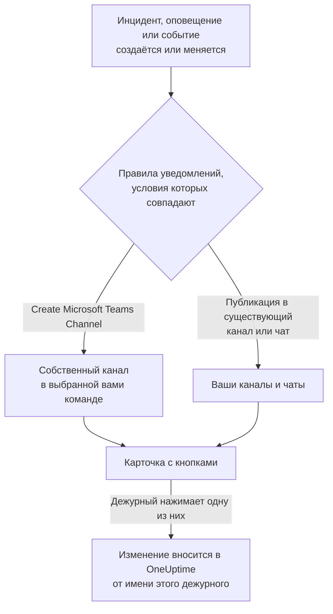

# Microsoft Teams

Подключите OneUptime к Microsoft Teams, чтобы публиковать в ваших каналах и чатах инциденты, оповещения, эпизоды, плановое обслуживание, мониторы и обновления дежурств, давать каждому инциденту собственный канал и позволять дежурным действовать из Teams: подтверждать, устранять, добавлять заметки, вызывать дежурных, объявлять инциденты и задавать вопросы OneUptime AI.

:::cards
- [Подключение Microsoft Teams](#подключение-microsoft-teams): Согласие администратора, ваш вход и приложение в каждой команде.
- [Правила уведомлений](#правила-уведомлений): Решите, какие события и куда публикуются и какие получают собственный канал.
- [Общение с ботом OneUptime](#общение-с-ботом-oneuptime): Команды, вопросы и формы в чате с ботом.
- [Действия с инцидентами, оповещениями и событиями из Microsoft Teams](#действия-с-инцидентами-оповещениями-и-событиями-из-microsoft-teams): Кнопки на карточках OneUptime.
:::

## Как это работает

Это работает благодаря трём вещам:

- **Подключение проекта**, выполняется один раз: администратор Microsoft 365 даёт согласие на приложение OneUptime для вашей организации.
- **Приложение OneUptime в каждой команде**, в которой вы хотите получать уведомления. Microsoft позволяет боту публиковать только в команде, в которую он добавлен.
- **Собственное подключение каждого человека**: его учётная запись Microsoft Teams, связанная с его учётной записью OneUptime. Кнопки, команды и реакции действуют от имени этого человека, с его правами в проекте.

## Перед началом

- **Роль, которой разрешено подключать проект:** **Project Owner**, **Project Admin** или **Project Member**. Для удаления нужна роль **Project Owner** или **Project Admin**.
- **Администратор Microsoft 365**, который даст согласие администратора, один раз для всей организации.
- **Тариф Growth в OneUptime Cloud** для правил уведомлений и сводок. См. [Правила уведомлений ниже тарифа Growth](#правила-уведомлений-ниже-тарифа-growth).
- **На собственном сервере** сначала настроенный для него бот Teams. См. [Интеграция с Microsoft Teams](/docs/self-hosted/microsoft-teams-integration).

## Подключение Microsoft Teams

:::steps
### Дайте согласие администратора

Откройте **Настройки проекта** > **Рабочее пространство** > **Microsoft Teams** и нажмите **Предоставить согласие администратора**. Администратор Microsoft 365 входит в систему и разрешает приложение OneUptime для организации. После этого на карточке написано **Admin Consent Completed**. Пока ни одно рабочее пространство не подключено, раздел **Рабочее пространство** в меню «Инциденты», «Оповещения», «Плановое обслуживание», «Мониторы» и «Дежурство» содержит **Подключить Slack или Teams**, который тоже ведёт сюда.

### Подключите свою учётную запись

Нажмите **Connect with Microsoft Teams** и войдите с рабочей учётной записью. OneUptime читает команды вашей организации; **Просмотреть команды** показывает их список.

### Добавьте приложение OneUptime в каждую команду (обязательно)

Одного подключения учётной записи недостаточно. Microsoft позволяет боту OneUptime публиковать только в команде, в которую он добавлен, поэтому сделайте это для каждой команды, в которой вы хотите получать уведомления:

- В Microsoft Teams нажмите "..." рядом с **названием команды** (а не канала).
- Выберите **Manage team** > **Apps** > **More apps**, найдите **OneUptime** и нажмите **Add**.

В OneUptime Cloud **Открыть Teams Store** открывает приложение в магазине Microsoft Teams, где **Add to a team** делает то же самое. На собственном сервере вместо этого установите пакет из **Скачать ZIP-архив манифеста приложения**: только он содержит бота вашего сервера. Если тестовое уведомление сообщает, что приложение OneUptime не установлено в команде, пропущен именно этот шаг.

### Подключите всех остальных

Каждый человек связывает свою учётную запись Microsoft Teams в **Настройки пользователя** > **Рабочее пространство** > **Microsoft Teams** с помощью **Connect my account with Microsoft Teams**, чтобы действовать с инцидентами и получать личные сообщения от своего имени. Этот раздел появляется, как только проект подключён к Microsoft Teams.

### Добавьте правило уведомлений

Откройте **Инциденты** > **Рабочее пространство** > **Microsoft Teams**. Раздел **Рабочее пространство** показывает только те чат-пространства, которые подключил ваш проект, поэтому **Microsoft Teams** появляется там, как только он подключён. Создайте правило, например такое, которое публикует в канал Teams при создании инцидента, затем нажмите **Тестовое правило** в его строке.
:::

> [!NOTE]
> Установка OneUptime для себя или добавление его в чат — это другая установка, и она не позволяет ему публиковать в каналы команды. **Приватным каналам** нужно приложение, добавленное в сам канал: откройте канал > "..." > **Manage channel** > **Apps** > **Add an app**. **Общие каналы** не могут получать уведомления: Microsoft Teams не поддерживает ботов в общих каналах.

## Правила уведомлений

Правило уведомлений определяет, какие события публикуются в Microsoft Teams и куда. У каждого продукта свои правила, в разделе **Рабочее пространство** > **Microsoft Teams** его меню:

| Продукт | Вкладки на его странице **Microsoft Teams** |
| --- | --- |
| **Инциденты** | **Инциденты**, **Инцидент Эпизоды**, **Summary** |
| **Оповещения** | **Оповещения**, **Оповещение Эпизоды**, **Summary** |
| **Плановое обслуживание** | Один список правил |
| **Мониторы** | Один список правил |
| **Дежурство** | Один список правил |

Создание правила проходит в четыре шага:

| Шаг | Что вы задаёте |
| --- | --- |
| **Базовый** | **Имя правила** и **Описание правила**. |
| **Условия** | Для каких событий срабатывает правило, например по серьёзности, состоянию, метке, монитору или словам в заголовке. Без условий оно срабатывает для каждого события. Если условий два или больше, **Условие совпадения** определяет, должны ли совпасть все или достаточно одного. |
| **Назначение** | Куда оно публикует: в существующий канал выбранной вами команды, в выбранные вами чаты, в новый канал, создаваемый в выбранной вами команде, или в несколько из них сразу. |
| **Video Call** | Только инциденты и оповещения: начать звонок для каждого из них. См. [Видеозвонки](/docs/workspace-connections/video-calls). |

Канал, который создаёт правило, называется по **New Microsoft Teams Channel Name** с номером записи на конце, например `oneuptime-incident-42`, и только созданный канал получает людей, которых приглашает правило. Приватный инцидент, приватное оповещение или приватный эпизод получает приватный канал. Каждое последующее обновление записи — смена состояния, заметка, новый владелец — публикуется в её каналах и чатах.

**Настройки проекта** > **Рабочее пространство** > **Microsoft Teams** показывает каналы, которые OneUptime видит в ваших командах, и чаты, в которые он добавлен, с **Отправить тест** рядом с каждым. Чат появляется, как только в него добавлено приложение OneUptime в Microsoft Teams; **Refresh Chats** подтягивает новые чаты и их текущие названия.

## Проверка правила

**Тестовое правило** в строке правила публикует тестовое сообщение этого правила в указанные им каналы, чтобы вы увидели, как оно приходит. Если правило создаёт канал для каждого события, проверка тоже создаёт канал и приглашает в него людей правила.

Как и **Отправить тест** рядом с каналом в **Настройки проекта** > **Рабочее пространство** > **Microsoft Teams**, для этого нужно право создавать правила уведомлений: **Project Owner**, **Project Admin**, **Project Member**, **Settings Admin**, **Settings Member** или **Create Workspace Notification Rule** и **Read Workspace Notification Rule** в пользовательской роли. Для того, кто может только просматривать правила, например **Viewer**, кнопка **Тестовое правило** заблокирована, а её подсказка говорит, что для этого нужно; API отклоняет такую проверку с "You do not have permission to send test notifications in this project." В OneUptime Cloud для проверки правила нужен тариф **Growth**, как и для добавления правила.

В OneUptime Cloud для **Отправить тест** рядом с каналом или чатом тоже нужен тариф **Growth**, ведь публикация в канал — это то, что делают правила и сводки. Для **Отправить тест сейчас** в сводке нужно право создавать сводки (**Create Workspace Notification Summary** и **Read Workspace Notification Summary** в пользовательской роли), а в OneUptime Cloud — тариф **Growth**; для всех остальных кнопка заблокирована, а её подсказка говорит, что для этого нужно. MCP-клиент, подключённый с доступом только на чтение, не может отправить ни одной проверки.

## Сводки

Вкладка **Summary** в **Инциденты** > **Рабочее пространство** > **Microsoft Teams** (и в **Оповещения**) публикует периодическую сводку в указанные вами каналы: сколько было инцидентов или оповещений, как быстро их подтвердили и устранили, и список со ссылками. Новая сводка выходит каждую неделю и охватывает последние 7 дней. Оставьте **Отправить первый отчёт в** пустым, и первая сводка выйдет в 09:00 в начале следующей недели, дня или месяца; форма показывает, когда именно.

Сводка выходит по часам своего **Часовой пояс**, который по умолчанию совпадает с вашим. Она сохраняет там своё время суток весь год: сводка, настроенная на 09:00 в Берлине, по-прежнему выходит в 09:00 по Берлину после перехода на летнее время, и даты в её сообщении тоже берлинские. Через API передайте `timezone` как имя часового пояса IANA, например `Europe/Berlin`. Сводка, созданная без часового пояса, берёт часовой пояс из профиля своего создателя или UTC, если её создаёт ключ API.

Форма сводки состоит из четырёх шагов: **Основная информация** (её название, каналы и их **Название команды**), **Расписание**, **Содержимое** (**Что включить**) и **Фильтры** (какие инциденты или оповещения она учитывает).

## Правила уведомлений ниже тарифа Growth

В OneUptime Cloud правила уведомлений и сводки доступны на тарифе **Growth** и выше. Проект на более низком тарифе сохраняет уже имеющиеся правила и сводки, и они продолжают публиковать в Microsoft Teams. Поэтому страница **Microsoft Teams** каждого продукта («Инциденты», «Оповещения», «Плановое обслуживание», «Дежурство», «Мониторы») показывает примечание о тарифе со списком под ним (**Оставшиеся правила уведомлений**, **Оставшиеся сводки**): удалите правило либо отключите или удалите сводку. Для добавления или изменения правил и сводок нужен **Growth**.

## Вызовы в Microsoft Teams

Чтобы получать вызовы личным сообщением во время дежурства, добавьте Microsoft Teams как один из своих методов уведомлений:

:::steps
1. Подключите свою учётную запись Microsoft Teams (см. [Подключение Microsoft Teams](#подключение-microsoft-teams)).
2. Откройте **Настройки пользователя** > **Методы уведомлений**, перейдите на вкладку **Workspace Apps** и нажмите **Add Microsoft Teams Account**.
3. Нажмите **Send Test Message** в её строке. Сообщение придёт в ваши чаты Microsoft Teams.
:::

После добавления она сразу включается в ваши правила дежурства, так что с этого момента вызовы приходят вам в Microsoft Teams. Какие вызовы она получает, можно изменить в **Настройки пользователя** > **Правила дежурства**.

## Сохранение сообщений как заметок

Отреагируйте на сообщение или ответ в канале, который OneUptime создал для инцидента, оповещения, эпизода или события планового обслуживания, и OneUptime сохранит его как заметку к этой записи. Он замечает реакцию в течение минуты и подтверждает ответом в треде:

| Реакция | Сохраняется как |
| --- | --- |
| 📌 или 📍 | Приватная заметка, видимая только вашей команде |
| 📣 или 📢 | Публичная заметка, показанная на странице статуса. Только инциденты и события планового обслуживания. |

Заметка сохраняется от вашего имени, с вашими правами, поэтому ваша учётная запись Microsoft Teams должна быть подключена, а приложение OneUptime должно быть в команде.

## Общение с ботом OneUptime

Напишите боту в личном чате или упомяните OneUptime через @ в канале или групповом чате: там он отвечает, только когда его упоминают.

| Сообщение | Что делает бот |
| --- | --- |
| `help` | Показывает, что он умеет. |
| `ask <question>` или любой вопрос обычным языком | OneUptime AI отвечает о ваших журналах, трассировках, метриках, инцидентах и мониторах, например «какие мониторы сейчас не работают?». Ответы только читают данные. |
| `create incident [title]` | Открывает форму инцидента с заполненным заголовком. |
| `create maintenance [title]` | Открывает форму планового обслуживания с заполненным заголовком. |
| `show active incidents`, `show active alerts` | Показывает то, что открыто сейчас. |
| `show scheduled maintenance`, `show ongoing maintenance` | Показывает предстоящие или текущие события обслуживания. |

Для вопросов OneUptime AI нужен включённый для проекта ИИ. См. [Спросить ИИ](/docs/ai/ask-ai).

## Создание инцидентов и обслуживания из Microsoft Teams

Если написать боту OneUptime `create incident` или `create maintenance`, откроется форма для того, кто это написал, — в личном чате, канале или групповом чате одинаково. Она заполняется от имени этого человека: как учётная запись OneUptime, к которой подключена его учётная запись Microsoft Teams (см. [Подключение Microsoft Teams](#подключение-microsoft-teams)), с правами этой учётной записи в проекте. Тот, чья учётная запись не подключена или чья учётная запись OneUptime больше не участник проекта, вместо формы получает инструкцию, что делать.

- **Кто может ими пользоваться.** Те, кто может объявить инцидент или создать событие планового обслуживания в OneUptime: **Project Owner**, **Project Admin**, **Project Member**, **Incident Admin** и **Incident Member** для инцидента (**Create Incident** в пользовательской роли), а также **Scheduled Maintenance Admin** и **Scheduled Maintenance Member** для события (**Create Scheduled Maintenance**). Все остальные получают об этом сообщение, а формы — нет.
- **Что предлагает форма.** Каждый список — серьёзности, мониторы, статусы мониторов, политики дежурства и метки — содержит то, что может читать запросивший форму человек, как и тот же список в OneUptime, а примечания "not shown" на карточке учитывают только это: при роли, ограниченной некоторыми метками, — мониторы и политики дежурства с этими метками. Список, который он не может читать вовсе, в форму не попадает. Архивные политики дежурства никогда не предлагаются.
- **Что может указывать форма.** В канале или групповом чате форму может отправить любой присутствующий, и она отправляется от имени того, кто это делает, с его собственными правами. Инцидент или событие создаётся с этими правами и записывается на этого человека. Монитор, политика дежурства, метка, серьёзность или статус, которые он не может читать, или относящиеся к другому проекту, отклоняются так, будто в проекте их нет, и ничего не создаётся: бот отвечает "One of the values you picked ... is not available in this project any more. Please pick it again."

**Execute On-Call Policy** для инцидента, оповещения или эпизода работает так же: нужно право выполнять политику дежурства (**Project Owner**, **Project Admin**, **Project Member**, **On-Call Admin** и **On-Call Member** или **Create On-Call Duty Policy Execution Log** в пользовательской роли) и право читать этот инцидент, оповещение или эпизод, а предлагаются действующие политики дежурства, которые этот человек может читать. Просмотр монитора или политики дежурства с карточки тоже читает их от имени того, кто нажал кнопку.

## Действия с инцидентами, оповещениями и событиями из Microsoft Teams

Кнопки на карточках OneUptime действуют от имени того, кто их нажимает, — в личном чате, канале или групповом чате одинаково: как учётная запись OneUptime, к которой подключена его учётная запись Microsoft Teams, с правами этой учётной записи в проекте. **Acknowledge**, **Resolve**, **Change State**, **Add Note** и **Execute On-Call Policy** для инцидента, оповещения или эпизода, а также **Mark as Ongoing**, **Mark as Complete**, **Change State** и **Add Note** для события планового обслуживания вносят то же изменение, что и то же действие в OneUptime, и оно записывается там на этого человека: хронология состояний и лента записи показывают, кто изменил состояние, а заметка — его. Заметка, сохранённая из сообщения с реакцией, публикуется так же.

- **Кто может ими пользоваться.** Те, кто может внести то же изменение в OneUptime. Чтобы подтвердить, устранить инцидент или изменить его состояние, нужно право менять его состояние: **Project Owner**, **Project Admin**, **Project Member**, **Incident Admin** и **Incident Member** или **Create Incident State Timeline** в пользовательской роли. Для оповещения, эпизода или события планового обслуживания нужно такое же право для их типа (например, **Create Alert State Timeline**), а для заметки — право публиковать заметки этого вида. Как и панель состояния в OneUptime, они не требуют права редактировать сам инцидент или оповещение. Все остальные получают об этом сообщение, и ничего не меняется.
- **Какие записи.** Те, которые этот человек может читать, как и в OneUptime: при роли, ограниченной некоторыми метками, — инциденты, оповещения, эпизоды и события с этими метками. На кнопку в любой другой записи или в записи другого проекта приходит ответ, что запись "was not found in this project, or you do not have access to it.", и ничего не меняется. В OneUptime Cloud изменение, которое не входит в тариф проекта, отклоняется с указанием нужного тарифа.
- **Что предлагает Change State.** Состояния, которые этот человек может читать и в которые запись может перейти дальше, в порядке проекта: ни одного раньше её текущего состояния, для эпизода так же, как для инцидента, оповещения или события планового обслуживания, поскольку смена состояния никогда не поднимает запись вверх по её списку (см. [Порядок — это настоящее ограничение, а не настройка отображения](/docs/incidents/states-and-severities#порядок-это-настоящее-ограничение-а-не-настройка-отображения)). Если он не может читать ни одного, бот отвечает "No incident states are available to you in this project. Ask a project admin for access to them."; если запись находится в последнем доступном ей состоянии, — "There is no later state to move this incident to." Ни в одном из случаев пустая карточка не показывается.
- **Escalate.** **Escalate** на карточке выполняет её политику дежурства для инцидента, оповещения или эпизода, к которому относится карточка, от имени того, кто нажал кнопку, с теми же правами, что и **Execute On-Call Policy**. На карточку, которая не относится ни к одному из них, приходит ответ "This on-call policy can only be executed for an incident, an alert or an episode. Open the record you are paging about and use Execute On-Call Policy there.", и никого не вызывают.

## Отключение

- **Disconnect** отвязывает только вашу учётную запись Microsoft Teams и вместе с ней удаляет ваш метод уведомлений Microsoft Teams.
- **Uninstall OneUptime from Microsoft Teams** на странице **Настройки проекта** > **Рабочее пространство** > **Microsoft Teams** отключает проект. OneUptime перестаёт публиковать в Microsoft Teams, а меню **Рабочее пространство** перестают его показывать. Правила уведомлений и сводки сохраняются на случай повторного подключения.

> [!WARNING]
> Удаление также отвязывает учётную запись Microsoft Teams каждого участника проекта и удаляет методы уведомлений Microsoft Teams и правила дежурства, которые их использовали. Проект подключается к одной организации Microsoft 365: чтобы перенести его в другую, сначала выполните удаление.

## Устранение неполадок

:::details Проверка сообщает, что приложение OneUptime не установлено в команде
Microsoft отклонил публикацию, потому что бота нет в этой команде. Добавьте приложение в команду (см. [Подключение Microsoft Teams](#подключение-microsoft-teams)) или, для приватного канала, в сам канал. Добавление в одну команду ничего не даёт для других.
:::

:::details Microsoft Teams не подключился
Когда Microsoft возвращает вас без подключения, страница, с которой вы начали, показывает **Microsoft Teams не подключён**, и одна фраза объясняет причину: у вас нет нужного права, ссылка уже использована или истекла, вы вошли в другую организацию Microsoft 365 или в вашей организации ещё нет команд. См. [Подключение не завершилось](/docs/self-hosted/microsoft-teams-integration#подключение-не-завершилось), где описана каждая фраза и что делать.
:::

:::details Бот сообщает, что моя учётная запись не подключена
Свяжите её в **Настройки пользователя** > **Рабочее пространство** > **Microsoft Teams** с помощью **Connect my account with Microsoft Teams**, войдя в ту организацию, к которой подключён проект. Гостевая учётная запись из другой организации — это не та же учётная запись.
:::

:::details На собственном сервере не проходит ни одно уведомление
Приложение Teams, установленное в ваших командах, должно быть пакетом, собранным вашим сервером, и Microsoft должен иметь доступ к конечной точке бота вашего сервера. См. раздел устранения неполадок в [Интеграция с Microsoft Teams](/docs/self-hosted/microsoft-teams-integration#устранение-неполадок).
:::

## Дальнейшие шаги

:::cards
- [Slack](/docs/workspace-connections/slack): Те же уведомления и действия в Slack.
- [Видеозвонки](/docs/workspace-connections/video-calls): Дайте каждому инциденту звонок, опубликованный вместе с его обновлениями.
- [Интеграция с Microsoft Teams](/docs/self-hosted/microsoft-teams-integration): Настройка бота Teams на собственном сервере.
- [Объявление инцидента](/docs/incidents/declaring-incidents): Все способы, которыми начинается инцидент, и что при этом запускается.
:::
