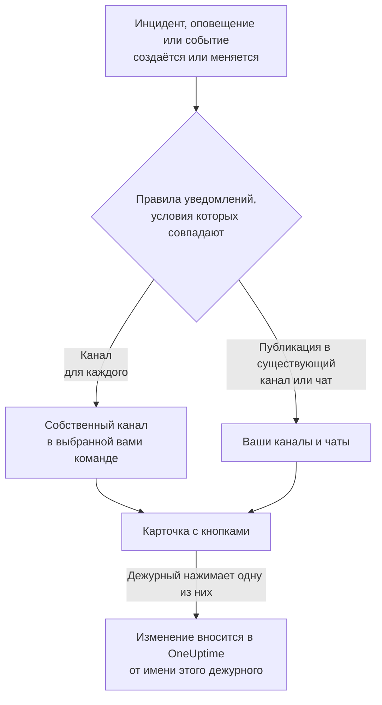

# Microsoft Teams

Подключите OneUptime к Microsoft Teams, чтобы публиковать в ваших каналах и чатах инциденты, оповещения, эпизоды, плановое обслуживание, мониторы и обновления дежурств, давать каждому инциденту собственный канал и позволять дежурным действовать из Teams: подтверждать, устранять, добавлять заметки, вызывать дежурных, объявлять инциденты и задавать вопросы OneUptime AI.

:::cards
- [Подключение Microsoft Teams](#подключение-microsoft-teams): Согласие администратора, ваш вход и приложение в каждой команде.
- [Просьба ко всем подключиться](#просьба-ко-всем-подключиться): Отправьте сообщение сразу всем участникам, которые не подключили свою учётную запись.
- [Правила уведомлений](#правила-уведомлений): Решите, какие события и куда публикуются и какие получают собственный канал.
- [Общение с ботом OneUptime](#общение-с-ботом-oneuptime): Команды, вопросы и формы в чате с ботом.
- [Дежурные теги](#дежурные-теги): Поддерживайте тег команды в соответствии с теми, кто дежурит, и вызывайте его.
- [Действия с инцидентами, оповещениями и событиями из Microsoft Teams](#действия-с-инцидентами-оповещениями-и-событиями-из-microsoft-teams): Кнопки на карточках OneUptime.
:::

## Как это работает

Это работает благодаря трём вещам:

- **Подключение проекта**, выполняется один раз: администратор Microsoft 365 даёт согласие на приложение OneUptime для вашей организации.
- **Приложение OneUptime в каждой команде**, в которой вы хотите получать уведомления. Microsoft позволяет боту публиковать только в команде, в которую он добавлен.
- **Собственное подключение каждого человека**: его учётная запись Microsoft Teams, связанная с его учётной записью OneUptime. Кнопки, команды и реакции действуют от имени этого человека, с его правами в проекте.

Одна организация Microsoft 365 может быть подключена к нескольким проектам, например к рабочему и тестовому. Кнопка карточки действует в проекте той записи, к которой относится карточка. Сообщение боту действует в проекте канала, в котором оно отправлено, например канала инцидента, а иначе — в единственном проекте, в котором подключена учётная запись Microsoft Teams отправителя. Если ничто этого не подсказывает, бот называет проекты, в которых состоит этот человек, и просит его повторить попытку из канала нужного проекта.

## Перед началом

- **Роль, которой разрешено подключать проект:** **Владелец проекта**, **Администратор проекта** или **Участник проекта**. Для удаления нужна роль **Владелец проекта** или **Администратор проекта**.
- **Администратор Microsoft 365**, который даст согласие администратора, один раз для всей организации.
- **Тариф Growth в OneUptime Cloud** для правил уведомлений и сводок. См. [Правила уведомлений ниже тарифа Growth](#правила-уведомлений-ниже-тарифа-growth).
- **На собственном сервере** сначала настроенный для него бот Teams. См. [Интеграция с Microsoft Teams](/docs/self-hosted/microsoft-teams-integration).

## Подключение Microsoft Teams

:::steps
### Дайте согласие администратора

Откройте **Настройки проекта** > **Рабочее пространство** > **Microsoft Teams** и нажмите **Предоставить согласие администратора**. Администратор Microsoft 365 входит в систему и разрешает приложение OneUptime для организации. После этого на карточке написано **Admin Consent Completed**. Пока ни одно рабочее пространство не подключено, раздел **Рабочее пространство** в меню «Инциденты», «Оповещения», «Плановое обслуживание», «Мониторы» и «Дежурство» содержит **Подключить Slack или Teams**, который тоже ведёт сюда.

### Подключите свою учётную запись

Нажмите **Connect with Microsoft Teams** и войдите с рабочей учётной записью. OneUptime читает команды вашей организации; **Просмотреть команды** показывает их список.

### Добавьте приложение OneUptime в каждую команду (обязательно)

Одного подключения учётной записи недостаточно. Microsoft позволяет боту OneUptime публиковать только в команде, в которую он добавлен, поэтому сделайте это для каждой команды, в которой вы хотите получать уведомления:

- В Microsoft Teams нажмите "..." рядом с **названием команды** (а не канала).
- Выберите **Manage team** > **Apps** > **More apps**, найдите **OneUptime** и нажмите **Add**.

В OneUptime Cloud **Открыть Teams Store** открывает приложение в магазине Microsoft Teams, где **Add to a team** делает то же самое. На собственном сервере вместо этого установите пакет из **Скачать ZIP-архив манифеста приложения**: только он содержит бота вашего сервера. Если тестовое уведомление сообщает, что приложение OneUptime не установлено в команде, пропущен именно этот шаг.

### Подключите всех остальных

Каждый человек связывает свою учётную запись Microsoft Teams в **Настройки пользователя** > **Рабочее пространство** > **Microsoft Teams** с помощью **Connect my account with Microsoft Teams**, чтобы действовать с инцидентами и получать личные сообщения от своего имени. Этот раздел появляется, как только проект подключён к Microsoft Teams. Чтобы подключить сразу всю команду, см. [Просьба ко всем подключиться](#просьба-ко-всем-подключиться).

### Добавьте правило уведомлений

Откройте **Инциденты** > **Рабочее пространство** > **Microsoft Teams**. Раздел **Рабочее пространство** показывает только те чат-пространства, которые подключил ваш проект, поэтому **Microsoft Teams** появляется там, как только он подключён. Создайте правило, например такое, которое публикует в канал Teams при создании инцидента, затем нажмите **Тестовое правило** в его строке.
:::

> [!NOTE]
> Установка OneUptime для себя или добавление его в чат — это другая установка, и она не позволяет ему публиковать в каналы команды. **Приватным каналам** нужно приложение, добавленное в сам канал: откройте канал > "..." > **Manage channel** > **Apps** > **Add an app**. **Общие каналы** не могут получать уведомления: Microsoft Teams не поддерживает ботов в общих каналах.

## Просьба ко всем подключиться

Никто не может подключить чужую учётную запись Microsoft Teams, даже администратор: каждый сам входит в свою учётную запись. Чтобы подключить всю команду, **Владелец проекта** или **Администратор проекта** просит об этом всех сразу на странице **Настройки проекта** > **Рабочее пространство** > **Microsoft Teams**. Карточка **Members' Microsoft Teams accounts** показывает, сколько участников уже подключились. По кнопке **Ask everyone to connect** бот OneUptime отправляет каждому участнику, который ещё не подключился, сообщение с кнопкой **Connect Microsoft Teams account**, которая подключает его учётную запись одним нажатием.

- **Кто получает сообщение.** Каждый участник проекта, который не подключил свою учётную запись Microsoft Teams и состоит в команде, куда добавлено приложение OneUptime; OneUptime находит его там по адресу электронной почты или имени участника-пользователя (UPN). Того, кого просили за последние 24 часа, повторно не просят, поэтому повторная просьба на следующий день напомнит только тем, кто так и не подключился.
- **Что сообщает карточка.** Ход рассылки, пока сообщения отправляются, а затем — кто попросил и сколько участников получили сообщение. Участники, которых OneUptime не нашёл, названы на карточке: добавьте приложение в их команду или попросите их подключиться самостоятельно в **Настройки пользователя** > **Рабочее пространство** > **Microsoft Teams**.
- **Что подключает кнопка.** Учётную запись Microsoft Teams того, кто её нажал и вошёл в систему, — к его собственной учётной записи OneUptime. Сообщение, пересланное кому-то другому, ничего не подключает участнику, которому оно было отправлено.

## Правила уведомлений

Правило уведомлений определяет, какие события публикуются в Microsoft Teams и куда. У каждого продукта свои правила, в разделе **Рабочее пространство** > **Microsoft Teams** его меню:

| Продукт | Вкладки на его странице **Microsoft Teams** |
| --- | --- |
| **Инциденты** | **Инциденты**, **Инцидент Эпизоды**, **Сводка** |
| **Оповещения** | **Оповещения**, **Оповещение Эпизоды**, **Сводка** |
| **Плановое обслуживание** | Один список правил |
| **Мониторы** | Один список правил |
| **Дежурство** | Один список правил |

Создание правила проходит в четыре шага:

| Шаг | Что вы задаёте |
| --- | --- |
| **Базовый** | **Имя правила** и **Описание правила**. |
| **Условия** | К каким событиям относится правило, например по серьёзности, состоянию, метке, монитору или словам в заголовке. Они проверяются при создании события и снова при каждом обновлении, которое OneUptime о нём публикует, поэтому правило для подтверждённых инцидентов срабатывает, когда инцидент подтверждают. Новое правило относится ко всем событиям, например **Все инциденты**. Чтобы сузить его, выберите **Только инциденты, соответствующие условиям** и добавьте условия. Если условий два или больше, **Условие совпадения** определяет, должны ли совпасть все или достаточно одного. |
| **Назначение** | Куда оно публикует: в существующий канал выбранной вами команды, в выбранные вами чаты, в канал для каждого инцидента (или оповещения, эпизода, события, монитора или политики дежурства), создаваемый в выбранной вами команде, или в несколько из них сразу. Под шагом **Что делает это правило** говорит это предложениями, как карточка правила. |
| **Video Call** | Только инциденты и оповещения: начать звонок для каждого из них. См. [Видеозвонки](/docs/workspace-connections/video-calls). |

Канал, который создаёт правило, называется по своей записи: инцидент INC-42 получает `inc-42`, оповещение ALT-7 получает `alt-7`, а в проекте без префиксов номеров инцидент 42 получает `incident-42`. Текст из **Префикс названия канала** ставится впереди, так что из `prod-` получается `prod-inc-42`, а форма показывает название, пока вы печатаете. У события запланированного обслуживания префикс заменяет его префикс номера: SM-5 получает `sm-5`, а из `maint-` получается `maint-5`. OneUptime оставляет буквы, цифры, пробелы, `-` и `_`, до 50 символов, которые принимает Microsoft Teams. Если в команде уже есть канал с таким названием, например другого проекта или удалённый за последние 30 дней, OneUptime добавляет `-2`, `-3` и так далее.

Правило создаёт свой канал, когда событие впервые подпадает под него: при создании события или позже, когда обновление делает его подходящим, пока оно ещё открыто. Правило для подтверждённых инцидентов создаёт канал, когда инцидент подтверждают. Microsoft Teams показывает каналы команды всем её участникам, поэтому OneUptime никого не добавляет в канал по одному: открыть его может каждый в выбранной вами команде, как и говорит форма правила под **Кто присоединяется к каналу**. Приватный инцидент, приватное оповещение или приватный эпизод получает приватный канал, который видят только его участники; добавляйте людей в Microsoft Teams.

Чтобы привлечь дежурных, выберите их расписания дежурств в поле **Упомянуть дежурных**. При создании канала OneUptime публикует в нём, сразу после первого сообщения записи, сообщение с @упоминанием тех, кто дежурит по этим расписаниям, чтобы Microsoft Teams их уведомил. Никого не вызывают. OneUptime находит каждого в команде по учётной записи Microsoft Teams, которую тот подключил к OneUptime, а иначе по его адресу электронной почты. Тот, кого нет в команде, не может открыть её каналы, поэтому вместо этого его называют в сообщении вместе с причиной. Приватный канал могут открыть только его участники, поэтому добавьте в него дежурных в Microsoft Teams.

Каждое последующее обновление записи — смена состояния, заметка, новый владелец — публикуется в её каналах и в существующих каналах и чатах, указанных её правилами, пока выполняются их условия. OneUptime не может архивировать канал Microsoft Teams, поэтому канал правила остаётся, когда запись завершена; архивируйте или удалите его в Microsoft Teams.

У инцидента, оповещения, эпизода или события запланированного обслуживания с собственным каналом в заголовке его страницы в OneUptime, рядом с кнопками состояний, есть **Открыть в Microsoft Teams**. Кнопка открывает этот канал в новой вкладке, в приложении Microsoft Teams или в браузере. Если у записи два собственных канала, кнопка перечисляет оба. У записи с каналами и в Slack, и в Microsoft Teams вместо этого одна кнопка **Открыть канал**, которая перечисляет их все. Существующие каналы и чаты, в которые публикуют ваши правила, не предлагаются.

На странице записи есть и карточка **Канал Microsoft Teams**, которая говорит, кто может открыть канал: все в команде или, для приватного канала, его участники, которых добавляют его владельцы в Microsoft Teams. OneUptime не меняет состав канала Microsoft Teams. Для канала Slack карточка показывает, кто в нём, и добавляет людей: см. [Кто в канале записи](/docs/workspace-connections/slack#кто-в-канале-записи).

Каналы и чаты остаются читаемыми: каждое событие публикуется один раз, а первое состояние записи указано в карточке, которая объявляет запись, а не в отдельной карточке. Запуск политики дежурства — это одна карточка, которая редактируется по мере эскалации: кого вызвали, сколько раз и как, кого не вызвали и почему, и кто подтвердил. Новая карточка публикуется, только когда кому-то нужно действовать: правило эскалации никого не достигло, или запуск закончился, а никто так и не подтвердил. То, что владельцы записи или подписчики страницы статуса получили уведомление, остаётся в её ленте в OneUptime.

**Настройки проекта** > **Рабочее пространство** > **Microsoft Teams** показывает каналы, которые OneUptime видит в ваших командах, и чаты, в которые он добавлен, с **Отправить тест** рядом с каждым. Чат появляется, как только в него добавлено приложение OneUptime в Microsoft Teams; **Refresh Chats** подтягивает новые чаты и их текущие названия.

## Проверка правила

**Тестовое правило** в строке правила публикует тестовое сообщение этого правила в указанные им каналы, чтобы вы увидели, как оно приходит. Если правило создаёт канал для каждого события, проверка тоже создаёт канал и приглашает в него людей правила.

Как и **Отправить тест** рядом с каналом в **Настройки проекта** > **Рабочее пространство** > **Microsoft Teams**, для этого нужно право создавать правила уведомлений: **Владелец проекта**, **Администратор проекта**, **Участник проекта**, **Администратор настроек**, **Участник настроек** или **Create Workspace Notification Rule** и **Read Workspace Notification Rule** в пользовательской роли. Для того, кто может только просматривать правила, например **Зритель**, кнопка **Тестовое правило** заблокирована, а её подсказка говорит, что для этого нужно; API отклоняет такую проверку с "You do not have permission to send test notifications in this project." В OneUptime Cloud для проверки правила нужен тариф **Growth**, как и для добавления правила.

В OneUptime Cloud для **Отправить тест** рядом с каналом или чатом тоже нужен тариф **Growth**, ведь публикация в канал — это то, что делают правила и сводки. Для **Отправить тест сейчас** в сводке нужно право создавать сводки (**Create Workspace Notification Summary** и **Read Workspace Notification Summary** в пользовательской роли), а в OneUptime Cloud — тариф **Growth**; для всех остальных кнопка заблокирована, а её подсказка говорит, что для этого нужно. MCP-клиент, подключённый с доступом только на чтение, не может отправить ни одной проверки.

## Сводки

Вкладка **Сводка** в **Инциденты** > **Рабочее пространство** > **Microsoft Teams** (и в **Оповещения**) публикует периодическую сводку в указанные вами каналы: сколько было инцидентов или оповещений, как быстро их подтвердили и устранили, и список со ссылками. Новая сводка выходит каждую неделю и охватывает последние 7 дней. Оставьте **Отправить первый отчёт в** пустым, и первая сводка выйдет в 09:00 в начале следующей недели, дня или месяца; форма показывает, когда именно.

Сводка выходит по часам своего **Часовой пояс**, который по умолчанию совпадает с вашим. Она сохраняет там своё время суток весь год: сводка, настроенная на 09:00 в Берлине, по-прежнему выходит в 09:00 по Берлину после перехода на летнее время, и даты в её сообщении тоже берлинские. Через API передайте `timezone` как имя часового пояса IANA, например `Europe/Berlin`. Сводка, созданная без часового пояса, берёт часовой пояс из профиля своего создателя или UTC, если её создаёт ключ API.

Форма сводки состоит из четырёх шагов: **Основная информация** (её название, каналы и их **Название команды**), **Расписание**, **Содержимое** (**Что включить**) и **Фильтры** (какие инциденты или оповещения она учитывает).

## Правила уведомлений ниже тарифа Growth

В OneUptime Cloud правила уведомлений и сводки доступны на тарифе **Growth** и выше. Проект на более низком тарифе сохраняет уже имеющиеся правила и сводки, и они продолжают публиковать в Microsoft Teams. Поэтому страница **Microsoft Teams** каждого продукта («Инциденты», «Оповещения», «Плановое обслуживание», «Дежурство», «Мониторы») показывает примечание о тарифе со списком под ним (**Оставшиеся правила уведомлений**, **Оставшиеся сводки**): удалите правило либо отключите или удалите сводку. Для добавления или изменения правил и сводок нужен **Growth**.

## Вызовы в Microsoft Teams

Чтобы получать вызовы личным сообщением во время дежурства, добавьте Microsoft Teams как один из своих методов уведомлений:

:::steps
1. Подключите свою учётную запись Microsoft Teams (см. [Подключение Microsoft Teams](#подключение-microsoft-teams)).
2. Откройте **Настройки пользователя** > **Методы уведомлений**, перейдите на вкладку **Workspace Apps** и нажмите **Add Microsoft Teams Account**.
3. Нажмите **Send Test Message** в её строке. Сообщение придёт в ваши чаты Microsoft Teams.
:::

После добавления она сразу включается в ваши правила дежурства, так что с этого момента вызовы приходят вам в Microsoft Teams. Какие вызовы она получает, можно изменить в **Настройки пользователя** > **Правила дежурства**.

## Сохранение сообщений как заметок

Отреагируйте на сообщение или ответ в канале, который OneUptime создал для инцидента, оповещения, эпизода или события планового обслуживания, и OneUptime сохранит его как заметку к этой записи. Он замечает реакцию в течение минуты и подтверждает ответом в треде:

| Реакция | Сохраняется как |
| --- | --- |
| 📌 или 📍 | Приватная заметка, видимая только вашей команде |
| 📣 или 📢 | Публичная заметка, показанная на странице статуса. Только инциденты и события планового обслуживания. В приватном инциденте — приватная заметка, а подтверждение объясняет почему. |

Заметка сохраняет сообщение таким, каким его показывал Microsoft Teams: форматирование, ссылки и код, упомянутых людей по именам, а файлы и изображения — в виде ссылок на них. Публичная заметка не включает файлы и изображения, так как они открываются только для вашей команды.

Это слова того, кто написал сообщение: его имя в OneUptime, если его учётная запись Microsoft Teams подключена, иначе имя, которое показывает Teams. Приватная заметка встаёт в ленту событий на момент публикации сообщения, сколько бы времени ни прошло до сохранения. Публичная заметка встаёт на момент сохранения, то есть когда её показывает страница статуса. Лента показывает, кто её сохранил. Заметка не публикуется обратно в канал, где сообщение уже есть.

Заметка сохраняется от вашего имени, с вашими правами, а приложение OneUptime должно быть в команде. Если ваша учётная запись Microsoft Teams ещё не подключена, OneUptime попросит вас подключить её в ответе, где вас упоминают, с кнопкой, которая сохранит сообщение, как только вы это сделаете.

## Общение с ботом OneUptime

Напишите боту в личном чате или упомяните OneUptime через @ в канале или групповом чате: там он отвечает, только когда его упоминают.

| Сообщение | Что делает бот |
| --- | --- |
| `help` | Показывает, что он умеет. |
| `incident [title or number]` | Открывает форму инцидента с заполненным заголовком. Номер инцидента, например `42` или `INC-42`, вместо этого показывает этот инцидент: см. [Управление инцидентом из Microsoft Teams](#управление-инцидентом-из-microsoft-teams). |
| `maintenance [title]` | Открывает форму планового обслуживания с заполненным заголовком. |
| `oncall` | Показывает, кто дежурит прямо сейчас в каждом доступном вам расписании дежурств, до какого времени и кто следующий. |
| `page [who] [message]` | Вызывает людей, которых вы упоминаете через @, по вашему сообщению или отправляет карточку, где вы выбираете, кого вызвать. См. [Вызов людей из Microsoft Teams](#вызов-людей-из-microsoft-teams). |
| `ask [question]` или любой вопрос обычным языком | OneUptime AI отвечает о ваших журналах, трассировках, метриках, инцидентах и мониторах, например «какие мониторы сейчас не работают?». Ответы только читают данные. |
| `show active incidents`, `show active alerts` | Показывает то, что открыто сейчас. |
| `show scheduled maintenance`, `show ongoing maintenance` | Показывает предстоящие или текущие события обслуживания. |

Кроме списков `show`, это те же слова, что идут после `/oneuptime` в Slack; `create incident` и `create maintenance` тоже по-прежнему работают. Для вопросов OneUptime AI нужны ваша подключённая учётная запись Microsoft Teams и включённый для проекта ИИ. Если ваша учётная запись не подключена, бот один раз в каждой ветке или чате просит подключить её, с кнопкой **Connect Microsoft Teams account**. См. [Спросить ИИ](/docs/ai/ask-ai).

## Ваша главная в Microsoft Teams

Напишите боту OneUptime `home`, и он ответит вашей главной: карточкой о том, что происходит в проекте, в том объёме, который вам доступен.

- **Ваше дежурство.** Расписания дежурств, в которых вы дежурите сейчас, и до какого времени, или иначе ваша следующая смена.
- **Что открыто.** Самые новые открытые инциденты и оповещения, которые вам можно читать, каждый со ссылкой на его страницу в OneUptime.
- **Кнопки.** **Declare incident** и **Page someone** отвечают так же, как `incident` и `page`, **Who's on call** — как `oncall`, а **Refresh** перечитывает карточку на её месте.

Когда вы добавляете приложение OneUptime для себя, бот сразу присылает вам вашу главную. Главная и списки `show` читают данные от вашего имени, поэтому им нужна ваша подключённая учётная запись Microsoft Teams: пока она не подключена, бот отвечает кнопкой **Connect Microsoft Teams account**. **Открыть OneUptime в Microsoft Teams** в разделе **Настройки пользователя** > **Рабочее пространство** > **Microsoft Teams** открывает приложение в Teams.

Когда приложение добавляют в команду, бот здоровается там: как задать ему вопрос и где добавить правило уведомлений, которое публикует в каналы команды.

## Создание инцидентов и обслуживания из Microsoft Teams

Если написать боту OneUptime `incident` или `maintenance`, откроется форма для того, кто это написал, — в личном чате, канале или групповом чате одинаково. Она заполняется от имени этого человека: как учётная запись OneUptime, к которой подключена его учётная запись Microsoft Teams (см. [Подключение Microsoft Teams](#подключение-microsoft-teams)), с правами этой учётной записи в проекте. Тот, чья учётная запись не подключена или чья учётная запись OneUptime больше не участник проекта, вместо формы получает инструкцию, что делать, в ответе с упоминанием.

- **Кто может ими пользоваться.** Те, кто может объявить инцидент или создать событие планового обслуживания в OneUptime: **Владелец проекта**, **Администратор проекта**, **Участник проекта**, **Администратор инцидентов** и **Участник инцидентов** для инцидента (**Create Incident** в пользовательской роли), а также **Администратор планового обслуживания** и **Участник планового обслуживания** для события (**Create Scheduled Maintenance**). Все остальные получают об этом сообщение, а формы — нет.
- **Что предлагает форма.** Каждый список — серьёзности, мониторы, статусы мониторов, политики дежурства и метки — содержит то, что может читать запросивший форму человек, как и тот же список в OneUptime, а примечания "not shown" на карточке учитывают только это: при роли, ограниченной некоторыми метками, — мониторы и политики дежурства с этими метками. Список, который он не может читать вовсе, в форму не попадает. Архивные политики дежурства никогда не предлагаются.
- **Что может указывать форма.** В канале или групповом чате форму может отправить любой присутствующий, и она отправляется от имени того, кто это делает, с его собственными правами. Инцидент или событие создаётся с этими правами и записывается на этого человека. Монитор, политика дежурства, метка, серьёзность или статус, которые он не может читать, или относящиеся к другому проекту, отклоняются так, будто в проекте их нет, и ничего не создаётся: бот отвечает "One of the values you picked ... is not available in this project any more. Please pick it again."

**Execute On-Call Policy** для инцидента, оповещения или эпизода работает так же: нужно право выполнять политику дежурства (**Владелец проекта**, **Администратор проекта**, **Участник проекта**, **Администратор дежурств** и **Участник дежурств** или **Create On-Call Duty Policy Execution Log** в пользовательской роли) и право читать этот инцидент, оповещение или эпизод, а предлагаются действующие политики дежурства, которые этот человек может читать. Просмотр монитора или политики дежурства с карточки тоже читает их от имени того, кто нажал кнопку.

## Вызов людей из Microsoft Teams

В канале или групповом чате `@OneUptime page @Nawaz Dhandala The checkout API is throwing 500s` сразу вызывает Nawaz. OneUptime создаёт оповещение с вашим сообщением в качестве заголовка, и каждый, кого вы упоминаете через @, получает звонок, SMS, push-уведомление или письмо, как велят его собственные правила дежурства, пока кто-нибудь не подтвердит оповещение.

- **Кого вызывают сразу.** Людей, которых вы упоминаете через @, и тех, кто дежурит по расписаниям, которым следует упомянутый вами через @ тег (см. [Дежурные теги](#дежурные-теги)), если за ними следует сообщение. OneUptime узнаёт человека по учётной записи OneUptime, к которой подключена его учётная запись Microsoft Teams, а иначе по его адресу электронной почты в Microsoft Teams. Никого за пределами проекта не вызывают.
- **На всё остальное приходит карточка.** Если никто не упомянут через @, как в личном чате с ботом, нет сообщения, указан тег, который не следует ни одному видимому вам расписанию дежурств, либо есть человек, которого OneUptime не может узнать, бот отвечает карточкой **Page someone**, уже заполненной тем, что вы написали, и говорит, кого не удалось выбрать. Выберите людей, команду, расписание дежурств, которое вызывает того, кто дежурит в нём сейчас, или политику дежурства, которая вызывает по своим правилам эскалации, и отправьте карточку. Отправить карточку может любой участник беседы, от своего имени. Когда вызов выполнен, карточка удаляется, чтобы никто не вызвал с её помощью дважды.
- **Где это видно.** Беседа показывает вызов одной карточкой, которая обновляется: кого и как вызвали и кто подтвердил. Если бот не может её опубликовать, его ответ говорит, кого вызвали, со ссылкой на оповещение.
- **Кто может вызывать.** Все, кто может и выполнять политику дежурства, и создавать оповещения: **Владелец проекта**, **Администратор проекта** и **Участник проекта** или **Участник дежурств** вместе с **Участник оповещений** (**Create On-Call Duty Policy Execution Log** и **Create Alert** в пользовательской роли). Чтобы вызвать людей, команду или расписание напрямую, без политики дежурства за вызовом, нужен ещё доступ ко всем политикам дежурства проекта. Все остальные узнают об этом из ответа, и никого не вызывают. В OneUptime Cloud для вызова нужен тариф Growth: на более низком тарифе OneUptime называет нужный тариф, и никого не вызывают.

## Дежурные теги

Поддерживайте состав тега Microsoft Teams, например `@Payments on-call`, в соответствии с теми, кто дежурит по одному или нескольким расписаниям дежурств, чтобы любой участник его команды мог упомянуть его через @ и связаться с дежурными. OneUptime меняет участников тега при каждой передаче смены и каждой замене и проверяет его каждые 15 минут.

:::steps
### Подключите тег к расписанию

Откройте расписание в разделе **Дежурство** > **Расписания дежурств**. На его карточке **Теги Microsoft Teams** нажмите **Подключить тег**, выберите команду и укажите имя тега: тег команды с этим именем или новый, который создаст OneUptime. Его участники сразу заменяются теми, кто дежурит.

### Подключите его и ко второму расписанию

Чтобы в теге были и основной, и резервный дежурный, подключите тот же тег на странице резервного расписания. Тег может следовать любому числу расписаний.
:::

- **Что показывает карточка.** Кто сейчас в каждом теге, его команда, каким ещё расписаниям он следует и отмечен ли он как **Актуально**. В тег входят только участники его команды: дежурный не из команды назван вместе с причиной.
- **Никто не дежурит.** OneUptime убирает всех из тега, пока кто-то не заступит на дежурство. Для нового тега нужен дежурный из команды, потому что Microsoft Teams не создаёт пустых тегов.
- **Вызов тега.** `@OneUptime page @Payments on-call The checkout API is down` вызывает тех, кто дежурит по расписаниям, которым следует тег. См. [Вызов людей из Microsoft Teams](#вызов-людей-из-microsoft-teams).
- **Что нужно Microsoft 365.** Чтобы менять теги, приложению нужно разрешение `TeamworkTag.ReadWrite.All`, которое администратор Microsoft 365 предоставляет кнопкой **Предоставить согласие администратора** в разделе **Настройки проекта** > **Рабочее пространство** > **Microsoft Teams**. Если ваша организация дала согласие до того, как OneUptime научился поддерживать теги, дайте его ещё раз.
- **Кто может подключить тег.** Роли, которым можно редактировать расписания: **Владелец проекта**, **Администратор проекта**, **Участник проекта**, **Администратор дежурств** и **Участник дежурств** или **Edit On-Call Duty Policy Schedule** в пользовательской роли. В OneUptime Cloud для подключения нужен тариф **Growth**.
- **Отключение.** OneUptime перестаёт менять тег. Тег и его участники остаются в Microsoft Teams как есть.

## Управление инцидентом из Microsoft Teams

У карточки инцидента четыре кнопки, **Acknowledge Incident**, **Resolve Incident**, **Add Note** и **View Incident**, а остальное — в её меню, кнопке с тремя точками:

| Пункт меню | Что он делает |
| --- | --- |
| **Change Severity** | Задаёт серьёзность инцидента. |
| **Change Incident State** | Переводит инцидент в более позднее состояние. |
| **Assign Role** | Даёт кому-то роль в инциденте, например **Incident Commander**. Роль для одного человека переходит к нему. |
| **Page Someone** | Вызывает людей, команду, того, кто сейчас дежурит по расписанию, или политику дежурства по инциденту, пока кто-нибудь его не подтвердит. |
| **Edit Custom Fields** | Задаёт пользовательские поля инцидента, каждое заполнено тем, что в инциденте есть. Поле, оставленное пустым, очищается. |

`incident 42`, написанное боту, отвечает инцидентом 42, этими кнопками и его меню. Пишите номер так, как его показывает OneUptime: `42`, `#42` или `INC-42`. В собственном канале инцидента `incident` без продолжения показывает этот инцидент.

- **Кто может ими пользоваться.** Те, кто может сделать то же изменение в OneUptime, как в Slack: см. [Управление инцидентом из Slack](/docs/workspace-connections/slack#управление-инцидентом-из-slack). Каждый пункт отвечает карточкой, заполненной так, как инцидент может видеть нажавший его человек. Любой участник беседы может отправить карточку от своего имени, со своими разрешениями.
- **Что происходит.** Изменение делается от имени того, кто отправил карточку, как в OneUptime, и лента инцидента сообщает, что изменилось. Бот говорит об этом в ответе, который упоминает этого человека, и удаляет карточку, чтобы никто не отправил её дважды. **Page Someone** сообщает, кого вызвали или почему никого; уже решённый инцидент никого не вызывает.
- **Чем отличается Microsoft Teams.** Карточка не может сказать под полем, что не так: значение, которое не подходит, указывается в ответе, а карточка остаётся, чтобы её исправили и отправили снова. Поле даты и времени — это день и время в вашем собственном часовом поясе. Старый клиент Teams показывает меню как дополнительные кнопки. `incident 42` отвечает в беседе, где инцидент видят все её участники.
- **Карточки, отправленные до меню.** У них остаётся кнопка **Execute On-Call Policy**, и она продолжает работать: **Page Someone** тоже вызывает политику дежурства. У оповещений и эпизодов их кнопка остаётся.

## Действия с инцидентами, оповещениями и событиями из Microsoft Teams

Кнопки на карточках OneUptime действуют от имени того, кто их нажимает, — в личном чате, канале или групповом чате одинаково: как учётная запись OneUptime, к которой подключена его учётная запись Microsoft Teams, с правами этой учётной записи в проекте. **Acknowledge**, **Resolve**, **Change State**, **Add Note** и **Execute On-Call Policy** для инцидента, оповещения или эпизода, а также **Mark as Ongoing**, **Mark as Complete**, **Change State** и **Add Note** для события планового обслуживания вносят то же изменение, что и то же действие в OneUptime, и оно записывается там на этого человека: хронология состояний и лента записи показывают, кто изменил состояние, а заметка — его. Заметка, сохранённая из сообщения с реакцией, публикуется так же.

- **Кто может ими пользоваться.** Те, кто может внести то же изменение в OneUptime. Чтобы подтвердить, устранить инцидент или изменить его состояние, нужно право менять его состояние: **Владелец проекта**, **Администратор проекта**, **Участник проекта**, **Администратор инцидентов** и **Участник инцидентов** или **Create Incident State Timeline** в пользовательской роли. Для оповещения, эпизода или события планового обслуживания нужно такое же право для их типа (например, **Create Alert State Timeline**), а для заметки — право публиковать заметки этого вида. Как и панель состояния в OneUptime, они не требуют права редактировать сам инцидент или оповещение. Все остальные получают об этом сообщение, и ничего не меняется.
- **Какие записи.** Те, которые этот человек может читать, как и в OneUptime: при роли, ограниченной некоторыми метками, — инциденты, оповещения, эпизоды и события с этими метками. Кнопка в любой другой записи объясняет причину, и ничего не меняется: в инциденте, на который не распространяется его роль, — "your access in this project does not include this incident. Ask a project admin for access to it."; в приватном инциденте, владельцем которого он не является, — "this incident is private, so only its owners and the project's owners and admins can see it. Ask one of them to add you as an owner."; а в инциденте, удалённом с тех пор, — "the incident was not found. It may have been deleted." В OneUptime Cloud изменение, которое не входит в тариф проекта, отклоняется с указанием нужного тарифа.
- **Что предлагает Change State.** Состояния, которые этот человек может читать и в которые запись может перейти дальше, в порядке проекта: ни одного раньше её текущего состояния, для эпизода так же, как для инцидента, оповещения или события планового обслуживания, поскольку смена состояния никогда не поднимает запись вверх по её списку (см. [Порядок — это настоящее ограничение, а не настройка отображения](/docs/incidents/states-and-severities#порядок-это-настоящее-ограничение-а-не-настройка-отображения)). Если он не может читать ни одного, бот отвечает "No incident states are available to you in this project. Ask a project admin for access to them."; если запись находится в последнем доступном ей состоянии, — "There is no later state to move this incident to." Ни в одном из случаев пустая карточка не показывается.
- **Add Note в приватном инциденте.** Приватный инцидент не принимает публичных заметок, поэтому его карточка не спрашивает тип заметки и добавляет приватную заметку. Карточка, отправленная до того, как он стал приватным, тоже добавляет приватную заметку и сообщает об этом. См. [Приватные инциденты принимают только приватные заметки](/docs/incidents/notes-owners-and-feed#приватные-инциденты-принимают-только-приватные-заметки).
- **Escalate.** **Escalate** на карточке выполняет её политику дежурства для инцидента, оповещения или эпизода, к которому относится карточка, от имени того, кто нажал кнопку, с теми же правами, что и **Execute On-Call Policy**. На карточку, которая не относится ни к одному из них, приходит ответ "This on-call policy can only be executed for an incident, an alert or an episode. Open the record you are paging about and use Execute On-Call Policy there.", и никого не вызывают.
- **Где человек получает ответ.** В ответе в той же беседе, в канале — в ветке карточки, с упоминанием этого человека, чтобы Microsoft Teams его уведомил. Кнопка, нажатая слишком поздно, сообщает, кто успел первым и когда, например "Incident INC-2 was already acknowledged by Simon Lee at 6:07 PM."
- **Если его учётная запись не подключена.** Ответ предлагает подключить её с помощью кнопки **Connect Microsoft Teams account**. Кнопка открывает его собственные настройки Microsoft Teams в OneUptime и подключает учётную запись за один шаг, после входа в OneUptime, если он нужен. Затем OneUptime завершает то, что он нажал, от его имени и отвечает в той же беседе; для кнопки, которая открывает форму, или для команды он просит нажать её или ввести её снова. Кнопка срабатывает один раз, в течение 30 минут, и только для учётной записи Microsoft, которая её нажала.

## Отключение

- **Отключить** отвязывает только вашу учётную запись Microsoft Teams и вместе с ней удаляет ваш метод уведомлений Microsoft Teams.
- **Uninstall OneUptime from Microsoft Teams** на странице **Настройки проекта** > **Рабочее пространство** > **Microsoft Teams** отключает проект. OneUptime перестаёт публиковать в Microsoft Teams, а меню **Рабочее пространство** перестают его показывать. Правила уведомлений и сводки сохраняются на случай повторного подключения.

> [!WARNING]
> Удаление также отвязывает учётную запись Microsoft Teams каждого участника проекта и удаляет методы уведомлений Microsoft Teams и правила дежурства, которые их использовали. Проект подключается к одной организации Microsoft 365: чтобы перенести его в другую, сначала выполните удаление.

## Устранение неполадок

:::details Проверка сообщает, что приложение OneUptime не установлено в команде
Microsoft отклонил публикацию, потому что бота нет в этой команде. Добавьте приложение в команду (см. [Подключение Microsoft Teams](#подключение-microsoft-teams)) или, для приватного канала, в сам канал. Добавление в одну команду ничего не даёт для других.
:::

:::details Microsoft Teams не подключился
Когда Microsoft возвращает вас без подключения, страница, с которой вы начали, показывает **Microsoft Teams не подключён**, и одна фраза объясняет причину: у вас нет нужного права, ссылка уже использована или истекла, вы вошли в другую организацию Microsoft 365 или в вашей организации ещё нет команд. См. [Подключение не завершилось](/docs/self-hosted/microsoft-teams-integration#подключение-не-завершилось), где описана каждая фраза и что делать.
:::

:::details Бот сообщает, что моя учётная запись не подключена
Нажмите **Connect Microsoft Teams account** в ответе бота, чтобы подключить её за один шаг, или свяжите её в **Настройки пользователя** > **Рабочее пространство** > **Microsoft Teams** с помощью **Connect my account with Microsoft Teams**. В обоих случаях вы входите в организацию, к которой подключён проект, — как гость, если вы там гость. Если вы гость и раньше подключили учётную запись своей организации, подключите её заново.
:::

:::details На собственном сервере не проходит ни одно уведомление
Приложение Teams, установленное в ваших командах, должно быть пакетом, собранным вашим сервером, и Microsoft должен иметь доступ к конечной точке бота вашего сервера. См. раздел устранения неполадок в [Интеграция с Microsoft Teams](/docs/self-hosted/microsoft-teams-integration#устранение-неполадок).
:::

## Дальнейшие шаги

:::cards
- [Slack](/docs/workspace-connections/slack): Те же уведомления и действия в Slack.
- [Видеозвонки](/docs/workspace-connections/video-calls): Дайте каждому инциденту звонок, опубликованный вместе с его обновлениями.
- [Интеграция с Microsoft Teams](/docs/self-hosted/microsoft-teams-integration): Настройка бота Teams на собственном сервере.
- [Объявление инцидента](/docs/incidents/declaring-incidents): Все способы, которыми начинается инцидент, и что при этом запускается.
:::
