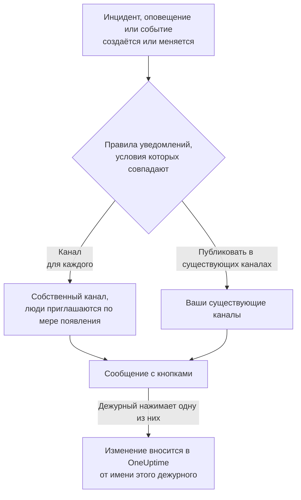

# Slack

Подключите OneUptime к Slack, чтобы публиковать в ваших каналах инциденты, оповещения, эпизоды, плановое обслуживание, мониторы и обновления дежурств, давать каждому инциденту собственный канал и позволять дежурным действовать, не выходя из Slack: подтверждать, устранять, добавлять заметки, вызывать дежурных и объявлять инциденты.

:::cards
- [Подключение Slack](#подключение-slack): Установите OneUptime в своё рабочее пространство, затем свяжите свою учётную запись.
- [Просьба ко всем подключиться](#просьба-ко-всем-подключиться): Отправьте сообщение сразу всем участникам, которые не подключили свою учётную запись.
- [Правила уведомлений](#правила-уведомлений): Решите, какие события и куда публикуются и какие получают собственный канал.
- [Кто в канале записи](#кто-в-канале-записи): Посмотрите, кто в нём, вступите в него и добавьте людей прямо со страницы записи.
- [Команда /oneuptime](#команда-oneuptime): Объявляйте инциденты, планируйте обслуживание, смотрите, кто дежурит, и задавайте вопросы ИИ.
- [Дежурные группы пользователей](#дежурные-группы-пользователей): Поддерживайте группу пользователей в соответствии с теми, кто дежурит, и вызывайте её.
- [Действия с инцидентами, оповещениями и событиями из Slack](#действия-с-инцидентами-оповещениями-и-событиями-из-slack): Кнопки в сообщениях OneUptime.
:::

## Как это работает

Это работает благодаря двум подключениям:

- **Подключение проекта**, выполняется один раз: приложение OneUptime, установленное в ваше рабочее пространство Slack. Оно публикует сообщения, создаёт каналы и приглашает людей.
- **Собственное подключение каждого человека**: его учётная запись Slack, связанная с его учётной записью OneUptime. Кнопки, команды и реакции эмодзи действуют от имени этого человека, с его правами в проекте.

Одно рабочее пространство Slack может быть подключено к нескольким проектам, например к рабочему и тестовому. Кнопка или форма действует в проекте той записи, к которой относится. Команды и сообщения для OneUptime действуют в проекте канала, в котором они написаны, например канала инцидента, а иначе — в единственном проекте, в котором подключена ваша учётная запись Slack. Если ничто этого не подсказывает, OneUptime спрашивает, какой проект вы имеете в виду, с кнопкой для каждого проекта, в котором вы состоите, и продолжает в выбранном. В разговоре с OneUptime AI ваш выбор действует до конца треда.

## Перед началом

- **Роль, которой разрешено подключать проект:** **Владелец проекта**, **Администратор проекта** или **Участник проекта**. Для удаления приложения нужна роль **Владелец проекта** или **Администратор проекта**.
- **Рабочее пространство Slack**, в которое вы можете устанавливать приложения.
- **Тариф Growth в OneUptime Cloud** для правил уведомлений и сводок. См. [Правила уведомлений ниже тарифа Growth](#правила-уведомлений-ниже-тарифа-growth).
- **На собственном сервере** сначала настроенное для него приложение Slack. См. [Интеграция со Slack](/docs/self-hosted/slack-integration).

## Подключение Slack

:::steps
### Установите OneUptime в рабочее пространство Slack

Откройте **Настройки проекта** > **Рабочее пространство** > **Slack** и нажмите **Connect with Slack**. Выберите рабочее пространство и разрешите доступ OneUptime. Slack вернёт вас на ту же страницу, где теперь указано рабочее пространство, к которому подключён проект. Пока ни одно рабочее пространство не подключено, раздел **Рабочее пространство** в меню «Инциденты», «Оповещения», «Плановое обслуживание», «Мониторы» и «Дежурство» содержит **Подключить Slack или Teams**, который тоже ведёт сюда.

### Подключите свою учётную запись Slack

Установка приложения связывает учётную запись того, кто его установил. Все остальные связывают свою учётную запись Slack в **Настройки пользователя** > **Рабочее пространство** > **Slack** с помощью **Connect my account with Slack**, чтобы действовать с инцидентами и получать личные сообщения от своего имени. Этот раздел появляется, как только проект подключён к Slack. Чтобы подключить сразу всю команду, см. [Просьба ко всем подключиться](#просьба-ко-всем-подключиться).

### Добавьте правило уведомлений

Откройте **Инциденты** > **Рабочее пространство** > **Slack**. Раздел **Рабочее пространство** показывает только те чат-пространства, которые подключил ваш проект, поэтому **Slack** появляется там, как только он подключён. Создайте правило, например такое, которое создаёт канал Slack для каждого нового инцидента со всеми, кто над ним работает: вызванными дежурными, руководителем инцидента и владельцами. См. [Правила уведомлений](#правила-уведомлений).

### Проверьте правило

Нажмите **Тестовое правило** в строке правила. Тестовое сообщение приходит в каналы, указанные в правиле. См. [Проверка правила](#проверка-правила).
:::

## Просьба ко всем подключиться

Никто не может подключить чужую учётную запись Slack, даже администратор: каждый сам входит в свою учётную запись. Чтобы подключить всю команду, **Владелец проекта** или **Администратор проекта** просит об этом всех сразу на странице **Настройки проекта** > **Рабочее пространство** > **Slack**. Карточка **Members' Slack accounts** показывает, сколько участников уже подключились. По кнопке **Ask everyone to connect** каждый участник, который ещё не подключился, получает от OneUptime личное сообщение в Slack с кнопкой **Connect Slack account**, которая подключает его учётную запись одним нажатием.

- **Кто получает сообщение.** Каждый участник проекта, который не подключил свою учётную запись Slack и которого OneUptime находит в Slack по адресу электронной почты. Того, кого просили за последние 24 часа, повторно не просят, поэтому повторная просьба на следующий день напомнит только тем, кто так и не подключился.
- **Что сообщает карточка.** Ход рассылки, пока сообщения отправляются, а затем — кто попросил и сколько участников получили сообщение. Участники, которых OneUptime не нашёл в Slack по адресу электронной почты, названы на карточке: они подключаются сами в **Настройки пользователя** > **Рабочее пространство** > **Slack**.
- **Что подключает кнопка.** Учётную запись Slack того, кто её нажал и вошёл в систему, — к его собственной учётной записи OneUptime. Сообщение, пересланное кому-то другому, ничего не подключает участнику, которому оно было отправлено.

## Правила уведомлений

Правило уведомлений определяет, какие события публикуются в Slack и куда. У каждого продукта свои правила, в разделе **Рабочее пространство** > **Slack** его меню:

| Продукт | Вкладки на его странице **Slack** |
| --- | --- |
| **Инциденты** | **Инциденты**, **Инцидент Эпизоды**, **Сводка** |
| **Оповещения** | **Оповещения**, **Оповещение Эпизоды**, **Сводка** |
| **Плановое обслуживание** | Один список правил |
| **Мониторы** | Один список правил |
| **Дежурство** | Один список правил |

Создание правила проходит в четыре шага:

| Шаг | Что вы задаёте |
| --- | --- |
| **Базовый** | **Имя правила** и **Описание правила**. |
| **Условия** | К каким событиям относится правило, например по серьёзности, состоянию, метке, монитору или словам в заголовке. Они проверяются при создании события и снова при каждом обновлении, которое OneUptime о нём публикует, поэтому правило для подтверждённых инцидентов срабатывает, когда инцидент подтверждают. Новое правило относится ко всем событиям, например **Все инциденты**. Чтобы сузить его, выберите **Только инциденты, соответствующие условиям** и добавьте условия. Если условий два или больше, **Условие совпадения** определяет, должны ли совпасть все или достаточно одного. |
| **Назначение** | Куда оно публикует: **Публиковать в существующих каналах** с названиями каналов, **Создавать канал для каждого инцидента** (или оповещения, эпизода, события, монитора или политики дежурства) с теми, кто к нему присоединяется, или и то и другое. Под шагом **Что делает это правило** говорит это предложениями, как карточка правила. |
| **Video Call** | Только инциденты и оповещения: начать звонок для каждого из них. См. [Видеозвонки](/docs/workspace-connections/video-calls). |

Канал, который создаёт правило, называется по своей записи: инцидент INC-42 получает `inc-42`, оповещение ALT-7 получает `alt-7`, а в проекте без префиксов номеров инцидент 42 получает `incident-42`. Текст из **Префикс названия канала** ставится впереди, так что из `prod-` получается `prod-inc-42`, а форма показывает название, пока вы печатаете. У события запланированного обслуживания префикс заменяет его префикс номера: SM-5 получает `sm-5`, а из `maint-` получается `maint-5`. Slack принимает строчные буквы, цифры, `-` и `_`, до 80 символов. Если канал с таким названием уже есть, например другого проекта или архивный, OneUptime добавляет `-2`, `-3` и так далее.

Правило создаёт свой канал, когда событие впервые подпадает под него: при создании события или позже, когда обновление делает его подходящим, пока оно ещё открыто. Правило для подтверждённых инцидентов создаёт канал, когда инцидент подтверждают. Приватный инцидент, приватное оповещение или приватный эпизод получает приватный канал.

**Кто присоединяется к каналу** перечисляет, кого правило добавляет в свой канал, каждого по мере появления в записи, а не только при создании канала: **Дежурные — по мере вызова**, **Руководитель инцидента и другие роли инцидента — по мере назначения** (инциденты и эпизоды инцидентов) и **Владельцы — по мере добавления**, все отмечены в новом правиле, а также люди, команды и расписания дежурств из **Также пригласить** при создании канала. Руководителя инцидента обычно назначают, когда кто-то впервые подтверждает инцидент, и тогда же он присоединяется к его каналу. Правило, сохранённое до того, как у ролей инцидента появился свой флажок, добавляет их, когда добавляет владельцев или дежурных, и его флажок показан отмеченным. Существующий канал, в который публикует правило, никого не получает.

Для расписания дежурств из **Также пригласить** к каналу присоединяется тот, кто дежурит по нему на момент создания канала, как его показывает страница расписания, и его не вызывают. Чтобы добавлять людей только в каналы некоторых инцидентов, задайте второму правилу эти условия и этих людей с тем же значением **Префикс названия канала**, что и у первого: правила, под которые инцидент подпадает при создании его канала, используют этот канал совместно, и каждое добавляет своих людей.

Каждое последующее обновление записи — смена состояния, заметка, новый владелец — публикуется в её каналах и в существующих каналах, указанных её правилами, пока выполняются их условия. Если включено **Архивировать канал, когда инцидент устранён** или его аналог для оповещений, эпизодов, событий, мониторов и политик дежурства, правило, создавшее канал, архивирует его, когда запись устранена, завершена или удалена, что бы ни говорили тогда его условия. Инцидент, оповещение или эпизод, созданный уже устранённым, не получает собственного канала; сообщение о его создании всё равно уходит в каналы, указанные вашими правилами. См. [Объявлен уже подтверждённым или устранённым](/docs/incidents/declaring-incidents#объявлен-уже-подтверждённым-или-устранённым).

У инцидента, оповещения, эпизода или события запланированного обслуживания с собственным каналом в заголовке его страницы в OneUptime, рядом с кнопками состояний, есть **Открыть в Slack**. Кнопка открывает этот канал в новой вкладке, в приложении Slack или в браузере. Если у записи два собственных канала, кнопка перечисляет оба. У записи с каналами и в Slack, и в Microsoft Teams вместо этого одна кнопка **Открыть канал**, которая перечисляет их все. Существующие каналы, в которые публикуют ваши правила, не предлагаются.

Канал остаётся читаемым: каждое событие публикуется один раз, а первое состояние записи указано в сообщении, которое объявляет запись, а не в отдельном сообщении. Запуск политики дежурства — это одно сообщение, которое редактируется по мере эскалации: кого вызвали, сколько раз и как, кого не вызвали и почему, и кто подтвердил. Новое сообщение публикуется, только когда кому-то нужно действовать: правило эскалации никого не достигло, или запуск закончился, а никто так и не подтвердил. Человека, чья учётная запись Slack не подключена к OneUptime, добавляют через учётную запись Slack с его адресом электронной почты. Того, кого OneUptime не находит ни тем, ни другим способом, или кто является гостем в Slack, нельзя добавить в канал; OneUptime говорит об этом один раз на канал, в одном сообщении, которое называет их всех и редактируется, когда список растёт. Отправьте им ссылку **Connect Slack account** из этого сообщения, чтобы они подключили учётную запись за один шаг. То, что владельцы записи или подписчики страницы статуса получили уведомление, остаётся в её ленте в OneUptime.

**Настройки проекта** > **Рабочее пространство** > **Slack** показывает каналы, которые видит OneUptime, с **Отправить тест** рядом с каждым. OneUptime сам вступает в публичный канал, когда впервые публикует в нём. Приватный канал появляется в списке и может получать публикации только после того, как приложение OneUptime приглашено в него в Slack.

## Кто в канале записи

У инцидента, оповещения, эпизода или события запланированного обслуживания с собственным каналом Slack на его странице в OneUptime есть карточка **Канал Slack**. Карточка показывает канал ссылкой, которая открывает его в Slack, приватный ли он и кто в нём, вас первым. С карточки, без администратора Slack:

- **Присоединиться к каналу** добавляет вас, если вас нет в канале.
- **Добавить людей** открывает список людей и команд проекта: выберите человека, чтобы добавить его, или команду, чтобы добавить всех её участников.

Приложение OneUptime добавляет их так же, как добавляет людей в канал правила. Приложение остаётся в каналах, которые создаёт, поэтому это работает и для приватного канала, из которого все вышли.

- **Кто может добавлять людей.** Тот, кто может редактировать запись: **Владелец проекта**, **Администратор проекта**, **Участник проекта**, **Администратор инцидентов** и **Участник инцидентов** для инцидента или **Edit Incident** в пользовательской роли, и такое же разрешение для оповещения, эпизода или события (например, **Edit Alert**). Все остальные видят, кто в канале и как туда попасть.
- **Кого можно добавить.** Того, кого OneUptime находит в Slack: по подключённой учётной записи Slack, а иначе по адресу электронной почты, который есть о нём в Slack. Карточка называет тех, кого не удалось добавить, и почему, например гостя, которого Slack не пускает в канал.
- **Что записывается.** Кто был добавлен и кем: в ленте записи (**Участник добавлен в канал**) и в **Настройки проекта** > **Уведомления** > **Журналы уведомлений**, на вкладке **Рабочее пространство**.
- **Как убрать человека.** OneUptime только добавляет людей: удалите человека из канала в Slack.

## Проверка правила

**Тестовое правило** в строке правила публикует тестовое сообщение этого правила в указанные им каналы, чтобы вы увидели, как оно приходит. Если правило создаёт канал для каждого события, проверка тоже создаёт канал и приглашает в него людей правила.

Как и **Отправить тест** рядом с каналом в **Настройки проекта** > **Рабочее пространство** > **Slack**, для этого нужно право создавать правила уведомлений: **Владелец проекта**, **Администратор проекта**, **Участник проекта**, **Администратор настроек**, **Участник настроек** или **Create Workspace Notification Rule** и **Read Workspace Notification Rule** в пользовательской роли. Для того, кто может только просматривать правила, например **Зритель**, кнопка **Тестовое правило** заблокирована, а её подсказка говорит, что для этого нужно; API отклоняет такую проверку с "You do not have permission to send test notifications in this project." В OneUptime Cloud для проверки правила нужен тариф **Growth**, как и для добавления правила.

В OneUptime Cloud для **Отправить тест** рядом с каналом тоже нужен тариф **Growth**, ведь публикация в канал — это то, что делают правила и сводки. Для **Отправить тест сейчас** в сводке нужно право создавать сводки (**Create Workspace Notification Summary** и **Read Workspace Notification Summary** в пользовательской роли), а в OneUptime Cloud — тариф **Growth**; для всех остальных кнопка заблокирована, а её подсказка говорит, что для этого нужно. MCP-клиент, подключённый с доступом только на чтение, не может отправить ни одной проверки.

## Сводки

Вкладка **Сводка** в **Инциденты** > **Рабочее пространство** > **Slack** (и в **Оповещения**) публикует периодическую сводку в указанные вами каналы: сколько было инцидентов или оповещений, как быстро их подтвердили и устранили, и список со ссылками. Новая сводка выходит каждую неделю и охватывает последние 7 дней. Оставьте **Отправить первый отчёт в** пустым, и первая сводка выйдет в 09:00 в начале следующей недели, дня или месяца; форма показывает, когда именно.

Сводка выходит по часам своего **Часовой пояс**, который по умолчанию совпадает с вашим. Она сохраняет там своё время суток весь год: сводка, настроенная на 09:00 в Берлине, по-прежнему выходит в 09:00 по Берлину после перехода на летнее время, и даты в её сообщении тоже берлинские. Через API передайте `timezone` как имя часового пояса IANA, например `Europe/Berlin`. Сводка, созданная без часового пояса, берёт часовой пояс из профиля своего создателя или UTC, если её создаёт ключ API.

Форма сводки состоит из четырёх шагов: **Основная информация** (её название и каналы), **Расписание**, **Содержимое** (**Что включить**) и **Фильтры** (какие инциденты или оповещения она учитывает).

## Правила уведомлений ниже тарифа Growth

В OneUptime Cloud правила уведомлений и сводки доступны на тарифе **Growth** и выше. Проект на более низком тарифе сохраняет уже имеющиеся правила и сводки, и они продолжают публиковать в Slack. Поэтому страница **Slack** каждого продукта («Инциденты», «Оповещения», «Плановое обслуживание», «Дежурство», «Мониторы») показывает примечание о тарифе со списком под ним (**Оставшиеся правила уведомлений**, **Оставшиеся сводки**): удалите правило либо отключите или удалите сводку. Для добавления или изменения правил и сводок нужен **Growth**.

## Вызовы в Slack

Чтобы получать вызовы личным сообщением во время дежурства, добавьте Slack как один из своих методов уведомлений:

:::steps
1. Подключите свою учётную запись Slack (см. [Подключение Slack](#подключение-slack)).
2. Откройте **Настройки пользователя** > **Методы уведомлений**, перейдите на вкладку **Workspace Apps** и нажмите **Add Slack Account**.
3. Нажмите **Send Test Message** в её строке. Сообщение придёт в ваши личные сообщения Slack.
:::

После добавления она сразу включается в ваши правила дежурства, так что с этого момента вызовы приходят вам в Slack. Какие вызовы она получает, можно изменить в **Настройки пользователя** > **Правила дежурства**.

## Сохранение сообщений как заметок

Отреагируйте на сообщение в канале инцидента, оповещения, эпизода или события планового обслуживания, и OneUptime сохранит его как заметку к этой записи, а затем подтвердит ответом в треде:

| Реакция | Сохраняется как |
| --- | --- |
| 📌 Эмодзи булавки или встроенное в Slack **Pin to channel** | Приватная заметка, видимая только вашей команде |
| 📢 Эмодзи мегафона или громкоговорителя | Публичная заметка, показанная на странице статуса. Только инциденты и события планового обслуживания. В приватном инциденте — приватная заметка, а подтверждение объясняет почему. |

Заметка сохраняет сообщение таким, каким его показывал Slack: форматирование, ссылки и код, упомянутых людей и каналы по именам, а файлы и изображения — в виде ссылок на них. Публичная заметка не включает файлы и изображения, так как они открываются только для вашей команды.

Это слова того, кто написал сообщение: его имя в OneUptime, если его учётная запись Slack подключена, иначе имя, которое показывает Slack. Приватная заметка встаёт в ленту событий на момент публикации сообщения, сколько бы времени ни прошло до сохранения. Публичная заметка встаёт на момент сохранения, то есть когда её показывает страница статуса. Лента показывает, кто её сохранил. Заметка не публикуется обратно в канал, где сообщение уже есть.

Заметка сохраняется от вашего имени, с вашими правами. Если ваша учётная запись Slack ещё не подключена, OneUptime попросит вас подключить её в сообщении, которое видите только вы, с кнопкой, которая сохранит сообщение, как только вы это сделаете. Сообщение сохраняется только один раз, сколько бы людей ни отреагировало.

## Команда /oneuptime

У OneUptime в Slack одна команда — `/oneuptime`. Слово, которое вы пишете после неё, говорит, что сделать; всё остальное после неё — вопрос к OneUptime AI.

| Команда | Что она делает |
| --- | --- |
| `/oneuptime help` | Показывает список команд с примерами. |
| `/oneuptime incident [title or number]` | Открывает форму инцидента с заполненным заголовком. Номер инцидента, например `42` или `INC-42`, вместо этого показывает этот инцидент: см. [Управление инцидентом из Slack](#управление-инцидентом-из-slack). |
| `/oneuptime maintenance [title]` | Открывает форму планового обслуживания с заполненным заголовком. |
| `/oneuptime oncall` | Показывает, кто дежурит прямо сейчас в каждом доступном вам расписании дежурств, до какого времени и кто следующий. |
| `/oneuptime page [who] [message]` | Вызывает людей, которых вы упоминаете через @, по вашему сообщению или открывает форму, где вы выбираете, кого вызвать. См. [Вызов людей из Slack](#вызов-людей-из-slack). |
| `/oneuptime ask [question]` или любой вопрос | OneUptime AI отвечает о ваших журналах, трассировках, метриках, инцидентах и мониторах. |

Ответы на `help` и `oncall` — это сообщения, которые видите только вы, под командой. Если первое слово похоже на команду с опечаткой, например `incidnet`, в ответ придёт команда, на которую оно похоже, а не ответ OneUptime AI. Формы инцидента и обслуживания действуют от вашего имени: см. [Создание инцидентов и обслуживания из Slack](#создание-инцидентов-и-обслуживания-из-slack).

> [!NOTE]
> `/oneuptime incident` и `/oneuptime maintenance` заменяют `/incident` и `/maintenance`, которые могли конфликтовать с одноимёнными командами других приложений Slack. Приложение Slack, созданное по более раннему манифесту, сохраняет их, и они открывают те же формы, пока приложение не будет обновлено: см. [Приложения, созданные по старому манифесту](/docs/self-hosted/slack-integration#приложения-созданные-по-старому-манифесту).

## Главная OneUptime в Slack

Откройте OneUptime в разделе **Apps** на боковой панели Slack: его вкладка **Home** показывает, что происходит в проекте, в том объёме, который вам доступен, и перечитывается при каждом открытии.

- **Ваше дежурство.** Расписания дежурств, в которых вы дежурите сейчас, и до какого времени, или иначе ваша следующая смена.
- **Что открыто.** Самые новые открытые инциденты и оповещения, которые вам можно читать, каждый со ссылкой на его страницу в OneUptime.
- **Кнопки.** **Declare incident**, **Schedule maintenance** и **Page someone** открывают те же формы, что `/oneuptime incident`, `/oneuptime maintenance` и `/oneuptime page`, а **Who's on call** отвечает так же, как `/oneuptime oncall`.

Главная читает данные от вашего имени, поэтому ей нужна ваша подключённая учётная запись Slack. Пока она не подключена, на главной есть кнопка **Connect Slack account**, а как только вы её подключите, главная покажет ваши данные.

В рабочем пространстве Slack, подключённом к нескольким проектам, главная показывает один проект за раз. Если ваша учётная запись Slack подключена в двух или более из них, меню **Switch project** рядом с названием проекта перечисляет остальные проекты, в которых вы состоите. Выберите один, чтобы увидеть его главную, и с этого момента главная открывается на нём, пока вы остаётесь его участником. Пока вы ничего не выбрали, она показывает тот из ваших проектов, который был подключён к Slack первым.

Когда кто-то добавляет OneUptime в канал, он публикует там приветствие: как задать ему вопрос и где добавить правило уведомлений, которое публикует в этот канал. Когда вы впервые открываете его вкладку **Messages**, он приветствует вас там: рассказывает, что он делает в Slack и с чего начать.

## Вопросы OneUptime AI из Slack

Задавайте вопросы о журналах, трассировках, метриках, инцидентах и мониторах обычным языком. Упомяните OneUptime через @ в канале или отправьте ему личное сообщение, и он ответит в треде. `/oneuptime ask which monitors are down?` публикует ответ в канале. Для обоих способов нужна подключённая учётная запись Slack и включённый для проекта ИИ. Ответы в Slack только читают данные: чтобы что-то изменить, используйте кнопки. См. [Спросить ИИ](/docs/ai/ask-ai).

OneUptime отвечает только на то, что обращено к нему.

- **В своём разговоре просто отвечайте.** Вопрос, который вы задаёте в канале, а не в треде, начинает разговор в треде под ним: отвечайте там, чтобы спросить ещё, не упоминая OneUptime снова, а остальные присоединяются, упомянув его.
- **В любом другом треде упоминайте OneUptime.** Например, под сообщением об инциденте упоминайте его каждый раз: на то, что люди пишут там друг другу, он не отвечает.
- **Если ваша учётная запись Slack не подключена.** OneUptime один раз в каждом разговоре просит подключить её, в сообщении, которое видите только вы, с кнопкой **Connect Slack account**.

## Создание инцидентов и обслуживания из Slack

`/oneuptime incident` и `/oneuptime maintenance` открывают форму, которую вы заполняете и отправляете от своего имени: как учётная запись OneUptime, к которой подключена ваша учётная запись Slack (см. [Подключение Slack](#подключение-slack)), с правами этой учётной записи в проекте. Если ваша учётная запись Slack не подключена или ваша учётная запись OneUptime больше не участник проекта, OneUptime сообщит, что делать, там, где вы выполнили команду, в сообщении, которое видите только вы, и форма не откроется. Ярлыки **Create New Incident** и **Create Scheduled Event** открывают те же формы.

- **Кто может ими пользоваться.** Те, кто может объявить инцидент или создать событие планового обслуживания в OneUptime: **Владелец проекта**, **Администратор проекта**, **Участник проекта**, **Администратор инцидентов** и **Участник инцидентов** для инцидента (**Create Incident** в пользовательской роли), а также **Администратор планового обслуживания** и **Участник планового обслуживания** для события (**Create Scheduled Maintenance**). Все остальные узнают об этом там, где выполнили команду, и форма не открывается.
- **Что предлагает форма.** Каждый список — серьёзности, мониторы, статусы мониторов, политики дежурства и метки — содержит то, что вы можете читать, как и тот же список в OneUptime: при роли, ограниченной некоторыми метками, — мониторы и политики дежурства с этими метками. Список, который вы не можете читать вовсе, в форму не попадает. Архивные политики дежурства никогда не предлагаются.
- **Что может указывать форма.** Инцидент или событие создаётся с вашими собственными правами и записывается на вас. Монитор, политика дежурства, метка, серьёзность или статус, которые вы не можете читать, или относящиеся к другому проекту, отклоняются так, будто в проекте их нет, даже из формы, открытой до изменения вашего доступа, и ничего не создаётся. OneUptime объясняет причину в канале, в сообщении, которое видите только вы.

**Execute On-Call Policy** для инцидента, оповещения или эпизода работает так же: нужно право выполнять политику дежурства (**Владелец проекта**, **Администратор проекта**, **Участник проекта**, **Администратор дежурств** и **Участник дежурств** или **Create On-Call Duty Policy Execution Log** в пользовательской роли) и право читать этот инцидент, оповещение или эпизод, а предлагаются действующие политики дежурства, которые вы можете читать.

## Вызов людей из Slack

`/oneuptime page @nawaz The checkout API is throwing 500s` сразу вызывает Nawaz. OneUptime создаёт оповещение с вашим сообщением в качестве заголовка, и каждый, кого вы упоминаете через @, получает звонок, SMS, push-уведомление или письмо, как велят его собственные правила дежурства, пока кто-нибудь не подтвердит оповещение.

- **Кого вызывают сразу.** Людей, которых вы упоминаете через @, и тех, кто дежурит по расписаниям, которым следует упомянутая вами через @ группа пользователей (см. [Дежурные группы пользователей](#дежурные-группы-пользователей)), если за ними следует сообщение. OneUptime узнаёт человека по учётной записи OneUptime, к которой подключена его учётная запись Slack, а иначе по адресу электронной почты, который есть о нём в Slack. Никого за пределами проекта не вызывают.
- **Всё остальное открывает форму.** Если никто не упомянут через @, нет сообщения, указан `@here` или группа пользователей, которая не следует ни одному видимому вам расписанию дежурств, либо есть человек, которого OneUptime не может узнать, открывается форма **Page someone**, уже заполненная тем, что вы написали, и в ней сказано, кого не удалось выбрать. Выберите людей, команду, расписание дежурств, которое вызывает того, кто дежурит в нём сейчас, или политику дежурства, которая вызывает по своим правилам эскалации, и отправьте форму. Имя, которое вы пишете первым, как в `/oneuptime page Primary The disk is full`, выбирает расписание, команду или политику с этим именем.
- **Где это видно.** Канал показывает вызов одним сообщением, которое обновляется: кого и как вызвали и кто подтвердил. Там, где OneUptime не может публиковать, например в приватном канале, куда его не пригласили, сообщение, которое видите только вы, говорит, кого вызвали, со ссылкой на оповещение.
- **Кто может вызывать.** Все, кто может и выполнять политику дежурства, и создавать оповещения: **Владелец проекта**, **Администратор проекта** и **Участник проекта** или **Участник дежурств** вместе с **Участник оповещений** (**Create On-Call Duty Policy Execution Log** и **Create Alert** в пользовательской роли). Чтобы вызвать людей, команду или расписание напрямую, без политики дежурства за вызовом, нужен ещё доступ ко всем политикам дежурства проекта. Все остальные узнают об этом там, где выполнили команду, и никого не вызывают. В OneUptime Cloud для вызова нужен тариф Growth: на более низком тарифе OneUptime называет нужный тариф, и никого не вызывают.

## Дежурные группы пользователей

Поддерживайте состав группы пользователей Slack, например `@payments-oncall`, в соответствии с теми, кто дежурит по одному или нескольким расписаниям дежурств, чтобы любой мог упомянуть её через @ и связаться с дежурными. OneUptime меняет участников группы при каждой передаче смены и каждой замене и проверяет её каждые 15 минут.

:::steps
### Подключите группу пользователей к расписанию

Откройте расписание в разделе **Дежурство** > **Расписания дежурств**. На его карточке **Группы пользователей Slack** нажмите **Подключить группу пользователей**, затем выберите одну из групп пользователей вашего рабочего пространства или **Создать новую группу пользователей** с именем и идентификатором. Её участники сразу заменяются теми, кто дежурит.

### Подключите её и ко второму расписанию

Чтобы в группе были и основной, и резервный дежурный, подключите ту же группу на странице резервного расписания. Группа может следовать любому числу расписаний.
:::

- **Что показывает карточка.** Кто сейчас в каждой группе, каким ещё расписаниям она следует и отмечена ли она как **Актуально**. Дежурный, которого нельзя добавить в группу, назван вместе с причиной: OneUptime находит человека по подключённой учётной записи Slack, а иначе по адресу электронной почты, который есть о нём в Slack, а Slack не добавляет гостей в группы пользователей.
- **Никто не дежурит.** Slack не может хранить пустую группу пользователей, поэтому OneUptime отключает группу, пока кто-то не заступит на дежурство, а затем снова включает её.
- **Вызов группы.** `/oneuptime page @payments-oncall The checkout API is down` вызывает тех, кто дежурит по расписаниям, которым следует группа. См. [Вызов людей из Slack](#вызов-людей-из-slack).
- **Что нужно Slack.** Группы пользователей доступны на платных тарифах Slack, а рабочее пространство может разрешать менять их только владельцам и администраторам: карточка подскажет, в чём дело и что сделать. Если Slack был подключён до того, как OneUptime научился поддерживать группы пользователей, один раз подключите его заново в разделе **Настройки проекта** > **Рабочее пространство** > **Slack**.
- **Кто может подключить группу.** Роли, которым можно редактировать расписания: **Владелец проекта**, **Администратор проекта**, **Участник проекта**, **Администратор дежурств** и **Участник дежурств** или **Edit On-Call Duty Policy Schedule** в пользовательской роли. В OneUptime Cloud для подключения нужен тариф **Growth**.
- **Отключение.** OneUptime перестаёт менять группу. Группа и её участники остаются в Slack как есть.

## Управление инцидентом из Slack

У сообщения инцидента четыре кнопки, **Acknowledge Incident**, **Resolve Incident**, **Add Note** и **View Incident**, а остальное — в его меню, кнопке с тремя точками после них:

| Пункт меню | Что он делает |
| --- | --- |
| **Change Severity** | Задаёт серьёзность инцидента. |
| **Change Incident State** | Переводит инцидент в более позднее состояние. |
| **Assign Role** | Даёт кому-то роль в инциденте, например **Incident Commander**. Роль для одного человека переходит к нему. |
| **Page Someone** | Вызывает людей, команду, того, кто сейчас дежурит по расписанию, или политику дежурства по инциденту, пока кто-нибудь его не подтвердит. |
| **Edit Custom Fields** | Задаёт пользовательские поля инцидента, каждое заполнено тем, что в инциденте есть. Поле, оставленное пустым, очищается. |

`/oneuptime incident 42` показывает инцидент 42, с этими кнопками и его меню, в сообщении, которое видите только вы. Пишите номер так, как его показывает OneUptime: `42`, `#42` или `INC-42`. В собственном канале инцидента `/oneuptime incident` без продолжения показывает этот инцидент.

- **Кто может ими пользоваться.** Те, кто может сделать то же изменение в OneUptime. **Change Severity** и **Edit Custom Fields** требуют разрешения редактировать инцидент: **Владелец проекта**, **Администратор проекта**, **Участник проекта**, **Администратор инцидентов** и **Участник инцидентов** или **Edit Incident** в пользовательской роли. **Assign Role** требует **Create Incident Member**, а чтобы передать роль для одного человека, нужен ещё **Delete Incident Member**. **Page Someone** требует того же, что и **Execute On-Call Policy**. Все остальные узнают почему, и форма не открывается.
- **Что предлагают формы.** То, что вам можно читать в проекте. Пользовательского поля, которое копируется с монитора инцидента, в форме нет, так как его скопировали бы снова, а в форме помещается 40 полей: остальные редактируйте в OneUptime.
- **Что происходит.** Форма закрывается, и изменение делается от вашего имени, как в OneUptime: лента инцидента, а с ней и каналы инцидента, сообщают, что изменилось, каждое пользовательское поле — с новым значением. Значение, которое не подходит своему полю, например текст вместо числа, указывается под полем, и форма остаётся открытой. **Page Someone** сообщает, кого вызвали или почему никого; уже решённый инцидент никого не вызывает.
- **Сообщения, отправленные до меню.** У них остаётся кнопка **Execute On-Call Policy**, и она продолжает работать: **Page Someone** тоже вызывает политику дежурства. У оповещений и эпизодов их кнопка остаётся.

## Действия с инцидентами, оповещениями и событиями из Slack

Кнопки в сообщениях OneUptime в Slack тоже действуют от вашего имени: как учётная запись OneUptime, к которой подключена ваша учётная запись Slack, с правами этой учётной записи в проекте. **Acknowledge**, **Resolve**, **Change State**, **Add Note** и **Execute On-Call Policy** для инцидента, оповещения или эпизода, а также **Mark as Ongoing**, **Mark as Complete**, **Change State** и **Add Note** для события планового обслуживания вносят то же изменение, что и то же действие в OneUptime, и оно записывается там на вас: хронология состояний и лента записи показывают, что состояние изменили вы, а заметка — ваша. Заметка, сохранённая из сообщения с реакцией эмодзи, публикуется так же.

- **Кто может ими пользоваться.** Те, кто может внести то же изменение в OneUptime. Чтобы подтвердить, устранить инцидент или изменить его состояние, нужно право менять его состояние: **Владелец проекта**, **Администратор проекта**, **Участник проекта**, **Администратор инцидентов** и **Участник инцидентов** или **Create Incident State Timeline** в пользовательской роли. Для оповещения, эпизода или события планового обслуживания нужно такое же право для их типа (например, **Create Alert State Timeline**), а для заметки — право публиковать заметки этого вида. Все остальные узнают об этом, и ничего не меняется.
- **Какие записи.** Те, которые вы можете читать, как и в OneUptime: при роли, ограниченной некоторыми метками, — инциденты, оповещения, эпизоды и события с этими метками. Кнопка в любой другой записи объясняет причину, и ничего не меняется: в инциденте, на который не распространяется ваша роль, — "your access in this project does not include this incident. Ask a project admin for access to it."; в приватном инциденте, владельцем которого вы не являетесь, — "this incident is private, so only its owners and the project's owners and admins can see it. Ask one of them to add you as an owner."; а в инциденте, удалённом с тех пор, — "the incident was not found. It may have been deleted." В OneUptime Cloud изменение, которое не входит в тариф проекта, отклоняется с указанием нужного тарифа.
- **Что предлагает Change State.** Состояния, которые вы можете читать и в которые запись может перейти дальше, в порядке проекта: ни одного раньше её текущего состояния, для эпизода так же, как для инцидента, оповещения или события планового обслуживания, поскольку смена состояния никогда не поднимает запись вверх по её списку (см. [Порядок — это настоящее ограничение, а не настройка отображения](/docs/incidents/states-and-severities#порядок-это-настоящее-ограничение-а-не-настройка-отображения)). Если вы не можете читать ни одного, вы получите сообщение "No incident states are available to you in this project. Ask a project admin for access to them."; если запись находится в последнем доступном ей состоянии, — "There is no later state to move this incident to." Ни в одном из случаев пустая форма не открывается.
- **Add Note в приватном инциденте или эпизоде.** Приватный инцидент или эпизод не принимает публичных заметок, поэтому его форма не спрашивает тип заметки и добавляет приватную заметку. Форма, открытая до того, как он стал приватным, тоже добавляет приватную заметку и сообщает об этом. См. [Приватные инциденты принимают только приватные заметки](/docs/incidents/notes-owners-and-feed#приватные-инциденты-принимают-только-приватные-заметки).
- **Где вы получаете ответ.** Под сообщением с кнопкой, в сообщении, которое видите только вы; в личном сообщении, только если Slack его не принимает. Кнопка, нажатая слишком поздно, сообщает, кто успел первым и когда, например "Incident INC-2 was already acknowledged by Simon Lee at 6:07 PM."
- **Если ваша учётная запись Slack не подключена.** Ответ предлагает подключить её с помощью кнопки **Connect Slack account**. Кнопка открывает ваши собственные настройки Slack в OneUptime и подключает учётную запись за один шаг, после входа в OneUptime, если он нужен. Затем OneUptime завершает то, что вы нажали, от вашего имени и отвечает под тем же сообщением; для кнопки, которая открывает форму, или для команды он просит нажать её или выполнить её снова. Кнопка срабатывает один раз, в течение 30 минут, и только для учётной записи Slack, которая её нажала: при входе в Slack под чужой учётной записью она ничего не подключает.

## Отключение

- **Отключить** отвязывает только вашу учётную запись Slack и вместе с ней удаляет ваш метод уведомлений Slack.
- **Uninstall OneUptime from Slack** на странице **Настройки проекта** > **Рабочее пространство** > **Slack** отключает проект. OneUptime перестаёт публиковать в Slack, а меню **Рабочее пространство** перестают его показывать. Правила уведомлений и сводки сохраняются на случай повторного подключения.

> [!WARNING]
> Удаление также отвязывает учётную запись Slack каждого участника проекта и удаляет методы уведомлений Slack и правила дежурства, которые их использовали. Тех, кого вызывали в Slack, будут вызывать через их другие методы уведомлений, пока они снова не добавят Slack.

## Ваши данные Slack

OneUptime читает из Slack только то, что нужно этим функциям, с разрешениями, которые вы даёте при его установке:

- **Сообщения, адресованные OneUptime.** Сообщение, в котором его упоминают через @, личное сообщение, которое вы ему отправляете, и ваши ответы в разговоре с ним, вместе с предыдущими сообщениями этого треда или личной переписки, чтобы OneUptime AI мог ответить. Slack присылает ему и остальные сообщения каналов и групповых личных сообщений, в которых он состоит; OneUptime не отвечает на них и не хранит их.
- **Сообщения, которые вы сохраняете как заметки.** Сообщение, на которое вы реагируете 📌 или 📢 или которое закрепляете, в канале инцидента, оповещения, эпизода или события планового обслуживания: оно сохраняется как заметка к этой записи с именем автора.
- **Названия каналов и имена людей.** Каналы, в которых он может публиковать, чтобы вы могли их выбрать, имена людей, чтобы показать, кто что написал или сделал, и кто состоит в собственном канале записи, что читается, когда страница записи это показывает.
- **Адреса электронной почты.** Адрес электронной почты, который есть о человеке в Slack, чтобы сопоставить его учётную запись Slack с учётной записью OneUptime, если он её не подключил: чтобы вызвать его, включить в дежурную группу пользователей, добавить в канал записи или попросить его подключить её.
- **Группы пользователей.** Группы пользователей вашего рабочего пространства, чтобы выбрать одну для расписания дежурств, и люди в подключённой вами группе, чтобы её состав совпадал с теми, кто дежурит.

Всё, что OneUptime из этого хранит (название рабочего пространства, его каналы, подключённые людьми учётные записи Slack, заметки и группы пользователей), хранится вместе с вашим проектом. [Политика конфиденциальности](https://oneuptime.com/legal/privacy) описывает, как OneUptime обращается с вашими данными.

## Устранение неполадок

:::details Правило ничего не публикует
Проверьте условия правила с помощью **Тестовое правило**: если тестовое сообщение приходит, условия правила не совпали с событием. Если нет, страница Slack показывает причину. Для приватного канала сначала пригласите в него приложение OneUptime в Slack. Каждое сообщение, которое публикует OneUptime, и каждое, которое отклонил Slack, перечислено в **Настройки проекта** > **Уведомления** > **Журналы уведомлений**, на вкладке **Рабочее пространство**.
:::

:::details Кого-то нет в канале правила
Карточка правила говорит под **Затем**, кого приглашает правило. Каждый вид людей присоединяется по мере появления в записи: вызванные дежурные — когда их вызывают, руководитель инцидента — когда его назначают, владелец — когда его добавляют, а те, кто уже был в записи, — при создании канала. Того, кого OneUptime не может найти в Slack ни по подключённой учётной записи, ни по адресу электронной почты, добавить нельзя; OneUptime упоминает его в канале со ссылкой для подключения учётной записи. Чтобы добавить человека сейчас, нажмите **Добавить людей** на карточке **Канал Slack** записи.
:::

:::details Все вышли из приватного канала
Откройте инцидент, оповещение, эпизод или событие в OneUptime и нажмите **Присоединиться к каналу** на его карточке **Канал Slack**, затем **Добавить людей**, чтобы вернуть остальных. Для этого нужно разрешение редактировать запись, а не администратор Slack: приложение OneUptime по-прежнему в канале и само добавляет их. Если карточка говорит, что OneUptime не видит канал, канал удалён или приложение из него убрали: кто-нибудь в канале может вернуть приложение, набрав `/invite @OneUptime`.
:::

:::details Slack не подключился
Когда Slack возвращает вас без подключения, страница, с которой вы начали, показывает **Slack не подключён**, и одна фраза объясняет причину: у вас нет нужного права, ссылка уже использована или истекла, вы вошли в другое рабочее пространство или сервер не настроен для Slack. См. [Подключение не завершилось](/docs/self-hosted/slack-integration#подключение-не-завершилось), где описана каждая фраза и что делать.
:::

:::details Кнопка или команда сообщает, что моя учётная запись Slack не подключена
Нажмите **Connect Slack account** в этом ответе, чтобы подключить её за один шаг, или свяжите её в **Настройки пользователя** > **Рабочее пространство** > **Slack** с помощью **Connect my account with Slack**. Если вы больше не участник проекта, OneUptime сообщит об этом и ничего не будет делать от вашего имени.
:::

:::details OneUptime не отвечает на ответ в треде
OneUptime отвечает на ответ без упоминания только в вашем собственном разговоре с OneUptime AI: в треде под вопросом, который вы задали ему в канале. В любом другом треде, например под сообщением об инциденте, упомяните OneUptime через @. Если ваша учётная запись Slack не подключена, OneUptime просит подключить её один раз в каждом разговоре, а не при каждом сообщении: нажмите **Connect Slack account** в этом сообщении или свяжите её в **Настройки пользователя** > **Рабочее пространство** > **Slack**. См. [Вопросы OneUptime AI из Slack](#вопросы-oneuptime-ai-из-slack).
:::

:::details Уведомления приходят, но кнопки и команды ничего не делают
На собственном сервере Slack должен иметь доступ к OneUptime для кнопок, форм и команд; уведомлениям нужен только исходящий доступ. См. [Сетевой доступ для самостоятельно размещённых установок](/docs/self-hosted/slack-integration#сетевой-доступ-для-самостоятельно-размещённых-установок).
:::

## Дальнейшие шаги

:::cards
- [Microsoft Teams](/docs/workspace-connections/microsoft-teams): Те же уведомления и действия в Microsoft Teams.
- [Видеозвонки](/docs/workspace-connections/video-calls): Дайте каждому инциденту звонок, опубликованный вместе с его обновлениями.
- [Интеграция со Slack](/docs/self-hosted/slack-integration): Настройка приложения Slack на собственном сервере.
- [Объявление инцидента](/docs/incidents/declaring-incidents): Все способы, которыми начинается инцидент, и что при этом запускается.
:::
