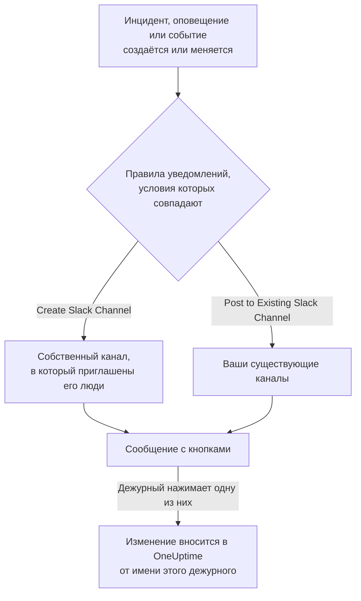

# Slack

Подключите OneUptime к Slack, чтобы публиковать в ваших каналах инциденты, оповещения, эпизоды, плановое обслуживание, мониторы и обновления дежурств, давать каждому инциденту собственный канал и позволять дежурным действовать, не выходя из Slack: подтверждать, устранять, добавлять заметки, вызывать дежурных и объявлять инциденты.

:::cards
- [Подключение Slack](#подключение-slack): Установите OneUptime в своё рабочее пространство, затем свяжите свою учётную запись.
- [Правила уведомлений](#правила-уведомлений): Решите, какие события и куда публикуются и какие получают собственный канал.
- [Команда /oneuptime](#команда-oneuptime): Объявляйте инциденты, планируйте обслуживание, смотрите, кто дежурит, и задавайте вопросы ИИ.
- [Действия с инцидентами, оповещениями и событиями из Slack](#действия-с-инцидентами-оповещениями-и-событиями-из-slack): Кнопки в сообщениях OneUptime.
:::

## Как это работает

Это работает благодаря двум подключениям:

- **Подключение проекта**, выполняется один раз: приложение OneUptime, установленное в ваше рабочее пространство Slack. Оно публикует сообщения, создаёт каналы и приглашает людей.
- **Собственное подключение каждого человека**: его учётная запись Slack, связанная с его учётной записью OneUptime. Кнопки, команды и реакции эмодзи действуют от имени этого человека, с его правами в проекте.

## Перед началом

- **Роль, которой разрешено подключать проект:** **Project Owner**, **Project Admin** или **Project Member**. Для удаления приложения нужна роль **Project Owner** или **Project Admin**.
- **Рабочее пространство Slack**, в которое вы можете устанавливать приложения.
- **Тариф Growth в OneUptime Cloud** для правил уведомлений и сводок. См. [Правила уведомлений ниже тарифа Growth](#правила-уведомлений-ниже-тарифа-growth).
- **На собственном сервере** сначала настроенное для него приложение Slack. См. [Интеграция со Slack](/docs/self-hosted/slack-integration).

## Подключение Slack

:::steps
### Установите OneUptime в рабочее пространство Slack

Откройте **Настройки проекта** > **Рабочее пространство** > **Slack** и нажмите **Connect with Slack**. Выберите рабочее пространство и разрешите доступ OneUptime. Slack вернёт вас на ту же страницу, где теперь указано рабочее пространство, к которому подключён проект. Пока ни одно рабочее пространство не подключено, раздел **Рабочее пространство** в меню «Инциденты», «Оповещения», «Плановое обслуживание», «Мониторы» и «Дежурство» содержит **Подключить Slack или Teams**, который тоже ведёт сюда.

### Подключите свою учётную запись Slack

Установка приложения связывает учётную запись того, кто его установил. Все остальные связывают свою учётную запись Slack в **Настройки пользователя** > **Рабочее пространство** > **Slack** с помощью **Connect my account with Slack**, чтобы действовать с инцидентами и получать личные сообщения от своего имени. Этот раздел появляется, как только проект подключён к Slack.

### Добавьте правило уведомлений

Откройте **Инциденты** > **Рабочее пространство** > **Slack**. Раздел **Рабочее пространство** показывает только те чат-пространства, которые подключил ваш проект, поэтому **Slack** появляется там, как только он подключён. Создайте правило, например такое, которое создаёт канал Slack для каждого нового инцидента и приглашает владельцев инцидента. См. [Правила уведомлений](#правила-уведомлений).

### Проверьте правило

Нажмите **Тестовое правило** в строке правила. Тестовое сообщение приходит в каналы, указанные в правиле. См. [Проверка правила](#проверка-правила).
:::

## Правила уведомлений

Правило уведомлений определяет, какие события публикуются в Slack и куда. У каждого продукта свои правила, в разделе **Рабочее пространство** > **Slack** его меню:

| Продукт | Вкладки на его странице **Slack** |
| --- | --- |
| **Инциденты** | **Инциденты**, **Инцидент Эпизоды**, **Summary** |
| **Оповещения** | **Оповещения**, **Оповещение Эпизоды**, **Summary** |
| **Плановое обслуживание** | Один список правил |
| **Мониторы** | Один список правил |
| **Дежурство** | Один список правил |

Создание правила проходит в четыре шага:

| Шаг | Что вы задаёте |
| --- | --- |
| **Базовый** | **Имя правила** и **Описание правила**. |
| **Условия** | Для каких событий срабатывает правило, например по серьёзности, состоянию, метке, монитору или словам в заголовке. Без условий оно срабатывает для каждого события. Если условий два или больше, **Условие совпадения** определяет, должны ли совпасть все или достаточно одного. |
| **Назначение** | Куда оно публикует: **Post to Existing Slack Channel** с названиями каналов, **Create Slack Channel** с названием нового канала и списком приглашённых, или и то и другое. |
| **Video Call** | Только инциденты и оповещения: начать звонок для каждого из них. См. [Видеозвонки](/docs/workspace-connections/video-calls). |

Канал, который создаёт правило, называется по **New Slack Channel Name** с номером записи на конце, например `oneuptime-incident-42`, и только созданный канал получает людей, которых приглашает правило: владельцев записи, выбранные команды и пользователей, а для инцидентов и оповещений — дежурных по мере их вызова. Приватный инцидент, приватное оповещение или приватный эпизод получает приватный канал. Каждое последующее обновление записи — смена состояния, заметка, новый владелец — публикуется в её каналах и в существующих каналах, указанных её правилами. Инцидент, оповещение или эпизод, созданный уже устранённым, не получает собственного канала; сообщение о его создании всё равно уходит в каналы, указанные вашими правилами. См. [Объявлен уже подтверждённым или устранённым](/docs/incidents/declaring-incidents#объявлен-уже-подтверждённым-или-устранённым).

У инцидента, оповещения, эпизода или события запланированного обслуживания с собственным каналом в заголовке его страницы в OneUptime, рядом с кнопками состояний, есть **Открыть в Slack**. Кнопка открывает этот канал в новой вкладке, в приложении Slack или в браузере. Если у записи два собственных канала, кнопка перечисляет оба. У записи с каналами и в Slack, и в Microsoft Teams вместо этого одна кнопка **Открыть канал**, которая перечисляет их все. Существующие каналы, в которые публикуют ваши правила, не предлагаются.

Канал остаётся читаемым: каждое событие публикуется один раз, а первое состояние записи указано в сообщении, которое объявляет запись, а не в отдельном сообщении. Запуск политики дежурства — это одно сообщение, которое редактируется по мере эскалации: кого вызвали, сколько раз и как, кого не вызвали и почему, и кто подтвердил. Новое сообщение публикуется, только когда кому-то нужно действовать: правило эскалации никого не достигло, или запуск закончился, а никто так и не подтвердил. Человека, чья учётная запись Slack не подключена к OneUptime, нельзя добавить в канал; OneUptime говорит об этом один раз на канал, в одном сообщении, которое называет их всех и редактируется, когда список растёт. Отправьте им ссылку **Connect Slack account** из этого сообщения, чтобы они подключили учётную запись за один шаг. То, что владельцы записи или подписчики страницы статуса получили уведомление, остаётся в её ленте в OneUptime.

**Настройки проекта** > **Рабочее пространство** > **Slack** показывает каналы, которые видит OneUptime, с **Отправить тест** рядом с каждым. OneUptime сам вступает в публичный канал, когда впервые публикует в нём. Приватный канал появляется в списке и может получать публикации только после того, как приложение OneUptime приглашено в него в Slack.

## Проверка правила

**Тестовое правило** в строке правила публикует тестовое сообщение этого правила в указанные им каналы, чтобы вы увидели, как оно приходит. Если правило создаёт канал для каждого события, проверка тоже создаёт канал и приглашает в него людей правила.

Как и **Отправить тест** рядом с каналом в **Настройки проекта** > **Рабочее пространство** > **Slack**, для этого нужно право создавать правила уведомлений: **Project Owner**, **Project Admin**, **Project Member**, **Settings Admin**, **Settings Member** или **Create Workspace Notification Rule** и **Read Workspace Notification Rule** в пользовательской роли. Для того, кто может только просматривать правила, например **Viewer**, кнопка **Тестовое правило** заблокирована, а её подсказка говорит, что для этого нужно; API отклоняет такую проверку с "You do not have permission to send test notifications in this project." В OneUptime Cloud для проверки правила нужен тариф **Growth**, как и для добавления правила.

В OneUptime Cloud для **Отправить тест** рядом с каналом тоже нужен тариф **Growth**, ведь публикация в канал — это то, что делают правила и сводки. Для **Отправить тест сейчас** в сводке нужно право создавать сводки (**Create Workspace Notification Summary** и **Read Workspace Notification Summary** в пользовательской роли), а в OneUptime Cloud — тариф **Growth**; для всех остальных кнопка заблокирована, а её подсказка говорит, что для этого нужно. MCP-клиент, подключённый с доступом только на чтение, не может отправить ни одной проверки.

## Сводки

Вкладка **Summary** в **Инциденты** > **Рабочее пространство** > **Slack** (и в **Оповещения**) публикует периодическую сводку в указанные вами каналы: сколько было инцидентов или оповещений, как быстро их подтвердили и устранили, и список со ссылками. Новая сводка выходит каждую неделю и охватывает последние 7 дней. Оставьте **Отправить первый отчёт в** пустым, и первая сводка выйдет в 09:00 в начале следующей недели, дня или месяца; форма показывает, когда именно.

Сводка выходит по часам своего **Часовой пояс**, который по умолчанию совпадает с вашим. Она сохраняет там своё время суток весь год: сводка, настроенная на 09:00 в Берлине, по-прежнему выходит в 09:00 по Берлину после перехода на летнее время, и даты в её сообщении тоже берлинские. Через API передайте `timezone` как имя часового пояса IANA, например `Europe/Berlin`. Сводка, созданная без часового пояса, берёт часовой пояс из профиля своего создателя или UTC, если её создаёт ключ API.

Форма сводки состоит из четырёх шагов: **Основная информация** (её название и каналы), **Расписание**, **Содержимое** (**Что включить**) и **Фильтры** (какие инциденты или оповещения она учитывает).

## Правила уведомлений ниже тарифа Growth

В OneUptime Cloud правила уведомлений и сводки доступны на тарифе **Growth** и выше. Проект на более низком тарифе сохраняет уже имеющиеся правила и сводки, и они продолжают публиковать в Slack. Поэтому страница **Slack** каждого продукта («Инциденты», «Оповещения», «Плановое обслуживание», «Дежурство», «Мониторы») показывает примечание о тарифе со списком под ним (**Оставшиеся правила уведомлений**, **Оставшиеся сводки**): удалите правило либо отключите или удалите сводку. Для добавления или изменения правил и сводок нужен **Growth**.

## Вызовы в Slack

Чтобы получать вызовы личным сообщением во время дежурства, добавьте Slack как один из своих методов уведомлений:

:::steps
1. Подключите свою учётную запись Slack (см. [Подключение Slack](#подключение-slack)).
2. Откройте **Настройки пользователя** > **Методы уведомлений**, перейдите на вкладку **Workspace Apps** и нажмите **Add Slack Account**.
3. Нажмите **Send Test Message** в её строке. Сообщение придёт в ваши личные сообщения Slack.
:::

После добавления она сразу включается в ваши правила дежурства, так что с этого момента вызовы приходят вам в Slack. Какие вызовы она получает, можно изменить в **Настройки пользователя** > **Правила дежурства**.

## Сохранение сообщений как заметок

Отреагируйте на сообщение в канале инцидента, оповещения, эпизода или события планового обслуживания, и OneUptime сохранит его как заметку к этой записи, а затем подтвердит ответом в треде:

| Реакция | Сохраняется как |
| --- | --- |
| 📌 Эмодзи булавки или встроенное в Slack **Pin to channel** | Приватная заметка, видимая только вашей команде |
| 📢 Эмодзи мегафона или громкоговорителя | Публичная заметка, показанная на странице статуса. Только инциденты и события планового обслуживания. |

Заметка сохраняется от вашего имени, с вашими правами, поэтому ваша учётная запись Slack должна быть подключена. Сообщение сохраняется только один раз, сколько бы людей ни отреагировало.

## Команда /oneuptime

У OneUptime в Slack одна команда — `/oneuptime`. Слово, которое вы пишете после неё, говорит, что сделать; всё остальное после неё — вопрос к OneUptime AI.

| Команда | Что она делает |
| --- | --- |
| `/oneuptime help` | Показывает список команд с примерами. |
| `/oneuptime incident [title]` | Открывает форму инцидента с заполненным заголовком. |
| `/oneuptime maintenance [title]` | Открывает форму планового обслуживания с заполненным заголовком. |
| `/oneuptime oncall` | Показывает, кто дежурит прямо сейчас в каждом доступном вам расписании дежурств, до какого времени и кто следующий. |
| `/oneuptime page [who] [message]` | Вызывает людей, которых вы упоминаете через @, по вашему сообщению или открывает форму, где вы выбираете, кого вызвать. См. [Вызов людей из Slack](#вызов-людей-из-slack). |
| `/oneuptime ask [question]` или любой вопрос | OneUptime AI отвечает о ваших журналах, трассировках, метриках, инцидентах и мониторах. |

Ответы на `help` и `oncall` — это сообщения, которые видите только вы, под командой. Если первое слово похоже на команду с опечаткой, например `incidnet`, в ответ придёт команда, на которую оно похоже, а не ответ OneUptime AI. Формы инцидента и обслуживания действуют от вашего имени: см. [Создание инцидентов и обслуживания из Slack](#создание-инцидентов-и-обслуживания-из-slack).

> [!NOTE]
> `/oneuptime incident` и `/oneuptime maintenance` заменяют `/incident` и `/maintenance`, которые могли конфликтовать с одноимёнными командами других приложений Slack. Приложение Slack, созданное по более раннему манифесту, сохраняет их, и они открывают те же формы, пока приложение не будет обновлено: см. [Приложения, созданные по старому манифесту](/docs/self-hosted/slack-integration#приложения-созданные-по-старому-манифесту).

## Вопросы OneUptime AI из Slack

Задавайте вопросы о журналах, трассировках, метриках, инцидентах и мониторах обычным языком. Упомяните OneUptime через @ в канале или отправьте ему личное сообщение, и он ответит в треде. `/oneuptime ask which monitors are down?` публикует ответ в канале. Для обоих способов нужна подключённая учётная запись Slack и включённый для проекта ИИ. Ответы в Slack только читают данные: чтобы что-то изменить, используйте кнопки. См. [Спросить ИИ](/docs/ai/ask-ai).

OneUptime отвечает только на то, что обращено к нему.

- **В своём разговоре просто отвечайте.** Вопрос, который вы задаёте в канале, а не в треде, начинает разговор в треде под ним: отвечайте там, чтобы спросить ещё, не упоминая OneUptime снова, а остальные присоединяются, упомянув его.
- **В любом другом треде упоминайте OneUptime.** Например, под сообщением об инциденте упоминайте его каждый раз: на то, что люди пишут там друг другу, он не отвечает.
- **Если ваша учётная запись Slack не подключена.** OneUptime один раз в каждом разговоре просит подключить её, в сообщении, которое видите только вы, с кнопкой **Connect Slack account**.

## Создание инцидентов и обслуживания из Slack

`/oneuptime incident` и `/oneuptime maintenance` открывают форму, которую вы заполняете и отправляете от своего имени: как учётная запись OneUptime, к которой подключена ваша учётная запись Slack (см. [Подключение Slack](#подключение-slack)), с правами этой учётной записи в проекте. Если ваша учётная запись Slack не подключена или ваша учётная запись OneUptime больше не участник проекта, OneUptime сообщит, что делать, там, где вы выполнили команду, в сообщении, которое видите только вы, и форма не откроется. Ярлыки **Create New Incident** и **Create Scheduled Event** открывают те же формы.

- **Кто может ими пользоваться.** Те, кто может объявить инцидент или создать событие планового обслуживания в OneUptime: **Project Owner**, **Project Admin**, **Project Member**, **Incident Admin** и **Incident Member** для инцидента (**Create Incident** в пользовательской роли), а также **Scheduled Maintenance Admin** и **Scheduled Maintenance Member** для события (**Create Scheduled Maintenance**). Все остальные узнают об этом там, где выполнили команду, и форма не открывается.
- **Что предлагает форма.** Каждый список — серьёзности, мониторы, статусы мониторов, политики дежурства и метки — содержит то, что вы можете читать, как и тот же список в OneUptime: при роли, ограниченной некоторыми метками, — мониторы и политики дежурства с этими метками. Список, который вы не можете читать вовсе, в форму не попадает. Архивные политики дежурства никогда не предлагаются.
- **Что может указывать форма.** Инцидент или событие создаётся с вашими собственными правами и записывается на вас. Монитор, политика дежурства, метка, серьёзность или статус, которые вы не можете читать, или относящиеся к другому проекту, отклоняются так, будто в проекте их нет, даже из формы, открытой до изменения вашего доступа, и ничего не создаётся. OneUptime объясняет причину в канале, в сообщении, которое видите только вы.

**Execute On-Call Policy** для инцидента, оповещения или эпизода работает так же: нужно право выполнять политику дежурства (**Project Owner**, **Project Admin**, **Project Member**, **On-Call Admin** и **On-Call Member** или **Create On-Call Duty Policy Execution Log** в пользовательской роли) и право читать этот инцидент, оповещение или эпизод, а предлагаются действующие политики дежурства, которые вы можете читать.

## Вызов людей из Slack

`/oneuptime page @nawaz The checkout API is throwing 500s` сразу вызывает Nawaz. OneUptime создаёт оповещение с вашим сообщением в качестве заголовка, и каждый, кого вы упоминаете через @, получает звонок, SMS, push-уведомление или письмо, как велят его собственные правила дежурства, пока кто-нибудь не подтвердит оповещение.

- **Кого вызывают сразу.** Людей, которых вы упоминаете через @, если за ними следует сообщение. OneUptime узнаёт человека по учётной записи OneUptime, к которой подключена его учётная запись Slack, а иначе по адресу электронной почты, который есть о нём в Slack. Никого за пределами проекта не вызывают.
- **Всё остальное открывает форму.** Если никто не упомянут через @, нет сообщения, указана группа пользователей или `@here` либо есть человек, которого OneUptime не может узнать, открывается форма **Page someone**, уже заполненная тем, что вы написали, и в ней сказано, кого не удалось выбрать. Выберите людей, команду, расписание дежурств, которое вызывает того, кто дежурит в нём сейчас, или политику дежурства, которая вызывает по своим правилам эскалации, и отправьте форму. Имя, которое вы пишете первым, как в `/oneuptime page Primary The disk is full`, выбирает расписание, команду или политику с этим именем.
- **Где это видно.** Канал показывает вызов одним сообщением, которое обновляется: кого и как вызвали и кто подтвердил. Там, где OneUptime не может публиковать, например в приватном канале, куда его не пригласили, сообщение, которое видите только вы, говорит, кого вызвали, со ссылкой на оповещение.
- **Кто может вызывать.** Все, кто может и выполнять политику дежурства, и создавать оповещения: **Project Owner**, **Project Admin** и **Project Member** или **On-Call Member** вместе с **Alert Member** (**Create On-Call Duty Policy Execution Log** и **Create Alert** в пользовательской роли). Чтобы вызвать людей, команду или расписание напрямую, без политики дежурства за вызовом, нужен ещё доступ ко всем политикам дежурства проекта. Все остальные узнают об этом там, где выполнили команду, и никого не вызывают.

## Действия с инцидентами, оповещениями и событиями из Slack

Кнопки в сообщениях OneUptime в Slack тоже действуют от вашего имени: как учётная запись OneUptime, к которой подключена ваша учётная запись Slack, с правами этой учётной записи в проекте. **Acknowledge**, **Resolve**, **Change State**, **Add Note** и **Execute On-Call Policy** для инцидента, оповещения или эпизода, а также **Mark as Ongoing**, **Mark as Complete**, **Change State** и **Add Note** для события планового обслуживания вносят то же изменение, что и то же действие в OneUptime, и оно записывается там на вас: хронология состояний и лента записи показывают, что состояние изменили вы, а заметка — ваша. Заметка, сохранённая из сообщения с реакцией эмодзи, публикуется так же.

- **Кто может ими пользоваться.** Те, кто может внести то же изменение в OneUptime. Чтобы подтвердить, устранить инцидент или изменить его состояние, нужно право менять его состояние: **Project Owner**, **Project Admin**, **Project Member**, **Incident Admin** и **Incident Member** или **Create Incident State Timeline** в пользовательской роли. Для оповещения, эпизода или события планового обслуживания нужно такое же право для их типа (например, **Create Alert State Timeline**), а для заметки — право публиковать заметки этого вида. Все остальные узнают об этом, и ничего не меняется.
- **Какие записи.** Те, которые вы можете читать, как и в OneUptime: при роли, ограниченной некоторыми метками, — инциденты, оповещения, эпизоды и события с этими метками. На кнопку в любой другой записи или в записи другого проекта приходит ответ, что запись "was not found in this project, or you do not have access to it.", и ничего не меняется. В OneUptime Cloud изменение, которое не входит в тариф проекта, отклоняется с указанием нужного тарифа.
- **Что предлагает Change State.** Состояния, которые вы можете читать и в которые запись может перейти дальше, в порядке проекта: ни одного раньше её текущего состояния, для эпизода так же, как для инцидента, оповещения или события планового обслуживания, поскольку смена состояния никогда не поднимает запись вверх по её списку (см. [Порядок — это настоящее ограничение, а не настройка отображения](/docs/incidents/states-and-severities#порядок-это-настоящее-ограничение-а-не-настройка-отображения)). Если вы не можете читать ни одного, вы получите сообщение "No incident states are available to you in this project. Ask a project admin for access to them."; если запись находится в последнем доступном ей состоянии, — "There is no later state to move this incident to." Ни в одном из случаев пустая форма не открывается.
- **Где вы получаете ответ.** Под сообщением с кнопкой, в сообщении, которое видите только вы; в личном сообщении, только если Slack его не принимает. Кнопка, нажатая слишком поздно, сообщает, кто успел первым и когда, например "Incident INC-2 was already acknowledged by Simon Lee at 6:07 PM."
- **Если ваша учётная запись Slack не подключена.** Ответ предлагает подключить её с помощью кнопки **Connect Slack account**. Кнопка открывает ваши собственные настройки Slack в OneUptime и подключает учётную запись за один шаг, после входа в OneUptime, если он нужен. Затем OneUptime завершает то, что вы нажали, от вашего имени и отвечает под тем же сообщением; для кнопки, которая открывает форму, или для команды он просит нажать её или выполнить её снова. Кнопка срабатывает один раз, в течение 30 минут, и только для учётной записи Slack, которая её нажала: при входе в Slack под чужой учётной записью она ничего не подключает.

## Отключение

- **Disconnect** отвязывает только вашу учётную запись Slack и вместе с ней удаляет ваш метод уведомлений Slack.
- **Uninstall OneUptime from Slack** на странице **Настройки проекта** > **Рабочее пространство** > **Slack** отключает проект. OneUptime перестаёт публиковать в Slack, а меню **Рабочее пространство** перестают его показывать. Правила уведомлений и сводки сохраняются на случай повторного подключения.

> [!WARNING]
> Удаление также отвязывает учётную запись Slack каждого участника проекта и удаляет методы уведомлений Slack и правила дежурства, которые их использовали. Тех, кого вызывали в Slack, будут вызывать через их другие методы уведомлений, пока они снова не добавят Slack.

## Устранение неполадок

:::details Правило ничего не публикует
Проверьте условия правила с помощью **Тестовое правило**: если тестовое сообщение приходит, условия правила не совпали с событием. Если нет, страница Slack показывает причину. Для приватного канала сначала пригласите в него приложение OneUptime в Slack. Каждое сообщение, которое публикует OneUptime, и каждое, которое отклонил Slack, перечислено в **Настройки проекта** > **Уведомления** > **Журналы уведомлений**, на вкладке **Рабочее пространство**.
:::

:::details Slack не подключился
Когда Slack возвращает вас без подключения, страница, с которой вы начали, показывает **Slack не подключён**, и одна фраза объясняет причину: у вас нет нужного права, ссылка уже использована или истекла, вы вошли в другое рабочее пространство или сервер не настроен для Slack. См. [Подключение не завершилось](/docs/self-hosted/slack-integration#подключение-не-завершилось), где описана каждая фраза и что делать.
:::

:::details Кнопка или команда сообщает, что моя учётная запись Slack не подключена
Нажмите **Connect Slack account** в этом ответе, чтобы подключить её за один шаг, или свяжите её в **Настройки пользователя** > **Рабочее пространство** > **Slack** с помощью **Connect my account with Slack**. Если вы больше не участник проекта, OneUptime сообщит об этом и ничего не будет делать от вашего имени.
:::

:::details OneUptime не отвечает на ответ в треде
OneUptime отвечает на ответ без упоминания только в вашем собственном разговоре с OneUptime AI: в треде под вопросом, который вы задали ему в канале. В любом другом треде, например под сообщением об инциденте, упомяните OneUptime через @. Если ваша учётная запись Slack не подключена, OneUptime просит подключить её один раз в каждом разговоре, а не при каждом сообщении: нажмите **Connect Slack account** в этом сообщении или свяжите её в **Настройки пользователя** > **Рабочее пространство** > **Slack**. См. [Вопросы OneUptime AI из Slack](#вопросы-oneuptime-ai-из-slack).
:::

:::details Уведомления приходят, но кнопки и команды ничего не делают
На собственном сервере Slack должен иметь доступ к OneUptime для кнопок, форм и команд; уведомлениям нужен только исходящий доступ. См. [Сетевой доступ для самостоятельно размещённых установок](/docs/self-hosted/slack-integration#сетевой-доступ-для-самостоятельно-размещённых-установок).
:::

## Дальнейшие шаги

:::cards
- [Microsoft Teams](/docs/workspace-connections/microsoft-teams): Те же уведомления и действия в Microsoft Teams.
- [Видеозвонки](/docs/workspace-connections/video-calls): Дайте каждому инциденту звонок, опубликованный вместе с его обновлениями.
- [Интеграция со Slack](/docs/self-hosted/slack-integration): Настройка приложения Slack на собственном сервере.
- [Объявление инцидента](/docs/incidents/declaring-incidents): Все способы, которыми начинается инцидент, и что при этом запускается.
:::
