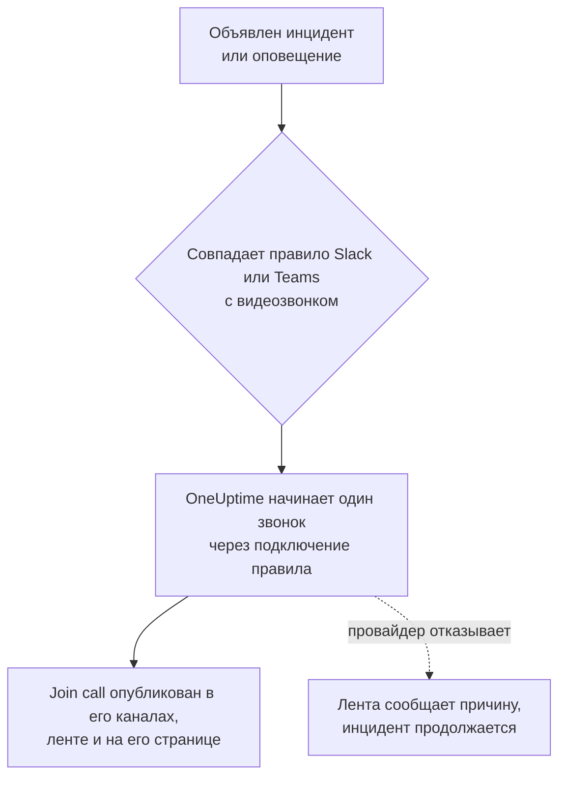

# Видеозвонки

Дайте каждому инциденту и каждому оповещению собственный звонок. Когда правило уведомлений Slack или Microsoft Teams срабатывает для нового инцидента или оповещения, OneUptime начинает отдельную встречу (встречу Zoom, Google Meet, встречу Microsoft Teams или хаддл в канале Slack инцидента) и публикует кнопку **Join call** везде, куда уходят обновления инцидента. Дежурные присоединяются одним нажатием, и никому не нужно создавать встречу в 3 часа ночи и рассылать ссылку.

:::cards
- [Как это работает](#как-это-работает): Правило начинает звонок, а дежурные присоединяются, где бы они ни были.
- [Подключение одним нажатием](#подключение-одним-нажатием): Zoom, Google Meet или Microsoft Teams — через вход в учётную запись.
- [Провайдеры](#провайдеры): Сервисная учётная запись вашего собственного приложения, постоянная ссылка на встречу или хаддл Slack.
- [Запуск звонка вручную](#запуск-звонка-вручную): Со страницы инцидента или оповещения.
- [Расшифровки звонков](#расшифровки-звонков): Что было сказано на звонке по инциденту, и корневая причина, которую в этом читает OneUptime AI.
:::

## Как это работает



:::steps
### Подключите провайдера

Откройте **Настройки проекта** > **Рабочее пространство** > **Video Calls** и подключите Zoom, Google Meet или Microsoft Teams либо добавьте постоянную ссылку на встречу. В OneUptime Cloud подключение Zoom, Google Meet или Microsoft Teams — это одно нажатие: войдите в учётную запись и разрешите OneUptime создавать встречи (см. [Подключение одним нажатием](#подключение-одним-нажатием)). Хаддлам Slack не нужно ничего, кроме подключения проекта к Slack.

### Включите его в правиле

Откройте правило уведомлений Slack или Microsoft Teams для инцидентов или оповещений (например, **Инциденты** > **Рабочее пространство** > **Slack**). На шаге правила **Video Call** включите **Start a video call for the incident** и выберите, где проходит звонок.

### Присоединяйтесь одним нажатием

Когда правило срабатывает, OneUptime начинает один звонок для инцидента и публикует его с кнопкой **Join call** в каналы, куда уходят обновления инцидента, и в ленту инцидента. Страница инцидента показывает звонок в карточке **Video Call** и кнопку **Присоединиться к звонку** в своём заголовке.
:::

Условия правила определяют, какие инциденты получают звонок. Чтобы созвон был только для инцидентов Sev1, задайте правилу условие по **Серьёзность**. Звонки начинаются для инцидентов и оповещений, объявленных текущими. Инцидент, созданный уже устранённым, звонка не получает.

### Один звонок на инцидент

Звонок начинается один раз на инцидент для каждого места, где проводится звонок. Правила, выбравшие одно и то же подключение, используют один звонок, и правило никогда не начинает второй звонок для инцидента, у которого уже есть звонок через это подключение. Правила, выбравшие разные места, начинают каждое свой звонок, например встречу Zoom для дежурных и хаддл в канале Slack инцидента.

### Когда звонок не может начаться

Объявление инцидента никогда не ждёт провайдера видеозвонков. Звонок начинается после создания инцидента, поэтому медленный или неисправный провайдер никогда не задерживает инцидент или его вызовы дежурных.

Если провайдер отказывает (истёкший секрет, отсутствующее разрешение, удалённый организатор), лента инцидента сообщает, что звонок правила не удалось начать, с причиной от провайдера, чтобы дежурные знали, что нужно начать звонок со страницы инцидента. Запуск правила отображается в журналах уведомлений рабочего пространства как **Начать видеозвонок**, а строка подключения в **Настройки проекта** > **Рабочее пространство** > **Video Calls** показывает ошибку, пока звонок снова не начнётся.

### Приватные инциденты

Встреча называется по инциденту, для которого она создана, с его номером и заголовком, а её описание ссылается на инцидент. Для приватного инцидента заголовок опускается, потому что название встречи видят все приглашённые в неё.

## Подключение одним нажатием

В OneUptime Cloud подключение Zoom, Google Meet или Microsoft Teams занимает одно нажатие, и у провайдера ничего настраивать не нужно:

:::steps
1. Откройте **Настройки проекта** > **Рабочее пространство** > **Video Calls** и нажмите **Подключить** у Zoom, Google Meet или Microsoft Teams.
2. Нажмите **Continue to Zoom** (или Google, или Microsoft), войдите в учётную запись и разрешите OneUptime создавать встречи.
3. Вы вернётесь на страницу видеозвонков с готовым подключением. **Start a test meeting** проверяет его от начала до конца; затем выберите подключение в правиле уведомлений Slack или Microsoft Teams.
:::

Каждая встреча создаётся от имени учётной записи, с которой вы вошли, и она же её организует. Входите с общей учётной записью, например incidents@example.com, а не со своей, чтобы звонки продолжали начинаться, когда люди уходят. Строка подключения показывает, от имени какой учётной записи выполнен вход.

| Провайдер | С чем входить | Что может делать OneUptime |
| --- | --- | --- |
| Zoom | Пользователь Zoom. Встречи, организованные пользователем Basic (бесплатным), завершаются через 40 минут. | Создавать встречи для этого пользователя (`meeting:write:meeting`) и узнавать, кто он (`user:read:user`). Для [расшифровок звонков](#расшифровки-звонков) — читать расшифровки облачных записей встреч этого пользователя (`cloud_recording:read:list_recording_files`, `cloud_recording:read:meeting_transcript`). |
| Google Meet | Учётная запись Google, которая может пользоваться Google Meet. | Создавать пространства Meet от имени этой учётной записи (`meetings.space.created`) и читать её адрес электронной почты. |
| Microsoft Teams | Рабочая или учебная учётная запись с Microsoft Teams. Личные учётные записи Microsoft не могут создавать встречи Teams. | Создавать онлайн-встречи от имени этой учётной записи (делегированное разрешение `OnlineMeetings.ReadWrite`) и оставаться в системе (`offline_access`). Для [записи и расшифровки звонков по инцидентам](#запись-и-расшифровка-каждого-звонка) — добавлять встречи в её календарь (`Calendars.ReadWrite`) и читать их расшифровки (`OnlineMeetingTranscript.Read.All`; это разрешение одобряет администратор). |

У подключения через вход по-прежнему есть настройки, определяющие, кто ждёт: **Who can join** для Google Meet и **Who skips the lobby** для Microsoft Teams. Измените их с помощью **Редактировать** в строке подключения.

Подключение Zoom, выполнившее вход до того, как OneUptime стал читать расшифровки звонков, начинает звонки как прежде, но не может читать их расшифровки, пока не войдёт снова: **Reconnect** в его строке запрашивает у Zoom разрешения на расшифровки.

Подключение Microsoft Teams, выполнившее вход, пока настройка **Записывать и расшифровывать звонки по инцидентам** была выключена, начинает звонки как прежде, без записи. Когда настройка включена, **Reconnect** в его строке запрашивает у Microsoft ещё и разрешения на календарь и расшифровки.

### Сохранение входа

OneUptime хранит токен обновления входа в зашифрованном виде и обновляет его не реже раза в неделю, поэтому он никогда не истекает из-за неиспользования, сколько бы проект ни жил без инцидентов. Если вход перестаёт работать (учётная запись удалила OneUptime, была удалена или заблокирована либо политика вашей организации требует войти снова), строка подключения показывает **Не работает** с причиной в тот же день, когда OneUptime это замечает, а не при следующем инциденте. **Reconnect** в строке выполняет вход заново.

Подключения, вошедшие от имени одной и той же учётной записи, используют один вход во всех проектах: Zoom хранит только один вход на учётную запись, поэтому повторное подключение того же пользователя Zoom заменяет вход для всех них.

### Повторное подключение и удаление

**Reconnect** в строке подключения выполняет вход заново — от имени той же учётной записи или другой. Используйте его после того, как учётная запись удалила OneUptime, или чтобы перенести встречи инцидентов на другую учётную запись.

Удаление подключения отзывает доступ OneUptime в Zoom и Google, как только этот вход не использует ни одно другое подключение. Для Microsoft удалите OneUptime в разделе **My Apps** (myapps.microsoft.com) учётной записи. Удаление OneUptime из вашей учётной записи Zoom в Zoom App Marketplace удаляет его вход из всех подключений, вошедших от имени этой учётной записи, и они показывают **Не работает**, пока их не подключат заново.

### Если Microsoft просит администратора

Некоторые организации Microsoft 365 разрешают одобрять приложения только администраторам. Если Microsoft сообщает, что нужно одобрение администратора, попросите администратора Microsoft 365 подключить Microsoft Teams или одобрить OneUptime в [центре администрирования Microsoft Entra](https://entra.microsoft.com/) в разделе **Enterprise applications** > **Admin consent requests**. Проекту, который записывает свои звонки Teams, это одобрение нужно в каждой организации, один раз: только администратор может разрешить приложению читать расшифровки встреч.

### Использование собственного приложения

Чтобы подключиться через сервисную учётную запись, а не через вход человека, — приложение Zoom типа Server-to-Server OAuth, сервисный аккаунт Google с делегированием на уровне домена или регистрацию приложения Microsoft Entra, — нажмите **Use your own Zoom app** (или Google, или Microsoft) в диалоге «Подключить». Раздел [Провайдеры](#провайдеры) объясняет каждый вариант. На собственном сервере без настроенных приложений для подключения одним нажатием **Подключить** сразу открывает эту форму; чтобы настроить их, см. [Подключение одним нажатием на собственном сервере](#подключение-одним-нажатием-на-собственном-сервере).

## Запуск звонка вручную

В карточке **Video Call** на странице инцидента или оповещения есть **Start call** (или **Start another**, когда звонок уже есть). Выберите одно из подключений проекта, хаддл в канале Slack инцидента или вставьте свою ссылку на встречу. Звонок публикуется в каналы и ленту инцидента так же, как звонок, начатый правилом.

**Удалить** на карточке убирает звонок со страницы инцидента. Сама встреча не удаляется, и любой, у кого есть ссылка, по-прежнему может к ней присоединиться.

Для запуска и удаления звонков нужно право работать с инцидентами (или оповещениями): **Владелец проекта**, **Администратор проекта**, **Участник проекта**, **Администратор инцидентов** или **Участник инцидентов** либо **Create Incident Video Call** и **Delete Incident Video Call** в пользовательской роли. Звонки видят все, кто может читать инцидент.

## Расшифровки звонков

То, что участники говорят на звонке, что они проверили, что подозревают и что решили, — лучшая запись того, как разбирали инцидент, и она исчезает, когда звонок заканчивается. Звонок инцидента сохраняет свою расшифровку, а OneUptime AI читает её в поисках корневой причины, на которую указывает звонок. Ничто из прочитанного не попадает в инцидент, пока участник это не использует.

:::steps
### Получите расшифровку после звонка

В карточке **Video Call** инцидента кнопка **Получить из Zoom**, **Получить из Google Meet** или **Получить из Microsoft Teams** читает расшифровку встречи, которую там начал OneUptime (для Microsoft Teams — встречи, начатой, пока каждый звонок записывается и расшифровывается). Для любого другого звонка **Добавить расшифровку** принимает файл, сохранённый инструментом для встреч (`.vtt`, `.srt` или `.txt`, до 5 МБ), или вставленную расшифровку. Если [каждый звонок записывается и расшифровывается](#запись-и-расшифровка-каждого-звонка), OneUptime сам получает расшифровку, как только звонок заканчивается.

### OneUptime AI её читает

Через минуту-две карточка **OneUptime AI** инцидента показывает **Предложенная корневая причина** с пометкой **Не подтверждено** и строки расшифровки, на которых она основана, процитированные со временем и говорящим. Ниже, в свёрнутом виде, — всё остальное, что прозвучало на звонке: находки, разделённые на **Подтверждено на звонке** и **Гипотезы**, затем что пробовали, решения, дальнейшие действия и открытые вопросы. Прочитанное также публикуется в ленте инцидента, а оттуда — в каналах Slack и Microsoft Teams инцидента.

### Используйте её или отклоните

**Использовать как корневую причину** открывает предложение вместе с цитатами в редакторе корневой причины. Измените, что нужно, и сохраните: оно станет корневой причиной инцидента как ваша собственная правка, записанная в его ленту. **Скрыть** откладывает предложение, а **Отменить** возвращает его.
:::

OneUptime AI предлагает причину, только если её называют на звонке, вместе со строками, где это сказано, и цитирует эти строки так, как они записаны в расшифровке. Если на звонке причину не выяснили, карточка пишет **На звонке сказали недостаточно, чтобы предложить корневую причину**, а не гадает.

### Запись и расшифровка каждого звонка

Чтобы никому не приходилось помнить о записи звонка или о получении его расшифровки, включите **Записывать и расшифровывать звонки по инцидентам** в **Настройки проекта** > **Рабочее пространство** > **Video Calls**. Пока настройка включена:

- Для каждой встречи по инциденту, которую начинает OneUptime, он просит Zoom записать её в облако, Google Meet — расшифровать, а Microsoft Teams — автоматически записать и расшифровать. Сообщение, которое публикует звонок, говорит об этом ещё до того, как кто-нибудь присоединится.
- Когда звонок заканчивается, OneUptime сам получает расшифровку, как это сделала бы кнопка **Получить из Zoom**, и OneUptime AI её читает. До тех пор карточка **Video Call** показывает, что ждёт её.
- Прочитанное OneUptime AI уходит в ленту инцидента и в его каналы Slack и Microsoft Teams: предложенная корневая причина с пометкой, что она не подтверждена, затем что подтвердили, пробовали и решили, дальнейшие действия и открытые вопросы.
- Если инцидент устранён раньше, чем пришла расшифровка, автоматический черновик постмортема ждёт её, чтобы учесть сказанное на звонке: до шести часов, пока провайдер готовит расшифровку, и один час, если признаков расшифровки ещё нет.

По умолчанию настройка выключена, потому что она записывает людей: все участники этих звонков видят, что их записывают или расшифровывают, поэтому убедитесь, что ваша организация это разрешает. Zoom сохраняет расшифровку, только если учётная запись записывает в облако с включённой аудиорасшифровкой, а Google Meet — только в редакции Google Workspace, где есть расшифровки. Хаддлы Slack и ссылки на встречи не записываются, как и звонки по оповещениям: добавляйте их расшифровки вручную.

Microsoft позволяет приложениям читать расшифровки только тех встреч Teams, которые есть в календаре, поэтому OneUptime добавляет каждую встречу по инциденту в календарь её организатора и включает автоматическую запись и расшифровку в параметрах встречи. Для этого подключению нужны ещё два разрешения Microsoft Graph — `Calendars.ReadWrite` и `OnlineMeetingTranscript.Read.All`: добавьте их в регистрацию своего приложения (см. [Microsoft Teams](#microsoft-teams)) или нажмите **Reconnect** у подключения через вход. Политика собраний Teams у организатора должна разрешать облачную запись, расшифровку и автоматическую запись, а ваша организация не должна отключать приложениям доступ к расшифровкам. Звонок, который OneUptime не может добавить в календарь, всё равно начинается, но без записи, и его карточка **Video Call** сообщает причину.

### Что хранит каждый провайдер

| Звонок | Как он получает расшифровку | Что для этого нужно |
| --- | --- | --- |
| Zoom | **Получить из Zoom** | Встреча, записанная в облако с включённой аудиорасшифровкой или с включённым кратким содержанием встречи от AI Companion. Подключению нужны разрешения на расшифровки (см. [Zoom](#zoom)), а подключению, выполнившему вход до них, нужно **Reconnect**. Zoom готовит расшифровку после встречи, обычно за время не более двух её длительностей. |
| Google Meet | **Получить из Google Meet** | Расшифровка, включённая во время звонка, в редакции Google Workspace, где она есть. Больше ничего настраивать не нужно: OneUptime читает расшифровки созданных им встреч. Google хранит расшифровку доступной приложениям 30 дней. |
| Microsoft Teams | **Получить из Microsoft Teams** | Встреча, которую OneUptime начал, пока [каждый звонок записывается и расшифровывается](#запись-и-расшифровка-каждого-звонка): Microsoft позволяет приложениям читать расшифровки только встреч, которые есть в календаре, и хранит встречу 60 дней. Для любой другой встречи Teams — **Добавить расшифровку**: в Teams откройте сводку встречи, затем её расшифровку и скачайте её как файл `.vtt`. |
| Ссылка на встречу или хаддл Slack | **Добавить расшифровку** | Расшифровка, которую хранят инструмент для встреч или заметки хаддла. |

### Кто что может

Чтобы получить, добавить, заменить или удалить расшифровку, прочитать её заново и отклонить предложение, нужно право начинать звонки инцидента: **Владелец проекта**, **Администратор проекта**, **Участник проекта**, **Администратор инцидентов** или **Участник инцидентов** либо **Create Incident Video Call** в пользовательской роли. Для **Использовать как корневую причину** нужно право редактировать корневую причину инцидента. Все, кто может читать инцидент, видят расшифровки его звонков и то, что прочитал в них OneUptime AI.

### Что читает OneUptime AI

Чтение расшифровки — это работа ИИ, как и расследование: оно выполняется, только пока ИИ включён для проекта, и учитывается в использовании ИИ и дневных лимитах проекта (см. [Контроль расходов](/docs/ai/ai-sre#контроль-затрат)). Длинная расшифровка читается по частям. Когда ИИ выключен, расшифровка сохраняется, а карточка сообщает, что её не прочитали. Удаление расшифровки удаляет то, что прочитал в ней OneUptime AI, и сохраняет корневую причину инцидента. Черновик постмортема от ИИ тоже читает то, что говорилось на звонках инцидента (см. [Постмортемы](/docs/incidents/postmortems)).

## Провайдеры

Этот раздел о подключении провайдера через сервисную учётную запись вашего собственного приложения: приложение Zoom типа Server-to-Server OAuth, сервисный аккаунт Google, регистрацию приложения Microsoft Entra. Сервисная учётная запись никогда не зависит от человека, поэтому продолжает работать, кто бы ни ушёл. Чтобы подключиться через вход, см. [Подключение одним нажатием](#подключение-одним-нажатием).

Учётные данные хранятся в зашифрованном виде и никогда не возвращаются через API. При редактировании подключения оставленное пустым поле учётных данных сохраняет прежнее значение.

**Start test meeting** в форме подключения и **Тест** в строке подключения создают настоящую встречу с настройками подключения и показывают её ссылку. Это единственная проверка, которая доказывает, что учётные данные, разрешение на стороне провайдера и организатор работают вместе. Ничего никуда не публикуется.

Для подключения провайдера нужна роль **Владелец проекта**, **Администратор проекта** или **Администратор настроек** либо **Create Video Call Connection** и **Edit Video Call Connection** в пользовательской роли.

### Zoom

OneUptime создаёт встречу Zoom для каждого инцидента через приложение Zoom типа **Server-to-Server OAuth**, а организует её выбранный вами лицензированный пользователь Zoom.

:::steps
1. В [Zoom App Marketplace](https://marketplace.zoom.us/) выберите **Develop** > **Build App** и создайте приложение **Server-to-Server OAuth**. Для этого нужен администратор учётной записи Zoom или роль, разрешающая приложения Server-to-Server OAuth.
2. На странице приложения **Scopes** добавьте **meeting:write:meeting:admin** (создание встречи для пользователя). Приложение, созданное до появления детализированных разрешений, может использовать вместо этого **meeting:write:admin**. Чтобы OneUptime мог читать и [расшифровки звонков](#расшифровки-звонков), добавьте **cloud_recording:read:list_recording_files:admin** и **cloud_recording:read:meeting_transcript:admin** (или **recording:read:admin** для приложения, созданного до появления детализированных разрешений).
3. Нажмите **Activate**, чтобы активировать приложение, затем скопируйте **Account ID**, **Client ID** и **Секрет клиента** со страницы **App Credentials** в форму подключения.
4. Укажите **Meeting host**: адрес электронной почты лицензированного пользователя Zoom, лучше всего сервисной учётной записи вроде incidents@example.com, чтобы встречи продолжали работать, когда люди уходят. Встречи, организованные пользователем Basic (бесплатным), завершаются через 40 минут.
5. Дежурные присоединяются, не дожидаясь организатора, потому что организатор — сервисная учётная запись, которая никогда не присоединяется. Убедитесь, что настройка **Waiting room** вашей учётной записи Zoom не заблокирована во включённом состоянии, иначе никто не сможет войти.
:::

| Поле | Где его найти |
| --- | --- |
| Account ID | Страница приложения **App Credentials** |
| Client ID | Страница приложения **App Credentials** |
| Client secret | Страница приложения **App Credentials** |
| Meeting host | Адрес электронной почты лицензированного пользователя Zoom, который организует каждую встречу |

### Google Meet

OneUptime создаёт Google Meet для каждого инцидента через Google Meet REST API с помощью сервисного аккаунта Google Cloud, который действует от имени пользователя Google Workspace благодаря делегированию на уровне домена.

:::steps
1. В [консоли Google Cloud](https://console.cloud.google.com/) выберите или создайте проект и включите для него **Google Meet REST API**.
2. В разделе **IAM & Admin** > **Service accounts** создайте сервисный аккаунт. Откройте его, перейдите в **Keys** > **Add key** > **Create new key**, выберите **JSON** и вставьте скачанный файл в форму подключения как **Service account JSON key**.
3. В [консоли администратора Google](https://admin.google.com/) откройте **Security** > **Access and data control** > **API controls** > **Manage Domain Wide Delegation** и нажмите **Add new**. Укажите числовой **Client ID** сервисного аккаунта и разрешение `https://www.googleapis.com/auth/meetings.space.created`.
4. В поле **Create meetings as** укажите пользователя Google Workspace, от имени которого действует сервисный аккаунт: отдельную учётную запись вроде incidents@example.com. Каждая встреча принадлежит этому пользователю.
:::

**Who can join** определяет, кто присоединяется без запроса: при **People in your organization join directly, others ask to join** (по умолчанию) люди вне вашего Google Workspace просят разрешения присоединиться, и кто-то из участников звонка их впускает. При **Anyone with the link joins directly** никто не ждёт.

Делегирование на уровне домена может начать работать только через несколько минут. Если сразу после добавления делегирования проверка сообщает, что Google не позволил сервисному аккаунту действовать от имени пользователя, подождите несколько минут и проверьте снова.

### Microsoft Teams

OneUptime создаёт встречу Microsoft Teams для каждого инцидента через Microsoft Graph с помощью регистрации приложения Microsoft Entra, которая организует встречи от имени лицензированного пользователя Teams.

:::steps
1. В [центре администрирования Microsoft Entra](https://entra.microsoft.com/) откройте **App registrations** > **New registration** и зарегистрируйте однотенантное приложение. Скопируйте его **Directory (tenant) ID** и **Application (client) ID**.
2. В разделе **API permissions** добавьте разрешение Microsoft Graph типа **application** **OnlineMeetings.ReadWrite.All** (а чтобы ещё и [записывать и расшифровывать звонки по инцидентам](#запись-и-расшифровка-каждого-звонка) — **Calendars.ReadWrite** и **OnlineMeetingTranscript.Read.All**), затем нажмите **Grant admin consent**.
3. В разделе **Certificates & secrets** создайте секрет клиента и вставьте его **Value**, а не Secret ID, в форму подключения как **Секрет клиента**.
4. Выберите организатора: лицензированного пользователя Teams, лучше всего сервисную учётную запись. Скопируйте его **Object ID** из раздела **Users** в центре администрирования Entra в поле **Organizer object ID**.
5. Разрешите приложению создавать встречи для организатора с помощью политики доступа приложений. В Teams PowerShell после `Connect-MicrosoftTeams` выполните две команды ниже.
:::

```powershell
New-CsApplicationAccessPolicy -Identity OneUptime-Meetings -AppIds "<application-client-id>"
Grant-CsApplicationAccessPolicy -PolicyName OneUptime-Meetings -Identity "<organizer-object-id>"
```

Применение политики может занять до 30 минут. До тех пор проверка сообщает, что приложению не разрешено создавать встречи для организатора.

Та же политика позволяет приложению читать расшифровки встреч организатора. `Calendars.ReadWrite` позволяет приложению изменять любой календарь в вашей организации: чтобы ограничить его календарём организатора, предоставьте это разрешение через [RBAC для приложений в Exchange Online](https://learn.microsoft.com/exchange/permissions-exo/application-rbac) с областью, ограниченной организатором, а не в разделе **API permissions**.

**Who skips the lobby** определяет, кто присоединяется без ожидания: при **People in your organization skip the lobby** (по умолчанию) все остальные ждут в зале ожидания, пока кто-то на встрече их не впустит. При **Everyone skips the lobby** никто не ждёт.

### Ссылка на встречу

Постоянная ссылка на встречу — это одна и та же комната для каждого инцидента: личная комната Zoom, повторяющаяся встреча Microsoft Teams или Google Meet, личная комната Webex или комната Jitsi. Для каждого инцидента ничего не создаётся, поэтому и авторизовать нечего.

:::steps
1. Создайте встречу без срока действия в инструменте, которым уже пользуется ваша команда.
2. Вставьте её https-ссылку для присоединения в форму подключения как **Meeting link**.
:::

Все инциденты и оповещения, начатые через это подключение, используют одну комнату, поэтому два одновременных инцидента тоже делят её. Убедитесь, что встреча позволяет присоединяться без организатора.

### Хаддлы Slack

Правило Slack может вместо этого начать хаддл в канале Slack инцидента. Подключать ничего не нужно: выберите **Slack huddle** на шаге правила **Video Call**.

Хаддл проходит в канале, который правило создаёт для инцидента, или, если правило вместо этого публикует в существующие каналы, в первом из них. Поэтому правило должно создавать канал или публиковать в существующий. Кнопка **Присоединиться к huddle** открывает хаддл канала в Slack. Первый дежурный, открывший его, начинает хаддл, а все следующие к нему присоединяются. Slack не даёт приложениям способа начать хаддл, поэтому в хаддле никого нет, пока кто-нибудь его не откроет.

Хаддл Slack доступен только для правил Slack. Правило Microsoft Teams начинает свои звонки через одно из подключений видеозвонков проекта.

## Использование API

Звонок — это запись, привязанная к инциденту (`IncidentVideoCall`) или оповещению (`AlertVideoCall`). Создайте её с `_id` инцидента и одним из следующего:

- `videoCallConnectionId`: начать новую встречу через это подключение.
- `provider` со значением `SlackHuddle`: хаддл в канале Slack инцидента.
- `joinUrl` (и необязательно `title`): ваша собственная ссылка на встречу.

```json
{
  "data": {
    "projectId": "<project-id>",
    "incidentId": "<incident-id>",
    "videoCallConnectionId": "<connection-id>"
  }
}
```

`POST /api/video-call-connection/test` начинает тестовую встречу через сохранённое подключение (`{ "connectionId": "..." }`) или с ещё не сохранёнными настройками (`{ "provider": "Zoom", "config": { ... }, "secrets": { ... } }`) и возвращает её `joinUrl`.

`authMethod` подключения показывает, как оно входит: `OAuth` для подключения через вход, `AppCredentials` для подключения с учётными данными вашего собственного приложения и ничего для ссылки на встречу. Подключение через вход создаётся только входом в панели управления. Через API его можно переименовать и изменить его `config`, а его `connectedAccount` показывает, от имени какой учётной записи выполнен вход.

## Подключение одним нажатием на собственном сервере

У OneUptime Cloud есть собственные приложения Zoom, Google и Microsoft для подключения одним нажатием. Собственный сервер предлагает его для каждого провайдера, приложение которого вы настроите. Без него **Подключить** открывает форму для вашего собственного приложения.

Создайте одно OAuth-приложение на каждого провайдера и зарегистрируйте в нём этот URI перенаправления с хостом вашего сервера:

| Провайдер | URI перенаправления | Переменные окружения | Значения Helm |
| --- | --- | --- | --- |
| Zoom | `https://<host>/api/video-call-oauth/zoom/callback` | `ZOOM_APP_CLIENT_ID`, `ZOOM_APP_CLIENT_SECRET`, `ZOOM_APP_WEBHOOK_SECRET_TOKEN` | `zoomApp.clientId`, `zoomApp.clientSecret`, `zoomApp.webhookSecretToken` |
| Google Meet | `https://<host>/api/video-call-oauth/google-meet/callback` | `GOOGLE_MEET_APP_CLIENT_ID`, `GOOGLE_MEET_APP_CLIENT_SECRET` | `googleMeetApp.clientId`, `googleMeetApp.clientSecret` |
| Microsoft Teams | `https://<host>/api/video-call-oauth/microsoft-teams/callback` | `MICROSOFT_TEAMS_MEETINGS_APP_CLIENT_ID`, `MICROSOFT_TEAMS_MEETINGS_APP_CLIENT_SECRET` | `microsoftTeamsMeetingsApp.clientId`, `microsoftTeamsMeetingsApp.clientSecret` |

- **Zoom**: в [Zoom App Marketplace](https://marketplace.zoom.us/) выберите **Develop** > **Build App** и создайте **General App**, управляемое пользователями. В разделе **Basic Information** добавьте URI перенаправления как OAuth Redirect URL на вкладках **Development** и **Production** и в список разрешённых адресов OAuth, а на вкладке **Production** укажите URL конечной точки **Deauthorization Notification** — `https://<host>/api/video-call-oauth/zoom/events`. В разделе **Scopes** добавьте `meeting:write:meeting` и `user:read:user`. Чтобы оно могло читать [расшифровки звонков](#расшифровки-звонков), добавьте также `cloud_recording:read:list_recording_files` и `cloud_recording:read:meeting_transcript`. **Secret Token** в **Features** > **Access** — это `ZOOM_APP_WEBHOOK_SECRET_TOKEN`. Учётные данные **Development** работают только для пользователей вашей собственной учётной записи Zoom; учётные данные **Production** работают для всех после того, как Zoom проверит и опубликует приложение.
- **Google Meet**: в [консоли Google Cloud](https://console.cloud.google.com/) включите **Google Meet REST API**, настройте экран согласия OAuth (**Google Auth Platform**) с разрешениями `openid`, `email` и `https://www.googleapis.com/auth/meetings.space.created` и создайте OAuth-клиент типа **Web application** с URI перенаправления. Опубликуйте приложение в рабочем режиме: приложение, оставленное в тестовом режиме, теряет свои входы через семь дней. Google проверяет приложения, которые запрашивают разрешение Meet; пока проверка не пройдена, люди видят предупреждение перед входом.
- **Microsoft Teams**: в [центре администрирования Microsoft Entra](https://entra.microsoft.com/) зарегистрируйте приложение для **Accounts in any organizational directory**, добавьте URI перенаправления как URI перенаправления **Web**, добавьте делегированные разрешения Microsoft Graph `openid`, `profile`, `email`, `offline_access` и `OnlineMeetings.ReadWrite` (а также `Calendars.ReadWrite` и `OnlineMeetingTranscript.Read.All`: их запрашивает проект, который [записывает и расшифровывает свои звонки](#запись-и-расшифровка-каждого-звонка)) и создайте секрет клиента. Используйте отдельную регистрацию, а не регистрацию бота Microsoft Teams (`MICROSOFT_TEAMS_APP_CLIENT_ID`). Пока у приложения нет проверенного издателя, большинству организаций нужен администратор, чтобы дать согласие.

Идентификаторы клиентов публичны: они отправляются в панель управления, чтобы она знала, какие провайдеры подключаются одним нажатием. Храните секреты и секретный токен вебхука в тайне. Воркер ежедневно обновляет входы, которым пора обновиться, поэтому ему нужны те же значения, что и приложению.

## Устранение неполадок

:::details Для инцидента не начался звонок
Проверьте, что правило совпало с инцидентом (**Тестовое правило**), что его шаг **Video Call** включён и что инцидент был объявлен текущим: инцидент, созданный уже устранённым, звонка не получает. Правило, которое уже начало звонок для инцидента через это подключение, второй не начинает.
:::

:::details Лента сообщает, что звонок не удалось начать
Провайдер отказал, и лента указывает его причину. Пока что начните звонок со страницы инцидента. Затем выполните **Тест** в строке подключения: проверка показывает ту же причину, пока вы исправляете настройку у провайдера, например истёкший секрет клиента или отсутствующее разрешение.
:::

:::details Подключение показывает Не работает
Его вход перестал работать: учётная запись удалила OneUptime, была удалена или заблокирована либо должна войти снова. Нажмите **Reconnect** в его строке. До тех пор звонки, которые оно должно начинать, начаться не могут.
:::

:::details Люди ждут в зале ожидания
Измените **Who can join** (Google Meet) или **Who skips the lobby** (Microsoft Teams) с помощью **Редактировать** в строке подключения. Для Zoom убедитесь, что настройка **Waiting room** учётной записи не заблокирована во включённом состоянии.
:::

:::details Получить из Zoom не находит расшифровку
Zoom хранит расшифровку только для встречи, записанной в облако с включённой аудиорасшифровкой или с включённым кратким содержанием встречи от AI Companion, и готовит её после окончания встречи. Карточка сообщает, в чём дело: попробуйте позже или включите одно из двух для встреч по инцидентам. А пока **Добавить расшифровку** принимает сохранённую вами расшифровку.
:::

:::details Карточка Video Call всё ещё ждёт расшифровку
После окончания звонка OneUptime запрашивает её у Zoom, Google Meet или Microsoft Teams каждые несколько минут, всё реже по мере того, как звонок уходит в прошлое, в течение трёх дней с начала звонка. Расшифровка приходит через несколько минут после того, как провайдер её подготовил, а Zoom тратит на подготовку примерно до двух длительностей звонка. **Получить из Zoom** запрашивает её сразу. Если провайдер не хранит расшифровку, карточка так и сообщает: проверьте, что учётная запись Zoom записывает в облако с включённой аудиорасшифровкой, что в вашей редакции Google Workspace есть расшифровки или что политика собраний Teams у организатора разрешает автоматическую запись.
:::

:::details Звонок Microsoft Teams не записался
OneUptime не смог добавить встречу в календарь её организатора, поэтому начал звонок обычным способом, без записи, а карточка **Video Call** сообщает причину. Обычно подключению не хватает `Calendars.ReadWrite` или `OnlineMeetingTranscript.Read.All`: добавьте их в регистрацию приложения и предоставьте согласие администратора или нажмите **Reconnect** у подключения через вход. Звонки, начатые после этого, записываются.
:::

:::details OneUptime AI не смог прочитать расшифровку
Карточка сообщает причину: ИИ выключен для проекта, проект достиг дневного лимита ИИ или провайдер ИИ отказал. Когда это исправлено, **Повторить попытку** в карточке читает её заново.
:::

## Дальнейшие шаги

:::cards
- [Slack](/docs/workspace-connections/slack): Правила, которые начинают звонки, и каналы, в которые они публикуют.
- [Microsoft Teams](/docs/workspace-connections/microsoft-teams): Те же правила и звонки в Microsoft Teams.
- [Интеграция с Microsoft Teams](/docs/self-hosted/microsoft-teams-integration): Настройка бота Teams на собственном сервере.
- [Объявление инцидента](/docs/incidents/declaring-incidents): Что происходит, когда начинается инцидент.
:::
