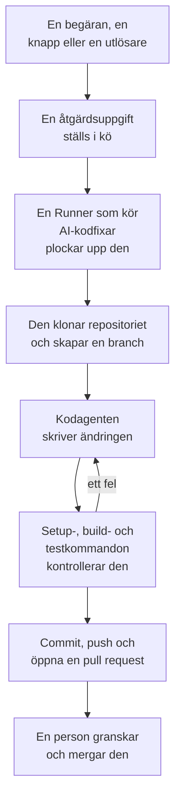

# Kod

Kod är där du ber OneUptime AI att arbeta i dina repositorier, så som du skulle be en kodagent: rätta en bugg, skriva tester, förklara koden, göra en ändring. Kod öppnas på rutan där du ber om saker, med repositoriet och branchen valda i den och alla uppgifter under den; en uppgifts sida är en konversation som du kan svara i. OneUptime startar också uppgifter på egen hand, från undantag, spår och utredningar. En [Runner](/docs/runbooks/agents) klonar repositoriet, skriver ändringen på en ny branch, bygger och testar den och öppnar en pull request. En människa granskar och mergar var och en: Runnern kan pusha brancher och öppna pull requests, inget mer.

:::cards
- [Be AI om något i ett repositorium](#be-ai-om-något-i-ett-repositorium): En begäran med dina egna ord, med den kontext den behöver.
- [En uppgifts konversation](#en-uppgifts-konversation): Vad AI gjorde, vad den ändrade, och ditt svar.
- [Så går en åtgärdskörning till](#så-går-en-åtgärdskörning-till): Från ett klick till en pull request, steg för steg.
- [Var åtgärdsuppgifter startar](#var-åtgärdsuppgifter-startar): Uppgifterna som OneUptime startar, och vad varje pull request gör.
- [Produktionstelemetri i en åtgärd](#produktionstelemetri-i-en-åtgärd): Vad en åtgärd läser från produktionen medan den skriver ändringen.
- [Produktionsgranskning av pull requests](#produktionsgranskning-av-pull-requests): Vad produktionen säger om koden som varje pull request ändrar.
- [Innan du börjar](#innan-du-börjar): En modell, ett anslutet repository och en Runner.
- [När en åtgärd misslyckas](#när-en-åtgärd-misslyckas): Vad som händer med en körning som fallerar, fastnar eller väntar.
:::

> [!TIP]
> Du kan också starta det här från GitHub. Nämn OneUptime GitHub App i en issue eller en pull request, så implementerar, reviderar eller granskar den direkt där: se [GitHub App](/docs/ai/github-app). Det är samma agent, samma Runner och samma budgetar; bara utlösaren skiljer sig.

## Be AI om något i ett repositorium

:::steps
### Öppna Kod

Öppna **Produkter → Kod**. Kod öppnas på **Vad ska AI göra?**: rutan där du ber om saker, med alla uppgifter under den, de senaste först. Finns det inget repositorium ännu erbjuder Kod i stället **Anslut GitHub** (se [Innan du börjar](#innan-du-börjar)). **Arkiv** i sidomenyn listar de repositorier som AI kan arbeta i, och samlar dem som GitHub App inte längre når under **Inte ansluten**. Varje repositoriums sida har samma ruta för det repositoriet.

### Välj repositoriet och branchen

Rutan börjar på repositoriet du valde senast. Välj ett annat i dess nedersta rad och bredvid den branch som uppgiften utgår från: repositoriets huvudbranch, märkt **Standard**, tills du väljer en annan. AI skapar sin branch från den du väljer och öppnar sin pull request mot den.

### Säg vad du vill

Skriv ändringen, buggen eller frågan med dina egna ord. Tills något har efterfrågats föreslår Kod några under **Prova att be om**.

### Lägg till kontext

Klicka på **Lägg till kontext** för att ge AI det den behöver: en fil eller mapp i repositoriet, en anteckning, en länk eller en post i projektet. OneUptime läser varje post när du skickar begäran, med dina behörigheter, och sparar vad AI fick.

### Starta uppgiften

Klicka på **Starta uppgift**, eller tryck på Enter. Uppgiftens sida öppnas, och AI:s arbete visas där medan det sker.
:::

| Kontext | Vad AI får |
| --- | --- |
| **Fil eller mapp** | En sökväg i repositoriet, som AI läser först. |
| **Anteckning** | Text som du klistrar in: ett fel, en specifikation, en loggrad. |
| **Länk** | En webbadress, som referens. |
| **Incident** eller **Larm** | Dess tillstånd, beskrivning och grundorsak, så som de är när du skickar begäran. |
| **Undantag** | Dess meddelande och stack trace. |
| **Övervakning** | Dess typ, status och beskrivning. |
| **Spår** | Dess spans: deras namn, tider och fel. |
| **Loggar** | De senaste 20 loggraderna som innehåller din sökning, från den senaste timmen, dagen eller veckan. |
| **Prestandaprofil** | Vart en funktions tid går i dess tjänsts profiler: vem som anropar den, vad den anropar och dess hetaste rader. |

En begäran bär högst 10 kontextdelar. Token, nycklar, lösenord och e-postadresser i det som OneUptime läser maskeras innan AI ser dem, som överallt där OneUptime AI läser dina data.

## En uppgifts konversation

En uppgifts sida är en konversation: vad som efterfrågades och kontexten som lades till, sedan AI:s tur – stegen den tar medan den tar dem (filerna den läste och redigerade, vad den sökte efter, kommandona den körde), dess svar, filerna den ändrade med deras diff, och pull requesten. Överst på sidan står var uppgiften arbetar (dess repositorium och den branch den utgick från), hur många rader den ändrade, med en knapp till dess pull request, och hur det går för uppgiften:

| Tillstånd | Vad det betyder |
| --- | --- |
| **I kö** | Den väntar på att en Runner ska ta den. |
| **Arbetar…** | AI arbetar med den. **Stoppa** stoppar den; det den har pushat ligger kvar på branchen. |
| **Väntar på dig** | AI har ställt en fråga. Svara på den i rutan nedanför. |
| **Klar** | AI är klar: dess svar, och pull requesten när den ändrade kod. |
| **Misslyckades** | Turen kunde inte slutföras, och säger varför. **Försök igen** ber om samma sak igen. |
| **Stoppad** | Någon stoppade den. **Försök igen** ber om samma sak igen. |

För att följa upp skriver du i rutan längst ned, som syns medan konversationen rullar: svara AI, lägg till kontext eller be om ändringar. Varje svar är nästa tur i samma uppgift: den arbetar på samma branch och pushar till samma pull request så länge den är öppen. En uppgift tar en tur i taget, så rutan väntar medan AI arbetar. Varje turs **Logg** är den ordagranna redogörelsen för vad den gjorde.

Den som kan läsa ett repositorium läser dess uppgifter. Att be AI om något, svara och stoppa en uppgift kräver behörighet att redigera repositoriet, och det gör även att se en ändrings diff: alla andra ser vilka filer som har ändrats. Uppgifterna som OneUptime startar på egen hand (nedan) finns också i sitt repositorium, som konversationer du kan svara i.

## Så går en åtgärdskörning till



1. Du klickar på **Starta uppgift** i Kod, eller på **Åtgärda med AI** på ett olöst undantag, eller så startar en annan knapp eller utlösare en uppgift (se [Var åtgärdsuppgifter startar](#var-åtgärdsuppgifter-startar)).
2. Uppgiften ställs i kö på sitt repository, och den Runner som repositoryt väljer tar den: en av dina Runners, eller en global Runner när det inte väljer någon (se [Välj repositoryts Runner](#välj-repositoryts-runner)).
3. Runnern hämtar uppgiftens kontext. För en begäran är det dess ord, kontexten som lades till och konversationen hittills; för ett undantag dess typ, dess meddelande och dess stack trace.
4. Den klonar repositoriet till en egen arbetsyta och skapar en branch. En åtgärd av ett undantag heter `oneuptime-fix-exception-` följt av de första tecknen i körningens id. En begäran utgår från den branch som valdes när den ställdes, och dess pull request öppnas mot den. Ett svar arbetar i stället på branchen för uppgiftens öppna pull request.
5. En kodagent, driven av ditt projekts LLM-leverantör, läser koden och skriver ändringen. OneUptime-servern gör LLM-anropen, så Runnern har aldrig din leverantörs API-nyckel, och varje anrop mäts och listas i AI-loggarna. En åtgärd av ett undantag, ett långsamt spår eller en incident läser också från produktionen medan den arbetar: undantagen, spåren, loggarna och mätvärdena för repositoriets tjänster (se [Produktionstelemetri i en åtgärd](#produktionstelemetri-i-en-åtgärd)).
6. På en egen Runner bygger och testar kodagenten sin ändring så som repositoriets `AGENTS.md` säger innan något committas, och reparerar det som misslyckas (se [Kontroll före pull requesten](#kontroll-före-pull-requesten)).
7. Runnern committar, pushar branchen, öppnar pull requesten (för en begäran bara när den ändrade kod) och tar bort arbetsytan.

Sidan som uppgiften startades från visar dess status live. Varje uppgift listas i sitt repositorium under **Produkter → Kod**: dess sida är dess konversation, och varje turs **Logg** har en rad för varje fil som Runnern läste eller skrev och varje kommando den körde.

Varje körning hålls inom budgetar som servern upprätthåller: högst **40 LLM-anrop** och **100 000 utdatatokens**. En körnings frågor mot produktionstelemetrin räknas mot samma 40 anrop. En körning som når någon av dem avslutas med en sammanfattning av arbetet hittills i stället för att gå i loop. Åtgärdskörningar räknas också mot projektets dagliga AI-gränser, när projektet sätter dem.

## Var åtgärdsuppgifter startar

| Var | Klick | Pull requesten |
| --- | --- | --- |
| Ett undantags sida **AI Assistance** | **Åtgärda med AI** | Åtgärdar buggen bakom undantaget. |
| Ett undantags sida **AI Assistance** | **Generate Regression Test** | Lägger till ett test som återskapar undantaget och fallerar tills buggen är åtgärdad. |
| Ett undantags sida **AI Assistance** | **Förbättra felhantering** | För ett förväntat fel, som ogiltig indata: tar bort användardata ur meddelandet, validerar indata tidigare och markerar felet som hanterat, utan att ändra beteendet. |
| En incidents eller ett larms kort **AI Investigation** | **Open Fix PR from this analysis** | Åtgärdar grundorsaken som utredningen publicerade (se [Automatiska kodåtgärder från utredningar](#automatiska-kodåtgärder-från-utredningar)). |
| Ett spår som är värt att åtgärda | **Åtgärda prestandan med AI** | Åtgärdar det långsamma mönster som knappen nämner, som en N+1-fråga eller anrop som kunde köras parallellt. |
| En tjänsts sida **Loggar** | **Förbättra loggning** | Gör tjänstens loggar strukturerade, med rätt allvarlighetsgrad och kopplade till dess spår, utan att ändra beteendet. |
| En tjänsts sida **Spår** | **Förbättra spårning** | Lägger till spans och attribut där tjänstens tracing saknas, utan att ändra beteendet. |
| En funktion i **Prestandaprofiler** | **Åtgärda med AI** | Får funktionen att göra samma arbete med mindre tid eller minne, med dess profil som underlag. |

De här knapparna visas bara där de kan starta en uppgift. Med AI avstängt för projektet visas ingen av dem, och ett undantags sidomeny har ingen **AI Assistance**. **Förbättra loggning** och **Förbättra spårning** visas så snart ett repository är anslutet, och **Åtgärda prestandan med AI** bara på ett spår som är värt att åtgärda (se [Spårutforskare](/docs/telemetry/traces-explorer)). En funktions **Åtgärda med AI** visas bara för programmets egen kod som tar minst 5 % av profilens tid eller minne, eller vars andel har vuxit med 3 enheter eller mer sedan fönstret den jämförs med (se [Kontinuerlig profilering](/docs/telemetry/profiles)).

För att öppna ett undantags sida **AI Assistance**, öppna undantaget under **Produkter → Observerbarhet → Undantag** och välj **AI Assistance** i dess sidomeny. Ett löst eller arkiverat undantag måste först markeras som olöst.

OneUptime AI startar också åtgärdsuppgifter på egen hand: från en utredning som hittar en kodändring, från en som slutar utan slutsats eftersom telemetri saknades, och från AI Insights om undantag och långsamma spår. Var och en har sin egen brytare; se [Automatiska kodåtgärder](/docs/ai/ai-sre#automatiska-kodkorrigeringar).

## Produktionstelemetri i en åtgärd

OneUptime vet vad din kod gör i produktion, så en åtgärd behöver inte utgå från enbart en stack trace. Medan kodagenten arbetar kan den ställa frågor mot produktionstelemetrin för de tjänster som hör till repositoriet:

| Den läser | Till vad |
| --- | --- |
| **Undantag** | De undantagsgrupper som kastas i angivna filer eller en funktion: hur ofta under de senaste dagarna, sedan vilken release, och spåret för en nylig förekomst. |
| **Spår** | Latens- och felprofilen för en slutpunkt eller operation, och spansen i ett enskilt spår. |
| **Loggar** | En tjänsts loggrader, efter tid, allvarlighetsgrad, text eller spår. |
| **Mätvärden** | Ett mätvärde som en tjänst rapporterar, över tid; utan ett namn de mätvärden den rapporterar. |
| **Incidenter** | Incidenter som drabbade tjänsterna, eller som en OneUptime-åtgärd i det här repositoriet öppnades för, med deras grundorsak och efteranalys. |
| **Driftsättningar** | De senaste driftsättningarna och andra ändringarna av tjänsterna, var och en med OneUptimes bedömning av om den skadade sin tjänst. |

| Uppgift | Vad den kontrollerar |
| --- | --- |
| **Åtgärda med AI** på ett undantag | Hur ofta det kastas nu och sedan vilken release, loggarna och spåret för en förekomst. |
| **Åtgärda prestandan med AI** | Hur belastad och hur långsam operationen är över alla dess spår, inte bara det analyserade. Den ändrar inget när operationen inte längre är långsam. |
| **Open Fix PR from this analysis**, och åtgärder som öppnas automatiskt från utredningar | Driftsättningarna före incidenten, dess fel, loggar och långsamma operationer, och om orsaken har slagit till tidigare. |
| `@oneuptime review` från GitHub | Vad produktionen säger om den ändrade koden (se [Granskningar med produktionskontext](/docs/ai/github-app#granskningar-med-produktionskontext)). |

Pull requestens beskrivning säger vilka frågor agenten ställde och vad de visade. Andra uppgifter, som regressionstester och förbättringar av loggning eller spårning, ställer inga frågor mot produktionen.

Vad agenten får läsa avgörs av OneUptime-servern, utifrån själva uppgiften:

- **Endast läsning.** Frågorna körs på OneUptime-servern, aldrig på Runnern, som inte har några inloggningsuppgifter som kan läsa telemetri. Inget de gör kan ändra ditt projekt.
- **Det här projektet, och bara de tjänster som hör till det här repositoriet.** Du kopplar inte ihop dem själv: det är de tjänster som OneUptime hittar det här repositoriet för, på samma sätt som den hittar repositoriet för en åtgärd - deras undantags stack traces går genom dess filer, de heter som det, eller så är det projektets enda repository. En annan tjänsts telemetri kan inte läsas.
- **Inga privata incidenter**, och token, nycklar, lösenord och e-postadresser maskeras innan agenten ser ett resultat, som överallt där OneUptime AI läser dina data.
- **Begränsat.** Högst **12** frågor per körning, som var och en räknas mot körningens 40 anrop.

När ingen tjänst hör till repositoriet körs uppgiften utan produktionstelemetri, som tidigare.

## Produktionsgranskning av pull requests

OneUptime vet vad din kod gör i produktion, så den kan granska en pull request med det som ingen ser när de läser diffen. Slå på **Granska pull-förfrågningar mot produktion** under **Fler inställningar** på ett repositorys sida **Inställningar** i Kod, så får varje pull request som någon med skrivbehörighet öppnar eller pushar till en kommentar som säger vad produktionen visar om koden den ändrar. Kommentaren redigeras på plats vid varje push, och repositoriets sida **Produktionsgranskningar** i Kod sparar varje granskning, med **Granska igen**.

| Den läser | Om koden som pull requesten ändrar |
| --- | --- |
| **Undantag** | Undantagen som kastats i de ändrade raderna, funktionerna och filerna de senaste 7 dagarna, med nya och ohanterade markerade. |
| **Operationer** | De spårade operationerna som kör den ändrade koden den senaste timmen: deras spans, fel och p95. |
| **Tunga funktioner** | Den ändrade kodens funktioner som tar en del av tjänsternas profiler den senaste timmen. |
| **Incidenter** | Tjänsternas incidenter från de senaste 30 dagarna som fortfarande är öppna, eller vars grundorsak eller efteranalys nämner den ändrade koden. Aldrig en privat incident. |
| **Driftsättningar** | Tjänsternas driftsättningar från de senaste 7 dagarna som OneUptime misstänker för en regression. |

När produktionen visar något läser OneUptime AI det bredvid diffen och lägger till **Vad du bör hålla koll på**: några korta punkter som var och en vilar på fakta. Det körs bara medan AI är påslaget för projektet, högst 10 gånger om dagen för en pull request och 100 för ett repository, och mäts som varje AI-anrop; fakta läses varje gång utan det. När produktionen inte visar något om ändringen publicerar OneUptime ingenting.

- **Bara sammanställda värden.** Kommentaren innehåller antal, varaktigheter och namn på kod: aldrig ett undantags meddelande, en loggrad, en incidents titel eller personuppgifter.
- **Offentliga repositorier får en länk.** Vem som helst kan läsa ett offentligt repositorys pull requests, så där länkar kommentaren bara till granskningen i OneUptime, som bara projektets medlemmar kan öppna. **Kommentar från produktionsgranskning** under **Fler inställningar** på repositoriets sida **Inställningar** kan publicera **Bara en länk till granskningen** överallt, eller **Granskningen, även i ett offentligt arkiv**.
- **Externa bidragsgivare kan inte starta en.** En pull request granskas bara av sig själv när dess författare, och den som pushade till den, kan skriva till repositoriet. En från någon annan - en extern bidragsgivare, en fork, en bot - granskas när någon med skrivbehörighet kommenterar `@oneuptime production review` på den, eller klickar på **Granska igen** i Kod.
- **Endast läsning.** En granskning klonar ingenting och kör ingenting från pull requesten. Dess diff och titel är data för OneUptime AI, aldrig instruktioner: AI:n har inga verktyg, och det den skriver läggs in i kommentaren som text.

Brytaren är påslagen för de repositorier som GitHub App ansluter från och med nu. Ett repository som anslöts innan den fanns behåller den avstängd tills du slår på den.

## Kontroll före pull requesten

Ett repositorium beskriver hur det byggs och testas i en `AGENTS.md` i roten, filen som kodagenter läser. Innan kodagenten ändrar något läser den repositoriets `AGENTS.md` (eller dess `CLAUDE.md`, när det inte har någon `AGENTS.md`) från den branch som uppgiften utgår från, och arbetar så som den säger. Utan någon av dem tar den reda på det från repositoriets `CONTRIBUTING.md`, README, paketskript, `Makefile` eller CI-arbetsflöden. Det finns inget att ställa in i OneUptime.

| Var AI arbetar | Vad den gör med repositoriets bygge och tester |
| --- | --- |
| En av dina Runners | Bygger och testar sin ändring innan pull requesten öppnas, rättar det som misslyckas och kontrollerar igen, och säger i sin sammanfattning vilka kontroller den körde. Varje kommando den kör får upp till 2 minuter, utan Runnerns egna inloggningsuppgifter i sin miljö. |
| **Global Runner** | Kör inget kommando: den skriver ändringen och öppnar pull requesten, och ditt repositorys egen CI kontrollerar den. |

Inget från en pull request som kommer från en fork läses någonsin som repositoriets instruktioner: en revidering avvisar en sådan pull request, och en granskning läser basbranchen.

### Kommandon som är satta på ett repositorium

Kod frågar inte längre efter installations-, bygg- och testkommandon, men ett repositorium som har dem, satta tidigare eller via API:et eller Terraform, behåller dem. De visas skrivskyddade på kortet **Bygg- och testkommandon**, under **Fler inställningar** på repositoriets sida **Inställningar**, och **Ta bort kommandon** tar bort alla tre. Så länge något av dem är satt kontrollerar varje åtgärdskörning på en egen Runner också sin ändring med dem innan pull requesten öppnas:

1. När kodagenten är klar körs kommandona i ordning i roten av repositoriet, på Runnern, i den klonade arbetsytan. Vart och ett får upp till 15 minuter och körs med `CI=true`, så att inget väntar på indata; det första felet stoppar omgången.
2. Vid ett fel går slutet av det fallerande kommandots utdata tillbaka till samma kodagent som en reparationsuppgift, med instruktioner att rätta sin egen ändring i stället för att försvaga eller hoppa över tester, och kommandona körs igen. Den gör högst **2** reparationsförsök. De delar körningens LLM-budget, och deras ändringar hamnar i samma commit som åtgärden.
3. Utfallet, godkänt, fallerat eller överhoppat (inga kommandon satta, eller en global Runner), skrivs i ett Verification-avsnitt i pull requestens beskrivning och registreras på uppgiftens pull request.

En ändring som fortfarande inte klarar kontrollen kastas inte: pull requesten öppnas ändå, med ett tydligt markerat avsnitt "Verification failed" som namnger det fallerande kommandot och slutar med dess utdata. Arbetet behålls, och den som granskar bestämmer. Ett repository utan satta kommandon rapporteras som överhoppat, i stället för att antyda ett grönt bygge.

Kommandona är repositoryinställningar som ditt team skriver och som körs på din egen Runner: samma förtroendemodell som en runbooks Bash-steg. AI:n skriver eller ändrar dem aldrig. En global Runner, som OneUptime kör för alla projekt, kör dem aldrig: på en global Runner skrivs korrigeringen och öppnas för granskning, kontrollen rapporteras som överhoppad, och ditt repositorys egen CI kontrollerar ändringen. [Kör en egen Runner](#kör-en-egen-runner) för att få korrigeringar byggda och testade innan pull requesten öppnas.

## När en korrigering har slagits samman

Att slå samman en korrigering åtgärdar ingenting förrän den körs. När en pull-förfrågan med en korrigering har slagits samman väntar OneUptime på en registrerad driftsättning som innehåller den (se [Driftsättningar och ändringar](/docs/telemetry/change-events)) och bevakar i den driftsättningen det som korrigeringen var till för. Uppgiftens pull-förfrågan i Code berättar hur det gick, och det gör även undantagets sida **AI Assistance**, incidentens AI-loggar och AI-insikten som korrigeringen kom från:

| En korrigering av | Det som bevakas | Det fungerade | Det fungerade inte |
| --- | --- | --- | --- |
| Ett undantag | Om undantaget inträffar igen | **Åtgärdad i produktion** | **Inträffar fortfarande efter korrigeringen** |
| En långsam trace eller en latensinsikt | p99 för operationen som korrigeringen nämner | **Snabbare i produktion** | **Fortfarande långsam efter korrigeringen** |
| Grundorsaken till en incident eller en avisering | Om dess monitor utlöser en till | **Åtgärdad i produktion** | **Inträffade igen efter korrigeringen** |
| Saknad telemetri, loggning eller spårning | Det som korrigeringen lägger till, och resten av tjänstens telemetri | **Kommer fram i produktion** | **Telemetrin upphörde efter korrigeringen** |

Tills en driftsättning levererar den står det **Mergad, väntar på en deploy** vid korrigeringen, sedan **Deployad, bevakas i produktion** medan den bevakas. En korrigering som ingen registrerad driftsättning innehåller inom 14 dagar, eller som produktionen inte kan säga något om, står som **Inte verifierad i produktion**. [Automatiska kodkorrigeringar](/docs/ai/ai-sre#automatiska-kodkorrigeringar) har reglerna. Ett regressionstest, bättre felhantering, en granskning och en begäran i Code bevakas inte: produktionen kan inte visa vad de ändrar.

## Innan du börjar

En uppgift behöver tre saker. Kods begäransruta och undantagets sida **AI Assistance** kontrollerar alla tre innan de erbjuder att starta, och säger vad som saknas.

| Vad | OneUptime Cloud | Självhostad |
| --- | --- | --- |
| En LLM-leverantör | Inget att ställa in: ett projekt utan egen leverantör använder den globala leverantören, betald med projektets AI-krediter. En egen leverantör, under **Projektinställningar → AI → LLM-leverantörer**, går först. | Sätt miljövariablerna `GLOBAL_LLM_PROVIDER_*` en gång på servern, eller lägg till en leverantör i projektet. |
| Ett repository anslutet via GitHub App | **Produkter → Kod**, sedan **Anslut GitHub**. Om appen redan är installerad på GitHub-kontot klickar du i stället på **Anslut en befintlig installation**: den ansluts inte av att installera den igen. Kräver Growth-planen. | Samma sak, när din instans har en GitHub App (se [GitHub-integration](/docs/self-hosted/github-integration)). |
| En Runner som kör AI-kodfixar | Inget att drifta: ett repository som inte väljer någon arbetar på OneUptimes globala Runners. | Docker Compose-tjänsten `runner`, eller Helm-chartets Runner (`runner.enabled`, påslagen som standard), registrerar sig själv och kör AI-kodfixar i varje repository som inte väljer någon Runner. |

På en självhostad instans är den globala leverantören ett block i `config.env` (Docker Compose) eller i dina Helm-värden. För en självhostad Ollama:

```bash
GLOBAL_LLM_PROVIDER_TYPE=Ollama
# An address the OneUptime server can reach, never localhost.
GLOBAL_LLM_PROVIDER_BASE_URL=http://ollama:11434
GLOBAL_LLM_PROVIDER_MODEL_NAME=llama3.1
# No GLOBAL_LLM_PROVIDER_API_KEY needed — Ollama is keyless.
```

Alla leverantörer som stöds fungerar: se [LLM-leverantörer](/docs/ai/llm-provider) för alla och varje miljövariabel.

Du kopplar inte repositories till tjänster. När en uppgift startar hittar OneUptime repositoriet genom att jämföra filsökvägarna i undantagets stack trace med dina anslutna repositories. När inget matchar faller den tillbaka på ett repository som heter som tjänsten, och sedan på projektets enda repository när det bara finns ett. Sidan **AI Assistance** visar vilket repository den hittade.

### Välj repositoryts Runner

Varje repository väljer den Runner som AI arbetar i det på: öppna **Fler inställningar** på dess sida **Inställningar** i Kod, klicka på **Redigera** på kortet **Runner** och välj en. Ett repository som GitHub App importerar startar på projektets [standard-Runner](/docs/runbooks/agents#projektets-standard-runner) när projektet har en. Ett repository som inte väljer någon arbetar på **Global Runner**, som OneUptime kör för alla projekt.

| Runner | Vad den gör med en uppgift |
| --- | --- |
| **Global Runner** | Skriver ändringen och öppnar pull requesten utan att bygga eller testa den: ditt repositorys egen CI kontrollerar ändringen. |
| En av dina Runners | Bygger och testar också ändringen så som repositoriets `AGENTS.md` säger, på en värd som du kontrollerar. |

Bara den Runner som ett repository väljer får dess uppgifter och en token för det. I ett projekt som stänger av **Använd globala Runners** under **Runbooks → Runbook-agenter** behöver varje repository en av projektets egna Runners. En Runners sida listar de repositoryn som väljer den.

### Kör en egen Runner

Så här kör du en Runner någon annanstans, till exempel på en maskin nära dina repositories:

:::steps
### Skapa Runnern

Skapa en Runner under **Runbooks → Runbook-agenter** och klicka på **Visa installationsinstruktioner** på dess rad. Kommandot innehåller Runnerns hemliga nyckel, som bara en Project Owner, Project Admin eller Runbook Admin kan läsa. Det ser ut så här:

```bash
docker run --name oneuptime-runner --restart unless-stopped \
  -e ONEUPTIME_RUNNER_ID=<runner-id> \
  -e ONEUPTIME_RUNNER_KEY=<runner-key> \
  -e ONEUPTIME_URL=<your-oneuptime-url> \
  -d oneuptime/runner:release
```

### Välj den för repositoryt

Öppna **Fler inställningar** på repositoryts sida **Inställningar** i Kod, klicka på **Redigera** på kortet **Runner** och välj Runnern. Runnern plockar upp ändringen vid nästa heartbeat, inom ungefär en minut; det finns inget att starta om.

### Kontrollera att den ansluter

Runnern visas som ansluten på sidan **Runbooks → Runbook-agenter** inom en minut eller två. Om inte, läs containerns logg (`docker logs oneuptime-runner`) efter ett fel med inloggningsuppgifter eller nätverk.
:::

Alla sätt att köra containern fungerar (Docker Compose, Kubernetes och så vidare), så länge den har de här variablerna och kan nå din OneUptime-instans över HTTPS:

| Variabel | Vad den är |
| --- | --- |
| `ONEUPTIME_RUNNER_ID` | Runnerns id, från instrumentpanelen. |
| `ONEUPTIME_RUNNER_KEY` | Runnerns hemliga nyckel. |
| `ONEUPTIME_URL` | Din OneUptime-instans adress (`https://oneuptime.com` på OneUptime Cloud). |

> [!NOTE]
> Före OneUptime 12 kördes AI-kodfixar på en separat AI Agent-komponent (avbildningen `oneuptime/ai-agent` med `AI_AGENT_*`-variabler). Den har gått upp i Runnern: om du fortfarande kör en, beskriver [uppgraderingsguiden från v11 till v12](/docs/installation/upgrading) hur du ersätter den.

## Automatiska kodåtgärder från utredningar

När en [AI-utredning](/docs/ai/ai-sre) publicerar en grundorsaksanalys på en incident eller ett larm, och dess noggranna klassificering rekommenderar en ändring i koden, erbjuder utredningskortet **Open Fix PR from this analysis**: en åtgärdsuppgift vars hela kontext är den publicerade analysen. Knappen är dold när åtgärden är driftmässig, bara gäller infrastruktur, är extern, är ett förväntat nekande, ett användarfel eller utan slutsats. Lämpliga åtgärder sker utan klicket så länge **Åtgärda nya incidenter automatiskt** är på på **Incidenter → AI → Inställningar** (och **Åtgärda nya larm automatiskt** på **Varningar → AI → Inställningar**). Åtgärdandet börjar avslaget, även för nya projekt. Utan AI-regler öppnas varje lämplig korrigering; med regler bara en för det som en regel matchar, när regeln har **Pull requests med korrigeringar** påslaget (det har en ny regel), i de kodrepositorier som den nämner.

Medan åtgärdandet är på ställer en utredning som slutar med en säker, belagd grundorsak som en kodändring kan åtgärda samma åtgärdsuppgift i kö som knappen skapar. Beslutet är en avgränsad klassificering som servern kontrollerar, aldrig ett mönster som matchas mot analysens text: bara en positiv bedömning om en kodåtgärd öppnar en pull request. Saknade belägg, en åtgärd utanför koden och en misslyckad klassificering slutar alla med att inget händer.

Allt annat är som med knappen:

- Pull requesten öppnas redo för granskning, skriven utifrån den publicerade analysen, och behöver ett repository anslutet via GitHub App, ett av dem som de matchande reglerna nämner när de nämner något, och en Runner som är online för att arbeta i det: den som repositoryt väljer, eller en global Runner.
- Den räknas mot signalens dagliga gräns för åtgärdsuppgifter (**Daily Incident AI Fix Task Limit** eller **Daily Alert AI Fix Task Limit**, under **Fler inställningar** på dess AI-inställningssida) och mot repositoriets tak för öppna pull requests, när något av dem är satt. Osatta begränsar ingen av dem något.
- Varje utlösare letar först efter en åtgärdsuppgift som redan står i kö eller körs för samma incident eller larm, så en automatisk utlösare och ett klick blir normalt en uppgift, inte två pull requests. Kontrollen är en läsning före skrivningen, inte ett lås, så två utlösare i exakt samma ögonblick kan fortfarande båda komma igenom.
- Körningen skrivs av systemet, tillskrivs ingen, och inget mergas av sig självt.

## När en åtgärd misslyckas

:::details Körningen fallerar
Åtgärden kunde inte tillämpas, repositoriet eller den branch som en begäran utgick från kunde inte nås, eller LLM-anropet misslyckades. Uppgiftens konversation, och sidan som den startades från, visar orsaken och erbjuder att försöka igen. Turens **Logg** har hela körningsloggen.
:::

:::details Runnern stannar mitt i en körning
En körning vars heartbeat har varit tyst i mer än 12 minuter avslutas med ett fel. Den ställs aldrig i kö igen av sig själv, eftersom Runnern redan kan ha pushat en del av en åtgärdsbranch; starta den igen där du startade den.
:::

:::details Ingen Runner plockar upp uppgiften
En uppgift som väntar mer än 30 minuter medan den Runner som ska ta den inte är ansluten - den som dess repository väljer, eller en global Runner för ett repository som inte väljer någon - fallerar, med ett meddelande som säger vilken, så att den aldrig visas som pågående för alltid. När en Runner är online men upptagen väntar köade uppgifter på sin tur. En Runner som är äldre än Kod får aldrig en begäran från Kod: uppdatera en Runner som du kör själv tillsammans med servern.
:::

## Integritet

Klonen av ditt repository ligger i en arbetsyta i Runnerns container och tas bort när körningen slutar, oavsett om den lyckades eller inte. Runnern har aldrig din LLM-leverantörs API-nyckel: OneUptime-servern gör LLM-anropen åt den, och kör även frågorna mot produktionstelemetrin. OneUptime behåller inte ditt repository och tränar inte på din kod. Uppgiftens logg behåller de första 300 tecknen av varje stegs utdata, så att du kan kontrollera vad Runnern gjorde, och det kan innehålla kodsnuttar. Kör en självhostad Runner med din egen LLM-leverantör (lokal Ollama inräknad), så lämnar din kod aldrig din infrastruktur.

## På färdplanen

Planerat, och **inte tillgängligt i dag**:

- **Stöd för GitLab.** Repositories ansluts bara via GitHub App.

## Nästa steg

:::cards
- [GitHub App](/docs/ai/github-app): Be om en ändring, en revidering eller en granskning direkt från GitHub.
- [AI SRE](/docs/ai/ai-sre): Utredningarna vars analyser åtgärdsuppgifter kan göra till pull requests.
- [Runbook-agenter](/docs/runbooks/agents): Workern som utför varje åtgärdskörning.
:::
