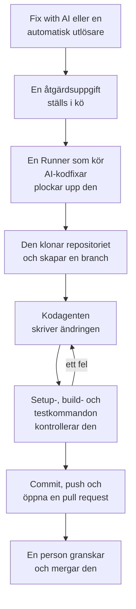

# Åtgärdsuppgifter

En åtgärdsuppgift är en pull request som OneUptime AI skriver i din kod. Du startar en från ett undantag, ett spår, en tjänst eller en utredning, eller så startar OneUptime en på egen hand; en [Runner](/docs/runbooks/agents) klonar repositoriet, skriver ändringen på en ny branch, bygger och testar den och öppnar en pull request. En människa granskar och mergar var och en: Runnern kan pusha brancher och öppna pull requests, inget mer.

:::cards
- [Så går en åtgärdskörning till](#så-går-en-åtgärdskörning-till): Från ett klick till en pull request, steg för steg.
- [Var åtgärdsuppgifter startar](#var-åtgärdsuppgifter-startar): Knapparna som startar en, och vad varje pull request gör.
- [Innan du börjar](#innan-du-börjar): En modell, ett anslutet repository och en Runner.
- [När en åtgärd misslyckas](#när-en-åtgärd-misslyckas): Vad som händer med en körning som fallerar, fastnar eller väntar.
:::

> [!TIP]
> Du kan också starta det här från GitHub. Nämn OneUptime GitHub App i en issue eller en pull request, så implementerar, reviderar eller granskar den direkt där: se [GitHub App](/docs/ai/github-app). Det är samma agent, samma Runner och samma budgetar; bara utlösaren skiljer sig.

## Så går en åtgärdskörning till



1. Du klickar på **Fix with AI** på ett olöst undantag, eller så startar en annan knapp eller utlösare en uppgift (se [Var åtgärdsuppgifter startar](#var-åtgärdsuppgifter-startar)).
2. Uppgiften ställs i kö, och en ledig Runner med **Kör AI-kodfixar** påslaget plockar upp den.
3. Runnern hämtar uppgiftens kontext. För ett undantag är det dess typ, dess meddelande och dess stack trace.
4. Den klonar repositoriet till en egen arbetsyta och skapar en branch. En åtgärd av ett undantag heter `oneuptime-fix-exception-` följt av de första tecknen i körningens id.
5. En kodagent, driven av ditt projekts LLM-leverantör, läser koden och skriver ändringen. OneUptime-servern gör LLM-anropen, så Runnern har aldrig din leverantörs API-nyckel, och varje anrop mäts och listas i AI-loggarna.
6. Om repositoriet har kontrollkommandon bygger och testar Runnern ändringen innan den committar något, och lämnar tillbaka ett fel till kodagenten att reparera (se [Kontroll före pull requesten](#kontroll-före-pull-requesten)).
7. Runnern committar, pushar branchen, öppnar pull requesten och tar bort arbetsytan.

Sidan som uppgiften startades från visar dess status live. Varje uppgift listas under **Produkter → Kod → Uppgifter**: öppna en för dess **Översikt**, dess **Loggar** (en rad för varje fil som Runnern läste eller skrev och varje kommando den körde) och dess **Pull-förfrågningar**.

Varje körning hålls inom budgetar som servern upprätthåller: högst **40 LLM-anrop** och **100 000 utdatatokens**. En körning som når någon av dem avslutas med en sammanfattning av arbetet hittills i stället för att gå i loop. Åtgärdskörningar räknas också mot projektets dagliga AI-gränser, när projektet sätter dem.

## Var åtgärdsuppgifter startar

| Var | Klick | Pull requesten |
| --- | --- | --- |
| Ett undantags sida **AI Assistance** | **Fix with AI** | Åtgärdar buggen bakom undantaget. |
| Ett undantags sida **AI Assistance** | **Generate Regression Test** | Lägger till ett test som återskapar undantaget och fallerar tills buggen är åtgärdad. |
| Ett undantags sida **AI Assistance** | **Improve Error Handling** | För ett förväntat fel, som ogiltig indata: tar bort användardata ur meddelandet, validerar indata tidigare och markerar felet som hanterat, utan att ändra beteendet. |
| En incidents eller ett larms kort **AI Investigation** | **Open Fix PR from this analysis** | Åtgärdar grundorsaken som utredningen publicerade (se [Automatiska kodåtgärder från utredningar](#automatiska-kodåtgärder-från-utredningar)). |
| Ett spår | **Fix performance with AI** | Åtgärdar det långsamma mönstret som hittades i spåret, som N+1-frågor eller ett enda dominerande långsamt span. |
| En tjänsts sida **Loggar** | **Improve Logging** | Gör tjänstens loggar strukturerade, med rätt allvarlighetsgrad och kopplade till dess spår, utan att ändra beteendet. |
| En tjänsts sida **Spår** | **Improve Tracing** | Lägger till spans och attribut där tjänstens tracing saknas, utan att ändra beteendet. |

För att öppna ett undantags sida **AI Assistance**, öppna undantaget under **Produkter → Observerbarhet → Undantag** och välj **AI Assistance** i dess sidomeny. Ett löst eller arkiverat undantag måste först markeras som olöst.

OneUptime AI startar också åtgärdsuppgifter på egen hand: från en utredning som hittar en kodändring, från en som slutar utan slutsats eftersom telemetri saknades, och från AI Insights om undantag och långsamma spår. Var och en har sin egen brytare; se [Automatiska kodåtgärder](/docs/ai/ai-sre#automatiska-kodkorrigeringar).

## Kontroll före pull requesten

Ett kodrepository kan ha upp till tre kontrollkommandon på sin sida **Inställningar**, under **Kodrepositorier**:

| Kommando | Exempel | När det körs |
| --- | --- | --- |
| **Setup Command** | `npm ci` | Först, för att installera beroenden. |
| **Build Command** | `npm run build` | Efter setup. |
| **Test Command** | `npm test` | Sist. |

När något av dem är satt kontrollerar varje åtgärdskörning sin ändring innan pull requesten öppnas:

1. När kodagenten är klar körs kommandona i ordning i roten av repositoriet, på Runnern, i den klonade arbetsytan. Vart och ett får upp till 15 minuter och körs med `CI=true`, så att inget väntar på indata; det första felet stoppar omgången.
2. Vid ett fel går slutet av det fallerande kommandots utdata tillbaka till samma kodagent som en reparationsuppgift, med instruktioner att rätta sin egen ändring i stället för att försvaga eller hoppa över tester, och kommandona körs igen. Den gör högst **2** reparationsförsök. De delar körningens LLM-budget, och deras ändringar hamnar i samma commit som åtgärden.
3. Utfallet, godkänt, fallerat eller överhoppat (inga kommandon satta), skrivs i ett Verification-avsnitt i pull requestens beskrivning och registreras på uppgiftens pull request.

En ändring som fortfarande inte klarar kontrollen kastas inte: pull requesten öppnas ändå, med ett tydligt markerat avsnitt "Verification failed" som namnger det fallerande kommandot och slutar med dess utdata. Arbetet behålls, och den som granskar bestämmer. Ett repository utan satta kommandon rapporteras som överhoppat, i stället för att antyda ett grönt bygge.

Kommandona är repositoryinställningar som ditt team skriver och som körs på din egen Runner: samma förtroendemodell som en runbooks Bash-steg. AI:n skriver eller ändrar dem aldrig.

## Innan du börjar

En åtgärdsuppgift behöver tre saker. Undantagets sida **AI Assistance** kontrollerar alla tre innan den erbjuder att starta, och säger vad som saknas.

| Vad | OneUptime Cloud | Självhostad |
| --- | --- | --- |
| En LLM-leverantör | Inget att ställa in: ett projekt utan egen leverantör använder den globala leverantören, betald med projektets AI-krediter. En egen leverantör, under **Projektinställningar → AI → LLM-leverantörer**, går först. | Sätt miljövariablerna `GLOBAL_LLM_PROVIDER_*` en gång på servern, eller lägg till en leverantör i projektet. |
| Ett repository anslutet via GitHub App | **Produkter → Kod → Uppgifter**, sedan **Kodrepositorier** och **Connect with GitHub App**. Kräver Growth-planen. | Samma sak, när din instans har en GitHub App (se [GitHub-integration](/docs/self-hosted/github-integration)). |
| En Runner som kör AI-kodfixar | Inget att drifta: OneUptimes delade Runners gör det. | Docker Compose-tjänsten `runner`, eller Helm-chartets Runner (`runner.enabled`, påslagen som standard), registrerar sig själv och kör AI-kodfixar. |

På en självhostad instans är den globala leverantören ett block i `config.env` (Docker Compose) eller i dina Helm-värden. För en självhostad Ollama:

```bash
GLOBAL_LLM_PROVIDER_TYPE=Ollama
# An address the OneUptime server can reach, never localhost.
GLOBAL_LLM_PROVIDER_BASE_URL=http://ollama:11434
GLOBAL_LLM_PROVIDER_MODEL_NAME=llama3.1
# No GLOBAL_LLM_PROVIDER_API_KEY needed — Ollama is keyless.
```

Alla leverantörer som stöds fungerar: se [LLM-leverantörer](/docs/ai/llm-provider) för alla och varje miljövariabel.

Du kopplar inte repositories till tjänster. När en uppgift startar hittar OneUptime repositoriet genom att jämföra filsökvägarna i undantagets stack trace med dina anslutna repositories. När inget matchar faller den tillbaka på ett repository som heter som tjänsten, och sedan på projektets enda repository när det bara finns ett. Sidan **AI Assistance** visar vilket repository den hittade.

### Kör en egen Runner

Så här kör du en Runner någon annanstans, till exempel på en maskin nära dina repositories:

:::steps
### Skapa Runnern

Skapa en Runner under **Runbooks → Runbook-agenter** och klicka på **Visa installationsinstruktioner** på dess rad. Kommandot innehåller Runnerns hemliga nyckel, som bara en Project Owner, Project Admin eller Runbook Admin kan läsa. Det ser ut så här:

```bash
docker run --name oneuptime-runner --restart unless-stopped \
  -e ONEUPTIME_RUNNER_ID=<runner-id> \
  -e ONEUPTIME_RUNNER_KEY=<runner-key> \
  -e ONEUPTIME_URL=<your-oneuptime-url> \
  -d oneuptime/runner:release
```

### Slå på AI-kodfixar

Slå på **Kör AI-kodfixar** på Runnern. Det är avslaget som standard, och Runnern plockar upp ändringen vid nästa heartbeat, inom ungefär en minut; det finns inget att starta om.

### Kontrollera att den ansluter

Runnern visas som ansluten på sidan **Runbooks → Runbook-agenter** inom en minut eller två. Om inte, läs containerns logg (`docker logs oneuptime-runner`) efter ett fel med inloggningsuppgifter eller nätverk.
:::

Alla sätt att köra containern fungerar (Docker Compose, Kubernetes och så vidare), så länge den har de här variablerna och kan nå din OneUptime-instans över HTTPS:

| Variabel | Vad den är |
| --- | --- |
| `ONEUPTIME_RUNNER_ID` | Runnerns id, från instrumentpanelen. |
| `ONEUPTIME_RUNNER_KEY` | Runnerns hemliga nyckel. |
| `ONEUPTIME_URL` | Din OneUptime-instans adress (`https://oneuptime.com` på OneUptime Cloud). |

> [!NOTE]
> Före OneUptime 12 kördes AI-kodfixar på en separat AI Agent-komponent (avbildningen `oneuptime/ai-agent` med `AI_AGENT_*`-variabler). Den har gått upp i Runnern: om du fortfarande kör en, beskriver [uppgraderingsguiden från v11 till v12](/docs/installation/upgrading) hur du ersätter den.

## Automatiska kodåtgärder från utredningar

När en [AI-utredning](/docs/ai/ai-sre) publicerar en grundorsaksanalys på en incident eller ett larm, och dess noggranna klassificering rekommenderar en ändring i koden, erbjuder utredningskortet **Open Fix PR from this analysis**: en åtgärdsuppgift vars hela kontext är den publicerade analysen. Knappen är dold när åtgärden är driftmässig, bara gäller infrastruktur, är extern, är ett förväntat nekande, ett användarfel eller utan slutsats. Lämpliga åtgärder sker utan klicket så länge brytaren **Öppna en pull-förfrågan med en korrigering när en utredning hittar en kodändring** är på. Den hör till åtgärdandet: den ligger under **Åtgärda nya incidenter automatiskt** på **Incidenter → AI → Inställningar** (och under **Åtgärda nya larm automatiskt** på **Varningar → AI → Inställningar**), slås på när åtgärdandet slås på och öppnar pull requests bara medan åtgärdandet är på. Båda börjar avslagna, även för nya projekt.

Medan den är på ställer en utredning som slutar med en säker, belagd grundorsak som en kodändring kan åtgärda samma åtgärdsuppgift i kö som knappen skapar. Beslutet är en avgränsad klassificering som servern kontrollerar, aldrig ett mönster som matchas mot analysens text: bara en positiv bedömning om en kodåtgärd öppnar en pull request. Saknade belägg, en åtgärd utanför koden och en misslyckad klassificering slutar alla med att inget händer.

Allt annat är som med knappen:

- Pull requesten öppnas redo för granskning, skriven utifrån den publicerade analysen, och behöver ett repository anslutet via GitHub App och en Runner med **Kör AI-kodfixar** påslaget.
- Den räknas mot signalens dagliga gräns för åtgärdsuppgifter (**Daily Incident AI Fix Task Limit** eller **Daily Alert AI Fix Task Limit**, under **Fler inställningar** på dess AI-inställningssida) och mot repositoriets tak för öppna pull requests, när något av dem är satt. Osatta begränsar ingen av dem något.
- Varje utlösare letar först efter en åtgärdsuppgift som redan står i kö eller körs för samma incident eller larm, så en automatisk utlösare och ett klick blir normalt en uppgift, inte två pull requests. Kontrollen är en läsning före skrivningen, inte ett lås, så två utlösare i exakt samma ögonblick kan fortfarande båda komma igenom.
- Körningen skrivs av systemet, tillskrivs ingen, och inget mergas av sig självt.

## När en åtgärd misslyckas

:::details Körningen fallerar
Åtgärden kunde inte tillämpas, repositoriet kunde inte nås eller LLM-anropet misslyckades. Sidan som uppgiften startades från visar orsaken och erbjuder att försöka igen. Uppgiftens sida **Loggar** har hela körningsloggen.
:::

:::details Runnern stannar mitt i en körning
En körning vars heartbeat har varit tyst i mer än 12 minuter avslutas med ett fel. Den ställs aldrig i kö igen av sig själv, eftersom Runnern redan kan ha pushat en del av en åtgärdsbranch; starta den igen där du startade den.
:::

:::details Ingen Runner plockar upp uppgiften
En uppgift som väntar mer än 30 minuter medan ingen Runner med **Kör AI-kodfixar** är ansluten fallerar, med ett meddelande om att kontrollera Runnern, så att den aldrig visas som pågående för alltid. När en Runner är online men upptagen väntar köade uppgifter på sin tur.
:::

## Integritet

Klonen av ditt repository ligger i en arbetsyta i Runnerns container och tas bort när körningen slutar, oavsett om den lyckades eller inte. Runnern har aldrig din LLM-leverantörs API-nyckel: OneUptime-servern gör LLM-anropen åt den. OneUptime behåller inte ditt repository och tränar inte på din kod. Uppgiftens logg behåller de första 300 tecknen av varje stegs utdata, så att du kan kontrollera vad Runnern gjorde, och det kan innehålla kodsnuttar. Kör en självhostad Runner med din egen LLM-leverantör (lokal Ollama inräknad), så lämnar din kod aldrig din infrastruktur.

## På färdplanen

Planerat, och **inte tillgängligt i dag**:

- **Stöd för GitLab.** Repositories ansluts bara via GitHub App.
- **Mer telemetri i en åtgärd.** Att föra in spåren, loggarna och mätvärdena kring ett undantag i dess åtgärd, utöver stack tracen.

## Nästa steg

:::cards
- [GitHub App](/docs/ai/github-app): Be om en ändring, en revidering eller en granskning direkt från GitHub.
- [AI SRE](/docs/ai/ai-sre): Utredningarna vars analyser åtgärdsuppgifter kan göra till pull requests.
- [Runbook-agenter](/docs/runbooks/agents): Workern som utför varje åtgärdskörning.
:::
