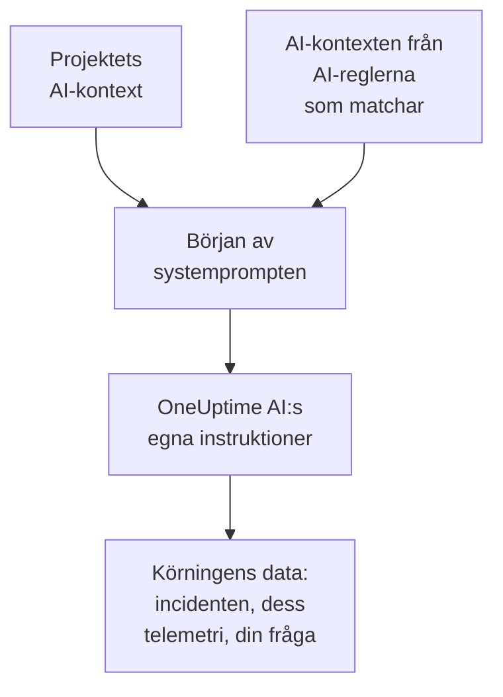

# AI-kontext

AI-kontexten är det ditt team skriver ner åt OneUptime AI om era egna system: hur de hänger ihop, vem som äger vilket symptom, var loggarna finns och vilka ord ditt team använder. OneUptime AI läser den först i varje utredning, varje åtgärd, varje utkast till efteranalys och varje samtal i Fråga AI, så att den börjar med det ditt team redan vet.

:::cards
- [Skriv AI-kontexten](#skriv-ai-kontexten): Ett kort i projektets AI-inställningar.
- [En AI-regels egna anteckningar](#en-ai-regels-egna-anteckningar): Anteckningar om det som en regel matchar.
- [Vad som läser den](#vad-som-läser-den): Funktionerna som läser den, och de som inte gör det.
- [Vad en körning läste](#vad-en-körning-läste): Varje körning visar anteckningarna den fick.
:::

## Så fungerar det

OneUptime AI lägger AI-kontexten allra först i sin systemprompt, före sina egna instruktioner och körningens data: först projektets anteckningar, sedan anteckningarna från AI-reglerna som matchar. Den läser dem som bakgrundskunskap från ditt team. De är inga bevis för vad som händer just nu, och de ändrar aldrig OneUptime AI:s egna regler.

Eftersom anteckningarna kommer först och är desamma från en körning till nästa hör de till början av prompten som leverantörer cachar. Hos Anthropic markerar OneUptime systemprompten för cachning; OpenAI, Azure OpenAI och de andra leverantörerna som cachar en upprepad början av en prompt gör det på egen hand. Anteckningar som inte har ändrats kostar mindre att läsa igen.

## Skriv AI-kontexten

:::steps
### Öppna AI Features
Öppna **Projektinställningar → AI → AI Features**. Kortet **AI-kontext** finns under **Aktivera AI**.

### Skriv anteckningarna
Klicka på **Lägg till AI-kontext**, eller på **Redigera** när det finns anteckningar. Skriv i Markdown, eller klicka på **Börja med en disposition** för att få en rubrik för varje sorts anteckning.

### Spara dem
Klicka på **Spara ändringar**. Kortet visar anteckningarna, hur långa de är och ungefär hur många tokens en modell läser dem som.
:::

Skriv det du skulle berätta för någon som precis har börjat i teamet:

| Sorts anteckning | Till exempel |
| --- | --- |
| Hur era system hänger ihop | `checkout-api` levererar kassasidan och är beroende av `payments-db`. |
| Vem som äger vilket symptom | En 502 på kassasidan hör till Betalningsteamet: kontrollera `payments-db` först. |
| Var loggarna finns | Kassans loggar finns i Loki under `app=checkout`. |
| Orden ditt team använder | PSP är vår betaltjänstleverantör. |

> [!WARNING]
> Utelämna hemligheter: alla som kan se vad en AI-körning gjorde kan läsa anteckningarna den fick.

## En AI-regels egna anteckningar

En AI-regel kan ha egna anteckningar om de incidenter eller varningar den matchar: tjänsterna i en produkt, vem som äger dem, var deras loggar finns. Skriv dem i regelns **AI-kontext** under **Fler fält**, efter **LLM-leverantör**. En regel som bara kör sina runbooks varje gång frågar inte OneUptime AI om något och har därför ingen AI-kontext att skriva.

- En utredning läser projektets anteckningar och sedan anteckningarna från varje aktiverad AI-regel som utreder och matchar incidenten eller varningen, i ordning efter reglernas namn.
- En åtgärd läser projektets anteckningar och sedan sin egen regels.
- Samtalet om en incident eller en varning läser samma anteckningar som dess utredning.

## Vad som läser den

| Funktion | Vad den läser |
| --- | --- |
| Utredningar från AI SRE, och deras nya kontroller när en ny varning öppnas | Projektets anteckningar och anteckningarna från AI-reglerna som matchar |
| Åtgärderna som en AI-regel startar: deras planer, kommandon och MCP-servrar | Projektets anteckningar och regelns |
| Fråga AI, och samtalet om en incident eller en varning | Projektets anteckningar; vid en incident eller en varning även anteckningarna från AI-reglerna som matchar |
| Svar i Slack och Microsoft Teams | Projektets anteckningar |
| Utkast till efteranalyser, för incidenter och episoder | Projektets anteckningar |
| Triage i AI Insights och triage av säkerhetsärenden | Projektets anteckningar |

Anrop som bara formulerar om eller bedömer det de får läser den inte: utkast till anteckningar och offentliga anteckningar, sammanfattningar av samtal, en utrednings sammanfattning, hur säker den är och dess betyg, och ett samtals titel. Det gör inte heller promptarna som folk skriver själva, i AI-steget i ett arbetsflöde.

## Gränser

| Vad | Högst |
| --- | --- |
| Projektets AI-kontext | 20 000 tecken |
| En AI-regels AI-kontext | 5 000 tecken |
| All AI-kontext som en körning läser | 30 000 tecken |

Formuläret räknar tecknen medan du skriver och vägrar spara över gränsen, och det gör API:et också. En körning läser först projektets anteckningar och sedan varje matchande regels, i ordning efter deras namn. En regel vars anteckningar skulle ta körningen över 30 000 tecken utelämnas helt, och körningens aktivitet säger det.

Antalet tokens är en uppskattning: anteckningarnas storlek i UTF-8-byte delat med 4, avrundat uppåt. Varje modell räknar tokens på sitt eget sätt, så en leverantörs räkning kan skilja sig, mest för text som inte är på engelska.

## Vad en körning läste

Varje körning sparar ord för ord anteckningarna den läste. Dess aktivitet säger **Läste projektets AI-kontext**, eller hur många AI-reglers anteckningar den också läste, med ungefär hur många tokens det blev. **Visa** öppnar anteckningarna så som körningen läste dem: först projektets, sedan varje regels under dess namn, även efter att de har ändrats. När en regels anteckningar utelämnades på grund av körningens gräns säger ett meddelande det.

## Vem som kan ändra den

- **Project Owner** och **Project Admin** kan ändra projektets AI-kontext. **Project Member**, **Viewer** och **Read Project** kan läsa den.
- En AI-regels anteckningar är en del av regeln: den som kan ändra regeln kan ändra dem.
- Anteckningarna läses bara för sitt eget projekt: ingen körning läser ett annat projekts AI-kontext.

Via API:et eller Terraform är projektets anteckningar projektets `aiContext`, och en AI-regels är regelns egen `aiContext`.

## Nästa steg

:::cards
- [AI SRE](/docs/ai/ai-sre): Låt OneUptime AI undersöka varje ny incident och varning.
- [Fråga AI](/docs/ai/ask-ai): Fråga om ditt projekts data i ett samtal.
- [LLM-leverantörer](/docs/ai/llm-provider): Välj modellen som läser anteckningarna.
:::
