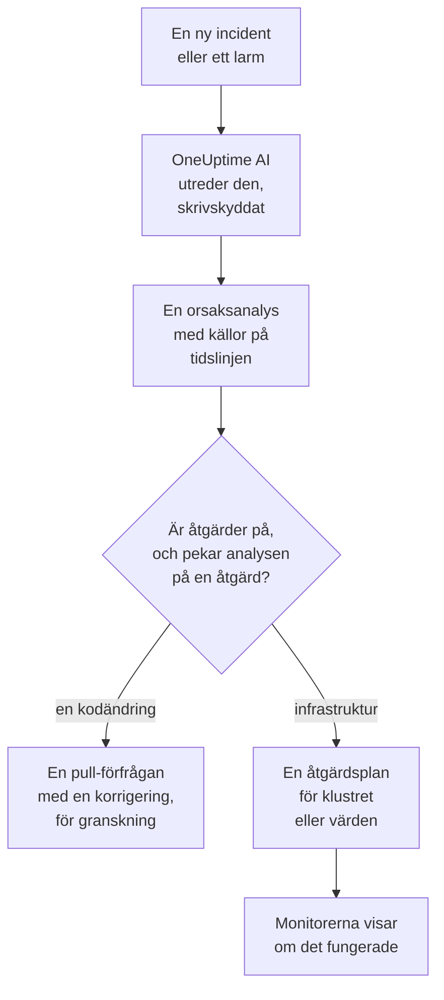
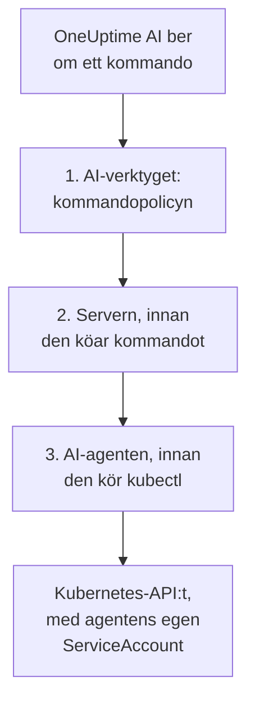

# AI SRE

OneUptime AI är din AI-drivna Site Reliability Engineer. I samma stund som en ny incident eller ett nytt larm deklareras sätter den igång, utreder det utifrån din egen telemetri (loggar, mätvärden, traces, undantag, monitorer och nyliga ändringar) och publicerar en orsaksanalys med källhänvisningar på incidentens eller larmets tidslinje, oftast innan den som har jour har hunnit läsa klart larmet.

Varje påstående i analysen har en källhänvisning som länkar direkt till exakt de data som stöder det, och själva utredningen är **strikt skrivskyddad**: OneUptime AI kan aldrig ändra något i ditt projekt medan den utreder.

:::cards
- [Så fungerar det](#så-fungerar-det): Från en ny incident till en analys med källor, och till en åtgärd när du tillåter det.
- [Slå på AI-utredningar](#slå-på-ai-utredningar): Reglagen och vad de kräver.
- [Klusteråtkomst: låt OneUptime AI köra kubectl](#klusteråtkomst-låt-oneuptime-ai-köra-kubectl): Utred, och åtgärda, inne i Kubernetes.
- [Kostnadskontroll](#kostnadskontroll): Gränser för incidenter, för larm och för hela projektet.
:::

## Så fungerar det

OneUptime AI gör tre saker för en ny incident eller ett nytt larm, och var och en har sitt eget reglage:

- **Den utreder** (på som standard). Den läser din telemetri, och de kluster och värdar där en AI-agent körs, och publicerar en orsaksanalys med källor. En utredning ändrar ingenting.
- **Den åtgärdar** (av som standard). När åtgärder är påslagna blir en säker analys en åtgärd: en pull-förfrågan med en ändring i din kod, eller en plan med kommandon för ett kluster eller en värd, som körs så som det klustrets eller den värdens AI-agent tillåter.
- **Den lär sig.** Sidorna i AI Insights berättar vad som fortsätter att gå fel, utifrån allt som har registrerats.



En analys som inte hittar någon orsak publiceras i tysthet, utan att larma någon (se [Tyst läge](#tyst-läge)), och ingenting åtgärdas utan en orsak.

## Vad utredningen publicerar

När en utredning är klar publicerar OneUptime AI en orsaksanalys med de här avsnitten:

- **Summary**: en eller två meningar som en larmad person kan läsa på fem sekunder.
- **Most likely root cause**: hypotesen, bara med den säkerhet som bevisen ger, och med källa för varje faktapåstående. Räcker telemetrin inte till säger AI:n det rakt ut och listar vad den kontrollerade i stället för att gissa.
- **Evidence**: de viktigaste fynden som stöder eller utesluter hypotesen, vart och ett med källa.
- **Suggested next steps**: konkreta åtgärder för den som har jour.

För incidenter publiceras analysen i incidentens flöde **och** som en intern anteckning på incidenten (där de som hanterar den samarbetar). För larm publiceras den i larmets flöde.

Medan utredningen pågår visar incidentens eller larmets sida en livepanel **AI Investigation** som berättar om varje steg (vilka verktyg som kördes, vad de hittade och hur lång tid de tog), så att du kan se den tänka. Om en utredning misslyckas visar panelen orsaken i stället för en tyst lucka.

En utredning pågår tills den är klar: den har **ingen tidsgräns** och ingen liten frågebudget, så den kan köra alla frågor och alla kubectl- eller infrastrukturkommandon som den behöver. Långa kommandoutdata (en `kubectl describe node` för en hårt belastad nod, en pods loggar) kapas aldrig: OneUptime AI läser dem en sida i taget. Vill du ha ett hårt stopp anger du en **tidsgräns för utredningar** per signaltyp (se **Kostnadskontroll** nedan).

## Vad en utredning läser

En utredning utgår från incidenten eller larmet och från infrastrukturen den är länkad till: värdarna, Docker- och Podman-värdarna, Kubernetes-klustren, databaserna och tjänsterna som dess övervakningar bevakar. En webbplats-, API- eller syntetisk övervakning bevakar det du länkar den till under **Övervakning → Översikt → Länkade resurser**, så länka den till värdarna som levererar det den kontrollerar, så börjar varje utredning av dess incidenter där. Före allt det läser den projektets [AI-kontext](/docs/ai/ai-context): det ditt team har skrivit ner åt OneUptime AI om era egna system, med anteckningarna från AI-reglerna som matchar.

- Larmen på den infrastrukturen som öppnades under de 30 minuterna före incidenten eller fortfarande är öppna, de nyaste först, som larmet om hög CPU på värden bakom en långsam webbplats. Privata larm utelämnas.
- Infrastrukturens egna mätvärden, lästa så som människor läser dem. Värdmätvärden som `system.cpu.utilization` och `system.memory.utilization` rapporteras en gång per tillstånd, och tillstånden summerar till 100 %, så ett medelvärde över dem alla säger ingenting. OneUptime AI läser dem ett tillstånd i taget (upptagen CPU är user plus system), och vilket mätvärde som helst per container, per monteringspunkt eller efter vilket annat attribut som helst.
- Containrarna på en Docker- eller Podman-värd: de mest belastade efter CPU, minne eller omstarter, och de som slutade rapportera. En stoppad container skickar ingenting i stället för noll, så siffrorna för hela värden döljer den.
- Ändringarna som registrerades under de 2 timmarna före incidenten eller larmet (driftsättningar, utrullningar i Kubernetes, konfigurationsändringar och de åtgärder som OneUptime körde) och vilka av dem som tjänsternas telemetri gör misstänkta: en tjänst som blev mätbart sämre direkt efter en ändring. Se [Driftsättningar och ändringar](/docs/telemetry/change-events).

Utredningens aktivitet på kortet **AI Investigation** säger hur många öppna eller nya larm den läste, och på vilka resurser.

### Kontrolleras igen när ett nytt larm öppnas

En utredning startar i samma ögonblick som en incident deklareras, och ett värdlarm som behöver några minuters mätvärden kan öppnas efteråt. När ett larm öppnas på incidentens länkade infrastruktur inom 30 minuter efter incidenten, efter att utredningen läste den, och incidenten fortfarande är öppen, kontrollerar OneUptime AI incidenten en gång till med det larmet i handen. Den nya analysen börjar med **Checked again** och larmet som ledde till kontrollen, och dess aktivitet säger det också. Om en AI-regel fick OneUptime AI att vänta innan den utredde incidenten räknas de minuterna i stället från när utredningen blev klar (se [Vänta innan utredningen](#vänta-innan-utredningen)).

Det sker högst en gång per incident, med samma reglage och gränser som en ny utredning: **Aktivera AI**, _Utred nya incidenter_, AI-krediterna och gränserna per dag och för samtidighet. Det finns inget att slå på. En uppföljande kontroll kör aldrig automatisk åtgärd igen och följs aldrig upp själv, och ett larms utredning kontrolleras inte igen.

## Prata med OneUptime AI om incidenten

Kortet **AI Investigation** slutar med en konversation, **Ask OneUptime AI**, som delas av alla som kan se incidenten eller larmet. Det är ett enda kort oavsett vad som hände ovanför: under en rapport ställer du följdfrågor, och när ingen automatisk utredning kördes (eller den stoppade före rapporten) är det första förslaget **What is the root cause?**, som får OneUptime AI att utreda på begäran.

- **Ställ följdfrågor**: "vilka pods använder mest minne?", "vad ändrades precis innan det här började?", "är något annat påverkat?". OneUptime AI bygger vidare på sin rapport, hämtar färska data (och kör skrivskyddade kubectl- eller infrastrukturkommandon där den har åtkomst, på de kluster och resurser du får se) och anger källa för varje påstående.
- **Be den agera**: "kvittera den här incidenten", "publicera en statusuppdatering om att vi utreder", "larma databasjouren", "höj allvarlighetsgraden". Den använder samma åtgärder som Fråga AI och agerar alltid **med dina egna behörigheter**, så den kan aldrig göra mer än du kunde.
- **Välj hur den agerar** med reglaget i meddelandefältet, som bredvid berättar vad det valda läget betyder: _Auto-run_ (standard: den agerar direkt på en tydlig begäran), _Ask to act_ (den visar först ett godkännandekort som vem som helst på incidenten kan godkänna eller avvisa) eller _Skrivskyddad_.
- **En gemensam tråd.** Varje fråga visar vem som ställde den, alla ser samma konversation live och vem som helst kan stoppa ett svar som pågår. Diagram och tabeller i ett svar visas för den som frågade; alla andra ser svaret med källor. Varje svar listar sina **Källor**, och en källa med egen sida (loggar, mätvärden, en monitor) öppnar den. En lång tråd öppnas vid de senaste meddelandena, med en knapp ovanför (till exempel **Show 6 earlier messages**) som hämtar fram resten.

En incident eller ett larm som OneUptime AI varken utredde eller åtgärdade eftersom AI var avstängt för den – avstängt för projektet, _Utred nya incidenter_ (eller larm) avstängt när den skapades, ingen AI-regel som utreder matchade den, eller dess allvarlighetsgrad låg under minimum – får i stället ett kort på en rad: **AI-utredning är avstängd** (eller **AI är avstängt för det här projektet**, så länge det är det), och varför. Pilen, **Det här kan du göra**, öppnar vad som ska slås på, med en länk till där det ändras för dem som får ändra det, och vem som kan ändra det för alla andra; en ändring gäller bara nya incidenter och larm, inte den här. Så länge AI är påslaget öppnar **Ask OneUptime AI** på raden konversationen, och en konversation som någon redan har startat visas av sig själv under raden. Kortet **Åtgärd** utelämnas då: raden säger varför ingenting åtgärdades.

## Slå på AI-utredningar

Autonoma utredningar är **påslagna som standard för nya projekt**. Det är även utkast till efteranalyser och AI Insights. Åtgärder börjar avslagna, och pull-förfrågningarna som hör till dem öppnas bara så länge åtgärder är på (se [Automatiska kodkorrigeringar](#automatiska-kodkorrigeringar)). Ett projekt som skapades före den här standarden behåller sin inställning; slå på utredningar som i steg 3, eller med **Slå på** på sidan **AI-agent** för ett valfritt Kubernetes-kluster (Project Owner eller Project Admin). Så kontrollerar eller ändrar du dem:

:::steps
1. **Konfigurera en LLM-leverantör.** Självhostade installationer använder sin egen nyckel (eller körs helt isolerat med en lokal Ollama): se [LLM-leverantörer](/docs/ai/llm-provider). Användare av OneUptime Cloud kan använda den förkonfigurerade globala leverantören, som faktureras som uppmätta AI-tokens, så projektet behöver AI-krediter: en projektägare eller någon med **Manage Billing** lägger till dem på **Projektinställningar → AI → AI-krediter**, där **Automatisk påfyllning** ser till att de inte tar slut.
2. **Se till att AI är aktiverat för projektet** (det är det som standard): **Aktivera AI** på **Projektinställningar → AI → AI Features**.
3. **Välj per signaltyp** (båda påslagna för nya projekt):
   - Incidenter: **Incidenter → AI → Inställningar**: slå på _Utred nya incidenter_.
   - Larm: **Varningar → AI → Inställningar**: slå på _Utred nya larm_.
:::

Varje AI-beteende på de sidorna är ett reglage som sparas så snart du slår om det; det finns ingen Spara-knapp. Incidentsidan har tre, under **Vad OneUptime AI gör**: _Utred nya incidenter_, _Åtgärda nya incidenter automatiskt_ och _Skriv ett utkast till efteranalys när en incident är löst_. Larmsidan har samma, utan efteranalysen. _Åtgärda nya incidenter automatiskt_ (och _Åtgärda nya larm automatiskt_) börjar **av**, även för nya projekt: det låter OneUptime AI ändra din infrastruktur, så ett projekt slår på det självt; se [Vilka incidenter som utreds och åtgärdas](#vilka-incidenter-som-utreds-och-åtgärdas). Pull-förfrågningarna som det öppnar, en korrigering av din kod och telemetrin som en utredning saknade, hör till, och varje AI-regel bestämmer dem: utan regler öppnas båda, och en regel kan slå av var och en av dem under **Fler fält** (se [Automatiska kodkorrigeringar](#automatiska-kodkorrigeringar)). Project Owners och Project Admins kan ändra dem; för alla andra är varje reglage låst och talar om vilken behörighet det kräver.

Sidorna säger två saker bara när de stämmer. Är **Aktivera AI** av körs ingenting på dem, och sidan säger det högst upp, med själva reglaget Aktivera AI för dem som får ändra det (Project Owners och alla med Manage Billing); alla andra får veta vem som kan. Har projektet ingen LLM-leverantör som OneUptime AI kan använda (ingen alls, eller leverantörer men ingen inställd som standard), säger sidan det också, med en länk till **Projektinställningar → AI → LLM-leverantörer**. På OneUptime Cloud räknas den globala leverantören, så där står ingenting.

Incidenter och larm konfigureras oberoende av varandra, så du kan ge varje signaltyp en egen gräns för samtidighet, en egen daglig tokenbudget, en egen budget för åtgärdsuppgifter och egna regler. Ingen av de gränserna gäller förrän du anger den: de är hopfällda under **Fler inställningar** längst ned på varje sida; se **Kostnadskontroll** nedan. Att ändra en AI-inställning för larm ändrar inte motsvarande inställning för incidenter, och tvärtom.

Åtgärder bygger på utredningar: så länge **Åtgärda nya incidenter automatiskt** (eller larm) är på öppnar en utredning som med säkerhet hittar en kodändring i ett repository automatiskt en pull-förfrågan med en korrigering; se **Automatiska kodkorrigeringar** nedan.

## Klusteråtkomst: låt OneUptime AI köra kubectl

Från början kan en utredning bara använda den telemetri som dina agenter skickar. För en Kubernetes-signal räcker det ofta inte: "pods som har fastnat i Pending" är ett schemaläggningsproblem som du diagnostiserar genom att beskriva podden och läsa dess händelser, inte genom att titta på ett mätvärde. **Kubernetes-AI-agenten** låter OneUptime AI göra just det och, om du tillåter det, åtgärda det den hittar.

Varje klusters sida har ett avsnitt **AI** i sidomenyn:

- **Agent**: klustrets sida **AI-agent**: om agenten är ansluten, vad AI får göra i klustret och allt som behöver uppmärksamhet, var och en med steget som löser det. Samma förklaring visas i incidentens utredningspanel när AI fick utreda med bara OneUptimes data.
- **Insikter**: klustrets sida **AI Insights**: vad OneUptime AI har fått reda på om klustret, vad som fortsätter att gå fel och varför, och vad du kan göra åt det (se [Vad AI har lärt sig i ett kluster](#vad-ai-har-lärt-sig-i-ett-kluster)).
- **Loggar**: klustrets sida **AI-loggar**: allt som OneUptime AI har gjort i klustret, nyast först (se [Allt som AI har gjort i ett kluster](#allt-som-ai-har-gjort-i-ett-kluster)).

Klustrets **Översikt** slutar med ett kort **AI-agent** som sammanfattar AI-agentens sida: om agenten är ansluten, om **Undersök med kubectl** är på, hur åtgärder körs (**Av**, **Be om godkännande**, **Automatiskt** eller **Hoppa över godkännande**) och vad som behöver uppmärksamhet, med en länk till AI-agentens sida, där de ändras.

### Kubernetes-AI-agenten: på som standard, skrivskyddad

Charten för [OneUptimes Kubernetes-agent](/docs/telemetry/kubernetes-agent) kör Kubernetes-AI-agenten som standard: en liten pod (`component=ai-agent`, image `oneuptime/kubernetes-ai-agent`) med ett **skrivskyddat** ServiceAccount. Den ansluter med den API-nyckel som charten redan använder, så det finns inget att ställa in i instrumentpanelen: inom en minut visar klustrets AI-agentsida den som **Ansluten**, och **Undersök med kubectl** är på, om inte någon redan har valt AI-inställningar för klustret där, som då behålls som de är.

På en agent som installerades innan Kubernetes-AI-agenten fanns uppdaterar du först ditt chartindex och uppgraderar sedan:

```bash
helm repo update
helm upgrade kubernetes-agent oneuptime/kubernetes-agent \
  --namespace oneuptime-agent --reset-then-reuse-values \
  --set aiAgent.enabled=true
```

`kubernetes-agent` i `oneuptime-agent` är det releasenamn och den namnrymd som instrumentpanelens installationsinstruktioner använder; installerade du agenten med andra namn använder du dina (`helm list -A | grep kubernetes-agent` visar dem). Utan `helm repo update` kan Helm använda den chart du installerade från, som inte känner till `aiAgent` och misslyckas med `Additional property aiAgent is not allowed`. På en självhostad OneUptime uppgraderar du OneUptime före charten: se [Uppgradera agenten](/docs/telemetry/kubernetes-agent#uppgradera-agenten). För att köra charten utan AI-agenten skickar du med `--set aiAgent.enabled=false`.

**Testa anslutningen** i menyn **⋯** bredvid agentens status på AI-agentens sida kör `kubectl version` och `kubectl auth can-i --list` genom agenten och visar resultaten: vad den kan nå och vad den får göra. Säger sidan att agenten inte är ansluten läser du dess logg med `kubectl logs -n oneuptime-agent -l component=ai-agent --tail=100`. En nyckel med ett **Pinned Service Name** kan inte registrera agenten: ge charten en nyckel utan. När servern avvisar en registrering säger loggen om avvisningen försvinner av sig själv (en tidigare agentpod som fortfarande rapporterar, eller den gamla Runnern i klustret som fortfarande håller på att stängas ned under en uppgradering) eller vad som behöver ändras. **Återställ agenten** i samma meny får servern att glömma agentens nyckel när du bekräftar; podden ansluter igen av sig själv inom några minuter.

Kubernetes-AI-agenten är inte en Runner och visas aldrig under Runbooks → Runbook-agenter. Den använder bara sitt eget ServiceAccount, så OneUptime ger den aldrig några autentiseringsuppgifter, den används aldrig som Bash/SSH-värd för runbooks och den godtas aldrig som kommando-Runner för en AI-regel.

### Vad AI får göra: bestäms av agenten

Vad OneUptime AI får göra i ett kluster bestäms där agenten körs, i charten, med två värden:

- `aiAgent.investigation`: `true`: AI får köra skrivskyddad kubectl i klustret medan den utreder. `false`: den utreder fortfarande, med de data som OneUptime redan har.
- `aiAgent.fixes`: hur AI tillämpar en åtgärd: `off`, `ask-for-approval`, `automatic` eller `bypass-approval` (se [Så fungerar åtgärder](#så-fungerar-åtgärder)). Alla nivåer utom `off` ger AI-agenten skrivåtkomst; med `off` har den ingen och avvisar själv alla skrivningar.

AI-agenten rapporterar båda till OneUptime vid varje heartbeat, och OneUptime tillämpar dem på klustret. **Vad AI får göra** på klustrets AI-agentsida visar dem (**På** och åtgärdsnivån, i grönt när de är på) utan möjlighet att ändra dem där; **Ändra** visar varje alternativ med exakt det `helm upgrade` som ställer in det. En ändring som görs någon annanstans (på AI-agentens sida, via API:t eller Terraform) avvisas så länge agenten bestämmer dem.

En release som inte anger något av de två värdena låter agenten använda sina standardvärden (utredning på; åtgärder av, eller ask-for-approval med det äldre `aiAgent.remediation.enabled=true`). OneUptime tillämpar bara de standardvärdena på ett kluster där ingen har valt AI-inställningar på dess AI-agentsida: inställningar som har valts där behålls som de är, och sidan visar kommandot som flyttar dem till charten. Detsamma gäller ett kluster vars AI-agent är för gammal för att rapportera dem: en uppgradering av charten med de två värdena flyttar dem.

### Låt AI åtgärda det den hittar

Åtgärder är av tills du slår på dem med `aiAgent.fixes`, som också ger AI-agenten skrivåtkomst, helst bara i de namnrymder som AI får åtgärda, och med nodåtgärder avslagna:

```bash
helm repo update
helm upgrade kubernetes-agent oneuptime/kubernetes-agent \
  --namespace oneuptime-agent --reset-then-reuse-values \
  --set aiAgent.enabled=true \
  --set aiAgent.investigation=true \
  --set aiAgent.fixes=ask-for-approval \
  --set "aiAgent.remediation.namespaces={web,api}" \
  --set aiAgent.remediation.nodeOperations=false
```

Eller för hela klustret:

```bash
helm repo update
helm upgrade kubernetes-agent oneuptime/kubernetes-agent \
  --namespace oneuptime-agent --reset-then-reuse-values \
  --set aiAgent.enabled=true \
  --set aiAgent.investigation=true \
  --set aiAgent.fixes=ask-for-approval \
  --set-json 'aiAgent.remediation.namespaces=[]'
```

Ersätt `{web,api}` med de namnrymder som AI får åtgärda. Varje namnrymd i listan måste redan finnas: charten skapar en RoleBinding i var och en och skapar aldrig en namnrymd, så en som saknas får hela installationen eller uppgraderingen (collectorn inräknad) att misslyckas med `namespaces "api" not found`. Skapa den först, eller ta bort den från listan; ta bort en namnrymd från listan innan du raderar den. Utelämnar du flaggan vid en uppgradering behålls listan som är sparad i releasen, så för att gå tillbaka till hela klustret skickar du med `--set-json 'aiAgent.remediation.namespaces=[]'` (Helm 3.10+), som det andra kommandot gör, och inte `={}`, som Helm läser som ett tomt namn och som charten avvisar. `--set aiAgent.remediation.namespaces=null` återställer inte en sparad lista under `--reuse-values`: Helm behåller den sparade listan. `aiAgent.remediation.nodeOperations=false` håller åtgärder borta från noder; sätt det till `true` för att låta AI spärra, återöppna, tömma och sätta taints på noder (en drain, en taint eller en patch av en nod väntar fortfarande på en människa).

Använd `automatic` eller `bypass-approval` i stället för `ask-for-approval` för mer självständighet, och `--set aiAgent.fixes=off` för att slå av åtgärder igen, vilket också tar bort skrivåtkomsten. Åtgärder kräver också två projektreglage. **Åtgärda nya incidenter automatiskt** (på **Incidenter → AI → Inställningar**) och **Åtgärda nya larm automatiskt** (på **Varningar → AI → Inställningar**) börjar av: tills ett av dem är på åtgärdas inget nytt av det slaget. **Aktivera AI** (**Projektinställningar → AI → AI Features**) är på om ingen har slagit av det; det slår av all AI för projektet, oavsett vad en agents konfiguration säger.

### Vilka incidenter ett klusters åtgärder gäller

Så länge **Åtgärda nya incidenter automatiskt** är på och ingen AI-regel har satts upp åtgärdar OneUptime AI varje ny incident som klustret är kopplat till, i det läge som dess AI-agentsida anger, och samma sak för larm med **Åtgärda nya larm automatiskt**. Med regler åtgärdar den bara de incidenter som matchas av en regel som åtgärdar med OneUptime AI (se [Vilka incidenter som utreds och åtgärdas](#vilka-incidenter-som-utreds-och-åtgärdas)). Det den inte är kopplad till rör den inte, hur tydligt orsaken än finns i klustret. En incident eller ett larm är kopplat till ett kluster när:

- telemetrin som den utlöstes från nämner klustret (en mätvärdes-, logg- eller trace-monitor på klustrets data);
- dess monitor är en Kubernetes-monitor för klustret;
- dess monitor är kopplad till klustret under **Övervakning → Översikt → Länkade resurser**, vilket är sättet att koppla en webbplats-, API- eller syntetisk monitor till klustret som levererar det den kontrollerar;
- någon valde klustret under **Andra påverkade resurser** när den deklarerades (att välja en kopplad monitor lägger till det där åt dig).

Varje incident och larm talar om på sitt kort **Åtgärd** om den var kopplad till ett kluster och vad klustrets åtgärder gjorde; se [Vad den automatiska åtgärden gjorde](#vad-den-automatiska-åtgärden-gjorde). Detsamma gäller en infrastrukturresurs och dess AI-agent.

### Vem som får ändra det

Så länge Kubernetes-AI-agenten bestämmer utredning och åtgärder är det den som får ändra chartens värden i klustret som ändrar dem; OneUptime avvisar en ändring som görs någon annanstans. Reglerna nedan gäller det som finns kvar i OneUptime (kubectl-tillåtelselistan och kopplingen till den tidigare Runnern i klustret) och utredning och åtgärder i ett kluster vars inställningar fortfarande anges i OneUptime (se [Vad AI får göra: bestäms av agenten](#vad-ai-får-göra-bestäms-av-agenten)).

Att slå på åtgärder (varje byte från **Av** till ett annat läge) och att lätta på dem (byta till **Automatiskt** eller **Hoppa över godkännande**, skriva kubectl-tillåtelselistan eller koppla en Runner) kräver en Project Owner, en Project Admin eller behörigheten **Edit AI Rule**, alltså samma personer som får skapa en AI-regel som åtgärdar utan att fråga. **Återställ agenten** kräver samma personer som att slå på åtgärder. Att strama åt dem (**Av**, tillbaka till **Be om godkännande**, tömma tillåtelselistan eller Runner-kopplingen) är öppet för alla som får redigera klustret, och det gäller även **Testa anslutningen** och att godkänna en åtgärd som OneUptime AI föreslår för det. Allt detta kräver behörighet att redigera just det klustret: en behörighet som är begränsad till vissa etiketter, eller till de kluster som du eller dina team äger, når bara de klustren, och en blockeringspost med etiketter tar bort de kluster som bär dem.

### Vad en utredning får köra

Med åtkomst kör en utredning **skrivskyddad** kubectl genom AI-agenten (`get`, `describe`, `logs`, `events`, `top`, `rollout status/history`, `auth can-i`), så många kommandon som den behöver, och anger varje kommando som källa precis som alla andra bevis. Utdata kapas aldrig: agenten sparar upp till en megabyte av dem, och OneUptime AI läser långa utdata en sida i taget. Tre oberoende kontroller håller den skrivskyddad: policyn som klassar varje kommando, servern som vägrar att köa något annat för en utredning, och AI-agenten, som kontrollerar samma policy igen innan den startar kubectl. "Skrivskyddat: ingenting i dina system ändrades" förblir bokstavligt sant.



### Så fungerar åtgärder

**Åtgärder** på AI-agentens sida har fyra inställningar (chartens `aiAgent.fixes`: `off`, `ask-for-approval`, `automatic`, `bypass-approval`):

- **Av**: AI utreder bara.
- **Be om godkännande**: efter orsaksanalysen ställer OneUptime AI en diagnos med kubectl och sätter ihop den minsta kubectl-plan som tar itu med orsaken, till exempel `kubectl rollout restart deployment/web -n web`. Planen visas på incidenten med motivering, förväntad effekt och återställning; en människa godkänner den med ett klick, och OneUptime kör exakt de kommandona. Om monitorerna inte återhämtar sig körs återställningen, och OneUptime AI sätter ihop en plan till, återigen för godkännande, med det misslyckade försöket framför sig, så att den väljer ett annat angreppssätt eller säger vad en människa bör titta på.
- **Automatiskt**: säkra ändringar körs av sig själva; en riskablare ändring aldrig. När rundan bara hittade riskablare åtgärder avslutas den med att föreslå exakt dem för godkännande med ett klick. När den också körde en säker åtgärd blir den riskablare kvar i analysen och föreslås bara om verifieringen visar att den säkra åtgärden inte fick monitorerna att återhämta sig, av uppföljningsrundan, som ber om godkännande. Lägg in formen på ett riskablare kommando i tillåtelselistan på AI-agentens sida, så körs även det av sig självt. Automatiskt läge löser också signalen när verifieringen bekräftar att monitorerna har återhämtat sig, och det har en säkring på tre obevakade åtgärder per kluster och timme: utöver det, eller medan en annan obevakad runda från OneUptime AI fortfarande ändrar eller verifierar samma kluster, föreslår en runda sin plan för godkännande i stället för att köra den.
- **Hoppa över godkännande**: AI frågar inte. Varje ändring som policyn tillåter, även de riskablare, körs av sig själv, och det gör även uppföljningsrundan efter en misslyckad verifiering; signalen löser sig själv när verifieringen bekräftar återhämtningen. Det som kräver en människa i alla lägen (nedan) väntar fortfarande på en. En runda föreslår också sin plan för godkännande i stället för att köra den, och säger varför på incidenten, när:
  - säkringen per timme (tre obevakade åtgärder per kluster och timme) har löst ut eller inte kan kontrolleras;
  - en annan obevakad runda från OneUptime AI fortfarande ändrar samma kluster, eller fortfarande verifierar en åtgärd där (ett larm och en incident från samma monitor är det vanliga fallet), eller detta inte kan kontrolleras;
  - det är uppföljningsrundan efter en åtgärd vars återställning inte slutfördes.

**Återställning först.** När OneUptime har markerat en utrullning i Kubernetes på klustret som misstänkt för incidenten (se [Driftsättningar och ändringar](/docs/telemetry/change-events)), försöker OneUptime AI rulla tillbaka den före alla andra åtgärder. OneUptime bygger `kubectl rollout undo` utifrån den registrerade ändringen, aldrig utifrån det som modellen skriver, och kommandot körs eller väntar på godkännande som vilken säker ändring som helst i klustrets läge. Det erbjuds inte när Deployment-objektet har ändrats igen efter den utrullningen, eftersom återställningen då i stället skulle ångra den senare ändringen.

**Workloads som Argo CD, Flux eller Helm deklarerar.** Många kluster deklarerar sina workloads i git och låter Argo CD eller Flux tillämpa det, eller installerar dem med Helm, och en kubectl-ändring av det som deklareras där håller inte: Argo CD återställer den inom några sekunder när Application har self-heal påslaget (annars vid nästa synkronisering), Flux vid nästa reconciliation och en Helm-release vid nästa uppgradering. Därför läser OneUptime, innan OneUptime AI kör eller föreslår en kubectl-ändring, med skrivskyddat kubectl via klustrets AI-agent det objekt som ändringen ändrar (för ett ReplicaSet, dess Deployment), och vem som deklarerar det: Argo CD (annoteringen `argocd.argoproj.io/tracking-id`, etiketten `argocd.argoproj.io/instance` eller dess fälthanterare), Flux (etiketterna `kustomize.toolkit.fluxcd.io/*` eller `helm.toolkit.fluxcd.io/*`) eller en Helm-release (annoteringen `meta.helm.sh/release-name` eller etiketten `app.kubernetes.io/managed-by: Helm`). En ändring som Argo CD eller Flux återställer (`rollout undo`, även återställning först, `scale` när git bestämmer antalet repliker, `set image/env/resources`, `patch`, att ta bort en workload) körs aldrig av sig själv, i något läge, inte heller med Hoppa över godkännande eller via tillåtelselistan: den föreslås för godkännande med ett klick som en **tillfällig lösning**, och planen nämner den varaktiga lösningen, samma ändring i git (manifestet, Helm-values eller Kustomize-overlayen som workloaden byggs från). Argo CD och Helm låter det som git inte deklarerar vara, som en `rollout restart`, en `rollout pause` eller en tillagd annotering, så en sådan ändring körs som klustrets läge säger. En Flux Kustomization tar bort även det vid nästa reconciliation, så där är en paus, en etikett eller en annotering också en tillfällig lösning. En omstart körs ändå som läget säger med Flux: när Flux tar bort dess annotering startas poddarna om en gång till, men omstarten ångras inte. Att ta bort en felande pod körs som läget säger, oavsett vem som deklarerar workloaden: git deklarerar aldrig en pod, och dess ReplicaSet ersätter den. En Helm-release återställer en ändring först vid nästa uppgradering, så där körs ändringen också som klustrets läge säger, och planen säger att den är tillfällig.

**Verifieringen märker en rättning som har återställts.** OneUptime läser objektet som en kubectl-rättning ändrar strax före och strax efter att den körs, och igen med några minuters mellanrum medan verifieringsfönstret är öppet. En rättning som står på sina gamla värden igen (återställd av Argo CD, Flux, en Helm-uppgradering, en operator eller en autoskalare) gör att verifieringen misslyckas direkt, och anteckningen säger vem som återställde den och var den varaktiga ändringen hör hemma. Dess återställning körs inte: klustret har redan ångrat den, och att ångra den kunde tillämpa rättningen igen. En ändring som Argo CD eller Flux återställer bedöms i slutet av sitt fönster, inte så fort monitorerna har återhämtat sig. En omstart lämnar inget att bevaka: dess poddar har ersatts, vad som än senare händer med dess annotering.

En **säker** ändring rör exakt ett namngivet objekt: `rollout restart/undo/pause/resume`, `scale` (till allt utom 0), radering av en namngiven pod, `cordon`/`uncordon` och `label`/`annotate` på en namngiven Pod, Deployment, StatefulSet, DaemonSet, ReplicaSet, Job eller CronJob med en vanlig nyckel (inte en reserverad som `*.kubernetes.io/…` eller `*.k8s.io/…`). Allt annat som policyn tillåter är **riskablare**: samma verb på en resurstyp utan namn (`rollout restart deployment`), på flera objekt, med en selektor eller med `--all`; `scale` till 0; radering av ett jobb; `taint`; `drain`; `patch`; `set image/env/resources`; `create`; radering med `--force`; och etiketter eller annoteringar på någon annan typ eller med en reserverad nyckel.

Vissa gränser gäller i **alla** lägen, Hoppa över godkännande inräknat, och ingen post i tillåtelselistan ändrar dem:

- En skrivning i **kube-system**, **kube-public** eller **kube-node-lease** kräver alltid en människa. En anpassad resurs bedöms efter den namnrymd den skrivs i, även en vars namn liknar en inbyggd klusteromfattande typ (`nodes.example.com`, `namespaces.example.com`).
- En `drain`, en `taint` eller en `patch` av en nod kräver alltid en människa. Att tömma en nod kastar ut poddar i alla namnrymder (de tre ovan och agentens egen inräknade), och en `NoExecute`-taint kastar också ut dem, oavsett om `kubectl taint` sätter den eller en `patch` av noden gör det.
- AI-agenten ändrar aldrig något i sin egen namnrymd (en åtgärd där skulle kunna skala bort Kubernetes-agenten, eller AI-agenten själv), inget utanför de namnrymder som dess chart låter den skriva i (`aiAgent.remediation.namespaces`), och ingen nod när dess chart har slagit av nodåtgärder (`aiAgent.remediation.nodeOperations=false`). OneUptime läser det omfånget från det som AI-agenten rapporterar och avvisar en sådan åtgärd när OneUptime AI föreslår den, och igen när någon godkänner den, så den når aldrig AI-agenten som en misslyckad åtgärd; AI-agenten avvisar den också, innan den startar `kubectl`.
- Destruktiva kommandon (nedan) körs aldrig, inte ens med en människas godkännande.

Tillåtelselistan för automatiskt läge jämförs ord för ord med det tolkade kommandot, inte som fritext: `*` står för exakt ett ord (en image, ett namn), aldrig för extra objekt, flaggor eller ytterligare en `-n`, och varje flagga som kommandot använder måste vara utskriven i posten. `kubectl set image deployment/web * -n web` tillåter en ny image för `web` i `web`, inget annat. En post måste skriva ut sitt verb (och underkommandot till `rollout`, `set` eller `create`) i stället för att använda `*` för det, och måste ha mer än ett ord efter det valfria inledande `kubectl`; en post som bryter mot de här reglerna, som `scale` eller `kubectl *`, skulle aldrig kunna förhandsgodkänna en ändring och avvisas när du sparar den.

:::details Kommandon som aldrig körs, och hur ett kommando läses
Vissa kommandon körs **aldrig**, oavsett läge och även med en människas godkännande. Kommandopolicyn avvisar dem, och den upprätthålls tre gånger (av serverns verktyg, av den passage där servern köar och av AI-agenten innan den startar `kubectl`): `exec`, `attach`, `cp`, `port-forward`, `proxy`, `debug`, `run`, `edit`, `apply`, `replace`, `diff`, kubectl-plugins och alla andra verb som inte står på listan, all indata från fil (`-f`, `-k`) eller alla utdataformat som läser en fil (`-o jsonpath-file=`, `-o go-template-file=`, `-o custom-columns-file=`, `--template` och en ensam `-o jsonpath`/`go-template`/`custom-columns` utan sin inbäddade mall), flaggor för autentiseringsuppgifter, för att uppträda som någon annan (`--as`, `--as-group`, `--as-uid`, `--as-user-extra`), för val av kluster, `--kuberc`, för rå-API:t och för utförlig loggning, Secret-objekt med **alla** verb (OneUptime AI läser, ändrar, raderar eller skapar aldrig en Secret, och `create secret`, `create token` och `set env --resolve` avvisas tillsammans med dem), allt som ger RBAC (`create role`, `create clusterrole`, `create rolebinding`, `create clusterrolebinding`, `set subject`), `certificate approve`, `set serviceaccount`, `create deployment`, `create cronjob` eller `create job` med `--image` (`create job --from=cronjob/…` förblir en riskablare ändring), `expose --overrides` eller `--override-type` (överskrivningen kan få kubectl att skapa ett Job, en ClusterRoleBinding eller någon annan typ av objekt i stället för en Service), en `patch`-kropp som inte är JSON (kubectl skulle läsa den som YAML, vars taggar kan skriva ett fält som ingen kontroll ser), patchar som ändrar en poddmalls ServiceAccount, volymer eller säkerhetsinställningar (värdportar, undantaget från användarnamnrymden `hostUsers` och körtidsklassen `runtimeClassName` inräknade), patchar som ersätter en hel del av en poddmall i stället för att sätta fält i den (en strategic-merge `$patch: replace`, en merge patch som sätter en hel `containers`-lista, eller en JSON patch som ersätter eller tar bort poddspecifikationen), vilket skulle tappa de inställningarna utan att nämna dem, en etikett eller annotering på Namespace-objekt som valts med `--all` eller en selektor i stället för efter namn, varje skrivning (`patch`, `label`, `annotate`, `set`) till RBAC-objekt, CustomResourceDefinitions, APIServices, konfigurationer av admission-webhooks eller admission-policyer, skrivningar med `--all-namespaces`, `delete --all` och radering av namnrymder, noder, volymer, CRD:er eller klusterroller. Flaggor tolkas som kubectl tolkar dem, så att en förbjuden flagga eller typ inte kan gömma sig bakom en annan: kombinerade korta flaggor delas upp bokstav för bokstav (`-As` fångas), flaggor med valfritt värde (`--cascade`, `--dry-run`, `--validate`) slukar aldrig nästa ord, och alla flaggor utom `-n`/`--namespace`, `--request-timeout` och `--match-server-version` måste komma efter verbet (och efter underkommandot till `rollout`, `set`, `create`, `auth`, `cluster-info` och `top`), eftersom kubectl väljer kommandot innan det tolkar flaggorna. AI-agenten levereras med sin egen låsta kubectl (v1.36.5) och slår av kuberc, så att en kuberc-fil inte kan lägga till standardvärden eller alias i ett kommando efter att policyn har kontrollerat det. Den ger varje kommando en privat kubeconfig för sitt eget ServiceAccount som pekar på den monterade tokenfilen, aldrig en kopia av tokenen.
:::

### Vad AI-agentens RBAC begränsar, och vad den inte begränsar

:::details Vad chartens RBAC ger
Chartens RBAC är ett separat lager vid sidan av policyn, och den begränsar **var** AI-agenten får skriva, inte vad en skrivning får göra. Skrivskyddad åtkomst (get/list/watch, poddloggar) ges för hela klustret. `aiAgent.remediation.enabled` lägger till patch/update på Deployments, StatefulSets, DaemonSets, ReplicaSets och deras scale-underresurs, Jobs, CronJobs, Pods och HPA:er; create på Jobs och HPA:er; och delete bara på Pods och Jobs. `aiAgent.remediation.nodeOperations` (på som standard) lägger till cordon, uncordon, taint och drain på noder för hela klustret; sätt det till `false` så ger charten ingen nod-RBAC och berättar det för AI-agenten (`ONEUPTIME_KUBECTL_ALLOW_NODE_OPERATIONS=false`), som då avvisar cordon, uncordon, drain, taint och label/annotate/patch på en nod innan den startar kubectl; och eftersom AI-agenten rapporterar reglaget avvisar OneUptime en sådan åtgärd redan när den föreslås eller godkänns. Den ger aldrig Secrets, `exec`, `attach`, `port-forward`, ServiceAccount-tokens, att uppträda som någon annan, CRD:er eller RBAC-skrivningar, så att radera någon annan typ, eller att sätta en etikett på en Service, en ConfigMap, en Ingress, ett Namespace eller en PVC, misslyckas hos API-servern med `Forbidden` även när en människa har godkänt det. De två lagren är inte kopior av varandra: för RBAC är `apply`, `edit`, `replace`, skrivningar med `--all-namespaces` och `delete --all` vanliga patch-, update- och delete-anrop, och bara policyn stoppar dem.
:::

:::warning Vad skrivåtkomst innebär
Var ändå klar över vad den skrivåtkomsten innebär: **patch/update på workloads, poddar och CronJobs, och create på Jobs, i en namnrymd motsvarar att köra vilken image som helst som vilket ServiceAccount som helst i den namnrymden och läsa dess Secrets.** En poddmall kan nämna vilken image, vilket ServiceAccount och vilken Secret-volym som helst, och RBAC har inget verb för "patch, men inte poddmallen"; att ingen regel nämner `exec` eller Secrets ändrar inte det. Därför avvisar policyn att ändra vilket ServiceAccount, vilka säkerhetsinställningar, volymer, vilket kommando eller vilken Secret-koppling en podd körs med (säkerhetspatchar av poddmallen, patchar som ersätter poddspecifikationen eller en hel `containers`-lista, `set serviceaccount`, `create … --image`, `expose --overrides`, patch-kroppar som inte är JSON), därför kräver de skyddade namnrymderna alltid en människa, och därför finns `aiAgent.remediation.namespaces`. Policyn avvisar **inte** att ändra en image: `set image`, eller en patch av ett image-fält, är en riskablare ändring (den nya imagen körs som workloadens eget ServiceAccount, med dess Secrets) som en människa godkänner, om inte klustret hoppar över godkännanden eller dess tillåtelselista nämner kommandot. Utan `aiAgent.remediation.namespaces` är skrivrollen kopplad för hela klustret (kube-system, kube-public, kube-node-lease och agentens egen namnrymd inräknade, eftersom RBAC inte kan utesluta namnrymder från en koppling för hela klustret), och där är det policyn och AI-agenten som håller linjen, inte RBAC. Med det kopplar charten rollen i exakt de namnrymder som du listar, OneUptime avvisar en skrivning någon annanstans när den föreslås eller godkänns, och AI-agenten avvisar den igen innan den startar kubectl.
:::

### Vad AI har lärt sig i ett kluster

Klustrets sida **AI Insights** (AI → Insikter) berättar vad som är värt att veta om klustret utifrån de senaste 30 dagarna: inte en förteckning över vad AI gjorde, utan vad den fick reda på:

- **Vad OneUptime AI hittade**: de få saker som betyder mest, det viktigaste först, var och en med incidenterna och larmen bakom och ett nästa steg:
  - ett problem som fortsätter att komma tillbaka: hur ofta (varje incident och larm som det har utlöst räknas, utrett eller inte) och hur stor del av helheten det är, om det är nytt den här veckan eller blir värre, den tid på dygnet då det brukar börja (i din egen tidszon), de delar av klustret som det drabbar, vad den senaste utredningen hittade och det första steget som dess rapport föreslår;
  - en åtgärd som inte löste sitt problem, och åtgärder som väntar på ditt godkännande;
  - en risk som upptäcktes innan någon larmades: en öppen [insikt](#insikter-proaktiv-upptäckt) med allvarlighetsgrad High eller Medium om klustrets egen telemetri;
  - den nod, podd, namnrymd eller workload som ligger bakom flera olika problem, med länk till dess egen sida i klustret;
  - vad AI åtgärdade på egen hand och om åtgärden höll, och (när ditt team har godkänt alla åtgärder som AI föreslog) att AI skulle kunna tillämpa åtgärder som dessa på egen hand;
  - ett problem som fortsatte att komma tillbaka och som upphörde efter en åtgärd.

  När inget sticker ut säger sidan det.
- **Andra problem**: allt annat som AI tittade på, grupperat efter vad som utlöste det (en monitor är ett problem, oavsett hur många poddar eller noder den utlöstes för), det vanligaste först: hur ofta, vilka namnrymder, workloads, poddar eller noder det drabbar, vad den senaste utredningen hittade och föreslår, vad som hände med åtgärderna som AI föreslog, och vad ditt team och bedömningen sa om fynden. Ett problem som har dykt upp mer än en gång markeras som **Återkommande**, **Nytt den här veckan** eller **Blir värre**.
- **Var problemen uppstår**: de delar av klustret som dök upp oftast, och i hur många olika problem.
- **Upptäckt innan någon larmades**: de andra öppna insikterna som detektorerna har registrerat om klustrets egen telemetri.
- **Vad OneUptime AI gjorde här**: fotnoten: hur många utredningar, åtgärder och kommandon det har varit och hur många av dem som misslyckades, utredningar per dag, var åtgärderna som AI föreslog hamnade och om de som tillämpades löste problemet, och vad som gick fel i AI:s eget arbete (misslyckade utredningar, kommandon som agenten aldrig hämtade, fynd som ditt team avvisade), var och en med var du ska titta.

Med **Aktivera AI** av för projektet, eller utan en LLM-leverantör som OneUptime AI kan använda, säger sidan det högst upp: inget nytt utreds, så inget nytt dyker upp.

Allt på sidan kommer från det som OneUptime redan har registrerat (incidenterna och larmen, utredningarna av dem och vad de kom fram till, bedömningarna av dem, åtgärderna och kommandona), och ingen modell anropas för att bygga den: de ord som är AI:s egna (ett fynd, ett föreslaget steg) skrevs av den utredning som hittade dem och visas som dess. Alla som kan se klustret kan se sidan, och den nämner bara incidenter och larm som personen får läsa.

### Allt som AI har gjort i ett kluster

Klustrets sida **AI-loggar** (AI → Loggar) är förteckningen över allt som OneUptime AI har gjort där, nyast först: varje utredning med dess incident eller larm och dess sammanfattning, varje åtgärd som den föreslog eller körde med dess status, och varje kubectl-kommando (för utredning eller åtgärd) med kommandot, dess status och när det kördes. En utrednings sammanfattning är dess TL;DR eller, när ingen TL;DR kunde skrivas, den sammanfattning som dess rapport börjar med. Den här sidan hette tidigare AI Insights; ett bokmärke till dess gamla adress öppnar nu sidan AI Insights, som länkar hit.

### Via den tidigare Runnern i klustret

Kluster som sattes upp med en tidigare chart (`aiAccess.enabled=true`) når OneUptime AI genom den tidigare Runnern i klustret tills charten uppgraderas. Uppgraderingen ersätter den Runnern med Kubernetes-AI-agenten och för över dess inställningar: se [Uppgradera agenten](/docs/telemetry/kubernetes-agent#uppgradera-agenten).

En Runner utanför klustret når det inte längre: Den gjorde det med Kubernetes-runbook-autentiseringsuppgifter, och runbook-autentiseringsuppgifter har tagits bort. Ett kluster som inte kör Kubernetes-agentens chart får OneUptime AI:s kubectl genom att installera den: chartens Kubernetes-AI-agent är vägen in.

## Infrastrukturåtkomst: Docker, Podman, Swarm, Proxmox, VMware, Ceph, databaser och värdar

Samma slags åtkomst finns för resten av din infrastruktur. En resurs-AI-agent (image `oneuptime/resource-ai-agent`) körs bredvid collectorn för en Docker- eller Podman-värd, ett Docker Swarm-kluster, ett Proxmox-kluster, en VMware vCenter, ett Ceph-kluster eller en databasserver (eller ensam på en Linux-värd) och låter OneUptime AI köra skrivskyddade kommandon där medan den utreder (`docker logs`, `pvesh get`, `govc vm.info`, `ceph health detail`, en fast katalog med databasdiagnostik, `systemctl status`, `journalctl`, …) och, bara när du startar agenten med `ONEUPTIME_AI_ALLOW_WRITES=true` och en åtgärdsnivå (`ONEUPTIME_AI_FIXES`), tillämpa åtgärder med samma fyra lägen och samma tre kontroller som ett Kubernetes-kluster. Precis som för ett kluster bestäms vad AI får göra på en sådan resurs där dess agent körs (`ONEUPTIME_AI_INVESTIGATION`, `ONEUPTIME_AI_FIXES`), och det visas skrivskyddat på dess AI-agentsida. Varje sådan resurs har samma sidor **AI-agent**, **Insikter** och **Loggar**. Se [AI-agenter för infrastrukturen](/docs/ai/infrastructure-ai-agents) för hur du installerar dem, vad var och en får köra och deras säkerhetsmodell.

## Tyst läge

En utredning som inte kan fastställa någon orsak publicerar sin analys på tidslinjen **utan** att pinga din Slack- eller Teams-arbetsyta eller den som har jour. Ett icke-svar ska aldrig larma någon: analysen finns där när någon tittar, men ingen väcks för ett "ofullständigt". Säkra analyser meddelar arbetsytan som vanligt.

Om en analys räknas som säker avgörs av en signal som servern har verifierat, inte av vad analysens text säger: en utredning som inte samlade några bevis (inga lyckade telemetrifrågor, inga källhänvisningar) behandlas alltid som ofullständig, och annars klassar en separat, avgränsad kontroll analysen. Om den kontrollen själv misslyckas väljer OneUptime AI i tveksamma fall att meddela: tyst läge misslyckas med mer oväsen, aldrig tyst.

## Automatiska kodkorrigeringar

En säker analys som rekommenderar en kodändring i ett repository kan gå ett steg längre än att meddela: den öppnar korrigeringen. Pull-förfrågningar med korrigeringar hör till åtgärder: de öppnas bara så länge **Åtgärda nya incidenter automatiskt** (på **Incidenter → AI → Inställningar**) eller **Åtgärda nya larm automatiskt** (på **Varningar → AI → Inställningar**) är på, och åtgärder börjar **av**, även för nya projekt. Utan AI-regler öppnas de för varje utredning som kvalificerar sig; med regler bestämmer varje regel det för det som den matchar, med **Pull requests med korrigeringar** under **Fler fält**, påslaget för en ny regel. Ingenting öppnas förrän projektet har ett anslutet repository och en Runner med förmågan att göra kodkorrigeringar. En utredning som kvalificerar sig köar automatiskt samma åtgärdsuppgift som knappen **Open Fix PR from this analysis** i utredningspanelen: en AI-agentuppgift som gör om den publicerade analysen till en pull-förfrågan, redo för granskning. Knappen använder samma rekommendation och är dold för analyser vars åtgärd är operativ, bara gäller infrastruktur, är extern, är ett förväntat avslag, ett användarfel eller ofullständig.

**Pull requests med telemetri**, bredvid under en regels **Fler fält** och också påslaget för en ny regel, är till för de utredningar som slutar ofullständiga för att loggarna, tracesen eller mätvärdena som de behövde saknades: OneUptime AI öppnar en pull-förfrågan som lägger till den instrumenteringen i de berörda kodvägarna, så att ditt team kan granska den. De kräver ett anslutet repository (se [Ansluta ett repositorium](/docs/ai/ai-agent#ansluta-ett-repositorium)) och öppnas också bara så länge åtgärder är på.

En pull-förfrågan ändrar ingenting förrän ditt team mergar den, men åtgärder gör mer än att öppna dem. För att få pull-förfrågningarna utan att OneUptime AI ändrar dina kluster eller värdar slår du på åtgärder, låter **Åtgärder** vara av på sidan **AI-agent** för varje Kubernetes-kluster och varje värd (av är standard där) och lägger inte till någon AI-regel: med åtgärder på och ingen regel åtgärdar OneUptime AI bara där en AI-agentsida tillåter det. Med regler uppsatta öppnas en pull-förfrågan bara för en incident (eller ett larm) som en regel matchar, när en matchande regel har den pull-förfrågan påslagen, och bara i de kodrepositorier som de matchande reglerna nämner; en matchande regel som inte nämner något tillåter alla anslutna repositorier.

Via API:t eller Terraform är åtgärder projektets fält `enableAutomaticIncidentRemediation` (`enableAutomaticAlertRemediation` för larm), och varje AI-regel har `openCodeFixPullRequests` och `openTelemetryPullRequests`, båda `true` om du inte anger dem, och `codeRepositories`, tomt för alla anslutna repositorier. Projektfälten som tidigare höll de två pull-förfrågningarna finns inte längre; se [uppgraderingsnoteringen](/docs/installation/upgrading#växlarna-för-pull-förfrågningar-har-flyttat-in-i-reglerna-för-automatisk-åtgärd).

Samma avgränsade klassning, verifierad av servern, som avgör säkerheten avgör också om en ändring i repositoryt är lämplig. Bara en positiv klassning som kodkorrigering erbjuder eller öppnar pull-förfrågan automatiskt. En utredning som inte samlade bevis som servern har verifierat, som rekommenderar en åtgärd utan kod eller vars klassning misslyckades öppnar aldrig någon: skapandet av PR:er misslyckas alltid åt hållet att inte göra något. Allt annat motsvarar den manuella knappen: pull-förfrågan öppnas redo för granskning, kräver ett anslutet repository och en Runner med förmågan att göra kodkorrigeringar, räknas mot den signaltypens dagliga gräns för åtgärdsuppgifter och mot repositoryts tak för öppna PR:er när någon av dem är satt, och högst en åtgärdsuppgift per incident eller larm kan vara aktiv åt gången. Själva utredningen förblir skrivskyddad: korrigeringen körs som en separat, fullständigt loggad agentuppgift. Se [Kod](/docs/ai/ai-agent) för hur pull-förfrågningar med korrigeringar fungerar, inklusive bygg- och testverifieringen som körs innan varje pull-förfrågan öppnas.

**Verifierad i produktion.** En korrigering som slås ihop åtgärdar inte undantaget; det gör den först när den körs. När en AI-korrigering av ett undantag har slagits ihop väntar OneUptime på en registrerad driftsättning av undantagets tjänst som innehåller korrigeringens commit (se [Driftsättningar och ändringar](/docs/telemetry/change-events)) och bevakar sedan undantaget i den driftsättningen. Om undantaget inträffar igen markeras korrigeringen som **Inträffar fortfarande efter korrigeringen** och undantaget öppnas igen. Om det uteblir i minst ett dygn, och så länge att det i sin takt från veckan före korrigeringen skulle ha inträffat minst 3 gånger, markeras korrigeringen som **Åtgärdad i produktion** och undantaget markeras som löst. En korrigering som ingen registrerad driftsättning innehåller inom 14 dagar, eller ett undantag som är för sällsynt för att 7 lugna dagar ska betyda något, markeras som **Inte verifierad i produktion**. Undantagets åtgärdsuppgift visar vilket det blev.

**De andra korrigeringarna bedöms efter vad de åtgärdar.** En korrigering av en långsam trace eller av en latensinsikt, en korrigering av grundorsaken som en undersökning hittade och en förbättring av telemetrin väntar på samma driftsättning och bedöms sedan efter vad de var till för:

- **En långsam operation** — dess p99 i den driftsatta korrigeringen jämfört med veckan före sammanslagningen, när korrigeringen har körts en dag på minst 100 spans, läst i driftsättningens version när tjänstens telemetri rapporterar den. Minst en femtedel snabbare är **Snabbare i produktion**, och latensinsikten som bad om korrigeringen löses; inte snabbare alls är **Fortfarande långsam efter korrigeringen**, och insikten behöver uppmärksamhet igen.
- **Grundorsaken till en incident eller en avisering** — monitorn som utlöste den. Varje incident eller avisering den utlöser efter driftsättningen är **Inträffade igen efter korrigeringen**, noterad i flödet för båda; lugn i en dag, och länge nog för att den i sin takt under de 30 dagarna före korrigeringen skulle ha utlöst 3, är **Åtgärdad i produktion**, noterad i den undersökta incidentens flöde. Så länge en av dess incidenter förblir öppen utlöser en monitor ingen annan, så den tiden räknas inte.
- **Saknad telemetri, loggning eller spårning** — det som korrigeringens ändringar lägger till och som veckan före sammanslagningen inte innehöll: namnet på ett span, nyckeln till ett attribut, meddelandet i en logg. Så snart något av det kommer fram från den driftsatta korrigeringen, eller en tjänst som inte skickade spans eller loggar börjar skicka dem, och korrigeringen har körts en dag, är den **Kommer fram i produktion**; en tjänst som skickade spans eller loggar jämnt och inga skickar efter driftsättningen är **Telemetrin upphörde efter korrigeringen**.

En korrigering som inget kan sägas om inom 7 dagar efter driftsättningen (14 för grundorsaken till en incident) är **Inte verifierad i produktion**. Code visar domen över varje pull-förfrågan med en korrigering, och det gör även incidentens AI-loggar och insikten som bad om korrigeringen.

## Vilka incidenter som utreds och åtgärdas

Två reglage på varje signaltyps sida med AI-inställningar avgör vad OneUptime AI gör på egen hand med en ny incident: _Utred nya incidenter_ (på som standard) och _Åtgärda nya incidenter automatiskt_ (av som standard); larm har sitt eget par. **AI-regler**, hopfällda under **Fler inställningar** på samma sida, begränsar båda: vilka nya incidenter OneUptime AI arbetar med, och vad den gör med var och en. De flesta projekt behöver inga.

- Utan regler utreder OneUptime AI varje ny incident direkt och åtgärdar, så länge _Åtgärda nya incidenter automatiskt_ är på, var och en på de Kubernetes-kluster och värdar som den är kopplad till, i det läge som varje AI-agentsida anger, och kan välja den runbook i projektet som passar, som den föreslår för ditt godkännande.
- Med regler utreder OneUptime AI bara de incidenter som matchar minst en aktiverad regel, och åtgärdar bara dem som matchas av en regel som åtgärdar, var och en på det sätt som de matchande reglerna säger. De andra säger det: en incident utanför reglerna på sitt kort **AI Investigation** (**This incident was outside the AI rules that investigate at creation**), där du ändå kan fråga OneUptime AI om den, och en som bara regler som inte åtgärdar matchade, på sitt kort **Åtgärd**. Regler som inte kan läsas stoppar aldrig en utredning: incidenten utreds som om det inte fanns några.

En AI-regel ställer tre frågor, en per steg:

1. **Matcha**: vilka incidenter den matchar: **Alla incidenter**, som en ny regel börjar på, eller **Endast incidenter som uppfyller villkoren** på monitorer, allvarlighetsgrader, etiketter, monitoretiketter, rubrik och beskrivning, samma villkor som projektets andra regler för incidenter och larm.
2. **Utreda**: när OneUptime AI utreder det som regeln matchar: **Direkt** eller **Bara om fortfarande öppen efter en väntetid** (se [Vänta innan utredningen](#vänta-innan-utredningen)).
3. **Åtgärd**: vad OneUptime AI gör när den har utrett. **Åtgärda inte**: den publicerar vad den hittar och ändrar ingenting. **Fråga innan något åtgärdas**: ingenting körs förrän någon godkänner åtgärden med ett klick. **Åtgärda utan att fråga**: OneUptime AI åtgärdar direkt överallt där AI-agentens inställningar tillåter det (ett kluster eller en värd som är inställd på att be om godkännande frågar fortfarande) och startar de runbooks du valde. En ny regel frågar innan något åtgärdas.

Det finns ingen åtgärd utan utredning, så varje regel som skapas i instrumentpanelen utreder. En regel som var en regel för automatisk åtgärd innan de två sorternas regler blev en, eller som en API- eller Terraform-klient skapar utan att säga det, kan bara åtgärda: dess kolumn **Utreder och åtgärdar** säger **Utreder inte**, dess steg **Utreda** säger det, och **Utred också** gör den till en regel som alla andra. En sådan regel avgör aldrig vilka incidenter som utreds: OneUptime AI utreder det den matchar när en annan regel gör det, eller när ingen aktiverad regel utreder. En regel som varken utreder eller åtgärdar avvisas.

OneUptime AI åtgärdar genom AI-agenten i det kluster eller på den värd som incidenten påverkar, med den runbook i projektet som passar, när det finns en, och med en pull-förfrågan när korrigeringen är en ändring i din kod. Det som de flesta regler aldrig ändrar är infällt under **Fler fält**, i slutet av regelns sista steg; runbooks, Runnern och de två pull-förfrågningarna finns bara för en regel som åtgärdar:

- **Kodrepositorier**: de repositorier som OneUptime AI får läsa medan den utreder och åtgärdar, och öppna pull-förfrågningar i. Är inget valt (**Alla anslutna repositorier**) får den använda alla repositorier som är anslutna till projektet.
- **MCP-servrar**: de [externa MCP-servrar](/docs/ai/external-mcp-servers) som OneUptime AI får använda för regeln: bara deras verktyg som läser medan den utreder, och även de andra när den åtgärdar. Är ingen vald (**Alla MCP-servrar**) får den använda alla projektets påslagna servrar, och varje ändring via dem väntar på godkännande; välj några så att den bara använder dem, och så att en regel som åtgärdar utan att fråga själv kan göra deras ändringar.
- **LLM-leverantör**: den LLM-leverantör som OneUptime AI använder för regeln: utredningen, och de runbooks den väljer, de kommandon den sätter ihop, dess åtgärder via MCP-servrar, dess pull-förfrågningar och AI-agentens arbete på klustret eller värden. Med ingen vald är det projektets standardleverantör, annars den globala (se [Vilken LLM-leverantör en regel använder](#vilken-llm-leverantör-en-regel-använder)). En regel som bara åtgärdar och är inställd på **Kör dem varje gång** använder ingen AI och har därför ingen.
- **Runbooks**: de runbooks som OneUptime AI får köra för regeln. Med ingen vald (**Valfri runbook**) får den välja vilken aktiverad runbook i projektet som helst; välj några så att den bara kör dem. En runbook som den väljer bland alla föreslås alltid för godkännande. En som den väljer bland regelns egna runbooks startar direkt för en regel som åtgärdar utan att fråga, om inte en annan matchande regel frågar först, AI-agenten redan åtgärdar incidenten i ett kluster eller på en värd, eller regeln redan har startat det högsta antalet runbooks som den får starta på en timme.
- **Kör dem varje gång**: regeln startar varje runbook som den nämner för varje incident som den matchar, på samma sätt varje gång, i stället för att OneUptime AI avgör. Den visas så snart regeln nämner runbooks.
- **Runner**: där OneUptime AI kör Bash-kommandon för regeln, inom ditt nätverk. Listan visar dina egna Runners, projektets standard först, och en ny regel börjar på standarden; med **Ingen Runner** kör OneUptime AI inga egna kommandon för regeln. Kommandon i det berörda Kubernetes-klustret eller på den berörda värden går alltid genom dess AI-agent, vad regeln än väljer, och en global Runner kör aldrig OneUptime AI:s kommandon. Det är valet av en av dina Runners som låter OneUptime AI köra kommandon på den: En Runner har inget reglage för det.
- **Pull requests med korrigeringar** och **Pull requests med telemetri**: om OneUptime AI öppnar en pull-förfrågan med en korrigering, eller en som lägger till saknad telemetri, för de incidenter som regeln matchar (se [Automatiska kodkorrigeringar](#automatiska-kodkorrigeringar)). Båda är påslagna för en ny regel.

När flera regler matchar körs var och en: OneUptime AI utreder incidenten en gång, efter den kortaste av deras väntetider, och åtgärdar den en gång, och varje regel som kör sina runbooks varje gång kör dem. Om någon matchande regel som åtgärdar med OneUptime AI frågar innan den åtgärdar, frågar varje åtgärd från OneUptime AI för incidenten först, och dess rad på kortet **Åtgärd** nämner den regeln. En matchande regel som inte åtgärdar lägger inget till åtgärden.

En regel som sparades innan reglerna förenklades fortsätter att göra det den gjorde. En som lät AI sätta ihop kommandon på Runners, eller välja en av projektets runbooks, visas som **OneUptime AI: kommandon på Runners** eller **OneUptime AI: väljer en runbook** och gör det fortfarande; den slår inte på åtgärderna för kluster och värdar och får dem inte att fråga. Dess andra inställningar (kommandotillåtelselistan, kommando-Runners, verifieringsfönstret) behålls och anges via API:t eller Terraform. När du redigerar den står det vad den gör, och **Åtgärda som en ny regel** får den att åtgärda som en ny regel och fråga först tills du väljer något annat.

Via API:et är en AI-regel en `AutoRemediationRule` på `/api/auto-remediation-rule`: den väg, de behörigheter och de id:n som reglerna för automatisk åtgärd hade. `investigates` och `fixes` säger vad den gör (`false` och `true` om du inte anger dem, så att en äldre klient fortfarande skapar regler som bara åtgärdar), och `onlyIfOpenAfterMinutes` är dess väntetid. I Terraform är den `oneuptime_ai_rule`; `oneuptime_auto_remediation_rule` fungerar fortfarande, men är föråldrad. Utredningsreglernas egen väg och Terraform-resurs finns inte längre: se [uppgraderingsanteckningen](/docs/installation/upgrading#utredningsregler-och-regler-för-automatisk-åtgärd-är-nu-ai-regler).

**Kommandon på Runners.** Ett kommando som OneUptime AI sätter ihop för en regel som väljer en **Runner**, eller för en regel som sparats för att sätta ihop kommandon på Runners, är ett Bash-kommando som körs på Runnerns egen värd, med det värden får nå. OneUptime AI sätter inte längre ihop SSH-kommandon: Ett sådant nådde en annan värd med runbook-autentiseringsuppgifter, och runbook-autentiseringsuppgifter har tagits bort, så en sparad plan som fortfarande innehåller ett godkänns inte och körs aldrig. Ett kubectl-kommando körs genom klustrets Kubernetes-AI-agent, eller den tidigare Runnern i klustret, med sitt eget ServiceAccount (se [Klusteråtkomst](#klusteråtkomst-låt-oneuptime-ai-köra-kubectl)).

### Vilken LLM-leverantör en regel använder

Varje OneUptime AI-regel – AI-regler och regler för efteranalys – kan under **Fler fält** välja den **LLM-leverantör** som OneUptime AI använder för det som regeln startar: en av projektets egna leverantörer, eller en global. De flesta regler väljer ingen. Det som en regel startar använder, i den här ordningen:

1. den leverantör som regeln väljer;
2. utan den, projektets standardleverantör, den som är inställd som standard under **Projektinställningar → AI → LLM-leverantörer**;
3. utan standard, den globala leverantören.

Ett tomt fält namnger den leverantör som det står för, och det gör även regelns hopfällda rad **Fler fält** när det finns fler än en leverantör att välja mellan.

- **Allt som regeln startar.** Leverantören för en AI-regel skriver utredningen, den nya kontrollen när ett nytt larm öppnas och bedömningen när incidenten löses; **Utred nu**, och att be OneUptime AI att starta en utredning, använder den också. För en regel som åtgärdar tar den också fram regelns åtgärder och öppnar dess pull-förfrågningar, och en senare omgång av en åtgärd använder leverantören från omgången före. Leverantören för en regel för efteranalys skriver utkastet och väljer dess mall.
- **Flera regler.** När flera regler som utreder matchar avgör den första av dem efter namn som väljer en leverantör. När flera regler som åtgärdar matchar tar var och en fram sina egna åtgärder med sin egen leverantör, och det som de delar – AI-agentens arbete på klustret eller värden, och pull-förfrågningarna – använder den första av dem efter namn som väljer en. En matchande regel som inte väljer någon döljer aldrig en annans val. För en efteranalys avgör den regel som avgör mallarna även leverantören.
- **En leverantör som inte längre kan användas.** När en leverantör tas bort försvinner den från varje regel som valde den. Arbete som köades innan dess, och en leverantör som projektet inte längre kan använda, faller tillbaka på projektets standardleverantör, annars den globala. En global leverantör som betalas med AI-krediter faller bara tillbaka på projektets egen standardleverantör när krediterna är slut eller projektets dagliga AI-utgiftsgräns stoppar den; utan egen standard stoppas arbetet.
- **Körningen säger vilken.** En körning vars regel valde en leverantör säger i sin aktivitet vilken leverantör den använde, eller vilken den använde i stället, och varför. Ett utkast till efteranalys säger det i incidentens flöde.
- **Vem som får välja en.** Att välja en leverantör kräver behörighet att läsa projektets LLM-leverantörer. En anpassad roll som redigerar regler men inte läser några leverantörer kan inte välja någon, och en redigering som den gör behåller den leverantör som regeln har valt.

Via API:et eller Terraform är varje regels leverantör dess `llmProviderId`, tom för ingen, och en AI-körning sparar den leverantör som dess regel valde i sitt eget `llmProviderId`.

### Vänta innan utredningen

Många incidenter är över inom några minuter: en kontroll som fladdrar, en driftsättning som återhämtar sig av sig själv. En AI-regel kan låta OneUptime AI vänta innan den utreder incidenterna som regeln matchar, och bara utreda dem som fortfarande är öppna när väntetiden är slut. Under **När utredning sker** väljer varje regel ett av två svar:

- **Direkt**: OneUptime AI börjar så fort incidenten deklareras. En ny regel börjar här, och varje regel som sparades innan regler kunde vänta behåller det.
- **Bara om fortfarande öppen efter en väntetid**: OneUptime AI väntar regelns **Väntetid (minuter)**, från 1 till 1440 (ett dygn), räknat från när incidenten deklareras. En incident som löses under väntetiden utreds inte, och dess kort **AI Investigation** säger varför: **Resolved before the investigation started**. I API:et och Terraform är väntetiden regelns fält `onlyIfOpenAfterMinutes`; tomt betyder ingen väntetid.

Medan en incident väntar visar dess kort **AI Investigation** **Väntar** och tiden då OneUptime AI utreder den om den fortfarande är öppen, och regeltabellens kolumn **Utreder och åtgärdar** säger när varje regel utreder. Den som får redigera incidenten kan starta utredningen tidigare med **Utred nu** på kortet, eller genom att be OneUptime AI starta den. Den startar direkt, oavsett vad reglerna, den lägsta allvarlighetsgraden eller vilotiden säger, så länge AI är påslaget, har en LLM-leverantör och AI-kredit, och ingen gräns har nåtts.

- **Flera regler.** När flera aktiverade regler matchar avgör den kortaste väntetiden, och en matchande regel som utreder direkt betyder direkt.
- **Ändringar under väntetiden.** När incidentens allvarlighetsgrad, etiketter, monitorer, titel eller beskrivning ändras medan den väntar följer väntetiden reglerna den då matchar: en allvarlighetsgrad vars regel väntar kortare, eller inte alls, avslutar väntetiden tidigare.
- **När väntetiden är slut.** Incidenten kontrolleras som en ny incident: reglagen, reglerna, den lägsta allvarlighetsgraden, vilotiden och gränserna. Väntar reglerna den nu matchar längre, väntar den vidare tills dess. Matchar den inte längre någon regel, eller stoppar något annat den, utreds den inte, och dess kort säger varför, märkt med **Beslut registrerat när väntetiden var slut**.
- **Åtgärder väntar inte.** Automatisk åtgärd startar när incidenten deklareras, som när ingen utredning köas, och utredningen efter väntetiden startar den aldrig igen (se [Automatisk åtgärd väntar på analysen](#automatisk-åtgärd-väntar-på-analysen)).
- **Ett nytt larm efteråt.** Uppföljningskontrollen räknar sina 30 minuter från när utredningen blev klar, inte från när incidenten deklarerades (se [Kontrolleras igen när ett nytt larm öppnas](#kontrolleras-igen-när-ett-nytt-larm-öppnas)).

Larm fungerar på samma sätt, på **Varningar → AI → Inställningar**, räknat från när larmet skapas.

## Automatisk åtgärd väntar på analysen

När projektet åtgärdar nya incidenter eller larm automatiskt (**Åtgärda nya incidenter automatiskt** och **Åtgärda nya larm automatiskt**, med AI-reglerna under **Fler inställningar** på **Incidenter → AI → Inställningar** och **Varningar → AI → Inställningar**), väntar åtgärderna på utredningen, **orsaksanalysen först**:

- När en ny incident eller ett nytt larm **köar en AI-utredning** skjuts den automatiska åtgärden för den incidenten eller det larmet upp tills utredningen **har avslutats**, med vilket slutligt utfall som helst: analysen har publicerats, körningen misslyckas efter sina nya försök, den löper ut i kön eller blir inaktuell. Först då körs AI-reglerna, så att åtgärdsplaneraren alltid har den publicerade orsaksanalysen som indata i stället för att tävla med den.
- När **ingen utredning köas** (utredningar avslagna, eller en lägsta allvarlighetsgrad, en vilotid eller en budget som du har angett hoppade över den), utlöses åtgärden direkt när incidenten eller larmet skapas, precis som förut. Automatisk åtgärd beror aldrig på att spåret för AI-utredningar är påslaget.
- När en AI-regel låter OneUptime AI **vänta innan utredningen** (se [Vänta innan utredningen](#vänta-innan-utredningen)), väntar inte åtgärden med den: den utlöses när incidenten eller larmet skapas, som när ingen utredning köas.
- En incident eller ett larm som **skapades redan löst** varken utreds eller åtgärdas: den var över innan den registrerades. Dess kort **AI Investigation** säger det, och du kan ändå fråga OneUptime AI om den. Se [Deklarerad redan kvitterad eller löst](/docs/incidents/declaring-incidents#deklarerad-redan-bekräftad-eller-löst).

En utredning som misslyckas, löper ut eller blir inaktuell släpper ändå fram åtgärden: uppskjutningen fördröjer åtgärden tills utfallet är känt; den avbryter den aldrig.

Medan åtgärden väntar säger incidentens eller larmets kort **Åtgärd** det, och visar vad som hände när utredningen har avslutats.

Automatisk åtgärd beror på två reglage. **Åtgärda nya incidenter automatiskt** (eller larm), av tills projektet slår på det: när det är av åtgärdas ingen ny incident (eller nytt larm). Och **Aktivera AI** (**Projektinställningar → AI → AI Features**), projektets huvudreglage för AI: när det är av körs ingen AI-regel (inte ens en som startar en runbook utan AI), och inget kluster eller någon resurs åtgärdas.

## Vad den automatiska åtgärden gjorde

Varje incident och larm har ett kort **Åtgärd** som berättar vad den automatiska åtgärden gjorde med den, även när den inte gjorde något. Varje gång motorn bedömer incidenten eller larmet registrerar den en rad per sätt som den kan åtgärdas på:

- **Varje Kubernetes-kluster som den är kopplad till**: OneUptime AI startade en åtgärd (och om den ber om godkännande eller körs av sig själv); åtgärder är av i klustret; åtgärder är på men blockerade, med orsaken och nästa steg som klustrets AI-agentsida anger; klustret har redan en åtgärd för den; eller åtgärden kunde inte starta.
- **Varje infrastrukturresurs som den är kopplad till**: detsamma, och att en annan kopplad resurs fick den enda AI-åtgärd som en incident får.
- **AI-reglerna**: med regler uppsatta matchade ingen (och hur många som kontrollerades), eller bara regler som inte åtgärdar, så ingenting åtgärdades; eller vad varje matchande regel gjorde: lät OneUptime AI åtgärda incidenten (med eller utan att fråga först), föreslog eller startade en runbook, lät AI sätta ihop kommandon eller välja en runbook, eller kunde inte, och varför.
- **Projektet**: **Åtgärda nya incidenter automatiskt** (eller larm) är av; **Aktivera AI** är av, så ingenting körs; incidenten har redan det högsta antalet åtgärder som den kan få; eller bedömningen stoppades av ett fel.

När incidenten inte är kopplad till något kluster och någon infrastrukturresurs alls säger kortet det på en rad (den vanligaste orsaken till att ingenting åtgärdades), med en länk till var och en av dess monitorer, där du kan koppla dem till det de övervakar så att nästa incident som de utlöser blir kopplad. Varje rad länkar till där det ändras: klustrets eller resursens AI-agentsida, incidentens (eller larmets) AI-inställningar, där dess åtgärdsreglage och dess regler finns, **Aktivera AI** eller LLM-leverantörerna. Incidenter och larm som skapades innan detta registrerades visar bara kortet när något föreslogs. När AI var helt avstängt för en incident säger raden på kortet **AI Investigation** varför ingenting åtgärdades, och kortet **Åtgärd** utelämnas.

## Vad OneUptime AI har lärt sig, och allt den har gjort

Avsnittet **AI** i sidomenyerna för Incidenter och Varningar öppnas på två sidor som blickar tillbaka på vad OneUptime AI har gjort för den signaltypen. Ingen av dem ändrar något: båda visar bara det som har registrerats, och bara för de incidenter (eller larm) som du får se.

- **Insikter** (**Incidenter → AI → Insikter**, **Varningar → AI → Insikter**): samma sida AI Insights som ett kluster har (se [Vad AI har lärt sig i ett kluster](#vad-ai-har-lärt-sig-i-ett-kluster)), över incidenterna (eller larmen) från de senaste 30 dagarna, beräknad på servern utifrån det som har registrerats:
  - **Vad OneUptime AI hittade**: de få saker som betyder mest, var och en med incidenterna bakom och ett nästa steg: en incident som fortsätter att komma tillbaka (hur ofta och hur stor del av helheten det är, om den är ny den här veckan eller blir värre, när den brukar börja, monitorerna som utlöste den, vad AI hittade och steget som den föreslår), en åtgärd som inte hjälpte eller som väntar på godkännande, de incidenter som AI inte tittade på och varför (med vägen till den inställning som avgör det, för dem som får ändra den), den tjänst eller monitor som ligger bakom flera olika problem, vad AI åtgärdade på egen hand och (när ditt team har godkänt alla åtgärder som AI föreslog) sättet att låta AI tillämpa åtgärder som dessa på egen hand.
  - **Andra problem**: resten av det som AI tittade på, grupperat efter monitorn som utlöste det (efter rubrik när det inte finns någon), det vanligaste först: hur ofta, monitorerna bakom, vilka värdar, poddar eller andra delar det drabbar, vad den senaste utredningen hittade och föreslår, vad som hände med åtgärderna som AI föreslog, och vad ditt team och den automatiska bedömningen ansåg om fynden.
  - **Monitorer som fortsätter att fallera** och **Tjänster som fortsätter att fallera**: monitorerna bakom, och tjänsterna som påverkas av, flest incidenter under de 30 dagarna, utredda eller inte.
  - **Vad OneUptime AI gjorde här**: fotnoten: hur många utredningar det har varit och hur många av incidenterna som skapades under de 30 dagarna som AI utredde, åtgärderna och kommandona och hur många av dem som misslyckades, utredningar per dag, var åtgärderna och pull-förfrågningarna med korrigeringar hamnade, och varför AI inte utredde de andra, med vägen till de AI-inställningar som avgör det.

  Att se siffrorna för åtgärder kräver behörighet att läsa förslag på automatiska åtgärder; utan den utelämnas de, de visas inte som noll.
- **Loggar** (**Incidenter → AI → Loggar**, **Varningar → AI → Loggar**): varje utredning, åtgärd, pull-förfrågan med en korrigering och varje kommando, nyast först, var och en länkad till sin incident eller sitt larm. En utrednings sammanfattning är dess TL;DR eller, när ingen TL;DR kunde skrivas, den sammanfattning som dess rapport börjar med. Filtrera på en sorts post, och använd **Läs in äldre poster** för att bläddra bakåt. Kommandon kräver behörighet att läsa Runner-jobb, och åtgärder kräver behörighet att läsa förslag på automatiska åtgärder; sidan säger vilka sorter den utelämnar för din roll.

AI-inställningarna och AI-reglerna fanns tidigare på `…/settings/ai` och `…/settings/auto-remediation-rules`, och reglerna därefter på `…/ai/auto-remediation-rules`; de adresserna fungerar fortfarande och öppnar **AI → Inställningar**, där reglerna finns nu, under **Fler inställningar**.

## Kostnadskontroll

Varje gräns nedan är valfri, och ingen av dem gäller förrän du anger den: med automatisk utredning påslagen utreds varje ny incident och varje nytt larm, oavsett allvarlighetsgrad, och ingenting begränsar hur många utredningar eller åtgärdsuppgifter som körs. Mängden larm kan vara mycket större än mängden incidenter, så det är de här kontrollerna du ska ta till när du vill ha ett tak.

De är hopfällda under **Fler inställningar** längst ned på varje signaltyps sida med AI-inställningar, tillsammans med AI-reglerna (se [Vilka incidenter som utreds och åtgärdas](#vilka-incidenter-som-utreds-och-åtgärdas)) och, på sidan för incidenter, postmortem-reglerna (se [Automatisk efteranalys](#automatisk-efteranalys)), på **Incidenter → AI → Inställningar** och **Varningar → AI → Inställningar**, i tre avsnitt som var och ett redigeras på en sida: **Vilka incidenter som utreds** (eller larm: den lägsta allvarlighetsgraden och vilotiden), **Gränser för utredningar** (gränsen för samtidighet och tidsgränsen) och **Dagliga gränser** (gränserna för tokens och åtgärdsuppgifter). Hopfällt nämner **Fler inställningar** sina regeltabeller och de tre avsnitten och säger vad standardvärdena gör (varje incident eller larm utreds, oavsett allvarlighetsgrad, var och en åtgärdas så länge åtgärder är på, varje löst incident får ett utkast till efteranalys, och ingenting begränsar hur mycket OneUptime AI gör), och visar, så snart en regel eller en gräns har angetts, den tabell eller det avsnitt som innehåller den. Utfällt är det ett enda kort: varje tabell och varje uppsättning gränser är ett avsnitt i det, med egen rubrik och egen knapp **Redigera** eller **Skapa**, avskilt från nästa med en avdelare.

| Kontroll | Beteende |
| --- | --- |
| Lägsta allvarlighetsgrad | Bara incidenter eller larm med en lägsta allvarlighetsgrad eller högre utreds. Inte angivet (standard) betyder **alla allvarlighetsgrader**. |
| Vilotid före ny utredning | En upprepad incident eller ett upprepat larm från en monitor som utreddes inom vilotiden utreds inte igen: den första analysen står kvar. Inte angivet (standard) eller 0 betyder **ingen vilotid**: varje incident och larm utreds. Högst 1440 minuter (ett dygn). |
| Gräns för samtidighet | Hur många utredningar av den här signaltypen som körs samtidigt. Incidenter och larm har separata pooler. Inte angivet (standard) betyder **ingen gräns**: varje utredning startar direkt. En gräns som du anger är minst 1, utan maximum; först då väntar köade utredningar på en ledig plats, och de löper ut efter 30 minuter. |
| Tidsgräns för utredningar | Valfri. Stoppar en utredning efter så många minuter och rapporterar vad den hittade. Inte angivet (standard) betyder **ingen tidsgräns**: utredningen pågår tills den är klar, bara med ett skydd mot skenande körningar på 100 LLM-anrop och 300 verktygsanrop. En slutförd utredning använder dessutom ett pyttelitet anrop för att klassa säkerheten (högst 20 utdatatokens), uppmätt och räknat mot den dagliga tokengränsen. |
| Daglig tokengräns | Valfritt maximalt antal tokens per UTC-dygn för autonomt AI-arbete som är kopplat till den här signaltypen, inklusive utredningar, åtgärder och uppföljande åtgärdsuppgifter. Förbrukningen för incidenter och för larm räknas separat. När en gräns nås pausas bara den signaltypens AI-arbete till nästa dag: interaktiv AI-chatt blockeras aldrig. Inte angivet (standard) betyder **ingen gräns**; ange **0** för att pausa det spåret. |
| Daglig gräns för åtgärdsuppgifter | Högsta antal åtgärdsuppgifter kopplade till incidenter eller larm som skapas per UTC-dygn. Varje signaltyp har sin egen gräns. Inte angivet (standard) betyder **ingen gräns**; ange 0 för att pausa spårets åtgärdsuppgifter. |

AI-arbete utanför incidenter och larm (triage av insikter, och åtgärdsuppgifter för undantag, insikter och prestandaregressioner) har ingen egen inställning och ingen av gränserna i tabellen; bara projektets egna dagliga gränser (nedan) gäller för det. Dess pull-förfrågningar räknas mot ett repositorys **Max Open Fix Pull Requests** (på repositoryts sida **Inställningar**) så snart du anger ett; inte angivet betyder inget tak, och 0 blockerar AI-pull-förfrågningar med korrigeringar för det repositoryt.

### Så räknas tokens

Varje tokengräns på den här sidan räknar ett anrops tokens efter vad de kostar, och det gör även AI-loggarna och, på OneUptime Cloud, AI-krediterna. En token som modellen läser för första gången, och varje token den skriver, räknas som en. En utredning eller ett svar från Fråga AI består av många anrop, och varje anrop skickar hela konversationen igen: leverantören levererar den del den redan har sett från sin promptcache, till en bråkdel av priset. En token som läses från den cachen räknas som en tiondels token, och en token som skrivs till den som en och en kvarts.

AI-loggarna (**Projektinställningar → AI → AI-loggar**) visar varje anrop med de tokens som räknas och, under dem, hur många tokens det använde totalt och hur många av dem som kom från cachen eller skrevs till den. Med Anthropic, Claude i Microsoft Foundry inräknat, markerar OneUptime systemprompten, verktygen och konversationen för cachen, så att varje anrop i en utredning läser allt före sina senaste verktygsresultat från den. OpenAI och Azure OpenAI cachar en upprepad prompt på egen hand.

### Projektets egna dagliga gränser

Över varje gräns i tabellen kan ett projekt sätta ett tak för vad OneUptime AI förbrukar under ett dygn, oavsett vad den gör: Fråga AI, utredningar, utkast till efteranalyser, pull-förfrågningar med korrigeringar, triage av insikter, workflows, runbooks och frågor i Slack eller Microsoft Teams, allt lika. Gränserna finns på **Projektinställningar → AI → AI Features**, hopfällda under **Fler inställningar**, i dess avsnitt **Dagliga gränser**:

- **Daglig AI-tokengräns**: det högsta antal tokens som projektets AI får använda varje dygn, genom vilken LLM-leverantör som helst.
- **Daglig gräns för AI-kostnad (USD)**, på OneUptime Cloud: det högsta antal AI-krediter, i hela amerikanska dollar, som projektets AI får spendera varje dygn. Bara AI som faktureras mot projektets AI-krediter räknas, så den stoppar aldrig AI som körs på projektets egen LLM-leverantör. Självhostade installationer fakturerar inte AI, så de erbjuder den inte.

Inte angivet (standard) betyder **ingen gräns**. En gräns är ett heltal på minst 1; för att slå av AI använder du **Aktivera AI**. Ett dygn är ett UTC-dygn, precis som för gränserna för incidenter och larm: förbrukningen räknas från midnatt UTC, och räkningen börjar om vid nästa midnatt UTC. Hopfällt säger avsnittet vad som gäller och vad AI har förbrukat i dag, till exempel "Högst 200 000 tokens per dag. Förbrukat i dag: 45 210 tokens." Bara en projektägare eller någon med **Manage Billing** kan ändra gränserna: samma personer som kan slå av AI.

När en gräns har nåtts stoppas nytt AI-arbete till midnatt UTC. Ett anrop som redan pågår slutförs, och varje anrop efter det avvisas med en mening som säger vilken gräns som har nåtts, hur mycket som har förbrukats, och vem som kan ändra den och var: "A project owner or someone with Manage Billing can raise or remove the limit in Project Settings → AI → AI Features → More settings." Fråga AI, en knapp **Generate with AI**, ett workflow, ett runbooksteg samt Slack och Microsoft Teams svarar med den meningen, och varje avvisat anrop listas i AI-loggarna (**Projektinställningar → AI → AI-loggar**) med statusen **Budget Exceeded**. Automatiska utredningar, utkast till efteranalyser och triage av insikter startas inte alls. En incident eller ett larm som skapas under tiden säger det på sitt kort för AI-utredningen, med en länk till gränserna för dem som kan ändra dem. De dagliga tokengränserna för incidenter och larm gäller fortfarande under projektets egen: AI stoppar vid den som nås först.

#### När en gräns har nåtts

**Projektets ägare får ett e-postmeddelande.** Första gången en gräns stoppar OneUptime AI under ett UTC-dygn får varje projektägare ett e-postmeddelande: vilken gräns, hur mycket projektet har förbrukat av den i dag, när den återställs, och en länk till **Projektinställningar → AI → AI Features**, där de kan höja eller ta bort den. Det kommer en gång per dag för varje gräns: tokengränsen och kostnadsgränsen skickar var sitt, och inget mer skickas den dagen, oavsett hur många anrop som avvisas. Det är samma e-postmeddelande som ägarna får om fakturering, och det visas som dem i projektets e-postloggar.

**Överhoppade incidenter och larm utreds efter återställningen.** En incident eller ett larm som inte utreddes eftersom en gräns hade nåtts utreds så snart gränsen inte längre stoppar AI: efter midnatt UTC, eller så snart en ägare höjer eller tar bort gränsen. Bara så länge den fortfarande är öppen och är mindre än ett dygn gammal, och bara en gång. Inställningarna för stunden gäller, som för en ny incident eller ett nytt larm: så länge Aktivera AI eller automatisk utredning är av, det inte finns någon LLM-leverantör eller AI-kredit, eller den dagliga tokengränsen för incidenter eller larm har nåtts, fortsätter den att vänta; den lägsta allvarlighetsgraden och vilotiden kan fortfarande hoppa över den, och dess kort säger då varför. En post som löstes under tiden, eller som någon under tiden har bett OneUptime AI att utreda, utreds inte igen. Några stycken plockas upp var femte minut, de senaste först, och bara så länge projektets utredningskö inte har något annat som väntar, så att nya incidenter och larm går först; om gränsen nås igen väntar resten på nästa återställning.

### När AI-krediterna tar slut

På OneUptime Cloud betalas OneUptime AI på den globala leverantören med projektets AI-krediter, på **Projektinställningar → AI → AI-krediter**. Vad som händer när de tar slut beror på **Automatisk påfyllning** på samma sida:

- **Automatisk påfyllning på**: det AI-anrop som först upptäcker att krediterna är slut lägger till det belopp som automatisk påfyllning är inställd på, debiterar projektets kort och körs sedan. Anrop som kommer i samma ögonblick debiterar kortet bara en gång. Att slå på automatisk påfyllning medan krediterna ligger under dess tröskel fyller på dem direkt, på samma sätt som automatisk påfyllning av saldot för sms och samtal gör.
- **Automatisk påfyllning av**: OneUptime AI stoppar. Varje AI-anrop avvisas med besked om vem som kan lägga till krediter, och var: "A project owner or someone with Manage Billing can add AI credits in Project Settings → AI → AI Credits." Varje avvisat anrop listas i AI-loggarna (**Projektinställningar → AI → AI-loggar**) med statusen **Insufficient Balance**. Automatiska utredningar och utkast till efteranalyser startas inte, och AI-agentsidorna och Kod säger att projektet har slut på AI-krediter.
- **Automatisk påfyllning kunde inte debitera kortet** (det finns ingen betalningsmetod, eller kortet nekades): OneUptime AI stoppar på samma sätt, och ägarna får det e-postmeddelande som säger att påfyllningen misslyckades. Automatisk påfyllning försöker med kortet igen en timme senare. Att lägga till krediter manuellt, eller att spara automatisk påfyllning igen, försöker direkt. Fram till dess säger **AI-krediter** det högst upp till alla som öppnar den: en projektägare eller någon med **Manage Billing** ombeds kontrollera betalningsmetoden eller lägga till krediter, och alla andra får veta vem som kan.

**Projektets ägare får ett e-postmeddelande** första gången OneUptime AI stoppar på grund av brist på krediter: när det anrop som förbrukar de sista är klart, eller när ett AI-anrop avvisas eller en utredning hoppas över. E-postmeddelandet säger vad som ska göras och länkar till **AI-krediter**. Det kommer en gång varje gång krediterna tar slut; efter att krediter har lagts till skickar nästa gång de tar slut ett nytt.

## Förtroende och säkerhet

- **Alltid skrivskyddat.** Autonoma utredningar körs med en utvald uppsättning skrivskyddade verktyg (frågor mot mätvärden, loggar, traces, undantag och ändringar, inklusive `baseline_anomaly`, som bedömer ett mätvärde mot dess inlärda normalintervall för varje timme i veckan). AI kan inte kvittera, lösa, larma eller ändra något från en utredning.
- **Källhänvisningar skapas på servern** från verktygsanrop som faktiskt kördes: modellen kan inte hitta på en källhänvisning till data som den aldrig har läst.
- **Fullständigt granskningsspår.** Varje utredning registreras som en AI-körning med ett ordnat händelsespår (varje LLM-anrop och varje verktygsanrop), och varje LLM-anrop mäts på sidan AI-loggar (**Projektinställningar → AI → AI-loggar**) med antal tokens och kostnad.
- **Hemligheter maskeras** i verktygsresultat innan något skickas till LLM:en (tokens, autentiseringsuppgifter, nyckelmönster).
- **Bilder hålls utanför det modellen läser.** En bild som är inbäddad i en incidents eller ett larms text - en syntetisk monitors skärmbild i beskrivningen, en bild inklistrad i en anteckning - är hundratals kilobyte base64 som modellen inte kan läsa och som skulle faktureras vid varje anrop. Den ersätts med en kort anteckning, till exempel `[image omitted: JPEG, 340 KB]`, och utredningens aktivitet säger vad som utelämnades. En beskrivning, grundorsak eller anteckning på mer än 4 000 tecken kortas på samma sätt och slutar med en anteckning om hur mycket som saknas (16 000 tecken i ett utkast till efteranalys eller anteckning). Människor ser fortfarande alla bilder: bara det modellen läser ändras.
- **Självhostat = inga data till tredje part.** Med din egen LLM-leverantör (inklusive en lokal Ollama) lämnar telemetrin aldrig din infrastruktur.
- **Det den skriver påverkar ingenting.** OneUptime AI skriver utifrån din telemetri, och telemetri kan innehålla text som är avsedd att styra den. Vart dess Markdown än tar vägen - rapporten i flödet och den interna anteckningen, ett utkast till efteranalys, anteckningarna, statusuppdateringarna och incidentbeskrivningarna som den skriver, och dess svar i Slack och Microsoft Teams - behåller den sina rubriker, listor, tabeller och sin kod, men ett Slack-omnämnande som `<!channel>` i den meddelar ingen, en bild visas som en länk, en länk visar sina ord och sin adress som de är skrivna (en ensam adress förblir en länk som visar vart den leder), och en HTML-tagg visas som text.

## Automatisk efteranalys

Fristående från utredningar kan OneUptime AI automatiskt skriva ett utkast till en efteranalys när en incident har lösts. Det är ett eget reglage (**Skriv ett utkast till efteranalys när en incident är löst**, på sidan med AI-inställningar för incidenter, **Incidenter → AI → Inställningar**), så att du kan utreda utan att skriva utkast, eller skriva utkast utan att utreda. Det är **på som standard för nya projekt**; ett projekt som skapades före den här standarden behåller sin inställning. Utkastet skriver aldrig över en befintlig anteckning för efteranalys och skrivs inte in i en efteranalys där **Publicera på statussidan** redan är påslaget: där skulle det hamna på statussidan utan granskning, och prenumeranterna skulle få besked om det. Det skrivs med projektets LLM-leverantör, eller med den som den matchande regeln för efteranalys väljer (se [Vilken LLM-leverantör en regel använder](#vilken-llm-leverantör-en-regel-använder)), och visas på incidentens flik för efteranalys så att en människa kan granska det.

**Postmortem-regler**, hopfällda under **Fler inställningar** på samma sida, avgör vilka lösta incidenter som får ett utkast och vilka mallar för efteranalys det får följa. Utan regler får varje löst incident ett, i OneUptime AI:s standardupplägg. Med regler avgör den första aktiverade regeln som matchar incidenten, räknat från toppen av listan; en incident som ingen regel matchar får inget utkast, och ingen incident får ett så länge reglerna inte kan läsas. Se [Välj vilka incidenter som får ett utkast, och dess mall](/docs/incidents/postmortems#välj-vilka-incidenter-som-får-ett-utkast-och-dess-mall).

## Insikter: proaktiv upptäckt

Utredningar reagerar på incidenter och larm. **AI Insights** håller utkik efter problem innan någon larmas: var 15:e minut söker deterministiska detektorer igenom din telemetri efter problem som (ännu) inte har utlöst någon monitor. Det finns **ingen AI i bevakningsslingan**: detektorerna är statistiska kontroller med fasta trösklar, så den del av funktionen som alltid är igång förbrukar inga tokens och kan inte hallucinera ett fynd. Trösklarna är medvetet försiktiga: en insikt betyder att något verkligen har rört sig, inte att en siffra har vickat.

Vad detektorerna håller utkik efter:

| Detektor | Utlöses när | Allvarlighetsgrad |
| ------------------------- | ------------------------------------------------------------------------------------------------------------------------------------------------------------------------------------------------------------------------------------------------------------------------------------------ | ------------------------------------------------------------------------------------------------------- |
| Nya undantag | Ett undantag som först sågs under de senaste 24 timmarna har redan inträffat 3+ gånger | Medium; High vid 50+ förekomster |
| Toppar i undantag | Ett känt undantag stiger till 10+ förekomster under den senaste timmen, med 5×+ dess normala takt per timme, inklusive ett undantag som länge legat i dvala och vaknar | Medium; High vid 10× |
| Toppar i felloggar | Mängden Error/Fatal-loggar för hela projektet når 100+ under den senaste timmen, med 3×+ föregående dygns snitt per timme; insikten nämner de tjänster som bidrar mest | Medium; High vid 10× |
| Latensregressioner i traces | En tjänsts p99-latens under den senaste timmen är minst 1 sekund och 2×+ dess p99 för de föregående 24 timmarna, med tillräckligt med trafik för att vara meningsfull. Detektorn går ned i en representativ långsam trace och registrerar vad den hittade (N+1-frågemönster, dominerande långsamma spans) som bevis på insikten | Medium; High vid 4× |
| Drift i mätvärden | Ett mätvärdes genomsnitt den här veckan har rört sig 50%+ jämfört med samma mätvärde förra veckan | Alltid Low: driftens riktning säger ingenting om huruvida ändringen är dålig, så drift åtgärdas aldrig automatiskt |
| Regressioner efter driftsättningar | En tjänst blev mätbart sämre under de 30 minuterna efter en registrerad driftsättning än under de 30 minuterna före, enligt de trösklar som får en utredning att kalla en ändring misstänkt (se [Driftsättningar och ändringar](/docs/telemetry/change-events)). Insikten nämner driftsättningen: dess version, dess commit och vad som rörde sig | Medium; High när två signaler rörde sig eller en tiondel av alla spans misslyckades |

Varje fynd blir en **insikt** i en lugn inkorg: **Produkter → AI → Insights** i instrumentpanelen. Inkorgen börjar med det du ska titta på först: det öppna fynd som betyder mest (det allvarligaste, det senast sedda) med slutsatsen från dess triage, den tjänst som ligger bakom de flesta öppna fynden när en sticker ut, och hur många som är nya den här veckan. Insikter **larmar aldrig någon och öppnar aldrig incidenter**; de väntar tills någon tittar. Ett återkommande fynd uppdaterar sin befintliga insikt (senast sedd, antal förekomster) i stället för att samla på sig dubbletter, ett fynd som du stänger hålls borta från din inkorg i 7 dagar, och varje genomsökning registrerar högst 10 nya insikter per projekt.

När en LLM-leverantör är konfigurerad får varje ny insikt också en **triageanalys**: en skrivskyddad AI-utredning med källor (samma motor, samma granskningsspår och samma budget per körning som autonoma utredningar) som bedömer den sannolika grundorsaken, räckvidden och den enda nästa åtgärd som är värd att vidta. Triage av insikter är inte kopplad till någon incident eller något larm, så den förbrukar aldrig tokenbudgeten för vare sig incidenter eller larm. Resultatet sparas på insiktens sida. Utan en leverantör får du ändå insikterna; du hoppar bara över AI-triagen.

Valfritt kan OneUptime AI också öppna en **pull-förfrågan med en korrigering** för de typer av insikter som har starkast bevis: nya undantag och toppar i undantag (genom den befintliga pipelinen för att åtgärda undantag) och latensregressioner i traces (baserat på bevisen från spans som har registrerats på insikten). Toppar i felloggar, drift i mätvärden och regressioner efter driftsättningar åtgärdas aldrig automatiskt. Varje automatisk korrigerings-PR öppnas redo för granskning och kräver en mänsklig granskning: automatisk merge finns inte. AI-arbete utanför incidenter och larm har ingen daglig gräns för åtgärdsuppgifter, så det enda tak som de här pull-förfrågningarna möter är repositoryts tak för öppna PR:er, om du anger ett.

Alla tre inställningarna är **på som standard för nya projekt** (ett projekt som skapades före den här standarden behåller sin inställning), på **Produkter → AI → Insights → Inställningar**. Var och en är ett reglage som sparas så snart du slår om det:

1. **Övervaka telemetri efter problem**: slår på bevakningsslingan, inkorgen och triagen.
2. **Öppna en pull-förfrågan med en korrigering när en insikt pekar på din kod**: slår på skapandet av åtgärdsuppgifter för kvalificerade insikter. Det kräver samma uppsättning som det manuella flödet "Fix with AI": ett anslutet repository och en LLM-leverantör.
3. **Arkivera förväntade undantag**: grupper av undantag som triagen klassar som förväntade avslag (nekade inloggningar, plangränser, skannrar som utlöser avsiktlig validering) arkiveras, så att de slutar visas som olösta. Användarfel och infrastrukturtillstånd blir det aldrig, och du kan hämta tillbaka en arkiverad grupp från fliken **Arkiverad**.

Med **Aktivera AI** av hittas insikter fortfarande (detektorerna använder ingen AI), men ingen får triage, arkiveras eller åtgärdas; inställningssidan säger det högst upp. Utan en LLM-leverantör som OneUptime AI kan använda säger den att insikter inte får triage.

Varje insikt har knapparna **Bekräfta** och **Stäng**: använd dem även när du inte agerar på fyndet. Dina röster med bekräfta och stäng är det som mäter varje detektors precision, och den uppmätta precisionen avgör vilka typer av insikter som med tiden förtjänar mer automatisering. Att stänga håller också samma fynd borta från din inkorg under de kommande 7 dagarna.

## Krav och gränser

- En LLM-leverantör måste vara konfigurerad (projektspecifik eller den globala leverantören i molnet).
- Utredningar utlöses bara av **nyskapade** incidenter och larm: att slå på reglagen utreder inte tidigare signaler.
- Kontrollen `baseline_anomaly` behöver ungefär två veckors historik av mätvärden innan dess baslinjer för varje timme i veckan är tillförlitliga; dessförinnan rapporterar den "insufficient baseline data" i stället för att gissa.
- På OneUptime Cloud med den globala leverantören förbrukar utredningar uppmätta AI-tokens (se **Projektinställningar → AI → AI-krediter**). Använd din egen leverantörsnyckel för förbrukning som inte mäts, eller sätt ett tak för vad AI får spendera varje dag med en daglig gräns för AI-kostnad (Projektinställningar → AI → AI Features → Fler inställningar).

## Felsökning

:::details En incident utreddes inte
Dess kort **AI Investigation** säger varför: AI är avslaget för projektet, det finns ingen LLM-leverantör eller ingen AI-kredit, en gräns har nåtts, incidenten låg utanför AI-reglerna eller under den lägsta allvarlighetsgraden, dess monitor utreddes inom vilotiden, den skapades redan löst, eller den löstes under en AI-regels väntetid. Medan en regel låter OneUptime AI vänta säger kortet i stället när den utreder. Be OneUptime AI på kortet att utreda den nu. När AI var avstängt för incidenten och ingenting heller åtgärdades är kortet en rad: öppna **Det här kan du göra** på det för att se vad som ska slås på.
:::

:::details Analysen säger att den inte kunde hitta någon orsak
Utredningen hittade för lite bevis: den säger vad den kontrollerade. Se till att tjänsten skickar de loggar, traces eller mätvärden som orsaken skulle synas i, och ge klustret eller värden en AI-agent så att OneUptime AI kan titta inuti. Så länge åtgärder är på öppnar OneUptime AI en pull-förfrågan som lägger till det som saknades, om inte de matchande AI-reglerna slår av **Pull requests med telemetri**.
:::

:::details Ingenting åtgärdades
Incidentens kort **Åtgärd** har en rad för varje sätt som den hade kunnat åtgärdas på, med orsaken till att den inte blev det och en länk till där det ändras: åtgärder av, inget kluster eller ingen värd kopplad till incidenten, åtgärder av på AI-agentens sida, eller ingen matchande AI-regel. När AI var helt avstängt för incidenten säger raden på kortet **AI Investigation** det i stället.
:::

:::details OneUptime AI slutade arbeta för i dag
En daglig gräns eller AI-krediterna tog slut. Avvisningen säger vilken och vem som kan ändra den; se [Kostnadskontroll](#kostnadskontroll).
:::

## Nästa steg

:::cards
- [AI-agenter för infrastrukturen](/docs/ai/infrastructure-ai-agents): Låt OneUptime AI titta in i Docker, Proxmox, VMware, Ceph, databaser och värdar.
- [Kod](/docs/ai/ai-agent): Hur en pull-förfrågan med en korrigering skrivs och kontrolleras.
- [Fråga AI](/docs/ai/ask-ai): Fråga om vad som helst i ditt projekt, från vilken sida som helst.
:::
