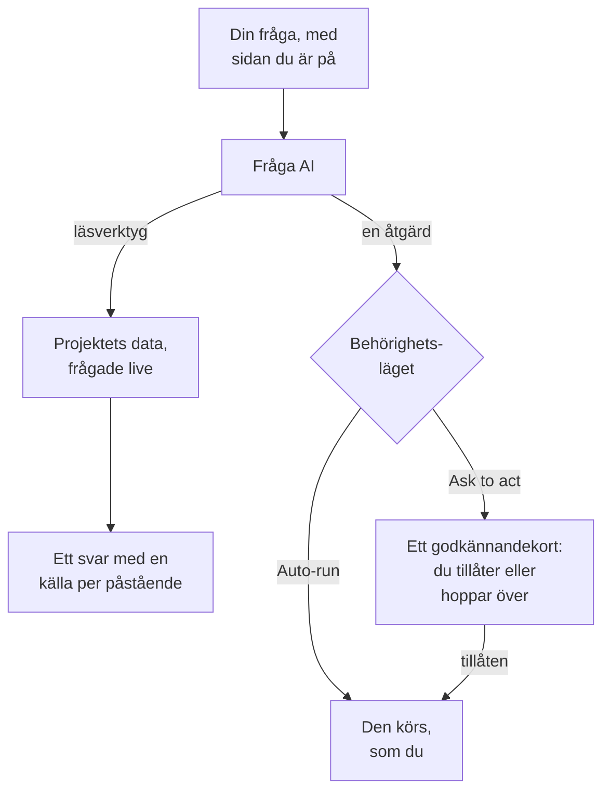

# Fråga AI

Fråga AI är OneUptimes chatt över ditt projekts data. Fråga om loggar, spår, mätvärden, undantag, incidenter, larm, monitorer, jour, statussidor, SLO:er, runbooks eller arbetsflöden: chatten frågar ditt projekt live, stöder varje påstående med en källa och agerar åt dig när du tillåter det.

:::cards
- [Öppna Fråga AI](#öppna-fråga-ai): Från sidhuvudet, tangentbordet, ett diagram eller produktmenyn.
- [Vad den kan se](#vad-den-kan-se): De data den läser för att svara dig.
- [Åtgärder och behörighetslägen](#åtgärder-och-behörighetslägen): Välj om den får agera och när den frågar först.
- [Åtgärder görs som du](#åtgärder-görs-som-du): Dina behörigheter, ditt namn på varje ändring.
:::

## Så svarar Fråga AI

Fråga AI svarar bara med det som verktygen returnerar: den kör frågor mot ditt projekt i stället för att svara ur minnet. Varje fakta i ett svar har en källbricka som visar frågan bakom och öppnar de data den läste. När du ber den ändra något avgör samtalets behörighetsläge om den frågar dig först. Före din fråga läser den projektets [AI-kontext](/docs/ai/ai-context): det ditt team har skrivit ner åt OneUptime AI om era egna system.

I läget **Skrivskyddad** erbjuds modellen aldrig åtgärderna, så samtalet bara läser.

## Frågor om OneUptime

Fråga AI svarar också på frågor om OneUptime självt: ”Hur får jag ett sms när min webbplats ligger nere?”, ”Vad är en episod?”, ”Var lägger jag till ett andra telefonnummer?”. Svaren kommer från den här dokumentationen, kopian som din OneUptime själv levererar, så det fungerar utan internetåtkomst och skickar inget till nya ställen. Den läser en sida på ditt språk när sidan är översatt, anger sida och avsnitt för varje steg och säger att dokumentationen inte täcker något i stället för att gissa.

Ett svar på ”hur gör jag” slutar med en knapp som öppnar sidan i ditt projekt där du gör det, till exempel **Skapa monitor** eller **Aviseringsmetoder**. Den öppnar bara sidor som OneUptime har: de som Sök (`Ctrl` + `K`) hittar.

## Öppna Fråga AI

| Var | Hur |
| --- | --- |
| Vilken sida som helst | Klicka på **Fråga AI** i sidhuvudet, eller tryck `Ctrl` + `I` (`Cmd` + `I` på en Mac). Medan du skriver i en textruta eller en redigerare förblir tangenterna redigerarens kortkommando för kursiv. |
| Kommandopaletten | Tryck `Ctrl` + `K` (`Cmd` + `K` på en Mac) och välj **Fråga AI**. |
| Ett felmönster i loggarna, eller ett diagrams fynd | Klicka på **Förklara med AI**: Fråga AI öppnas med bevisen som en fråga du kan redigera innan du skickar den. |
| Produktmenyn | Öppna **Produkter → AI → Chatt**. Fråga AI öppnas bredvid sidan du var på. Varje samtal har en egen adress, så du kan bokmärka det och komma tillbaka till det. |

Fråga AI öppnas vid sidan av fönstret, och sidan gör plats för den: inget döljs bakom den, så du kan fortsätta arbeta på sidan, gå till andra sidor och fråga igen. Dra i kanten för att göra den bredare eller smalare. Tryck på `Esc` i den, eller klicka på **Fråga AI** igen, för att ge sidan hela fönstret tillbaka. Medan den är öppen går `Ctrl` + `I` (`Cmd` + `I` på en Mac) från sidan till rutan du skriver i, och stänger den därifrån. Samtalet stannar där du lämnade det: öppna Fråga AI igen för att fortsätta. Stänger du den medan den fortfarande svarar säger en påminnelse i hörnet när svaret är klart, och öppnar det. På en surfplatta eller en telefon, där det inte finns plats för båda, öppnas den över sidan, och på en telefon fyller den hela skärmen.

På en incident eller ett larm har kortet **OneUptime AI** ett eget samtal, **Fråga OneUptime AI**, som delas av alla som kan se incidenten eller larmet: se [Prata med OneUptime AI om incidenten](/docs/ai/ai-sre#prata-med-oneuptime-ai-om-incidenten).

## Vad den kan se

Fråga AI läser ditt projekt med dina egna behörigheter, så den ser det du får se och inget mer.

| Område | Vad Fråga AI läser |
| --- | --- |
| Telemetri | Loggsökning och histogram, spåraggregeringar och span-träd, mätvärden, undantag, säkerhetshändelser, real user monitoring och Web Vitals, nyliga ändringar och avvikelsekontroller mot inlärda baslinjer. |
| Infrastruktur | Värdar, Docker, Podman, Kubernetes, Docker Swarm, Proxmox, VMware vCenter, Ceph, lagringsmatriser, serverlösa funktioner, molnmiljöer, IoT-flottor och nätverksenheter: vad som finns i inventariet, deras rapporterade anslutningstillstånd, trender i mätvärden, antal loggar per allvarlighetsgrad och sammanfattningar av spåroperationer. En fråga täcker både telemetri som nämner en tjänst och telemetri som nämner en infrastrukturresurs. |
| Incidenthantering | Incidenter och larm, med tillståndsfilter ("vad är aktivt just nu?"), deras aktivitetstidslinjer (tillståndsändringar, interna och offentliga anteckningar, flödet) och ägare, och en sökning i tidigare incidenter för att återanvända hur de löstes. |
| Jour | Vem som har jour nu, policyer och eskaleringskedjor, och om de senaste utlarmningarna levererades och kvitterades. |
| AI:ns eget arbete | Resultaten av AI SRE-undersökningar och AI Insights, så att "vad hittade AI:n?" besvaras utifrån den publicerade analysen i stället för att tas fram på nytt. |
| Plattform | Monitorer (med statusfilter), schemalagt underhåll, statussidor och deras meddelanden, SLO:er, runbooks, körningar av arbetsflöden, sondernas hälsa, team och koden i anslutna repositorier på GitHub, GitLab, Forgejo, Gitea och Azure DevOps (se [Vad AI läser i ett Git-repositorium](/docs/ai/ai-agent#vad-ai-läser-i-ett-git-repositorium)). |

## Sidkontext

Fråga AI vet vilken sida du öppnade den från. På en incidentsida betyder "varför hände det här?" just den incidenten: inmatningsfältet visar en bricka med sidans ämne, och frågorna den föreslår är sidans egna. Ta bort brickan för att fråga om hela projektet, och lägg till den igen på samma sätt. Öppna Fråga AI på en annan sida så följer kontexten med. Samtalet minns också sitt första ämne på servern, så en följdfråga dagar senare förstår fortfarande "den här incidenten".

På en incident, ett larm, en monitor eller ett schemalagt underhåll följer frågorna också var den posten står, läst varje gång Fråga AI öppnas på den. En löst incident frågar hur insatsen gick och vad som skulle hindra att den händer igen, ett löst larm om det var ett verkligt problem och hur ofta larm som det utlöses, och en monitor som inte är i drift frågar varför. Ett underhåll som inte har börjat frågar om dess monitorer är friska innan det börjar, och ett som är slut om de är tillbaka till det normala.

Infrastrukturlistor och resurssidor föreslår frågor för den sortens resurs du tittar på. Öppna ett Kubernetes-kluster och fråga "Vilka mätvärden har ändrats de senaste 24 timmarna?", eller öppna en Docker-värd och fråga "Sammanfatta loggarnas allvarlighet och spårfelen de senaste sex timmarna." Bevislänkar leder tillbaka till resursens sida. Läsningar respekterar dina behörigheter för projekt, resurser och telemetri, inklusive begränsningar på ägarskap och etiketter.

På en undersida registrerar kontexten också den pod, container, VM, process eller annan underresurs du valde. Infrastrukturverktygen läser den överordnade resursens telemetri; de kan inte mäta en enskild underresurs utifrån bara dess namn. Fråga AI säger det och gissar inte ett Kubernetes-namnområde som sidan inte anger. Ett anslutningstillstånd är inte en arbetsbelastnings hälsa, och saknad telemetri betyder inte att en resurs är frisk.

## Kommandon på din infrastruktur

Öppnat på sidan för en resurs vars AI-agent är ansluten (en värd, en Docker- eller Podman-värd, ett Docker Swarm-kluster, ett Proxmox-kluster, ett VMware vCenter, ett Ceph-kluster, en databasserver eller ett Kubernetes-kluster) kör Fråga AI kommandon på den genom den agenten när du ber om det: "kör `uptime` på den här värden" eller "visa de sista 100 raderna av `journalctl -u nginx`". Den svarar med det som kom tillbaka, med källhänvisning som allt annat underlag. Öppnat på en incident eller ett larm når den resurserna som är kopplade till den.

- Den kör bara de skrivskyddade kommandon som en AI-undersökning får köra på den typen av resurs (se [AI-agenter för infrastrukturen](/docs/ai/infrastructure-ai-agents)), så många som svaret behöver, kontrollerade av OneUptime och igen av agenten, i alla behörighetslägen. En ändring genom agenten, till exempel att starta om en tjänst, körs aldrig från Fråga AI: den ger dig i stället det exakta kommandot, och agenten gör bara ändringar när OneUptime AI åtgärdar en incident eller ett larm, enligt resursens egna inställningar för åtgärder. Fråga AI:s egna åtgärder, till exempel att köra en runbook, följer samtalets behörighetsläge, som beskrivs nedan.
- Den når bara de resurser du får se, och bara medan AI-undersökning är påslagen för resursen.
- När den inte kan köra ett kommando där (ingen agent är ansluten, agenten är offline eller AI-undersökning är avstängd för resursen) säger den det, tillsammans med vad som behöver ändras, och svarar i stället utifrån ditt projekts data.

## Åtgärder och behörighetslägen

Varje samtal har ett behörighetsläge, som du väljer i inmatningsfältet bredvid rutan du skriver i:

| Läge | Vad som händer |
| --- | --- |
| **Fråga före åtgärd** | Standard. Fråga AI föreslår varje åtgärd på ett godkännandekort, och inget körs förrän du väljer **Tillåt** eller **Hoppa över** för den, eller **Neka alla**. |
| **Kör automatiskt** | Åtgärder körs så snart modellen ber om dem, fortfarande begränsade till det din roll får göra. Använd det med omsorg. |
| **Skrivskyddad** | Åtgärderna erbjuds inte modellen alls: Fråga AI kan bara läsa. |

Vad Fråga AI kan göra när ett läge tillåter det:

- Skapa en incident eller ett larm, kvittera eller lösa incidenter och larm, och ändra en incidents allvarlighetsgrad.
- Koppla en incident eller ett larm till den infrastruktur och de tjänster det gäller. En incident eller ett larm som skapas på en resurs sida, till exempel en värds, kopplas till den resursen, och godkännandekortet visar vad varje åtgärd kopplar till. OneUptime AI undersöker och åtgärdar det som en incident eller ett larm är kopplat till.
- Registrera ett problem som någon redan hanterar, eller som redan är över: en incident eller ett larm som skapas kan börja redan bekräftad eller löst och larmar då ingen. Godkännandekortet säger vilket. Se [Deklarerad redan bekräftad eller löst](/docs/incidents/declaring-incidents#deklarerad-redan-bekräftad-eller-löst).
- Lägga en intern anteckning på en incident eller ett larm. Interna anteckningar visas aldrig på en statussida.
- Publicera en offentlig statusuppdatering på en incident. Det är en separat åtgärd, eftersom den meddelar statussidans prenumeranter.
- Larma en jourpolicy, köra en runbook eller starta en AI-undersökning av en incident eller larm.
- Ställa in saker från en mening: en monitor för en webbplats eller ett API, vem som larmas, en statussida och monitorerna den visar, allt på ett godkännandekort. Se [Ställ in saker](#ställ-in-saker).
- Föreslå en kodändring: committa till en ny gren i ett repositorium på GitHub, GitLab, Forgejo eller Gitea och öppna en pull request (en merge request på GitLab). Den skriver aldrig till standardgrenen eller en skyddad gren, så en människa slår fortfarande ihop ändringen. Ask AI skriver varje fil i sin helhet, utifrån filen som den senast läste den, och läser huvudgrenen i ett repositorium om den inte ombeds läsa en annan. Har en fil ändrats på grenen efter att Ask AI läste den, nämner kortet den innan du godkänner committen eller pull requesten, till exempel "Den här filen ändrades på fix/login efter att AI läste den, och AI:s version gör den ändringen ogjord: src/billing/charge.ts." Kortet nämner också en fil som Ask AI bara har läst på en annan gren, där den är annorlunda, en fil som Ask AI aldrig har läst men ersätter, och en fil som OneUptime inte kunde kontrollera. Ask AI läser en lång fil en del i taget, så kortet nämner också en fil som Ask AI bara har läst en del av, till exempel "AI läste bara en del av den här filen, och AI:s version ersätter hela filen: src/billing/charge.ts." När Ask AI har läst hela filen, i en läsning eller flera, säger kortet ingenting om den. Ett senare svar har orden från de tidigare svaren, inte filerna de läste, så kortet nämner också en fil som Ask AI bara har läst i ett tidigare svar, till exempel "AI läste den här filen i ett tidigare svar och har inte längre dess text, och AI:s version ersätter hela filen: src/billing/charge.ts." Ett mycket långt svar utelämnar också sina äldsta resultat, för att hålla sig inom det modellen kan ta in på en gång, så kortet nämner också en fil som Ask AI läste tidigare i samma svar om det resultatet utelämnades, till exempel "AI läste den här filen tidigare i det här svaret och har inte längre dess text, och AI:s version ersätter hela filen: src/billing/charge.ts." Om Ask AI har läst filen i flera delar och inte längre har alla delarna, säger kortet det också, till exempel "AI läste den här filen och har inte längre en del av dess text, och AI:s version ersätter hela filen: src/billing/charge.ts." När Ask AI läser filen igen i det svar som ändrar den säger kortet ingenting om den. En ny fil räknas aldrig. Vill du behålla det någon annan ändrade, hoppar du över åtgärden och ber Ask AI läsa filerna igen. I Kör automatiskt, där ingen godkänner åtgärder, gör Ask AI inte en sådan ändring: det läser filerna igen och gör sin ändring på dem som de är nu. Ändras en fil medan kortet väntar på dig, ändrar godkännandet ingenting, och Ask AI föreslår ändringen igen. En pull request som du ändå godkänner nämner filerna i sin beskrivning, för den som granskar den. Ask AI får aldrig se värden som ser ut som hemligheter eller personuppgifter, till exempel IP-adresser, e-postadresser och nycklar: det läser en platshållare som `[redacted-ip]` i stället. Därför nämner kortet också en fil som Ask AI:s version skriver sådana platshållare i, till exempel "Värden som ser ut som hemligheter eller personuppgifter doldes för AI, och AI:s version av den här filen skriver platshållare i stället för dem: config/servers.ts." En platshållare som filen på grenen redan har räknas inte. Ask AI kan inte skriva tillbaka de värdena, så i Kör automatiskt gör det inte den ändringen utan berättar i stället vad du ska ändra.

Be om en incident när användare påverkas, och om ett larm när något först behöver ditt teams uppmärksamhet, till exempel en värds minne som bara stiger. Båda skapas en gång och övervakar ingenting: för att larmas varje gång en värds minne går över 75 %, skapar du en [värdmonitor](/docs/monitor/host-monitor#färdiga-larmmallar) från dess minnesmall, med 75 % som tröskel. Fråga AI ställer bara in monitorer för webbplatser och API:er (se [Ställ in saker](#ställ-in-saker)). Ombedd om en annan sort säger den det, kontrollerar det aktuella värdet och erbjuder sig att skapa ett larm om det redan är över.

## Åtgärder görs som du

Varje åtgärd Fråga AI utför görs som du: den gör samma ändring som instrumentpanelen gör för samma åtgärd, med dina egna behörigheter i projektet, och ändringen tillskrivs dig. Kvitteras en incident från chatten uppstår samma tillståndsändring som från incidentens tillståndspanel, så incidentens tidslinje och flöde visar att du ändrade dess tillstånd. Ett utlarm som skickas från chatten visar dig som den som utlöste det.

- **Vad varje åtgärd kräver.** Den behörighet som instrumentpanelen kräver för samma ändring. Att skapa en incident eller ett larm kräver behörighet att skapa dem: en roll som får det, eller **Create Incident** eller **Create Alert** i en anpassad roll. Att kvittera eller lösa en incident kräver behörighet att ändra dess tillstånd: **Projektägare**, **Projektadministratör**, **Projektmedlem**, **Incidentadministratör** och **Incidentmedlem**, eller **Create Incident State Timeline** i en anpassad roll; ett larm kräver samma behörighet för larm (**Create Alert State Timeline**). Att skapa en incident eller ett larm som börjar bekräftad eller löst kräver båda: behörighet att skapa den och behörighet att ändra dess tillstånd. Att larma en jourpolicy kräver behörighet att köra den (**Execute On-Call Policies**), och att köra en runbook kräver behörighet att starta runbook-körningar: en roll som kör runbooks, för de runbooks dess etiketter når, eller **Create Runbook Execution** i en anpassad roll, som når varje runbook i projektet. Att ändra en incidents allvarlighetsgrad, starta en AI-undersökning av en incident eller larm och skriva kod till ett anslutet repositorium kräver behörighet att ändra den incidenten, larmet eller det repositoriet. En åtgärd du inte får utföra avvisas, och AI:n berättar vilken behörighet som krävs. Har du behörigheten men ett team du tillhör blockerar den, säger AI:n det i stället: en blockering på vissa etiketter avvisar åtgärden i Fråga AI för alla poster, inte bara för poster med de etiketterna.
- **Vilka poster.** De du får ändra, som överallt i OneUptime: med en roll som är begränsad till vissa etiketter, eller till de poster du äger, ändrar en åtgärd på någon annan post ingenting. En runbook körs bara när din behörighet att starta runbook-körningar når den. I OneUptime Cloud avvisas en åtgärd som projektets plan inte omfattar, med den plan som krävs.
- **När en åtgärd avvisas.** Inget ändras, och AI:n säger tydligt att åtgärden inte utfördes, och varför, i stället för att försöka igen. Bland svarets steg säger åtgärdens eget steg att den inte utfördes, och varför: din roll tillåter det inte, ett team du tillhör blockerar det, eller projektets plan omfattar det inte.
- **Slack, Microsoft Teams och AI-undersökningar.** AI:ns svar i Slack och Microsoft Teams, och autonoma AI-undersökningar, bara läser: de utför ingen av dessa åtgärder. Ber du om en ändring där säger AI:n hur du gör den från chatten: `/oneuptime incident` deklarerar en incident, `/oneuptime incident 42` visar incident 42 med dess knappar, `/oneuptime page` larmar någon (i Microsoft Teams samma ord skrivna till OneUptime-boten), och knapparna på OneUptimes meddelanden agerar också som du (se [Slack](/docs/workspace-connections/slack#agera-på-incidenter-larm-och-händelser-från-slack) och [Microsoft Teams](/docs/workspace-connections/microsoft-teams#agera-på-incidenter-larm-och-händelser-från-microsoft-teams)). För alla andra ändringar länkar den till Fråga AI, som föreslår ändringen så att du kan godkänna den. Tillfrågad i en incidents eller ett larms egen kanal tar den den incidenten eller det larmet som det du menar.

## Ställ in saker

Fråga AI ställer från en mening in det som de guidade inställningarna ställer in: "Övervaka example.com varje minut och sms:a mig om den ligger nere."

- **En plan, ett godkännande.** Fråga AI föreslår varje del på ett godkännandekort, var och en med enkla ord: en monitor för en webbplats eller ett API, projektets första jourpolicy, en statussida och monitorerna den visar. Kortet slutar med "Inget annat ändras." Välj **Hoppa över** på varje del du inte vill ha och kör resten. Inget skapas innan dess.
- **Frågar alltid.** Inställningen väntar på ditt godkännande i alla lägen, även **Kör automatiskt**, eftersom den skapar saker som larmar personer och som dina kunder ser. **Skrivskyddad** erbjuder den inte.
- **De guidade inställningarnas poster.** Monitorn är den som **Veta när min webbplats eller mitt API ligger nere** skapar för samma adress: standardvärdena från Skapa monitor, som öppnar en incident när adressen inte svarar eller svarar med ett fel, kontrollerad var 5:e minut om du inte ber om ett annat av Skapa monitors intervall. Den är din, så du får ett e-postmeddelande när dess status ändras. Statussidan är den som **Publicera en statussida** skapar: offentlig så snart den skapats, och den visar varje monitors status, upptid och historik.
- **Vem som larmas.** I ett projekt som ännu inte larmar någon föreslår Fråga AI projektets första jourpolicy, "Default on-call policy", som larmar dig, och de medlemmar och team du nämner, vid varje ny incident och varje nytt larm. Ett projekt som redan larmar personer behåller sina egna jourpolicyer och jourregler, och Fråga AI säger det i stället för att skapa en till.
- **Vad som saknas.** Fråga AI lägger aldrig till ett telefonnummer eller mobilappen: du lägger till och verifierar dem själv under **Användarinställningar → Aviseringsmetoder**. Ber du om sms utan ett verifierat nummer säger kortet det, och svaret länkar till sidan. En del som Fråga AI inte kan skapa föreslås inte, till exempel när din roll inte tillåter det, adressen inte är en adress eller monitorerna inte finns: svaret säger vad som behövs.
- **Vad varje del behöver.** En monitor behöver behörighet att skapa monitorer. Larmning behöver behörighet att skapa jourpolicyer, deras eskaleringsregler och jourregler för incidenter och larm. En statussida behöver behörighet att skapa statussidor och lägga till monitorer på dem. Projektets abonnemangsgränser gäller, som i de guidade inställningarna.
- **Testa det sedan.** När planen har körts öppnar varje kort det som skapades, och **Testa den här policyn** (eller **Skicka ett testlarm till mig**, för en monitor ensam) under svaret skickar ett testlarm som du kvitterar från meddelandet. Om en del misslyckas säger svaret vad som skapades och vad som inte gjorde det.
- **Vem som får veta.** Fråga "vem får veta när example.com ligger nere?" så svarar Fråga AI utifrån samma kedja som monitorns sida visar, och nämner varje brott.

## Styr ett samtal

- **Stoppa den.** Medan Fråga AI arbetar blir skicka-knappen en stoppknapp. Stoppa en körning när som helst och fråga om något annat direkt.
- **Följ arbetet.** Medan den svarar säger en rad vad den gör just nu, till exempel söker i loggar. Klicka på antalet steg bredvid för att se varje steg.
- **Välj modellen.** När ditt projekt kan använda mer än en LLM-leverantör listar leverantörsväljaren i inmatningsfältet projektets LLM-leverantörer och de globala, med standarden markerad. Ett nytt samtal använder standarden.
- **Betygsätt ett svar.** **Bra svar** och **Dåligt svar** sparas med meddelandet, så att svarens kvalitet kan mätas över tid.
- **Se kostnaden.** Under varje svar öppnas källorna till de frågor det körde, och det senaste svarets källor säger också hur många frågor det körde, dess token och dess kostnad. Varje källbricka i ett svar öppnar data bakom den.
- **Behåll en kopia.** **Ladda ned konversation** sparar tråden med **Ladda ned som Markdown**, för att läsa eller klistra in i ett ärende, eller **Ladda ned som PDF**, för att lämna till någon.
- **Fortsätt där du slutade.** **Alla konversationer**, i sidhuvudet i Fråga AI, listar dina samtal, det senaste först, så att du kan öppna dem igen eller ta bort dem. Början av ett nytt samtal visar de tre senaste.

## Krav

- **En LLM-leverantör.** Fråga AI använder projektets standard-LLM-leverantör (se [LLM-leverantörer](/docs/ai/llm-provider)). I OneUptime Cloud fungerar den direkt med den globala leverantören, betald med projektets AI-krediter; en egenhostad installation konfigurerar en leverantör, eller miljövariablerna för den globala leverantören. Svaren är bara så bra som modellen: en liten egenhostad modell utan tillförlitliga verktygsanrop svarar dåligt.
- **Growth-planen, i OneUptime Cloud.** Ett projekt på en lägre plan ser att AI inte ingår i planen, med en länk till **Projektinställningar → Fakturering och fakturor → Fakturering**.
- **AI påslaget för projektet.** **Aktivera AI**, på **Projektinställningar → AI → AI-funktioner**, stänger av alla projektets AI-funktioner, Fråga AI inräknat. Det är på om inte någon har stängt av det.

Fråga AI räknas in i projektets egna dagliga AI-gränser när projektet sätter dem (Projektinställningar → AI → AI Features → Fler inställningar): när en nås visar Fråga AI en mening som säger vilken gräns som nåtts, att OneUptime AI börjar igen vid midnatt UTC och vem som kan höja eller ta bort gränsen. Projektets ägare får ett e-postmeddelande första gången en gräns nås varje dag. De dagliga gränserna för incidenter och larm stoppar aldrig Fråga AI. Se [projektets egna dagliga gränser](/docs/ai/ai-sre#projektets-egna-dagliga-gränser).

## Felsökning

:::details Fråga AI säger att AI inte är tillgängligt
Fråga AI säger varför innan du skriver: projektets plan omfattar inte AI, **Aktivera AI** är avstängt, eller projektet har ingen LLM-leverantör. Varje meddelande länkar till sidan där det ändras.
:::

:::details En åtgärd avvisades
Fråga AI säger vilken behörighet åtgärden kräver, eller vilket team som blockerar den. Be någon som får göra ändringen, eller be en projektägare ge din roll behörigheten. Inget ändrades.
:::

:::details Svaren är vaga eller använder aldrig data
Kontrollera modellen bakom leverantören. Fråga AI behöver en modell som anropar verktyg tillförlitligt; små lokala modeller svarar ofta utan att köra en enda fråga. Se [LLM-leverantörer](/docs/ai/llm-provider).
:::

## Nästa steg

:::cards
- [AI SRE](/docs/ai/ai-sre): Låt OneUptime AI undersöka varje ny incident och larm.
- [LLM-leverantörer](/docs/ai/llm-provider): Välj modellen som Fråga AI och de andra AI-funktionerna använder.
- [MCP-server](/docs/ai/mcp-server): Fråga om OneUptime från Claude, Cursor eller VS Code i stället.
:::
