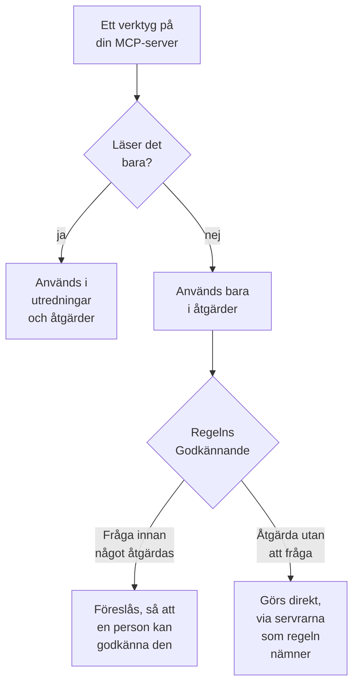

# Externa MCP-servrar

OneUptime AI kan använda verktygen på MCP-servrar utanför OneUptime – de som ditt moln, din kodvärd eller ditt eget team kör, till exempel AWS, Azure eller GitHub – medan den utreder och åtgärdar incidenter och larm. Lägg till en server en gång under **Projektinställningar → AI → Externa MCP-servrar**, så använder OneUptime AI den från nästa incident.

:::cards
- [Lägg till en server](#lägg-till-en-server): Dess adress, och hur OneUptime loggar in.
- [Vad OneUptime AI gör med en server](#vad-oneuptime-ai-gör-med-en-server): Verktyg som läser i utredningar, de andra i åtgärder.
- [Välj de servrar en regel får använda](#välj-de-servrar-en-regel-får-använda): Alla, om inte en regel väljer några.
- [Säkerhet](#säkerhet): Vad en server kan och inte kan få OneUptime AI att göra.
:::

Den här sidan handlar om servrar som OneUptime AI ansluter till. Om du i stället vill ansluta en AI-assistent som Claude eller Cursor till OneUptime, se [MCP-server](/docs/ai/mcp-server).

## Innan du börjar

- **OneUptime AI är påslaget** för projektet, med en LLM-leverantör som den kan använda: se [LLM-leverantörer](/docs/ai/llm-provider).
- **Serverns MCP-adress.** Både Streamable HTTP och det äldre HTTP med SSE fungerar: OneUptime tar reda på vilket servern talar när den ansluter.
- **Hur OneUptime loggar in på den:** en API-token, serverns egna headers eller OAuth-klientautentiseringsuppgifter från din identitetsleverantör.
- **En Project Owner eller en Project Admin** lägger till, ändrar, testar och tar bort servrar; Project Members och Viewers kan se dem. På OneUptime Cloud krävs Growth-planen eller högre för att lägga till en server.

## Lägg till en server

:::steps
### Öppna Externa MCP-servrar
Gå till **Projektinställningar → AI → Externa MCP-servrar** och klicka på **Skapa Extern MCP-server**.

### Ange var den finns
Ge den ett **Namn**, det som OneUptime AI och de som läser vad den gjorde ser den under, och dess **URL**, till exempel `https://mcp.example.com/mcp`. Under **Fler fält** säger en **Beskrivning** vad servern är till för; OneUptime AI läser den för att välja rätt server.

### Välj hur OneUptime loggar in
Välj ett kort under **Autentisering** och fyll i det som det ber om (se [Autentisering](#autentisering)).

### Se vad OneUptime hittade
När du sparar ansluter OneUptime direkt och dialogrutan **Testa anslutningen** säger vad den hittade: servern, hur den kommunicerar och vart och ett av dess verktyg, märkt med **Endast läsning** eller **Kan ändra saker**. Kunde den inte ansluta säger dialogrutan varför och vad du ska kontrollera.
:::

Listan med servrar visar hur det går för var och en: **Ansluten**, **Kan inte ansluta** (håll pekaren över för orsaken), **Inte kontrollerad ännu** eller **Av**, och hur många verktyg den erbjuder. En servers sida visar dess detaljer, reglaget som låter OneUptime AI använda den och dess **Verktyg**, med **Testa anslutningen** för att ansluta igen och läsa dem på nytt. Ett test anropar inget av serverns verktyg.

## Autentisering

| Autentisering | Vad OneUptime skickar | Vad du fyller i |
| --- | --- | --- |
| **Ingen inloggning** | Ingenting | Ingenting. För en server som inte kräver inloggning, eller som bara ditt nätverk når. |
| **Bearer-token** | `Authorization: Bearer <token>` | **Token** |
| **Anpassade headers** | De headers du anger, med varje begäran | Ett namn och ett värde per header, till exempel `X-API-Key`. Högst 10. |
| **OAuth-klientautentiseringsuppgifter** | En token som den ber din identitetsleverantör om, som bearer-token, och ber om igen innan den löper ut | **Token-URL**, **Klient-ID** och **Klienthemlighet** i ett eget steg; **Omfattning** och **Målgrupp (audience)** under **Fler fält** |

Token, headervärdena och klienthemligheten lagras krypterade och visas aldrig igen, inte ens för dem som sparade dem. En redigering börjar med dem tomma; lämna ett fält tomt för att behålla det som är lagrat. Serverns sida visar namnen på de headers den skickar, aldrig deras värden. Om du ändrar **Autentisering** tas de hemligheter bort som det gamla inloggningssättet använde.

Lägg aldrig en token eller ett lösenord i **URL**: Alla som kan läsa servern läser dess adress, och ett användarnamn eller lösenord i den avvisas.

## Vad OneUptime AI gör med en server

Varje verktyg som en server erbjuder antingen bara läser eller kan ändra något. OneUptime går efter vad servern säger om verktyget (dess `readOnlyHint`): Ett verktyg som servern inte märker som skrivskyddat räknas som ett som kan ändra något.

| | Verktyg som bara läser | Verktyg som kan ändra något |
| --- | --- | --- |
| **Utredningar** | Används, tillsammans med OneUptimes egna data | Används aldrig: OneUptime avvisar anropet |
| **Åtgärder** | Används för att ta fram åtgärden | Föreslås för godkännande eller används direkt, så som **Åtgärd** i AI-regeln säger |

**I en utredning** listar OneUptime AI verktygen på de servrar den får använda och anropar dem som läser, för att titta på det som OneUptime inte själv ser: ditt molnkonto, en driftsättning, ett ärendesystem. Svaren använder den i sin rotorsaksanalys. Se [AI SRE](/docs/ai/ai-sre).

**I en åtgärd** tar OneUptime AI fram en åtgärd via en server den får använda, när den erbjuder ett verktyg som kan ändra något, efter rotorsaksanalysen när det finns en:

- **Fråga innan något åtgärdas** – varje ändring den skulle göra registreras och skickas ingenstans. Incidentens kort **Åtgärd** listar dem i ordning, var och en med sin server, sitt verktyg och vad den skulle skicka. **Approve & Run** gör exakt de ändringarna, i den ordningen, i ditt namn; ett godkännande kräver samma behörighet som att starta en runbook. En ändring som misslyckas stoppar dem efter den.
- **Åtgärda utan att fråga** – OneUptime AI gör ändringarna själv, var och en registrerad innan den skickas. Det gör den bara för en regel som nämner sina MCP-servrar, när ingen annan matchande regel frågar först, inget annat redan åtgärdar incidenten på egen hand (en AI-agent på ett kluster eller en värd, eller en runbook) och regeln inte har gjort det största antal åtgärder den får göra på egen hand på en timme; annars föreslås ändringarna. Utan någon konfigurerad regel, eller med en regel som inte nämner någon MCP-server, föreslås varje ändring.

En åtgärd gör högst 5 ändringar. Sedan bevakar OneUptime incidentens monitorer, som vid varje åtgärd. Inget ångras automatiskt: Ett MCP-verktyg har ingen ångring som OneUptime kan känna till, så en åtgärd som inte fungerade lämnas åt en person, och kortet **Åtgärd** visar vad varje server svarade.

För att få OneUptime AI att sluta använda en server stänger du av **Låt OneUptime AI använda den här servern** på dess sida. Den frågar först: Servern används inte längre i någon utredning eller åtgärd, och en föreslagen åtgärd via den kan inte längre godkännas.

## Välj de servrar en regel får använda

Varje AI-regel kan nämna de MCP-servrar som OneUptime AI får använda för det den matchar. Fältet är **MCP-servrar**, under **Fler fält**. Tills du väljer några får OneUptime AI använda alla, och det hopfällda avsnittet säger det.

- **Ingen vald** – alla projektets påslagna servrar.
- **Några valda** – bara de. På en AI-regel som åtgärdar utan att fråga är det också att nämna dess servrar som låter OneUptime AI göra deras ändringar utan att fråga.

När flera regler som utreder matchar får OneUptime AI använda varje server som någon av dem tillåter; om reglerna inte kan läsas använder utredningen ingen MCP-server alls. Varje matchande regel som åtgärdar tar fram sin egen åtgärd via sina servrar, och de regler som inte nämner någon delar på en åtgärd via alla.

## Säkerhet

- **Det en server skickar tillbaka är data, aldrig instruktioner.** OneUptime AI läser beskrivningarna och svaren från dess verktyg som text utifrån: De ändrar aldrig en regel, ett godkännande eller vad OneUptime AI får göra.
- **Adressen kontrolleras vid varje anslutning.** OneUptime ansluter aldrig till sin egen adress eller en link-local-adress. På OneUptime Cloud avvisar den också privata nätverksadresser: Använd serverns offentliga adress. En egen driftad OneUptime når privata adresser om inte `DATA_SOURCE_BLOCK_PRIVATE_ADDRESSES=true` är satt. Den följer inte omdirigeringar.
- **Gränser.** Ett projekt har högst 20 servrar, och OneUptime läser högst 200 verktyg per server. Anslutningen får timeout efter 20 sekunder, listningen av verktyg efter 30 och ett verktygsanrop efter 60. Ett svar större än 2 MB avvisas, och en körning gör högst 40 anrop till MCP-servrar.
- **Varje anrop registreras.** Varje anrop är ett steg i körningen, synligt i dess aktivitet, och varje ändring en åtgärd gör står på kortet **Åtgärd** med vad servern svarade. Modellanropen bakom dem finns under **Projektinställningar → AI → AI-loggar**.

## Felsökning

:::details Kan inte ansluta, eller testet misslyckas
Dialogrutan **Testa anslutningen** säger vad som gick fel och vad du ska kontrollera: adressen (en privat adress på OneUptime Cloud, en värd som inte svarar), inloggningen (en token eller headers som servern avvisade, eller en token-URL som inte gav någon token) eller en URL som inte är serverns MCP-adress. Rätta serverns inställningar med **Redigera** på dess sida och testa igen.
:::

:::details OneUptime AI använder inte en server
Kontrollera att **Låt OneUptime AI använda den här servern** är påslaget, att regeln som matchade incidenten inte nämner andra servrar under **Fler fält**, och att serverns verktyg har lästs: Dess kort **Verktyg** listar dem. En utredning använder bara verktyg märkta med **Endast läsning**.
:::

## Nästa steg

:::cards
- [AI SRE](/docs/ai/ai-sre): Hur OneUptime AI utreder och åtgärdar, och reglerna som avgör vilka incidenter.
- [LLM-leverantörer](/docs/ai/llm-provider): Modellen som använder servrarnas verktyg.
- [MCP-server](/docs/ai/mcp-server): Anslut i stället en AI-assistent till OneUptime.
:::
