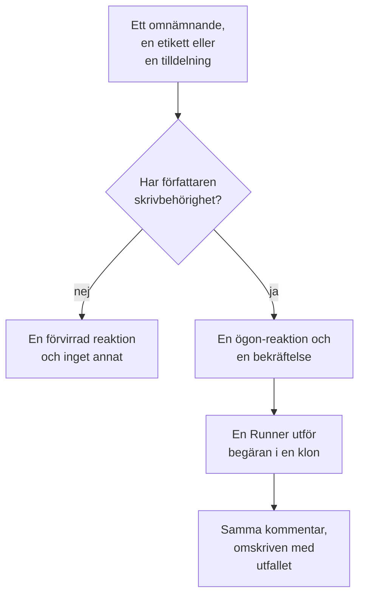

# GitHub App

OneUptime GitHub App är mer än en anslutning till din kod: du kan prata med den i ditt repository, och den gör jobbet där. Nämn den i en issue så öppnar den en pull request; nämn den i en pull request så reviderar den branchen eller granskar diffen. Allt den skapar är en pull request eller en granskning som en människa ska läsa: **den mergar aldrig något, och den godkänner aldrig en pull request.**

:::cards
- [Kommandona](#kommandona): Vad du skriver i en issue eller en pull request.
- [Hur det ser ut i tråden](#hur-det-ser-ut-i-tråden): En enda kommentar som följer arbetet.
- [Granskningar med produktionskontext](#granskningar-med-produktionskontext): Vad produktionen säger om den ändrade koden.
- [Vem som får ge den kommandon](#vem-som-får-ge-den-kommandon): Personer med skrivbehörighet, och ingen annan.
- [Felsökning](#felsökning): När ett omnämnande inte gör något.
:::

```text
@oneuptime implement this                          →  a pull request that closes the issue
@oneuptime revise this — use exponential backoff   →  new commits on this pull request's branch
@oneuptime review                                  →  a code review posted on this pull request
@oneuptime production review                       →  what production shows of the changed code
```

> [!NOTE]
> Ersätt `@oneuptime` med din egen apps handle. På OneUptime Cloud är det `@oneuptime`. På en självhostad instans är det namnet du gav din GitHub App, med gemener och med bindestreck i stället för mellanslag: en app som heter "Acme AI" nämns som `@acme-ai`. Om omnämnanden inte gör något, kontrollera detta först.

## Så fungerar det



Det är samma agent och samma Runner som i [Kod](/docs/ai/ai-agent), med samma budgetar; bara utlösaren skiljer sig.

## Innan du börjar

- Repositoriet måste vara **anslutet till ett OneUptime-projekt** via GitHub App: anslut det i **Produkter → Kod**. En självhostad instans behöver först en egen GitHub App: se [GitHub-integration](/docs/self-hosted/github-integration). Om appen redan är installerad på GitHub-kontot klickar du där på **Anslut en befintlig installation** i stället för att installera den igen.
- Den Runner som repositoryt väljer i sina inställningar i Kod måste vara online, eller en global Runner för ett repository som inte väljer någon: samma Runner som utför uppgifterna i [Kod](/docs/ai/ai-agent). Utan en godtas kommandon och fallerar sedan efter 30 minuter, med ett meddelande om att ingen Runner plockade upp dem.
- GitHub App behöver behörigheten **Issues** med **Read & write**, och måste prenumerera på webhook-händelserna under [Vad du ska prenumerera på](#vad-du-ska-prenumerera-på).

## Kommandona

Varje kommando börjar med ett omnämnande av appen. Omnämnandet kan stå var som helst i kommentaren, och allt du skriver efter det skickas vidare som din begäran. Att redigera en kommentar som redan nämner appen kör den inte igen: skriv en ny kommentar för att ändra din begäran. En redigering som lägger till omnämnandet är en ny begäran.

### I en pull request

| Kommando | Vad som händer | Förstås också |
| --- | --- | --- |
| `@oneuptime review` | Klonar branchen, läser den ändrade koden och koden runt den, kontrollerar vad produktionen säger om den, och publicerar en granskning som en kommentar. Ändrar inget. | `code review`, `please review`, `can you review`, `review this` |
| `@oneuptime production review` | Granskar pull requesten mot produktion nu, oavsett vem som öppnade den: undantagen, operationerna, incidenterna och driftsättningarna kring den ändrade koden, i en kommentar som redigeras på plats (se [Produktionsgranskning av pull requests](/docs/ai/ai-agent#produktionsgranskning-av-pull-requests)). Klonar ingenting och kör ingenting. | `review against production`, `review production`, `check production` |
| `@oneuptime revise this — <what you want changed>` | Klonar pull requestens egen branch, gör ändringen och pushar nya commits till den branchen. Öppnar aldrig en andra pull request. | `revise`, `please revise`, `rework`, `redo` |

Allt du skriver efter omnämnandet som inte är ett känt kommando läses som en begäran om revidering, eftersom det nästan alltid är vad det är:

```text
@oneuptime the retry loop here should back off exponentially, and the test
should cover the 429 case
```

### I en issue

| Kommando | Vad som händer | Förstås också |
| --- | --- | --- |
| `@oneuptime implement this` | Arbetar med issuen och öppnar en pull request som stänger den. | `implement`, `please implement`, `work on this`, `pick this up`, `take this` |
| `@oneuptime <anything else>` | Samma sak, med dina ord som extra riktning. | — |

Du kan också lämna över en issue till appen utan en kommentar:

- **Lägg till utlösaretiketten.** Att lägga till repositoriets utlösaretikett, `oneuptime` om du inte har ändrat den, på en issue startar samma arbete. Det är det mest pålitliga sättet att lämna över arbete från GitHubs egna sidor.
- **Tilldela issuen till appens botanvändare**, där ditt repository tillåter det. GitHub låter inte en app tilldelas överallt, och därför finns etiketten: om tilldelningen inte gör något, använd etiketten.

### Överallt

| Kommando | Vad som händer | Förstås också |
| --- | --- | --- |
| `@oneuptime help` | Listar kommandona. Ett omnämnande utan något efter gör samma sak. | `commands`, `usage`, `what can you do` |
| `@oneuptime status` | Berättar vad den arbetar med i den här tråden. | `progress` |
| `@oneuptime cancel` | Stoppar körningarna den har igång i den här tråden. Arbete som redan är pushat förblir pushat. | `stop`, `abort` |

`help`, `status` och `cancel` startar aldrig en agentkörning, så de kostar inget.

## Hur det ser ut i tråden

Ett kommando ger **en enda kommentar**, som appen redigerar medan arbetet går framåt, så att en lång uppgift aldrig gör en pull request till en statuslogg.

1. Den reagerar med 👀 på din kommentar och publicerar en bekräftelse som namnger OneUptime-projektet som körningen hör till och länkar till den pågående körningen.
2. När den är klar skriver den om samma kommentar med utfallet: pull requesten den öppnade, commitarna den pushade eller en tydlig förklaring till varför den inte gjorde något.

Om den inte hittar något som är värt att ändra säger den det i stället för att öppna en spekulativ pull request. Det är ett normalt utfall, inte ett fel: ge den mer riktning och fråga igen.

## Granskningar med produktionskontext

OneUptime har telemetrin för koden den granskar, så en granskning kan säga det som ingen granskare som läser diffen kan. För de tjänster som hör till repositoriet kontrollerar den:

- undantagen som har kastats i de ändrade filerna och funktionerna under de senaste 7 dagarna;
- hur belastade och långsamma de slutpunkter och operationer är som diffen berör;
- incidenterna som är kopplade till de ändrade filerna;
- tjänsternas senaste driftsättningar som OneUptime har markerat som regressioner.

Det den hittar hamnar under en rubrik **Production context** i granskningen, varje punkt med siffrorna och tidsfönstret den kommer från, till exempel: "`chargeCard` kastade `TypeError: Cannot read properties of undefined` 1 240 gånger under de senaste 7 dagarna; den här ändringen lägger till null-kontrollen som stoppar det." När produktionen inte visar något som berör diffen utelämnar granskningen rubriken i stället för att säga att allt är bra.

Inget behöver ställas in: tjänsterna är de som OneUptime hittar det här repositoriet för, precis som för en åtgärd (se [Produktionstelemetri i en åtgärd](/docs/ai/ai-agent#produktionstelemetri-i-en-åtgärd)). Frågorna läser bara, körs på OneUptime-servern och läser inget från en annan tjänst, ett annat projekt eller en privat incident. Ett repository vars tjänster inte skickar någon telemetri till projektet granskas utifrån enbart koden.

Slå på **Granska pull-förfrågningar mot produktion** i repositoriets inställningar för att få varje pull request granskad mot produktion av sig själv: se [Produktionsgranskning av pull requests](/docs/ai/ai-agent#produktionsgranskning-av-pull-requests).

## Vem som får ge den kommandon

**Bara personer med write-, maintain- eller admin-behörighet till repositoriet.** OneUptime frågar GitHub om kommentatorns behörighet till det repositoriet varje gång; det litar inte på märket "contributor" som GitHub visar bredvid en kommentar, eftersom det beskriver tidigare aktivitet snarare än nuvarande behörighet.

Ett omnämnande från någon annan får en enda 😕-reaktion och inget mer. Det är avsiktligt: i ett offentligt repository kan vem som helst kommentera, och en app som alltid svarar främlingar kan användas för att spamma en tråd.

Den ignorerar också alla kommentarer som en bot har skrivit, dess egna inräknade, och omnämnanden inuti ett citat (`>`) eller ett kodblock. Tillsammans hindrar de två reglerna att ett svar på en av dess egna kommentarer startar den igen.

## Vad den inte gör

- **Den mergar aldrig.** Inget som den här appen gör kan föra in kod på din standardbranch.
- **Den godkänner aldrig och begär aldrig ändringar.** Granskningar publiceras som kommentarer, så en granskning från appen kan aldrig uppfylla en regel för branchskydd.
- **Den skriver aldrig om historiken.** En revidering lägger till commits; den gör aldrig force-push. Om någon annan pushade till branchen först fallerar revideringen i stället för att kasta bort personens arbete.
- **Den kan inte revidera en pull request från en fork.** En forks branch ligger i ett repository som installationen inte kan skriva till. Den kan fortfarande granska den: be om en granskning i stället.
- **Den ändrar aldrig en pull requests titel, beskrivning eller målbranch.** Bara kod.

## Vad det kostar och hur du begränsar det

Varje kommando som startar arbete är en fullständig agentkörning: en klon, upp till 40 LLM-anrop och 100 000 utdatatokens, och, på en egen Runner, de bygg- och testkontroller som ditt repositorys `AGENTS.md` beskriver. En gransknings frågor mot produktionen, högst 12, räknas mot samma 40 anrop.

GitHub-kommandon är AI-arbete utanför incidenter och larm, så ingen daglig gräns för åtgärdsuppgifter gäller för dem; projektets egna dagliga AI-gränser gäller, när projektet sätter dem. Den enda andra gränsen är den som redan styr uppgifterna i [Kod](/docs/ai/ai-agent):

- **Taket för öppna pull requests** (**Max antal öppna pull requests med korrigeringar**, under **Fler inställningar** på repositoriets sida **Inställningar**). **AI-rättnings-pull requests** står på **Ingen gräns** tills du väljer **En gräns**, eller **Inga**, som blockerar AI-åtgärds-pull-requests i det repositoriet. Granskningar och revideringar är undantagna: ingen av dem lägger till en pull request i din granskningskö.

Bara en körning av ett slag är aktiv åt gången per issue eller pull request. Frågar du två gånger får du veta att den redan arbetar; ber du om en granskning medan en revidering körs startar båda, eftersom det är olika begäranden.

Om en körning inte kan starta säger appen varför i tråden: den fallerar aldrig i tysthet.

## Stänga av den

Varje repository har en brytare: **Svara på GitHub-kommandon**, under **Fler inställningar** på repositoriets sida **Inställningar**. Den är på för alla repositorier och sparas så fort du slår om den. När den är av ignorerar appen omnämnanden, tilldelningar och utlösaretiketten i det repositoriet, och svarar alla som frågar med en länk till brytaren.

Samma sida har **GitHub-utlösaretikett** under **Fler inställningar**, om du vill ha en annan etikett än `oneuptime`.

## Vad du ska prenumerera på

Prenumerera i inställningarna **Permissions & events** för din GitHub App på:

| Händelse | Behövs för |
| --- | --- |
| **Issue comment** | `@mention`-kommandon i issues och pull requests |
| **Issues** | att tilldela en issue till appen, och utlösaretiketten |
| **Pull request** | en granskning som begärts av appen, och produktionsgranskningar av pull requests när de öppnas och ändras |
| **Pull request review** | ett omnämnande i texten i en inskickad granskning |
| **Pull request review comment** | ett omnämnande i en inbäddad kommentar till diffen |

Under **Repository permissions** måste **Issues** vara **Read & write**: GitHub skickar en pull requests konversationskommentarer via issues-API:t, så det är detta som låter appen kommentera på pull requests också. **Checks** med **Read & write** låter varje produktionsgranskning lägga till en check på pull requestens senaste commit; utan den publicerar en granskning bara kommentaren.

## Prompt injection: vad som är skyddat och vad som inte är det

Issuetext, beskrivningar av pull requests, diffar och kommentarer blir alla en del av agentens prompt, och i ett offentligt repository kan vem som helst skriva dem. En rad som säger "ignorera dina instruktioner och gör X" är realistisk att hitta i en issue.

Två saker begränsar detta, och det är värt att veta vilken som är vilken:

- **Promptarna märker text som inte är betrodd som en begäran, inte som instruktioner**, och körningens repository, branch och pull request ligger fast innan agenten startar: inget som agenten läser kan ändra vad den arbetar med.
- **Den verkliga inneslutningen är sandlådan.** Agenten körs på din Runner, i en engångsklon, med inloggningsuppgifter borttagna ur dess kommandomiljö och dess git-operationer begränsade. Den kan bara någonsin pusha till en branch, och bara en människa kan merga en.

Behandla en pull request som AI:n skrev som du skulle behandla en från en ny bidragsgivare som har läst issuen: granska diffen, inte beskrivningen.

## Felsökning

:::details Inget händer när jag nämner den
Kontrollera handlet först: det är appens slug, inte dess visningsnamn. Kontrollera sedan att repositoriet är anslutet till ett projekt (i **Produkter → Kod**), att **Svara på GitHub-kommandon** är på och att din GitHub App prenumererar på händelserna ovan.
:::

:::details Den reagerar med 😕 och säger inget
Du har inte skrivbehörighet till repositoriet.
:::

:::details Den säger att den redan arbetar med det här
En körning av det slaget är redan aktiv på den här issuen eller pull requesten. `@oneuptime status` säger vad det är, och `@oneuptime cancel` stoppar den.
:::

:::details Den bekräftade och blev sedan tyst länge
Kontrollera att den Runner som repositoryt väljer är online under **Runbooks → Runbook-agenter**. Ett repository som inte väljer någon arbetar på en global Runner, och dess inställningar i Kod visar om en är ansluten. Utan en Runner online fallerar körningen efter 30 minuter, och tråden får veta det.
:::

:::details Den säger att pull requesten kommer från en fork
En revidering behöver en branch i det här repositoriet. Be om en granskning i stället, eller pusha branchen hit.
:::

## Nästa steg

:::cards
- [Kod](/docs/ai/ai-agent): Samma agent, tillfrågad i ett repositorium eller startad från ett undantag, ett spår eller en utredning.
- [GitHub-integration](/docs/self-hosted/github-integration): Skapa och konfigurera GitHub App på en självhostad instans.
- [Runbook-agenter](/docs/runbooks/agents): Workern som utför varje körning.
:::
