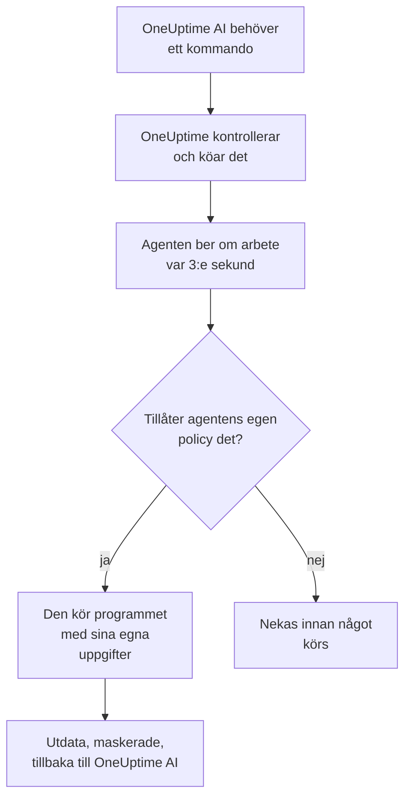

# AI-agenter för infrastrukturen

OneUptime AI kan titta på mer än din telemetri medan den utreder en incident eller ett larm. En liten agent som är installerad bredvid en av dina resurser (en Docker- eller Podman-värd, ett Docker Swarm-kluster, ett Proxmox-kluster, ett VMware vCenter, ett Ceph-kluster, en databasserver eller en Linux-värd) kör de skrivskyddade kommandon som OneUptime AI ber om, till exempel `docker logs --tail 200 web`, `pvesh get /cluster/status`, `ceph health detail`, `db long-queries --min-seconds 30` eller `journalctl -u nginx -n 200 --no-pager`, och skickar tillbaka utdata, så att rotorsaksanalysen citerar vad resursen själv säger. Om du tillåter det tillämpar samma agent också åtgärder (startar om en container, startar en VM, markerar en OSD som in igen), var och en placerad i en nivå av en kommandopolicy och, om du inte väljer annat, godkänd av en människa först. Fråga AI, öppnat på resursens sida, kör samma skrivskyddade kommandon när du ber om det (se [Fråga AI](/docs/ai/ask-ai)).

De här agenterna är **resurs-AI-agenterna**. Varje resurs sida i dashboarden har en **AI**-sektion med tre sidor:

- **Insikter**: vad OneUptime AI har tagit reda på om resursen de senaste 30 dagarna, alltså problemen som hela tiden kommer tillbaka och varför, med vad AI hittade och steget den föreslår, de delar av resursen som ligger bakom de flesta av dem, åtgärder som inte hjälpte eller som väntar på godkännande, vad AI åtgärdade på egen hand och riskerna som upptäcktes innan någon larmades, med vad AI själv gjorde där som fotnot. Den fungerar som ett klusters; se [Vad AI har lärt sig i ett kluster](/docs/ai/ai-sre#vad-ai-har-lärt-sig-i-ett-kluster).
- **Loggar**: allt som OneUptime AI har gjort på resursen, nyast först: varje utredning med sin incident eller sitt larm och sin sammanfattning, varje åtgärd den föreslog eller körde och varje kommando den skickade genom agenten. (Den här sidan hette tidigare Insikter.)
- **AI-agent**: om agenten är ansluten, vad AI får göra på resursen (utreda, och hur åtgärder körs), allt som behöver uppmärksamhet med steget som löser det och, i menyn **⋯** bredvid agentens status, **Testa anslutningen** och **Återställ agenten**.

Resursens **Översikt** avslutas med ett **AI-agent**-kort som sammanfattar AI-agentens sida: om agenten är ansluten, om utredning är påslagen, hur åtgärder körs (**Av**, **Be om godkännande**, **Automatiskt** eller **Hoppa över godkännande**) och vad som behöver uppmärksamhet, med en länk till AI-agentens sida, där de ändras.

:::cards
- [Resurser som stöds](#resurser-som-stöds): Åtta sorters resurser, en image.
- [Installera en AI-agent](#installera-en-ai-agent): Bredvid en collector som du redan kör, eller på en Linux-värd.
- [Så fungerar åtgärder](#så-fungerar-åtgärder): Vad som får köras av sig självt, vad som väntar på en människa och vad som aldrig körs.
- [Säkerhetsmodell](#säkerhetsmodell): Tre kontroller av varje kommando och inga autentiseringsuppgifter från OneUptime.
:::

## Så fungerar det

Agenten väntar aldrig på en anslutning från OneUptime: den anropar själv OneUptime, ber om arbete och kör bara det som dess egen kopia av kommandopolicyn tillåter, med de autentiseringsuppgifter den redan har.



## Hur den förhåller sig till Kubernetes-AI-agenten

Kubernetes-kluster har en egen agent, Kubernetes-AI-agenten, som installeras av Kubernetes-agentens Helm-chart; se [Klusteråtkomst: låt OneUptime AI köra kubectl](/docs/ai/ai-sre#klusteråtkomst-låt-oneuptime-ai-köra-kubectl). Inget på den här sidan ändrar den. Resurs-AI-agenterna följer samma utformning:

- **Samma nivåer och lägen.** Varje kommando är **Read**, **SafeWrite**, **RiskyWrite** eller **Denied**, och åtgärder är **Av**, **Be om godkännande**, **Automatiskt** eller **Hoppa över godkännande**, med samma betydelse som i ett kluster.
- **Samma tre kontroller.** Samma kommandopolicy upprätthålls av OneUptimes AI-verktyg, igen när OneUptime köar kommandot och ytterligare en gång av agenten innan den kör något.
- **Samma regel om autentiseringsuppgifter.** Agenten använder bara det som dess egen miljö och dess monteringar ger den. OneUptime skickar aldrig några autentiseringsuppgifter till den.
- **Samma standardvärden.** AI-utredningar är påslagna som standard: en resurs börjar med utredning påslagen och åtgärder avslagna, precis som ett kluster, så OneUptime AI utreder med sin agent så snart den ansluter och ändrar ingenting förrän någon tillåter åtgärder (se [Ansluta till OneUptime](#ansluta-till-oneuptime)).

Vad som skiljer:

- **En image för alla resurser.** `oneuptime/resource-ai-agent` betjänar alla åtta sorters resurser, och `ONEUPTIME_AI_AGENT_RESOURCE_TYPE` anger vilken en agent betjänar. Den körs bredvid resursens collector som ytterligare en container, inte från ett Helm-chart.
- **Skrivåtkomst är en miljövariabel.** Först `ONEUPTIME_AI_ALLOW_WRITES=true` på agenten låter den tillämpa åtgärder över huvud taget, och `ONEUPTIME_AI_WRITE_TARGETS` begränsar vilka containrar, tjänster, VM:ar, OSD:er, sessioner eller units de får röra. I ett kluster sköter chartets RBAC och `aiAgent.remediation.namespaces` det.

Precis som Kubernetes-AI-agenten är en resurs-AI-agent inte en Runner. Den visas aldrig under Runbooks → Runbook-agenter, och den används aldrig som Bash- eller SSH-värd för runbooks.

## Resurser som stöds

| Resurs | `ONEUPTIME_AI_AGENT_RESOURCE_TYPE` | Agent | Registrerar sig som (collectorns variabel) | Kör | Når resursen via |
| -------------------- | ---------------------------------- | --------------------- | ----------------------------------------------------------------------------------------------- | -------------------------------------------------------------------------------------------------------------------------------------------------- | -------------------------------------------------------------------------- |
| Docker-värd | `docker` | Docker-AI-agent | `DOCKER_HOST_NAME` | `docker` | Docker-socketen, `/var/run/docker.sock` |
| Podman-värd | `podman` | Podman-AI-agent | `PODMAN_HOST_NAME` | `docker`, genom Podmans Docker-kompatibla API | Podman-socketen, `/run/podman/podman.sock` |
| Docker Swarm-kluster | `docker-swarm` (eller `swarm`) | Docker Swarm-AI-agent | `DOCKER_SWARM_CLUSTER_NAME` | `docker` | Docker-socketen på en managernod |
| Proxmox-kluster | `proxmox` | Proxmox-AI-agent | `PROXMOX_CLUSTER_NAME` | `pvesh`-kommandon, skickade till Proxmox VE-API:t (det finns ingen `pvesh`-binär i agenten) | `https://PVE_HOST:8006/api2/json`, med en Proxmox-API-token |
| VMware vCenter | `vmware` (eller `vcenter`) | VMware-AI-agent | `VMWARE_VCENTER_NAME` | `govc` | vCenters API, med en vSphere-användare |
| Ceph-kluster | `ceph` | Ceph-AI-agent | `CEPH_CLUSTER_NAME` | `ceph` | monitorerna, med en `ceph.conf` och nyckelringen för agentens egen klient |
| Databasserver | `database` (eller `db`) | Databas-AI-agent | `DATABASE_SERVER_ID`, eller `DATABASE_SYSTEM` + `DATABASE_SERVER_ADDRESS` + `DATABASE_SERVER_PORT` | `db`: en operation ur en fast diagnostikkatalog, aldrig SQL | databasens egen drivrutin, med en databasinloggning |
| Värd | `host` | Värd-AI-agent | `HOST_NAME` (tomt: värdens eget värdnamn) | `systemctl`, `journalctl`, `df`, `free`, `uptime`, `ps`, `ss`, `ip`, `dmesg`, `lsblk`, `cat`, `top`, `uname`, `hostnamectl`, `timedatectl`, `kill` | `nsenter` in i värdens namnrymder, från en privilegierad container |

Databasservrar: Databas-AI-agenten har diagnostik för PostgreSQL, MySQL (och MariaDB och Percona Server), Redis (och Valkey, KeyDB och Dragonfly) och MongoDB. För alla andra motorer kör den ingenting och säger det på databasens AI-agentsida.

**Testa anslutningen**, i menyn **⋯** bredvid agentens status på AI-agentens sida, kör de här skrivskyddade kommandona genom agenten och visar deras utdata i agentens kort:

| Resurs | Vad Testa anslutningen kör |
| -------------------- | ---------------------------------------------------- |
| Docker-värd | `docker version`, `docker info` |
| Podman-värd | `docker version`, `docker info` |
| Docker Swarm-kluster | `docker version`, `docker node ls` |
| Proxmox-kluster | `pvesh get /version`, `pvesh get /cluster/status` |
| VMware vCenter | `govc about` |
| Ceph-kluster | `ceph health`, `ceph versions` |
| Databasserver | `db ping`, `db version` |
| Värd | `uptime`, `systemctl list-units --failed --no-pager` |

På en Docker Swarm-worker misslyckas `docker node ls`: Docker Swarm-AI-agenten måste köras på en managernod. En agent som startas på en worker registrerar sig inte för klustret förrän dess nod är en manager, och Docker Swarm-installationsprogrammet utelämnar den på en nod som inte är manager.

## Installera en AI-agent

Varje resurs-AI-agent är samma image, `oneuptime/resource-ai-agent:release`. Den behöver ingenting i dashboarden: så snart den körs registrerar den sig hos OneUptime och dyker upp på resursens AI-agentsida inom en minut.

### Bredvid en collector

För Docker, Podman, Docker Swarm, Proxmox, VMware, Ceph och databasservrar körs agenten bredvid den collector som du redan använder för den resursen och delar dess `.env`: den har redan `ONEUPTIME_URL`, inmatningsnyckeln och resursens namn. Varje collectors `docker-compose.yml` levererar agenten som ytterligare en tjänst, och dess `install.sh` startar den.

| Resurs | Collector | AI-agentens tjänst (och container) | Var den konfigureras |
| -------------------- | ----------------------------------------------------------- | --------------------------------- | ------------------------------------------------------------------------------------- |
| Docker-värd | [Docker-agent](/docs/telemetry/docker-host#ai-agent) | `oneuptime-docker-ai-agent` | `agents/DockerAgent/docker-compose.yml`; `install.sh` startar den som en andra container |
| Podman-värd | [Podman-agent](/docs/telemetry/podman-host#ai-agent) | `oneuptime-podman-ai-agent` | `agents/PodmanAgent/docker-compose.yml`; `install.sh` startar den som en andra container |
| Docker Swarm-kluster | [Docker Swarm-agent](/docs/telemetry/docker-swarm#ai-agent) | `oneuptime-docker-swarm-ai-agent` | `agents/DockerSwarmAgent/docker-compose.yml`, på en managernod |
| Proxmox-kluster | [Proxmox-agent](/docs/telemetry/proxmox#ai-agent) | `oneuptime-proxmox-ai-agent` | `agents/ProxmoxAgent/docker-compose.yml` |
| VMware vCenter | [VMware-agent](/docs/telemetry/vmware#ai-agent) | `oneuptime-vmware-ai-agent` | `agents/VMwareAgent/docker-compose.yml` |
| Ceph-kluster | [Ceph-agent](/docs/telemetry/ceph#ai-agent) | `oneuptime-ceph-ai-agent` | `agents/CephAgent/docker-compose.yml`, med agentens egen Ceph-klient i `./ceph` |
| Databasserver | [Databasagent](/docs/telemetry/databases#ai-agent) | `oneuptime-database-ai-agent` | `agents/DatabaseAgent/docker-compose.yml` |

En collector som installerades innan AI-agenten fanns kör den inte ännu. Kör dess `install.sh` igen: den startar nu även AI-agenten (installationsprogrammen för Proxmox, VMware, Ceph, databaser och Docker Swarm hämtar den aktuella `docker-compose.yml`, som har AI-agentens tjänst). Om du hanterar filerna själv lägger du till tjänsten från collectorns `docker-compose.yml` i din egen och kör `docker compose up -d`. Resursens AI-agentsida visar den exakta tjänsten för den resursen, med namnet redan ifyllt.

Utan installationsprogrammen är Docker-AI-agenten ett enda `docker run`:

```bash
docker run -d \
  --name oneuptime-docker-ai-agent \
  --user 0:0 \
  --restart unless-stopped \
  --read-only --tmpfs /tmp \
  -v /var/run/docker.sock:/var/run/docker.sock:ro \
  -e ONEUPTIME_URL="https://oneuptime.com" \
  -e ONEUPTIME_SERVICE_TOKEN="YOUR_TELEMETRY_INGESTION_TOKEN" \
  -e ONEUPTIME_AI_AGENT_RESOURCE_TYPE=docker \
  -e DOCKER_HOST_NAME="my-docker-host" \
  oneuptime/resource-ai-agent:release
```

`DOCKER_HOST_NAME` måste vara det namn som Docker-agenten rapporterar. Installationsprogrammen för Docker och Podman tar `--no-ai-agent` (eller `ONEUPTIME_INSTALL_AI_AGENT=false`) för att utelämna AI-agenten, och det gör även Docker Swarm-installationsprogrammet. För att senare köra en collector utan den tar du bort dess AI-agenttjänst från `docker-compose.yml`, eller tar bort dess container med `docker rm -f`.

### Värd-AI-agent

En Linux-värd som rapporterar genom [OpenTelemetry-collector på värden](/docs/telemetry/host-otel-collector) har ingen OneUptime-container att stå bredvid, så Värd-AI-agenten kommer med ett eget installationsprogram (`agents/HostAIAgent`):

```bash
curl -fsSL https://raw.githubusercontent.com/OneUptime/oneuptime/master/agents/HostAIAgent/install.sh -o install.sh
sudo bash install.sh
```

Det frågar efter din OneUptime-URL, projektets inmatningsnyckel för telemetri och värdens namn, skriver `/opt/oneuptime-host-ai-agent/.env` och `docker-compose.yml` och startar containern `oneuptime-host-ai-agent`. Lägg till `--systemd` för att i stället köra den under systemd-uniten `oneuptime-host-ai-agent`. Den behöver Docker (systemmotorn, inte rootless Docker) med Compose-pluginet; rootful Podman kan köra samma container.

Värd-AI-agenten kör **värdens egna** program: varje kommando körs som `nsenter --target 1 --mount --uts --ipc --net --pid -- PROGRAM ARGS`, som går in i namnrymderna för värdens init. Det kräver `pid: host`, `privileged: true` och root; se [Docker-socketen och Värd-AI-agenten är root på värden](#docker-socketen-och-värd-ai-agenten-är-root-på-värden). Lämna `HOST_NAME` tomt för att använda maskinens värdnamn, vilket är det som collectorn rapporterar som `host.name` om du inte har ändrat det; annars sätter du det till namnet som visas under **Värdar**.

### Ansluta till OneUptime

Agenten registrerar sig med **samma identitet som collectorn rapporterar** (`DOCKER_HOST_NAME`, `PROXMOX_CLUSTER_NAME`, `CEPH_CLUSTER_NAME`, …; `ONEUPTIME_AI_AGENT_RESOURCE_NAME` åsidosätter den), så att den betjänar exakt den resurs som collectorns telemetri skapade. När OneUptime ännu inte har någon resurs med det namnet skapar registreringen den, så ett namn som skiljer sig från collectorns ger dig en andra, tom resurs i stället för ett fel. En databas registrerar sig med `DATABASE_SERVER_ID` när det är satt, annars med sin motor, adress och port; ett `DATABASE_SERVER_ID` som inte är en databas i det här projektet nekas.

Om collectorn fortfarande använder sitt standardnamn (`docker-host`, `podman-host`, `docker-swarm`, `proxmox-cluster`, `vmware-vcenter`, `ceph`) rapporterar varje resurs som har installerats med den standarden till samma resurs i OneUptime, och kommandon för den kan nå vilken som helst av dem. Agenten varnar för detta i sin logg; ge varje resurs ett unikt namn, både på collectorn och på agenten.

Den autentiserar sig med projektets inmatningsnyckel för telemetri (den första som är satt av `ONEUPTIME_API_KEY`, `ONEUPTIME_TELEMETRY_INGESTION_KEY` och `ONEUPTIME_SERVICE_TOKEN`, som collectorerna redan sätter) och får en egen nyckel. Alla dess anrop är HTTPS-`POST`-anrop till `<ONEUPTIME_URL>/resource-ai-agent-ingest/…`: den registrerar sig en gång vid start, skickar ett heartbeat var 30:e sekund (den räknas som online i 5 minuter efter det senaste), ber om arbete var 3:e sekund och loggar ut när den stoppas. En andra agent med samma identitet nekas så länge den första är online: en container som stoppas snyggt loggar ut, så att dess ersättare släpps in direkt, men efter en krasch eller ett kill väntar ersättaren tills den gamla har varit tyst i 5 minuter. Om den fortfarande nekas efter 10 minuter använder en annan aktiv agent samma identitet: agenten loggar ett fel som säger det och frågar bara var 5:e minut tills du ger varje resurs ett eget namn eller stoppar den andra agenten. Ett projekt rymmer högst 250 resurs-AI-agenter, och högst 30 nya registrerar sig per timme. När de 250 är nådda tas agenter som inte har hörts av på 7 dagar bort för att ge plats åt en ny (resursen behåller sina AI-inställningar, och en sådan agent som kommer tillbaka registrerar sig helt enkelt igen).

**Utredning** är påslagen för varje resurs från start, så OneUptime AI utreder med agenten så snart den ansluter. Utöver det är det som AI får göra på resursen agentens egen inställning (se [Vad AI får göra, satt av agenten](#vad-ai-får-göra-satt-av-agenten)). En agent som inte nämner någon av de två inställningarna använder sina standardvärden: den slår på **utredning** för sin resurs och sätter, om den tillåter skrivningar (`ONEUPTIME_AI_ALLOW_WRITES=true`), **Åtgärder** till **Be om godkännande**, annars till **Av**. Standardvärdena gäller bara för en resurs vars AI-inställningar ingen har valt på AI-agentens sida: inställningar som någon har sparat där förblir som de är tills agentens konfiguration nämner dem, så en resurs där någon har slagit av **Utreda**-reglaget förblir avslagen. En agent som är äldre än de här inställningarna rapporterar ingen av dem, och AI-agentens sida sätter dem, som tidigare.

**Återställ agenten**, i samma meny **⋯** på AI-agentens sida, får OneUptime att glömma agentens nyckel när du bekräftar; den som hade den är utelåst, och den riktiga agenten registrerar sig igen inom några minuter. Agenten behöver en OneUptime-server av samma version som dess image, eller nyare.

### Vad AI får göra, satt av agenten

Utredning och åtgärder sätts där agenten körs (i den `.env` som den delar med collectorn, eller i dess containers miljö), och OneUptime följer dem:

| Variabel | Standard | Vad den gör |
| ---------------------------- | ------- | ----------------------------------------------------------------------------------------------------------------------------------------------------------------------------------------------------------------------------------------------------- |
| `ONEUPTIME_AI_INVESTIGATION` | tom | `true` låter AI köra de skrivskyddade kommandona nedan medan den utreder; `false` håller den till de data som OneUptime redan har. Tom: på. |
| `ONEUPTIME_AI_FIXES` | tom | Hur AI får tillämpa en åtgärd: `off`, `ask-for-approval`, `automatic` eller `bypass-approval` (se [Åtgärdslägen](#åtgärdslägen)). Alla lägen utom `off` behöver också `ONEUPTIME_AI_ALLOW_WRITES=true`, och `off` håller agenten skrivskyddad även med den. Tom: `ask-for-approval` när agenten tillåter skrivningar, annars `off`. |

Till exempel för att låta AI tillämpa åtgärder där en människa godkänner var och en:

```bash
ONEUPTIME_AI_INVESTIGATION=true
ONEUPTIME_AI_FIXES=ask-for-approval
ONEUPTIME_AI_ALLOW_WRITES=true
```

Starta sedan om agenten (`docker compose up -d`, eller kör collectorns `install.sh` igen med dem satta för en Docker- eller Podman-värd). Agenten rapporterar båda när den registrerar sig och med varje heartbeat, och OneUptime tillämpar dem på resursen direkt. Resursens AI-agentsida visar dem då skrivskyddade: **Ändra** visar de här raderna för alternativet du väljer i stället för att spara något, och OneUptime nekar en ändring som görs någon annanstans (API:t, Terraform, en masteradministratör) så länge agenten sätter dem. Listan över tillåtna kommandon ligger kvar på sidan. Ett värde som agenten inte kan läsa håller den inställningen avslagen, och agenten loggar vilken.

## Vad en utredning får köra

En utredning kör bara **Read**-kommandon: de tittar på resursen och ändrar ingenting. OneUptime AI ser de resurser som är länkade till incidenten eller larmet (genom deras monitorer och telemetri, högst 10 per signal) vars AI-agent är ansluten och vars **Utreda**-reglage är påslaget, och kör så många kommandon som utredningen behöver (upp till 200 per utredning, ett skydd mot en skenande loop), vart och ett citerat som vilket annat bevis som helst. Varje kommando är ett program med sina argument, aldrig genom ett skal, så pipes, omdirigeringar, `;`, `&&`, `$(…)` och `sudo` nekas med ett meddelande som säger det. Ett kommando får 30 sekunder som standard och högst 2 minuter, och dess utdata begränsas till 1024 KB på agenten. Inget av de utdata klipps av innan OneUptime AI ser dem: långa utdata visas en sida i taget (de första 40 000 tecknen, sedan resten på begäran). Om en agent inte hämtar ett kommando slutar OneUptime AI att skicka kommandon till den resursen under resten av utredningen.

Vad varje sorts resurs får läsa står nedan. Det är samma lista som AI själv får; allt som inte står på den nekas.

### Docker- och Podman-värdar

- Containrar: `docker ps -a` (även `-q`, `-n`, `-l`, `-s`, `--no-trunc`, `--filter`, `--format json`), `docker container inspect web`, `docker inspect --type container web`, `docker top web`, `docker port web`, `docker diff web`. Miljövärden i inspect-utdata kommer tillbaka maskerade.
- Loggar och aktivitet: `docker logs --tail 200 web` eller `docker logs --since 30m web`; en `--tail` på högst 2000 eller en `--since` krävs (utan `--tail` måste `--since` vara en varaktighet på högst 24h), och `-f` tillåts aldrig; `docker stats --no-stream`; `docker events --since 30m --until 0s` (båda gränserna krävs, `--until` som varaktighet, så att fönstret alltid stängs i det förflutna).
- Motorn: `docker info`, `docker version`, `docker system df` (`-v` bara som tabell: `-v --format json` skriver ut kommandoraden för varje byggsteg), `docker images`, `docker image inspect nginx:1.27`, `docker network ls`, `docker network inspect bridge`, `docker volume ls`, `docker volume inspect data`.
- Bara `--format json` (eller `table` för listor), aldrig en Go-mall, och ingen av dockers globala flaggor (`-H`, `--context`, `--config`, …): de skulle rikta CLI:t mot en annan motor.

En Podman-värd kör samma `docker`-CLI och samma policy, genom Podmans Docker-kompatibla API.

### Docker Swarm-kluster

- Noder: `docker node ls`, `docker node ps node-1`, `docker node inspect node-1 --pretty`.
- Tjänster: `docker service ls`, `docker service ps web --no-trunc`, `docker service inspect web --pretty` (miljövärden kommer tillbaka maskerade), `docker service logs --tail 200 web` (en `--tail` på högst 2000 eller en `--since` krävs, som ensam måste vara en varaktighet på högst 24h; aldrig `-f`).
- Stackar: `docker stack ls`, `docker stack ps shop`, `docker stack services shop`.
- Managerns egen motor: `docker ps -a`, `docker container inspect web`, `docker logs --tail 200 web`, `docker stats --no-stream`, `docker info`, `docker version`, `docker network ls` och resten av en Docker-värds läsningar.

### Proxmox-kluster

Det finns ingen `pvesh` i agenten. Ett kommando skrivs med `pvesh`-grammatik (`get` eller `ls` och en API-sökväg, med alternativ som `--name value`), och agenten gör om det till exakt ett `GET` mot Proxmox VE-API:t med sin egen token. `--output-format json|json-pretty|text` väljer utdata; frågesträngar accepteras inte, och en skrivning måste ange sin nod (aldrig `localhost`).

- Klustret: `pvesh get /version`, `pvesh get /cluster/status`, `pvesh get /cluster/resources --type vm`, `pvesh get /cluster/ha/status/current`, `pvesh get /cluster/log --max 50`, `pvesh get /cluster/tasks`, `pvesh get /nodes` och listorna över replikering, säkerhetskopiering, pooler och lagring.
- En nod: `pvesh get /nodes/pve1/status`, `pvesh get /nodes/pve1/services`, `pvesh get /nodes/pve1/storage`, `pvesh get /nodes/pve1/disks/list`, `pvesh get /nodes/pve1/rrddata --timeframe hour`, plus dess nätverk, replikering, APT-uppdateringar och Ceph-status.
- Uppgifter och loggar: `pvesh get /nodes/pve1/tasks --errors 1 --limit 20`, en uppgifts status och logg, `pvesh get /nodes/pve1/syslog --limit 200`, `pvesh get /nodes/pve1/journal --lastentries 200`.
- Gäster (`qemu` för VM:ar, `lxc` för containrar): `pvesh get /nodes/pve1/qemu`, `pvesh get /nodes/pve1/lxc`, `pvesh get /nodes/pve1/qemu/101/status/current`, `pvesh get /nodes/pve1/qemu/101/config` (hemligheter som cloud-init-lösenord kommer tillbaka maskerade), väntande ändringar, ögonblicksbilder, `pvesh get /nodes/pve1/qemu/101/rrddata --timeframe hour` och information från QEMU-gästagenten som `pvesh get /nodes/pve1/qemu/101/agent/get-fsinfo`.
- Aldrig: något under `/access` (användare, API-tokens, ACL:er), konsoler (`vncproxy`, `termproxy`, `spiceproxy`), QEMU-monitorn, gästagentens exec- och filanrop.

### VMware vCenter

Kommandot kommer först, sedan dess flaggor och sedan namn eller inventarisökvägar (govc ignorerar flaggor som skrivs efter ett argument); `-dc DATACENTER` väljer ett datacenter.

- `govc about`, `govc datacenter.info`, `govc ls /DC/vm`, `govc find . -type m -runtime.powerState poweredOff`: vCenterns version och inventarie (`find` filtrerar bara på namn, typer, hälsa och körningsegenskaper; `ls -json` nekas, eftersom det läser in alla egenskaper för varje objekt det listar).
- `govc vm.info web-01`, `govc host.info esx-01`, `govc datastore.info datastore1`, `govc pool.info /DC/host/cluster1/Resources`: strömtillstånd, värd, gäst-OS, IP-adress, VMware Tools, kapacitet. `vm.info` är bara text: `-json` och `-e` nekas eftersom de skriver ut VM:ens `extraConfig`, där cloud-init-data och lösenord finns.
- `govc events -n 50 /DC/vm/web-01`, `govc tasks -n 50`: senaste händelser och uppgifter (högst 500, aldrig `-f`).
- `govc metric.sample -n 12 /DC/vm/web-01 cpu.usage.average`, `govc metric.ls /DC/vm/web-01`, `govc object.collect -s /DC/vm/web-01 runtime.powerState` (bara körnings- och hälsoegenskaper), `govc host.service.ls -host esx-01`, `govc host.date.info -host esx-01`, `govc tags.ls`.
- Aldrig: flaggorna för anslutning, autentiseringsuppgifter, TLS och felsökning (`-u`, `-k`, `-cert`, `-debug`, `-dump`, …), gästoperationer (`guest.*`), filåtkomst till datalager, `esxcli`, `env` och alla kommandon som inte står på listan.

### Ceph-kluster

- Klustret: `ceph status` (eller `ceph -s`), `ceph health detail`, `ceph df detail`, `ceph versions`, `ceph progress`, `ceph quorum_status`, `ceph log last 100`.
- OSD:er: `ceph osd tree`, `ceph osd df`, `ceph osd perf`, `ceph osd stat`, `ceph osd dump`, `ceph osd blocked-by`, `ceph osd find 3`, `ceph osd metadata 3`, `ceph osd ok-to-stop 3`, `ceph osd safe-to-destroy 3`.
- Pooler och placement groups: `ceph osd pool ls detail`, `ceph osd pool stats`, `ceph osd pool get rbd size`, `ceph pg stat`, `ceph pg dump_stuck`, `ceph pg 1.2f query`, `ceph pg ls-by-osd 3`.
- Daemoner, krascher och cephadm: `ceph mon stat`, `ceph mgr services`, `ceph mgr module ls`, `ceph fs status`, `ceph mds stat`, `ceph balancer status`, `ceph crash ls`, `ceph crash stat`, `ceph orch ps`, `ceph orch ls`, `ceph orch host ls`, `ceph orch device ls`.
- Lägg till `--format json` (eller `-f json`, `json-pretty`, `plain`) för strukturerade utdata. Inga andra alternativ accepteras (aldrig `-c`, `--keyring`, `--id`, `--admin-daemon`, `-i`, `-o` eller `-w`), och `auth`, `config-key`, `config`, `tell` och `daemon` körs aldrig.

### Databasservrar

`db` är inget program: det namnger en operation ur en fast diagnostikkatalog, som agenten kör genom databasens egen drivrutin i en skrivskyddad session, med en tidsgräns för varje sats. OneUptime AI skriver aldrig SQL, ett Redis-kommando eller MongoDB-skalkod. Flaggor finns bara i lång form (`--limit 20` eller `--limit=20`).

- `db ping`, `db version`: om servern svarar, dess version och drifttid.
- `db sessions --limit 20` (även `--state active`, `--user`, `--database`; `db current-ops` är samma sak): sessionerna och vad var och en kör.
- `db long-queries --min-seconds 30`, `db blocking`, `db locks`: långsamma satser, och vem som väntar på ett lås och vem som håller det.
- `db replication`, `db connections`, `db database-sizes`, `db table-sizes --limit 20`, `db top-statements --limit 10`: replikeringsfördröjning, anslutningar mot gränsen, vart utrymmet och tiden går.
- `db settings work_mem` (eller alla inställningar): aldrig en inställning med autentiseringsuppgifter som `requirepass`.
- Motorns rapporter: `db slowlog`, `db info memory`, `db innodb-status`, `db memory`, `db keyspace`.

Frågetext i utdata normaliseras (varje sträng- och talliteral blir `?`), så att dina kunders data i en sats aldrig når OneUptime.

### Värdar

- Tjänster: `systemctl status nginx --no-pager -n 50`, `systemctl is-active nginx`, `systemctl list-units --failed --no-pager`, `systemctl list-timers --all`, `systemctl show nginx -p ActiveState,SubState,Result,NRestarts` (`-p` krävs, och bara egenskaper för unitens tillstånd tillåts: aldrig `Environment` och aldrig en unitfil).
- Loggar: `journalctl -u nginx -n 200 --no-pager`; varje läsning behöver `-n` (högst 2000) eller `--since`, aldrig `-f`; även `-p err`, `-k`, `-b`, `--until`, `-g`, `-t`, `-o short-iso|json`; `journalctl --list-boots`, `journalctl --disk-usage`.
- Resurser: `uptime`, `free -m`, `df -h`, `df -i`, `lsblk -f`, `uname -a`, `hostnamectl`, `timedatectl`, `dmesg -T --level=err,warn`.
- Processer: `ps aux --sort=-%cpu`, `top -b -n 1 -o %MEM`. Lösenord på kommandorader kommer tillbaka maskerade.
- Nätverk: `ss -tulpn`, `ss -s`, `ip -br addr`, `ip route`, `ip route get 1.1.1.1`.
- Kärnräknare: `cat /proc/loadavg`, `cat /proc/meminfo`, `cat /proc/pressure/memory`, `cat /etc/os-release`; `cat` läser bara en kort lista med `/proc`-filer och `/etc/os-release`, inget annat.
- Ett program per kommando, namngivet utan sökväg: aldrig ett skal, `sudo` eller något annat program.

## Så fungerar åtgärder

Åtgärder är avslagna tills du slår på dem, och det kräver två inställningar på agenten: `ONEUPTIME_AI_FIXES` satt till ett annat läge än `off` (se [Vad AI får göra, satt av agenten](#vad-ai-får-göra-satt-av-agenten)) och `ONEUPTIME_AI_ALLOW_WRITES=true` (se [Skrivåtkomst på agenten](#skrivåtkomst-på-agenten)). Den ena utan den andra ändrar ingenting. En agent som är äldre än `ONEUPTIME_AI_FIXES` tar i stället **Åtgärder** från resursens AI-agentsida. Åtgärder kräver också att AI är aktiverat för projektet (**Aktivera AI** under Projektinställningar → AI → AI Features), vilket det är om ingen har stängt av det.

### Åtgärdslägen

Åtgärder har samma fyra lägen som i ett Kubernetes-kluster; `ONEUPTIME_AI_FIXES` skriver dem som `off`, `ask-for-approval`, `automatic` och `bypass-approval`:

- **Av**: AI utreder bara.
- **Be om godkännande**: efter rotorsaksanalysen ställer OneUptime AI en diagnos med läskommandon och sätter ihop den minsta plan som angriper orsaken, till exempel `docker restart web`. Planen visas på incidenten eller larmet med motivering, förväntad effekt och återställning; en människa godkänner den med ett klick, och OneUptime kör exakt de kommandona.
- **Automatiskt**: säkra ändringar (**SafeWrite**) körs av sig själva; en mer riskfylld ändring (**RiskyWrite**) föreslås för godkännande, om inte resursens lista över tillåtna kommandon anger dess exakta form.
- **Hoppa över godkännande**: varje ändring som policyn tillåter, även de mer riskfyllda, körs av sig själv. Det som alltid behöver en människa väntar fortfarande på en.

När en åtgärd har körts bevakar OneUptime incidentens eller larmets monitorer. Om de inte återhämtar sig körs planens återställning, och OneUptime AI sätter ihop ytterligare en plan med det misslyckade försöket framför sig: högst två omgångar per incident eller larm. I läget **Automatiskt** ber den andra omgången om godkännande; med **Hoppa över godkännande** körs även den av sig själv. Obevakade åtgärder har en spärr på tre per resurs och timme: utöver det, eller medan en annan obevakad omgång från OneUptime AI fortfarande ändrar eller verifierar samma resurs, föreslår en omgång sin plan för godkännande i stället för att köra den.

En incident eller ett larm får ett enda AI-åtgärdsspår. När den är länkad till ett Kubernetes-kluster med åtgärder påslagna körs klustrets omgång och ingen resursomgång. Annars får den första länkade resursen med åtgärder påslagna och en redo agent omgången, i den här ordningen: Docker-värd, Podman-värd, Docker Swarm-kluster, Proxmox-kluster, VMware vCenter, Ceph-kluster, databasserver, värd. Omgången ändrar bara den resursen.

### Säker, mer riskfylld och aldrig

| Nivå | Vad det betyder | Körs |
| -------------- | ------------------------------------------------------------------------------------------------------------------------------------- | ------------------------------------------------------------------------------------------------------------ |
| **Read** | Tittar på resursen och ändrar ingenting | I utredningar och åtgärdsomgångar, alltid |
| **SafeWrite** | En reversibel ändring av exakt ett namngivet objekt: starta om en container, starta en VM, markera en OSD som in, starta om en unit | Av sig själv i **Automatiskt** och **Hoppa över godkännande**; efter godkännande i **Be om godkännande** |
| **RiskyWrite** | En ändring som kan slå ut något eller ändra vad som körs: stoppa, döda, stänga av, skala till noll, en ny image, flera objekt på en gång | Av sig själv i **Hoppa över godkännande**, eller i **Automatiskt** när listan över tillåtna kommandon anger den; annars efter godkännande |
| **Denied** | Allt annat, framför allt allt som kör kod, raderar data, läser autentiseringsuppgifter eller som policyn inte känner till | Aldrig, inte ens när en människa godkänner det |

Vissa mer riskfyllda ändringar **behöver alltid en människa** i alla lägen, även Hoppa över godkännande, och ingen post i listan över tillåtna kommandon ändrar det; de är markerade som sådana i tabellerna nedan.

### Åtgärder på Docker- och Podman-värdar

| | Kommandon |
| ------------------- | ----------------------------------------------------------------------------------------------------------------------------------------------------------------------------------------------------------------------------------------------------------------------------------------------------- |
| **Säker** | `docker restart web` (`-t 30` går bra), `docker start web`, `docker unpause web`: en container |
| **Mer riskfylld** | `docker stop web`, `docker kill -s TERM web` (TERM, INT, HUP, QUIT, USR1, USR2 eller KILL), `docker pause web`, `docker update --memory 1g web` (även `--memory-swap`, `--memory-reservation`, `--cpus`, `--cpu-shares`, `--restart`, `--pids-limit`) och `docker restart web api` (flera containrar) |
| **Alltid en människa** | — |
| **Aldrig** | `docker exec web sh`, `docker run nginx`, `docker rm web`, `docker system prune`, `docker cp web:/etc/passwd .`, `docker compose up -d`, create, build, pull, push, login, commit, save, load, ändringar av nätverk och volymer, swarm-kommandon och alla andra `update`-flaggor |

### Åtgärder på Docker Swarm-kluster

| | Kommandon |
| ------------------- | --------------------------------------------------------------------------------------------------------------------------------------------------------------------------------------------------------------------------------------------------------------------------------------------------------------------------------------- |
| **Säker** | `docker service update --force web` (en rullande omstart), `docker service rollback web`, `docker service scale web=3` (till 1 eller fler): en tjänst |
| **Mer riskfylld** | `docker service scale web=0`, `docker service update --image nginx:1.27 web`, `docker service update --replicas 5 web`, `docker service update --limit-memory 1g web` (även CPU-gränser, reservationer och uppdateringspolicyn), `docker node update --availability active node-1` |
| **Alltid en människa** | `docker node update --availability drain node-1`, `docker node update --availability pause node-1` |
| **Aldrig** | `docker service rm web`, `docker stack deploy -c stack.yml shop`, `docker secret ls`, `docker node rm node-1`, `docker service update --env-add A=b web` (miljö, monteringar, hemligheter, nätverk, portar, användare), konfigurationer, befordran och etiketter för noder, och `docker restart web`: att ändra en container på managern är ingen Swarm-åtgärd |

Precis innan en ändring körs slår AI-agenterna för Docker, Podman och Docker Swarm upp dess mål i motorn och nekar en ändring vars mål gör den till mer än dess nivå säger: att stoppa eller döda en container som startats med `--rm` (docker skulle ta bort den och dess anonyma volymer), att starta en stoppad engångscontainer som skapats av `docker compose run` (dess jobb skulle köras igen), och varje uppdatering, skalning eller återställning av en Swarm-jobbtjänst (`replicated-job` eller `global-job`: var och en kör jobbet igen). En sådan ändring lämnas åt en människa, oavsett vem som godkände den.

### Åtgärder på Proxmox-kluster

En åtgärd är `create` och en API-sökväg: ett `POST` mot Proxmox VE-API:t. `{type}` är `qemu` för en VM och `lxc` för en container. Agenten följer den uppgift som en åtgärd startar tills den stoppar, så en gäst som inte startar rapporteras som en misslyckad åtgärd, med uppgiftens logg.

| | Kommandon |
| ------------------- | -------------------------------------------------------------------------------------------------------------------------------------------------------------------------------------------------------------------------------------------------------------------------------------------------------------------------------------------------------------------------------------------------------------------------------------------------------------------------------------------------------------------------- |
| **Säker** | `pvesh create /nodes/pve1/qemu/101/status/start`, `pvesh create /nodes/pve1/lxc/102/status/start`, `pvesh create /nodes/pve1/qemu/101/status/resume`, `pvesh create /nodes/pve1/qemu/101/status/reboot`: en gäst |
| **Mer riskfylld** | `pvesh create /nodes/pve1/qemu/101/status/shutdown`, `pvesh create /nodes/pve1/qemu/101/status/stop`, `pvesh create /nodes/pve1/qemu/101/status/suspend`, `pvesh create /nodes/pve1/qemu/101/status/reset` och `pvesh create /nodes/pve1/services/pveproxy/restart` (start, omstart eller omladdning av pveproxy, pvedaemon, pvestatd, pve-ha-lrm, pve-ha-crm, spiceproxy, pvescheduler, pve-firewall, chrony, cron eller postfix) |
| **Alltid en människa** | `pvesh create /nodes/pve1/qemu/101/migrate --target pve2`, `pvesh create /nodes/pve1/services/corosync/restart` (och start, omstart eller omladdning av `pve-cluster`) |
| **Aldrig** | `pvesh set /nodes/pve1/qemu/101/config --memory 4096` (varje konfigurationsändring), `pvesh delete /nodes/pve1/qemu/101`, `pvesh create /nodes/pve1/services/pveproxy/stop` (stopp av en nodtjänst), `pvesh create /nodes/pve1/status --command reboot` (omstart eller avstängning av noden), `pvesh create /nodes/pve1/stopall`, `pvesh create /nodes/pve1/qemu/101/snapshot --snapname before`, `pvesh get /access/users`, `pvesh create /nodes/pve1/qemu/101/vncproxy`, `pvesh create /nodes/pve1/qemu/101/agent/exec --command ls` |

### Åtgärder på VMware vCenter

Varje VM namnges exakt (helst med sin fullständiga inventarisökväg, eftersom govc tillämpar ett bart namn på varje VM som har det, i vilken mapp som helst) och varje ESXi-värd bara med sitt namn, eftersom en sökväg kan namnge ett helt kluster. Inga jokertecken och inga referenser till hanterade objekt (`vm-42`), och flaggorna står före namnen.

| | Kommandon |
| ------------------- | -------------------------------------------------------------------------------------------------------------------------------------------------------------------------------------------------------------------------------------------------------------------------------------------------------------------------------------------------------------- |
| **Säker** | `govc vm.power -on /DC/vm/web-01`, `govc vm.power -r /DC/vm/web-01` (en ordnad omstart av gästen genom VMware Tools): en VM, namngiven med sin inventarisökväg |
| **Mer riskfylld** | `govc vm.power -s web-01` (avstängning av gästen), `govc vm.power -off web-01`, `govc vm.power -reset web-01`, `govc vm.power -suspend web-01` (`-force` bara med `-off` eller `-reset`), `govc vm.power -on web-01 web-02` (flera VM:ar), `govc vm.power -on web-01` (ett bart namn: varje VM som heter web-01), `govc host.maintenance.exit esx-01` |
| **Alltid en människa** | `govc vm.migrate -host esx-02 web-01`, `govc host.maintenance.enter esx-01` |
| **Aldrig** | `govc vm.destroy web-01` (och create, clone, change, register), `govc snapshot.create -vm web-01 before`, `govc guest.run -vm web-01 ls`, `govc vm.info -e web-01`, `govc env`, `govc host.esxcli -host esx-01 system version get`, enheter och diskar, filåtkomst till datalager, att lägga till, ta bort, starta om och stänga av värdar, behörigheter, roller, sessioner och licenser |

### Åtgärder på Ceph-kluster

Varje åtgärd namnger en OSD (`3` eller `osd.3`), PG (`1.2f`), daemon (så som `ceph orch ps` listar den), tjänst eller kraschrapport.

| | Kommandon |
| ------------------- | -------------------------------------------------------------------------------------------------------------------------------------------------------------------------------------------------------------------------------------------------------------------------------------------------------------------------------------------- |
| **Säker** | `ceph osd in 3`, `ceph osd unset noout` (även norebalance, nobackfill, norecover, noscrub, nodeep-scrub, pause), `ceph orch daemon restart osd.3`, `ceph pg scrub 1.2f`, `ceph pg deep-scrub 1.2f` och arkivering av en kraschrapport |
| **Mer riskfylld** | `ceph osd out 3`, `ceph osd down 3`, `ceph osd set noout`, `ceph osd reweight 3 0.8`, `ceph pg repair 1.2f`, `ceph mgr fail`, `ceph orch daemon stop osd.3`, `ceph orch restart rgw.default`, `ceph crash archive-all`, `ceph balancer on` |
| **Alltid en människa** | `ceph osd set pause` (den stoppar all klient-I/O), `ceph osd pool set rbd size 3` (och `min_size`) |
| **Aldrig** | `ceph osd purge 3` (och destroy, rm, lost, ändringar av CRUSH-kartan), `ceph osd pool delete rbd` (och att skapa, byta namn på eller ändra någon annan poolinställning), `ceph auth ls`, `ceph config-key ls`, `ceph tell osd.3 injectargs --debug-osd 20`, `ceph --id admin status`, `config`, `daemon`, ändringar av fs och mon, `mgr module enable`, `orch apply`, `crash rm` |

### Åtgärder på databasservrar

`12345` nedan är ett sessions-id så som `db sessions` skriver ut det: PostgreSQL-pid:en, MySQL-processlist-id:t, Redis-klient-id:t eller MongoDB-opid:en. Agenten slår först upp sessionen och rör aldrig sin egen anslutning, en server- eller replikeringstråd eller en session som inte finns.

| | Kommandon |
| ------------------- | ----------------------------------------------------------------------------------------------------------------------------------------------------------------------------------------------------- |
| **Säker** | `db cancel-query 12345`: avbryter satsen som en session kör; sessionen förblir ansluten (PostgreSQL, MySQL/MariaDB, MongoDB) |
| **Mer riskfylld** | `db terminate-session 12345`: kopplar från en session och rullar tillbaka dess öppna transaktion (PostgreSQL, MySQL/MariaDB, Redis) |
| **Alltid en människa** | — |
| **Aldrig** | `db query "SELECT 1"`, `db sql DROP TABLE users`: ingen SQL, inga ändringar av inställningar (`ALTER SYSTEM`, `SET GLOBAL`, `CONFIG SET`), ingen `FLUSHALL`, ingen `SHUTDOWN`, inga ändringar av schema, data, användare eller replikering |

### Åtgärder på värdar

Units namnges med sitt fullständiga namn: `systemctl restart nginx` startar om `nginx.service`.

| | Kommandon |
| ------------------- | -------------------------------------------------------------------------------------------------------------------------------------------------------------------------------------------------------------------------------------------------------------------------------------------------------------------------------------------------------------------- |
| **Säker** | `systemctl restart nginx`, `systemctl start nginx`, `systemctl reload nginx`, `systemctl reset-failed nginx` (även `try-restart` och `reload-or-restart`): en service-, socket-, timer- eller path-unit |
| **Mer riskfylld** | `systemctl stop nginx`, `systemctl restart nginx php-fpm` (flera units), `journalctl --vacuum-size=500M` (även `--vacuum-time`, `--vacuum-files`) och `systemctl reset-failed` utan en unit |
| **Alltid en människa** | `systemctl restart sshd` och varje annan ändring av en skyddad unit (ssh, `systemd-*`, udev, dbus, polkit, NetworkManager, networking, getty och autovt, docker, containerd, podman, kubelet, brandväggen, `user@` och paketuppgraderingarnas units som `apt-daily-upgrade` och `unattended-upgrades`), `systemctl restart docker`, `systemctl restart local-fs.target` (varje `.target`-, `.mount`-, `.automount`- eller `.swap`-unit), `kill -TERM 4242` (att skicka en signal till en process) |
| **Aldrig** | `systemctl enable nginx` (och disable, mask, edit), `systemctl daemon-reload`, `systemctl reboot` (och poweroff, halt, suspend, rescue och deras units som `reboot.target` och `runlevel6.target`), `systemctl start debug-shell` (ett root-skal utan lösenord), `systemctl cat nginx`, `systemctl show nginx -p Environment`, `journalctl -f -u nginx`, `ip link set eth0 down`, `kill -9 1`, `cat /etc/shadow`, `bash -c uptime`, `sudo systemctl restart nginx`, `dmesg --clear`, `ss -K` |

### Listan över tillåtna kommandon

I läget **Automatiskt** låter resursens **Tillåtna kommandon** på AI-agentens sida de mer riskfyllda kommandon som du anger köras utan godkännande. Listan matchas ord för ord mot kommandot, inte som text:

- `*` står för exakt **ett helt ord** (ett namn, ett id, ett värde), aldrig en del av ett ord och aldrig extra ord eller flaggor. `docker update --memory * web` tillåter vilken minnesgräns som helst för `web`; `docker stop web-*` matchar ingenting, eftersom `*` aldrig står för en del av ett ord.
- Varje ord i kommandot måste finnas i posten, flaggor inräknade, och posten måste ha minst två ord efter programmet. `*` får inte stå för verbet: `docker *` och `docker * web` nekas när du sparar dem.
- En post som aldrig kan förhandsgodkänna en ändring nekas: ett skrivskyddat kommando (läsningar behöver aldrig godkännande), ett kommando som policyn nekar, eller ett för en annan sorts resurs. En lista rymmer högst 50 poster på högst 500 tecken.
- En post med en `*` där målet står (`docker stop *` förhandsgodkänner att stoppa **varje** container) ber dig bekräfta innan den sparas.
- En Proxmox-sökväg är ett enda ord, så den kan inte innehålla en `*`: skriv en post per gäst, till exempel `pvesh create /nodes/pve1/qemu/100/status/shutdown`.
- Inget på listan åsidosätter en ändring som alltid behöver en människa, eller ett kommando som policyn nekar.

En giltig post per resurs: `docker stop web` (Docker och Podman), `docker service update --image nginx:1.27 web` (Docker Swarm), `pvesh create /nodes/pve1/qemu/100/status/shutdown` (Proxmox), `govc vm.power -off web-01` (VMware), `ceph osd out 3` (Ceph), `db terminate-session 12345` (databaser), `systemctl stop nginx` (värdar).

### Vem som får ändra den

Så länge agenten sätter utredning och åtgärder ändras de där den körs, oavsett vem du är, och det som följer gäller bara listan över tillåtna kommandon. För en agent som är äldre än de här inställningarna och lämnar dem åt AI-agentens sida: att slå på åtgärder (varje byte bort från **Av**, även till **Be om godkännande**) och att lätta på dem (byta till **Automatiskt** eller **Hoppa över godkännande**, eller lägga till en post i listan) kräver en Project Owner, en Project Admin eller behörigheten **Edit AI Rule**, samma personer som får skapa en AI-regel som åtgärdar utan att fråga. **Återställ agenten** kräver samma personer. Att skärpa (**Av**, ett mindre självständigt läge, att ta bort poster ur listan) och **Utreda**-reglaget är öppna för alla som får redigera resursen, och det gäller även **Testa anslutningen** och att godkänna en åtgärd som OneUptime AI föreslår för den. Allt detta kräver behörighet att redigera just den resursen: en behörighet som är begränsad till vissa etiketter, eller till de resurser som du eller dina team äger, når bara de resurserna, och en blockeringspost med etiketter tar bort de resurser som bär dem.

## Skrivåtkomst på agenten

Vad AI-agentens sida än säger nekar agenten själv varje ändring om den inte startades med skrivåtkomst. Dess miljö avgör:

| Variabel | Standard | Vad den gör |
| -------------------------------- | ------- | -------------------------------------------------------------------------------------------------------------------------------------------------------------------------------------------------------------------------------------------------- |
| `ONEUPTIME_AI_ALLOW_WRITES` | `false` | Först `true` låter agenten köra ändringar över huvud taget. Allt annat (inte satt, `false`, ett stavfel, `yes`) håller den skrivskyddad, och agenten loggar en varning för ett värde som varken är `true` eller `false`. |
| `ONEUPTIME_AI_WRITE_TARGETS` | tom | Kommaseparerade globmönster för de mål som en ändring får röra; `*` matchar valfri följd av tecken, och matchningen skiljer på stora och små bokstäver. Tom betyder varje mål utom de skyddade. När den är satt nekas en ändring som inte namnger sina mål. |
| `ONEUPTIME_AI_PROTECTED_TARGETS` | tom | Kommaseparerade globmönster för mål som OneUptime AI aldrig får ändra, utöver dem som agenten skyddar på egen hand. Jämförs utan hänsyn till stora och små bokstäver. |

Sätt dem i den `.env` som agenten delar med collectorn (eller i dess containers miljö) och starta om den med `docker compose up -d`. En lista med fler än 64 poster, eller med en post längre än 256 tecken, håller agenten skrivskyddad tills den är rättad.

Agenten rapporterar de här inställningarna till OneUptime med varje heartbeat, så OneUptime nekar redan en åtgärd utanför dem när OneUptime AI föreslår den, och igen när någon godkänner den; den når aldrig agenten som en misslyckad åtgärd. Agenten nekar den också, innan den kör något.

### Skrivmål per resurs

| Resurs | En ändrings mål, så som `ONEUPTIME_AI_WRITE_TARGETS` ser dem | Exempel |
| ----------------------- | ---------------------------------------------------------------------------------------------------------------------------------------------------------------------------------------------------- | ----------------------- |
| Docker- och Podman-värdar | containernamn eller -id:n, så som kommandot skriver dem | `web-*,api-*` |
| Docker Swarm-kluster | tjänstnamn (`web`, inte `web=3`) och nodnamn | `web_*,api_*` |
| Proxmox-kluster | en gästs VMID (`101`); en nodtjänst som `<node>/<service>` (`pve1/pveproxy`) | `100,101,pve1/pveproxy` |
| VMware vCenter | VM- och värdnamn eller inventarisökvägar, exakt så som kommandot skriver dem; ange båda formerna om du använder sökvägar | `web-*,/DC/vm/web/*` |
| Ceph-kluster | `osd.3` (oavsett om kommandot skrev `3` eller `osd.3`), ett poolnamn, ett PG-id, ett daemonnamn, ett tjänstnamn, `mgr.NAME`, `crash/ID` och `cluster` för ändringar i hela klustret som `ceph osd set noout` | `osd.*,cluster` |
| Databasservrar | `session:<id>` | `session:*` |
| Värdar | fullständiga unitnamn (`nginx.service`), `pid:<pid>` för en process, `journal` för en rensning av journalen | `nginx.service,app-*` |

### Vad agenten skyddar på egen hand

OneUptime AI ändrar aldrig agenten själv eller det som den körs i, vad `ONEUPTIME_AI_WRITE_TARGETS` än säger:

- **Docker, Podman och Docker Swarm:** agentens egen container (efter namn och id) och dess Swarm-tjänst, samt containrarna för OneUptimes Docker-, Podman- och Docker Swarm-agenter, alltså collectorerna, Swarm-inventariepollern och deras AI-agenter. Tills agenten har hittat sin egen container nekar den varje ändring.
- **VMware vCenter:** den VM som är uppkallad efter värden i `VCENTER_ENDPOINT` (och dess korta namn), normalt själva vCenter-appliancen, oavsett vilken inventarisökväg ett kommando namnger den med. Agenten känner bara appliancen under det namnet: när `VCENTER_ENDPOINT` är en IP-adress (agenten varnar då vid start), eller appliancens VM har ett annat namn, lägger du den VM:en i `ONEUPTIME_AI_PROTECTED_TARGETS`.
- **Databasservrar:** agentens egen session.
- **Värdar:** varje OneUptime-unit (`oneuptime-*`, inklusive Värd-AI-agentens egen), OpenTelemetry-collectorn (`otelcol-contrib.service`, `otelcol.service`), Docker-motorn som den körs i (`docker.service`, `docker.socket`, `containerd.service`), samt agentens egen process och processerna ovanför den.
- **Proxmox:** agenten kan inte avgöra vilken gäst den körs i. Om den körs i en VM eller container i samma kluster lägger du det VMID:t i `ONEUPTIME_AI_PROTECTED_TARGETS`; gör samma sak med agentens VM i VMware.

## Autentiseringsuppgifter och minsta behörighet

Agenten använder bara autentiseringsuppgifterna i sin egen miljö och sina monteringar, oftast collectorns, från samma `.env`. Ett jobb som bär med sig autentiseringsuppgifter nekas: OneUptime skickar aldrig några. Vad kommandopolicyn än tillåter låter resursen själv bara agenten göra det som de autentiseringsuppgifterna får, så autentiseringsuppgifterna är den hårda gränsen. Ge utredningar en skrivskyddad identitet, och åtgärder en separat identitet med exakt de rättigheter de behöver.

| Resurs | Vad agenten använder | För utredningar | För åtgärder |
| ---------------------------- | --------------------------------------------------------------------------------------------------------------------------------------------------------------------------------------------------------------------------------------- | --------------------------------------------------------------------- | ---------------------------------------------------------------------------------------------------------------------------------------------------------------------------------------------------------------------------- |
| Docker, Podman, Docker Swarm | Motorns socket, monterad i containern (`DOCKER_HOST` åsidosätter var den finns) | Det finns ingen skrivskyddad socket: lämna `ONEUPTIME_AI_ALLOW_WRITES` osatt | `ONEUPTIME_AI_WRITE_TARGETS` satt till de containrar eller tjänster som AI får ändra |
| Proxmox-kluster | `PVE_API_TOKEN_ID` / `PVE_API_TOKEN_SECRET` (collectorns token), eller `ONEUPTIME_AI_PVE_API_TOKEN_ID` / `ONEUPTIME_AI_PVE_API_TOKEN_SECRET` när de är satta; `PVE_HOST`, `PVE_PORT`, `PVE_VERIFY_SSL`, `PVE_CA_FILE` | Collectorns `PVEAuditor`-token | En egen token för agenten med `VM.PowerMgmt` (till exempel rollen `PVEVMUser`) på `/vms`, eller hellre på en pool eller enskilda VMID:n; `Sys.Modify` på en nod bara om AI får starta om nodtjänster |
| VMware vCenter | `VCENTER_USERNAME` / `VCENTER_PASSWORD` (collectorns användare), eller `ONEUPTIME_AI_VCENTER_USERNAME` / `ONEUPTIME_AI_VCENTER_PASSWORD` när de är satta; `VCENTER_ENDPOINT`, `VCENTER_INSECURE_SKIP_VERIFY`, `VCENTER_CA_FILE`, `GOVC_DATACENTER` | Collectorns användare med rollen **Read-Only** | En egen användare för agenten med `VirtualMachine.Interact.PowerOn`, `PowerOff`, `Reset` och `Suspend`, beviljade bara på de mappar som AI får åtgärda; `Host.Config.Maintenance` och migreringsbehörigheter bara om du vill ha de åtgärderna |
| Ceph-kluster | Nyckelringen för dess egen klient, `client.oneuptime-ai`, och en minimal `ceph.conf`, monterade på `/etc/ceph` (`CEPH_CLIENT_ID`, `CEPH_CONF`, `CEPH_KEYRING`) | `mon 'allow r' mgr 'allow r' osd 'allow r'`, aldrig administratörens nyckelring | Läs-caps plus `allow command`-poster för exakt åtgärderna (Ceph-agentens README listar dem) |
| Databasserver | `DATABASE_USERNAME` / `DATABASE_PASSWORD` (collectorns inloggning), eller `ONEUPTIME_AI_DATABASE_USERNAME` / `ONEUPTIME_AI_DATABASE_PASSWORD` när de är satta; `DATABASE_ENDPOINT` och TLS-inställningarna | Collectorns övervakningsinloggning (`pg_monitor` i PostgreSQL) | En egen inloggning för agenten som får skicka signaler till andra sessioner: `pg_signal_backend` (PostgreSQL), `CONNECTION_ADMIN` (MySQL 8), `+client\|kill` (Redis-ACL), åtgärden `killop` (MongoDB) |
| Värd | Ingenting: den körs privilegierat som root i värdens namnrymder | Lämna `ONEUPTIME_AI_ALLOW_WRITES` osatt | `ONEUPTIME_AI_WRITE_TARGETS` satt till de units som AI får ändra |

Collectorernas README-filer har de exakta kommandona: `pveum`-kommandona för en Proxmox-token för åtgärder ([ProxmoxAgent](https://github.com/OneUptime/oneuptime/tree/master/agents/ProxmoxAgent)), vSphere-rollen för åtgärder ([VMwareAgent](https://github.com/OneUptime/oneuptime/tree/master/agents/VMwareAgent)), Ceph-caps för läsning och åtgärder ([CephAgent](https://github.com/OneUptime/oneuptime/tree/master/agents/CephAgent)) och databasbehörigheterna per motor ([DatabaseAgent](https://github.com/OneUptime/oneuptime/tree/master/agents/DatabaseAgent)).

## Säkerhetsmodell

### Tre kontrollpunkter

Varje kommando är en argumentlista, aldrig en skalrad, och samma kommandopolicy (en kopia i OneUptime, en byteidentisk kopia i agenten) avgör dess nivå på tre ställen:

1. **OneUptime AI:s verktyg.** Utredningsverktyget nekar allt utom en Read; åtgärdsverktygen nekar Denied-kommandon, tillämpar läget, listan över tillåtna kommandon och agentens rapporterade skrivåtkomst, och skickar en ändring som behöver en människa för godkännande.
2. **När OneUptime köar det.** Varje kommando kontrolleras igen: ett Denied-kommando nekas, en utredning får bara köa Reads, resursen måste tillhöra det här projektet och dess agent vara online, reglaget för utredning eller åtgärder måste vara påslaget, jobbet får inte bära med sig autentiseringsuppgifter, och en ändring måste passa agentens rapporterade skrivåtkomst. Ett projekt får köa högst 240 utredningskommandon och 30 åtgärdskommandon per timme.
3. **På agenten, innan något körs.** Agenten nekar ett jobb som inte är ett AI-kommando för dess egen resurs (identiteten den registrerade sig med och dess OneUptime-id), ett program som dess resurs inte kör, ett kommando som dess egen policy nekar eller placerar högre än nivån som OneUptime skickade, allt utom en Read i en utredning, och en ändring så länge `ONEUPTIME_AI_ALLOW_WRITES` inte är `true` eller utanför dess skrivmål.

### Så körs ett kommando

- Ett program, som en argumentlista, aldrig genom ett skal: pipes, omdirigeringar, `;`, `&&` och `$(…)` nekas innan något körs, och det gör även `sudo`.
- En miljö som byggs för just det kommandot: inget av agentens eget (varken dess inmatningsnyckel eller dess proxyinställningar) når programmet, och `docker`, `govc` och `ceph` får för just det kommandot en privat, tom hemkatalog under `/tmp`. `docker`-CLI:t får en tom privat `DOCKER_CONFIG`, så att ingen kontext eller credential helper kan ändra vart den pekar; `govc` får sina autentiseringsuppgifter i sin miljö, aldrig på sin kommandorad; `ceph` får agentens egna `--conf`, `--keyring` och `--id`, och ett kommando får inte välja andra.
- En tidsgräns (högst 2 minuter), varefter programmet dödas; utdata begränsade till 50 KB.
- Hemligheter i utdata (miljövärden i `docker inspect`, Proxmox cloud-init-lösenord, nycklar, tokens och lösenord i loggar och kommandorader) maskeras på agenten innan utdata lämnar den, och igen av OneUptime innan de lagras eller visas för modellen.
- Containrarna körs med ett skrivskyddat rotfilsystem. AI-agenterna för Proxmox, VMware, Ceph och databaser körs som UID 1000 utan capabilities.

### Docker-socketen och Värd-AI-agenten är root på värden

Var klar över vad två av de här agenterna har i sina händer:

- **Docker- och Podman-socketen är root på värden.** Den som kan prata med den kan starta en privilegierad container som monterar värdens filsystem. Att montera den skrivskyddad (`:ro`) ändrar inte det: en process kan fortfarande ansluta till en socket på en skrivskyddad montering, och varje API-anrop går igenom. På en Docker Swarm-manager styr socketen hela swarmen. AI-agenterna för Docker, Podman och Docker Swarm körs som root eftersom socketen ägs av root.
- **Värd-AI-agenten är root på värden.** Den körs privilegierat, som root, i värdens pid-namnrymd, och går in i värdens namnrymder för varje kommando.

Det finns inga mer finkorniga autentiseringsuppgifter för någon av dem, så för de här fyra agenterna är kommandopolicyn, `ONEUPTIME_AI_ALLOW_WRITES` och `ONEUPTIME_AI_WRITE_TARGETS` gränsen, inte kontot. Policyn kör aldrig `exec`, `run`, `rm`, `prune`, ett skal eller ett program utanför sin lista, och agenten ändrar aldrig sig själv eller sin collector. Om det är mer förtroende än du vill ge den, lämna `ONEUPTIME_AI_ALLOW_WRITES` osatt (utredningar fungerar fortfarande), eller kör inte agenten på den värden.

### Vad OneUptime aldrig skickar

OneUptime skickar ett kommando till en agent (programmet, dess argument och dess nivå) och ingenting annat. Den skickar aldrig ett lösenord, en token, en nyckel eller en anslutningsinställning; ett jobb som bär med sig något sådant nekas när det köas, när agenten hämtar det och av agenten själv. Agentens egen nyckel skapas vid registreringen, och bara dess hash lagras. OneUptimes API visar bara en agent för personer som får läsa dess resurs.

## Felsökning

### Loggar och status

Börja med agentens logg och sedan dess status. Varje agent svarar på port `3877` (Kubernetes-AI-agenten använder 3876, så båda kan köras på samma maskin), bara på `127.0.0.1` i sitt eget nätverk (`ONEUPTIME_AI_AGENT_HEALTH_HOST=0.0.0.0` exponerar den på alla gränssnitt, för att publicera porten), med `/status/live`, `/status/ready` (ingen av dem väntar på OneUptime) och `/status`: om den har registrerat sig, resursen den betjänar, dess senaste heartbeat och fel, om den når resursen och varför inte, och om din OneUptime är för gammal för den:

```bash
docker logs --tail 100 oneuptime-docker-ai-agent
docker exec oneuptime-docker-ai-agent wget -qO- http://127.0.0.1:3877/status
```

Använd containernamnet för din resurs: `oneuptime-docker-ai-agent`, `oneuptime-podman-ai-agent` (med `podman` i stället för `docker`), `oneuptime-docker-swarm-ai-agent`, `oneuptime-proxmox-ai-agent`, `oneuptime-vmware-ai-agent`, `oneuptime-ceph-ai-agent`, `oneuptime-host-ai-agent`. Databasagentens tjänst har inget fast containernamn, så använd `docker compose logs --tail=100 oneuptime-database-ai-agent` och `docker compose exec oneuptime-database-ai-agent wget -qO- http://127.0.0.1:3877/status` i `/opt/oneuptime-database-agent`. Värd-AI-agenten använder värdens nätverk, så `curl -s http://127.0.0.1:3877/status` fungerar på själva värden.

En saknad inställning får inte agenten att krascha: den fortsätter att köra och vara frisk, säger vad som saknas i sin logg och i `/status` och gör inget annat, så containern startar aldrig om i en loop.

### Vanliga fel

| Vad du ser | Vad du gör |
| ------------------------------------------------------------------------------------- | --------------------------------------------------------------------------------------------------------------------------------------------------------------------------- |
| `ONEUPTIME_AI_AGENT_RESOURCE_TYPE is not set` (eller en annan obligatorisk inställning) | Sätt den i den `.env` som agenten delar med collectorn och kör sedan `docker compose up -d`. |
| `This OneUptime server does not have the resource AI agent API` | Uppgradera OneUptime, eller kör den version av agentens image som passar din server. Agenten kontrollerar igen var 5:e minut. |
| `OneUptime refused the agent's API key` | Använd en inmatningsnyckel för telemetri från projektet som inte är fäst. |
| `OneUptime refused the registration: …` | Läs resten av raden: en okänd resurstyp, en identitet som är tom eller för lång, ett `DATABASE_SERVER_ID` från ett annat projekt, eller projektets gräns för agenter. |
| `Waiting for this …'s previous AI agent to go offline` | Den gamla containern loggade inte ut (en krasch eller ett kill), så den räknas som online i 5 minuter efter sitt senaste heartbeat. Längre än så: en annan agent använder den här identiteten. |
| En varning om att namnet är collectorns standardnamn | Ge resursen ett unikt namn på collectorn och agenten. |
| `The agent cannot reach this … right now` | Kontrollera socketmonteringen, adressen, autentiseringsuppgifterna eller nyckelringen som meddelandet nämner. AI-agentens sida visar samma orsak. |
| `Refused by the …: … this agent is read-only` | Sätt `ONEUPTIME_AI_ALLOW_WRITES=true` och `ONEUPTIME_AI_FIXES` till ett annat läge än `off`, och starta om agenten. |
| `ONEUPTIME_AI_FIXES="…" is not one of …, so AI fixes stay off` | Använd `off`, `ask-for-approval`, `automatic` eller `bypass-approval` (och `true` eller `false` för `ONEUPTIME_AI_INVESTIGATION`); tills dess förblir den inställningen avslagen. |
| `ONEUPTIME_AI_FIXES=…, but … is not "true": the agent stays read-only` | Sätt även `ONEUPTIME_AI_ALLOW_WRITES=true`, eller `ONEUPTIME_AI_FIXES=off`. |
| En sparning som nekades eftersom agenten sätter vad OneUptime AI får göra | Agenten sätter utredning och åtgärder: ändra dem där den körs. **Ändra** på AI-agentens sida visar raderna för varje alternativ. |
| En åtgärd som nekades som `outside the targets`, eller för att agenten skyddar ett mål (`protects`) | Justera `ONEUPTIME_AI_WRITE_TARGETS` eller `ONEUPTIME_AI_PROTECTED_TARGETS`, eller lämna den ändringen åt en människa. |
| `OneUptime sent … as …, but this agent's policy reads it as …` | Agenten och OneUptime kör olika versioner: kör den version av agentens image som passar din server. |
| `pipes and redirects are not supported; run one command` | Förväntat: kommandon körs aldrig genom ett skal. Nekandet säger åt OneUptime AI att köra ett kommando i taget. |
| `Killed (timeout …)` | Resursen svarade inte i tid; helt utan utdata kan agenten inte nå den: kontrollera nätverket mellan dem. |
| Ett fel från Proxmox, vCenter, Ceph eller databasen om att en behörighet, roll eller cap saknas | Autentiseringsuppgifterna är den hårda gränsen: bevilja det som meddelandet nämner (se [Autentiseringsuppgifter och minsta behörighet](#autentiseringsuppgifter-och-minsta-behörighet)), eller lämna den ändringen åt en människa. |

README-filerna för agenterna för [Proxmox](https://github.com/OneUptime/oneuptime/tree/master/agents/ProxmoxAgent), [VMware](https://github.com/OneUptime/oneuptime/tree/master/agents/VMwareAgent), [Ceph](https://github.com/OneUptime/oneuptime/tree/master/agents/CephAgent) och [databaser](https://github.com/OneUptime/oneuptime/tree/master/agents/DatabaseAgent), och den för [Värd-AI-agenten](https://github.com/OneUptime/oneuptime/tree/master/agents/HostAIAgent), har en felsökningstabell för sina egna anslutningsfel.

## Vad som inte täcks

Kubernetes-kluster använder Kubernetes-AI-agenten. Serverlösa funktioner och andra molnresurser, IoT-flottor och nätverksenheter har ingen AI-agent: att agera på dem kräver autentiseringsuppgifter för molnet eller enheten, som OneUptime AI bara använder genom en Runner som du själv kör.

## Nästa steg

:::cards
- [AI SRE](/docs/ai/ai-sre): Vad OneUptime AI gör med en incident, och hur åtgärder beslutas.
- [Docker-agent](/docs/telemetry/docker-host): Installera collectorn som Docker-AI-agenten körs bredvid.
- [OpenTelemetry-collector på värden](/docs/telemetry/host-otel-collector): Låt en Linux-värd rapportera, och lägg sedan till Värd-AI-agenten.
:::
