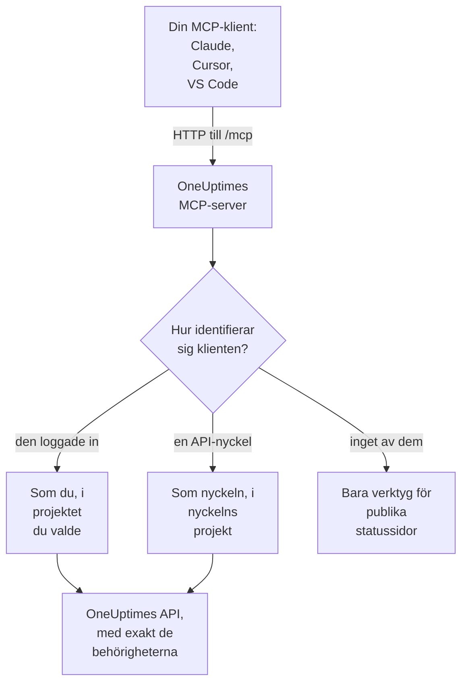

# MCP-server

OneUptimes MCP-server låter en AI-assistent arbeta direkt med ditt OneUptime-projekt. Anslut Claude, Cursor, VS Code med GitHub Copilot eller någon annan klient för Model Context Protocol (MCP), och be den titta på en incident, fråga efter loggar och spår, kvittera ett larm eller skapa en monitor: den anropar OneUptimes verktyg med dina behörigheter, eller med en API-nyckels.

:::cards
- [Ansluta en klient](#ansluta-en-klient): Ge klienten serverns adress och logga in.
- [Logga in med OneUptime](#logga-in-med-oneuptime): Vad en ansluten klient får göra, och hur du kopplar bort den.
- [Hämta din API-nyckel](#hämta-din-api-nyckel): För en agent som körs utan tillsyn.
- [Felsökning](#felsökning): Problem med inloggning, behörigheter och anslutning.
:::

## Så fungerar det

MCP-servern är en del av varje OneUptime-instans, på `/mcp` på samma adress som instrumentpanelen, och använder transporten streamable HTTP. Det finns inget att installera.

- **OneUptime Cloud**: `https://oneuptime.com/mcp`
- **Självhostat**: `https://your-oneuptime-domain.com/mcp`



Servern är tillståndslös: den utfärdar inga sessions-id:n och varje begäran står för sig själv, så den fungerar bakom lastbalanserare och med flera repliker.

## Vad verktygen täcker

- **Monitorer**: skapa och konfigurera monitorer, kontrollera deras status och gå igenom deras historik.
- **Incidenthantering**: skapa, kvittera och lösa incidenter, lägga till interna eller publika anteckningar och följa dem till lösning.
- **Larm**: kvittera och lösa larm, lägga till anteckningar och hantera larmens tillstånd och allvarlighetsgrader.
- **Team och jour**: hantera team och jourpolicyer.
- **Statussidor**: hantera statussidor och publicera meddelanden.
- **Planerat underhåll**: skapa och hantera underhållshändelser.
- **Telemetri**: fråga efter loggar, mätvärden, spår, undantag, monitorloggar, säkerhetshändelser med mera, endast läsning.

Det finns verktyg för att skapa, hämta, lista, uppdatera, ta bort och räkna för 30 sorters poster, verktyg för att lista och räkna för 9 sorters telemetri, och verktyg gjorda för incidenthantering. Skrivskyddade verktyg har `readOnlyHint`, varje verktyg som ändrar något har `destructiveHint`, och bara verktygen för publika statussidor har `openWorldHint`, så att en klient själv kan köra skrivskyddade anrop och fråga dig före varje ändring. Ett misslyckat verktygsanrop kommer tillbaka som ett verktygsresultat (`isError: true`) med en `statusCode`, detaljerna och ett förslag, inte som ett fel i MCP-protokollet, så att agenten kan läsa felet och rätta sig själv.

## Innan du börjar

- En OneUptime-instans: OneUptime Cloud eller självhostad.
- En MCP-klient, till exempel Claude Code, Claude, VS Code med GitHub Copilot eller Cursor.
- Ett OneUptime-konto att logga in med, eller en OneUptime-API-nyckel för en agent som körs utan tillsyn. Verktygen för publika statussidor behöver inget av dem.
- På OneUptime Cloud Growth-planen eller högre: att ansluta en MCP-klient finns i samma planer som API-nycklar.

## Ansluta en klient

Ge klienten serverns adress och inget annat. Första gången den behöver dina data öppnar den OneUptime i din webbläsare så att du kan logga in (se [Logga in med OneUptime](#logga-in-med-oneuptime)). På en självhostad instans använder du `https://your-oneuptime-domain.com/mcp` i stället för `https://oneuptime.com/mcp`.

:::tabs
@tab Claude Code
```bash
claude mcp add --transport http oneuptime https://oneuptime.com/mcp
```
Kör sedan `/mcp` i Claude Code och välj **oneuptime** för att logga in.
@tab Claude
Öppna **Customize → Connectors** i Claude, välj **Add custom connector** och ange `https://oneuptime.com/mcp`. Claude ber dig logga in på OneUptime första gången den behöver dina data.
@tab VS Code
Lägg till det här i din MCP-konfiguration (se [VS Code med GitHub Copilot](#vs-code-med-github-copilot) för var den finns). VS Code öppnar OneUptime så att du kan logga in när du startar servern:
```json
{
  "servers": {
    "oneuptime": {
      "type": "http",
      "url": "https://oneuptime.com/mcp"
    }
  }
}
```
@tab Cursor
```json
{
  "mcpServers": {
    "oneuptime": {
      "url": "https://oneuptime.com/mcp"
    }
  }
}
```
:::

Alla andra klienter som stöder MCP-auktorisering fungerar på samma sätt: ge den adressen så upptäcker den allt annat själv. Se [Logga in (OAuth 2.1)](#logga-in-oauth-21) för protokollet.

Instrumentpanelen har också de här stegen, med instansens adress redan ifylld: **Projektinställningar → AI → MCP-server**. Och från vilken resurs som helst (en monitor, en incident, en statussida och så vidare) fäller du ut **Utvecklare** i dess sidomeny och väljer **AI-assistenter**: den sidan föreslår också prompter som nämner resursen och dess ID, så att assistenten hittar den direkt. För en resurs som MCP-servern ännu inte har verktyg för, till exempel ett arbetsflöde, visar sidan hur en assistent som kan köra kommandon i stället kan arbeta med den via REST-API:t.

## Logga in med OneUptime

Det enklaste sättet att ansluta är att ge din MCP-klient serverns adress och inget annat. Första gången klienten behöver dina data öppnar den en OneUptime-sida i din webbläsare:

:::steps
1. Logga in på OneUptime, om du inte redan är inloggad.
2. Välj projektet som klienten ska arbeta i.
3. Välj **Läs- och skrivåtkomst** eller **Endast läsåtkomst**.
4. Klicka på **Godkänn**.
:::

Klienten agerar sedan som du i det projektet. Det finns ingen API-nyckel att skapa, kopiera eller rotera, och inget hemligt sparas i en konfigurationsfil.

Vad en ansluten klient kan göra:

- **Den har dina behörigheter, och aldrig fler.** Det dina team låter dig göra i projektet är det klienten kan göra. Om din roll ändras eller du lämnar projektet gäller det från klientens nästa begäran. Att lämna projektet kopplar också bort klienten: dess auktorisering tas bort, och du ansluter den igen om du går med i projektet på nytt.
- **Endast läsning betyder endast läsning.** En klient som är auktoriserad för endast läsning kan använda verktygen `get_`, `list_` och `count_`. Verktyg som skapar, uppdaterar, tar bort, kvitterar eller löser avvisas, av MCP-servern och av OneUptimes API bakom den. Du kan aldrig ge en klient mer åtkomst än den bad om.
- **Den gäller ett projekt.** För att använda ett andra projekt ansluter du klienten igen och väljer det projektet.
- **Den fungerar bara via MCP-servern.** Klientens åtkomsttoken godtas av MCP-slutpunkten och ingen annanstans. Den kan inte användas för att anropa OneUptimes REST-API direkt.
- **Instansadministratörer får ingen särbehandling.** En klient som en masteradmin har anslutit har det som personens team ger i projektet, inte åtkomst till hela instansen.

### Hantera anslutna klienter

Varje klient som anslutits genom inloggning listas på **Projektinställningar → AI → MCP-server**, under **Anslutna MCP-klienter**, med vem som anslöt den, vad den får göra och när den senast användes. Du ser de klienter du har anslutit; projektets ägare och administratörer ser allas.

Klicka på **Disconnect** för att logga ut en klient. Den slutar fungera direkt.

En klient förblir ansluten så länge den används. En klient som inte har använts på 30 dagar måste logga in igen.

### Styra vem som kan ansluta klienter

Som standard kan alla projektmedlemmar ansluta en MCP-klient. För att hindra medlemmarna i ett team öppnar du teamets sida **Behörigheter**, öppnar **Fler inställningar** längst ned och lägger till behörigheten **Authorize MCP Client** under **Blockera behörigheter**. Klienter som de medlemmarna redan har anslutit slutar fungera direkt.

Om projektet kräver enkel inloggning loggar du in på projektet med SSO i din webbläsare innan du auktoriserar en klient. Klientens anslutning varar lika länge som den SSO-inloggningen; när den går ut, eller SSO-leverantören du loggade in med stängs av eller tas bort, ansluter du klienten igen.

På OneUptime Cloud finns anslutning av en MCP-klient i samma planer som API-nycklar (Growth och högre).

I Enterprise Edition registreras varje ändring som en ansluten klient gör i granskningsloggen under personen som anslöt den, med klientens namn. Ändringar gjorda med en API-nyckel visar nyckelns namn.

## Hämta din API-nyckel

Använd en API-nyckel för en agent som körs utan tillsyn, till exempel ett schemalagt jobb eller en CI-pipeline, där ingen finns på plats för att logga in.

:::steps
### Skapa nyckeln

Gå till **Projektinställningar → Avancerad → API-nycklar** och klicka på **Skapa API-nyckel**. Ge den ett namn, till exempel "MCP Server".

### Välj vad den får göra

Under **Åtkomst** väljer du **Viewer** för en agent som bara läser, eller **Project Admin** för en som också skapar, uppdaterar och tar bort (se [Behörigheter för API-nycklar](#behörigheter-för-api-nycklar)).

### Kopiera nyckeln

Klicka på **Skapa API-nyckel**: nyckelns sida öppnas. Kopiera nyckeln därifrån.
:::

API-nycklar hör till ett projekt: MCP-servern tar projektet från nyckeln, så att skapandeverktyg aldrig behöver ett `projectId`-argument.

> [!WARNING]
> Ge aldrig en AI-agent en masternyckel. En OneUptime-master-API-nyckel godtas också i den här headern och ger administratörsåtkomst till hela instansen. Använd alltid en projekt-API-nyckel med det minsta agenten behöver: en skrivskyddad nyckel räcker för alla verktygen `get_`, `list_` och `count_`.

## Ansluta med en API-nyckel

Skicka nyckeln i headern `x-api-key`. En begäran som har med sig en API-nyckel ombeds aldrig att logga in. På en självhostad instans använder du din egen domän i stället för `oneuptime.com`.

:::tabs
@tab Claude Code
```bash
claude mcp add --transport http oneuptime https://oneuptime.com/mcp --header "x-api-key: your-api-key-here"
```
@tab Claude Desktop
Lägg till det här i `claude_desktop_config.json`, i `~/Library/Application Support/Claude/` på macOS, `%APPDATA%\Claude\` på Windows eller `~/.config/Claude/` på Linux:
```json
{
  "mcpServers": {
    "oneuptime": {
      "transport": "streamable-http",
      "url": "https://oneuptime.com/mcp",
      "headers": {
        "x-api-key": "your-api-key-here"
      }
    }
  }
}
```
@tab VS Code
Indatavariabeln med `"password": true` frågar efter nyckeln när servern startar, i stället för att spara den i klartext:
```json
{
  "servers": {
    "oneuptime": {
      "type": "http",
      "url": "https://oneuptime.com/mcp",
      "headers": {
        "x-api-key": "${input:oneuptime-api-key}"
      }
    }
  },
  "inputs": [
    {
      "type": "promptString",
      "id": "oneuptime-api-key",
      "description": "OneUptime API Key",
      "password": true
    }
  ]
}
```
@tab Cursor
```json
{
  "mcpServers": {
    "oneuptime": {
      "url": "https://oneuptime.com/mcp",
      "headers": {
        "x-api-key": "your-api-key-here"
      }
    }
  }
}
```
:::

## VS Code med GitHub Copilot

VS Code 1.99 och senare stöder MCP-servrar direkt i GitHub Copilot Chat.

:::steps
### Kontrollera vad du behöver

VS Code 1.99 eller senare, med tillägget GitHub Copilot installerat och inloggat, och GitHub Copilot Chat påslaget.

### Öppna MCP-konfigurationen

Tryck på `Ctrl+Shift+P` (`Cmd+Shift+P` på macOS), skriv "MCP: Open User Configuration" och tryck på Enter. Det öppnar, eller skapar, filen `mcp.json`. För bara en arbetsyta skapar du i stället `.vscode/mcp.json` i den.

### Lägg till OneUptime

Klistra in VS Code-konfigurationen ovan: den utan nyckel för att logga in, eller den med en API-nyckel.

### Starta servern

Tryck på `Ctrl+Shift+P` (`Cmd+Shift+P` på macOS), skriv "MCP: List Servers" och välj **oneuptime** för att starta den. VS Code ber dig första gången att lita på servern, och sedan att logga in eller ange din API-nyckel.

### Fråga Copilot

Öppna GitHub Copilot Chat i agentläge och fråga till exempel "Vilka monitorer har jag i OneUptime?", "Visa de senaste incidenterna" eller "Skapa en ny monitor för https://example.com".
:::

## Autentisering

MCP-servern fungerar på tre sätt.

### Publika verktyg (ingen autentisering krävs)

Utan en API-nyckel eller en inloggning kan en klient använda de publika verktygen:

- **`oneuptime_help`**: hjälp och vägledning om OneUptimes MCP-verktyg
- **`oneuptime_list_resources`**: resurserna och vad du kan göra med var och en
- **`get_public_status_page_overview`**: översikten för en publik statussida
- **`get_public_status_page_incidents`**: incidenterna på en publik statussida
- **`get_public_status_page_scheduled_maintenance`**: dess planerade underhållshändelser
- **`get_public_status_page_announcements`**: dess meddelanden

Verktygen för publika statussidor tar en statussidas ID (ett UUID) eller dess domännamn. För att bara använda dem ansluter du med adressen och utan inloggningsuppgifter:

```json
{
  "mcpServers": {
    "oneuptime": {
      "transport": "streamable-http",
      "url": "https://oneuptime.com/mcp"
    }
  }
}
```

En statussidas ägare kan stänga av MCP-åtkomst för den sidan: på statussidan öppnar du **MCP** i avsnittet **AI** i dess sidomeny och stänger av **Aktivera MCP-server**. Brytaren sparas så snart den slås om. MCP-åtkomst är på som standard. Så länge den är av returnerar de fyra verktygen `get_public_status_page_*` ett fel för den statussidan; statussidans webbplats, dess RSS-flöde och dess publika JSON-API påverkas inte, och de statussideverktyg som kräver inloggning (`get_status_page`, `list_status_pages` och så vidare) fortsätter att fungera för sidans eget projekt.

### Logga in (OAuth 2.1)

Alla andra verktyg måste veta vem som anropar. En klient som inte skickar några inloggningsuppgifter och anropar ett av dem får `401 Unauthorized` med en `WWW-Authenticate`-header som pekar på serverns metadata för skyddad resurs. Det är signalen som en MCP-klient reagerar på för att logga in dig; `initialize`, `tools/list` och de publika verktygen ber aldrig om det.

Servern implementerar [MCP-auktoriseringsspecifikationen](https://modelcontextprotocol.io/specification/latest/basic/authorization):

- **Flöde**: OAuth 2.1 authorization code med PKCE (bara `S256`). Åtkomsttoken skickas som `Authorization: Bearer`.
- **Identifiering**: metadata för skyddad resurs (RFC 9728) och metadata för auktoriseringsserver (RFC 8414). Utfärdaren och resursen är båda `https://<host>/mcp`.
- **Klientidentitet**: ett Client ID Metadata Document (klient-ID:t är en `https`-URL som servern hämtar), eller dynamisk klientregistrering (RFC 7591). Ingen klient behöver registreras av en administratör.
- **Omfattningar**: `mcp:read` för verktygen `get_`, `list_` och `count_`; `mcp:write` lägger till alla verktyg som ändrar något och inkluderar `mcp:read`. En skrivskyddad token som anropar ett skrivverktyg får `403` med `error="insufficient_scope"`.
- **Tokenlivslängd**: en åtkomsttoken gäller en timme. En uppdateringstoken gäller 30 dagar och byts ut varje gång den används; att använda en uppdateringstoken som redan har bytts ut avslutar anslutningen.
- **Resursindikatorer** (RFC 8707): en token utfärdas för `https://<host>/mcp` och godtas ingen annanstans.
- **Återkallelse** (RFC 7009): att återkalla någon av de två token avslutar anslutningen.

### API-nyckel

En agent som körs utan tillsyn skickar en OneUptime-API-nyckel i en av de här headerna:

- `x-api-key`: din OneUptime-API-nyckel
- `Authorization`: en bearer-token med din API-nyckel (t.ex. `Bearer your-api-key-here`)

Schemat `Bearer` skiljer inte mellan versaler och gemener. En begäran som har med sig en API-nyckel ombeds aldrig att logga in.

På OneUptime Cloud fungerar API-nycklar bara medan projektet är på **Growth** eller högre. Under det svarar alla verktyg som behöver nyckeln med `402` och ett meddelande som nämner planen, och agenten får veta att inte försöka igen. Inget tas bort: nyckeln fungerar igen som den är så snart projektet är tillbaka på Growth, utan att något behöver anslutas på nytt. En klient som anslutits genom inloggning agerar som en person och fortsätter att fungera ([API-nycklar och SCIM under sin plan](/docs/api-reference/api-reference#api-nycklar-och-scim-under-sin-plan)).

## Tillgängliga slutpunkter

| Slutpunkt | Metod | Beskrivning |
| --- | --- | --- |
| `/mcp` | POST | JSON-RPC-begäranden för verktygsanrop och andra åtgärder |
| `/mcp` | GET | Utan en SSE-`Accept`-header: en kort JSON-beskrivning av servern. Med en: `405`, eftersom den tillståndslösa servern inte erbjuder någon fristående SSE-ström (klienter som följer specifikationen fortsätter utan den) |
| `/mcp` | DELETE | Gör ingenting: servern är tillståndslös, så det finns ingen session att avsluta |
| `/mcp/health` | GET | Hälsokontroll |
| `/mcp/tools` | GET | Listan över verktyg, som vanlig REST |

MCP-klienter som loggar in använder också OAuth-slutpunkterna nedan. En klient hittar dem själv; de listas för den som skriver en klient eller sätter upp en proxy.

| Slutpunkt | Metod | Beskrivning |
| --- | --- | --- |
| `/mcp/.well-known/oauth-protected-resource` | GET | Metadata för skyddad resurs (RFC 9728). Även på `/.well-known/oauth-protected-resource/mcp` |
| `/.well-known/oauth-authorization-server/mcp` | GET | Metadata för auktoriseringsserver (RFC 8414). Även på `/mcp/.well-known/oauth-authorization-server` |
| `/mcp/oauth/authorize` | GET | Auktoriseringsslutpunkt: dit klienten skickar din webbläsare för att logga in |
| `/mcp/oauth/token` | POST | Tokenslutpunkt: växlar in en auktoriseringskod eller en uppdateringstoken |
| `/mcp/oauth/register` | POST | Dynamisk klientregistrering (RFC 7591) |
| `/mcp/oauth/revoke` | POST | Återkallelse av token (RFC 7009) |

För att kontrollera att servern körs, och lista dess verktyg:

```bash
curl https://oneuptime.com/mcp/health
curl https://oneuptime.com/mcp/tools
```

## Verktyg för incidenthantering

Utöver verktygen för varje sorts post har servern verktyg gjorda för att hantera incidenter och larm:

- **`acknowledge_incident`** / **`resolve_incident`**: flytta en incident till projektets tillstånd Acknowledged eller Resolved, som instrumentpanelens knapp gör
- **`acknowledge_alert`** / **`resolve_alert`**: samma sak för larm
- **`add_incident_note`**: lägg till en anteckning på en incident med `visibility: "internal"` (bara teamet, standard) eller `visibility: "public"` (publicerad på statussidan). Markdown stöds
- **`add_alert_note`**: lägg till en intern anteckning på ett larm

En typisk slinga: `list_incidents` → `acknowledge_incident` → undersök med `list_logs` → `add_incident_note` (publik) → `resolve_incident`.

Verktyget **`oneuptime_whoami`** returnerar projektet som dina inloggningsuppgifter hör till (dess ID och namn). För en klient som loggade in säger det också vem den är inloggad som och om den får göra ändringar. Det är ett bra första anrop för att en agent ska orientera sig, och eftersom skapandeverktyg tar `projectId` från inloggningsuppgifterna behöver agenten aldrig skicka ett projekt-ID.

## Fråga efter telemetri

Loggar, mätvärden, spår (spans), undantag, monitorloggar och de andra sorterna av telemetri finns som skrivskyddade verktyg `list_` och `count_` (`list_logs`, `list_metrics`, `list_spans`, `list_exception_instances`, `list_monitor_logs` och deras `count_`-tvillingar). Telemetri kommer in via OpenTelemetry, så det finns inga skapandeverktyg.

Fråga alltid efter telemetri med ett tidsintervall. Ett frågefält tar ett värde, eller ett operatorobjekt:

```json
{
  "query": {
    "time": { "_type": "GreaterThan", "value": "2026-07-04T00:00:00.000Z" }
  },
  "sort": { "time": "DESC" },
  "limit": 50
}
```

Operatorerna är `EqualTo`, `NotEqual`, `IsNull`, `NotNull`, `EqualToOrNull`, `GreaterThan`, `LessThan`, `GreaterThanOrEqual`, `LessThanOrEqual`, `InBetween`, `Search` och `Includes`. Sorteringsvärden är `"ASC"` eller `"DESC"`.

## Fältval och sidindelning

Verktygen `get_` och `list_` tar en valfri `select`-array med fältnamn. Som standard returneras alla läsbara fält utom de tunga (JSON, mycket lång text och HTML-kolumner), som måste begäras i `select`.

Listverktyg bläddrar med `limit` (10 som standard, högst 100) och `skip`, och varje listsvar säger exakt vad det returnerade:

```json
{
  "returnedCount": 10,
  "totalCount": 42,
  "skip": 0,
  "limit": 10,
  "hasMore": true,
  "data": ["..."]
}
```

## Användningsexempel

### Vardagliga frågor

```text
"What's the current status of all my monitors?"
"Show me incidents from the last 24 hours"
"List the teams in this project"
"Show me our on-call policies"
```

### Monitorer och incidenter

```text
"Create a new website monitor for https://example.com that checks every 5 minutes"
"Set up an API monitor for https://api.example.com/health with a 30-second timeout"
"Disable the monitor for staging.example.com while we're doing maintenance"
"Create a high-priority incident for the database outage affecting user authentication"
"Add a note to incident #123 saying 'Database connection restored, monitoring for stability'"
"Mark incident #456 as resolved"
```

### Statussidor

```text
"Update our status page to show 'Investigating Payment Issues' for the payment service"
"Create a status page announcement about scheduled maintenance this weekend"
```

### Frågor mot publika statussidor (ingen API-nyckel krävs)

De här fungerar utan inloggningsuppgifter, med enbart verktygen för publika statussidor:

```text
"What's the current status of status.example.com?"
"Show me recent incidents from the OneUptime status page"
"Are there any scheduled maintenance events on status.acme.com?"
"Get the latest announcements from my public status page with ID abc123-..."
```

### Flera steg på en gång

```text
"Create a scheduled maintenance window for Saturday 2-4 AM, disable all monitors for api.example.com during that time, and update the status page"
"Show me all monitors that have been down in the last hour, create incidents for any that don't already have one"
```

## Behörigheter för API-nycklar

| Vad agenten gör | Välj under **Åtkomst** |
| --- | --- |
| Läser bara | **Viewer**, eller lägg till läsbehörigheter på nyckelns sida |
| Skapar, uppdaterar och tar också bort | **Project Admin**, eller lägg till rollen Project Admin på nyckelns sida |

Ge varje nyckel det minsta den behöver, rotera nycklar regelbundet, ha en separat nyckel för varje miljö och håll koll på vad varje nyckel gör i OneUptime.

## Konfiguration vid självhosting

Inloggning fungerar direkt på en självhostad instans. Två inställningar ändrar det:

| Miljövariabel | Helm-värde | Vad den gör |
| --- | --- | --- |
| `DISABLE_MCP_OAUTH` | `mcpOAuth.disabled` | Sätt till `true` för att stänga av inloggning. OAuth-slutpunkterna tillhandahålls inte längre och MCP-servern godtar bara API-nycklar. Inget tas bort; anslutna klienter fungerar igen när den slås på igen. |
| `DISABLE_MCP_OAUTH_CLIENT_ID_METADATA_DOCUMENTS` | `mcpOAuth.disableClientIdMetadataDocuments` | Sätt till `true` på en instans som inte kan nå internet. En klient kan identifiera sig med en URL som OneUptime hämtar; med den här inställningen registrerar klienter sig i stället direkt hos din instans, vilket inte kräver någon utgående begäran. |

Om du kör en egen omvänd proxy framför OneUptime vidarebefordrar du `/.well-known/oauth-protected-resource` och `/.well-known/oauth-authorization-server` (och allt under dem) till OneUptime tillsammans med `/mcp`. Den medföljande ingressen gör det redan.

Servern bygger varje OAuth-URL utifrån inställningarna `HOST` och `HTTP_PROTOCOL`, så de måste stämma med adressen som folk använder för att nå din instans.

## Felsökning

### Problem med inloggning

- **Klienten ber mig aldrig att logga in**: klienten kanske inte stöder MCP-auktorisering, eller så är den konfigurerad med en API-nyckelheader, som har företräde. Ta bort headern för att logga in i stället.
- **Mitt projekt är gråat på auktoriseringssidan**: sidan säger varför bredvid projektnamnet: projektets plan omfattar inte anslutning av MCP-klienter, projektet kräver SSO och den här webbläsaren har inte loggat in på det med SSO, eller ditt team är blockerat från att ansluta klienter.
- **Ett verktyg avvisas som "read-only"**: klienten auktoriserades för endast läsning. Anslut den igen och välj **Läs- och skrivåtkomst**.
- **Klienten slutade fungera**: den kopplades bort, användes inte på 30 dagar, du togs bort från projektet, eller projektets SSO-inloggning gick ut eller dess leverantör stängdes av. Anslut den igen.
- **Självhostat - klienten säger att den inte hittar auktoriseringsservern**: kontrollera att `HOST` och `HTTP_PROTOCOL` stämmer med din publika adress, och att din proxy vidarebefordrar sökvägarna `/.well-known/oauth-*`.

### Behörighetsfel

API-nyckeln, eller för en klient som loggade in ditt eget konto, behöver rätt behörigheter: läsåtkomst för att lista poster, skrivåtkomst för att skapa och uppdatera dem och borttagningsåtkomst för att ta bort dem.

### Anslutningsproblem

Kontrollera att OneUptime-adressen är rätt och nåbar, att API-nyckeln är giltig och att hälsoslutpunkten svarar (se [Tillgängliga slutpunkter](#tillgängliga-slutpunkter)).

### Ogiltig API-nyckel

- Kontrollera API-nyckeln i dina OneUptime-inställningar, utan extra mellanslag eller tecken
- Kontrollera att nyckeln inte har gått ut
- På OneUptime Cloud betyder en `402` som säger att API-nycklar kräver Growth-planen att projektet ligger under den: uppgradera projektet under **Projektinställningar → Fakturering och fakturor → Fakturering**, så fungerar samma nyckel igen

### Sessionsfel

MCP-servern är tillståndslös: den varken utfärdar eller spårar sessions-id:n, så varje begäran fungerar mot vilken replik som helst. En klient som skickar en `mcp-session-id`-header från en äldre serverversion kan utelämna den; den ignoreras. Uppdatera en äldre klientkonfiguration som förväntar sig att servern returnerar ett sessions-id.

## Tillgängliga resurser

| Område | Poster med verktyg för att skapa, hämta, lista, uppdatera, ta bort och räkna |
| --- | --- |
| Övervakning | Monitor, Monitor Status, Monitor Status Event |
| Incidenter | Incident, Incident State, Incident Severity, Incident State Timeline, Incident Public Note, Incident Internal Note, Incident Alert, Postmortem Status |
| Larm | Alert, Alert State, Alert Severity, Alert State Timeline, Alert Internal Note |
| Statussidor | Status Page, Status Page Announcement |
| Planerat underhåll | Scheduled Maintenance Event, Scheduled Maintenance State, Scheduled Maintenance State Timeline |
| Team och jour | Team, On-Call Policy |
| Etiketter | Label |
| Säkerhet | Security Case, Security Case Note, Security Case Priority, Security Case Status, Security Detection, Security Playbook |

| Område | Telemetri med bara verktyg för att lista och räkna |
| --- | --- |
| Observerbarhet | Log, Metric, Span, Exception Instance, Monitor Log |
| Säkerhet | Security Event, Threat Intel Indicator |
| Ändringar och kostnader | Change Event, Kubernetes Cost Allocation |

Verktygen namnges i snake case: `create_incident`, `get_incident`, `list_incidents`, `update_incident`, `delete_incident` och `count_incidents`, eller `list_logs` och `count_spans` för telemetri.

## Nästa steg

:::cards
- [Fråga AI](/docs/ai/ask-ai): Fråga i stället om ditt projekt inne i OneUptime.
- [OneUptimes API-referens](/docs/api-reference/api-reference): REST-API:t bakom varje verktyg.
- [Behörigheter](/docs/permissions/index): Vad en roll, ett team eller en API-nyckel får göra.
:::
