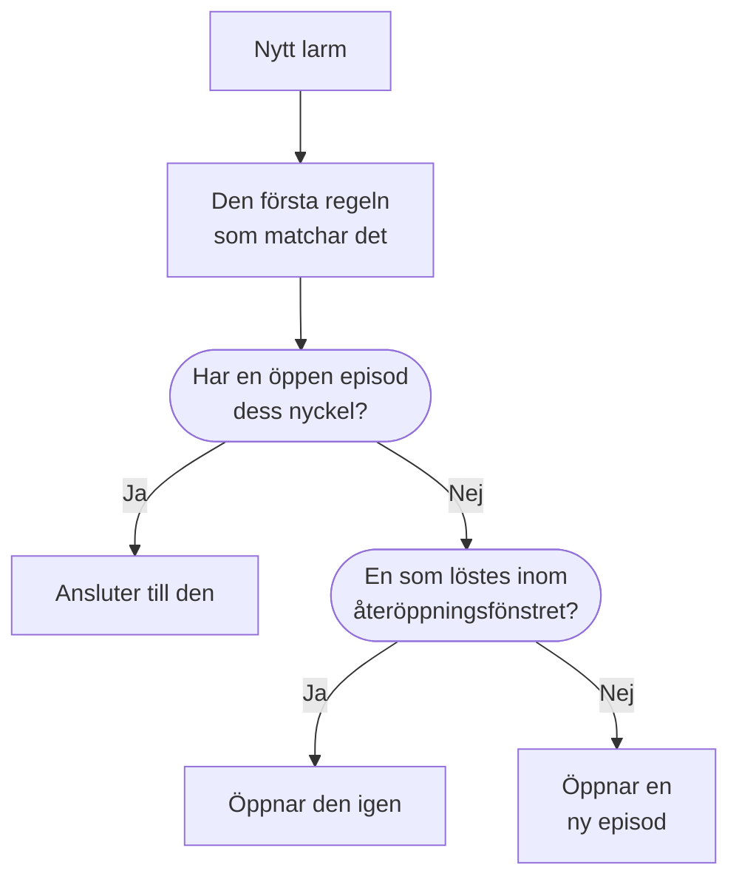

# Larmepisoder och grupperingsregler

När en databas går ner kan tjugo monitorer utlösa tjugo larm inom några minuter. En episod samlar dem i en enda post som ditt team bekräftar och löser tillsammans, och en grupperingsregel avgör vilka larm som hör hemma i den. Den här sidan visar hur gruppering fungerar, hur du ställer in en regel och hur en episod beter sig när den väl är öppen.

:::cards
- [Hur gruppering fungerar](#hur-gruppering-fungerar): Regler, grupperingsnycklar och tidsfönster.
- [Skapa en grupperingsregel](#skapa-en-grupperingsregel): Från en mall med ett klick, eller din egen.
- [Hur en episod beter sig](#hur-en-episod-beter-sig): Dess allvarlighetsgrad, dess tillstånd och när den löses.
- [Vem en episod larmar](#vem-en-episod-larmar): Regelns jourpolicyer och larmens egna.
:::

## Hur gruppering fungerar

Grupperingen körs en gång för varje nytt larm, direkt efter att dess jourpolicyer har körts. Larmet kontrolleras mot dina aktiverade grupperingsregler, uppifrån och ned i listan, och den första regeln som matchar det avgör dess episod. Ett larm som ingen regel matchar förblir ensamt.



- **Regelns villkor** avgör vilka larm den gäller för. En regel utan villkor gäller för varje nytt larm.
- **Grupperingsnyckeln** avgör vilka larm som delar en episod: de med samma monitor, samma allvarlighetsgrad, samma titel, eller den kombination som regeln grupperar efter. En regel som inte grupperar efter något lägger varje larm som den matchar i en enda episod.
- **Tidsfönstret** avgör hur länge en episod fortsätter att ta emot larm. När det är påslaget ansluter ett larm bara om det kommer inom fönstret efter episodens senaste larm. När det är avslaget fortsätter matchande larm att ansluta tills episoden är löst.

Gruppering sker när ett larm skapas. En regel som du lägger till i dag grupperar larmen som skapas efter den; den grupperar inte om de som redan finns.

> [!NOTE]
> Ett larm som skapas redan bekräftat kan ansluta till en öppen episod men öppnar aldrig en, och ett larm som skapas löst grupperas inte alls. Se [Skapat redan bekräftat eller löst](/docs/alerts/index#skapat-redan-bekräftat-eller-löst).

## Skapa en grupperingsregel

Gå till **Larm → Regler → Grupperingsregler**. Avsnittet **Regler** i sidomenyn börjar hopfällt, så fäll ut det först.

### Börja från en mall

Ett projekt utan grupperingsregler ser fyra färdiga regler i stället för en tom lista; när du har regler öppnar **Skapa från mall** på kortet dem. **Lägg till regel** sparar en med ett enda klick, aktiverad, sist i listen och gällande för varje nytt larm. Redigera den efteråt som vilken annan regel som helst.

| Mall                                          | Grupperar                                                                     | Tidsfönster |
| --------------------------------------------- | ----------------------------------------------------------------------------- | ----------- |
| **Gruppera larm från samma övervakare**       | En episod per monitor                                                         | 30 minuter  |
| **Gruppera larm som sker samtidigt**          | En gemensam episod, oavsett monitor                                           | 10 minuter  |
| **Gruppera larm efter allvarlighetsgrad**     | En episod per allvarlighetsgrad                                               | 30 minuter  |
| **Gruppera upprepningar av samma larm**       | En episod per larmtitel, utan hänsyn till siffror och skiftläge               | 1 timme     |

### Skapa en egen

:::steps
#### Svara på hur det ska grupperas

Klicka på **Skapa anpassad regel** under mallarna, eller på **Skapa grupperingsregel för larm** på kortet när du har regler. I steget **Gruppering** ställer **Gruppera larm efter** en enda fråga: **Övervakning**, **Allt tillsammans**, **Allvarlighetsgrad**, **Titel** eller **Anpassad**. **Namn** följer ditt svar tills du skriver ett eget.

#### Ställ in tidsfönstret

**Gruppera bara larm som kommer tätt efter varandra** är påslaget, med ett fönster på 30 minuter. Ändra minuterna, eller slå av det för att hålla en episod öppen tills den är löst.

#### Kombinera fält, för Anpassad

**Anpassad** lägger till ett steg **Gruppera efter** med fem reglage: **Gruppera efter övervakning**, **Gruppera efter larmallvarlighetsgrad**, **Gruppera efter larmtitel**, **Gruppera efter larmetiketter** och **Gruppera efter övervakningsetiketter**. Etiketter grupperar efter sin exakta uppsättning.

#### Avgränsa den

I **Vilka larm** grupperar **Alla larm**, som en ny regel börjar på, varje nytt larm. För att snäva in regeln väljer du **Endast larm som uppfyller villkoren** och lägger till villkor för monitorer, allvarlighetsgrader, etiketter, titlar och beskrivningar. Klicka sedan på **Skapa grupperingsregel för larm**.
:::

Allt annat som en regel kan göra är hopfällt under **Fler fält** i slutet av steget **Gruppering**, i tre grupper. Hopfälld anger dess rubrik vad den innehåller och visar vad varje inställning som regeln använder är satt till, så att redigering av en regel aldrig döljer vad den gör.

| Grupp                     | Inställningar                                                                                              |
| ------------------------- | ---------------------------------------------------------------------------------------------------------- |
| **Jour och ägarskap**     | **Jourpolicyer** som ska köras när regeln öppnar en episod, och **Episodägare**.                           |
| **Episodens livscykel**   | **Återöppna nyligen lösta episoder**, **Vänta innan en episod löses** och **Lös tysta episoder**, vart och ett ett reglage med sina minuter. |
| **Detaljer**              | Regelns **Beskrivning**, **Mall för episodtitel**, **Mall för episodbeskrivning** och **Episodetiketter**. |

Regler kontrolleras uppifrån och ned i listan, och den första matchningen vinner: Dra en regel för att ändra dess plats. Placera specifika regler ovanför breda. Listans kolumn **Gruppering** säger i en mening vad varje regel gör, till exempel "En episod per övervakare".

## Episodtitlar

Utan en mall får en episod namn efter monitorn för dess första larm, eller efter de första 50 tecknen i larmets titel när det inte har någon monitor. Med en **Mall för episodtitel** eller en **Mall för episodbeskrivning** fylls de här variablerna i. Skriv `{{` i något av fälten för att välja en.

| Variabel               | Fylls i med                                                                                     |
| ---------------------- | ----------------------------------------------------------------------------------------------- |
| `{{alertTitle}}`       | Det första larmets titel.                                                                       |
| `{{alertDescription}}` | Det första larmets beskrivning.                                                                 |
| `{{alertSeverity}}`    | Det första larmets allvarlighetsgrad.                                                           |
| `{{monitorName}}`      | Namnet på det första larmets monitor.                                                           |
| `{{alertCount}}`       | Hur många larm episoden innehåller, skrivet på nytt när larm ansluter eller lämnar den.         |

En variabel som det första larmet inte har något värde för, eller en som inte finns i den här listan, utelämnas. När det första larmet är privat står det "Private alert" i `{{alertTitle}}` och `{{alertDescription}}`, eftersom episoden inte är privat.

## Hur en episod beter sig

En episod går igenom dina larmtillstånd, samma lista som larm använder, och har egna ägare, anteckningar, rotorsak och åtgärdsanteckningar.

- **Dess allvarlighetsgrad stiger med dess larm.** Den börjar med det första larmets allvarlighetsgrad och tar allvarlighetsgraden från varje allvarligare larm som ansluter till den, där "allvarligare" betyder högre upp i **Larm → Inställningar → Larmallvar**.
- **Dess tillstånd flyttar dess larm.** Bekräfta eller lös en episod, eller flytta den till ett eget tillstånd, så flyttas varje larm i den också, utom ett larm som redan är i det tillståndet eller efter det.
- **Den löser sig själv** när varje larm i den är löst. **Vänta innan en episod löses** håller den öppen i så många minuter först, ifall ett larm kommer tillbaka.
- **Den kan öppnas igen.** Med **Återöppna nyligen lösta episoder** påslaget öppnar ett matchande larm som kommer inom minuterna efter att episoden löstes den igen, i stället för att öppna en ny. Det är det enda steget tillbaka uppåt i listan över tillstånd, och det öppnar inte episodens larm igen.

> [!WARNING]
> **Lös tysta episoder** löser en episod när inget nytt larm har anslutit till den under det antal minuter som du anger, och löser också varje larm som fortfarande är öppet i den. Använd det för brus som du är säker på inte behöver något svar.

## Vem en episod larmar

Ett larms egna jourpolicyer körs när det skapas, före grupperingen, oavsett om det ansluter till en episod eller inte. En episod lägger till sina egna:

```mermaid title="Ett larm som öppnar en episod larmar två gånger; ett som ansluter larmar en gång"
flowchart TB
    alert["Nytt larm"] --> own["Larmets egna<br/>policyer körs"]
    own --> grouped{"Gruppering"}
    grouped -->|"Öppnar en episod"| ep["Episodens policyer<br/>körs också"]
    grouped -->|"Ansluter till en episod"| none["Inget mer körs"]
```

- **En ny episod** kör regelns **Jourpolicyer**, plus de från varje matchande regel på fliken **Episode Rules** under **Larm → Regler → Jourregler**.
- **Ett larm som ansluter till en öppen episod** kör bara sina egna policyer. Episodens körs inte igen.
- **Att svara på en episods larmanrop** bekräftar episoden, och därmed varje larm i den.

> [!TIP]
> För att larma en gång per problem i stället för en gång per larm lägger du jourpolicyer på dina grupperingsregler och håller dem borta från larmen: från monitorns kriterier, från formuläret för att skapa och från dina jourregler för larm.

Episodens ägare får också veta det: **Larmepisod skapad**, **Tillstånd för larmepisod ändrades** och **Larm tillagt i larmepisod** är påslagna via e-post som standard, under **Användarinställningar → Aviseringsinställningar**, på fliken **Larm**. Regelns **Episodägare** blir ägare till varje episod som den öppnar, och meddelas som alla andra ägare.

## Skapa en episod manuellt

:::steps
### Öppna formuläret

Gå till **Larm → Alla episoder** och klicka på **Skapa episod**. Formuläret **Skapa ny larmepisod** öppnas.

### Beskriv episoden

I **Episoddetaljer** fyller du i **Titel** och, om du vill, en **Larmallvar** och en **Beskrivning**. **Inledande tillstånd** och **Etiketter** väntar under **Fler fält**.

### Välj vem som larmas och vem som äger den

I **Jour och ägare** väljer du en **Jourpolicy** som ska köras när episoden skapas, och dess **Ägare**. Klicka sedan på **Skapa episod**.

Varje team du är medlem i är ett klick bort under **Ägare**, och sammanfattningen nämner ägarreglerna som lägger till fler.

### Lägg till larmen

Öppna episodens sida **Medlemslarm**, klicka på **Lägg till larm** och markera larmen som hör till den, så många du behöver på en gång. Vill du hellre börja från larmen markerar du dem i listan **Larm** och väljer **Lägg till i ny episod** under **Massåtgärder** (se [Episoder](/docs/incidents/episodes)).
:::

En episod som du skapar har ingen grupperingsregel, så listan visar dess **Grupperingsregel** som **Manuell**, och ingen livscykelinställning gäller för den. Den löser ändå sig själv när varje larm i den är löst.

## Vad varje sida av en episod visar

| Avsnitt i sidomenyn    | Sidor                                                                       |
| ---------------------- | --------------------------------------------------------------------------- |
| **Översikt** | **Översikt**, **Tillståndstidslinje** |
| **Utredning** | **Beskrivning**, **Rotorsak**, **Åtgärdsanteckningar** |
| **Team** | **Ägare** |
| **Larm** | **Medlemslarm** |
| **Anteckningar** | **Privata anteckningar** |
| **Utvecklare** | **Terraform**, **API**, **AI-assistenter** |
| **Avancerad** | **Granskningsloggar**, **Ta bort episod** |

**Utvecklare** och **Avancerad** börjar hopfällda. På **Översikt** nämner sidhuvudet episodens **Ägare**, team först, och den första rutan, **Skapad**, säger när episoden skapades — **Automatiskt**, när en grupperingsregel öppnade den. Kortet **Vad som hände** står överst på sidan — episodens beskrivning och dess **Rotorsak** — sedan **Alerts in this episode** och **Episodflöde**, bredvid kortet **Episoddetaljer**: dess nummer, tillstånd, allvarlighetsgrad, antal larm, grupperingsregel och jourpolicyer. Dess sidhuvud har **Bekräfta** och **Lös**, och **Flytta episoden till** i menyn **⋯**.

**Larm → Aktiva episoder** listar de episoder som inte är lösta ännu, och märket bredvid räknar dem.

## Felsökning

:::details Ett nytt larm anslöt inte till den episod jag väntade mig
Kontrollera, i den här ordningen: att regeln är aktiverad; att ingen regel ovanför den matchade larmet först; att larmet matchar regelns villkor; att det har samma grupperingsnyckel som episodens larm, till exempel samma monitor; och, med tidsfönstret påslaget, att det kom inom fönstret efter episodens senaste larm. Ett larm som skapas redan bekräftat öppnar aldrig en episod, och ett som skapas löst grupperas aldrig.
:::

:::details Vi larmades två gånger för ett problem
Larmets egen jourpolicy kördes, och den nya episodens policy kördes också. Behåll policyerna på grupperingsregeln, och ta bort dem från larmets kriterier, formulär eller jourregler.
:::

:::details En episod löstes av sig själv
Varje larm i den var löst, så episoden löstes när dess väntetid var över. När **Lös tysta episoder** är påslaget löser det också en episod som inte har tagit emot något nytt larm på så lång tid.
:::

## Nästa steg

:::cards
- [Larmregler och inställningar](/docs/alerts/settings): De andra reglerna som verkar på nya larm och episoder.
- [Larmstatusar och allvarlighetsgrader](/docs/alerts/states-and-severities): Tillstånden som en episod går igenom.
- [Eskaleringsregler](/docs/on-call/escalation-rules): Hur policyerna som en episod kör larmar människor.
- [Incidentinställningar och automatisering](/docs/incidents/settings): Grupperingsregler för incidenter.
:::
