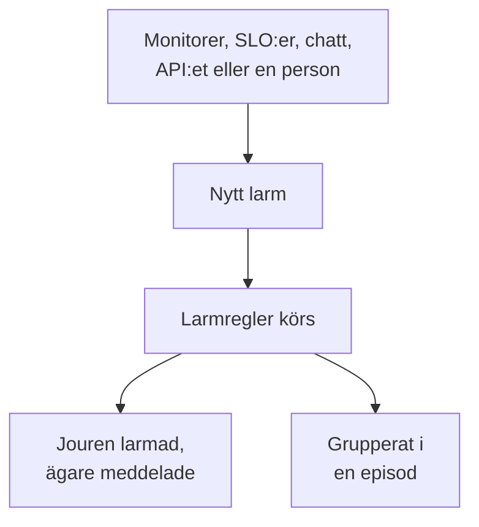

# Larm – Översikt

Ett larm gör ditt team uppmärksamt på ett problem som bör undersökas innan dina användare märker det: en disk som håller på att bli full, ett certifikat som snart går ut, en felfrekvens som smyger uppåt. Larmet kan larma den som har jour och meddela sina ägare, men det visas aldrig på en statussida och meddelar aldrig dina prenumeranter. Den här sidan förklarar var larm kommer ifrån, var de finns i instrumentpanelen och hur ditt team arbetar med dem.

:::cards
- [Larm och incidenter](#larm-och-incidenter): Vad ett problem bör vara, och hur de två hänger ihop.
- [Var larm kommer ifrån](#var-larm-kommer-ifrån): Monitorer, SLO:er, chatt, API:et eller manuellt.
- [Skapa ett larm manuellt](#skapa-ett-larm-manuellt): Två steg i instrumentpanelen.
- [Svara på ett larm](#svara-på-ett-larm): Bekräfta det, lös det eller deklarera en incident.
:::

## Så fungerar det

De flesta larm utlöses av en monitor vars kriterier matchar. Vissa kommer från en SLO som förbrukar sin felbudget, en säkerhetsregel, ett larmanrop från Slack eller Microsoft Teams, eller en person. Oavsett hur det kommer in är ett larm alltid samma post, och samma regler körs på det.

- **Regler formar det.** Sekretess-, ägar-, etikett- och jourregler körs i samma ögonblick som ett larm skapas, och runbook-regler startar de procedurer som matchar. Se [Larmregler och inställningar](/docs/alerts/settings).
- **Jourpolicyer larmar människor.** Policyerna som larmet anger, plus de som dess jourregler lägger till, larmar sina personer tills någon bekräftar larmet.
- **Episoder samlar bruset.** En grupperingsregel samlar relaterade larm i en episod, så att tjugo larm från ett avbrott blir en enda uppgift. Se [Larmepisoder och grupperingsregler](/docs/alerts/episodes).

## Larm och incidenter

Båda registrerar ett problem, och båda kan larma den som har jour. Skillnaden är vem problemet drabbar.

|                              | Larm                                                   | Incident                                          |
| ---------------------------- | ------------------------------------------------------ | ------------------------------------------------- |
| **Vad det är**               | Ett problem som ditt team bör undersöka innan användarna drabbas | Ett problem som drabbar dina användare, till exempel ett avbrott |
| **På statussidor**           | Aldrig                                                 | Kan visas och meddelar prenumeranter              |
| **Anteckningar**             | Privata anteckningar, bara för ditt team               | Offentliga anteckningar för kunder och privata anteckningar |
| **Starttillstånd**           | **Identified**, **Bekräftad**, **Löst**                | **Identified**, **Bekräftad**, **Löst**           |
| **Startallvarlighetsgrader** | **High**, **Low**                                      | Critical Incident, Major Incident, Minor Incident |
| **Nummer i ett nytt projekt** | `ALT-42` och `AE-42` för episoder                     | `INC-42` och `IE-42` för episoder                 |

Utlös ett larm när ditt team bör titta innan någon utanför märker något, och deklarera en incident när användarna drabbas. Visar det sig att ett larm är en del av ett avbrott kan du deklarera en incident från det eller länka det till incidenten som förklarar det: se [Länkade larm](/docs/incidents/linked-alerts).

## Var larm kommer ifrån

- **En monitors kriterier.** Under **Åtgärder** för ett kriterium slår du på **När filter matchar, skapa en varning.** och fyller i larmet det skapar: **Larmtitel** och **Allvarlighetsgrad**, sedan, var för sig hopfällda, **Beskrivning**, **Ägarskap och etiketter**, **Jour** och **Fler fält**, som innehåller **Lös larm automatiskt**, **Privat larm** och **Åtgärdsanteckningar**. Ett kriterium håller ett öppet larm åt gången, ett per serie på en monitor som grupperar efter ett fält, och **Lös larm automatiskt** löser det när kriteriet slutar matcha. Se [Skapa en monitor](/docs/monitor/create-monitor) och [Incident- och varningsmallar](/docs/monitor/incident-alert-templating).
- **Manuellt.** Klicka på **Skapa varning** i larmlistan, eller på fliken **Varningar** för en monitor, en värd eller en annan resurs, som väljer den resursen åt dig. Se [Skapa ett larm manuellt](#skapa-ett-larm-manuellt).
- **En SLO:s förbrukningstakt.** En regel för förbrukningstakt kan skapa ett larm när en SLO förbrukar sin felbudget för snabbt. Se [Larm och incidenter för förbrukningstakt](/docs/slo/burn-rate-alerts).
- **Nätverksplatser och säkerhetshändelser.** En nätverksplats som är inställd på att larma när den är ohälsosam öppnar ett larm när dess sammanfattning inte längre är i drift, och dina detekteringsregler för säkerhetshändelser öppnar också larm. Se [Nätverksplatser (hälsosammanfattning och upptid)](/docs/monitor/network-sites) och [Säkerhetshändelser (SIEM)](/docs/telemetry/security-events).
- **Ett larmanrop.** `/oneuptime page` i Slack eller Microsoft Teams öppnar ett larm med ditt meddelande som titel och larmar personerna du nämner. Larmblocken i ett arbetsflöde gör samma sak med titeln och meddelandet du ger dem. Se [Larma någon från Slack](/docs/workspace-connections/slack#larma-någon-från-slack) och [Paging](/docs/workflows/components#paging).
- **API:et, Terraform och arbetsflöden.** Larm är en vanlig resurs: `/api/alert`, Terraform-resursen `oneuptime_alert` och steget **Create One Alert** i ett arbetsflöde.

## Var larm finns i instrumentpanelen

Öppna **Varningar** från menyn **Produkter** i det övre fältet. Larmlistan finns på `/dashboard/{projectId}/alerts`, och dess sidomeny innehåller allt om larm:

| Avsnitt           | Vad du gör där                                                                                                            |
| ----------------- | ------------------------------------------------------------------------------------------------------------------------- |
| **Varningar**     | **Alla varningar** och **Aktiva varningar**, där det röda märket räknar larmen som inte är lösta ännu.                     |
| **Episoder** | **Alla episoder** och **Aktiva episoder**: relaterade larm samlade i ett problem att arbeta med. |
| **AI**            | **Insikter**, **Loggar** och **Inställningar**: vad OneUptime AI har lärt sig av dina larm, allt den har gjort och vad den får göra. |
| **Arbetsyta**     | **Slack** och **Microsoft Teams**, beroende på vad projektet har anslutit, eller **Anslut Slack eller Teams** när det inte har någon av dem. |
| **Regler**        | **Grupperingsregler**, **Jourregler**, **Ägarregler**, **Runbook-regler**, **Sekretessregler**, **Etikettregler**, **Reminder Rules**. |
| **Inställningar** | **Varningsstatus**, **Varningsallvar**, **Anteckningsmallar**, **Anpassade fält**, **Mätningar**, **Medlemskap i episoder**, **Numrering**.         |

**Varningar** och **Episoder** är öppna; **AI**, **Arbetsyta**, **Regler**, **Inställningar** och **Utvecklare** börjar hopfällda, och ett avsnitt öppnar sig självt när du är på en av dess sidor. Konfigurationen av larm finns här, inte i **Projektinställningar**.

Listan visar **Larmnummer**, **Titel**, **Tillstånd**, **Allvarlighetsgrad**, **Berörda resurser** (larmets monitor först), **Skapad**, **Varaktighet**, **Etiketter** och **Ägare**. Markera larm för att agera på flera samtidigt: **Bekräfta**, **Lös**, **Ändra tillstånd**, **Ändra allvarlighetsgrad**, **Tilldela mig**, **Add Owner**, **Remove Owner**, **Add Labels**, **Remove Labels**, **Länka till incident**, **Deklarera incident** eller ta bort dem.

Menyn **⋯** i slutet av varje larms rad gör samma sak för just det larmet: **Bekräfta** och **Lös** så länge larmet kan ta det steget, **Ändra tillstånd**, **Ändra allvarlighetsgrad**, **Tilldela mig** tills du äger det, och **Add Owner** för att lämna över det till någon annan.

## Skapa ett larm manuellt

:::steps
### Öppna formuläret

Gå till **Varningar → Alla varningar** och klicka på **Skapa varning**. Formuläret **Skapa nytt larm** öppnas på sitt första steg, **Larmdetaljer**.

### Beskriv larmet

Fyll i **Titel** och välj en **Varningsallvar**; båda krävs. Lägg till en **Beskrivning** om det hjälper. Under **Fler fält**, hopfällt, kan du välja ett **Inledande tillstånd**, lägga till **Etiketter** eller slå på **Privat larm**. Där väntar även **Ägare**: du blir ändå ägare till varningen du skapar, och varje team du är medlem i är ett klick bort under väljaren. En master admin, som sköter hela installationen, är det enda undantaget: den blir inte ägare till det den skapar.

### Välj vad det påverkar och vem som larmas

Klicka på **Nästa** för att komma till **Resurser och jour**. Välj den **Övervakning** det gäller och eventuella **Andra påverkade resurser**, till exempel värdar, Kubernetes-kluster eller tjänster. Under **Jourpolicy** väljer du de policyer som ska köras när larmet skapas.

### Skapa det

Klicka på **Nästa** för att granska sammanfattningen och sedan på **Skapa varning**. Larmets egen sida öppnas, och reglerna börjar köras. I sammanfattningen nämner raden **Ägare** varje ägarregel som kommer att lägga till någon, och vem: se [Vem som äger den](/docs/incidents/declaring-incidents#vem-som-äger-den).
:::

Lämnar du **Inledande tillstånd** tomt börjar larmet där alla nya larm börjar: i ditt skapandetillstånd, **Identified** i ett nytt projekt. Väljer du ett senare tillstånd registrerar du ett larm som någon redan hanterar, eller som redan är över; se [Skapat redan bekräftat eller löst](#skapat-redan-bekräftat-eller-löst).

## Vad som händer när ett larm skapas

I samma ögonblick som ett larm skapas går OneUptime igenom de här stegen, i den här ordningen:

1. **Det får ett nummer och ett tillstånd.** Larmnumret kommer från en räknare per projekt och visas med ditt prefix (`ALT-42`). Larmet börjar i ditt skapandetillstånd, om inte formuläret, API:et eller ett arbetsflöde valde ett annat.
2. **Sekretessregler körs först**, så att allt efter dem vet om larmet är privat.
3. **Flödet och dina chattverktyg får veta.** En post **Larm skapat** skrivs i **Larm Flöde**, och kanalerna som dina Slack- och Microsoft Teams-regler anger meddelas; en regel kan skapa en kanal för larmet.
4. **Ägare och etiketter läggs till**: de som monitorns kriterier eller begäran anger, sedan de från matchande ägar- och etikettregler.
5. **Jourregler lägger till sina policyer**, sedan startar runbook-regler de runbooks som matchar.
6. **Jourpolicyer körs.** Varje policy på larmet larmar sina personer parallellt; att en misslyckas stoppar inte de andra.
7. **Grupperingsregler lägger det i en episod**, när en av dem matchar. Se [Larmepisoder och grupperingsregler](/docs/alerts/episodes).
8. **Påminnelser schemaläggs**, när en påminnelseregel matchar, och **OneUptime AI** utreder larmet när **Utred nya larm** är påslaget under **Varningar → AI → Inställningar**, och åtgärdar det när **Åtgärda nya larm automatiskt** är påslaget. Se [AI SRE](/docs/ai/ai-sre).

Ett bakgrundsjobb meddelar larmets ägare inom en minut, och arbetsflödesutlösaren **On Create Alert** startar alla arbetsflöden som bygger på den.

### Skapat redan bekräftat eller löst

Ett larm som börjar i ett senare tillstånd registrerar ett problem som någon redan tar hand om, så det behandlas inte som en ny nödsituation:

- **I eller efter ditt bekräftade tillstånd** körs ingen jourpolicy. Larmet behåller sina policyer, och dess flöde säger på en rad varför ingen larmades. Det kan gå med i en öppen episod, men öppnar aldrig en, eftersom det skulle larma via episodens policyer.
- **I eller efter ditt lösta tillstånd** är larmet över: Det grupperas inte i någon episod, ingen runbook eller automatisk åtgärd verkar på det, OneUptime AI utreder det inte, och ingen Slack- eller Microsoft Teams-kanal skapas för det.

Dess regler, ägare, flöde och första tillstånd sker ändå i båda fallen. Incidenter följer samma regel: se [Deklarerad redan bekräftad eller löst](/docs/incidents/declaring-incidents#deklarerad-redan-bekräftad-eller-löst).

## Svara på ett larm

Öppna larmet. Dess sidhuvud visar tillståndet, allvarlighetsgraden, hur länge det har pågått, ägarna och vilken monitor och episod det hör till, med knapparna som nästa steg behöver:

- **Bekräfta** säger att någon tar hand om det. Det hindrar larmets jourpolicyer från att larma nästa nivå.
- **Lös** stänger det. Larmet lämnar **Aktiva varningar**, och dess påminnelser upphör.
- **Ändra tillstånd till**, i menyn **⋯** bredvid, flyttar det till ett eget tillstånd, till exempel "Under utredning".
- **Deklarera incident** öppnar en ny incident, förifylld från larmet, när det visar sig att problemet drabbar användarna. Se [Länkade larm](/docs/incidents/linked-alerts).

Ett byte till ett annat tillstånd ber dig bekräfta, med en valfri privat anteckning hopfälld under **Lägg till en privat anteckning**. Vad varje tillstånd gör står på [Larmstatusar och allvarlighetsgrader](/docs/alerts/states-and-severities).

Medan du arbetar med det skriver du ner det du lär dig som **Privata anteckningar**, fyller i sidorna **Rotorsak** och **Åtgärd** och lägger till **Ägare**. Menyn **Åtgärder** i **Larm Flöde** kör också en runbook med **Execute Runbook**, eller larmar fler personer med **Kör jourpolicy**.

## Vad varje sida av ett larm visar

| Avsnitt i sidomenyn  | Sidor                                                                                                       |
| -------------------- | ----------------------------------------------------------------------------------------------------------- |
| **Översikt** | **Översikt** och **Tillståndstidslinje** |
| **Utredning** | **Beskrivning**, **Rotorsak**, **Åtgärd**, **Runbooks**, **Länkade incidenter** |
| **Team** | **Jourexekveringar** och **Ägare**: vem som larmades för larmet, och vem som äger det |
| **Aviseringar**           | **Aviseringsloggar** och **AI-loggar**: varje meddelande som skickats om larmet, och allt AI har gjort för det |
| **Anteckningar** | **Privata anteckningar**                                                                                    |
| **Utvecklare**       | **Terraform**, **API** och **AI-assistenter**: larmet hanterat från kod                                     |
| **Avancerad** | **Anpassade fält**, **Inställningar**, **Granskningsloggar**, **Ta bort varning** |

**Översikt**, **Utredning**, **Team** och **Anteckningar** är öppna; de andra avsnitten är hopfällda tills du klickar på dem.

- **Översikt** — rubriken nämner larmets **Ägare**, team först, bredvid dess monitor och episod. Rutan **Skapad** visar när och av vad larmet skapades, två andra hur lång tid det tog att bekräfta och lösa det; hur länge det har pågått står först i rubriken. Kortet **Vad som hände** står överst på sidan — larmets beskrivning och dess **Rotorsak** — sedan kortet **AI Investigation** med **Ask OneUptime AI** längst ner, och **Larm Flöde** registrerar allt som hände med larmet. Bredvid finns kortet **Berörda resurser**, kortet **Larmdetaljer** och larmets mätningar.
- **Tillståndstidslinje** — varje tillstånd larmet har varit i, när och hur länge. Se [Tillståndstidslinjen](/docs/alerts/states-and-severities#tillståndstidslinjen).
- **Länkade incidenter** — incidenterna som larmet är en del av, med **Länka incident** och **Deklarera incident**.
- **Inställningar** — **Vem kan se det här larmet** med reglaget **Privat larm**, och **Påminnelser** med **Skicka påminnelser**. Varje reglage sparar i samma ögonblick som du slår om det.

## Privata larm

Ett privat larm syns bara för dess ägare, det vill säga ägaranvändarna och medlemmarna i dess ägarteam, och för projektets administratörer och ägare. Ingen annan i projektet kan öppna det.

Gör ett larm privat med **Privat larm** under **Fler fält** i formuläret för att skapa eller i en monitors kriterier, med **Varningar → Regler → Sekretessregler**, eller senare på dess sida **Inställningar**, som frågar **Göra det här larmet privat?** innan larmet döljs. Är du ingen av de personerna förlorar du också själv åtkomsten.

En episod som ett privat larm öppnar är inte privat, så den visar aldrig larmets titel eller beskrivning: Där dess titel eller beskrivning skulle innehålla dem står det "Private alert".

## Vem som får veta om ett larm

- **Jouren.** Larmets jourpolicyer larmar sina personer, var och en på det sätt de har ställt in under **Användarinställningar → Jourregler** på fliken **Varningar**. Den som svarar på larmanropet bekräftar larmet, och larmningen upphör.
- **Dess ägare.** Via e-post, om de inte har valt andra kanaler under **Användarinställningar → Aviseringsinställningar** på fliken **Varningar**: **Larm skapat**, **Larmtillstånd ändrades** och **Alert reminder** är påslagna som standard, och **Larmanteckning publicerad** och **Tillagd som ägare av larm** är avslagna tills någon slår på dem. Ett larm utan ägare meddelar i stället projektets ägare.
- **Dina chattverktyg.** **Varningar → Arbetsyta** innehåller Slack- och Microsoft Teams-reglerna som publicerar larm och episoder i kanaler. Se [Slack](/docs/workspace-connections/slack) och [Microsoft Teams](/docs/workspace-connections/microsoft-teams).

## Felsökning

:::details Ingen larmades för ett nytt larm
Öppna larmets sida **Jourexekveringar**. Är den tom hade larmet ingen jourpolicy: Ingen valdes i formuläret eller i monitorns kriterier, och ingen jourregel matchade. Skapades larmet redan bekräftat eller löst säger dess flöde att ingen larmades, och varför.
:::

:::details Monitorn fortsätter att misslyckas, men inget nytt larm dyker upp
Ett kriterium håller ett öppet larm åt gången. Tills det larmet är löst lägger monitorn inte till något nytt för samma kriterium. Lös det, eller slå på **Lös larm automatiskt** så att monitorn löser det när kriteriet slutar matcha.
:::

:::details En kollega kan öppna ett larm som jag inte hittar
Larmet är troligen privat. Be en projektadministratör att lägga till dig som ägare eller slå av **Privat larm** på larmets sida **Inställningar**.
:::

## Nästa steg

:::cards
- [Larmstatusar och allvarlighetsgrader](/docs/alerts/states-and-severities): Vad bekräftelse och lösning gör, och hur du lägger till egna tillstånd.
- [Larmepisoder och grupperingsregler](/docs/alerts/episodes): Gör en flod av larm till en enda uppgift.
- [Larmregler och inställningar](/docs/alerts/settings): Larma, tilldela ägare, sätt etiketter och påminn automatiskt.
- [Länkade larm](/docs/incidents/linked-alerts): Länka larm till incidenten som förklarar dem.
:::
