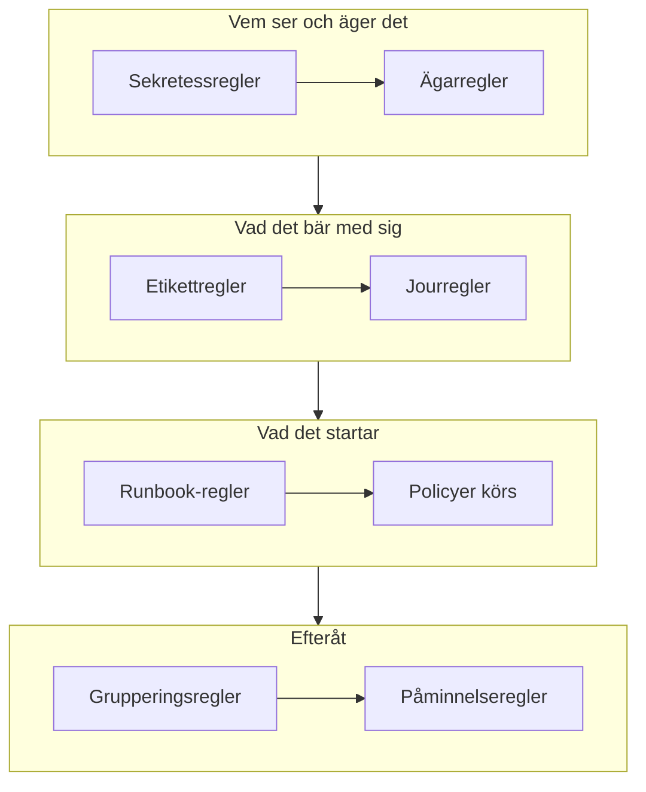

# Larmregler och inställningar

Konfigurationen av larm finns i **Larm**, inte i **Projektinställningar**: reglerna som verkar på varje nytt larm, och inställningarna som formar varje larm i projektet. Den här sidan är referensen för var och en av dem, och för det som körs av sig självt när ett larm skapas.

:::cards
- [Reglerna som ett nytt larm passerar](#reglerna-som-ett-nytt-larm-passerar): I ordning, och vad var och en gör.
- [Jourregler](#jourregler): Larma rätt personer utan att välja en policy varje gång.
- [Påminnelseregler](#påminnelseregler): Påminn ägare så länge ett larm är öppet.
- [Inställningar](#inställningar): Anteckningsmallar, anpassade fält, mätningar, medlemskap i episoder och numrering.
:::

## Var larminställningarna finns

Öppna **Larm** från menyn **Produkter** i det övre fältet. Avsnitten **Regler** och **Inställningar** i dess sidomeny börjar hopfällda, så fäll ut dem först. Varje sida här gäller hela projektet, på adresser som börjar med `/dashboard/{projectId}/alerts/settings/`.

| Regelsida             | Vad den gör                                                                                    |
| --------------------- | ---------------------------------------------------------------------------------------------- |
| **Grupperingsregler** | Samlar relaterade larm i episoder. Se [Larmepisoder och grupperingsregler](/docs/alerts/episodes). |
| **Jourregler**        | Kör jourpolicyer för matchande larm och episoder.                                              |
| **Ägarregler**        | Lägger till ägare på matchande larm och episoder.                                              |
| **Runbook-regler**    | Startar runbooks för matchande larm.                                                           |
| **Sekretessregler**   | Gör matchande larm och episoder privata.                                                       |
| **Etikettregler**     | Lägger till etiketter på matchande larm och episoder.                                          |
| **Reminder Rules**    | Påminner ägare med ett intervall så länge ett larm är öppet.                                   |

Avsnittet **Inställningar** innehåller **Larmstatus** och **Larmallvar**, som beskrivs på [Larmstatusar och allvarlighetsgrader](/docs/alerts/states-and-severities), och sedan **Anteckningsmallar**, **Anpassade fält**, **Mätningar**, **Medlemskap i episoder** och **Numrering**, som beskrivs nedan.

Två avsnitt till verkar på larm. **Larm → AI → Inställningar** avgör vad OneUptime AI gör på egen hand: **Utred nya larm**, påslaget för nya projekt, och **Åtgärda nya larm automatiskt**, avslaget tills du slår på det. Se [AI SRE](/docs/ai/ai-sre). **Larm → Arbetsyta** innehåller Slack- och Microsoft Teams-reglerna som publicerar larm och episoder i kanaler, och dess flik **Sammanfattning**. Se [Slack](/docs/workspace-connections/slack).

## Reglerna som ett nytt larm passerar

Reglerna skiljer sig åt i hur flera matchningar avgörs:

- **Grupperingsregler** och **Reminder Rules** kontrolleras uppifrån och ned i sin lista, och den första matchningen vinner. Dra en regel för att ändra dess plats; en ny regel hamnar sist.
- **Jourregler**, **Ägarregler**, **Etikettregler**, **Sekretessregler** och **Runbook-regler** verkar alla när de matchar. Jourpolicyer, ägare och etiketter som flera regler lägger till läggs till en gång.

**Jourregler**, **Ägarregler**, **Etikettregler** och **Sekretessregler** har två flikar: **Alert Rules**, för larm, och **Episode Rules**, som verkar på samma sätt på varje ny larmepisod. En ny regel börjar aktiverad; slå av **Aktiverad** i dess redigeringsformulär för att pausa den, och listan visar en grön **Aktiverad** eller en röd **Inaktiverad** för varje regel.

De flesta regler verkar på larm och episoder som skapas efter att du har sparat dem. För att tillämpa en ägar-, etikett- eller sekretessregel på dem som du redan har använder du **Kör nu**: se [Köra regler på befintliga resurser](/docs/configuration/run-rules-now). Påminnelseregler är undantaget: När du sparar en matchas varje öppet larm på nytt.

### Villkor

En regels villkor avgör vilka larm den verkar på, och läses som meningar: "Om **Larmtitel** innehåller `database`", "Och **Övervakningsetiketter** har någon av *Production*". En regel utan villkor matchar varje larm.

| Villkor                                                       | Jämför med                                                                                                     |
| ------------------------------------------------------------- | -------------------------------------------------------------------------------------------------------------- |
| **Monitorer**, **Larm Allvarligheter**, **Larmetiketter**, **Övervakningsetiketter** | **Har någon av**, **Har alla** eller **Har ingen av** de värden som du väljer.                 |
| **Larmtitel**, **Larmbeskrivning**, **Övervakningsnamn**, **Övervakningsbeskrivning** | **Innehåller**, **Innehåller inte**, **Lika med**, **Inte lika med**, **Börjar med**, **Slutar med**, utan hänsyn till skiftläge, eller **Matchar mönster** och **Matchar inte mönster**, för ett reguljärt uttryck eller ett jokertecken `*`. |

Med två eller fler villkor väljer du **Matcha alla**, där vart och ett måste gälla, eller **Matcha något**, där ett räcker. Episodregler matchar i stället en episods allvarlighetsgrad, etiketter, titel och beskrivning.

## Jourregler

**Larm → Regler → Jourregler** gör larmningen automatisk. Varje matchande regel lägger till sina policyer på det nya larmet, och larmet kör dem tillsammans med de policyer som det redan hade, var och en en gång.

:::steps
### Välj larmen

Klicka på **Skapa Alert On-Call Rule**. I **Matcha** matchar **Alla larm**, som en ny regel börjar på, varje nytt larm. För att snäva in regeln väljer du **Endast larm som uppfyller villkoren** och lägger till de villkor som ett larm måste uppfylla.

### Välj policyerna

I **Jourpolicyer** väljer du de **Jourpolicyer** som regeln larmar. Dess **Namn** följer dem, till exempel "Larma Platform on-call", tills du skriver ett eget, och en **Beskrivning** väntar under **Fler fält**. Skapa sedan regeln.
:::

En allvarlighetsgrad larmar ingen på egen hand: En jourregel som matchar **Larm Allvarligheter** är sättet att ställa in "larma databasteamet för varje High-larm". För att se vad som kördes för ett larm öppnar du dess sida **Jourexekveringar**. Varje person nås sedan på det sätt som de har ställt in under **Användarinställningar → Jourregler**, på fliken **Larm**; se [Eskaleringsregler](/docs/on-call/escalation-rules).

En regel larmar så snart ett larm matchar den. För att låta den vänta på arbetstid i stället svarar du **Endast under arbetstid** på **När ska den här regeln larma?** under **Fler fält**. **Arbetstid** börjar som måndag till fredag, 09:00 till 17:00, i din egen tidszon: välj andra dagar, en annan **Starttid** eller **Sluttid** eller en annan **Tidszon**, så säger en mening under valet vad som händer. I listan visar regeln sin arbetstid under namnet. Ett larm som matchar utanför de tiderna får en körning som väntar och inte larmar någon; när arbetstiden börjar larmar policyn sin första eskaleringsregel och eskalerar som vanligt. Bekräftas eller löses larmet först larmas ingen. Ändras larmet medan det väntar så att det nu matchar en regel som larmar direkt, till exempel för att dess allvarlighetsgrad höjs, börjar körningen larma genast, och larmets flöde säger varför. Två regler som larmar samma policy larmar den så snart någon av dem tillåter det: en regel för dina högsta allvarlighetsgrader som larmar direkt, bredvid en regel för resten som väntar på arbetstid, håller nätterna lugna.

## Ägar- och etikettregler

**Ägarregler** lägger till ägaranvändare och ägarteam på nya larm som matchar, och **Etikettregler** lägger till etiketter. Att skapa en tar två steg: **Matcha**, villkoren, och sedan **Ägare** eller **Etiketter**, det som regeln lägger till. Regelns **Namn** följer det du väljer tills du skriver ett eget.

- **En regel kan ärva.** Hopfällda under **Ärv ägare** eller **Ärv etiketter** för sex reglage vidare ägarna eller etiketterna från larmets monitor, värdar, Kubernetes-kluster, Docker-värdar, Podman-värdar och tjänster. Episodregler har inga sådana reglage. En ägarregels **Ärv ägare** slutar med **Skaparens team**: av teamen som står där blir varje team som den som skapar larmet är med i också ägare.
- **En ny regel måste lägga till något**: Välj minst en ägare eller etikett, eller slå på ett reglage. På en ägarregel för incidenter eller larm räcker det också med ett team under **Skaparens team**.
- **Avisera ägare**, under **Fler fält** i en ägarregel, avgör om personerna som läggs till får veta det.

[Etikett- och ägarregler](/docs/configuration/label-and-owner-rules) går igenom formuläret steg för steg, för varje typ av resurs.

## Sekretess- och runbook-regler

**Sekretessregler** gör nya larm som matchar privata innan något annat körs: Bara deras ägare och projektets administratörer och ägare kan se dem. En regel har två steg: **Matcha**, larmen den gör privata, och sedan **Namn**, redan ifyllt som "Gör larm privata". Se [Privata larm](/docs/alerts/index#privata-larm).

**Runbook-regler** startar en runbook när ett nytt larm matchar, om inte larmet skapades löst. Se [Runbook-regler](/docs/runbooks/rules).

## Påminnelseregler

**Larm → Regler → Reminder Rules** påminner ett larms ägare så länge det är öppet. Varje nytt larm får den första regeln som matchar det, uppifrån och ned i listan.

:::steps
### Välj vilka larm som ska påminnas om

Klicka på **Skapa Alert Reminder Rule**. I **Matcha** låter du **Alla larm** vara valt för att påminna om varje larm, eller väljer **Endast larm som uppfyller villkoren** och sedan de **Larm Allvarligheter** och **Etiketter** som den gäller för.

### Ställ in intervallet

I **Påminnelser** ställer du in **Påminnelseintervall (minuter)**, hur ofta ägarna påminns, och **Sluta påminna när**: **Löst**, standardvärdet, eller **Bekräftad**. Dess **Namn** följer båda, till exempel "Påminn var 30 minuter tills löst", tills du skriver ett eget. Skapa sedan regeln.
:::

Ägarna får varje påminnelse som **Alert reminder**, som är påslagen via e-post som standard. Ett larms regel matchas på nytt när dess allvarlighetsgrad eller etiketter ändras. För att stoppa påminnelserna för ett larm slår du av **Skicka påminnelser** på dess sida **Inställningar**; det sparas i samma ögonblick som du slår om det.

## Inställningar

### Anteckningsmallar

**Larm → Inställningar → Anteckningsmallar** innehåller färdig text för privata anteckningar. Kortet **Mallar för privata anteckningar för larm** listar dem; **Skapa Larm Anteckning Mall** frågar efter **Mallnamn**, **Mallbeskrivning** och **Anteckning**. En mall erbjuds när någon skriver en privat anteckning på ett larm eller en episod, och när de bekräftar eller löser ett, och dess text kan redigeras innan den publiceras. Anteckningsmallar för larm är ren text: Till skillnad från anteckningsmallar för incidenter fyller de inte i några variabler.

### Anpassade fält

**Larm → Inställningar → Anpassade fält** lägger till dina egna fält på varje larm, till exempel en kundnivå eller en ärendereferens. Fyll i dem på larmets sida **Anpassade fält**, eller via API:et som `customFields`. Ett fält kan kopiera sitt värde från ett anpassat fält på en monitor i stället för att skrivas in: se [Fält som kopieras från en monitor](/docs/incidents/settings#fält-som-kopieras-från-en-monitor), som fungerar på samma sätt för larm.

### Mätningar

**Larm → Inställningar → Mätningar** mäter hur lång tid saker tar för varje larm. Välj **Tid till bekräftelse** eller **Tid till lösning**, eller två egna tidpunkter, till exempel när **Larmet skapas** och när det går in i ett tillstånd som du väljer. Varje mätning visas på larmets sida och i diagram som `oneuptime.alert.measurement.<key>`. Se [Mätningar](/docs/incidents/settings#mätningar), som fungerar på samma sätt för larm.

**Tid till bekräftelse efter utlarmning** räknas från **Någon larmas för första gången**, när en jourpolicy eller en direkt utlarmning först aviserade någon om larmet, i stället för från när det skapades: ett larm som uppstår på natten och larmas ut på morgonen får inte natten tillräknad. Ett larm som ingen larmades om har inget värde. Se [Tid till bekräftelse efter utlarmning](/docs/incidents/settings#tid-till-bekräftelse-efter-utlarmning).

### Medlemskap i episoder

**Larm → Inställningar → Medlemskap i episoder** avgör om ett larm kan ingå i mer än en episod. Slå på **Ett larm kan bara ingå i en episod**, så läggs ett larm som finns i en episod inte till i någon annan, varken från instrumentpanelen eller via API:t, ett arbetsflöde eller en grupperingsregel, förrän det har tagits ut ur den episoden. Reglaget är avslaget tills du slår på det, och bara Project Owners och Project Admins kan ändra det. Att slå på det tar inte ut något larm ur en episod. Se [En episod per incident](/docs/incidents/episodes#en-episod-per-incident), som fungerar på samma sätt för larm.

### Numrering

**Larm → Inställningar → Numrering** anger texten framför larm- och episodnummer: `ALT-` och `AE-` i ett nytt projekt, eller `#` utan prefix. **Uppdatera** öppnar **Larmnummerprefix** och **Nummerprefix för larmepisod**, med en förhandsvisning medan du skriver. Bara larm och episoder som skapas efteråt får det nya prefixet. Reglerna för ett prefix finns under [Nummerprefix](/docs/incidents/settings#nummerprefix).

Kortet **Nästa nummer** under det anger numret som nästa larm och nästa episod får, för att fortsätta ett annat verktygs nummer: **Uppdatera** öppnar **Nästa larmnummer** och **Nästa nummer för larmepisod**, vart och ett högre än det högsta hittills. Se [Nästa nummer](/docs/incidents/settings#nästa-nummer).

> [!NOTE]
> På OneUptime Cloud kräver anteckningsmallar och anpassade fält planen **Growth** eller högre.

## Arbetsflöden

Varje larmmodell har arbetsflödesutlösare och åtgärder som är uppkallade efter den: **On Create Alert**, **On Update Alert**, **On Create or Update Alert** och **On Delete Alert**, samma sak för **Larm Episod**, **Larm Tillstånd Tidslinje** och de andra, och åtgärder som **Create One Alert** och **Update One Alert**. Definitionerna av anpassade fält för larm är det enda undantaget: De har inga arbetsflödesutlösare. Se [Översikt över arbetsflöden](/docs/workflows/index).

## Vem som kan ändra dem

Regler, anpassade fält och mätningar kräver en Project Owner eller Project Admin, eller en anpassad roll med regelns egen behörighet. **Larmmedlem** arbetar med larm och episoder, deras anteckningar, ägare och tillståndstidslinjer, och anteckningsmallar, och **Larmadministratör** hanterar dessutom larmtillstånd och allvarlighetsgrader. Se [Användare, team och behörigheter](/docs/permissions/index).

## Nästa steg

:::cards
- [Larmepisoder och grupperingsregler](/docs/alerts/episodes): Grupperingsreglerna på djupet.
- [Eskaleringsregler](/docs/on-call/escalation-rules): Vad som händer när en jourregel kör en policy.
- [Etikett- och ägarregler](/docs/configuration/label-and-owner-rules): Regelformuläret steg för steg.
- [AI SRE](/docs/ai/ai-sre): Utred och åtgärda nya larm av sig självt.
:::
