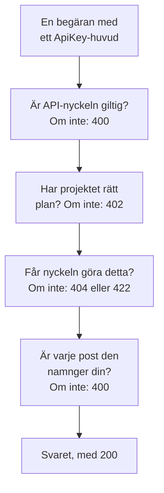

# OneUptime API-referens

Allt du kan göra i OneUptimes instrumentpanel kan du också göra via dess REST-API: automatisera återkommande arbete, koppla OneUptime till dina andra verktyg eller bygga egna integrationer. Den här sidan visar hur du gör din första begäran och vilka regler varje begäran följer. Varje slutpunkt och varje fält finns i den [fullständiga API-referensen](/reference).

:::cards
- [Gör din första begäran](#gör-din-första-begäran): En API-nyckel, ett huvud och ett curl-kommando.
- [Begäranden och svar](#begäranden-och-svar): De sex begäranden som varje resurs har, och vad varje statuskod betyder.
- [Planer och API:t](#planer-och-apit): Vad en plan säljer, och vad som fortfarande fungerar under den.
- [Namnge och skriva poster](#namnge-och-skriva-poster): ID:n, referenser, brytare och fälten som OneUptime fyller i.
- [Tillstånd och episoder](#tillstånd-och-episoder): Tillståndet som en post börjar i och går igenom.
- [Vad en begäran kan nå](#vad-en-begäran-kan-nå): Läsningar, ändringar och raderingar, ett projekt i taget.
:::

## Så besvaras en begäran

API:t är uppbyggt kring REST: vanliga HTTP-metoder och statuskoder, JSON in och JSON ut. Varje begäran har med sig en API-nyckel och går igenom några kontroller. Den första kontrollen som den inte klarar svarar med en statuskod och `{ "message": "..." }`, så meddelandet säger vad som stoppade den.



## Gör din första begäran

Alla API-begäranden autentiseras med en API-nyckel. En nyckel tillhör ett projekt och gör det som dess behörigheter tillåter.

:::steps
### Skapa en API-nyckel

Öppna **Projektinställningar → Avancerad → API-nycklar** och klicka på **Skapa API-nyckel**. Ge den ett **Namn** och välj under **Åtkomst** vad den får göra: **Projektadministratör**, **Projektmedlem**, **Tittare** eller **Välj behörigheter senare** för att lägga till enskilda behörigheter på nyckelns sida. Nyckeln upphör om ett år, om du inte väljer ett annat datum under **Avancerad**.

### Kopiera nyckeln

Nyckelns sida öppnas. Kopiera **API-nyckel** från kortet **Detaljer om API-nyckel** och håll den utanför din kod:

```bash
export ONEUPTIME_API_KEY="your-api-key"
```

### Skicka en begäran

Lista de tio första monitorerna. Nyckeln läser sitt eget projekt, så begäran namnger inget projekt:

```bash
curl -X POST 'https://oneuptime.com/api/monitor/get-list?skip=0&limit=10' \
  -H "ApiKey: $ONEUPTIME_API_KEY" \
  -H 'Content-Type: application/json' \
  -d '{ "select": { "name": true } }'
```

Svaret är `{ "data": [...], "count": ... }`: monitorerna, och hur många det finns totalt. På en egendriven installation använder du din egen OneUptime-adress i stället för `https://oneuptime.com`.
:::

### Exempel för varje resurs

Varje resurs i OneUptimes instrumentpanel har en sektion **Utvecklare** i sidomenyn, hopfälld tills du öppnar den. Dess sida **API** har `curl`-kommandon som är klara att köra för den resursen, riktade mot ditt OneUptime och ifyllda från ditt eget projekt: läs, ändra och radera den från resursens egen sida, eller lista, räkna och skapa från en listsida (till exempel **Monitorer**). Kommandona läser din API-nyckel från miljövariabeln `ONEUPTIME_API_KEY`.

Exemplen är skrivna för resursen. På listan **Incidenter** visar till exempel listbegäran sitt svar med din första incident, filtren hittar incidenter som inte är lösta, av en allvarlighetsgrad, om en monitor eller från de senaste sju dagarna, med dina egna tillstånd, allvarlighetsgrader och monitorer, och begäran om att skapa deklarerar en incident med en av dina allvarlighetsgrader, med en rad om vad varje fält är till för. En incidents egen sida läser den med sitt verkliga svar, flyttar den till en annan av dina allvarlighetsgrader och har de vanliga uppgifterna: bekräfta och lös den (med projektets egna tillstånd), och lägg till interna eller offentliga anteckningar. Varje API-sida slutar med resursens slutpunkter.

## Begäranden och svar

Varje resurs har samma begäranden, under `https://oneuptime.com/api` och resursens sökväg, som `/monitor` eller `/incident`:

| Begäran | Metod och sökväg | Vad kroppen innehåller |
| --- | --- | --- |
| Lista | `POST /api/<resource>/get-list` | `query`, `select` och `sort` |
| Räkna | `POST /api/<resource>/count` | `query` |
| Läs en | `POST /api/<resource>/<id>/get-item` | `select` |
| Skapa | `POST /api/<resource>` | `{ "data": { ... } }` |
| Ändra en | `PUT /api/<resource>/<id>` | `{ "data": { ... } }`, fälten som ska ändras |
| Radera en | `DELETE /api/<resource>/<id>` | Ingenting |

`POST /api/<resource>/<id>/update-item` och `POST /api/<resource>/<id>/delete-item` ändrar och raderar också en post, för klienter som bara skickar `POST`.

### Filtrera, sortera och bläddra

En lista eller en räkning tar en `query`. Ett fält med ett värde matchar det värdet; ett objekt med en `_type` jämför:

| `_type` | Matchar |
| --- | --- |
| `Search` | Text som innehåller `value` |
| `NotEqual` | Allt utom `value` |
| `GreaterThan`, `LessThan` | Senare datum eller större tal, eller tidigare och mindre |
| `InBetween` | Datum eller tal mellan `startValue` och `endValue` |
| `Includes` | Något av värdena i `value` |
| `IsNull`, `NotNull` | Inget värde, eller vilket värde som helst |

Ett fält i en post som resursen namnger filtreras under dess relation: `"user": { "name": { "_type": "Search", "value": "ada" } }` hittar de teammedlemmar vars användare har ett namn som innehåller ”ada”. Att filtrera på ett fält kräver behörighet att läsa det, genom en relation som på själva resursen: ett filter på ett fält du inte får läsa avvisas med en `422` som namnger fältet.

`select` namnger fälten som ska returneras, och `_id` kommer alltid med. `sort` ordnar dem, `ASC` eller `DESC`; utan sortering kommer de nyaste först. En lista returnerar 10 poster om du inte anger `limit`, upp till 10 000, och `skip` hoppar först över så många: fortsätt att öka `skip` med `limit` tills du har `count` av dem. Lägg till `?output-type=csv` i en listbegäran för CSV i stället för JSON.

Till exempel de monitorer vars namn innehåller ”checkout”, skapade sedan början av 2026, de nyaste först:

```bash
curl -X POST 'https://oneuptime.com/api/monitor/get-list' \
  -H "ApiKey: $ONEUPTIME_API_KEY" \
  -H 'Content-Type: application/json' \
  -d '{
    "query": {
      "name": { "_type": "Search", "value": "checkout" },
      "createdAt": { "_type": "GreaterThan", "value": "2026-01-01T00:00:00.000Z" }
    },
    "select": { "name": true, "createdAt": true },
    "sort": { "createdAt": "DESC" },
    "limit": 100
  }'
```

Datum och id:n utöver `_id` kommer inslagna, som `{ "_type": "DateTime", "value": "..." }` och `{ "_type": "ObjectID", "value": "..." }`: läs dem från `value`.

Varje id som en begäran filtrerar på eller skriver - `_id`, ett fält som `monitorId` och varje post som en relation listar, som `"labels": [{ "_id": "..." }]` - är ett UUID, skickat som text eller inslaget så som det kommer tillbaka. Allt annat, som text som inte är ett UUID eller ett objekt i stället för ett id, avvisas med en `400` som namnger fältet och säger om det stod i `query` eller i `data`, och ingenting läses eller skrivs:

```text
Invalid ID for "currentIncidentStateId" in the query: "resolved". An ID is a UUID, such as "550e8400-e29b-41d4-a716-446655440000".
```

### Statuskoder

| Kod | Vad den betyder | Läs mer |
| --- | --- | --- |
| `200` | Den gick igenom. En lista eller en räkning svarar med de poster du får läsa, inga när det inte finns några. | [Läsa en post via dess ID](#läsa-en-post-via-dess-id) |
| `400` | Begäran är felaktig: API-nyckeln är ogiltig, ett värde är inte tillåtet, ett fält kan inte skrivas, en post som den namnger är inte din, eller den ändrar flera projekt på en gång. Meddelandet säger vad som är fel. | [Poster som en begäran namnger](#poster-som-en-begäran-namnger) |
| `402` | Projektets plan omfattar inte det som begäran använder. Meddelandet namnger planen. | [Funktioner som din plan inte omfattar](#funktioner-som-din-plan-inte-omfattar) |
| `404` | Posten finns inte, ligger i ett annat projekt eller är en som du inte får läsa: samma svar för var och en. | [Ändra eller radera en post som du inte får läsa](#ändra-eller-radera-en-post-som-du-inte-får-läsa) |
| `422` | Du får inte göra detta: API-nyckeln har ingen behörighet för den här sortens post, du får läsa posten men inte ändra den, eller så utesluter en behörighets etiketter den. Meddelandet säger varför. | [Ändra eller radera en post som du inte får läsa](#ändra-eller-radera-en-post-som-du-inte-får-läsa) |
| `500` | Något misslyckades på servern. När ägaren till en ny post inte kan skrivas tas posten bort igen, så att skapandet kan försökas igen. | [Poster som en begäran namnger](#poster-som-en-begäran-namnger) |

## Planer och API:t

### Funktioner som din plan inte omfattar

I OneUptime Cloud säljs vissa resurser i en plan: SSO-leverantörer och SCIM-anslutningar i **Scale**; API-nycklar, jourscheman samt aviseringsregler och sammanfattningar för Slack och Microsoft Teams i **Growth**, bland andra. Att skapa en, ändra en eller slå på en kräver den planen. Under den avvisas begäran med `402 Payment Required`, och meddelandet namnger planen.

Vissa inställningar för en resurs säljs i en plan på samma sätt. Till exempel: en statussida som är privat, som döljer en av sina listor, eller som har anpassad HTML, CSS eller JavaScript, e-postrapporter, prenumeranter via SMS, Slack, Microsoft Teams eller webhook, eller en lista över tillåtna IP-adresser; en instrumentpanel som delas offentligt, eller dess lista över tillåtna IP-adresser; ett formulärs lista över tillåtna IP-adresser; ett projekts granskningsloggar. Guiden för var och en, och instrumentpanelen bredvid inställningen, namnger planen som den kräver. En sådan inställning kräver sin plan varje gång den skrivs - när resursen skapas med den som när den ändras senare - så ett skapande som slår på en av dem under planen avvisas också med `402`. En inställning som står kvar på sitt standardvärde, eller återställs till det, fungerar på alla planer: ett skapande som lämnar de här inställningarna orörda går igenom, och det gör också en Terraform-konfiguration som inte anger dem.

Det som ett projekt redan har går fortfarande att hantera oavsett plan, till exempel när en provperiod tar slut eller planen sänks:

- du kan radera de posterna;
- du kan slå av en, på en resurs med ett fält `isEnabled`, genom att skicka `"isEnabled": false` och inget annat;
- du kan lista och läsa dem som ett projekt behöver hitta efter att planen har sänkts - för att slå av dem, eller för att se vad som har stoppats: SSO-leverantörer, SCIM-anslutningar, API-nycklar och deras behörigheter, jourscheman samt aviseringsregler och sammanfattningar för Slack och Microsoft Teams.

De vanliga behörigheterna avgör fortfarande vem som får göra vad, precis som på planen. Att läsa de andra resurser som en plan säljer, som mallar, anpassade fält, monitorgrupper, jourloggar och formulärsvar, kräver fortfarande planen: att läsa dem är att använda funktionen. En API-nyckels behörigheter raderas inte en i taget under **Growth**, eftersom en raderad blockeringsbehörighet skulle ge nyckeln mer åtkomst; radera nyckeln i stället.

### API-nycklar och SCIM under sin plan

I OneUptime Cloud fungerar ett projekts API-nycklar bara medan projektet har **Growth** eller högre, och dess SCIM-anslutningar - projektets egna och dess statussidors - fungerar fullt ut bara medan det har **Scale** eller högre. När projektet hamnar under den planen:

- Varje begäran som görs med en av projektets API-nycklar avvisas med `402 Payment Required`, vad den än ber om: REST-API:t, och allt som anropar det med en API-nyckel - Terraform, CLI:t `oneuptime`, MCP-klienter som är anslutna med en API-nyckel, arbetsflöden som skickar en i ett begärandehuvud, och dina egna skript. Meddelandet namnger planen: `API keys need the Growth plan. This project's plan does not include them, so its API keys stopped working. The keys are kept: upgrade the project to Growth in Project Settings > Billing and Invoices > Billing and they work again.`
- Dess SCIM-anslutningar tar bara bort personer. Att inaktivera och radera personer, och ta bort dem från grupper, fungerar fortfarande, så den som slutar förlorar fortfarande sin åtkomst; varje SCIM-begäran som skulle lägga till eller ändra personer eller grupper avvisas med `402`, i SCIM-felformatet, så att din identitetsleverantör visar varför ([SCIM under planen Scale](/docs/identity/scim#under-planen-scale)).

Inget raderas eller slås av. Nycklarna och anslutningarna behålls, och de fungerar fullt ut igen, som de är, så snart projektet är tillbaka på planen: inga nya nycklar att skapa, inget att konfigurera om i din identitetsleverantör. En planändring får effekt inom en minut.

Under **Growth** listar **Projektinställningar** > **Avancerad** > **API-nycklar** de nycklar som projektet fortfarande har och säger att de har stoppats, så att vilken som helst av dem kan raderas (återkallas) på alla planer. Att skapa eller ändra nycklar kräver **Growth**. **Projektinställningar** > **Fakturering och fakturor** > **Fakturering** anger hur många API-nycklar en lägre plan stoppar och hur många SCIM-anslutningar den begränsar, för varje plan du kan välja, och vad projektets plan har stoppat; projektets ägare får ett e-postmeddelande när en planändring stoppar dem. Ägarna till projekt som redan låg under de här planerna när detta började får ett e-postmeddelande som säger vad som stoppades och hur det slås på igen.

Bara ett projekts API-nycklar och SCIM-anslutningar påverkas. Personer påverkas inte: inloggning i instrumentpanelen, och MCP-klienter som är anslutna genom inloggning, fungerar som förut. Inmatningsnycklar för telemetri, sondnycklar och agentnycklar är inte API-nycklar och fortsätter att fungera. Egendrivna installationer har inga planer, så för dem ändras ingenting.

## Namnge och skriva poster

### Hitta ID:t för en resurs

Begäranden som läser, ändrar eller raderar en resurs namnger den med dess ID, ett UUID. På resursens egen sida slutar dess detaljkort med en liten rad **ID** som visar början av ID:t: klicka på ID:t, eller på kopieringsknappen bredvid det, för att kopiera hela ID:t. Listor som erbjuder det har **Visa ID** i en rads meny **⋯**, och ID:t är också den sista delen av sidans adress. Ditt projekts ID är det första på kortet **Projektdetaljer** under **Projektinställningar → Projekt**.

### Poster som en begäran namnger

Många resurser namnger andra poster: en monitor sina etiketter och sonder, en prenumerant på en statussida sin statussida, en nätverksenhet sin plats, en incidentmedlem incidenten och rollen. Varje regel nedan gäller lika för API:t, Terraform och arbetsflöden:

| När en begäran | måste den | Annars |
| --- | --- | --- |
| namnger en post med dess ID | namnge en post i ditt projekt | `400` |
| skapar en post som läses via en annan, som en anteckning | skapa den under en som du får läsa | `400`, eller `422` utan behörighet att läsa den sortens post |
| flyttar en post under en annan | flytta den under en som du får läsa | `400` |
| listar poster, eller namnger en i ett eget fält | namnge poster som din läsbehörighet når | `400` |
| namnger en inställning som innehåller autentiseringsuppgifter | komma från någon som får läsa den sortens inställning | `400` |
| skapar en post eller ger den nya etiketter med en behörighet som är begränsad till etiketter | ge posten en av de etiketterna | `422` |
| namnger en post på två sätt | namnge samma post båda gångerna | `400` |

#### Varje ID måste tillhöra ditt projekt

Varje ID som du skickar för en post som en resurs namnger måste vara en post i ditt projekt — instrumentpanelens väljare erbjuder inget annat — och begäranden från Terraform och arbetsflöden hålls till samma sak. Ett ID för ett annat projekts post och ett ID som inte finns avvisas likadant, med en `400` som namnger fältet och ID:t:

```text
This network device references records that are not in this project: Network Site "…". Please pick values from this project and try again.
```

Personer kontrolleras genom medlemskap: den som inte är medlem i projektet avvisas på samma sätt. En global sond, som alla projekt kan använda, räknas som ditt projekts. En ändring av en resurs kontrollerar bara de ID:n som ändringen lägger till, så en resurs som namnger något som sedan har försvunnit kan fortfarande sparas.

#### Poster som läses via en annan

En post som läses via en annan - en incidents eller ett larms anteckningar och tillståndstidslinje, en statussidas meddelanden, domäner och grupper - måste också namnge en som du får läsa, enligt den regel som en läsning av den följer: en incident utanför de etiketter eller ägare som din behörighet att läsa incidenter når, med en etikett som en blockering av läsning av incidenter tar bort, eller markerad som privat utan att du är bland dess ägare, direkt eller via ett team (projektägare och administratörer ser varje privat incident, larm och episod), avvisas med samma `400`, och inget skrivs. Varje statussida som ett meddelande namnger måste vara en som du får läsa, och en nyckel vars behörighet att läsa statussidor bara når några av dem måste namnge minst en. En behörighet att skapa en sådan post kräver en att läsa posten som den skapas under; utan en sådan avvisas skapandet med en `422` som namnger de behörigheter som skulle släppa in den:

```text
You do not have permissions to create Incident Internal Note. It is read through its Incident, and you need one of these permissions to read Incidents: …
```

En ändring som flyttar en sådan post följer samma regel: varje post som den lägger till som överordnad - en annan statussida för ett meddelande, en annan tjänst för en post som läses via sin tjänst - måste vara en som du får läsa, annars avvisas ändringen med samma `400` och inget skrivs. De överordnade som en post redan har kontrolleras inte igen, och en ändring som lämnar den under ingen kräver en behörighet att läsa den sortens post som når alla, precis som ett skapande som inte namnger någon.

#### Ägare

Ägarna till en resurs - användar- och teamägarposterna för en monitor, en jourpolicy, en instrumentpanel och varje annan resurs med ägare - läses på samma sätt via resursen som de äger: att lista, läsa, lägga till och ta bort dem kräver en behörighet att läsa den resursen, under dess etiketter och ägare, och en ägarpost för en resurs som du inte får läsa besvaras som om den inte fanns. Att lägga till och ta bort dem håller sig också till omfattningen av den behörighet som tillåter det: en med omfattningen `Owned` når bara ägarna till resurser som du eller något av dina team äger, och att lägga till en ägare på någon annan resurs nekas med en `422` som säger det.

#### Poster som en skrivning listar eller namnger

De poster som ett skapande eller en ändring listar - en incidents monitorer och jourpolicyer, ett larms tjänster, en schemalagd underhållshändelses statussidor, en regels runbooks - håller sig till din behörighet att läsa den sortens post när du har en, och i vilket fall som helst till en blockering med etiketter på läsningen av den: en post utanför dem avvisas med samma `400`. En ändring kontrollerar bara de poster som den lägger till i en lista, så de som listan redan innehåller står kvar.

Den enda post som ett skapande eller en ändring namnger i ett eget fält - ett larms monitor, monitorn som en statussidesresurs visar, en kostnadsbudgets tjänst, incidenten som en runbook-körning är kopplad till - håller sig till samma regel, under vilket som helst av sina namn: en post utanför din behörighet att läsa den sortens post, eller med en etikett som en blockering av läsningen tar bort, avvisas med samma `400`. En ändring kontrollerar den bara när den namnger en annan post än den som fältet redan innehåller. OneUptimes globala sonder och AI-agenter, som alla projekt kan använda, är fortfarande öppna för alla projekt. De poster som en mall fyller i åt dig kontrolleras på samma sätt när de har fyllts i, innan något sparas: de monitorer, statussidor och jourpolicyer som en incidentmall lägger till en incident som deklareras från den måste vara sådana som du får läsa, som om du hade valt dem.

#### Inställningar som innehåller autentiseringsuppgifter

En inställning som innehåller autentiseringsuppgifter - en SMTP-server, en leverantör för samtal och SMS, SNMP-autentiseringsuppgifter, en anslutning för videosamtal, en API-nyckel, en extern MCP-server - namnges bara av en anropare som får läsa den sortens inställning: en statussidas `smtpConfig` och `callSmsConfig`, en policy för inkommande samtals `projectCallSMSConfig`, en nätverksenhets eller en plats `snmpCredentialProfile`, en incidents eller ett larms videosamtal `videoCallConnection`, en API-nyckelbehörighets `apiKey` och `externalMcpServers` i en AI-regel. Att namnge en utan behörighet att läsa den sortens inställning - eller med en som en blockering utan etiketter tar bort - avvisas med samma `400`, under vilket som helst av dess namn; en ändring som behåller den inställning som en post redan namnger tillfrågas inte. Nummersökningen och listan över ägda nummer i en policy för inkommande samtal kräver samma läsning av den samtals- och SMS-konfiguration som de namnger.

#### Etiketter och ägare när en post skapas

En behörighet att skapa som är begränsad till etiketter skapar bara poster som har en av dess etiketter - för en post utan egna etiketter, poster under en som har en - om inte en annan behörighet att skapa den sortens post når hela projektet, och en blockering med etiketter på en behörighet att skapa avvisar en post som har en av dess etiketter. Ett skapande utanför dem avvisas med en `422` som namnger etiketterna:

```text
Your access lets you create Status Pages only with one of these labels: Production. Add one of them and try again.
```

En behörighet att skapa med omfånget **Owned** skapar en monitor, en statussida eller en annan post med egna ägare bara för en person, som blir en av dess ägare, och en anteckning eller en annan post som tar sina ägare från posten som den hör till bara under en som du eller ett av dina team äger.

Skaparen görs till ägare direkt efter att posten har sparats, innan något annat händer med den. Om ägarraden inte kan skrivas tas posten bort igen och skapandet avvisas med en `500`, så att ingen post blir kvar som dess skapare inte kunde nå.

#### En ändring av etiketter

En ändring av de etiketter som en post har - dess egna etiketter, eller för en post utan egna etiketter de poster som den namnger - håller sig på samma sätt till din behörighet att ändra den sortens post: med en som är begränsad till etiketter behåller posten minst en av dem, om inte en annan behörighet att ändra den når hela projektet, och en blockering med etiketter på en behörighet att ändra avvisar att ge den en av dess etiketter. En sådan ändring avvisas med en `422` som namnger etiketterna:

```text
Your access lets you change Monitors only with one of these labels: Production. Keep one of them and try again.
```

#### Namnge en post på två sätt

En post kan namnges på två sätt: med dess ID-fält (`monitorId`), eller med relationen (`"monitor": { "_id": "…" }`), vilket är vad instrumentpanelens formulär skickar. Skicka ett av dem. Om en begäran skickar båda måste de namnge samma post: en begäran där de två inte stämmer överens — två olika ID:n, eller ett ID och ett tomt värde — avvisas med en `400` som namnger båda fälten:

```text
Conflicting Monitor references were provided. monitorId and monitor are names for the same field and must hold the same value: send only one of them, or the same id in each.
```

Båda namnen kontrolleras på samma sätt. Reglerna om posten som du namnger gäller vilket namn du än skickar den under: en statussidegrupps överordnade grupp måste ligga på samma statussida, en statussida tar högst tre länkar i sidhuvudet, och en grupps namn måste vara unikt på dess statussida.

### Brytare

Ett fält som är på eller av - `isEnabled`, `isVisibleOnStatusPage`, `isArchived` och varje annat `true`- eller `false`-fält - tar `true` eller `false`. Text och tal som databasen läser som ett av dem tas som det värdet, på samma sätt för API:t, Terraform och arbetsflöden: `"true"`, `"yes"`, `"on"`, `"1"` och `1` är `true`, och `"false"`, `"no"`, `"off"`, `"0"` och `0` är `false`, oavsett skiftläge. Allt som OneUptime gör med posten behandlar den också som det värdet: en schemalagd underhållshändelse som skickas med `"isVisibleOnStatusPage": "true"` visar sina bilder på statussidan, och `"isEnabled": "false"` slår av en resurs under dess plan som `false` gör. Varje annat värde, som `"maybe"`, `""` eller `2`, avvisas med en `400` som namnger fältet:

```text
isVisibleOnStatusPage must be true or false.
```

En uppdatering som skriver en posts värden som de redan är ändrar ingenting: den startar inte postens **On Update**-arbetsflöden, skickar inga liveuppdateringar och lägger inte till någon rad i granskningsloggen. `false` skrivet över `false` räknas som samma värde, och det gör även `"false"` skrivet över `false`, ett tal skrivet som sin text, en tid skriven som samma ögonblick i ett annat format, och etiketter skrivna som samma etiketter i valfri ordning. När en uppdatering ändrar några värden och skriver tillbaka andra som de är listar dess rad i granskningsloggen bara de värden som ändrades, och ett arbetsflödes **Fields to watch** hör bara dem.

### Var ett projekt köptes

Ett projekts återförsäljare, återförsäljarplan och återförsäljarlicens (`resellerId`, `resellerPlanId`, `resellerLicenseId`, och relationerna `reseller` och `resellerPlan`) anges av OneUptime ensamt: när ett projekt skapas med en återförsäljares kampanjkod, och när återförsäljaren ändrar planen. Ett skapande eller en ändring av ett projekt som skickar ett av dem avvisas med en `400` som namnger fältet, vem som än skickar det:

```text
User is not allowed to create on resellerId column of Project. No permission allows it: the column is set by the server, not by a request.
```

### Vem som skapade en post

OneUptime registrerar vem som skapade en post — och vem som arkiverade den, löste den, bekräftade den eller utlöste den — från själva begäran: den person som är inloggad, eller ingen när begäran kommer med en API-nyckel eller från ett arbetsflöde. De här fälten (`createdByUserId` och de andra fälten som slutar på `ByUserId`, med sina relationer som `createdByUser`) är skrivskyddade, och det är även när en post arkiverades eller löstes (`archivedAt`, `markedAsResolvedAt`, `markedAsArchivedAt`): att slå på `isArchived` eller `isResolved` registrerar vem som gjorde det och när, och att slå av det rensar båda. Att skicka en brytare som den redan står behåller vem som slog om den, och när.

API-referensen markerar de här fälten som skrivskyddade. Ett värde som en begäran skickar för ett av dem bredvid andra ändringar ignoreras, så att resten av ändringen går igenom; en uppdatering som inte skickar något annat avvisas med ett meddelande som namnger fälten. Poster som OneUptime självt skapar för någons räkning — en anteckning som postats från Slack eller Microsoft Teams, ett konto som skapats genom en inbjudan — namnger den personen.

## Tillstånd och episoder

### Tillståndet som en ny post börjar i

En incident, ett larm, en incidentepisod och en larmepisod kan skapas i vilket som helst av ditt projekts tillstånd, som fältet **Inledande tillstånd** i deras formulär för att skapa gör: skicka `currentIncidentStateId` (incidenter och incidentepisoder) eller `currentAlertStateId` (larm och larmepisoder), eller relationen. Posten börjar i det tillståndet och dess tillståndstidslinje börjar med det. Utelämna det så börjar den i ditt projekts skapat-tillstånd, det som är flaggat `isCreatedState` — eller, för en incident som deklareras från en mall som har ett inledande tillstånd, i mallens. Ett tillstånd i ett annat projekt avvisas som vilken annan post som helst. Terraforms `current_incident_state_id` och `current_alert_state_id` fungerar på samma sätt. En post som skapas i ditt bekräftat-tillstånd eller senare aviserar ingen, och en som skapas löst grupperas inte heller, åtgärdas inte och undersöks inte av AI, och får ingen kanal i Slack eller Microsoft Teams — se [Deklarerad redan bekräftad eller löst](/docs/incidents/declaring-incidents#deklarerad-redan-bekräftad-eller-löst).

### Ändra en posts tillstånd

En posts tillstånd ändras genom en rad i dess tillståndstidslinje - `POST /api/incident-state-timeline`, `/api/alert-state-timeline`, `/api/incident-episode-state-timeline`, `/api/alert-episode-state-timeline` eller `/api/scheduled-maintenance-state-timeline` - eller genom en uppdatering som skriver dess aktuella tillstånd (`currentIncidentStateId`, `currentAlertStateId`, `currentScheduledMaintenanceStateId`, eller relationen), vilket registrerar samma rad. I båda fallen styr en regel övergången, för en episod som för en incident, ett larm eller en schemalagd underhållshändelse: ett tillstånd som kommer tidigare i ditt projekts ordning än postens aktuella avvisas innan något sparas, liksom det tillstånd som den redan är i:

```text
Episode cannot transition to Acknowledged state from Resolved state because Acknowledged is before Resolved in the order of incident states.
```

Ett tillstånd som har satts av misstag rättas genom att radera dess rad från postens tillståndstidslinje. Se [Ordningen är en verklig begränsning](/docs/incidents/states-and-severities#ordningen-är-en-verklig-begränsning-inte-en-visningspreferens).

### Episoden som en incident eller ett larm ingår i

En incidents `incidentEpisodeId` och ett larms `alertEpisodeId` — och deras relationer `incidentEpisode` och `alertEpisode` — namnger den senaste episod som den lades till i och fortfarande är medlem av, eller ingenting. De är skrivskyddade: OneUptime anger dem utifrån episodens medlemmar. För att lägga en incident i en episod skapar du en Incident Episode Member (`POST /api/incident-episode-member` med `incidentEpisodeId` och `incidentId`); för att ta ut den raderar du den medlemmen, och incidenten namnger då den senaste episod som den fortfarande ingår i, eller ingen. Larm fungerar på samma sätt via Alert Episode Members (`/api/alert-episode-member`, med `alertEpisodeId` och `alertId`). Grupperingsregler lägger till incidenter och larm i episoder på samma sätt. Ett skapande eller en uppdatering av en incident eller ett larm som skickar dess episod avvisas, vem som än skickar det — API:t, Terraform, MCP-verktygen eller ett arbetsflöde. I Terraform kan `incident_episode_id` och `alert_episode_id` läsas men inte anges; resurserna `oneuptime_incident_episode_member` och `oneuptime_alert_episode_member` hanterar medlemskapet.

## Vad en begäran kan nå

### Ändra eller radera en post som du inte får läsa

En ändring eller en radering når bara de poster som API-nyckeln - eller den inloggade personen - får läsa. En post utanför dess etiketter eller ägare, bakom en blockering av läsning, eller som läses via en annan post som den inte får läsa (en incidents anteckning, en statussidas meddelande) kan inte heller ändras eller raderas. En behörighet att ändra eller radera en sorts post fungerar tillsammans med behörigheten att läsa den, och en att ändra en incidents anteckningar med en att läsa incidenter.

En begäran som ändrar eller raderar en post via dess ID - `PUT /api/<resource>/<id>` eller `POST /api/<resource>/<id>/update-item`, `DELETE /api/<resource>/<id>` eller `POST /api/<resource>/<id>/delete-item` - och inte når något svarar:

- `404` när posten inte finns, ligger i ett annat projekt eller är en som du inte får läsa - samma svar för var och en:

```text
Incident not found.
```

- `422` när du får läsa posten men inte ändra eller radera den, med orsaken:

```text
You do not have permission to update this incident.
```

En radering som inte nådde något brukade svara `200`. Uppdateringar och raderingar via fråga, som ett arbetsflödes uppdaterings- och raderingssteg, svarar med hur många poster de ändrade, `0` när de inte nådde någon. Terraform läser en `404` vid `terraform destroy` som en resurs som redan är borta.

Telemetri följer samma regel. En radering av loggar, spår, mätvärden, undantag, profiler eller sessionsinspelningar når raderna för de resurser - tjänster, värdar, kluster och liknande - vars telemetri du både får läsa och radera, och görs i ett projekt i taget: en begäran över alla dina projekt avvisas. En radering av en rad via dess ID som inte når något svarar `404` eller `422` som ovan.

### Ändringar görs i ett projekt i taget

En uppdatering eller en radering av ett projekts poster görs i det projekt som begäran namnger: huvudet `tenantid`, eller, för en API-nyckel, nyckelns eget projekt. En inloggad användares uppdatering eller radering som inte namnger något projekt, eller som frågar över alla användarens projekt med huvudet `is-multi-tenant-query`, avvisas med `400`:

```text
Changes to incidents are made in one project at a time. Please pass the project ID in the 'tenantid' header.
```

En sådan begäran brukade misslyckas med `500`. Läsningar får fortfarande fråga över alla dina projekt.

### Läsa en post via dess ID

En läsning av en post via dess ID - `POST /api/<resource>/<id>/get-item` - svarar `404` när posten inte finns, ligger i ett annat projekt eller är en som du inte får läsa, samma svar för var och en:

```text
Incident not found.
```

Den brukade svara `200` med en tom kropp. En lista (`get-list`) och en räkning svarar fortfarande `200` med de poster du får läsa, inga när det inte finns några. Terraform-providern läser en `404` vid en refresh som en resurs som är borta och tar bort den från sitt state, så att nästa plan skapar den igen: ge API-nyckeln som den använder behörigheterna, och etiketterna, för att läsa varje resurs som den hanterar. MCP-verktygen svarar på en `404` med ett fel som pekar på motsvarande listverktyg, och CLI:t avslutas med koden `3`.

## Den fullständiga referensen över slutpunkter

Varje resurs, slutpunkt och fält finns i [OneUptimes API-referens](/reference). Den finns på flera språk: ditt språk väljs utifrån din webbläsare, och du kan byta när som helst med väljaren högst upp på sidan.

## Felsökning

:::details Varje begäran besvaras med 400 Invalid API Key
Huvudet `ApiKey` är tomt, är inte en nyckel, eller namnger en nyckel som har upphört att gälla eller återställts. Kopiera nyckeln igen från dess sida under **Projektinställningar → Avancerad → API-nycklar**, där även dess datum för **Upphör** står.
:::

:::details Varje begäran besvaras med 402 Payment Required
I OneUptime Cloud fungerar API-nycklar bara medan projektet har planen **Growth** eller högre. Nycklarna behålls och fungerar igen som de är när projektet är tillbaka på planen: se [API-nycklar och SCIM under sin plan](#api-nycklar-och-scim-under-sin-plan).
:::

:::details Varje begäran besvaras med 422 You do not have permissions
API-nyckeln har ingen behörighet för den sortens post. En nyckel som skapats med **Välj behörigheter senare** kan ingenting förrän den får en: öppna den under **Projektinställningar → Avancerad → API-nycklar** och klicka sedan på **Lägg till roll** eller **Lägg till behörighet**. Meddelandet namnger de behörigheter som skulle släppa igenom begäran.
:::

:::details En post som jag ser i instrumentpanelen besvaras med 404
API-nyckeln läser bara det som dess behörigheter, och deras etiketter, når, och en nyckel kan nå mindre än ditt eget konto. Ge nyckeln en behörighet som når posten: se [Läsa en post via dess ID](#läsa-en-post-via-dess-id).
:::

:::details En uppdatering besvaras med 400 Invalid request body
En uppdatering skickar fälten som ska ändras inuti `data`, som `{ "data": { "name": "New name" } }`. En kropp utan det avvisas, i stället för att svara `200` och inte ändra något:

```text
Invalid request body. The update payload should be an object of the form { "data": { ...fields to update... } }.
```
:::

:::details En skrivning besvaras med 400 och namnger ett fält och ett ID
ID:t namnger en post i ett annat projekt, en som inte finns, eller en som dina behörigheter inte når. Se [Poster som en begäran namnger](#poster-som-en-begäran-namnger).
:::

## Nästa steg

:::cards
- [Användare, team och behörigheter](/docs/permissions/index): Vad en API-nyckels behörigheter och etiketter når.
- [Terraform-leverantör](/docs/terraform/index): Hantera OneUptime-resurser som kod, via samma API.
- [OneUptime CLI](/docs/cli/index): Anropa API:t från din terminal och dina skript.
- [MCP-server](/docs/ai/mcp-server): Låt AI-assistenter arbeta med ditt projekt.
:::
