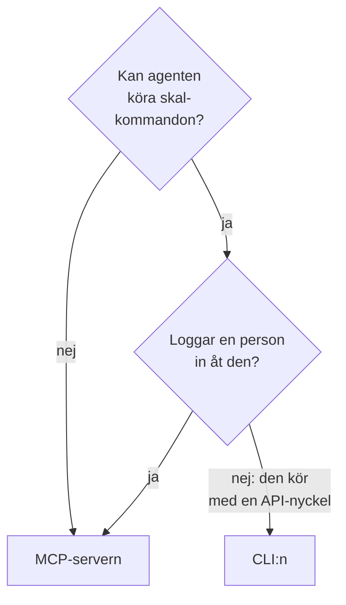

# CLI för AI-agenter

En AI-agent som kan köra skalkommandon, till exempel en kodagent i din editor eller ett jobb i din pipeline, kan arbeta med OneUptime genom CLI:n i stället för [MCP-servern](/docs/ai/mcp-server). Den här sidan säger när vilken passar, och hur en agent installerar CLI:n, hittar rätt och läser dess svar.

:::cards
- [CLI:n eller MCP-servern](#clin-eller-mcp-servern): Vilken en agent bör använda.
- [Konfigurera den för en agent](#konfigurera-den-för-en-agent): Installera den och ge den en nyckel i miljön.
- [Så hittar en agent rätt](#så-hittar-en-agent-rätt): Resurserna, deras fält och hjälpen.
- [Läs svaren](#läs-svaren): JSON från varje kommando, fel inräknade.
:::

## CLI:n eller MCP-servern

Båda når OneUptimes API och gör det som deras inloggningsuppgifter tillåter. De skiljer sig i vad agenten behöver för att nå dem:



| | CLI:n | MCP-servern |
| --- | --- | --- |
| Agenten behöver | Ett skal och Node.js 22 eller senare | En MCP-klient, till exempel Claude eller Cursor |
| Den loggar in med | En API-nyckel till projektet i `ONEUPTIME_API_KEY` | Ditt OneUptime-konto eller en API-nyckel |
| Den når | Varje resurs i API:et, 450 och fler | De poster och den telemetri som den har verktyg för, och verktyg för incidenthantering |
| Den passar för | Skript som agenten skriver för att människor ska behålla dem, kontroller i en pipeline och arbete med många poster | Ett samtal: att undersöka en incident, att sätta upp en monitor |

Använd CLI:n när agenten redan kör kommandon, som en kodagent gör, eller när det den bygger ska fortsätta köras utan den: ett skript i ett repository, ett steg i en pipeline. Använd MCP-servern när en person pratar med agenten i en chattklient, så att agenten arbetar med personens behörigheter och klienten frågar före en ändring.

## Konfigurera den för en agent

Varje OneUptime tillhandahåller CLI:ns installationsskript för sin egen version: kommandona nedan laddar ner det från `https://oneuptime.com`, så på ett egenhostat OneUptime ersätter du den med din URL. Skriptet sparas först som `install.sh`, så att du kan läsa det innan du kör det:

```bash
curl -fsSL https://oneuptime.com/install/cli -o install.sh
ONEUPTIME_URL=https://oneuptime.com bash install.sh
```

Ge agenten en API-nyckel till projektet med bara den åtkomst som dess arbete behöver, i miljön i stället för på kommandoraden, och låt den kontrollera nyckeln först:

```bash
export ONEUPTIME_API_KEY="your-api-key"
export ONEUPTIME_URL=https://oneuptime.com
oneuptime whoami --check -o json
```

Skapa nyckeln under **Projektinställningar → Avancerad → API-nycklar**: se [Skapa en API-nyckel](/docs/api-reference/api-reference#skapa-en-api-nyckel). En nyckel som bara får läsa låter agenten titta, och inget annat.

## Så hittar en agent rätt

CLI:n säger vad den kan, utan API-nyckel och utan begäran:

| Kommando | Vad det svarar |
| --- | --- |
| `oneuptime resources -o json` | Varje resurs: dess kommando, dess namn, dess API-sökväg, dess operationer och dess åtgärder |
| `oneuptime incident fields -o json` | En resurs fält: vad varje används till, dess typ, om ett skapande behöver det, och dess flagga |
| `oneuptime incident create --help` | Ett kommandos argument och flaggor |

Ett fält som innehåller ett ID säger vilken resurs ID:t kommer från, så att agenten listar den resursen först: `incidentSeverityId` tar ett ID från `oneuptime incident-severity list`. Ett fält som nämner en person tar även personens e-postadress, till exempel med `--user-email`.

## Läs svaren

Låt agenten lägga till `-o json` eller `--json` till varje kommando. Då svarar varje kommando med JSON, även de vars svar är en mening, och ett fel är ett enda JSON-objekt på standard fel:

```bash
oneuptime incident acknowledge 6f1c2a40-3b1e-4c55-9a0b-3e2f8d7c1a11 -o json
```

```json
{
  "_id": "6f1c2a40-3b1e-4c55-9a0b-3e2f8d7c1a11",
  "action": "acknowledge",
  "changed": true,
  "state": {
    "_id": "0b7d5e2c-8f4a-4d1b-9c3e-5a6f7b8c9d0e",
    "name": "Acknowledged"
  }
}
```

Slutkoden säger vad som hände: `0` när det lyckades, `1` när det misslyckades, `2` när API-nyckeln saknas eller avvisas, och `3` när posten inte finns. Ett fels JSON har samma kod i `exitCode`, och i `hint` vad man gör härnäst. Se [Utdataformat](/docs/cli/output-formats#json) och [Slutkoder](/docs/cli/scripting#slutkoder).

## Nästa steg

:::cards
- [Resursoperationer](/docs/cli/resource-operations): Varje operation, med dess flaggor och filter.
- [Kommandoreferens](/docs/cli/command-reference): Varje kommando, alternativ och standardvärde.
- [MCP-server](/docs/ai/mcp-server): Anslut i stället en chattklient till OneUptime.
:::
