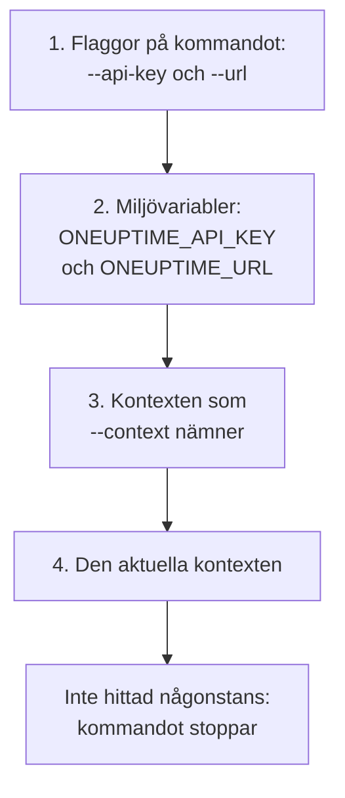

# Autentisering

Varje begäran som CLI:n skickar bär en API-nyckel till ditt projekt. Spara nycklar en gång med `oneuptime login`, en kontext för varje miljö, eller ge dem till ett kommando i flaggor eller miljövariabler, som skript gör. Den här sidan visar varje sätt, och vilket ett kommando använder när det finns flera.

:::cards
- [Logga in](#logga-in): Spara en API-nyckel och adressen till ditt OneUptime.
- [Kontexter](#kontexter): En sparad inloggning för varje projekt eller miljö, och byten mellan dem.
- [Vilka inloggningsuppgifter ett kommando använder](#vilka-inloggningsuppgifter-ett-kommando-använder): Först flaggor, sedan miljövariabler, sedan kontexter.
- [Felsökning](#felsökning): Inga inloggningsuppgifter hittade, ogiltiga nycklar och avslag.
:::

## Innan du börjar

Du behöver en API-nyckel till ditt projekt. Skapa en under **Projektinställningar → Avancerad → API-nycklar** med **Skapa API-nyckel**, och ge den den åtkomst dina kommandon behöver: se [Skapa en API-nyckel](/docs/api-reference/api-reference#skapa-en-api-nyckel). En nyckel gör det dess behörigheter tillåter: en nyckel som bara får läsa poster kan lista och läsa dem, men inte ändra dem.

På OneUptime Cloud fungerar API-nycklar bara så länge projektet har planen **Growth** eller högre. Under den svarar varje kommando med `API error (402)` och ett meddelande som nämner planen, tills projektet uppgraderas; då fungerar samma nyckel igen. Se [API-nycklar och SCIM under sin plan](/docs/api-reference/api-reference#api-nycklar-och-scim-under-sin-plan).

## Logga in

`oneuptime login` sparar en API-nyckel och adressen till ditt OneUptime som en kontext, och gör den till den aktuella kontexten:

```bash
oneuptime login <api-key> <instance-url> [--context-name <name>]
```

| Argument eller alternativ | Vad det är |
| --- | --- |
| `<api-key>` | En API-nyckel till ditt projekt |
| `<instance-url>` | Adressen till ditt OneUptime: `https://oneuptime.com`, eller din egen servers, till exempel `https://oneuptime.example.com` |
| `--context-name <name>` | Namnet som kontexten sparas under. Standard: `default` |

Till exempel en kontext med namnet `production`:

```bash
oneuptime login <api-key> https://oneuptime.com --context-name production
```

Den svarar `Logged in successfully. Context "production" is now active.` Ett snedstreck i slutet av adressen tas bort, och en ny inloggning under samma namn ersätter den kontexten.

> [!NOTE]
> `login` sparar nyckeln utan att fråga OneUptime om den. Kör ett kommando, till exempel `oneuptime incident count`, för att se att nyckeln fungerar.

## Kontexter

En kontext är en sparad inloggning: ett namn, en adress och en API-nyckel. Spara en för varje projekt eller miljö, och välj sedan en för alla kommandon som följer, eller för ett enda kommando.

:::steps
### Spara en kontext för varje miljö

```bash
oneuptime login <production-api-key> https://oneuptime.com --context-name production
oneuptime login <staging-api-key> https://oneuptime.example.com --context-name staging
```

Varje inloggning gör sin kontext till den aktuella, så nu är `staging` den aktuella.

### Lista dem

```bash
oneuptime context list
```

```text
┌───┬────────────┬───────────────────────────────┐
│   │ Name       │ URL                           │
├───┼────────────┼───────────────────────────────┤
│   │ production │ https://oneuptime.com         │
├───┼────────────┼───────────────────────────────┤
│ * │ staging    │ https://oneuptime.example.com │
└───┴────────────┴───────────────────────────────┘
```

`*` markerar den aktuella kontexten. API-nycklar listas aldrig.

### Byt till en annan kontext

```bash
oneuptime context use production
```

Den svarar `Switched to context "production".` och kommandona som följer använder den.

### Använd en kontext för ett kommando

```bash
oneuptime incident list --context staging
```

Den aktuella kontexten förblir som den var.
:::

| Kommando | Vad det gör |
| --- | --- |
| `oneuptime context list` | Listar de sparade kontexterna; `*` markerar den aktuella. Med `-o json` varje kontexts `name`, `apiUrl` och `isCurrent`, aldrig dess nyckel |
| `oneuptime context use <name>` | Gör en sparad kontext till den aktuella |
| `oneuptime context current` | Visar den aktuella kontextens namn, URL och API-nyckel, med nyckeln dold utom de fyra första och fyra sista tecknen |
| `oneuptime context delete <name>` | Tar bort en sparad kontext. Var det den aktuella, blir den första kvarvarande kontexten aktuell |

## Vilka inloggningsuppgifter ett kommando använder

Ett kommando behöver en API-nyckel och en URL. Det tar var och en av de två från den första av de här platserna som har den:



Du kan alltså blanda dem: till exempel en API-nyckel från en miljövariabel med URL:en från den aktuella kontexten. Miljövariabler passar skript och CI-jobb, som inte har några sparade kontexter:

:::tabs
@tab Linux
```bash
export ONEUPTIME_API_KEY=<api-key>
export ONEUPTIME_URL=https://oneuptime.com
oneuptime incident list
```
@tab macOS
```bash
export ONEUPTIME_API_KEY=<api-key>
export ONEUPTIME_URL=https://oneuptime.com
oneuptime incident list
```
@tab Windows
```powershell
$env:ONEUPTIME_API_KEY = "<api-key>"
$env:ONEUPTIME_URL = "https://oneuptime.com"
oneuptime incident list
```
:::

Flaggor går före allt annat, för ett kommando:

```bash
oneuptime --api-key <api-key> --url https://oneuptime.com incident list
```

> [!WARNING]
> En nyckel som ges som flagga hamnar i din skalhistorik, och andra användare på maskinen kan se den i processlistan. Använd hellre en kontext eller en miljövariabel på en delad maskin.

## Kontrollera vad CLI:n kommer att använda

`oneuptime whoami` visar URL:en och API-nyckeln som nästa kommando kommer att använda, och kontexten de kommer från:

```bash
oneuptime whoami
```

```text
URL:     https://oneuptime.com
API Key: 4f1c****0a13
Context: production
```

Bara nyckelns fyra första och fyra sista tecken visas. Raden `Context` visas bara när URL:en och nyckeln är kontextens egna, inte värden som en flagga eller en miljövariabel har ersatt. `whoami` läser dina inställningar utan att anropa OneUptime: den visar vad ett kommando kommer att skicka, inte om OneUptime godtar det. Är inget sparat eller satt, svarar den:

```text
Not authenticated. Run `oneuptime login` to authenticate.
```

## Konfigurationsfilen

`oneuptime login` sparar kontexter i `~/.oneuptime/config.json`, i din hemmapp (`%USERPROFILE%\.oneuptime\config.json` på Windows). CLI:n skapar den så att bara din användare kan läsa och skriva den (läge `0600`):

```json title="~/.oneuptime/config.json"
{
  "currentContext": "production",
  "contexts": {
    "production": {
      "name": "production",
      "apiUrl": "https://oneuptime.com",
      "apiKey": "<api-key>"
    },
    "staging": {
      "name": "staging",
      "apiUrl": "https://oneuptime.example.com",
      "apiKey": "<api-key>"
    }
  }
}
```

Filen innehåller API-nycklarna som de är: håll den borta från delade mappar, säkerhetskopior och repositorier. Logga ut från en kontext genom att ta bort den med `oneuptime context delete <name>`; logga ut från alla genom att ta bort filen. En nyckel som kan ha läckt är giltig tills du tar bort den i OneUptime, under **Projektinställningar → Avancerad → API-nycklar**.

Utdataformat och liststorlekar sparas inte här: ge `-o` och `--limit` till varje kommando.

## Felsökning

:::details Meddelandet ”No credentials found”
`Authentication error: No credentials found.` betyder att ingen flagga, miljövariabel eller sparad kontext gav kommandot dess API-nyckel och URL. Kör `oneuptime login`, eller sätt både `ONEUPTIME_API_KEY` och `ONEUPTIME_URL`. Kommandot avslutas med koden `2`.
:::

:::details Meddelandet ”API error (400): Invalid API Key”
Nyckeln är inte en API-nyckel till OneUptime, har gått ut eller har återställts. Kopiera den igen från dess sida under **Projektinställningar → Avancerad → API-nycklar**, där även dess datum står under **Upphör**, och logga in igen under samma kontextnamn. Kommandot avslutas med koden `2`.
:::

:::details Meddelandet ”API error (402): API keys need the Growth plan”
På OneUptime Cloud ligger projektet under planen **Growth**, så dess API-nycklar slutade fungera. Uppgradera projektet, så fungerar samma nyckel igen: inget att ändra i CLI:n.
:::

:::details Meddelandet ”API error (422): You do not have permissions”
Nyckelns behörigheter räcker inte till det kommandot ber om. Ge nyckeln en roll eller en behörighet på dess sida under **Projektinställningar → Avancerad → API-nycklar**: meddelandet nämner de behörigheter som skulle släppa igenom begäran.
:::

:::details Meddelandet ”Context "staging" does not exist”
Ingen kontext med det namnet är sparad. `oneuptime context list` visar de namn som finns.
:::

:::details whoami visar en annan URL eller nyckel än kontexten har
En miljövariabel eller en flagga ersätter kontextens värde. `env | grep ONEUPTIME` visar variablerna som är satta, och `unset ONEUPTIME_API_KEY ONEUPTIME_URL` tar dig tillbaka till dina kontexter.
:::

:::details Begäran till adressen misslyckas
`Error: Request failed to https://...` betyder att CLI:n inte kunde nå OneUptime på den adressen. Kontrollera URL:en med `oneuptime whoami`: det är adressen du öppnar OneUptime på, med `https://`, till exempel `https://oneuptime.com`.
:::

## Nästa steg

:::cards
- [Resursoperationer](/docs/cli/resource-operations): Lista, läs, skapa, ändra, ta bort och räkna poster.
- [Skript och CI/CD](/docs/cli/scripting): Ge en pipeline dess nyckel i miljövariabler.
- [OneUptime API-referens](/docs/api-reference/api-reference): Vad en API-nyckel får göra, och vad varje svar betyder.
:::
