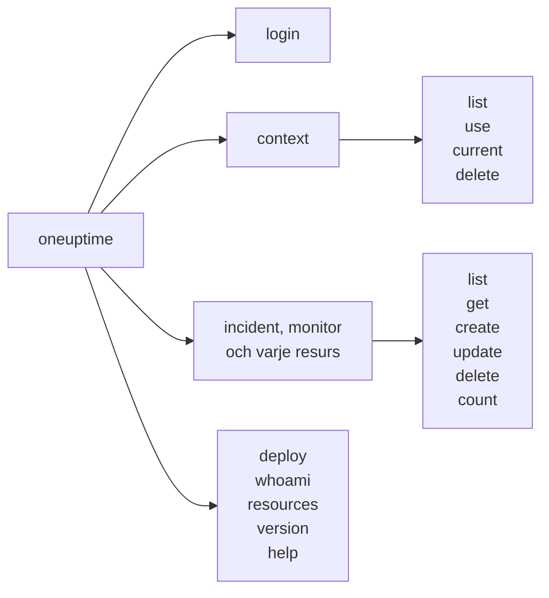

# Kommandoreferens

Varje kommando i CLI:n `oneuptime`, med dess argument, alternativ och standardvärden. Lägg till `--help` till vilket kommando som helst för att se samma sak i din terminal.

:::cards
- [Globala alternativ](#globala-alternativ): Alternativen som varje kommando tar.
- [Inloggning och kontexter](#inloggning-och-kontexter): login och context-kommandona.
- [Resurskommandon](#resurskommandon): list, get, create, update, delete och count.
- [Andra kommandon](#andra-kommandon): deploy, whoami, resources, version och help.
:::

## Kommandona



## Globala alternativ

| Alternativ | Vad det gör | Standard |
| --- | --- | --- |
| `--api-key <key>` | API-nyckeln för det här kommandot | `ONEUPTIME_API_KEY`, sedan kontextens nyckel |
| `--url <url>` | Adressen till ditt OneUptime för det här kommandot | `ONEUPTIME_URL`, sedan kontextens URL |
| `--context <name>` | Den sparade kontexten som används för det här kommandot | Den aktuella kontexten |
| `-o, --output <format>` | `json`, `table` eller `wide` | `table` i en terminal, `json` i en pipe |
| `--no-color` | Skriver ut utan färger | Färger, om inte `NO_COLOR` är satt |
| `-V, --version` | Skriver ut CLI:ns version | |
| `-h, --help` | Visar hjälpen för ett kommando | |

Alternativen står före eller efter kommandot: `oneuptime --context staging incident list` och `oneuptime incident list --context staging` gör samma sak.

## Inloggning och kontexter

### `oneuptime login`

Sparar en API-nyckel och en adress som en kontext, och gör den till den aktuella. Se [Logga in](/docs/cli/authentication#logga-in).

```bash
oneuptime login <api-key> <instance-url> [--context-name <name>]
```

| Argument eller alternativ | Krävs | Vad det är | Standard |
| --- | --- | --- | --- |
| `<api-key>` | Ja | En API-nyckel till ditt projekt | |
| `<instance-url>` | Ja | Adressen till ditt OneUptime, till exempel `https://oneuptime.com` | |
| `--context-name <name>` | Nej | Namnet som kontexten sparas under | `default` |

### `oneuptime context list`

Listar de sparade kontexterna; `*` markerar den aktuella. API-nycklar listas aldrig.

```bash
oneuptime context list [-o <format>]
```

| Alternativ | Krävs | Vad det är |
| --- | --- | --- |
| `-o, --output <format>` | Nej | `json`, `table` eller `wide`. JSON ger varje kontexts `name`, `apiUrl` och `isCurrent` |

### `oneuptime context use`

Gör en sparad kontext till den aktuella.

```bash
oneuptime context use <name>
```

| Argument | Krävs | Vad det är |
| --- | --- | --- |
| `<name>` | Ja | Namnet på en sparad kontext |

### `oneuptime context current`

Visar den aktuella kontextens namn och URL, och dess API-nyckel dold utom de fyra första och fyra sista tecknen.

```bash
oneuptime context current
```

### `oneuptime context delete`

Tar bort en sparad kontext. Var det den aktuella, blir den första kvarvarande kontexten aktuell.

```bash
oneuptime context delete <name>
```

| Argument | Krävs | Vad det är |
| --- | --- | --- |
| `<name>` | Ja | Namnet på en sparad kontext |

## Resurskommandon

`<resource>` är kommandot för en sorts post, från tabellerna under [Resurser](#resurser), till exempel `incident` eller `monitor`. Se [Resursoperationer](/docs/cli/resource-operations) för exempel.

### `oneuptime <resource> list`

Listar poster, de nyaste först. Etiketter listas i stället efter namn, numrerade etiketter först (`2. Team` före `10. Owner`).

```bash
oneuptime <resource> list [--query <json>] [--limit <n>] [--skip <n>] [--sort <json>] [-o <format>]
```

| Alternativ | Vad det gör | Standard |
| --- | --- | --- |
| `--query <json>` | Ett filter, som JSON | Varje post som nyckeln får läsa |
| `--limit <n>` | Det högsta antalet poster att returnera, upp till 10 000 | `10` |
| `--skip <n>` | Hur många poster som hoppas över först | `0` |
| `--sort <json>` | Ordningen, som JSON: `{"<field>":"ASC"}` eller `{"<field>":"DESC"}` | De nyaste först |
| `-o, --output <format>` | `json`, `table` eller `wide` | `table` i en terminal, `json` i en pipe |

### `oneuptime <resource> get`

Läser en post. Bara poster: telemetri har ingen `get`.

```bash
oneuptime <resource> get <id> [-o <format>]
```

| Argument eller alternativ | Krävs | Vad det är |
| --- | --- | --- |
| `<id>` | Ja | Postens ID, ett UUID |
| `-o, --output <format>` | Nej | `json`, `table` eller `wide` |

### `oneuptime <resource> create`

Skapar en post och skriver ut den.

```bash
oneuptime <resource> create (--data <json> | --file <path>) [-o <format>]
```

| Alternativ | Krävs | Vad det är |
| --- | --- | --- |
| `--data <json>` | Ett av de två | Posten, som JSON |
| `--file <path>` | Ett av de två | En JSON-fil med posten. Anges den tillsammans med `--data` används filen |
| `-o, --output <format>` | Nej | `json`, `table` eller `wide` |

### `oneuptime <resource> update`

Ändrar de fält du anger. Bara poster: telemetri har ingen `update`.

```bash
oneuptime <resource> update <id> --data <json> [-o <format>]
```

| Argument eller alternativ | Krävs | Vad det är |
| --- | --- | --- |
| `<id>` | Ja | Postens ID |
| `--data <json>` | Ja | Fälten som ska ändras, som JSON |
| `-o, --output <format>` | Nej | `json`, `table` eller `wide` |

### `oneuptime <resource> delete`

Tar bort en post direkt, utan att fråga. Bara poster: telemetri har ingen `delete`.

```bash
oneuptime <resource> delete <id> [--force]
```

| Argument eller alternativ | Krävs | Vad det är |
| --- | --- | --- |
| `<id>` | Ja | Postens ID |
| `--force` | Nej | Godtas och ändrar ingenting: `delete` ber aldrig om bekräftelse |

### `oneuptime <resource> count`

Räknar poster och skriver ut talet.

```bash
oneuptime <resource> count [--query <json>] [-o <format>]
```

| Alternativ | Krävs | Vad det är |
| --- | --- | --- |
| `--query <json>` | Nej | Ett filter, som JSON. Utan filter varje post som nyckeln får läsa |
| `-o, --output <format>` | Nej | `json`, `table` eller `wide` |

### Resurser

Poster tar `list`, `get`, `create`, `update`, `delete` och `count`:

| Område | Kommandon |
| --- | --- |
| Övervakning | `monitor`, `monitor-status`, `monitor-status-event` |
| Incidenter | `incident`, `incident-state`, `incident-severity`, `incident-state-timeline`, `incident-public-note`, `incident-internal-note`, `incident-alert`, `postmortem-status` |
| Larm | `alert`, `alert-state`, `alert-severity`, `alert-state-timeline`, `alert-internal-note` |
| Statussidor | `status-page`, `status-page-announcement` |
| Planerat underhåll | `scheduled-maintenance-event`, `scheduled-maintenance-state`, `scheduled-maintenance-state-timeline` |
| Team och jour | `team`, `on-call-policy` |
| Säkerhet | `security-case`, `security-case-note`, `security-case-priority`, `security-case-status`, `security-detection`, `security-playbook` |
| Etiketter | `label` |

Telemetri tar `list`, `create` och `count`:

| Område | Kommandon |
| --- | --- |
| Observerbarhet | `log`, `metric`, `span`, `exception-instance`, `monitor-log` |
| Säkerhet | `security-event`, `threat-intel-indicator` |
| Ändringar och kostnader | `change-event`, `kubernetes-cost-allocation` |

CLI:n släpps tillsammans med OneUptime, så `oneuptime resources` listar kommandona i den version du har installerat.

### API-begäranden

Varje operation är en begäran till API:et, med nyckeln i headern `APIKey`. `<path>` är resursens API-sökväg, från `oneuptime resources`: `/incident` för `incident`, `/on-call-duty-policy` för `on-call-policy`.

| Operation | Begäran | Body |
| --- | --- | --- |
| `list` | `POST /api/<path>/get-list` | `query`, `select`, `skip`, `limit` och `sort` |
| `get` | `POST /api/<path>/<id>/get-item` | `select` |
| `create` | `POST /api/<path>` | `{"data": ...}` |
| `update` | `PUT /api/<path>/<id>/` | `{"data": ...}` |
| `delete` | `DELETE /api/<path>/<id>/` | Ingen |
| `count` | `POST /api/<path>/count` | `query` |

## Andra kommandon

### `oneuptime deploy`

Registrerar en driftsättning, eller en annan ändring, från en pipeline: den ritas i tjänstens diagram och läses av OneUptime AI när den utreder en incident. Kommandot skriver med en intagningsnyckel för telemetri, inte med en API-nyckel. Se [Driftsättningar och ändringar](/docs/telemetry/change-events).

```bash
oneuptime deploy [--service <name>] [--service-version <version>] [--previous-version <version>] [--commit <sha>] [--repository <url>] [--branch <name>] [--pull-request <number>] [--environment <name>] [--title <title>] [--description <text>] [--type <type>] [--time <time>] [--attribute <key=value...>] [--ingestion-key <key>]
```

| Alternativ | Krävs | Vad det är | Standard |
| --- | --- | --- | --- |
| `--service <name>` | Nej | Tjänsten som driftsattes | En ändring för hela projektet |
| `--service-version <version>` | Nej | Den driftsatta versionen | |
| `--previous-version <version>` | Nej | Versionen som den ersatte | |
| `--commit <sha>` | Nej | Den driftsatta committen | |
| `--repository <url>` | Nej | Repositoryt som committen finns i | |
| `--branch <name>` | Nej | Den driftsatta branchen | |
| `--pull-request <number>` | Nej | Den driftsatta pull requesten | |
| `--environment <name>` | Nej | Miljön som driftsättningen gjordes i | |
| `--title <title>` | Nej | Ändringens titel; krävs för alla sorters ändringar utom driftsättningar | `Deploy <version>` |
| `--description <text>` | Nej | Detaljer om ändringen | |
| `--type <type>` | Nej | Typen av ändring, till exempel `config-change` eller `rollback` | `deployment` |
| `--time <time>` | Nej | När den hände, till exempel `2026-10-19T10:00:00Z` | Nu |
| `--attribute <key=value...>` | Nej | Fler attribut, som `key=value`, ett eller flera | |
| `--ingestion-key <key>` | Nej | En intagningsnyckel för telemetri från projektet | `ONEUPTIME_TELEMETRY_INGESTION_KEY` |

### `oneuptime whoami`

Visar URL:en och API-nyckeln som nästa kommando kommer att använda, med nyckeln maskerad, och kontexten de kommer från. Den anropar inte OneUptime. Se [Kontrollera vad CLI:n kommer att använda](/docs/cli/authentication#kontrollera-vad-clin-kommer-att-använda).

```bash
oneuptime whoami
```

### `oneuptime resources`

Listar varje sorts post som CLI:n har ett kommando för: dess kommando, namn i singular och plural, typ och API-sökväg, samt totalen.

```bash
oneuptime resources [--type <type>] [-o <format>]
```

| Alternativ | Krävs | Vad det är | Standard |
| --- | --- | --- | --- |
| `--type <type>` | Nej | `database` för poster, `analytics` för telemetri | Båda |
| `-o, --output <format>` | Nej | `json`, `table` eller `wide`. JSON ger var och ens `name`, `singularName`, `pluralName`, `modelType` och `apiPath` | `table` i en terminal, `json` i en pipe |

### `oneuptime version`

Skriver ut CLI:ns version, som `oneuptime --version` gör.

```bash
oneuptime version
```

### `oneuptime help`

Visar hjälpen för CLI:n, eller för ett kommando.

```bash
oneuptime help [command]
```

## Miljövariabler

| Variabel | Vad den gör |
| --- | --- |
| `ONEUPTIME_API_KEY` | API-nyckeln, när ingen `--api-key`-flagga anger en |
| `ONEUPTIME_URL` | Adressen till ditt OneUptime, när ingen `--url`-flagga anger en |
| `ONEUPTIME_TELEMETRY_INGESTION_KEY` | Intagningsnyckeln för telemetri som `oneuptime deploy` skriver med, när ingen `--ingestion-key`-flagga anger en |
| `NO_COLOR` | Satt till valfritt värde stänger den av färger |

## Filer

| Fil | Vad den innehåller |
| --- | --- |
| `~/.oneuptime/config.json` | De sparade kontexterna, deras API-nycklar och den aktuella kontexten |

## Slutkoder

| Kod | Betydelse |
| --- | --- |
| `0` | Det fungerade |
| `1` | Det misslyckades: OneUptime avvisade begäran, eller kommandot var fel |
| `2` | Ingen användbar API-nyckel: ingen hittad, ogiltig eller under sin plan |
| `3` | Hittades inte: OneUptime svarade `404` |

Se [Slutkoder](/docs/cli/scripting#slutkoder) för exempel.

## Nästa steg

:::cards
- [CLI – Översikt](/docs/cli/index): Installera CLI:n och kör dina första kommandon.
- [Resursoperationer](/docs/cli/resource-operations): Exempel på varje operation.
- [Skript och CI/CD](/docs/cli/scripting): CLI:n i skript och pipelines.
:::
