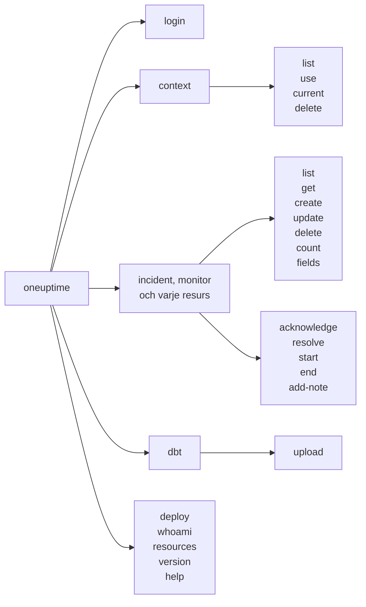

# Kommandoreferens

Varje kommando i CLI:n `oneuptime`, med dess argument, alternativ och standardvärden. Lägg till `--help` till vilket kommando som helst för att se samma sak i din terminal.

:::cards
- [Globala alternativ](#globala-alternativ): Alternativen som varje kommando tar.
- [Inloggning och kontexter](#inloggning-och-kontexter): login och context-kommandona.
- [Resurskommandon](#resurskommandon): Varje resurs operationer, fält och åtgärder.
- [Andra kommandon](#andra-kommandon): deploy, dbt upload, data-checks apply, whoami, resources, version och help.
:::

## Kommandona



## Globala alternativ

| Alternativ | Vad det gör | Standard |
| --- | --- | --- |
| `--api-key <key>` | API-nyckeln för det här kommandot | `ONEUPTIME_API_KEY`, sedan kontextens nyckel |
| `--url <url>` | Adressen till ditt OneUptime för det här kommandot | `ONEUPTIME_URL`, sedan kontextens URL |
| `--context <name>` | Den sparade kontexten som används för det här kommandot | Den aktuella kontexten |
| `-o, --output <format>` | `json`, `table` eller `wide` | `table` i en terminal, `json` i en pipe |
| `--json` | Samma som `-o json` | |
| `--no-color` | Skriver ut utan färger | Färger, om inte `NO_COLOR` är satt |
| `-V, --version` | Skriver ut CLI:ns version | |
| `-h, --help` | Visar hjälpen för ett kommando | |

Alternativen står före eller efter kommandot: `oneuptime --context staging incident list` och `oneuptime incident list --context staging` gör samma sak.

Varje kommando tar `-o` och `--json`, så tabellerna nedan utelämnar dem. Ett kommando vars svar är en mening, till exempel `delete`, skriver ut meningen om inte `-o json` eller `--json` ber om JSON: se [Utdataformat](/docs/cli/output-formats#json).

## Inloggning och kontexter

### `oneuptime login`

Sparar en API-nyckel och en adress som en kontext, och gör den till den aktuella. Se [Logga in](/docs/cli/authentication#logga-in).

```bash
oneuptime login <api-key> <instance-url> [--context-name <name>]
```

| Argument eller alternativ | Krävs | Vad det är | Standard |
| --- | --- | --- | --- |
| `<api-key>` | Ja | En API-nyckel till ditt projekt | |
| `<instance-url>` | Ja | Adressen till ditt OneUptime, till exempel `https://oneuptime.com` | |
| `--context-name <name>` | Nej | Namnet som kontexten sparas under | `default` |

### `oneuptime context list`

Listar de sparade kontexterna; `*` markerar den aktuella. API-nycklar listas aldrig: JSON ger varje kontexts `name`, `apiUrl` och `isCurrent`.

```bash
oneuptime context list
```

### `oneuptime context use`

Gör en sparad kontext till den aktuella.

```bash
oneuptime context use <name>
```

| Argument | Krävs | Vad det är |
| --- | --- | --- |
| `<name>` | Ja | Namnet på en sparad kontext |

### `oneuptime context current`

Visar den aktuella kontextens namn och URL, och dess API-nyckel dold utom de fyra första och fyra sista tecknen.

```bash
oneuptime context current
```

### `oneuptime context delete`

Tar bort en sparad kontext. Var det den aktuella, blir den första kvarvarande kontexten aktuell.

```bash
oneuptime context delete <name>
```

| Argument | Krävs | Vad det är |
| --- | --- | --- |
| `<name>` | Ja | Namnet på en sparad kontext |

## Resurskommandon

`<resource>` är kommandot för en sorts post, från tabellen under [Resurser](#resurser), till exempel `incident` eller `monitor`. En resurs har de operationer som API:et tar för den, de flesta alla sex, och `oneuptime <resource> --help` listar dess egna. Se [Resursoperationer](/docs/cli/resource-operations) för exempel.

### `oneuptime <resource> list`

Listar poster, de nyaste först. Etiketter listas i stället efter namn, numrerade etiketter först (`2. Team` före `10. Owner`).

```bash
oneuptime <resource> list [--query <json>] [--limit <n>] [--skip <n>] [--sort <json>] [--fields <names>] [--all]
```

| Alternativ | Vad det gör | Standard |
| --- | --- | --- |
| `--query <json>` | Ett filter, som JSON | Varje post som nyckeln får läsa |
| `--limit <n>` | Det högsta antalet poster att returnera, upp till 10 000 | `10` |
| `--skip <n>` | Hur många poster som hoppas över först | `0` |
| `--sort <json>` | Ordningen, som JSON: `{"<field>":"ASC"}` eller `{"<field>":"DESC"}` | De nyaste först |
| `--fields <names>` | Fälten som ska returneras, åtskilda av kommatecken; ett fält i en kopplad post efter en punkt, som i `currentIncidentState.name` | Varje fält som nyckeln får läsa |
| `--all` | Varje post som matchar, 100 åt gången, upp till 100 000, i stället för `--limit` och `--skip`. Bara poster: telemetri har ingen `--all` | |

### `oneuptime <resource> get`

Läser en post.

```bash
oneuptime <resource> get <id> [--fields <names>]
```

| Argument eller alternativ | Krävs | Vad det är |
| --- | --- | --- |
| `<id>` | Ja | Postens ID, ett UUID |
| `--fields <names>` | Nej | Fälten som ska returneras, åtskilda av kommatecken. Standard: varje fält som nyckeln får läsa |

### `oneuptime <resource> create`

Skapar en post och skriver ut den.

```bash
oneuptime <resource> create [--<field> <value>]... [--data <json>] [--file <path>]
```

| Alternativ | Krävs | Vad det är |
| --- | --- | --- |
| `--<field> <value>` | De fält som ett skapande måste ange | Ett fälts värde: `--title <text>`, `--incident-severity-id <id>`, `--labels <ids>`. `oneuptime <resource> create --help` listar dem. Bara poster |
| `--data <json>` | Nej | Posten som JSON |
| `--file <path>` | Nej | En JSON-fil med posten. Anges den tillsammans med `--data` används filen |

Flaggorna läggs ovanpå `--data` eller `--file`. Ett fält som nämner en person med användar-ID har även en flagga som nämner personen med e-postadress: `--user-email` bredvid `--user-id`.

### `oneuptime <resource> update`

Ändrar de fält du anger.

```bash
oneuptime <resource> update <id> [--<field> <value>]... [--data <json>] [--file <path>]
```

| Argument eller alternativ | Krävs | Vad det är |
| --- | --- | --- |
| `<id>` | Ja | Postens ID |
| `--<field> <value>` | Nej | Ett fält som ska ändras: `oneuptime <resource> update --help` listar dem. Bara poster |
| `--data <json>` | Nej | De fält som ska ändras, som JSON |
| `--file <path>` | Nej | En JSON-fil med de fält som ska ändras. Anges den tillsammans med `--data` används filen |

### `oneuptime <resource> delete`

Tar bort en post direkt, utan att fråga.

```bash
oneuptime <resource> delete <id> [--force]
```

| Argument eller alternativ | Krävs | Vad det är |
| --- | --- | --- |
| `<id>` | Ja | Postens ID |
| `--force` | Nej | Godtas och ändrar ingenting: `delete` ber aldrig om bekräftelse |

### `oneuptime <resource> count`

Räknar poster och skriver ut talet.

```bash
oneuptime <resource> count [--query <json>]
```

| Alternativ | Krävs | Vad det är |
| --- | --- | --- |
| `--query <json>` | Nej | Ett filter, som JSON. Utan filter varje post som nyckeln får läsa |

### `oneuptime <resource> fields`

Listar resursens fält: vad varje används till, dess typ, om ett skapande måste ange det, och den flagga som sätter det. Det läser dem från själva CLI:n, utan API-nyckel och utan begäran.

```bash
oneuptime <resource> fields
```

### `oneuptime <resource> acknowledge`

Flyttar en incident, ett larm eller en episod av något av dem till ditt projekts bekräftad-tillstånd, som knappen i instrumentpanelen gör. En post som redan är bekräftad, eller förbi det, lämnas som den är.

```bash
oneuptime <resource> acknowledge <id>
```

| Argument | Krävs | Vad det är |
| --- | --- | --- |
| `<id>` | Ja | Postens ID |

### `oneuptime <resource> resolve`

Flyttar en incident, ett larm eller en episod av något av dem till ditt projekts löst-tillstånd.

```bash
oneuptime <resource> resolve <id>
```

| Argument | Krävs | Vad det är |
| --- | --- | --- |
| `<id>` | Ja | Postens ID |

### `oneuptime <resource> start`

Flyttar en underhållshändelse till ditt projekts pågående tillstånd.

```bash
oneuptime <resource> start <id>
```

| Argument | Krävs | Vad det är |
| --- | --- | --- |
| `<id>` | Ja | Händelsens ID |

### `oneuptime <resource> end`

Flyttar en underhållshändelse till ditt projekts avslutad-tillstånd.

```bash
oneuptime <resource> end <id>
```

| Argument | Krävs | Vad det är |
| --- | --- | --- |
| `<id>` | Ja | Händelsens ID |

### `oneuptime <resource> add-note`

Lägger till en anteckning på en incident, ett larm, en episod av något av dem eller en underhållshändelse.

```bash
oneuptime <resource> add-note <id> --note <markdown> [--public]
```

| Argument eller alternativ | Krävs | Vad det är |
| --- | --- | --- |
| `<id>` | Ja | Postens ID |
| `--note <markdown>` | Ja | Anteckningen i Markdown |
| `--public` | Nej | Publicerar den på postens statussidor, där dess prenumeranter får besked. Bara incidenter, deras episoder och schemalagt underhåll |

### Resurser

Varje resurs i OneUptimes API är ett kommando, med de operationer som API:et tar för den, `fields` och åtgärderna för de poster som har sådana:

{{CLI_RESOURCE_COMMANDS}}

CLI:n släpps tillsammans med OneUptime, så `oneuptime resources` listar kommandona i den version du har installerat.

### API-begäranden

Varje operation är en begäran till API:et, med nyckeln i headern `APIKey`. `<path>` är resursens API-sökväg, från `oneuptime resources`: `/incident` för `incident`, `/on-call-duty-policy` för `on-call-policy`.

| Operation | Begäran | Body |
| --- | --- | --- |
| `list` | `POST /api/<path>/get-list` | `query`, `select`, `skip`, `limit` och `sort` |
| `get` | `POST /api/<path>/<id>/get-item` | `select` |
| `create` | `POST /api/<path>` | `{"data": ...}` |
| `update` | `PUT /api/<path>/<id>/` | `{"data": ...}` |
| `delete` | `DELETE /api/<path>/<id>/` | Ingen |
| `count` | `POST /api/<path>/count` | `query` |

En åtgärd läser ditt projekts tillstånd och posten och skapar sedan en rad i postens tillståndstidslinje, som knappen i instrumentpanelen gör: `acknowledge` på en incident skapar en `incident-state-timeline`. `add-note` skapar en `incident-internal-note`, eller med `--public` en `incident-public-note`. En e-postflagga listar först projektets teammedlemmar med den adressen. När OneUptime avvisar ett fält som nyckeln inte får läsa frågar en lista eller en läsning igen utan fältet.

## Andra kommandon

### `oneuptime deploy`

Registrerar en driftsättning, eller en annan ändring, från en pipeline: den ritas i tjänstens diagram och läses av OneUptime AI när den utreder en incident. Kommandot skriver med en intagningsnyckel för telemetri, inte med en API-nyckel. Se [Driftsättningar och ändringar](/docs/telemetry/change-events).

```bash
oneuptime deploy [--service <name>] [--service-version <version>] [--previous-version <version>] [--commit <sha>] [--repository <url>] [--branch <name>] [--pull-request <number>] [--environment <name>] [--title <title>] [--description <text>] [--type <type>] [--time <time>] [--attribute <key=value...>] [--ingestion-key <key>]
```

| Alternativ | Krävs | Vad det är | Standard |
| --- | --- | --- | --- |
| `--service <name>` | Nej | Tjänsten som driftsattes | En ändring för hela projektet |
| `--service-version <version>` | Nej | Den driftsatta versionen | |
| `--previous-version <version>` | Nej | Versionen som den ersatte | |
| `--commit <sha>` | Nej | Den driftsatta committen | |
| `--repository <url>` | Nej | Repositoryt som committen finns i | |
| `--branch <name>` | Nej | Den driftsatta branchen | |
| `--pull-request <number>` | Nej | Den driftsatta pull requesten | |
| `--environment <name>` | Nej | Miljön som driftsättningen gjordes i | |
| `--title <title>` | Nej | Ändringens titel; krävs för alla sorters ändringar utom driftsättningar | `Deploy <version>` |
| `--description <text>` | Nej | Detaljer om ändringen | |
| `--type <type>` | Nej | Typen av ändring, till exempel `config-change` eller `rollback` | `deployment` |
| `--time <time>` | Nej | När den hände, till exempel `2026-10-19T10:00:00Z` | Nu |
| `--attribute <key=value...>` | Nej | Fler attribut, som `key=value`, ett eller flera | |
| `--ingestion-key <key>` | Nej | En intagningsnyckel för telemetri från projektet | `ONEUPTIME_TELEMETRY_INGESTION_KEY` |

### `oneuptime dbt upload`

Skickar ett dbt-projekts artefakter efter ett bygge, från CI eller ett dbt Cloud-jobb, till Dataobserverbarhet. Projektets modeller visas på tabellerna de bygger, med sin härkomst, dess tester visas bredvid OneUptimes kontroller och kan utlösa larm, och varje bygge är en körning av projektets pipeline. Kommandot läser `manifest.json` och `run_results.json` från dbt:s målmapp, skickar bara det som Dataobserverbarhet läser av dem och skriver med en intagningsnyckel för telemetri, inte med en API-nyckel. Sidan Dokumentation under Dataobserverbarhet i din instrumentpanel visar det i ett CI-jobb.

```bash
oneuptime dbt upload [--target-path <dir>] [--manifest <file>] [--run-results <file>] [--project <name>] [--ingestion-key <key>]
```

| Alternativ | Krävs | Vad det är | Standard |
| --- | --- | --- | --- |
| `--target-path <dir>` | Nej | Mappen som dbt skrev sina artefakter till | `target` |
| `--manifest <file>` | Nej | Manifestet som skickas | `manifest.json` i målmappen |
| `--run-results <file>` | Nej | Körningsresultaten som skickas | `run_results.json` i målmappen |
| `--project <name>` | Nej | dbt-projektets namn, behövs bara när inget manifest skickas | Manifestets projekt |
| `--ingestion-key <key>` | Nej | En intagningsnyckel för telemetri från projektet | `ONEUPTIME_TELEMETRY_INGESTION_KEY` |

### `oneuptime data-checks apply`

Gör projektets datakontroller likadana som en YAML-fil, så att de förvaras i ett repository och granskas som kod. Ett fel var som helst i filen gör att ingenting tillämpas och kommandot avslutas med ett fel. Filens format finns i [Kontroller och avstämningar](/docs/data-observability/checks).

```bash
oneuptime data-checks apply <file> [--dry-run] [--prune]
```

| Alternativ | Krävs | Vad det är | Standard |
| --- | --- | --- | --- |
| `--dry-run` | Nej | Visar vad som skulle ändras, och ändrar ingenting | Av |
| `--prune` | Nej | Tar bort kontroller som en tidigare apply skapade och som filen inte längre nämner | Av |

### `oneuptime whoami`

Visar URL:en och API-nyckeln som nästa kommando kommer att använda, med nyckeln maskerad, och kontexten de kommer från. Utan `--check` anropar det inte OneUptime. Se [Kontrollera vad CLI:n kommer att använda](/docs/cli/authentication#kontrollera-vad-clin-kommer-att-använda).

```bash
oneuptime whoami [--check]
```

| Alternativ | Krävs | Vad det är |
| --- | --- | --- |
| `--check` | Nej | Frågar OneUptime om den godtar nyckeln, och visar nyckelns projekt, ditt OneUptimes version och CLI:ns |

### `oneuptime resources`

Listar varje sorts post som CLI:n har ett kommando för: dess kommando, namn i singular och plural, typ och API-sökväg, och totalen. JSON ger för var och en `name`, `singularName`, `pluralName`, `modelType`, `apiPath`, `operations` och `actions`.

```bash
oneuptime resources [--type <type>]
```

| Alternativ | Krävs | Vad det är | Standard |
| --- | --- | --- | --- |
| `--type <type>` | Nej | `database` för poster, `analytics` för telemetri | Båda |

### `oneuptime version`

Skriver ut CLI:ns version, som `oneuptime --version` gör.

```bash
oneuptime version
```

### `oneuptime help`

Visar hjälpen för CLI:n, eller för ett kommando.

```bash
oneuptime help [command]
```

## Miljövariabler

| Variabel | Vad den gör |
| --- | --- |
| `ONEUPTIME_API_KEY` | API-nyckeln, när ingen `--api-key`-flagga anger en |
| `ONEUPTIME_URL` | Adressen till ditt OneUptime, när ingen `--url`-flagga anger en |
| `ONEUPTIME_TELEMETRY_INGESTION_KEY` | Intagningsnyckeln för telemetri som `oneuptime deploy` skriver med, när ingen `--ingestion-key`-flagga anger en |
| `NO_COLOR` | Satt till valfritt värde stänger den av färger |

## Filer

| Fil | Vad den innehåller |
| --- | --- |
| `~/.oneuptime/config.json` | De sparade kontexterna, deras API-nycklar och den aktuella kontexten |

## Slutkoder

| Kod | Betydelse |
| --- | --- |
| `0` | Det fungerade |
| `1` | Det misslyckades: OneUptime avvisade begäran, eller kommandot var fel |
| `2` | Ingen användbar API-nyckel: ingen hittad, ogiltig eller under sin plan |
| `3` | Hittades inte: OneUptime svarade `404` |

Se [Slutkoder](/docs/cli/scripting#slutkoder) för exempel.

## Nästa steg

:::cards
- [CLI – Översikt](/docs/cli/index): Installera CLI:n och kör dina första kommandon.
- [Resursoperationer](/docs/cli/resource-operations): Exempel på varje operation.
- [Skript och CI/CD](/docs/cli/scripting): CLI:n i skript och pipelines.
:::
