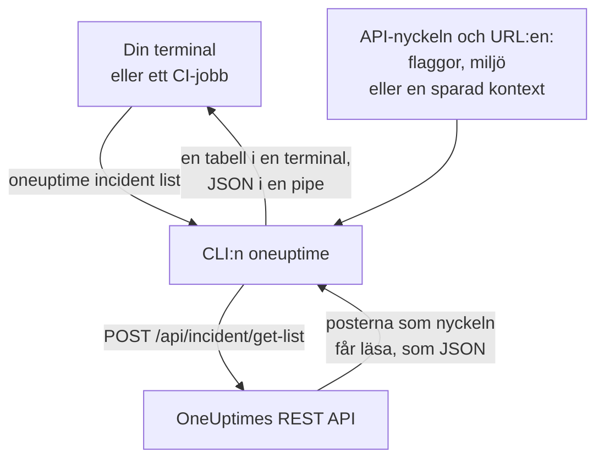

# CLI – Översikt

OneUptimes CLI, `oneuptime`, hanterar ditt OneUptime-projekt från en terminal eller ett skript. Den listar, läser, skapar, ändrar, tar bort och räknar monitorer, incidenter, varningar, statussidor och de andra poster som OneUptimes API erbjuder, med en API-nyckel till ditt projekt.

:::cards
- [Så fungerar CLI:n](#så-fungerar-clin): Ett kommando, en API-begäran, ett svar.
- [Installera CLI:n](#installera-clin): Ett npm-kommando, och vilken version du ska välja.
- [Kör dina första kommandon](#kör-dina-första-kommandon): Spara din API-nyckel och lista sedan dina incidenter.
- [Kommandona i korthet](#kommandona-i-korthet): Varje kommando, och sidan som förklarar det.
:::

## Så fungerar CLI:n

Varje kommando skickar en begäran till OneUptimes REST API och skriver ut svaret. CLI:n tar API-nyckeln och adressen till ditt OneUptime från flaggor, miljövariabler eller en kontext som `oneuptime login` har sparat. Nyckeln avgör vad ett kommando får läsa och ändra, precis som för API:et.



Kommandona för poster följer med CLI:n: varje sorts post som OneUptimes API öppnar för verktyg har ett, samma poster som [MCP-servern](/docs/ai/mcp-server) har verktyg för. Kör `oneuptime resources` för att lista dem.

## Innan du börjar

- **Node.js och npm**, i en aktuell LTS-version, för att installera CLI:n.
- **En API-nyckel till ditt projekt.** Skapa en under **Projektinställningar → Avancerad → API-nycklar** med **Skapa API-nyckel**: se [Skapa en API-nyckel](/docs/api-reference/api-reference#skapa-en-api-nyckel).
- **På OneUptime Cloud planen Growth eller högre.** Ett projekts API-nycklar fungerar bara på den: se [API-nycklar och SCIM under sin plan](/docs/api-reference/api-reference#api-nycklar-och-scim-under-sin-plan).

## Installera CLI:n

Installera paketet `@oneuptime/cli` från npm. Det lägger till kommandot `oneuptime`, och `--version` skriver ut den version du har installerat:

```bash
npm install -g @oneuptime/cli
oneuptime --version
```

CLI:n släpps tillsammans med OneUptime och har samma versionsnummer. På ett egenhostat OneUptime installerar du CLI:n i ditt OneUptimes version, så att dess kommandon passar de poster din server har:

```bash
npm install -g @oneuptime/cli@<your-oneuptime-version>
```

> [!WARNING]
> CLI-versioner före 14.0.64 stannar så fort de startar, med ett fel som `Cannot find module 'Common/Models/DatabaseModels/Index'`. Installera 14.0.64 eller senare med `npm install -g @oneuptime/cli@latest`. På ett egenhostat OneUptime som är äldre än 14.0.64 [uppgraderar du först OneUptime](/docs/installation/upgrading#så-uppgraderar-du) och installerar sedan CLI:n i den version du uppgraderade till.

## Kör dina första kommandon

:::steps
### Spara din API-nyckel

Logga in med nyckeln och adressen till ditt OneUptime. CLI:n sparar dem som en kontext med namnet `default` och använder den från och med nu:

```bash
oneuptime login <your-api-key> https://oneuptime.com
```

Den svarar `Logged in successfully. Context "default" is now active.` På ett egenhostat OneUptime använder du dess adress i stället för `https://oneuptime.com`.

### Lista dina incidenter

```bash
oneuptime incident list
```

De tio nyaste incidenterna visas som en tabell. `login` sparar nyckeln utan att kontrollera den, så detta är det första kommandot som visar att nyckeln fungerar: om den avvisas, se [Felsökning](/docs/cli/authentication#felsökning).

### Se vad mer du kan hantera

```bash
oneuptime resources
```

Listan visar varje sorts post du kan arbeta med, och dess kommando, till exempel `monitor`, `status-page` eller `on-call-policy`.
:::

## Kommandona i korthet

| Kommando | Vad det gör | Läs mer |
| --- | --- | --- |
| `oneuptime login <api-key> <instance-url>` | Sparar en API-nyckel och en adress som en kontext | [Autentisering](/docs/cli/authentication#logga-in) |
| `oneuptime context list`, `use`, `current`, `delete` | Listar, byter, visar och tar bort sparade kontexter | [Autentisering](/docs/cli/authentication#kontexter) |
| `oneuptime whoami` | Visar URL:en och API-nyckeln som nästa kommando kommer att använda | [Autentisering](/docs/cli/authentication#kontrollera-vad-clin-kommer-att-använda) |
| `oneuptime deploy` | Registrerar en driftsättning, eller en annan ändring, för diagram och OneUptime AI | [Driftsättningar och ändringar](/docs/telemetry/change-events) |
| `oneuptime <resource> list`, `get`, `create`, `update`, `delete`, `count` | Arbetar med en sorts post | [Resursoperationer](/docs/cli/resource-operations) |
| `oneuptime resources` | Listar sorterna av poster med deras kommandon | [Kommandoreferens](/docs/cli/command-reference#oneuptime-resources) |
| `oneuptime version` | Skriver ut CLI:ns version | [Kommandoreferens](/docs/cli/command-reference#oneuptime-version) |
| `oneuptime help [command]` | Visar hjälpen för ett kommando | [Få hjälp](#få-hjälp) |

## Globala alternativ

De här alternativen fungerar med varje kommando, före eller efter det:

| Alternativ | Vad det gör |
| --- | --- |
| `--api-key <key>` | API-nyckeln för det här kommandot, i stället för den sparade |
| `--url <url>` | Adressen till ditt OneUptime för det här kommandot |
| `--context <name>` | En sparad kontext för det här kommandot, i stället för den aktuella |
| `-o, --output <format>` | `table`, `json` eller `wide`: se [Utdataformat](/docs/cli/output-formats) |
| `--no-color` | Skriver ut utan färger |
| `-V, --version` | Skriver ut CLI:ns version |
| `-h, --help` | Visar hjälpen för kommandot |

## Få hjälp

Varje kommando har sin egen hjälp, med sina argument, alternativ och standardvärden:

```bash
oneuptime --help
oneuptime help incident
oneuptime incident list --help
```

## Nästa steg

:::cards
- [Autentisering](/docs/cli/authentication): Kontexter för varje miljö, och vilken nyckel ett kommando använder.
- [Resursoperationer](/docs/cli/resource-operations): Lista, läs, skapa, ändra, ta bort och räkna poster.
- [Utdataformat](/docs/cli/output-formats): Tabeller för människor, JSON för skript.
- [Skript och CI/CD](/docs/cli/scripting): Slutkoder, jq och pipelines.
- [Kommandoreferens](/docs/cli/command-reference): Varje kommando, alternativ och standardvärde.
:::
