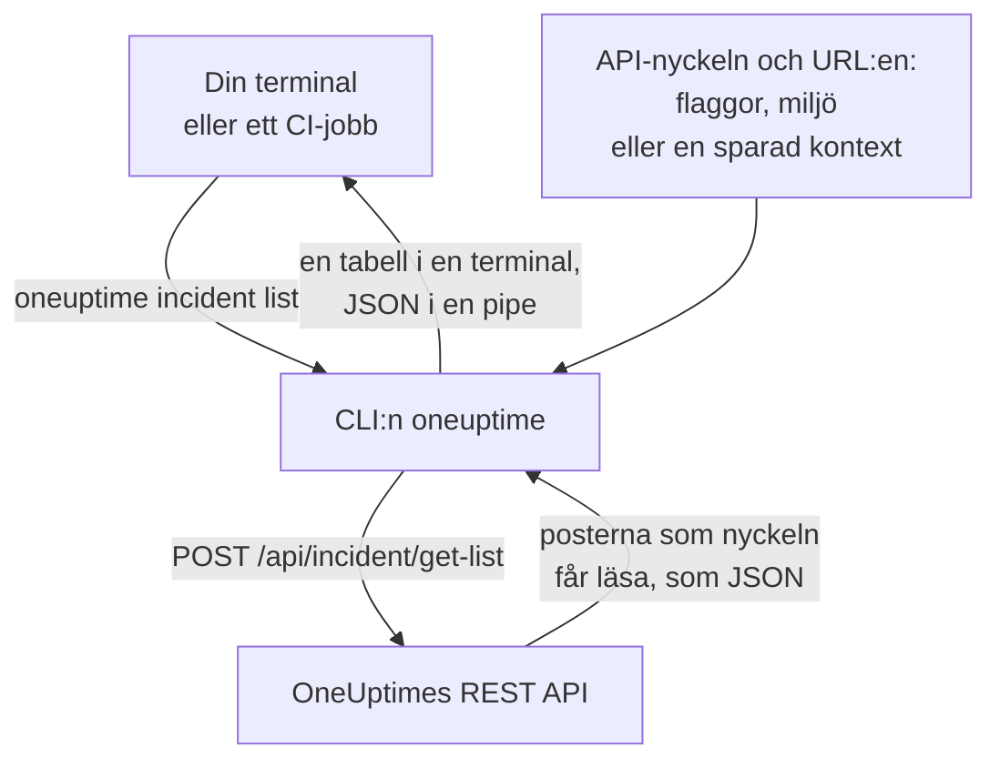

# CLI – Översikt

OneUptimes CLI, `oneuptime`, hanterar ditt OneUptime-projekt från en terminal eller ett skript. Den listar, läser, skapar, ändrar, tar bort och räknar monitorer, incidenter, larm, statussidor och de andra poster som OneUptimes API erbjuder, med en API-nyckel till ditt projekt.

:::cards
- [Så fungerar CLI:n](#så-fungerar-clin): Ett kommando, de API-begäranden det skickar och dess svar.
- [Installera CLI:n](#installera-clin): Installationsskriptet som ditt OneUptime tillhandahåller, eller npm.
- [Kör dina första kommandon](#kör-dina-första-kommandon): Spara din API-nyckel, kontrollera den och lista sedan dina incidenter.
- [Kommandona i korthet](#kommandona-i-korthet): Varje kommando, och sidan som förklarar det.
:::

## Så fungerar CLI:n

De flesta kommandon skickar en begäran till OneUptimes REST API och skriver ut svaret; en åtgärd som `acknowledge` skickar de få som knappen i instrumentpanelen skickar. CLI:n tar API-nyckeln och adressen till ditt OneUptime från flaggor, miljövariabler eller en kontext som `oneuptime login` har sparat. Nyckeln avgör vad ett kommando får läsa och ändra, precis som för API:et.



Varje resurs i OneUptimes API är ett kommando, 450 och fler, från `incident` och `monitor` till `status-page-subscriber` och `telemetry-ingestion-key`, var och en med de operationer som API:et tar för den. CLI:n släpps tillsammans med OneUptime, så CLI:n i ditt OneUptimes version har ett kommando för varje resurs som din server har. Kör `oneuptime resources` för att lista dem.

## Innan du börjar

- **Node.js och npm**, i en aktuell LTS-version, för att installera CLI:n.
- **En API-nyckel till ditt projekt.** Skapa en under **Projektinställningar → Avancerad → API-nycklar** med **Skapa API-nyckel**: se [Skapa en API-nyckel](/docs/api-reference/api-reference#skapa-en-api-nyckel).
- **På OneUptime Cloud planen Growth eller högre.** Ett projekts API-nycklar fungerar bara på den: se [API-nycklar och SCIM under sin plan](/docs/api-reference/api-reference#api-nycklar-och-scim-under-sin-plan).

## Installera CLI:n

Varje OneUptime tillhandahåller CLI:ns installationsskript för sin egen version: kommandona nedan laddar ner det från `https://oneuptime.com`, så på ett egenhostat OneUptime ersätter du den med din URL. Skriptet sparas först som `install.sh`, så att du kan läsa det innan du kör det. Det frågar ditt OneUptime om dess version och installerar CLI:n i samma version med npm:

```bash
curl -fsSL https://oneuptime.com/install/cli -o install.sh
ONEUPTIME_URL=https://oneuptime.com bash install.sh
```

Eller installera paketet `@oneuptime/cli` från npm själv. Det lägger till kommandot `oneuptime`, och `--version` skriver ut den version du har installerat:

```bash
npm install -g @oneuptime/cli
oneuptime --version
```

CLI:n släpps tillsammans med OneUptime och har samma versionsnummer. På ett egenhostat OneUptime installerar du CLI:n i ditt OneUptimes version, så att dess kommandon passar de poster din server har:

```bash
npm install -g @oneuptime/cli@<your-oneuptime-version>
```

> [!WARNING]
> CLI-versioner före 14.0.64 stannar så fort de startar, med ett fel som `Cannot find module 'Common/Models/DatabaseModels/Index'`. Installera 14.0.64 eller senare med `npm install -g @oneuptime/cli@latest`. På ett egenhostat OneUptime som är äldre än 14.0.64 [uppgraderar du först OneUptime](/docs/installation/upgrading#så-uppgraderar-du) och installerar sedan CLI:n i den version du uppgraderade till.

## Kör dina första kommandon

:::steps
### Spara din API-nyckel

Logga in med nyckeln och adressen till ditt OneUptime. CLI:n sparar dem som en kontext med namnet `default` och använder den från och med nu:

```bash
oneuptime login <your-api-key> https://oneuptime.com
```

Den svarar `Logged in successfully. Context "default" is now active.` På ett egenhostat OneUptime använder du dess adress i stället för `https://oneuptime.com`.

### Kontrollera nyckeln

```bash
oneuptime whoami --check
```

`login` sparar nyckeln utan att fråga OneUptime om den. `--check` frågar: den visar nyckelns projekt, ditt OneUptimes version och CLI:ns, och vad du ska installera när de två skiljer sig åt. Om OneUptime avvisar nyckeln, se [Felsökning](/docs/cli/authentication#felsökning).

### Lista dina incidenter

```bash
oneuptime incident list
```

De tio nyaste incidenterna visas som en tabell.

### Se vad mer du kan hantera

```bash
oneuptime resources
```

Listan visar varje sorts post som du kan arbeta med, och dess kommando, till exempel `monitor`, `status-page` eller `on-call-policy`. `oneuptime monitor fields` listar en monitors fält och de flaggor som sätter dem.
:::

## Kommandona i korthet

| Kommando | Vad det gör | Läs mer |
| --- | --- | --- |
| `oneuptime login <api-key> <instance-url>` | Sparar en API-nyckel och en adress som en kontext | [Autentisering](/docs/cli/authentication#logga-in) |
| `oneuptime context list`, `use`, `current`, `delete` | Listar, byter, visar och tar bort sparade kontexter | [Autentisering](/docs/cli/authentication#kontexter) |
| `oneuptime whoami` | Visar URL:en och API-nyckeln som nästa kommando kommer att använda, och med `--check` om OneUptime godtar nyckeln | [Autentisering](/docs/cli/authentication#kontrollera-vad-clin-kommer-att-använda) |
| `oneuptime deploy` | Registrerar en driftsättning, eller en annan ändring, för diagram och OneUptime AI | [Driftsättningar och ändringar](/docs/telemetry/change-events) |
| `oneuptime data-checks apply` | Gör projektets datakontroller likadana som en fil i ditt repository | [Kommandoreferens](/docs/cli/command-reference) |
| `oneuptime dbt upload` | Skickar ett dbt-projekts artefakter efter ett bygge till Dataobserverbarhet | [Kommandoreferens](/docs/cli/command-reference#oneuptime-dbt-upload) |
| `oneuptime <resource> list`, `get`, `create`, `update`, `delete`, `count` | Arbetar med en sorts post | [Resursoperationer](/docs/cli/resource-operations) |
| `oneuptime <resource> fields` | Listar en resurs fält och de flaggor som sätter dem | [Resursoperationer](/docs/cli/resource-operations#se-en-resurs-fält) |
| `oneuptime <resource> acknowledge`, `resolve`, `start`, `end`, `add-note` | Gör det som instrumentpanelens knappar gör på incidenter, larm och schemalagt underhåll | [Resursoperationer](/docs/cli/resource-operations#bekräfta-lös-och-lägg-till-anteckningar) |
| `oneuptime resources` | Listar sorterna av poster med deras kommandon | [Kommandoreferens](/docs/cli/command-reference#oneuptime-resources) |
| `oneuptime version` | Skriver ut CLI:ns version | [Kommandoreferens](/docs/cli/command-reference#oneuptime-version) |
| `oneuptime help [command]` | Visar hjälpen för ett kommando | [Få hjälp](#få-hjälp) |

## Globala alternativ

De här alternativen fungerar med varje kommando, före eller efter det:

| Alternativ | Vad det gör |
| --- | --- |
| `--api-key <key>` | API-nyckeln för det här kommandot, i stället för den sparade |
| `--url <url>` | Adressen till ditt OneUptime för det här kommandot |
| `--context <name>` | En sparad kontext för det här kommandot, i stället för den aktuella |
| `-o, --output <format>` | `table`, `json` eller `wide`: se [Utdataformat](/docs/cli/output-formats) |
| `--json` | Samma som `-o json` |
| `--no-color` | Skriver ut utan färger |
| `-V, --version` | Skriver ut CLI:ns version |
| `-h, --help` | Visar hjälpen för kommandot |

## Få hjälp

Varje kommando har sin egen hjälp, med sina argument, alternativ och standardvärden:

```bash
oneuptime --help
oneuptime help incident
oneuptime incident list --help
```

## Nästa steg

:::cards
- [Autentisering](/docs/cli/authentication): Kontexter för varje miljö, och vilken nyckel ett kommando använder.
- [Resursoperationer](/docs/cli/resource-operations): Lista, läs, skapa, ändra, ta bort och räkna poster.
- [Utdataformat](/docs/cli/output-formats): Tabeller för människor, JSON för skript.
- [Skript och CI/CD](/docs/cli/scripting): Slutkoder, jq och pipelines.
- [CLI för AI-agenter](/docs/cli/ai-agents): När en agent kör CLI:n och när den använder MCP-servern.
- [Kommandoreferens](/docs/cli/command-reference): Varje kommando, alternativ och standardvärde.
:::
