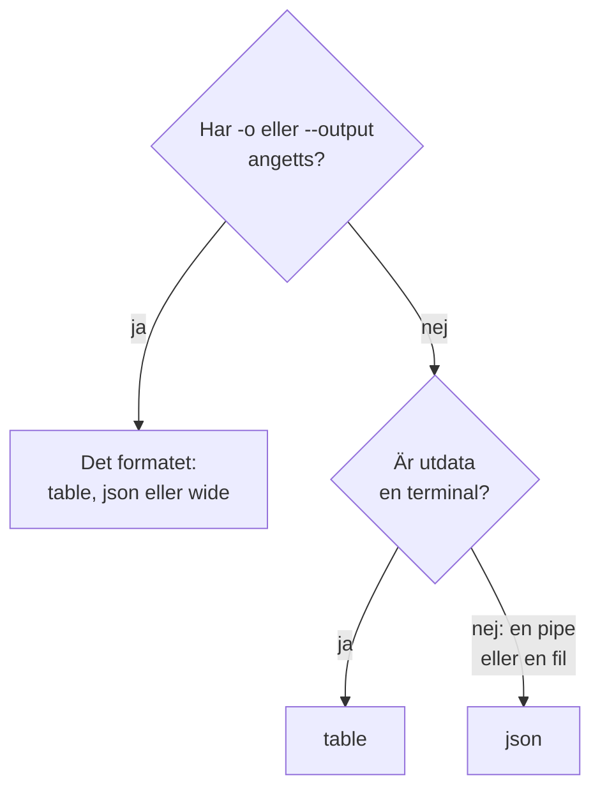

# Utdataformat

CLI:n skriver ut en tabell när du läser dess svar i en terminal, och JSON när ett skript eller ett annat program läser det. Välj formatet för vilket kommando som helst med `-o` eller `--output`.

:::cards
- [Så väljs formatet](#så-väljs-formatet): En terminal får en tabell, en pipe får JSON.
- [Tabell](#tabell): Sex kolumner, varje värde avkortat vid 60 tecken.
- [JSON](#json): Varje fält, helt, för skript och jq.
- [Bred](#bred): En tabell med alla kolumner.
:::

## Så väljs formatet



| Format | Vad det skriver ut | Bäst för |
| --- | --- | --- |
| `table` | En tabell med upp till sex kolumner; en post som en rad per fält | Att läsa i en terminal |
| `json` | Svaret som OneUptime skickade det, indraget med två mellanslag | Skript, `jq` och filer |
| `wide` | En tabell med en kolumn för varje fält | Att jämföra många fält på en gång |

`-o` fungerar på varje kommando som skriver ut poster: `list`, `get`, `create`, `update` och `count` för en resurs, `oneuptime resources` och `oneuptime context list`. Det kan stå var som helst på kommandoraden. Alla andra värden avvisas innan en begäran skickas:

```text
error: option '-o, --output <format>' argument 'yaml' is invalid. Allowed choices are json, table, wide.
```

## Tabell

En tabell är standard i en terminal. `oneuptime resources --type analytics` skriver till exempel ut den här:

```text
┌────────────────────────────┬────────────────────────────┬─────────────────────────────┬───────────┬─────────────────────────────┐
│ Command                    │ Singular                   │ Plural                      │ Type      │ API Path                    │
├────────────────────────────┼────────────────────────────┼─────────────────────────────┼───────────┼─────────────────────────────┤
│ log                        │ Log                        │ Logs                        │ analytics │ /logs                       │
├────────────────────────────┼────────────────────────────┼─────────────────────────────┼───────────┼─────────────────────────────┤
│ span                       │ Span                       │ Spans                       │ analytics │ /span                       │
├────────────────────────────┼────────────────────────────┼─────────────────────────────┼───────────┼─────────────────────────────┤
│ metric                     │ Metric                     │ Metrics                     │ analytics │ /metrics                    │
├────────────────────────────┼────────────────────────────┼─────────────────────────────┼───────────┼─────────────────────────────┤
│ exception-instance         │ Exception Instance         │ Exception Instances         │ analytics │ /exceptions                 │
├────────────────────────────┼────────────────────────────┼─────────────────────────────┼───────────┼─────────────────────────────┤
│ monitor-log                │ Monitor Log                │ Monitor Logs                │ analytics │ /monitor-log                │
├────────────────────────────┼────────────────────────────┼─────────────────────────────┼───────────┼─────────────────────────────┤
│ kubernetes-cost-allocation │ Kubernetes Cost Allocation │ Kubernetes Cost Allocations │ analytics │ /kubernetes-cost-allocation │
├────────────────────────────┼────────────────────────────┼─────────────────────────────┼───────────┼─────────────────────────────┤
│ security-event             │ Security Event             │ Security Events             │ analytics │ /security-events            │
├────────────────────────────┼────────────────────────────┼─────────────────────────────┼───────────┼─────────────────────────────┤
│ change-event               │ Change Event               │ Change Events               │ analytics │ /change-events              │
├────────────────────────────┼────────────────────────────┼─────────────────────────────┼───────────┼─────────────────────────────┤
│ threat-intel-indicator     │ Threat Intel Indicator     │ Threat Intel Indicators     │ analytics │ /threat-intel-indicators    │
└────────────────────────────┴────────────────────────────┴─────────────────────────────┴───────────┴─────────────────────────────┘

Total: 9 resources
```

För en lista med poster visar en tabell upp till sex kolumner: först `_id`, `name`, `title`, `status`, `createdAt` och `updatedAt`, de av dem som posterna har, sedan posternas nästa fält i ordning. Kolumnerna tas från den första posten. Ett värde som är längre än 60 tecken kortas till sina första 57, följt av `...`.

En post, som `get` och `create` skriver ut den, är en tabell med två kolumner: fältets namn och dess värde, en rad per fält.

OneUptime skickar datum och andra posters ID:n som objekt, till exempel `{"_type":"DateTime","value":"2026-10-14T09:12:44.000Z"}`, och en tabell visar dem som den texten. Deras värde finns i `value`: se [JSON](#json).

## JSON

JSON är svaret som OneUptime skickade det, indraget med två mellanslag: en lista är en array av poster, och en post är ett objekt.

```bash
oneuptime incident list --limit 1 -o json
```

```json
[
  {
    "_id": "6f1c2a40-3b1e-4c55-9a0b-3e2f8d7c1a11",
    "createdAt": {
      "_type": "DateTime",
      "value": "2026-10-14T09:12:44.000Z"
    },
    "title": "Checkout API is down",
    "currentIncidentStateId": {
      "_type": "ObjectID",
      "value": "0b7d5e2c-8f4a-4d1b-9c3e-5a6f7b8c9d0e"
    }
  }
]
```

En post har varje fält som nyckeln får läsa; den här är avkortad till fyra. En posts eget `_id` är text, och de andra ID:na och datumen är objekt vars `value` innehåller dem:

```bash
oneuptime incident list -o json | jq -r '.[] | "\(.createdAt.value)  \(.title)"'
```

När utdata inte är en terminal, som i `oneuptime incident list | jq '.[].title'`, skriver CLI:n ut JSON utan `-o json`. Skriv ändå `-o json` i skript, så att de inte är beroende av det.

## Bred

`-o wide` är en tabell med en kolumn för varje fält i posterna. Varje värde avkortas fortfarande vid 60 tecken, och poster har många fält, så en bred tabell är mycket bred: bläddra igenom den med `less -S`.

```bash
oneuptime incident list -o wide | less -S
```

## Färger

Tabellrubriker är cyan; meddelanden är gröna när något lyckades, blå för information och röda för fel. Stäng av färger med `--no-color`, eller genom att sätta `NO_COLOR` till valfritt värde:

```bash
oneuptime incident list --no-color
NO_COLOR=1 oneuptime incident list
```

## Vad varje kommando skriver ut

Poster och antal går till standard ut, och fel till standard fel, så en pipe läser bara svaret.

| Kommando | I en tabell | I JSON |
| --- | --- | --- |
| En `list` som inte hittar något | `No results found.` | `[]` |
| En `get` eller en `create` | En rad per fält | Posten |
| En `count` | Talet | Talet |
| En `update` | En tom rad | `{}` |
| En `delete` | `Monitor <id> deleted successfully.` | Samma rad |

## Nästa steg

:::cards
- [Skript och CI/CD](/docs/cli/scripting): Läs JSON:en med jq i skript och pipelines.
- [Resursoperationer](/docs/cli/resource-operations): Operationerna som det här är svaren från.
- [Kommandoreferens](/docs/cli/command-reference): Varje kommando och varje alternativ.
:::
