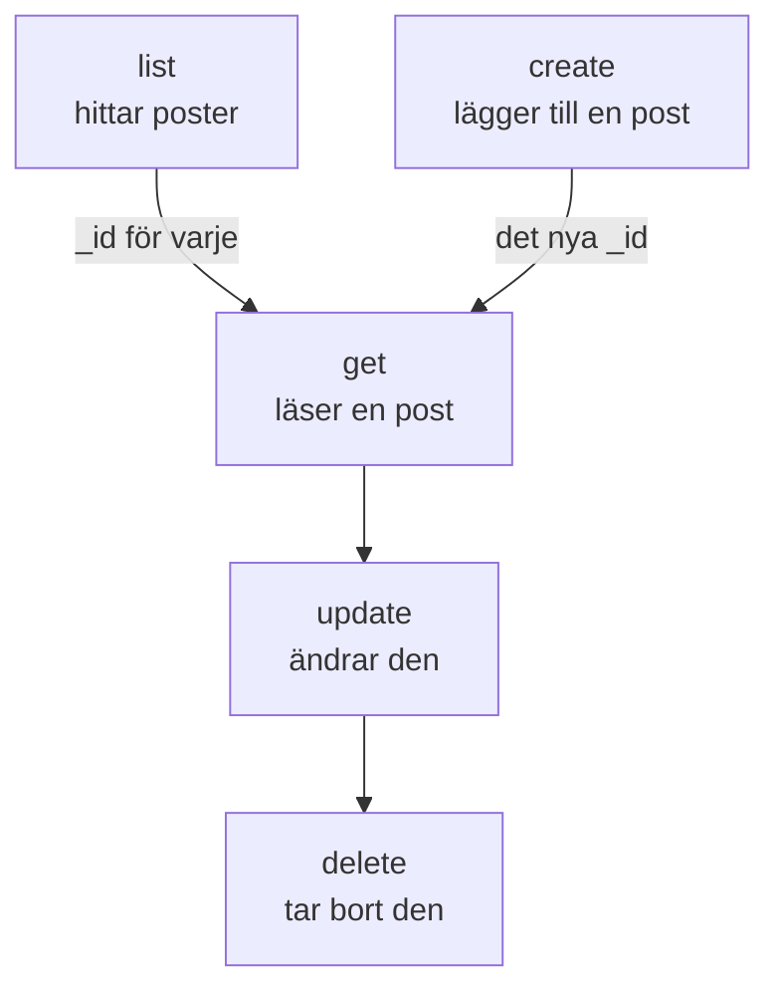

# Resursoperationer

Varje sorts post är ett eget kommando, till exempel `incident`, `monitor` eller `status-page`, med de operationer som API:et tar för den: för de flesta `list`, `get`, `create`, `update`, `delete` och `count`. Den här sidan visar varje operation, med filter, sidor och de flaggor som en post skrivs med, och de kommandon som gör det som instrumentpanelens knappar gör.

:::cards
- [Hitta kommandot för en post](#hitta-kommandot-för-en-post): oneuptime resources listar dem alla.
- [Lista poster](#lista-poster): Filtrera, sortera och bläddra.
- [Skapa en post](#skapa-en-post): En flagga för varje fält, eller posten som JSON.
- [Bekräfta, lös och lägg till anteckningar](#bekräfta-lös-och-lägg-till-anteckningar): Instrumentpanelens knappar som kommandon.
- [Ta bort en post](#ta-bort-en-post): Direkt, utan ångra.
:::

## Så hänger operationerna ihop

Att läsa, ändra och ta bort en post kräver dess ID. Att lista, räkna och skapa kräver inget, och en lista eller ett skapande ger dig de ID:n som de andra tar:



Ett ID är ett UUID, till exempel `6f1c2a40-3b1e-4c55-9a0b-3e2f8d7c1a11`. Du kan också kopiera ett från postens sida i OneUptime: se [Hitta ID:t för en resurs](/docs/api-reference/api-reference#hitta-idt-för-en-resurs).

## Hitta kommandot för en post

```bash
oneuptime resources
```

Listan visar varje sorts post med dess kommando, dess namn, dess typ och dess API-sökväg. Det finns två typer:

| Typ | Vad den innehåller |
| --- | --- |
| `database` | Poster som du hanterar: monitorer, incidenter, larm, statussidor, team och mer |
| `analytics` | Telemetri: loggar, spann, mätvärden, undantag och andra händelser |

Visa en typ med `oneuptime resources --type database` eller `--type analytics`. [Kommandoreferensen](/docs/cli/command-reference#resurser) listar varje kommando.

En resurs tar de operationer som API:et tar för den. De flesta tar alla sex; en som OneUptime själv skriver, till exempel en e-postlogg, kan bara läsas. `oneuptime <resource> --help` listar en resurs underkommandon.

## Se en resurs fält

`fields` listar en resurs fält från själva CLI:n, utan API-nyckel och utan begäran:

```bash
oneuptime incident fields
```

Varje fält har sin typ, vad det används till, om ett skapande måste ange det, och den flagga som sätter det. Ett fält som innehåller ett ID nämner resursen som ID:t hör till: `incidentSeverityId` tar ett från `oneuptime incident-severity list`. Med `-o json` läser ett skript eller en AI-agent samma sak, med samma nycklar för varje fält: `name`, `title`, `type`, `description`, `required`, `create`, `update`, `read`, `flag`, `emailFlag` och `relatedResource`.

## Lista poster

```bash
oneuptime <resource> list [--query <json>] [--limit <n>] [--skip <n>] [--sort <json>] [--fields <names>] [--all] [-o <format>]
```

| Alternativ | Vad det gör | Standard |
| --- | --- | --- |
| `--query <json>` | Returnerar bara de poster som matchar: se [Filtrera en lista](#filtrera-en-lista) | Varje post som nyckeln får läsa |
| `--limit <n>` | Det högsta antalet poster att returnera, upp till 10 000 | `10` |
| `--skip <n>` | Hur många matchande poster som hoppas över först | `0` |
| `--sort <json>` | Ordningen, till exempel `{"createdAt":"ASC"}`, eller `"DESC"` för de nyaste först | De nyaste först |
| `--fields <names>` | Fälten som ska returneras, åtskilda av kommatecken, till exempel `title,createdAt` | Varje fält som nyckeln får läsa |
| `--all` | Varje post som matchar, sida efter sida, i stället för `--limit` och `--skip`. Bara poster | |
| `-o, --output <format>` | `table`, `json` eller `wide` | `table` i en terminal, `json` i en pipe |

```bash
# The ten newest incidents
oneuptime incident list

# The oldest monitors first, 50 at a time: the second page
oneuptime monitor list --sort '{"createdAt":"ASC"}' --limit 50 --skip 50

# Every field of each incident, as JSON
oneuptime incident list -o json

# The title, the state and the creation date of every incident
oneuptime incident list --all --fields title,currentIncidentState.name,createdAt -o json
```

En lista ber OneUptime om varje fält i varje post som nyckeln får läsa. `--fields` ber i stället om de fält den nämner, och efter en punkt om ett fält i en kopplad post, som i `currentIncidentState.name`. En tabell visar sex fält; JSON visar alla (se [Utdataformat](/docs/cli/output-formats)). `--all` läser varje sida, 100 poster åt gången, upp till 100 000; `count` säger hur många det finns.

Etiketter listas efter namn i stället för de nyaste först: etiketter vars namn börjar med en siffra kommer först, i ordning efter talet (`2. Team` före `10. Owner`), sedan de övriga i bokstavsordning. Vill du ha dem i en annan ordning anger du `--sort`.

### Filtrera en lista

`--query` tar samma filter som API:et: ett fält med ett värde matchar det värdet, och ett objekt med en `_type` jämför.

| Filter | Matchar |
| --- | --- |
| `{"title":"Checkout API is down"}` | Poster med exakt det värdet |
| `{"title":{"_type":"Search","value":"checkout"}}` | Text som innehåller värdet |
| `{"createdAt":{"_type":"GreaterThan","value":"2026-10-01T00:00:00.000Z"}}` | Senare datum eller större tal |
| `{"currentIncidentState":{"isResolvedState":false}}` | Ett fält i en post som resursen nämner: här incidenter som inte är lösta |

```bash
oneuptime incident list --query '{"title":{"_type":"Search","value":"checkout"}}'
```

[Filtrera, sortera och bläddra](/docs/api-reference/api-reference#filtrera-sortera-och-bläddra) i API-referensen listar varje `_type`.

## Läs en post

```bash
oneuptime <resource> get <id> [--fields <names>] [-o <format>]
```

```bash
oneuptime incident get 6f1c2a40-3b1e-4c55-9a0b-3e2f8d7c1a11
```

En tabell visar en rad för varje fält i posten, med varje värde avkortat vid 60 tecken; `-o json` visar värdena hela. Ett ID som inte nämner någon post som din nyckel får läsa ger svaret `Not found`, och kommandot avslutas med koden `3`.

## Skapa en post

```bash
oneuptime <resource> create [--<field> <value>]... [--data <json>] [--file <path>] [-o <format>]
```

Varje fält som ett skapande tar har en flagga: `--title <text>`, `--incident-severity-id <id>`, `--labels <ids>` för ID:n åtskilda av kommatecken, `--is-visible-on-status-page [true|false]` för ett ja-eller-nej-fält, sant när den anges ensam, och `--monitor-steps <json>` för ett fält som innehåller JSON. `oneuptime <resource> create --help` listar dem, och [`fields`](#se-en-resurs-fält) säger vad varje fält används till. Projektet kommer från API-nyckeln, så en post nämner det aldrig.

```bash
# A manual monitor
oneuptime monitor create --name "Checkout API" --monitor-type Manual

# An incident with one of your severities
oneuptime incident create --title "Checkout API is down" --incident-severity-id <severity-id>

# The same incident, from a file
oneuptime incident create --file incident.json
```

`--data` tar posten som JSON, och `--file` läser den från en JSON-fil, med API:ets fält: [API-referensen](/reference) listar varje resurs fält. Anger du båda används filen, och flaggor läggs ovanpå vilken som helst av dem.

Ett fält som nämner en person med användar-ID har en andra flagga som nämner personen med e-postadress: `--user-email` bredvid `--user-id`, `--owner-user-emails` bredvid `--owner-users`. CLI:n hittar personen bland medlemmarna i API-nyckelns projekt och de personer som är inbjudna till det. En teammedlem som nämns med en adress som ingen i projektet har bjuds in till det, som när du bjuder in från instrumentpanelen:

```bash
oneuptime team-member create --team-id <team-id> --user-email alice@example.com
```

CLI:n skriver ut den nya posten med dess `_id`. En incident börjar i ditt projekts skapad-tillstånd, om inte `currentIncidentStateId` nämner ett annat: se [Tillståndet som en ny post börjar i](/docs/api-reference/api-reference#tillståndet-som-en-ny-post-börjar-i). Så hittar du ID:na för dina allvarlighetsgrader:

```bash
oneuptime incident-severity list -o json | jq -r '.[] | "\(._id)  \(.name)"'
```

> [!TIP]
> På Windows anger du fälten med deras flaggor, eller lägger JSON:en i en fil och använder `--file`: PowerShell och kommandotolken citerar JSON på kommandoraden på ett annat sätt än Bash.

## Uppdatera en post

```bash
oneuptime <resource> update <id> [--<field> <value>]... [--data <json>] [--file <path>] [-o <format>]
```

Ange bara de fält som ska ändras, med deras flaggor eller som JSON:

```bash
# Rename a monitor
oneuptime monitor update <monitor-id> --name "Checkout API (EU)"

# Record an incident's root cause
oneuptime incident update <incident-id> --root-cause "A full disk on the primary database"
```

OneUptime svarar på en uppdatering med ett tomt objekt: CLI:n skriver ut en tom rad, eller `{}` med `-o json`. Kör `get` för att se posten som den är nu. För att flytta en incident till ett annat tillstånd anger du `--current-incident-state-id`: ändringen registreras på dess tidslinje, som instrumentpanelen gör, och ett tillstånd före det nuvarande avvisas. [`acknowledge` och `resolve`](#bekräfta-lös-och-lägg-till-anteckningar) hittar tillståndet åt dig. Så hittar du ID:t för löst-tillståndet, det första i ditt projekts ordning:

```bash
oneuptime incident-state list --query '{"isResolvedState":true}' --sort '{"order":"ASC"}' --limit 1 -o json | jq -r '.[0]._id'
```

## Bekräfta, lös och lägg till anteckningar

Incidenter, larm, deras episoder och schemalagda underhållshändelser har kommandon för det som instrumentpanelens knappar gör på dem:

| Kommando | Vad det gör | Resurser |
| --- | --- | --- |
| `acknowledge <id>` | Flyttar posten till ditt projekts bekräftad-tillstånd | `incident`, `alert`, `incident-episode`, `alert-episode` |
| `resolve <id>` | Flyttar den till ditt projekts löst-tillstånd | Samma fyra |
| `start <id>` | Flyttar händelsen till ditt projekts pågående tillstånd | `scheduled-maintenance-event` |
| `end <id>` | Flyttar den till ditt projekts avslutad-tillstånd | `scheduled-maintenance-event` |
| `add-note <id> --note <markdown>` | Lägger till en anteckning som bara de som kan se posten kan läsa, eller med `--public` en på postens statussidor | Alla fem |

```bash
oneuptime incident acknowledge 6f1c2a40-3b1e-4c55-9a0b-3e2f8d7c1a11
oneuptime incident add-note 6f1c2a40-3b1e-4c55-9a0b-3e2f8d7c1a11 --note "Rolled back the 14:05 deploy."
oneuptime incident resolve 6f1c2a40-3b1e-4c55-9a0b-3e2f8d7c1a11
```

`acknowledge` svarar `Incident 6f1c2a40-3b1e-4c55-9a0b-3e2f8d7c1a11 acknowledged: it is in Acknowledged now.` En post som redan är i det tillståndet, eller förbi det, lämnas som den är: kommandot säger det och avslutas med `0`. Med `-o json` svarar det med postens `_id`, `action`, om något ändrades (`changed`), och tillståndet `state` som posten är i. Larm och larmepisoder tar bara interna anteckningar.

## Ta bort en post

```bash
oneuptime <resource> delete <id>
```

```bash
oneuptime monitor delete 6f1c2a40-3b1e-4c55-9a0b-3e2f8d7c1a11
```

Den svarar `Monitor 6f1c2a40-3b1e-4c55-9a0b-3e2f8d7c1a11 deleted successfully.` Med `-o json` svarar den med postens `_id` och `"deleted": true`.

> [!CAUTION]
> `delete` tar bort posten direkt. CLI:n ber dig inte bekräfta, och det går inte att ångra. Den godtar `--force`, för skript som skrivits med det, och `--force` ändrar ingenting.

## Räkna poster

```bash
oneuptime <resource> count [--query <json>]
```

```bash
# Every incident
oneuptime incident count

# Incidents that are not resolved
oneuptime incident count --query '{"currentIncidentState":{"isResolvedState":false}}'
```

CLI:n skriver ut ett tal, samma i en tabell och i JSON, så att ett skript kan läsa det som det är.

## Felsökning

:::details Meddelandet ”Not found: API error (404)”
Posten finns inte, ligger i ett annat projekt, eller nyckeln får inte läsa den: OneUptime svarar likadant i varje fall. Kontrollera ID:t med `list`, och nyckelns behörigheter. Kommandot avslutas med koden `3`.
:::

:::details Meddelandet ”Left out fields this API key may not read”
En lista eller en läsning ber om varje fält i posten, och OneUptime avvisar ett fält som nyckeln inte får läsa: CLI:n frågar igen utan fältet och nämner de utelämnade fälten på standard fel. Ge nyckeln en behörighet som läser dem, eller nämn de fält du behöver med `--fields`: ett nämnt fält som nyckeln inte får läsa stoppar kommandot med `API error (422)`.
:::

:::details Meddelandet ”Error: Invalid JSON”
Värdet för `--query`, `--sort` eller `--data` är inte JSON. I Bash och zsh sätter du det inom enkla citattecken; på Windows anger du fälten med deras flaggor, eller lägger en post i en fil och använder `--file`.
:::

:::details API error (400) vid ett skapande eller en uppdatering
OneUptime avvisade ett fält: meddelandet nämner det, och `oneuptime <resource> fields` listar fälten med de flaggor som sätter dem. Ett kommando som inte anger något fält alls avvisas innan det skickas, med de flaggor som ska anges.
:::

:::details Meddelandet ”No one in this project, or invited to it, has the email address”
En e-postflagga nämner någon som varken är medlem i API-nyckelns projekt eller inbjuden till det. Bjud in personen med `oneuptime team-member create --team-id <team-id> --user-email <email>`, eller nämn personen med användar-ID.
:::

## Nästa steg

:::cards
- [Utdataformat](/docs/cli/output-formats): Läs svaren som tabeller eller som JSON.
- [Skript och CI/CD](/docs/cli/scripting): Använd de här operationerna i skript och pipelines.
- [Kommandoreferens](/docs/cli/command-reference): Varje kommando, alternativ och standardvärde.
:::
