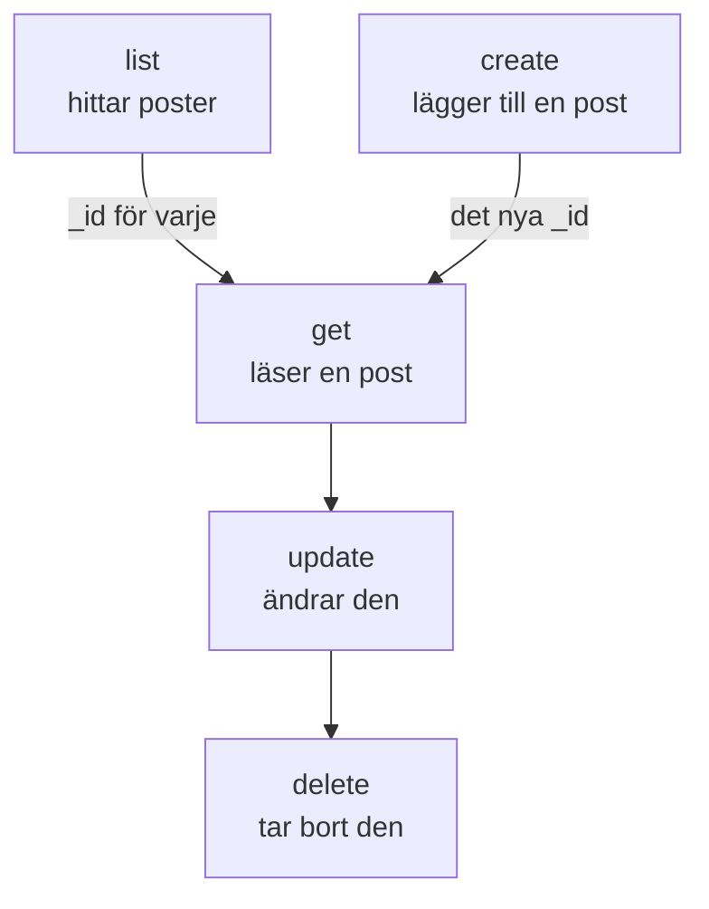

# Resursoperationer

Varje sorts post är ett eget kommando, till exempel `incident`, `monitor` eller `status-page`, och vart och ett tar samma operationer: `list`, `get`, `create`, `update`, `delete` och `count`. Den här sidan visar varje operation, med filter, sidor och den JSON som en post skrivs i.

:::cards
- [Hitta kommandot för en post](#hitta-kommandot-för-en-post): oneuptime resources listar dem alla.
- [Lista poster](#lista-poster): Filtrera, sortera och bläddra.
- [Skapa en post](#skapa-en-post): Från JSON på kommandoraden eller i en fil.
- [Ta bort en post](#ta-bort-en-post): Direkt, utan ångra.
:::

## Så hänger operationerna ihop

Att läsa, ändra och ta bort en post kräver dess ID. Att lista, räkna och skapa kräver inget, och en lista eller ett skapande ger dig de ID:n som de andra tar:



Ett ID är ett UUID, till exempel `6f1c2a40-3b1e-4c55-9a0b-3e2f8d7c1a11`. Du kan också kopiera ett från postens sida i OneUptime: se [Hitta ID:t för en resurs](/docs/api-reference/api-reference#hitta-idt-för-en-resurs).

## Hitta kommandot för en post

```bash
oneuptime resources
```

Listan visar varje sorts post med dess kommando, dess namn, dess typ och dess API-sökväg. Det finns två typer:

| Typ | Vad den innehåller | Operationer |
| --- | --- | --- |
| `database` | Poster som du hanterar: monitorer, incidenter, larm, statussidor, team och mer | `list`, `get`, `create`, `update`, `delete`, `count` |
| `analytics` | Telemetri: loggar, spans, mätvärden, undantag och andra händelser | `list`, `create`, `count` |

Visa en typ med `oneuptime resources --type database` eller `--type analytics`. [Kommandoreferensen](/docs/cli/command-reference#resurser) listar varje kommando.

## Lista poster

```bash
oneuptime <resource> list [--query <json>] [--limit <n>] [--skip <n>] [--sort <json>] [-o <format>]
```

| Alternativ | Vad det gör | Standard |
| --- | --- | --- |
| `--query <json>` | Returnerar bara de poster som matchar: se [Filtrera en lista](#filtrera-en-lista) | Varje post som nyckeln får läsa |
| `--limit <n>` | Det högsta antalet poster att returnera, upp till 10 000 | `10` |
| `--skip <n>` | Hur många matchande poster som hoppas över först | `0` |
| `--sort <json>` | Ordningen, till exempel `{"createdAt":"ASC"}`, eller `"DESC"` för de nyaste först | De nyaste först |
| `-o, --output <format>` | `table`, `json` eller `wide` | `table` i en terminal, `json` i en pipe |

```bash
# The ten newest incidents
oneuptime incident list

# The oldest monitors first, 50 at a time: the second page
oneuptime monitor list --sort '{"createdAt":"ASC"}' --limit 50 --skip 50

# Every field of each incident, as JSON
oneuptime incident list -o json
```

En lista ber OneUptime om varje fält i varje post som nyckeln får läsa. En tabell visar sex av dem; JSON visar alla (se [Utdataformat](/docs/cli/output-formats)). För att bläddra igenom alla poster ökar du `--skip` med `--limit` tills en sida kommer tillbaka tom; `count` säger hur många det finns.

Etiketter listas efter namn i stället för de nyaste först: etiketter vars namn börjar med en siffra kommer först, i ordning efter talet (`2. Team` före `10. Owner`), sedan de övriga i bokstavsordning. Vill du ha dem i en annan ordning anger du `--sort`.

### Filtrera en lista

`--query` tar samma filter som API:et: ett fält med ett värde matchar det värdet, och ett objekt med en `_type` jämför.

| Filter | Matchar |
| --- | --- |
| `{"title":"Checkout API is down"}` | Poster med exakt det värdet |
| `{"title":{"_type":"Search","value":"checkout"}}` | Text som innehåller värdet |
| `{"createdAt":{"_type":"GreaterThan","value":"2026-10-01T00:00:00.000Z"}}` | Senare datum eller större tal |
| `{"currentIncidentState":{"isResolvedState":false}}` | Ett fält i en post som resursen nämner: här incidenter som inte är lösta |

```bash
oneuptime incident list --query '{"title":{"_type":"Search","value":"checkout"}}'
```

[Filtrera, sortera och bläddra](/docs/api-reference/api-reference#filtrera-sortera-och-bläddra) i API-referensen listar varje `_type`.

## Läs en post

```bash
oneuptime <resource> get <id> [-o <format>]
```

```bash
oneuptime incident get 6f1c2a40-3b1e-4c55-9a0b-3e2f8d7c1a11
```

En tabell visar en rad för varje fält i posten, med varje värde avkortat vid 60 tecken; `-o json` visar värdena hela. Ett ID som inte nämner någon post som din nyckel får läsa ger svaret `Not found`, och kommandot avslutas med koden `3`.

## Skapa en post

```bash
oneuptime <resource> create --data <json> [-o <format>]
oneuptime <resource> create --file <path> [-o <format>]
```

`--data` tar posten som JSON, och `--file` läser den från en JSON-fil. Ange en av de två; anger du båda används filen. Fälten är API:ets, och [API-referensen](/reference) listar varje resurs fält. Projektet kommer från API-nyckeln, så en post nämner det aldrig.

```bash
# A manual monitor
oneuptime monitor create --data '{"name":"Checkout API","monitorType":"Manual"}'

# An incident with one of your severities
oneuptime incident create --data '{"title":"Checkout API is down","incidentSeverityId":"<severity-id>"}'

# The same incident, from a file
oneuptime incident create --file incident.json
```

CLI:n skriver ut den nya posten med dess `_id`. En incident börjar i ditt projekts skapad-tillstånd, om inte `currentIncidentStateId` nämner ett annat: se [Tillståndet som en ny post börjar i](/docs/api-reference/api-reference#tillståndet-som-en-ny-post-börjar-i). Så hittar du ID:na för dina allvarlighetsgrader:

```bash
oneuptime incident-severity list -o json | jq -r '.[] | "\(._id)  \(.name)"'
```

> [!TIP]
> På Windows lägger du JSON:en i en fil och använder `--file`: PowerShell och kommandotolken citerar JSON på kommandoraden på ett annat sätt än Bash.

## Uppdatera en post

```bash
oneuptime <resource> update <id> --data <json> [-o <format>]
```

`--data` krävs och innehåller bara de fält som ska ändras:

```bash
# Rename a monitor
oneuptime monitor update <monitor-id> --data '{"name":"Checkout API (EU)"}'

# Move an incident to your resolved state
oneuptime incident update <incident-id> --data '{"currentIncidentStateId":"<resolved-state-id>"}'
```

OneUptime svarar på en uppdatering med ett tomt objekt: CLI:n skriver ut en tom rad, eller `{}` med `-o json`. Kör `get` för att se posten som den är nu. Flyttar du en incident till ett annat tillstånd på det här sättet registreras ändringen på dess tidslinje, som instrumentpanelen gör, och ett tillstånd före det aktuella avvisas. Så hittar du ID:t för det lösta tillståndet, det första i ditt projekts ordning:

```bash
oneuptime incident-state list --query '{"isResolvedState":true}' --sort '{"order":"ASC"}' --limit 1 -o json | jq -r '.[0]._id'
```

## Ta bort en post

```bash
oneuptime <resource> delete <id>
```

```bash
oneuptime monitor delete 6f1c2a40-3b1e-4c55-9a0b-3e2f8d7c1a11
```

Den svarar `Monitor 6f1c2a40-3b1e-4c55-9a0b-3e2f8d7c1a11 deleted successfully.`

> [!CAUTION]
> `delete` tar bort posten direkt. CLI:n ber dig inte bekräfta, och det går inte att ångra. Den godtar `--force`, för skript som skrivits med det, och `--force` ändrar ingenting.

## Räkna poster

```bash
oneuptime <resource> count [--query <json>]
```

```bash
# Every incident
oneuptime incident count

# Incidents that are not resolved
oneuptime incident count --query '{"currentIncidentState":{"isResolvedState":false}}'
```

CLI:n skriver ut ett tal, samma i en tabell och i JSON, så att ett skript kan läsa det som det är.

## Vad varje typ kan

| Operation | `database` | `analytics` |
| --- | --- | --- |
| `list` | Ja | Ja |
| `get` | Ja | Nej |
| `create` | Ja | Ja |
| `update` | Ja | Nej |
| `delete` | Ja | Nej |
| `count` | Ja | Ja |

## Felsökning

:::details Meddelandet ”Not found: API error (404)”
Posten finns inte, ligger i ett annat projekt, eller nyckeln får inte läsa den: OneUptime svarar likadant i varje fall. Kontrollera ID:t med `list`, och nyckelns behörigheter. Kommandot avslutas med koden `3`.
:::

:::details Meddelandet ”API error (422): You do not have permissions to select on”
En lista eller en läsning ber om varje fält i posten, och nyckeln får inte läsa ett av dem: meddelandet nämner fältet och de behörigheter som får läsa det. Ge nyckeln en av de behörigheterna.
:::

:::details Meddelandet ”Error: Invalid JSON”
Värdet för `--query`, `--sort` eller `--data` är inte JSON. I Bash och zsh sätter du det inom enkla citattecken; på Windows lägger du en post i en fil och använder `--file`.
:::

:::details API error (400) vid ett skapande eller en uppdatering
OneUptime avvisade ett fält: meddelandet nämner det. `No fields to update` betyder att `--data` inte innehöll något fält att ändra.
:::

## Nästa steg

:::cards
- [Utdataformat](/docs/cli/output-formats): Läs svaren som tabeller eller som JSON.
- [Skript och CI/CD](/docs/cli/scripting): Använd de här operationerna i skript och pipelines.
- [Kommandoreferens](/docs/cli/command-reference): Varje kommando, alternativ och standardvärde.
:::
