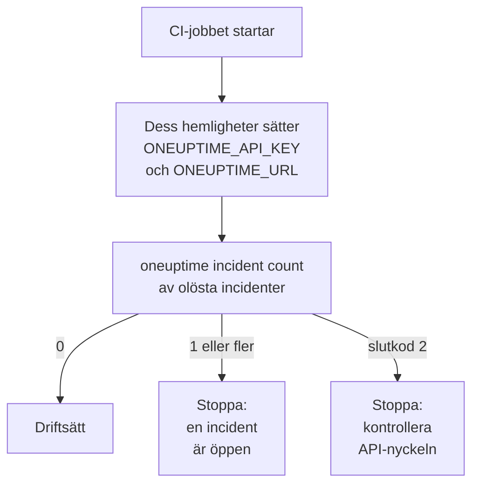

# Skript och CI/CD

CLI:n fungerar likadant i ett skript som i en terminal. Ge den en API-nyckel i miljövariabler, läs dess svar som JSON och låt dess slutkod tala om för skriptet vad som hände. Den här sidan visar var och en av delarna, och kompletta pipelines för GitHub Actions, GitLab CI och Docker.

:::cards
- [Ge ett skript dess API-nyckel](#ge-ett-skript-dess-api-nyckel): Två miljövariabler, ingen sparad kontext.
- [Slutkoder](#slutkoder): 0 när det fungerade, och varför det annars inte gjorde det.
- [Läs svar med jq](#läs-svar-med-jq): ID:n, titlar och datum ur JSON:en.
- [Exempel på pipelines](#exempel-på-pipelines): GitHub Actions, GitLab CI och Docker.
:::

## Så använder ett skript CLI:n

En driftsättning kan först fråga OneUptime om en incident är öppen, och stoppa om det finns en:



## Ge ett skript dess API-nyckel

Sätt `ONEUPTIME_API_KEY` och `ONEUPTIME_URL` från ditt CI-systems hemligheter. CLI:n behöver då varken `login` eller en konfigurationsfil. En flagga går fortfarande före dem för ett kommando, och de går före sparade kontexter.

```bash
export ONEUPTIME_API_KEY="$CI_ONEUPTIME_API_KEY"
export ONEUPTIME_URL="https://oneuptime.com"
oneuptime incident count
```

> [!TIP]
> Ge varje pipeline en egen API-nyckel med bara den åtkomst den behöver: en kontroll som bara läser behöver en nyckel som bara läser. Ta bort nyckeln i OneUptime när pipelinen läggs ned.

Kör en maskin jobb för flera projekt, så spara en kontext för vart och ett och nämn den i varje kommando, så att ett jobb aldrig använder ett annats aktuella kontext:

```bash
oneuptime --context production incident count
oneuptime --context staging monitor count
```

## Slutkoder

| Kod | Betydelse | Till exempel |
| --- | --- | --- |
| `0` | Det fungerade | En lista, även en som inte hittar något |
| `1` | Det misslyckades | OneUptime avvisade begäran, till exempel `API error (422)`; ogiltig JSON; ett saknat eller okänt alternativ; en kontext som inte är sparad |
| `2` | Ingen användbar API-nyckel | Inga inloggningsuppgifter hittade; en ogiltig API-nyckel; en nyckel under sin plan (`402`); `401` |
| `3` | Hittades inte | OneUptime svarade `404`: posten finns inte, ligger i ett annat projekt, eller nyckeln får inte läsa den |

`whoami` och `context current` avslutas med `0` även när inget är sparat: de rapporterar vad som är satt, de kontrollerar det inte. Ett skript skiljer fallen åt på koden:

```bash
oneuptime incident get "$INCIDENT_ID" -o json > incident.json
case $? in
  0) echo "Saved the incident to incident.json" ;;
  2) echo "Check ONEUPTIME_API_KEY and ONEUPTIME_URL" >&2; exit 1 ;;
  3) echo "There is no incident $INCIDENT_ID" >&2; exit 1 ;;
  *) echo "OneUptime refused the request" >&2; exit 1 ;;
esac
```

Felmeddelanden går till standard fel, så `incident.json` innehåller bara svaret.

## Läs svar med jq

Skriv `-o json` i skript. I en pipe skriver CLI:n ut JSON ändå, men flaggan håller skriptet fungerande var det än körs:

```bash
# The title of each incident
oneuptime incident list -o json | jq -r '.[].title'

# The ID of a new monitor
MONITOR_ID=$(oneuptime monitor create --data '{"name":"Checkout API","monitorType":"Manual"}' -o json | jq -r '._id')

# When each incident was created: dates come as objects
oneuptime incident list -o json | jq -r '.[] | "\(.createdAt.value)  \(.title)"'

# The newest 100 incidents as CSV
oneuptime incident list --limit 100 -o json | jq -r '.[] | [._id, .title, .createdAt.value] | @csv'
```

En räkning skriver ut ett tal, redo att jämföra:

```bash
OPEN=$(oneuptime incident count --query '{"currentIncidentState":{"isResolvedState":false}}')
echo "$OPEN incidents are open"
```

## Skapa poster från filer

Håll poster som JSON-filer bredvid din kod, och skapa dem därifrån:

```json title="monitors/checkout-api.json"
{
  "name": "Checkout API",
  "monitorType": "Manual"
}
```

```bash
oneuptime monitor create --file monitors/checkout-api.json
```

Många poster från en JSON-array, ett skapande för varje:

```bash
jq -c '.[]' monitors.json | while IFS= read -r monitor; do
  oneuptime monitor create --data "$monitor" -o json | jq -r '._id'
done
```

> [!NOTE]
> Varje körning skapar nya poster. För att hålla monitorer och statussidor i takt med filer, bara ändra det som ändrats och ta bort det som försvunnit, använder du [Terraform-providern](/docs/terraform/index).

## Exempel på pipelines

:::tabs
@tab GitHub Actions
```yaml title=".github/workflows/deploy.yml"
name: Deploy
on:
  push:
    branches: [main]

jobs:
  deploy:
    runs-on: ubuntu-latest
    steps:
      - uses: actions/checkout@v4
      - uses: actions/setup-node@v4
        with:
          node-version: lts/*
      - name: Install the OneUptime CLI
        run: npm install -g @oneuptime/cli
      - name: Stop while an incident is open
        env:
          ONEUPTIME_API_KEY: ${{ secrets.ONEUPTIME_API_KEY }}
          ONEUPTIME_URL: https://oneuptime.com
        run: |
          OPEN=$(oneuptime incident count --query '{"currentIncidentState":{"isResolvedState":false}}')
          if [ "$OPEN" -gt 0 ]; then
            echo "$OPEN incidents are open: not deploying."
            exit 1
          fi
      - name: Deploy
        run: ./deploy.sh
```
@tab GitLab CI
```yaml title=".gitlab-ci.yml"
check-incidents:
  stage: test
  image: node:lts
  variables:
    ONEUPTIME_URL: https://oneuptime.com
  script:
    - npm install -g @oneuptime/cli
    - OPEN=$(oneuptime incident count --query '{"currentIncidentState":{"isResolvedState":false}}')
    - echo "$OPEN incidents are open"
    - test "$OPEN" -eq 0
```
@tab Docker
```dockerfile title="Dockerfile"
FROM node:lts-slim
RUN npm install -g @oneuptime/cli
ENTRYPOINT ["oneuptime"]
```
:::

I GitHub Actions lägger du till `ONEUPTIME_API_KEY` under repositoriets **Settings → Secrets and variables → Actions**; i GitLab lägger du till den som en maskerad CI/CD-variabel. Med Docker-avbildningen skickar du med variablerna till varje körning:

```bash
docker build -t oneuptime-cli .
docker run --rm -e ONEUPTIME_API_KEY -e ONEUPTIME_URL oneuptime-cli incident count
```

## Nästa steg

:::cards
- [Autentisering](/docs/cli/authentication): Vilken nyckel ett kommando använder när flera är satta.
- [Utdataformat](/docs/cli/output-formats): JSON:en som dina skript läser.
- [Resursoperationer](/docs/cli/resource-operations): Filter, sidor och en posts fält.
- [Terraform-provider](/docs/terraform/index): Håll OneUptimes konfiguration i filer.
:::
