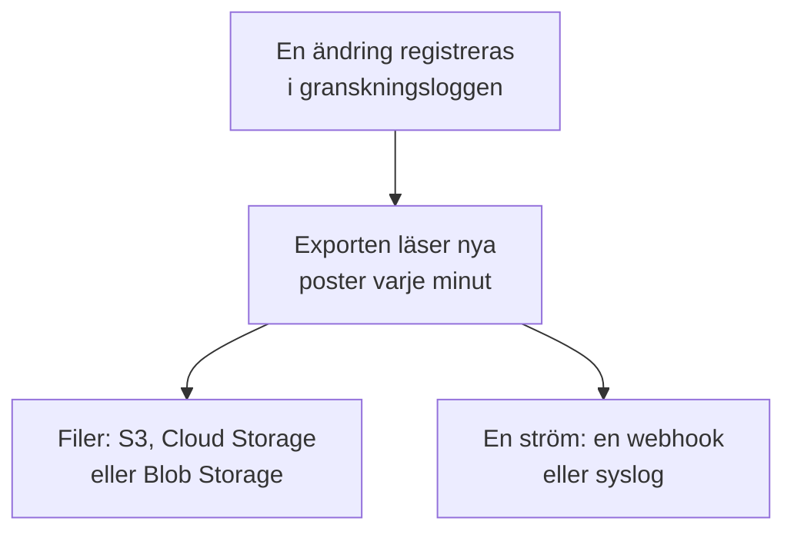

# Export av granskningslogg

Skicka granskningsloggen, allt eftersom den registreras, till lagring eller en tjänst du väljer: Amazon S3 eller S3-kompatibel lagring, Google Cloud Storage, Azure Blob Storage, en webhook eller syslog. Behåll posterna där så länge dina efterlevnadsgranskningar kräver, och sök i dem i ditt SIEM. Ett projekts ägare och administratörer exporterar dess granskningslogg från projektinställningarna, och master admins exporterar alla projekts från Admin Dashboard. Den ingår i Enterprise-planen i OneUptime Cloud och i Enterprise Edition när du kör självhostat.

:::cards
- [Konfigurera en export](#konfigurera-en-export): Välj ett mål, testa det, spara det.
- [Vad som skickas](#vad-som-skickas): Ett JSON-objekt per post, i ett stabilt schema.
- [När poster skickas](#när-poster-skickas): Varje minut, varje post en gång, i ordning.
- [När ett mål misslyckas](#när-ett-mål-misslyckas): Nya försök, felet, och inget hoppas över.
:::

## Så når en post ditt mål



- **En export, ett mål.** Ett projekt kan ha flera exporter, och var och en skickar varje post till sitt eget mål.
- **Ett projekts, eller instansens.** Ett projekts export skickar det projektets poster. En export som konfigurerats i Admin Dashboard skickar posterna från alla projekt som registrerar granskningsloggar.
- **Från när den sparas.** En export skickar det som registreras efter att den sparats, om du inte ställer **Exportera från** på ett tidigare datum.

## Innan du börjar

- **I OneUptime Cloud: Enterprise-planen.** På andra planer visar sidan vad funktionen gör och hur du får den.
- **När du kör självhostat: Enterprise Edition**, med en licens som omfattar granskningsloggar. Se [Enterprise Edition](/docs/self-hosted/enterprise).
- **Granskningsloggning påslagen** i varje projekt du exporterar. Se [Granskningsloggar](/docs/configuration/audit-logs).
- **En Project Owner eller Project Admin** för att exportera ett projekts granskningslogg, eller en master admin för att exportera instansens.

## Konfigurera en export

:::steps
### Öppna exportsidan

För ett projekt går du till **Projektinställningar → Granskningsloggar → Export**. För hela instansen går du till **Inställningar → Export av granskningslogg** i Admin Dashboard.

### Välj ett mål

Klicka på **Lägg till export** och välj ett av de sex målen nedan. En exports mål kan inte ändras senare.

### Fyll i hur det nås

Fyll i det som målet frågar efter. Inställningar som de flesta låter vara väntar under **Fler fält**, och **Installationsguide** öppnar målets avsnitt på den här sidan.

### Skicka ett test

Klicka på **Skriv en testfil** eller **Skicka en testpost**. Lagring får filen `oneuptime-audit-log-export-test.ndjson.gz` i sin mapp, och en webhook eller syslog får en post vars åtgärd är `Test`. Ett misslyckat test säger vad som ska åtgärdas.

### Börja exportera

Klicka på **Nästa**, namnge exporten och klicka på **Börja exportera**. De första posterna kommer inom några minuter.
:::

Exportens rad visar hur det går: **Exporterar**, **Misslyckas**, **Pausad**, **Väntar på poster** eller **Startar**. **Skicka ett test** skickar ett test med de sparade inställningarna, och **Redigera** ändrar dem: En inloggningsuppgift som du lämnar tom behåller den sparade.

## Mål

| Mål | Vad som kommer fram | Loggar in med |
| --- | --- | --- |
| [Amazon S3](#amazon-s3) | Komprimerade NDJSON-filer | En åtkomstnyckel |
| [S3-kompatibel lagring](#s3-kompatibel-lagring) | Komprimerade NDJSON-filer | En åtkomstnyckel |
| [Google Cloud Storage](#google-cloud-storage) | Komprimerade NDJSON-filer | En nyckel för ett tjänstkonto |
| [Azure Blob Storage](#azure-blob-storage) | Komprimerade NDJSON-filer | En SAS-token eller en åtkomstnyckel |
| [Webhook](#webhook) | HTTPS-förfrågningar | Ett valfritt huvud och en signeringshemlighet |
| [Syslog](#syslog) | RFC 5424-meddelanden | Inget |

### Amazon S3

| Fält | Vad du anger |
| --- | --- |
| **Bucket** | Bucketen som filerna skrivs till. |
| **Region** | Bucketens region. Den står först på `us-east-1`. |
| **Åtkomstnyckel-ID** | En åtkomstnyckel som får skriva objekt till bucketen. |
| **Hemlig åtkomstnyckel** | Nyckelns hemlighet. |
| **Mapp** | Under **Fler fält**. Lämnas den tom hamnar filerna i `oneuptime/audit-logs/`. |

Nyckeln behöver bara `s3:PutObject` på mappen:

```json
{
  "Version": "2012-10-17",
  "Statement": [
    {
      "Effect": "Allow",
      "Action": "s3:PutObject",
      "Resource": "arn:aws:s3:::my-audit-logs/oneuptime/audit-logs/*"
    }
  ]
}
```

### S3-kompatibel lagring

Samma fält som för Amazon S3, efter en **Endpoint**: lagringens S3-adress, till exempel `https://minio.example.com:9000` eller `https://<account>.r2.cloudflarestorage.com`. Ställ **Region** på den som lagringen förväntar sig: `us-east-1` för MinIO och Wasabis standard, `auto` för Cloudflare R2.

### Google Cloud Storage

Ange **Bucket** och klistra in en **Nyckel för tjänstkonto** (JSON) vars tjänstkonto har rollen Storage Object Creator på bucketen. **Mapp** väntar under **Fler fält**.

### Azure Blob Storage

Ange **Lagringskonto** och **Container**, och välj under **Logga in med** hur exporten loggar in: med en **SAS-token** med behörigheterna Create och Write på containern, eller med en **Åtkomstnyckel** till lagringskontot. En SAS-token kan begränsas till den här containern, så den är det säkrare valet. **Moln** och **Mapp** väntar under **Fler fält**.

### Webhook

OneUptime skickar varje batch med POST till **URL**, som en JSON-array (`application/json`) eller en post per rad (`application/x-ndjson`), som **Format för innehåll** anger, med de här huvudena:

| Huvud | Värde |
| --- | --- |
| `X-OneUptime-Event` | `audit-log-export` |
| `X-OneUptime-Batch-Id` | ID:t för batchens första post: Samma batch, skickad igen, har samma ID. |
| `X-OneUptime-Entry-Count` | Hur många poster innehållet har. |
| `X-OneUptime-Signature` | `sha256=` och HMAC-SHA256 av innehållet, med **Signeringshemlighet**, när en är angiven. |

**Inloggningsuppgift**, till exempel `Bearer <token>`, skickas i det huvud du väljer under **Huvudnamn**, `Authorization` om du inte ändrar det. **Format för innehåll**, **Huvudnamn** och **Signeringshemlighet** väntar under **Fler fält**. Varje 2xx-svar räknas som en leverans. En `413` delar batchen i två, och varje annat avslag skickar hela batchen igen senare.

### Syslog

Varje post är ett RFC 5424-meddelande till **Värd** och **Port**, över TLS på port `6514` om inte **Protokoll** anger TCP, med facility 13 (log audit) och severity 6 (informational):

```text
<110>1 2026-10-24T09:15:03.000Z oneuptime.example.com oneuptime - audit-log - {"schemaVersion":1,"id":"..."}
```

Meddelanden avgränsas med oktetträkning (RFC 5425), om inte **Meddelandeavgränsning** anger ett meddelande per rad. En mottagare vars certifikat en privat CA har signerat behöver den CA:ns certifikat i **CA-certifikat**. Båda väntar under **Fler fält**.

## Vad som skickas

Varje post är ett JSON-objekt, med nycklarna alltid i den här ordningen:

| Nyckel | Vad den innehåller |
| --- | --- |
| `schemaVersion` | `1`. En ändring av schemat kommer med en ny version. |
| `id` | Postens ID. Samma post, skickad två gånger, har samma ID. |
| `createdAt` | När ändringen registrerades, i UTC. |
| `projectId` | Projektet där ändringen gjordes. |
| `action` | `Create`, `Update`, `Delete` eller `Download`. |
| `resourceType`, `resourceId`, `resourceName` | Vad som ändrades. |
| `rootResourceType`, `rootResourceId` | Resursen den hör till, till exempel ett SLO för dess regel. |
| `userId`, `userName`, `userEmail`, `userType` | Vem som gjorde ändringen. |
| `apiKeyId`, `apiKeyName` | API-nyckeln den gjordes med, om någon. |
| `mcpOAuthGrantId`, `mcpClientName` | MCP-klienten den gjordes genom, om någon. |
| `workflowId`, `workflowName` | Arbetsflödet som gjorde den, om något. |
| `changes` | Varje ändrat fält: `field`, med `oldValue` och `newValue`. |

En fil har en post per rad, komprimerad med gzip, och arkiveras under timmen för sin första post: `oneuptime/audit-logs/2026/10/24/09/20261024T091503Z_<first entry id>.ndjson.gz`.

Nycklar, tokens och lösenord lämnar aldrig OneUptime: De registreras som `[REDACTED]`, och fält som ingen får läsa utelämnas ur varje post.

## När poster skickas

- **Varje minut.** Poster som registrerades för mer än en minut sedan läses med de äldsta först och skickas i batchar: upp till 5 000 poster eller 16 MB per fil, och 500 poster per webhook-förfrågan eller syslog-anslutning.
- **Filer skrivs inte för varje post.** En fil skrivs när en batch är full eller dess första post är fem minuter gammal.
- **Varje post en gång, i ordning.** Efter varje leverans kommer exporten ihåg den senast skickade posten, så en omstart eller en annan worker fortsätter därifrån.
- **En upprepning kan kännas igen.** En batch som skickas igen efter en krasch skriver samma filnamn eller har samma `X-OneUptime-Batch-Id`, och varje post har sitt `id`.

## När ett mål misslyckas

En batch försöks tre gånger med några sekunders mellanrum, och sedan väntar exporten innan den försöker igen: en minut, sedan två, fyra och så vidare, upp till en timme. Raden säger **Misslyckas**, och **Visa fel** visar vad målet svarade och när nästa försök kommer.

Inget hoppas över: Posterna väntar i granskningsloggen, och nästa leverans som lyckas tar igen från den äldsta. En post som är äldre än lagringstiden för projektets granskningslogg tas bort innan den kan skickas, så åtgärda en export som misslyckas inom den tiden.

Välj **Stäng av** i radens meny för att pausa en export: Den behåller sin plats, och **Slå på** skickar det som registrerats under tiden. I OneUptime Cloud slutar ett projekt som lämnar Enterprise-planen att exportera, och dess exporter väntar under uppgraderingskortet, där de kan stängas av eller tas bort. När du kör självhostat stoppar exporten så länge licensen inte omfattar granskningsloggar, och fortsätter där den slutade så snart en licens gör det.

## Felsökning

:::details Testet säger att åtkomst nekas
Nyckeln, token eller tjänstkontot får inte skriva där exporten skriver. Ge den behörighet att skapa objekt i mappen, som varje måls avsnitt ovan visar, och skicka sedan testet igen.
:::

:::details Testet når inte adressen
Ett projekts export i OneUptime Cloud kan inte nå en privat nätverksadress. När du kör självhostat kan den det, om inte `DATA_SOURCE_BLOCK_PRIVATE_ADDRESSES` är `true`, och en export som konfigurerats i Admin Dashboard kan det alltid. Loopback- och link-local-adresser nås aldrig.
:::

:::details Inget kommer fram
Kontrollera att granskningsloggning är påslagen i projektet och att någon ändrat något efter att exporten sparades. Lagring får en fil först när en batch är full eller fem minuter gammal.
:::

## Nästa steg

:::cards
- [Granskningsloggar](/docs/configuration/audit-logs): Vad som registreras, och hur länge det behålls.
- [Användare, team och behörigheter](/docs/permissions/index): Bestäm vem som får konfigurera en export.
- [Enterprise Edition](/docs/self-hosted/enterprise): Granskningsloggar på en självhostad installation.
:::
