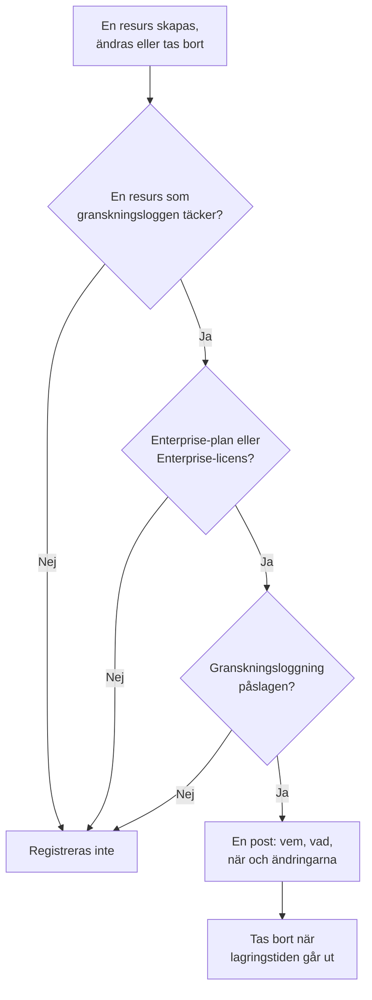

# Granskningsloggar

Granskningsloggen registrerar vem som ändrade vad i ditt projekt: varje skapande, ändring och borttagning av de resurser den täcker, med värdena före och efter. Använd den för att ta reda på vem som stängde av en monitor eller ändrade en API-nyckel, och för att föra dokumentation inför efterlevnadsgranskningar. Den ingår i Enterprise-planen i OneUptime Cloud och i Enterprise Edition när du kör självhostat.

:::cards
- [Slå på granskningsloggning](#slå-på-granskningsloggning): Den är avstängd från början i alla projekt.
- [Läs granskningsloggen](#läs-granskningsloggen): Vem ändrade vad, och när.
- [Vad som registreras](#vad-som-registreras): Resurserna och åtgärderna den täcker.
- [Hur länge poster behålls](#hur-länge-poster-behålls): Från 7 till 180 dagar.
:::

## Så blir en ändring en post

- **Den är avstängd från början.** Ett projekt registrerar ingenting förrän någon slår på granskningsloggning, och ingenting från före det ögonblicket.
- **Den registrerar vad personer gör.** En ändring som görs av en person, en API-nyckel, en MCP-klient eller ett arbetsflöde registreras. En ändring som OneUptime själv gör, som från ett bakgrundsjobb, utelämnas, om du inte slår på **Lagra systemhändelser**.
- **Poster kan inte ändras.** Ingen kan redigera eller ta bort en post, varken i instrumentpanelen eller via API:et. En post försvinner först när dess lagringstid går ut.

## Innan du börjar

- **I OneUptime Cloud: Enterprise-planen.** På andra planer visar granskningsloggens sidor vad funktionen gör och hur du får den.
- **När du kör självhostat: Enterprise Edition**, med en licens som omfattar granskningsloggar. Se [Enterprise Edition](/docs/self-hosted/enterprise).
- **En roll som får läsa granskningsloggen.** Project Owner, Project Admin, Settings Admin eller behörigheten **Read Audit Log**. Att slå på granskningsloggning och ändra dess inställningar kräver en Project Owner, en Project Admin eller behörighet att redigera projektet.

## Slå på granskningsloggning

:::steps
### Öppna granskningsloggens inställningar

Gå till **Projektinställningar → Granskningsloggar → Inställningar**. **Granskningsloggar** är hopfällt i sidomenyn från början: klicka på det för att öppna det.

### Redigera inställningarna

Klicka på **Edit Audit Log Settings**.

### Slå på den

Slå på **Aktivera granskningsloggar**, ange **Lagring (dagar)** och välj om du vill **Lagra systemhändelser**. Klicka på **Spara ändringar**.
:::

| Inställning | Startvärde | Vad den gör |
| --- | --- | --- |
| **Aktivera granskningsloggar** | Av | Registrerar från och med nu ändringar i projektets resurser. |
| **Lagring (dagar)** | 7 | Hur många dagar varje post behålls: från 7 till 180. |
| **Lagra systemhändelser** | Av | Registrerar också de ändringar som OneUptime själv gör och som ingen person eller nyckel har startat. |

En ändring av de här inställningarna träder i kraft inom en minut.

## Läs granskningsloggen

**Projektinställningar → Granskningsloggar → Granskningsloggar** listar varje post i projektet, de senaste först:

| Kolumn | Vad den visar |
| --- | --- |
| **När** | Hur länge sedan, med datum och klockslag. |
| **Åtgärd** | `Create`, `Update` eller `Delete`, eller `Download` för en paketinspelningsfil som någon har laddat ner. |
| **Resurs** | Resursens namn, som öppnar den så länge den finns, och dess typ. |
| **Aktör** | Vem som gjorde ändringen: en person, en API-nyckel, ett arbetsflöde eller `System` för en ändring som OneUptime själv gjorde. En persons ändring via en MCP-klient anger vilken. |
| **Ändringar** | Hur många fält som ändrades, eller registrerades vid ett skapande eller en borttagning. Klicka för att se varje fält. |

Filtrera efter **Resurstyp**, **Resursnamn**, **Åtgärd**, **Användares e-post** eller **Tid**. En ändring visar bara de fält som ändrades, före och efter, och en sparning som inte ändrar något lägger inte till någon post.

Monitorer, incidenter, larm, statussidor, SLO:er och många andra resurser har också en egen sida **Granskningsloggar** i ett hopfällt avsnitt av sin sidomeny, som **Avancerad**. Den visar bara den resursens poster, tillsammans med posterna för det som hör till den: ett SLO:s sida visar också dess regler och ägare.

## Vad som registreras

| Resurs | **Resurstyp** i loggen |
| --- | --- |
| Monitorer | `Monitor` |
| Incidenter | `Incident` |
| Larm | `Alert` |
| Statussidor | `Status Page` |
| Schemalagda underhållshändelser | `Scheduled Maintenance Event` |
| Jourpolicyer | `On-Call Policy` |
| SLO:er | `Service Level Objective` |
| Ett SLO:s regler och ägare | `SLO Burn Rate Rule`, `SLO Monitor Rule`, `Service Level Objective User Owner`, `Service Level Objective Team Owner` |
| Team | `Team` |
| Anpassade roller, och de team och API-nycklar som får en | `Custom Role`, `Team Custom Role`, `API Key Custom Role` |
| Etiketter | `Label` |
| Incidentstatusar och allvarlighetsgrader | `Incident State`, `Incident Severity` |
| Larmstatusar och allvarlighetsgrader | `Alert State`, `Alert Severity` |
| Monitorstatusar | `Monitor Status` |
| Statusar för schemalagt underhåll | `Scheduled Maintenance State` |
| Incidentroller | `Incident Role` |
| Efteranalysstatusar | `Postmortem Status` |
| API-nycklar | `API Key` |
| MCP-klienter som personer ansluter | `MCP Client Authorization` |
| Inventarieobjekt | `Inventory Item` |
| Insamlarkonfigurationer | `Collector Config` |
| vCenter-servrar | `vCenter` |
| Paketinspelningar och nedladdningarna av dem | `Packet Capture` |
| Säkerhetsärenden och deras prioriteter och statusar, playbooks och deras körningar, skyddade entiteter, entitetskritikalitet samt en entitets risk när någon återställer den | `Security Case`, `Security Case Priority`, `Security Case Status`, `Security Playbook`, `Security Playbook Run`, `Protected Entity`, `Entity Criticality`, `Entity Risk` |
| Regelundantag | `Rule Exception` |
| Bevakningslistor | `Watchlist` |
| Bevakningslistvärden | `Watchlist Value` |
| Uppgifter och bevis i säkerhetsärenden | `Security Case Task`, `Security Case Evidence` |
| Datalager och deras fynd, samt Datasäkerhets problem, inställningar, kontrollinställningar, anpassade datatyper och hemvistregler | `Data Store`, `Data Store Finding`, `Data Security Issue`, `Data Security Setting`, `Check Setting`, `Custom Data Type`, `Residency Rule` |
| Exporter av granskningsloggen | `Audit Log Export` |

Det registreras också när en administratör lägger till eller tar bort en aviseringsmetod eller en personlig jourregel på någon annans konto, utan själva adressen eller numret.

Andra data finns inte i granskningsloggen, som vem som är med i ett team, eller en behörighet som har lagts till ett team för sig. Fält som ingen får läsa utelämnas från alla poster, och nycklar, tokens och lösenord registreras som `[REDACTED]`: posten visar att de har ändrats, aldrig deras värde.

## Hur länge poster behålls

Varje post behålls under den **Lagring (dagar)** som projektet hade när den registrerades, och tas sedan bort. En ny lagringstid gäller för nya poster: redan registrerade poster behåller sina datum.

För att behålla poster i mer än 180 dagar skickar du dem allt eftersom de registreras till din egen lagring eller ditt SIEM: se [Export av granskningslogg](/docs/configuration/audit-log-export). Du kan också läsa dem via API:et med en API-nyckel som har **Read Audit Log** och spara dem där du behöver dem. Se [OneUptime API-referens](/docs/api-reference/api-reference).

## När planen eller licensen inte längre omfattar granskningsloggar

- **I OneUptime Cloud** slutar ett projekt som lämnar Enterprise-planen att registrera, och dess granskningsloggsidor visar uppgraderingskortet tills det är tillbaka på planen.
- **När du kör självhostat** slutar granskningsloggningen att registrera när Enterprise-provperioden eller fristen tar slut utan en licens, eller när licensen inte omfattar granskningsloggar. Granskningsloggen visar det i rött. Redan registrerade poster behålls, och registreringen återupptas med samma inställningar så snart en licens aktiveras. Se [När en licens löper ut eller saknas](/docs/self-hosted/enterprise#när-en-licens-löper-ut-eller-saknas).

## Felsökning

:::details Granskningsloggen är tom
Granskningsloggning är avstängd från början och registrerar ingenting från innan den slogs på. Om listan säger att granskningsloggning är avstängd följer du dess länk till inställningarna och slår på den. Annars ändrar du en monitor eller en incident och uppdaterar listan.
:::

:::details En ändring saknas i granskningsloggen
Kontrollera att resursen finns under [Vad som registreras](#vad-som-registreras) och att ändringen gjordes efter att granskningsloggning slogs på. En ändring som OneUptime själv gjorde registreras bara med **Lagra systemhändelser** påslagen.
:::

## Nästa steg

:::cards
- [Export av granskningslogg](/docs/configuration/audit-log-export): Skicka granskningsloggen till din egen lagring eller ditt SIEM.
- [Användare, team och behörigheter](/docs/permissions/index): Bestäm vem som får läsa granskningsloggen.
- [Projektinställningar](/docs/configuration/project-settings): Projektets övriga inställningar.
- [Fakturering och användning](/docs/configuration/billing): Byt projektets plan.
- [Enterprise Edition](/docs/self-hosted/enterprise): Granskningsloggar på en självhostad installation.
:::
