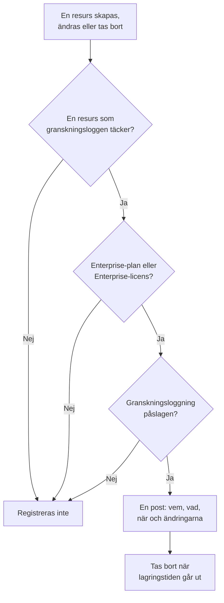

# Granskningsloggar

Granskningsloggen registrerar vem som ändrade vad i ditt projekt: varje skapande, ändring och borttagning av de resurser den täcker, med värdena före och efter, och varje gång någon loggar in eller ut. Använd den för att ta reda på vem som stängde av en monitor eller ändrade en API-nyckel, vem som loggade in och varifrån, och för att föra dokumentation inför efterlevnadsgranskningar. Den ingår i Enterprise-planen i OneUptime Cloud och i Enterprise Edition när du kör självhostat.

:::cards
- [Slå på granskningsloggning](#slå-på-granskningsloggning): Den är avstängd från början i alla projekt.
- [Läs granskningsloggen](#läs-granskningsloggen): Vem ändrade vad, och när.
- [Vad som registreras](#vad-som-registreras): Resurserna och åtgärderna den täcker.
- [Inloggningar och sessioner](#inloggningar-och-sessioner): Vem som loggade in, och hur varje session slutade.
- [Hur länge poster behålls](#hur-länge-poster-behålls): Från 7 till 180 dagar.
:::

## Så blir en ändring en post

- **Den är avstängd från början.** Ett projekt registrerar ingenting förrän någon slår på granskningsloggning, och ingenting från före det ögonblicket.
- **Den registrerar vad personer gör.** En ändring som görs av en person, en API-nyckel, en MCP-klient eller ett arbetsflöde registreras. En ändring som OneUptime själv gör, som från ett bakgrundsjobb, utelämnas, om du inte slår på **Lagra systemhändelser**.
- **Poster kan inte ändras.** Ingen kan redigera eller ta bort en post, varken i instrumentpanelen eller via API:et. En post försvinner först när dess lagringstid går ut.

## Innan du börjar

- **I OneUptime Cloud: Enterprise-planen.** På andra planer visar granskningsloggens sidor vad funktionen gör och hur du får den.
- **När du kör självhostat: Enterprise Edition**, med en licens som omfattar granskningsloggar. Se [Enterprise Edition](/docs/self-hosted/enterprise).
- **En roll som får läsa granskningsloggen.** Project Owner, Project Admin, Settings Admin eller behörigheten **Read Audit Log**. Att slå på granskningsloggning och ändra dess inställningar kräver en Project Owner, en Project Admin eller behörighet att redigera projektet.

## Slå på granskningsloggning

:::steps
### Öppna granskningsloggens inställningar

Gå till **Projektinställningar → Granskningsloggar → Inställningar**. **Granskningsloggar** är hopfällt i sidomenyn från början: klicka på det för att öppna det.

### Redigera inställningarna

Klicka på **Edit Audit Log Settings**.

### Slå på den

Slå på **Aktivera granskningsloggar**, ange **Lagring (dagar)** och välj om du vill **Lagra systemhändelser**. Klicka på **Spara ändringar**.
:::

| Inställning | Startvärde | Vad den gör |
| --- | --- | --- |
| **Aktivera granskningsloggar** | Av | Registrerar från och med nu ändringar i projektets resurser. |
| **Lagring (dagar)** | 7 | Hur många dagar varje post behålls: från 7 till 180. |
| **Lagra systemhändelser** | Av | Registrerar också de ändringar som OneUptime själv gör och som ingen person eller nyckel har startat. |

En ändring av de här inställningarna träder i kraft inom en minut.

## Läs granskningsloggen

**Projektinställningar → Granskningsloggar → Granskningsloggar** listar varje post i projektet, de senaste först:

| Kolumn | Vad den visar |
| --- | --- |
| **När** | Hur länge sedan, med datum och klockslag. |
| **Åtgärd** | `Create`, `Update` eller `Delete`, `Download` för en paketinspelningsfil som någon har laddat ner, eller `Sign In`, `Sign Out`, `Session Timeout` eller `Session Revoked` för en session. |
| **Resurs** | Resursens namn, som öppnar den så länge den finns, och dess typ. |
| **Aktör** | Vem som gjorde ändringen: en person, en API-nyckel, ett arbetsflöde eller `System` för en ändring som OneUptime själv gjorde. En persons ändring via en MCP-klient anger vilken. |
| **Ändringar** | Hur många fält som ändrades, eller registrerades vid ett skapande eller en borttagning. För en session: hur den loggade in eller varför den slutade. Klicka för att se varje fält. |

Filtrera efter **Resurstyp**, **Resursnamn**, **Åtgärd**, **Användares e-post** eller **Tid**. En ändring visar bara de fält som ändrades, före och efter, och en sparning som inte ändrar något lägger inte till någon post.

En resurs utan eget namn får namn efter det som namnger den i OneUptime: ett undantag efter sin typ och början av sitt meddelande, med id:n, adresser och allt som liknar en hemlighet maskerat, en körning av en runbook efter sin runbook, telefonnumret till en policy för inkommande samtal efter numret, och en mall eller en domän efter sitt eget namn.

Monitorer, incidenter, larm, statussidor, SLO:er och många andra resurser har också en egen sida **Granskningsloggar** i ett hopfällt avsnitt av sin sidomeny, som **Avancerad**. Den visar bara den resursens poster, tillsammans med posterna för det som hör till den: ett SLO:s sida visar också dess regler och ägare.

## Vad som registreras

Allt som personer skapar, ändrar eller tar bort i ett projekt registreras: övervakare, incidenter, larm, statussidor, arbetsflöden och deras steg, köer, instrumentpaneler, jourpolicyer, team och vilka som är med i dem, API-nycklar och varje inställning. **Resurstyp** säger vad en post gäller, till exempel `Monitor`, `Workflow` eller `Queue`.

| Registreras inte | Varför |
| --- | --- |
| Loggar över meddelanden | Var och en är redan registreringen av ett e-postmeddelande, sms, samtal, en pushavisering eller ett chattmeddelande som OneUptime har skickat eller tagit emot. |
| Registreringar av körningar | Var och en är redan registreringen av en körning av ett arbetsflöde, en joureskalering, en skanning, en import eller en AI-körning. |
| Det som agenter och telemetri rapporterar | Upptäckta resurser, mätvärden och användning ändras med varje rapport, inte för att någon har ändrat dem. |
| Aktivitetsflöden | Ett flöde visar ändringar som granskningsloggen redan registrerar. |
| OneUptimes arbetstillstånd | Sessioner för läsare av statussidor, köade jobb och annat tillstånd som OneUptime håller medan det arbetar. |
| En persons egen aviseringskonfiguration | Varje persons adresser, nummer och personliga jourregler tillhör bara dem. |
| En persons egna preferenser | De produkter som varje person fäster i sitt eget övre fält tillhör bara dem, och bara de ser dem. |

Det registreras också när en administratör lägger till eller tar bort en aviseringsmetod eller en personlig jourregel på någon annans konto, utan själva adressen eller numret.

Fält som bara OneUptime skriver, till exempel när en värd senast sågs, utelämnas från alla poster, och det gör även fält som ingen får läsa. När OneUptime skriver ett av dem för att någon bad om det, till exempel när ett undantag slås ihop med ett annat eller en webhook-URL återställs, registrerar posten det som den personens ändring. Nycklar, tokens och lösenord registreras som `[REDACTED]`: posten visar att de har ändrats, aldrig deras värde. Ett arbetsflödes steg registreras som det som ändrades, med namnen på ett stegs inställningar men aldrig det som skrevs i dem, och att flytta ett steg på arbetsytan registreras inte.

Det OneUptime gör för att någon bad om det registreras också som deras ändring, oavsett om projektet lagrar systemhändelser eller inte:

- Att starta, godkänna, slutföra, hoppa över och avbryta en körning av en runbook. Dess steg registreras som det som gjordes med vart och ett, till exempel `Approved "Restart the API" (step 3)`, aldrig med det ett steg skrev ut.
- Det en regel ändrar när någon kör den: de etiketter och ägare som den lägger till, de poster som en sekretessregel gör privata, de enheter som en regel för platstilldelning flyttar, de enheter och monitorer som en regel för automatisk import skapar, och det en monitorregel på en statussida eller en SLO ändrar på sidan eller SLO:n.
- Att köpa, koppla och frisläppa telefonnumret till en policy för inkommande samtal.
- Att lösa ett datalarm som någon markerar som väntat eller som inget problem.
- Att återställa länken till ett kalenderflöde.
- De team som någon går med i när de loggar in med SSO.

Det en regel gör av sig själv är OneUptimes egen ändring och registreras när **Lagra systemhändelser** är på: etiketter och ägare som en regel lägger till när en post skapas, och en post som den då gör privat; de enheter och monitorer som en regel för automatisk import skapar från nya skanningsresultat; och det en monitorregel på en statussida eller en SLO ändrar när en regel, en monitor eller en etikett sparas.

Att återställa AI-agenten för en värd, ett kluster eller ett molnkonto registreras på resursens egen sida **Granskningsloggar**, som ändringen av `aiAgentResetAt` gjord av den som återställde den: vem, och när. Detsamma gäller att skapa en nyckel för ett molnkontos AI-agent: nycklarna visas som ändrade, aldrig med en nyckel eller en hash. Det en agent rapporterar när den ansluter och hör av sig lämnas utanför, som tidigare.

## Inloggningar och sessioner

Varje gång en medlem i projektet loggar in i OneUptime registrerar granskningsloggen det, och igen när den sessionen slutar. En inloggning sker i OneUptime, inte i ett enskilt projekt, så varje projekt som personen är medlem i registrerar den.

| Åtgärd | När den registreras |
| --- | --- |
| `Sign In` | Någon loggar in: med lösenord eller inloggningslänk, passnyckel, Google, Microsoft, Vercel eller enkel inloggning. |
| `Sign Out` | Personen loggar ut. |
| `Session Timeout` | OneUptime avslutar sessionen när tiden har gått ut: den inaktivitetstid eller sessionslängd som en serveradministratör har angett, eller 30 dagar utan användning. |
| `Session Revoked` | OneUptime avslutar sessionen för att lösenordet ändrades, kontot blockerades, eller en serveradministratör återställde eller krävde tvåfaktorsautentisering. |

En posts **Resurs** är sessionen, som får namn efter enheten den loggade in från, till exempel `Chrome 130 on macOS`. Dess **Aktör** är personen som sessionen tillhör, så om du filtrerar efter **Användares e-post** hittar du alla personens inloggningar och sessioner. Detaljerna anger hur personen loggade in och med vilken andra faktor, IP-adressen och platsen, och för en session som har slutat när den loggade in, när den senast användes och när tiden gick ut. Ett projekts egen SSO-leverantör namnges bara i det projektets granskningslogg.

Inloggningar och sessioner registreras oavsett om projektet lagrar systemhändelser eller inte. En sessionslängd eller 30 dagar utan användning registreras inom några minuter efter att tiden har gått ut. En inaktivitetstid registreras när personens öppna flik eller mobilappen nästa gång når OneUptime.

## Hur länge poster behålls

Varje post behålls under den **Lagring (dagar)** som projektet hade när den registrerades, och tas sedan bort. En ny lagringstid gäller för nya poster: redan registrerade poster behåller sina datum. Även via API:et är en lagringstid ett helt antal dagar från 7 till 180: alla andra värden avvisas.

För att behålla poster i mer än 180 dagar skickar du dem allt eftersom de registreras till din egen lagring eller ditt SIEM: se [Export av granskningslogg](/docs/configuration/audit-log-export). Du kan också läsa dem via API:et med en API-nyckel som har **Read Audit Log** och spara dem där du behöver dem. Se [OneUptime API-referens](/docs/api-reference/api-reference).

## När planen eller licensen inte längre omfattar granskningsloggar

- **I OneUptime Cloud** slutar ett projekt som lämnar Enterprise-planen att registrera, och dess granskningsloggsidor visar uppgraderingskortet tills det är tillbaka på planen.
- **När du kör självhostat** slutar granskningsloggningen att registrera när Enterprise-provperioden eller fristen tar slut utan en licens, eller när licensen inte omfattar granskningsloggar. Granskningsloggen visar det i rött. Redan registrerade poster behålls, och registreringen återupptas med samma inställningar så snart en licens aktiveras. Se [När en licens löper ut eller saknas](/docs/self-hosted/enterprise#när-en-licens-löper-ut-eller-saknas).

## Felsökning

:::details Granskningsloggen är tom
Granskningsloggning är avstängd från början och registrerar ingenting från innan den slogs på. Om listan säger att granskningsloggning är avstängd följer du dess länk till inställningarna och slår på den. Annars ändrar du en monitor eller en incident och uppdaterar listan.
:::

:::details En ändring saknas i granskningsloggen
Kontrollera att resursen finns under [Vad som registreras](#vad-som-registreras) och att ändringen gjordes efter att granskningsloggning slogs på. En ändring som OneUptime själv gjorde registreras bara med **Lagra systemhändelser** påslagen.
:::

## Nästa steg

:::cards
- [Export av granskningslogg](/docs/configuration/audit-log-export): Skicka granskningsloggen till din egen lagring eller ditt SIEM.
- [Användare, team och behörigheter](/docs/permissions/index): Bestäm vem som får läsa granskningsloggen.
- [Projektinställningar](/docs/configuration/project-settings): Projektets övriga inställningar.
- [Fakturering och användning](/docs/configuration/billing): Byt projektets plan.
- [Enterprise Edition](/docs/self-hosted/enterprise): Granskningsloggar på en självhostad installation.
:::
