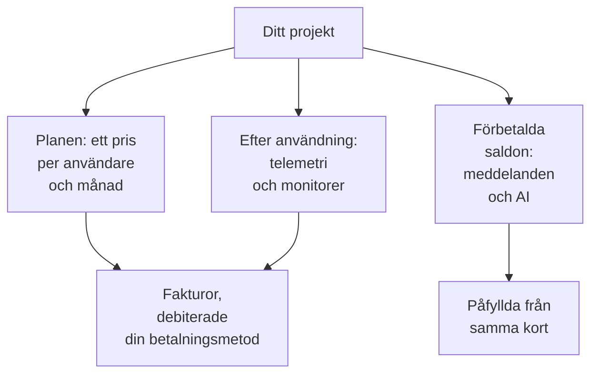

# Fakturering och användning

I OneUptime Cloud betalar ett projekt för sin plan, per användare, och för det som det använder: telemetri, aktiva monitorer och de meddelanden och det AI-arbete som det betalar från förbetalda saldon. Den här sidan visar var du ser och ändrar var och en av dem, och vem som får göra det. En självhostad installation har ingen fakturering och inga av de här sidorna.

:::cards
- [Din plan och dina platser](#din-plan-och-dina-platser): Vad planen kostar och vem som räknas som en plats.
- [Betalningsmetoder](#betalningsmetoder): Kortet som dina fakturor debiteras.
- [Fakturor](#fakturor): Betala dem, ladda ner dem och se vad du har använt.
- [Förbetalda saldon](#förbetalda-saldon): Meddelanden och AI, påfyllda manuellt eller automatiskt.
:::

## Vad ett projekt betalar för

| Vad | Hur det prissätts |
| --- | --- |
| Planen | Ett pris per användare och månad, fakturerat månadsvis eller årsvis. Varje person i projektet är en plats. |
| Telemetri | $0.10 per inmatad GB, med 15 dagars lagring. Längre lagring kostar mer, och lagring kortare än 7 dagar faktureras som 7 dagar: se [Vad lagring kostar](/docs/telemetry/data-retention#vad-lagring-kostar). |
| Sessionsuppspelningar | $2 per GB, med 15 dagars lagring. |
| Aktiva monitorer | $1 per monitor och månad. Alla monitorer utom manuella är aktiva, även när de är avstängda. |
| SMS, samtal, WhatsApp och Telegram | Betalas från projektets saldo när varje meddelande skickas. |
| OneUptime AI | Betalas från projektets AI-krediter, om den inte körs på din egen LLM-leverantör. |

[Prissidan](https://oneuptime.com/pricing) jämför planerna.

## Innan du börjar

- **OneUptime Cloud.** Avsnittet **Fakturering och fakturor** i **Projektinställningar** finns bara i OneUptime Cloud och är hopfällt från början: klicka på rubriken för att öppna det.
- **En roll som får läsa faktureringen.** Project Owners, personer med **Manage Billing** och de tre faktureringsrollerna läser alla faktureringssidor. Se [Vem får göra vad](#vem-får-göra-vad).

## Din plan och dina platser

Gå till **Projektinställningar → Fakturering och fakturor → Fakturering**. Kortet **Aktuell plan** visar projektets plan och priset per användare, och **Platser**: en för varje person i projektet.

En person räknas som en plats från det att du bjuder in personen, redan innan den accepterar, tills du tar bort den. För att ändra antalet platser bjuder du in eller tar bort personer: se [Bjud in personer](/docs/permissions/inviting-people).

## Byt plan

:::steps
### Lägg till en betalningsmetod först

Ett planbyte kräver en betalningsmetod. Utan en öppnar **Change Plan** i stället **Add a Payment Method**: se [Betalningsmetoder](#betalningsmetoder).

### Klicka på Change Plan

Klicka på **Change Plan** på kortet **Aktuell plan**. **Årsplan** är påslagen från början: stäng av den för att se månadspriserna.

### Välj planen

Varje plan visar sitt pris per användare. Anteckningen under planerna säger vad som händer med din provperiod: **Your free trial carries over** så länge projektet fortfarande är i sin provperiod, och **Changing plan does not start a free trial** när det inte längre är det.

### Spara ändringen

Klicka på **Spara ändringar**. En betald plan faktureras från det ögonblick du byter till den, och varje person du bjuder in på den faktureras när du bjuder in personen.
:::

API-nycklar kräver Growth-planen eller en högre plan, och under Scale-planen tar SCIM-anslutningar bara bort personer. En plan som stoppar dem säger hur många innan du väljer den, och sidan **Fakturering** visar **Ingår inte i det här abonnemanget** så länge de är stoppade. Ingenting tas bort: de fungerar igen på en plan som innehåller dem.

> [!NOTE]
> Köpte du OneUptime via en återförsäljare eller en molnmarknadsplats (AWS Marketplace, Microsoft Marketplace, Google Cloud Marketplace eller Vercel Marketplace)? Sidan **Fakturering** säger det. En återförsäljare byter din plan åt dig, och en marknadsplats fakturerar projektets plan och användning på din molnfaktura.

## Betalningsmetoder

Kortet **Betalningsmetoder** listar projektets kort. Fakturor debiteras automatiskt standardkortet.

:::steps
### Klicka på Lägg till betalningsmetod

Klicka på **Lägg till betalningsmetod** på kortet **Betalningsmetoder**.

### Ange kortet

Ange betalningsuppgifterna och klicka på **Save payment method**. Metoden du lägger till blir standard, och när du lägger till en slås betalning efter användning på. Det ändrar inte din plan.
:::

- **Ange som standard** gör en annan metod i listan till den som fakturor debiteras.
- **Re-sync Autopay**, på standardmetoden, rättar en förnyelse som fortfarande debiterar ett äldre kort.
- Projektet behåller minst en betalningsmetod: lägg till en annan innan du tar bort den sista.

## Faktureringsadress och faktura-e-post

Kortet **Företagsuppgifter / faktureringsadress** innehåller det som dina fakturor säger om dig. Klicka på **Uppdatera** och fyll i två steg:

| Steg | Fält |
| --- | --- |
| **Faktureringsadress** | **Företagsuppgifter / faktureringsadress**: företagets juridiska namn, adress och moms- eller skatte-ID. **Land**: ditt faktureringsland. |
| **Fakturor** | **E-post för ekonomi/redovisning**: dit fakturor, kvitton och faktureringsmeddelanden skickas, flera adresser åtskilda med kommatecken. **Skicka fakturor via e-post**: skicka varje faktura dit så snart den utfärdas. |

## Fakturor

**Projektinställningar → Fakturering och fakturor → Fakturor** listar projektets fakturor, var och en med **Fakturanummer**, **Fakturadatum**, **Belopp** och **Fakturastatus**.

- **Betala faktura** betalar en faktura som fortfarande är obetald.
- **Ladda ner** öppnar fakturan som PDF. På en faktura som fortfarande är obetald finns den i radens meny **⋯**.

När din bank fortfarande behandlar en betalning säger OneUptime det: vissa banker tar upp till 2 dagar på sig att bekräfta en kortbetalning, och fakturan uppdateras av sig själv. Betala den inte igen.

## Användningshistorik

**Projektinställningar → Fakturering och fakturor → Användningshistorik** visar den telemetri som projektet har skickat, en rad per produkt, tjänst och dag:

| Kolumn | Vad den visar |
| --- | --- |
| **Produkt** | Loggar, spårningar, metriker och de andra typerna av telemetri. |
| **Dag** | Dagen den skickades. |
| **Tjänst** | Tjänsten, eller värden, klustret eller den andra resursen som skickade den. |
| **Inmatad data (i GB)** | Hur mycket som kom in. |
| **Datalagring (i dagar)** | Hur länge den lagras. |
| **Total kostnad** | Vad den kostade, i amerikanska dollar. |

En dags användning visas när dagen är slut. Filtrera efter **Produkt**, **Dag** eller **Tjänst** för att hitta det som har växt.

## Förbetalda saldon

SMS, samtal, WhatsApp- och Telegram-meddelanden betalas från projektets saldo, och OneUptime AI från dess AI-krediter. Du fyller på vart och ett i förväg:

| Saldo | Var |
| --- | --- |
| SMS, samtal, WhatsApp och Telegram | **Projektinställningar → Aviseringar → Aviseringsinställningar** |
| OneUptime AI | **Projektinställningar → AI → AI-krediter** |

:::steps
### Fyll på nu

Klicka på **Fyll på saldo** på sidans kort **Aktuellt saldo**. Ange ett belopp från $20 till $1,000 och klicka på **Fyll på**. Beloppet debiteras projektets kort.

### Eller låt det fylla på sig självt

Klicka på **Redigera Automatisk påfyllning** på kortet **Automatisk påfyllning** och slå på **Aktivera automatisk påfyllning**. Den är avstängd från början. När den är påslagen lägger OneUptime till $20 varje gång saldot sjunker till $10, eller de belopp du väljer.
:::

När ett saldo inte räcker skickas inte meddelandet, eller så stoppas OneUptime AI, och projektets ägare får ett e-postmeddelande. Se [När ett larm inte skickas](/docs/on-call/escalation-rules#när-ett-larm-inte-skickas) och [När AI-krediterna tar slut](/docs/ai/ai-sre#när-ai-krediterna-tar-slut).

## Vem får göra vad

| För att | Krävs |
| --- | --- |
| Läsa faktureringssidorna: planen, fakturor, användning, saldon och betalningsmetoder | Project Owner, **Manage Billing**, **Billing Admin**, **Billing Member** eller **Billing Viewer** |
| Ladda ner en faktura | Project Owner, Project Admin, **Manage Billing**, **Read Invoices**, **Billing Admin** eller **Billing Member** |
| Ändra faktureringsadressen och faktura-e-posten | Project Owner, **Manage Billing**, **Billing Admin** eller **Billing Member** |
| Slå på eller av SMS, samtal, WhatsApp eller Telegram | Project Owner, **Manage Billing** eller **Billing Admin** |
| Lägga till en betalningsmetod | Project Owner, **Manage Billing** eller **Create Payment Method** |
| Betala en faktura | Project Owner, **Manage Billing** eller **Edit Invoices** |
| Byta plan, fylla på ett saldo eller ändra automatisk påfyllning | Project Owner eller **Manage Billing** |

En knapp som du inte får använda visas låst och säger vem som får. Se [Användare, team och behörigheter](/docs/permissions/index#team) för faktureringsrollerna.

## Inställningar som kräver en plan

I OneUptime Cloud kräver de här administrationsinställningarna en plan. En sida vars plan du inte har visar vad funktionen gör och vilken plan den kräver.

| Inställning | Planen den kräver |
| --- | --- |
| Etiketter | Growth |
| API-nycklar | Growth |
| Dina egna SMTP-servrar och Twilio-konton | Growth |
| Dina egna LLM-leverantörer | Growth |
| Ansluta MCP-klienter | Growth |
| Skapa team | Scale |
| SSO, OIDC och SCIM | Scale |
| Åsidosättningar av lagringstid | Scale |
| Granskningsloggar | Enterprise |

## Säg upp planen

För att sluta betala för ett projekt tar du bort det: faktureringen upphör när det har tagits bort. Se [Ta bort projektet](/docs/configuration/project-settings#ta-bort-projektet). Ett projekt som köpts via en återförsäljare sägs upp hos återförsäljaren, och ett som köpts via en molnmarknadsplats på marknadsplatsen.

## Felsökning

:::details "Add a payment method in Project Settings > Billing and Invoices > Billing before using paid monitoring or telemetry"
Ett projekt på Free-planen behöver en betalningsmetod innan det skapar aktiva monitorer eller skickar telemetri, eftersom de betalas efter användning. Lägg till en under [Betalningsmetoder](#betalningsmetoder). Manuella monitorer förblir gratis.
:::

:::details En röd banderoll säger att det finns obetalda fakturor
Ett projekt med obetalda fakturor blir inaktivt och tas bort om de förblir obetalda. Öppna **Fakturor** och klicka på **Betala faktura** på varje som fortfarande är obetald.
:::

:::details Change Plan öppnar Add a Payment Method
Projektet har ingen betalningsmetod ännu. Lägg till en och byt sedan plan.
:::

:::details Användningshistoriken är tom
Användning räknas per dag, och en dag visas när den är slut. Ett projekt som inte har skickat telemetri har inga rader.
:::

## Nästa steg

:::cards
- [Projektinställningar](/docs/configuration/project-settings): Allt annat som gäller för hela projektet.
- [Bjud in personer](/docs/permissions/inviting-people): Lägg till de personer som dina platser är till för.
- [Datalagring](/docs/telemetry/data-retention): Behåll telemetri så länge som behövs, och inte längre.
- [Drop-filter och scrub-regler](/docs/telemetry/drop-filters-and-scrub-rules): Sluta betala för telemetri som du inte använder.
:::
