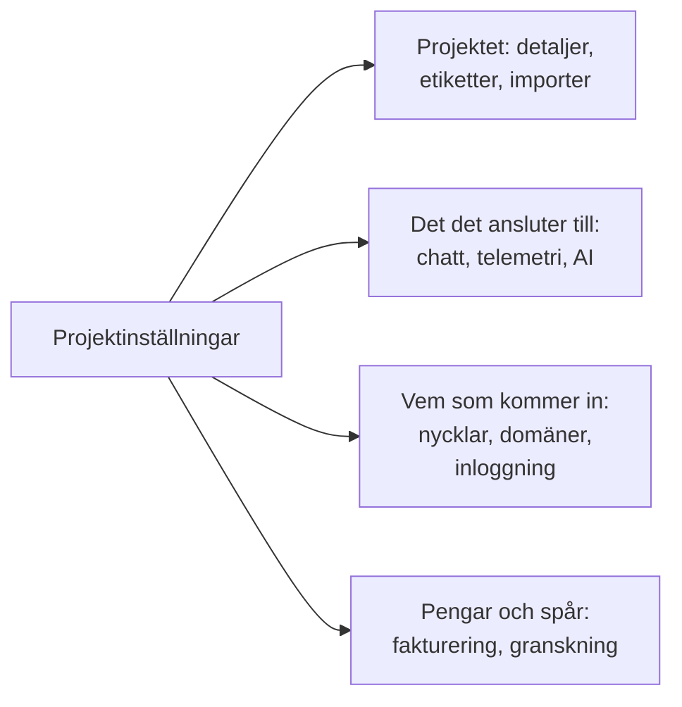

# Projektinställningar

Projektinställningar innehåller det som gäller för hela projektet: namnet, verktygen det är anslutet till, nycklarna, hur personer loggar in, faktureringen och granskningsspåret. Det mesta ställer du in en gång och återvänder sällan till. Den här sidan är en karta över det och täcker de inställningar som inte har en egen sida: projektets detaljer, etiketter, funktionsflaggor och borttagning av projektet.

:::cards
- [Hitta en inställning](#hitta-en-inställning): Vad varje avsnitt i sidomenyn innehåller.
- [Projektets detaljer](#projektets-detaljer): Namnet, ID:t och supportåtkomst.
- [Etiketter](#etiketter): Taggar för resurser, behörigheter och regler.
- [Ta bort projektet](#ta-bort-projektet): Vad det kräver och vad som försvinner med det.
:::

## Öppna projektinställningar

Gå till **Produkter → Inställningar → Projektinställningar**. Sidomenyn grupperar sidorna i avsnitt, och bara **Grundläggande** är öppet från början: klicka på ett avsnitts rubrik för att öppna det. Ett avsnitt öppnas av sig självt på varje sida i det.

## Innan du börjar

- **En roll som kan ändra projektet.** Project Owners och Project Admins ändrar de flesta av de här inställningarna. Fakturering, aviseringskanaler och borttagning av projektet kräver mer, som varje avsnitt anger.
- **I OneUptime Cloud: planen som innehåller en inställning.** Vissa inställningar kräver en plan: se [Inställningar som kräver en plan](/docs/configuration/billing#inställningar-som-kräver-en-plan).

## Hitta en inställning

| Avsnitt | Sidor | Läs mer |
| --- | --- | --- |
| **Grundläggande** | **Projekt**, **Etiketter** | [Projektets detaljer](#projektets-detaljer), [Etiketter](#etiketter) |
| **Arbetsyta** | **Slack**, **Microsoft Teams**, **Video Calls** | [Slack](/docs/workspace-connections/slack), [Microsoft Teams](/docs/workspace-connections/microsoft-teams), [Videosamtal](/docs/workspace-connections/video-calls) |
| **Telemetri och APM** | **Intagningsnycklar**, **Datalagring** | [Intagningsnycklar](/docs/telemetry/ingestion-keys), [Datalagring](/docs/telemetry/data-retention) |
| **Aviseringar** | **Aviseringsinställningar**, **Aviseringsloggar**, **Mobilappar** | [Aviseringar](#aviseringar) |
| **AI** | **AI Features**, **LLM-leverantörer**, **Externa MCP-servrar**, **AI-krediter**, **AI-loggar**, **MCP-server** | [LLM-leverantörer](/docs/ai/llm-provider), [Externa MCP-servrar](/docs/ai/external-mcp-servers), [MCP-server](/docs/ai/mcp-server), [AI SRE](/docs/ai/ai-sre#kostnadskontroll) |
| **Avancerad** | **Domäner**, **API-nycklar**, **Funktionsflaggor**, **Importera från ett annat verktyg** | [Egna domäner](/docs/status-pages/branding-and-domains#anpassade-domäner), [API-nycklar](/docs/permissions/index#api-nycklar), [Funktionsflaggor](#funktionsflaggor), [Byt från Opsgenie](/docs/moving-to-oneuptime/opsgenie) och de andra flyttguiderna |
| **Säkerhet** | **SSO**, **SCIM** | [SSO](/docs/identity/sso), [SCIM](/docs/identity/scim) |
| **Fakturering och fakturor** | **Fakturering**, **Användningshistorik**, **Fakturor** | [Fakturering och användning](/docs/configuration/billing) |
| **Granskningsloggar** | **Granskningsloggar**, **Inställningar**, **Export** | [Granskningsloggar](/docs/configuration/audit-logs), [Export av granskningslogg](/docs/configuration/audit-log-export) |
| **Farozon** | **Farozon** | [Ta bort projektet](#ta-bort-projektet) |

**Fakturering och fakturor** och **AI-krediter** finns bara i OneUptime Cloud: en självhostad installation har ingen fakturering.

## Projektets detaljer

**Projektinställningar → Grundläggande → Projekt** har två kort.

**Projektdetaljer** visar projektets namn och ID:

- **Projektnamn**: klicka på **Redigera Projekt** för att byta namn på projektet. Ett namn har minst 2 tecken. Att byta namn kräver en Project Owner eller behörighet att redigera projektet eller hantera fakturering.
- **Projekt-ID**: kopiera det till API:et, CLI:t och Terraform, eller när du skriver till supporten.
- **Data Residency**: i OneUptime Cloud, var ditt projekts data ska ligga, när OneUptime har registrerat det. Bara OneUptime anger det.

**Åtkomst för kundsupport** avgör i OneUptime Cloud om OneUptimes supportteam får öppna projektet. Slå på **Ge OneUptimes support åtkomst till det här projektet** när du vill ha hjälp: OneUptime frågar först, eftersom supporten då kan se och ändra allt i projektet, och du klickar på **Släpp in support**. Stäng av det när de är klara: det sparas direkt. Project Owners och Project Admins ändrar det.

## Etiketter

Etiketter är taggar som du sätter på monitorer, incidenter, statussidor och andra resurser. De filtrerar och grupperar listor, och de begränsar hur långt ett teams behörigheter och projektets regler når.

:::steps
### Öppna etiketter

Gå till **Projektinställningar → Grundläggande → Etiketter**.

### Skapa en etikett

Klicka på **Skapa Etikett**. Ge den ett **Namn** och, om du vill, en **Beskrivning**. **Etikettfärg** är redan vald, en färg som ingen etikett på sidan använder ännu: välj en annan om du föredrar det. Klicka på **Skapa Etikett** för att spara den.
:::

I OneUptime Cloud kräver det Growth-planen att skapa och ändra etiketter. Se [Etiketter](/docs/permissions/index#etiketter) för hur etiketter begränsar behörigheter, och [Etikett- och ägarregler](/docs/configuration/label-and-owner-rules) för att sätta etiketter på resurser när de skapas.

I en lista visas en posts etiketter under varandra; är de fler än fyra visas de tre första med en länk till resten. Överallt där etiketter listas (i listor, på en posts sida och i varje etikettväljare) står de i naturlig ordning: etiketter vars namn börjar med en siffra kommer först, i ordning efter talet (`2. Team` före `10. Owner`), sedan de övriga i bokstavsordning, oavsett versaler och gemener. Vill du bestämma ordningen på dina etiketter börjar du namnen med en siffra, som `1. Category` och `2. Subcategory`.

### Arkivera en etikett

För att fasa ut en etikett arkiverar du den från radens meny **⋯** i stället för att ta bort den. Allt som har etiketten behåller den, och du kan fortfarande filtrera på den, men ingen kan lägga till den på något igen: Varje etikettväljare utelämnar den, och API:et, Terraform och MCP avvisar den. Dialogen listar de regler och behörigheter som är inställda på att använda etiketten, och som fortsätter att använda den tills du ändrar dem. Arkiverade etiketter listas för sig, i det hopfällda avsnittet **Arkiverade etiketter**, där **Avarkivera** återställer en. **Ta bort** listar först allt som etiketten skulle tas bort från och erbjuder **Arkivera i stället**.

## Aviseringar

**Projektinställningar → Aviseringar** innehåller hur projektet skickar aviseringar:

- **Aviseringsinställningar**: kortet **Aviseringskanaler** slår på eller av SMS, telefonsamtal, WhatsApp och Telegram för projektet. Alla fyra är avstängda från början. En Project Owner, en **Billing Admin** eller någon med **Manage Billing** slår på dem. Sidan innehåller också projektets egna e-postservrar under **Anpassade SMTP-konfigurationer** (se [SMTP](/docs/emails/smtp)) och dess eget Twilio-konto (se [Twilio-integration](/docs/self-hosted/twilio-integration)). I OneUptime Cloud innehåller den saldot som de här meddelandena betalas från: se [Förbetalda saldon](/docs/configuration/billing#förbetalda-saldon).
- **Aviseringsloggar**: varje avisering som projektet har skickat, med en flik per kanal: **E-post**, **SMS**, **WhatsApp**, **Telegram**, **Webhook**, **Anrop**, **Push** och **Arbetsyta**.
- **Mobilappar**: var du hämtar apparna för iOS och Android. Se [Appar – Översikt](/docs/mobile-desktop-apps/index).

## Funktionsflaggor

**Projektinställningar → Avancerad → Funktionsflaggor** slår på eller av valfria funktioner för projektet. Var och en är en brytare som sparas när du slår om den. I dag innehåller sidan **Monitorgrupper**, avstängd i ett nytt projekt: slå på den för att lägga till monitorgrupper i menyn Monitorer. Att stänga av den tar inte bort någon grupp. Se [Monitorgrupper](/docs/monitor/monitor-groups).

## Ta bort projektet

Att ta bort ett projekt tar bort allt i det, för alla medlemmar: monitorer, incidenter, statussidor, jourinställningar och telemetri. Ingenting tar tillbaka det.

:::steps
### Öppna farozonen

Gå till **Projektinställningar → Farozon**.

### Klicka på Ta bort Projekt

Klicka på **Ta bort Projekt**. En dialog ber dig bekräfta.

### Skriv projektets namn

Skriv namnet exakt som det är. **Ta bort Projekt** förblir låst tills du gör det. I OneUptime Cloud frågar dialogen också varför du lämnar oss: svaret är valfritt.

### Bekräfta

Klicka på **Ta bort Projekt**. OneUptime tar bort projektet och tar ut dig ur det.
:::

> [!CAUTION]
> Att ta bort projektet kan inte ångras. Det kräver en Project Owner eller behörighet att ta bort projektet.

I OneUptime Cloud säger du upp ett projekts plan genom att ta bort projektet: faktureringen upphör när projektet har tagits bort. Ett projekt som faktureras via en molnmarknadsplats får en sista debitering för sin användning, och köpet på marknadsplatsen förblir aktivt tills du säger upp det där.

## Felsökning

:::details Ett avsnitt i sidomenyn verkar saknas
Alla avsnitt utom **Grundläggande** är hopfällda från början. Klicka på avsnittets rubrik för att öppna det. På en självhostad installation finns varken avsnittet **Fakturering och fakturor** eller sidan **AI-krediter**.
:::

:::details Redigera Projekt är låst
Att byta namn kräver en Project Owner eller behörighet att redigera projektet eller hantera fakturering. Den låsta knappen nämner behörigheten du saknar.
:::

:::details Ta bort Projekt förblir låst i dialogen
Skriv projektets namn exakt som dialogen visar det: stora och små bokstäver räknas.
:::

## Nästa steg

:::cards
- [Bjud in personer](/docs/permissions/inviting-people): Få in ditt team i projektet.
- [Fakturering och användning](/docs/configuration/billing): Din plan, betalningsmetoder, fakturor och användning.
- [Granskningsloggar](/docs/configuration/audit-logs): Se vem som ändrade vad i projektet.
- [SSO](/docs/identity/sso): Låt personer logga in med din identitetsleverantör.
:::
