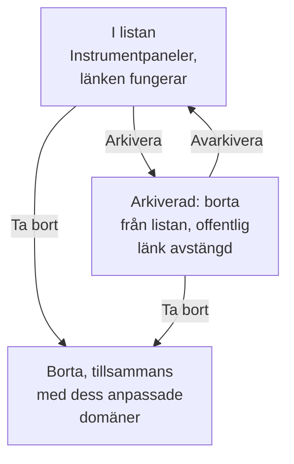

# Instrumentpanelskonfiguration & behörigheter

När du har en instrumentpanel som är värd att behålla går den här sidan igenom vem som får läsa och ändra den, hur ägare och etiketter organiserar dina instrumentpaneler, och hur du kopierar, exporterar, arkiverar och tar bort en.

:::cards
- [Vem som får göra vad](#vem-som-får-göra-vad): Behörigheterna bakom varje åtgärd, och vem som har dem.
- [Ägare](#ägare): Användarna och teamen som en instrumentpanel tillhör.
- [Duplicera en instrumentpanel](#duplicera-en-instrumentpanel): En säker kopia, numrerad åt dig.
- [Arkivera en instrumentpanel](#arkivera-en-instrumentpanel): Lägg undan en instrumentpanel utan att ta bort den.
:::

## Vem som får göra vad

Instrumentpaneler följer ditt projekts [behörigheter](/docs/permissions/index). Varje åtgärd kräver en av de här, som du får genom ett team:

| För att | Krävs |
| --- | --- |
| Läsa instrumentpaneler | `ReadDashboard`, eller en projektroll: Project Owner, Project Admin, Project Member, Viewer eller en Settings-roll |
| Skapa instrumentpaneler | `CreateDashboard`, Project Owner eller Project Admin |
| Ändra en instrumentpanel: dess widgetar, variabler, delning och varumärke, och arkivera den | `EditDashboard`, Project Owner eller Project Admin |
| Ta bort en instrumentpanel | `DeleteDashboard`, Project Owner eller Project Admin |
| Lägga till och ta bort ägare | Behörigheterna för instrumentpanelsägare, Project Owner, Project Admin eller Project Member |
| Lägga till och ändra anpassade domäner | Behörigheterna för instrumentpanelsdomäner, Project Owner, Project Admin, Project Member, Settings Admin eller Settings Member |
| Skapa ägarregler och etikettregler | Behörigheterna för regler, Project Owner eller Project Admin |

En Project Member läser alltså alla instrumentpaneler, men behöver `CreateDashboard` och `EditDashboard` för att bygga dem. Läsning, redigering och borttagning kan var och en begränsas till de instrumentpaneler som ett team äger, eller till instrumentpaneler med vissa etiketter: se [Omfattning: hur långt en tillåten behörighet når](/docs/permissions/index#omfattning-hur-långt-en-tillåten-behörighet-når).

Tilldela dem på ett teams sida **Behörigheter**: öppna **Produkter → Team** och välj teamet.

Vem som kan se en instrumentpanel utanför projektet är en separat fråga, som besvaras på dess sida **Delning**: se [Åtkomst till offentliga instrumentpaneler](#åtkomst-till-offentliga-instrumentpaneler).

## Ägare

En instrumentpanels **ägare** är användarna och teamen som den tillhör. Lägg till dem på instrumentpanelens sida **Ägare**, eller markera flera instrumentpaneler i listan **Instrumentpaneler** och lägg till ägare på alla på en gång.

Ägare begränsar åtkomsten när du ber om det: en teambehörighet som är avgränsad till instrumentpanelerna som teamet äger når bara de instrumentpaneler som har det teamet, eller personen som agerar, som ägare. Ägarskap i sig ger ingenting.

Listan **Instrumentpaneler** visar varje instrumentpanels ägare, och dess filter **Ägare** hittar instrumentpanelerna som en person eller ett team äger.

## Etiketter

Etiketter är taggar för att organisera instrumentpaneler. Lägg till dem på instrumentpanelens sida **Översikt**, där du också redigerar dess namn och beskrivning, eller på flera instrumentpaneler samtidigt från listan **Instrumentpaneler**.

Vanliga mönster:

- **Efter team**: `team:platform`, `team:checkout`, `team:growth`.
- **Efter miljö**: `env:prod`, `env:staging`.
- **Efter syfte**: `purpose:oncall`, `purpose:exec`, `purpose:investigation`.

Filtret **Etiketter** på listan **Instrumentpaneler** är det snabbaste sättet att hitta en instrumentpanel i ett projekt som har samlat på sig många. Etiketter begränsar också behörigheter: en teambehörighet som är begränsad till vissa etiketter når bara de instrumentpaneler som har någon av dem.

## Ägar- och etikettregler

I stället för att lägga till ägare och etiketter för hand kan du låta regler göra det. Under **Inställningar** i sidomenyn för **Instrumentpaneler** lägger **Ägarregler** till ägare och **Etikettregler** etiketter på varje ny instrumentpanel som matchar dem: efter etiketterna den redan har, eller efter ett mönster i dess namn eller beskrivning. [Etikett- och ägarregler](/docs/configuration/label-and-owner-rules) förklarar hur regler matchar, och hur du kör en på de instrumentpaneler du redan har.

## Åtkomst till offentliga instrumentpaneler

Vem som kan se en instrumentpanel utanför projektet är ett enda val på dess sida **Delning** (även **⋯ → Dela** på själva instrumentpanelen; se [Delning & offentliga instrumentpaneler](/docs/dashboards/sharing)):

1. **Bara personer i det här projektet** (standard): instrumentpanelen har ingen offentlig länk; dess offentliga adress visar en sida med "hittades inte".
2. **Alla med länken**: alla som har den offentliga länken kan se den, utan att logga in.
3. **Alla med länken och ett lösenord**: besökare anger ett lösenord innan instrumentpanelen visas.

Under **Fler inställningar** på samma sida avvisar **IP-tillåtelselista** (planen Scale) förfrågningar till den offentliga länken från alla IP-adresser som inte finns med. Den mest låsta offentliga uppsättningen är **Alla med länken och ett lösenord** med en IP-tillåtelselista: användbart för partnerportaler där du vill ha båda lagren.

## Duplicera en instrumentpanel

För att kopiera en instrumentpanel öppnar du den, går till dess sida **Inställningar** och klickar på **Duplicera Instrumentpanel**. Kopians namn fylls i åt dig: instrumentpanelens namn, numrerat förbi de namn som projektet redan har ("Checkout API" kopieras som "Checkout API 2", och en kopia av den som "Checkout API 3"). Ändra det om du vill, bekräfta med **Duplicera Instrumentpanel**, så öppnas kopian. Den har instrumentpanelens widgetar, variabler, beskrivning och etiketter. Varumärke och anpassade domäner stannar hos originalet, och offentlig delning börjar alltid avstängd, så att du kan bestämma om den ska slås på.

Det är rätt drag när du vill förgrena en mall (som "vår jourpanel") till en kopia för en viss tjänst.

## Exportera och importera

En instrumentpanel reser som JSON:

- **Exportera Instrumentpanel**, på instrumentpanelens sida **Inställningar**, laddar ned den som en JSON-fil. För att exportera flera markerar du dem i listan **Instrumentpaneler** och väljer **Exportera JSON**.
- **Importera JSON**, ovanför listan **Instrumentpaneler**, skapar instrumentpaneler från en sådan fil, i det här projektet eller ett annat.

En export innehåller instrumentpanelens egna inställningar, bland annat dess widgetar och variabler. Dess ägare och etiketter utelämnas, och widgetar som pekar på det här projektets resurser, till exempel ett SLO eller en datakälla, kan behöva att de väljs om i ett annat projekt.

## Arkivera en instrumentpanel

Arkivera en instrumentpanel som du inte använder längre men vill behålla. En arkiverad instrumentpanel försvinner från listan **Instrumentpaneler** och, om den är offentlig, slutar dess offentliga länk att fungera: dess URL och anpassade domäner svarar "Dashboard not found". Dess widgetar, variabler, varumärke, domäner och offentliga inställningar behålls alla, så när du avarkiverar den är den precis som den var, offentlig länk inräknad.

För att arkivera en instrumentpanel öppnar du den, går till dess sida **Inställningar** och klickar på **Arkivera**. För att arkivera flera markerar du dem i listan **Instrumentpaneler** och väljer **Arkivera**. För att hämta tillbaka en öppnar du **Instrumentpaneler → Avancerad → Arkiverad**, markerar den och väljer **Avarkivera**, eller öppnar den och klickar på **Avarkivera** i banderollen överst på dess sidor.

Arkivering är det omkastbara alternativet till borttagning: ta till det först när du är osäker.

## Ta bort en instrumentpanel

Öppna instrumentpanelens sida **Ta bort**. Borttagning kan inte ångras: instrumentpanelen, dess widgetar och variabler och alla anpassade domäner som är kopplade till den tas bort. Din telemetri påverkas inte.

Om instrumentpanelen är offentlig på en anpassad domän slutar adressen att svara så snart du tar bort den. För att fortsätta leverera adressen lägger du till domänen på en annan instrumentpanel efter att du har tagit bort den här: en domän tillhör en instrumentpanel åt gången.

## Granskningsloggar

Instrumentpanelens sida **Granskningsloggar** listar varje ändring som gjorts på instrumentpanelen, och vem som gjorde den. Granskningsloggar ingår i Enterprise-planen och [Enterprise Edition](/docs/self-hosted/enterprise).

## Datalagring och säkerhetskopior

Instrumentpaneler i sig går inte ut. Datan de visar följer projektets lagringsinställningar: med tidsintervallet satt till de senaste 3 månaderna visar ett projekt som behåller sina loggar i 15 dagar de senaste 15 dagarna av dem.

Om du driftar OneUptime själv räcker en regelbunden säkerhetskopia av databasen: en instrumentpanels konfiguration lagras med resten av ditt projekt. På OneUptime Cloud sköts säkerhetskopiorna åt dig. För att få en egen kopia exporterar du instrumentpanelen som JSON, eller läser den via [OneUptimes API](/docs/api-reference/api-reference).

## Nästa steg

:::cards
- [Delning & offentliga instrumentpaneler](/docs/dashboards/sharing): Offentliga länkar, lösenord, IP-tillåtelselistor och anpassade domäner.
- [Användare, team och behörigheter](/docs/permissions/index): Team, roller, omfattningar och blockeringar.
- [Instrumentpanelsvariabler & filter](/docs/dashboards/variables): En instrumentpanel för varje tjänst.
- [Översikt över instrumentpaneler](/docs/dashboards/index): Den stora bilden.
:::
