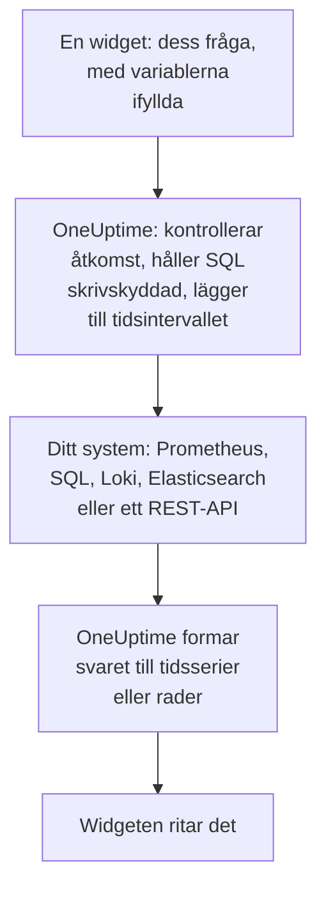

# Externa datakällor

En extern datakälla ansluter ett system utanför OneUptime, till exempel Prometheus, en SQL-databas, ClickHouse, Loki, Elasticsearch eller ett REST-API, så att dina instrumentpaneler kan visa dess data bredvid din egen. Du ansluter systemet en gång; därefter kör varje widget en skrivskyddad fråga i systemets eget språk.

:::cards
- [Anslut en datakälla](#anslut-en-datakälla): Välj typen, och ange sedan var den finns och hur man loggar in.
- [Skriv en fråga](#skriv-en-fråga): PromQL, SQL, LogQL, Query DSL eller en förfrågan.
- [Gränser](#gränser): Tidsgränserna och taken som skyddar båda sidor.
- [Säkerhet](#säkerhet): Skrivskyddade frågor och inloggningsuppgifter som bara kan skrivas.
:::

## Så körs en fråga

Widgeten skickar sin fråga till OneUptime, med variablerna redan ifyllda. OneUptime kontrollerar att du får läsa datakällan, fyller i tidsintervallet och frågar ditt system med inloggningsuppgifterna som det förvarar. Det formar svaret till tidsserier eller rader som widgeten ritar.



## Innan du börjar

- **En plan som omfattar det.** På OneUptime Cloud kräver att skapa och ändra datakällor planen **Growth**. Att ta bort en fungerar på alla planer.
- **En behörighet att lägga till dem.** Projektägare och -administratörer kan lägga till datakällor; alla andra behöver `CreateDataSource`, med `EditDataSource` och `DeleteDataSource` för att ändra och ta bort dem. Alla som kan läsa projektets datakällor, även medlemmar och läsare, ser deras widgetars data.
- **Ett skrivskyddat konto.** Instrumentpaneler läser bara. Anslut databaser med ett konto som bara kan läsa, och HTTP-källor med en token som bara kan fråga.
- **En väg in.** Det är OneUptimes API-server som ansluter till ditt system, så den måste kunna nå det: se [Säkerhet](#säkerhet) för adresserna som avvisas.

## System som stöds

| Typ | Frågespråk | Fungerar med |
| --- | --- | --- |
| Prometheus | PromQL | Prometheus, Thanos, Cortex, Mimir, VictoriaMetrics |
| PostgreSQL | SQL | PostgreSQL, TimescaleDB, CockroachDB |
| MySQL | SQL | MySQL, MariaDB |
| Microsoft SQL Server | T-SQL | SQL Server, Azure SQL |
| ClickHouse | SQL | ClickHouse, via dess HTTP-gränssnitt |
| Grafana Loki | LogQL | Loki och Loki-kompatibla slutpunkter |
| Elasticsearch | Query DSL (JSON) | Elasticsearch, OpenSearch |
| REST API | Förfrågan (JSON) | Alla HTTP(S)-API:er som svarar med JSON |

## Anslut en datakälla

:::steps
### Öppna datakällorna

Öppna **Produkter → Instrumentpaneler**, fäll ut **Inställningar** i sidomenyn och klicka på **Datakällor**.

### Välj typen

Klicka på **Skapa Data Source**. Dialogrutan **Choose a Data Source Type** grupperar typerna efter vad de innehåller: mätvärden, loggar, databaser, sökning och API:er. Klicka på en.

### Namnge den

Under **Grundläggande information** ger du den ett **Namn**, till exempel "Produktions-Prometheus", och en **Beskrivning** om du vill.

### Ange var den finns

Under **Anslutning** får en HTTP-källa den **URL** som den svarar på. En databas får sin **Database Host**, sin **Database Port** (lämna den tom för 5432, 3306, 1433 eller 8123) och sitt **Databasnamn**.

### Ange hur man loggar in

Under **Autentisering** anger du ett **Användarnamn** och ett **Lösenord** eller, för en HTTP-källa, en **API-token**, som skickas som bearer-token. **Fler fält** innehåller **Custom HTTP Headers**, till exempel `{ "X-Scope-OrgID": "tenant-1" }`, och **Additional Options**: `sslEnabled` och `sslRejectUnauthorized` för databaser, och `elasticsearchIndex` för Elasticsearch, som utan den läser alla index (`*`).

### Testa den

Klicka på **Skapa Data Source** och sedan på **Testa** på dess rad. OneUptime ansluter med uppgifterna som du angav, och talar om ifall det fungerade eller vad som gick fel.
:::

För att ändra en datakälla senare öppnar du den från listan. **Redigera** på **Data Source Details** ändrar allt utom dess hemligheter; **Uppdatera inloggningsuppgifter** ersätter lösenordet, token eller rubrikerna, och lämnar fälten som du lämnar tomma som de var; **Testa** kontrollerar den igen.

## Använd den i en widget

Redigera en instrumentpanel, klicka på **Lägg till widget** och välj en widget i gruppen Externa datakällor: ett **Diagram**, ett **Värde**, en **Mätare** eller en **Tabell**. I dess inställningar:

- Välj **Data Source** och skriv **Fråga**. Redigeraren namnger frågespråket och visar ett exempel för typen.
- På ett diagram lägger **Lägg till fråga** fler frågor på samma axlar, och **Legend (optional)** namnger varje serie utifrån dess etiketter: `{{instance}} — errors` skriver seriens etikett `instance` först.
- På ett värde eller en mätare gör **Reduce** om punkterna till ett enda tal: det senaste värdet (standard), det första, medelvärdet, summan, minimum eller maximum. **Unit** lägger till ett suffix och skalar de kända enheterna: `Bytes` läses som 1.5 MB, `ms` som 2.4 s.
- På en tabell fungerar vilken skrivskyddad fråga som helst, och dess rader visas som de kommer tillbaka.

## Skriv en fråga

Varje typ tar sitt eget språk, med samma regler för vad som kommer tillbaka:

- **Diagram, värden och mätare behöver tidsserier.** En SQL-fråga returnerar en tidskolumn med namnet `time`, `timestamp`, `date` eller `ts`, och en numerisk kolumn `value` (eller dess första numeriska kolumn); alla andra kolumner blir serieetiketter. Elasticsearch behöver en aggregering `date_histogram`, och Loki en mätvärdesfråga som `rate()` eller `count_over_time()`.
- **Tabeller visar rader** som frågan returnerar dem: SQL-rader, Prometheus-serier, Loki-loggrader, Elasticsearch-träffar, eller objekten vid ett REST-API:s `rowsPath`.

:::tabs
@tab Prometheus
```text title="PromQL"
sum by (job) (rate(http_requests_total{job=~"{{job}}"}[5m]))
```
@tab SQL
```sql title="SQL"
SELECT date_trunc('minute', created_at) AS time, COUNT(*) AS value
FROM orders
WHERE created_at BETWEEN $__startTime AND $__endTime
GROUP BY 1
ORDER BY 1
```
@tab Loki
```text title="LogQL"
sum by (app) (rate({app="api"} |= "error" [5m]))
```
@tab Elasticsearch
```json title="Query DSL"
{
  "query": { "range": { "@timestamp": { "gte": "$__startTime", "lte": "$__endTime" } } },
  "aggs": {
    "over_time": {
      "date_histogram": { "field": "@timestamp", "fixed_interval": "1m" }
    }
  }
}
```
@tab REST API
```json title="Request"
{
  "path": "/api/stats?from=$__startTimeMs&to=$__endTimeMs",
  "method": "GET",
  "rowsPath": "data.items",
  "timestampField": "time",
  "valueField": "count",
  "seriesField": "service"
}
```
:::

### Tidsmakron

Prometheus och Loki får instrumentpanelens tidsintervall med varje förfrågan, så deras frågor behöver inget mer. De andra typerna placerar tidsintervallet där du skriver ett makro:

| Makro | Blir | I |
| --- | --- | --- |
| `$__startTime`, `$__endTime` | Intervallets start och slut, i UTC: `'2026-10-13 09:00:00'` i SQL, annars ISO 8601 | SQL, Elasticsearch, REST API |
| `$__startTimeMs`, `$__endTimeMs` | Samma sak, som millisekunder sedan 1970 | SQL, Elasticsearch, REST API |
| `$__rangeSeconds` | Intervallets längd, i sekunder | SQL |

SQL-makron skrivs i UTC, så kör dina databassessioner i UTC, eller räkna om i frågan.

### Instrumentpanelsvariabler

Skriv `{{name}}` var som helst i en fråga, så sätter widgeten in variabelns värde där innan den skickar frågan. Flera värden i en flervalsvariabel slås ihop med `|`, vilket är vad en matchning med reguljära uttryck i PromQL eller LogQL behöver: `job=~"{{job}}"`. En variabel utan något valt lämnar platshållaren som den är skriven, så att felet namnger den. [Instrumentpanelsvariabler & filter](/docs/dashboards/variables) visar hur du lägger till en.

## Gränser

Varje fråga är begränsad, så att en instrumentpanel med tjugo widgetar som uppdateras varje minut inte kan överbelasta OneUptime eller ditt system:

| Gräns | Värde |
| --- | --- |
| Anslutning | 10 sekunder |
| Körning av en fråga | 30 sekunder |
| Punkter i ett tidsseriesvar | 11 000 |
| Rader i en tabell | 1 000 |
| Serier i ett svar | 100 |
| Svar från en HTTP-källa | 20 MB |

Intervallfrågor till Prometheus och Loki ber om ungefär 250 punkter över tidsintervallet, inte tätare än 10 sekunder och inte glesare än ett dygn.

## Säkerhet

- **SQL förblir skrivskyddad.** En fråga måste vara en enda sats som börjar med `SELECT`, `WITH`, `SHOW`, `EXPLAIN`, `DESCRIBE` eller `DESC`. Ord som skriver eller ändrar en session, till exempel `INSERT`, `UPDATE`, `DELETE`, `DROP`, `INTO` eller `SET`, avvisas överallt utanför strängar och citerade namn, så citera en kolumn som heter som något av dem. Skriv ett citattecken i en sträng som två citattecken (`''`): ett omvänt snedstreck före ett citattecken avvisas. Sessioner i PostgreSQL, MySQL och ClickHouse är också skrivskyddade. SQL Server har ingen skrivskyddad session, så anslut den med en skrivskyddad inloggning.
- **Inloggningsuppgifter kan bara skrivas.** **Lösenord**, **API-token** och **Custom HTTP Headers** krypteras när de lagras, och API:et returnerar dem aldrig, inte ens till dig.
- **Adresser kontrolleras.** Loopback-, link-local- (där molnmetadata finns) och andra reserverade adresser avvisas överallt. Privata adresser avvisas på OneUptime Cloud, och tillåts på en egeninstallation om inte `DATA_SOURCE_BLOCK_PRIVATE_ADDRESSES` är `true`: se [Åtkomst till privat nätverk](/docs/self-hosted/private-network-access).
- **Offentliga instrumentpaneler kör dem aldrig.** Widgetarna i Externa datakällor utelämnas från en [offentlig instrumentpanel](/docs/dashboards/sharing), frågor och allt.

## Felsökning

:::details Testa säger att det inte går att ansluta
Kontrollera URL:en, eller värden och porten, från där OneUptime körs: en brandvägg, en privat adress på OneUptime Cloud eller en databas som bara lyssnar på sin egen dator ser likadana ut härifrån. För en databas som kräver TLS lägger du till `{ "sslEnabled": true }` under **Additional Options**.
:::

:::details "Only read-only queries are allowed"
Frågan börjar inte med `SELECT`, `WITH`, `SHOW`, `EXPLAIN`, `DESCRIBE` eller `DESC`. Skicka en enda sats som bara läser: en andra sats efter ett `;` avvisas också, som "Only a single SQL statement is allowed per query."
:::

:::details "Query contains a keyword that is not allowed"
Ett ord som skriver förekommer utanför en sträng, ofta som kolumnnamn, till exempel `delete` eller `set`. Citera det som databasen gör: `"delete"` i PostgreSQL, `[delete]` i SQL Server, och inom bakåtfnuttar i MySQL och ClickHouse.
:::

:::details Diagrammet förblir tomt, men tabellen visar rader
Frågan returnerar rader, men inga tidsserier. Döp tidskolumnen till `time` och talet till `value` i SQL, lägg till en aggregering `date_histogram` i Elasticsearch, eller gör om en Loki-loggfråga till en mätvärdesfråga med `rate()` eller `count_over_time()`.
:::

:::details Viss data saknas
Svaret nådde en [gräns](#gränser). Begränsa tidsintervallet, filtrera frågan eller aggregera den till färre serier.
:::

## Nästa steg

:::cards
- [Instrumentpanels-widgetar](/docs/dashboards/widgets): Varje widget, inklusive gruppen Externa datakällor.
- [Instrumentpanelsvariabler & filter](/docs/dashboards/variables): Variabler att använda i dina frågor.
- [Åtkomst till privat nätverk](/docs/self-hosted/private-network-access): Nå system i ett privat nätverk från en egeninstallation.
- [Instrumentpanelskonfiguration & behörigheter](/docs/dashboards/configuration): Vem som får lägga till datakällor, och vem som läser dem.
:::
