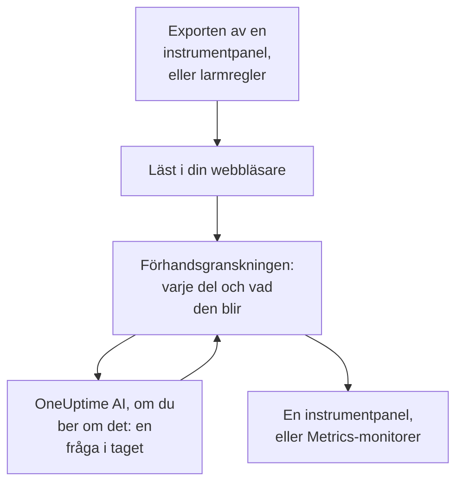

# Importera från Grafana och Datadog

Hämta in en instrumentpanel som du byggt i Grafana eller Datadog, eller de larmregler du skrivit för Prometheus, Grafana eller Datadog, till OneUptime. Du klistrar in eller laddar upp filen, ser vad varje panel och varje regel blir, och först då skapar du instrumentpanelen eller monitorerna.

:::cards
- [Importera en instrumentpanel](#importera-en-instrumentpanel): JSON-modellen för en Grafana-instrumentpanel, eller exporten av en Datadog-instrumentpanel.
- [Importera larmregler](#importera-larmregler): Prometheus-regelfiler, Grafana-larmregler och Datadog-monitorer.
- [Hur varje del konverteras](#hur-varje-del-konverteras): Exakt, ungefärligt eller inte alls, och varför.
- [Konvertera en fråga med OneUptime AI](#konvertera-en-fråga-med-oneuptime-ai): För en fråga som ingen regel konverterar.
:::

## Så går en import till

OneUptime läser filen i din webbläsare och konverterar varje panel, widget, variabel och regel för sig. Förhandsgranskningen listar alla med vad var och en blir. Inget skapas förrän du väljer att skapa det, och då skapas det med dina egna behörigheter, så som formulären för instrumentpaneler och monitorer skapar det.

## Innan du börjar

- De importerade widgetarna och monitorerna läser projektets egna mätvärden med PromQL. Skicka dem med Prometheus remote write, OpenTelemetry eller Datadog Agent, så behåller de namnen de har där.
- Att importera en instrumentpanel kräver en roll som får skapa instrumentpaneler, och att importera larmregler en roll som får skapa monitorer.
- En fil får vara upp till 10 MB, och upp till 500 av dess paneler eller regler läses.

## Importera en instrumentpanel

:::steps
### Öppna importen av instrumentpaneler

Öppna **Produkter → Instrumentpaneler** och sedan **Fler alternativ → Import from Grafana or Datadog**.

### Klistra in instrumentpanelen

Kopiera JSON-modellen från instrumentpanelens inställningar i Grafana. Exportera instrumentpanelens JSON i Datadog. Klistra in den, eller välj **Upload a File**, och välj sedan **Förhandsgranskning**.

### Skapa instrumentpanelen

Kontrollera vad varje panel och varje variabel blir, ge instrumentpanelen ett namn och välj **Skapa instrumentpanel**. Den nya instrumentpanelen öppnas.
:::

PromQL från Grafana behålls som det är skrivet: OneUptime fyller i `$__interval`, `$__rate_interval` och `$__range` som Grafana gör, och en variabel på All matchar alla värden. En Datadog-fråga blir PromQL över de mätvärden som Datadog Agent har skickat: `avg:system.cpu.user{host:web-1}` läser `system_cpu_user{host="web-1"}`.

## Importera larmregler

:::steps
### Öppna larmimporten

Öppna **Produkter → Monitorer** och sedan **Fler alternativ → Import Alerts**.

### Klistra in reglerna

Klistra in en Prometheus-regelfil eller en PrometheusRule-resurs, Grafanas export av sina larmregler eller Datadog-monitorer exporterade som JSON, och välj sedan **Förhandsgranskning**.

### Skapa monitorerna

Avmarkera de regler du inte vill ha, välj under **When a rule fires** vad en regel som utlöses öppnar, och välj **Skapa monitorer**.
:::

Varje regel blir en Metrics-monitor med en PromQL-fråga, regelns villkor och dess tidsfönster. Den öppnar ett larm, eller en incident, för varje serie som går över gränsen och löser det när serien återhämtar sig. Titel och beskrivning kommer från regelns sammanfattning eller meddelande, med seriens etiketter ifyllda.

## Hur varje del konverteras

| Status | Vad den betyder |
| --- | --- |
| **Converted exactly** | Den läser samma data och visar dem på samma sätt. |
| **Converted approximately** | Den skapas, och dess anteckningar säger vad som skiljer sig. |
| **Not converted** | Inget skapas för den, och dess anteckningar säger varför. |

Inspelningsregler, larmregler över loggar, Datadog-widgetar som läser loggar, traces eller händelser, och Datadogs monitorer för avvikelser, extremvärden och prognoser konverteras inte.

## Konvertera en fråga med OneUptime AI

En fråga som ingen regel konverterar visar **Convert with OneUptime AI**, som kräver att AI är påslaget för projektet. Bara den frågan, med namnen på instrumentpanelens variabler, skickas till projektets AI-leverantör. Svaret kontrolleras som vilken fråga som helst och visas för dig: välj **Use This Query** för att använda det. Inget skapas förrän du skapar instrumentpanelen eller monitorerna.

## Nästa steg

:::cards
- [Instrumentpanels-widgetar](/docs/dashboards/widgets): Ändra vad en importerad widget visar.
- [Instrumentpanelsvariabler & filter](/docs/dashboards/variables): Variablerna som en import skapade.
- [Metrikövervakning](/docs/monitor/metrics-monitor): Monitorerna som en import skapade.
- [PromQL](/docs/telemetry/promql): Språket som de importerade widgetarna och monitorerna läser.
:::
