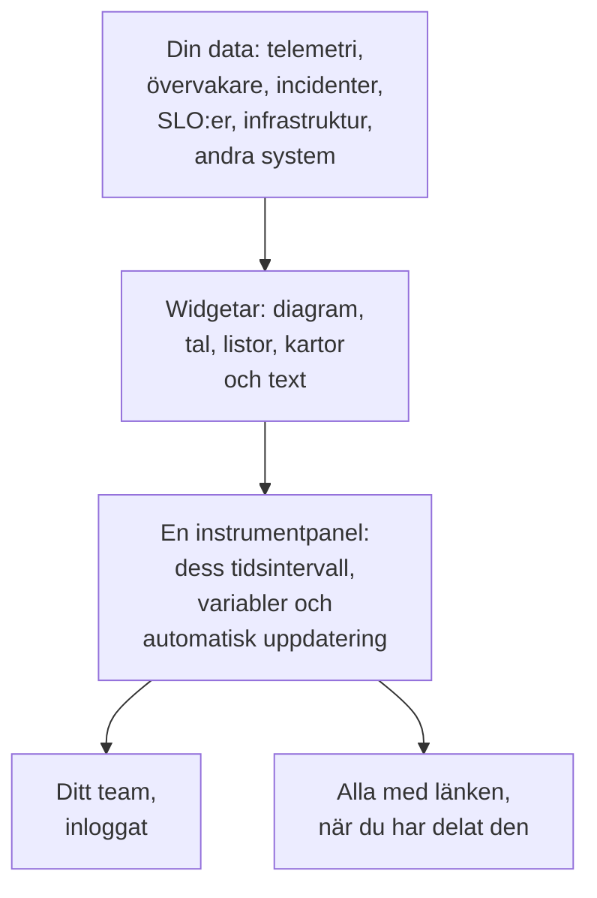

# Översikt över instrumentpaneler

En instrumentpanel är en sida med widgetar som du själv ordnar: diagram över dina mätvärden, loggar och spår, listor över incidenter, larm och övervakare, dina SLO:er och din infrastruktur, till och med data från system utanför OneUptime. Bygg en för jourskärmen, för ett teams morgonkoll eller som en sida för dina kunder, och dela den med ditt projekt eller med alla som har länken.

:::cards
- [Så fungerar en instrumentpanel](#så-fungerar-en-instrumentpanel): Var datan kommer ifrån, och vem som ser den.
- [Hitta dina instrumentpaneler](#hitta-dina-instrumentpaneler): Listan Instrumentpaneler och varje instrumentpanels egna sidor.
- [Bygg din första instrumentpanel](#bygg-din-första-instrumentpanel): Från en mall till en delad sida i fem steg.
- [Ett exempel: en jourpanel](#ett-exempel-en-jourpanel): En sida som fungerar för alla tjänster.
:::

## Så fungerar en instrumentpanel

Varje widget läser från en källa, inom instrumentpanelens tidsintervall och filtrerad av dess variabler. Alla som öppnar instrumentpanelen ser samma widgetar: ditt team när det loggar in, och besökare via den offentliga länken när du har delat den.

| Begrepp | Vad det betyder |
| --- | --- |
| Instrumentpanel | En sida: ett namn, ett rutnät med widgetar, ett tidsintervall, variabler och en inställning för automatisk uppdatering. |
| Widget | En ruta i rutnätet: ett diagram, ett tal, en lista, en karta, en klocka eller ett textblock. |
| Variabel | En väljare i verktygsfältet som begränsar varje widget som stöder den till en tjänst, värd eller kund. |
| Tidsintervall | Fönstret som alla diagram och tal läser. En instrumentpanel öppnas på sin standard, den senaste timmen om inte någon som redigerar den väljer en annan, och varje tittare kan välja sitt eget. |
| Automatisk uppdatering | Hur ofta widgetarna läser sin data igen: av, eller från var 5:e sekund till var 15:e minut. |
| Visning och redigering | En instrumentpanel öppnas för läsning. Redigering är ett separat steg som slutar med att du sparar eller kastar dina ändringar. |

## Vad instrumentpaneler är bra för

- **En "är allt okej?"-sida** för den som har jour, ett teams standup eller en skärm på väggen.
- **Att se samband**: en CPU-topp bredvid en stigande svarstid och en öppen incident syns tydligt på en sida, och är lätt att missa utspritt på tre.
- **Felsökning**: lägg diagrammen du hela tiden öppnar igen sida vid sida, och dra över en topp för att läsa alla widgetar i det ögonblicket.
- **Delning utanför teamet**: en prestandasida för en kund eller partner, skyddad med ett lösenord eller en IP-tillåtelselista om du vill.

## Hitta dina instrumentpaneler

Öppna **Produkter → Instrumentpaneler**. Listan **Instrumentpaneler** visar projektets instrumentpaneler med deras beskrivningar, etiketter och ägare. Sök på namn eller beskrivning, begränsa listan med filtren **Ägare** och **Etiketter**, eller markera flera instrumentpaneler för att ändra deras etiketter eller ägare, arkivera dem eller exportera dem som JSON.

Listans sidomeny har sidorna som tar hand om alla dina instrumentpaneler:

| Sida | Vad du gör där |
| --- | --- |
| **Instrumentpaneler** | Projektets instrumentpaneler. Skapa en, eller hämta in instrumentpaneler med **Importera JSON**. |
| **Instrumentpaneler → Spellistor** | [Visa instrumentpaneler efter varandra](/docs/dashboards/playlists) på en skärm, till exempel en NOC-vägg. |
| **Inställningar → Ägarregler** | Lägg automatiskt till ägare på nya instrumentpaneler. |
| **Inställningar → Etikettregler** | Lägg automatiskt till etiketter på nya instrumentpaneler. |
| **Inställningar → Datakällor** | Anslut Prometheus, SQL-databaser, ClickHouse, Loki, Elasticsearch eller ett REST-API. |
| **Avancerad → Arkiverad** | Instrumentpaneler som du har arkiverat. Avarkivera dem härifrån. |

Öppna en instrumentpanel, så har dess egen sidomeny de här sidorna. Alla avsnitt utom **Grundläggande** börjar hopfällda: klicka på rubriken för att öppna dem.

| Sida | Vad du gör där |
| --- | --- |
| **Instrumentpanel** | Själva instrumentpanelen. Läs den, eller redigera den från dess **⋯**-meny. |
| **Översikt** | Dess namn, beskrivning och etiketter. |
| **Delning** | Vem som kan se den, dess offentliga länk och en IP-tillåtelselista under Fler inställningar. |
| **Ägare** | Användarna och teamen som äger den. |
| **Varumärke** | Sidtitel, beskrivning, logotyp, tema och favicon för den offentliga instrumentpanelen. |
| **Anpassade domäner** | Lägg den offentliga instrumentpanelen på din egen domän. |
| **Inställningar** | Duplicera, exportera eller arkivera instrumentpanelen. |
| **Granskningsloggar** | Varje ändring som gjorts på instrumentpanelen, och vem som gjorde den. |
| **Ta bort** | Ta bort instrumentpanelen för gott. |

## Bygg din första instrumentpanel

:::steps
1. **Skapa** — välj en mall, eller **Börja från grunden**. En mall fyller i namnet och öppnas med sina widgetar; en instrumentpanel från grunden öppnas utan innehåll, med **Lägg till widget** på arbetsytan.
2. **Lägg till widgetar** — välj en widget i katalogen, ange i dess inställningar vad den läser, och dra den sedan på plats och ändra storlek.
3. **Lägg till variabler, om du behöver dem** — en variabel `service` låter till exempel en enda instrumentpanel visa vilken tjänst som helst.
4. **Spara** — klicka på **Spara ändringar**. Inget du ändrar under redigeringen sparas förrän du gör det.
5. **(Valfritt) Dela offentligt** — välj **⋯ → Dela** på instrumentpanelen och välj vem som kan se den: alla med länken, eller alla med länken och ett lösenord.
:::

[Skapa en instrumentpanel](/docs/dashboards/authoring) går igenom varje steg.

## Ett exempel: en jourpanel

Målet: en sida för checkout-tjänsten med dess svarstid, felfrekvens, öppna incidenter och senaste loggar, som också fungerar för alla andra tjänster.

1. Klicka på **Skapa instrumentpanel**, välj **Börja från grunden** och döp instrumentpanelen till "Checkout-jour".
2. Klicka på **Lägg till widget** och lägg till ett **Diagram** över ditt mätvärde för förfrågningarnas svarstid, aggregerat som P95.
3. Bredvid det lägger du till ett **Värde** för din felfrekvens, med ett varningströskelvärde på 1 och ett kritiskt tröskelvärde på 5.
4. Under dem lägger du till en **Incidentlista** filtrerad på olösta incidenter, och en **Loggström** med tjänstens loggar.
5. Öppna **Variabler**, lägg till en variabel med namnet `service` med källan Telemetry Attribute och attributnyckeln `service.name`, och ge den standardvärdet `checkout`.
6. Klicka på **Spara ändringar**. Välj `payments` i verktygsfältets väljare `service`: diagrammet, värdet och loggströmmen byter till tjänsten payments, och incidentlistan fortsätter att visa alla olösta incidenter.

## Hur instrumentpaneler passar in i resten av OneUptime

- **Övervakare och telemetri** är där datan kommer ifrån. Varje mätvärde, logg och spår du skickar kan hamna på en widget.
- **Incidenter och larm** visas i widgetarna **Incidentlista** och **Larmlista**. En instrumentpanel visar dem bara: du arbetar med dem på deras egna sidor.
- **Statussidor** berättar för dina kunder om din tjänst är uppe. Instrumentpaneler visar i detalj hur den beter sig. De två arbetar sida vid sida.
- **Arbetsflöden** agerar på det som händer. Instrumentpaneler är där du läser det.

## Nästa steg

:::cards
- [Skapa en instrumentpanel](/docs/dashboards/authoring): Skapa en instrumentpanel, redigera den och spara dina ändringar.
- [Instrumentpanels-widgetar](/docs/dashboards/widgets): Varje widget, och vilken du ska välja.
- [Instrumentpanelsvariabler & filter](/docs/dashboards/variables): En instrumentpanel för varje tjänst, värd eller kund.
- [Delning & offentliga instrumentpaneler](/docs/dashboards/sharing): Offentliga länkar, lösenord, IP-tillåtelselistor och anpassade domäner.
:::
