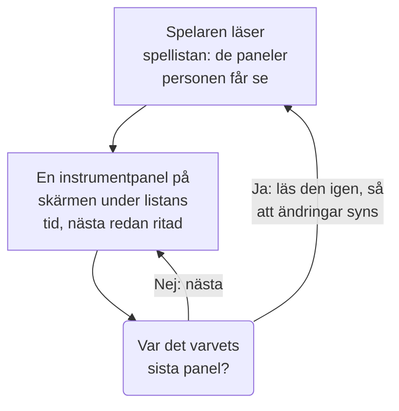

# Spellistor för instrumentpaneler

En spellista visar en rad instrumentpaneler efter varandra på en skärm som ingen rör, till exempel en NOC-vägg eller ett teams tv: varje instrumentpanel under den tid du väljer, om och om igen, tills någon pausar den. Gör spellistan en gång, öppna dess spelare på skärmen och låt den gå.

:::cards
- [Så spelas en spellista](#så-spelas-en-spellista): Ordningen, turerna och vad varje instrumentpanel visar.
- [Skapa en spellista](#skapa-en-spellista): Ett namn, dess instrumentpaneler i ordning och hur länge var och en visas.
- [Spela upp den på en skärm](#spela-upp-den-på-en-skärm): Spelarens list, dess knappar och dess tangenter.
- [Vem ser vad](#vem-ser-vad): Behörigheterna, och de instrumentpaneler en person inte får läsa.
:::

## Så spelas en spellista

Spelaren visar spellistans första instrumentpanel, sedan nästa när dess tid är ute, och börjar om från den första efter den sista. Varje instrumentpanel öppnas som dess redaktörer sparade den: med sitt eget standardtidsintervall, sin egen automatiska uppdatering och sina egna variabler, vad spelarens adress än säger. Medan en instrumentpanel visas ritar spelaren nästa utom synhåll, så att skärmen aldrig blir tom mellan två av dem.

En spellista namnger sina instrumentpaneler och kopierar dem aldrig: en ändring som en redaktör sparar i en instrumentpanel syns på skärmen nästa gång det är dess tur. Spelaren läser spellistan igen före varje varv, så att en instrumentpanel som lagts till, flyttats eller tagits bort syns inom ett varv, utan att skärmen laddas om; misslyckas den läsningen spelar skärmen det varv den har en gång till.

## Skapa en spellista

:::steps
### Öppna Spellistor
Öppna **Produkter → Instrumentpaneler** och sedan **Spellistor** i sidomenyn. Listan visar hur många instrumentpaneler varje spellista har och hur länge var och en visas, med **Spela upp** på varje rad.

### Ge den ett namn
Klicka på **Skapa Spellista** och ge den ett **Namn** som säger var den spelas, till exempel "NOC-vägg".

### Lägg till dess instrumentpaneler
Under **Instrumentpaneler** väljer du var och en i **Lägg till en instrumentpanel**, i den ordning skärmen visar dem. Knapparna på en instrumentpanels rad flyttar den upp eller ner, eller tar bort den. Arkiverade instrumentpaneler erbjuds inte.

### Välj hur länge var och en visas
**Visa varje instrumentpanel i** börjar på en minut; välj en tid från 15 sekunder till en timme. Klicka på **Skapa Spellista**.
:::

Spellistans sida visar dess instrumentpaneler i ordning, hur länge var och en visas och **Spelarlänk**. **Redigera spellista** ändrar namnet, instrumentpanelerna, deras ordning och tiden. **Ta bort Spellista för instrumentpaneler**, längst ner på sidan, tar bort spellistan och aldrig dess instrumentpaneler.

Via API:et och Terraform är en spellista ett `name`, dess `dashboards` som en lista som `[{"dashboardId": "<id>"}]` i den ordning de visas, högst 100, och `intervalInSeconds`, valfritt helt antal sekunder från 10 till 86400 (ett dygn). Ett värde utanför dessa gränser avvisas, med vad som är fel.

## Spela upp den på en skärm

Klicka på **Spela upp** på spellistans rad eller på dess sida. Spelaren fyller webbläsarfönstret, ovanpå resten av OneUptime; **Helskärm** fyller hela skärmen. För att starta en skärm på egen hand öppnar du **Spelarlänk** på den och sparar ett bokmärke: länken öppnar spelaren direkt.

Spelarens list visar instrumentpanelen på skärmen, spellistan, var varvet är ("2 av 5") och instrumentpanelen som kommer härnäst. En linje under listen fylls medan en instrumentpanel har sin tur. Listens knappar går till föregående instrumentpanel, pausar eller spelar upp och går till nästa; på en dator gör de här tangenterna samma sak:

| Tangenter | Vad den gör |
| --- | --- |
| `Space` | **Pausa eller spela upp**. Pausad stannar instrumentpanelen på skärmen och listen visar **Pausad**. |
| `Right Arrow` | **Nästa instrumentpanel**. |
| `Left Arrow` | **Föregående instrumentpanel**. |
| `F` | **Helskärm**, eller ut ur den igen. |
| `Esc` | **Lämna spelaren**, tillbaka till spellistans sida. I helskärm lämnar det första `Esc` bara helskärmen. |
| `?` | **Visa kortkommandon**. |

En instrumentpanel du går till, nästa eller föregående, får en hel tur. På en sida som läses från höger till vänster, till exempel på persiska, byter pilarna plats: `Left Arrow` går till nästa instrumentpanel. Medan den spelar håller spelaren skärmen vaken, där webbläsaren tillåter det.

## Vem ser vad

Spellistor har egna behörigheter, som du får genom ett team precis som instrumentpanelernas egna:

| För att | Krävs |
| --- | --- |
| Se och spela upp spellistor | `ReadDashboardPlaylist`, eller en projektroll: Project Owner, Project Admin, Project Member, Viewer eller en Settings-roll |
| Skapa spellistor | `CreateDashboardPlaylist`, Project Owner eller Project Admin |
| Ändra en spellista: dess namn, instrumentpaneler och tid | `EditDashboardPlaylist`, Project Owner eller Project Admin |
| Ta bort en spellista | `DeleteDashboardPlaylist`, Project Owner eller Project Admin |

En spellista visar aldrig någon en instrumentpanel som personen inte får läsa. Spelaren spelar bara upp de instrumentpaneler som personen som är inloggad på skärmen får läsa och som inte är arkiverade, och hoppar över resten: en borttagen instrumentpanel, en arkiverad eller en som personens behörigheter håller den borta från. Spellistans sida säger varför den hoppar över var och en. När en spellista sparas behåller den de instrumentpaneler i den som redaktören inte själv kan se, så att inget går förlorat som någon annan har lagt dit.

| När spelaren hittar | Visar den |
| --- | --- |
| Instrumentpaneler den får visa | Var och en i tur och ordning. |
| Ingen instrumentpanel den får visa | **Inget att visa än**, och den tittar igen varje minut. |
| Spellistan borttagen, eller inte personens att läsa | **Spellistan hittades inte**. |
| En läsning som misslyckades | **Spellistan kunde inte läsas in**, och den försöker igen varje minut, eller vid **Försök igen**. |

> [!NOTE]
> Spelaren är till för någon som är inloggad i OneUptime. För att köra en spellista på en skärm loggar du in på den skärmen med ett konto som får läsa spellistan och dess instrumentpaneler, till exempel en teammedlem med rollen Viewer.

## Nästa steg

:::cards
- [Skapa en instrumentpanel](/docs/dashboards/authoring): Bygg de instrumentpaneler en spellista visar.
- [Instrumentpanelsvariabler & filter](/docs/dashboards/variables): Det sparade urvalet varje instrumentpanel öppnas med.
- [Delning & offentliga instrumentpaneler](/docs/dashboards/sharing): Visa en instrumentpanel för personer som inte loggar in.
- [Instrumentpanelskonfiguration & behörigheter](/docs/dashboards/configuration): Ägare, etiketter och vem som får läsa en instrumentpanel.
:::
