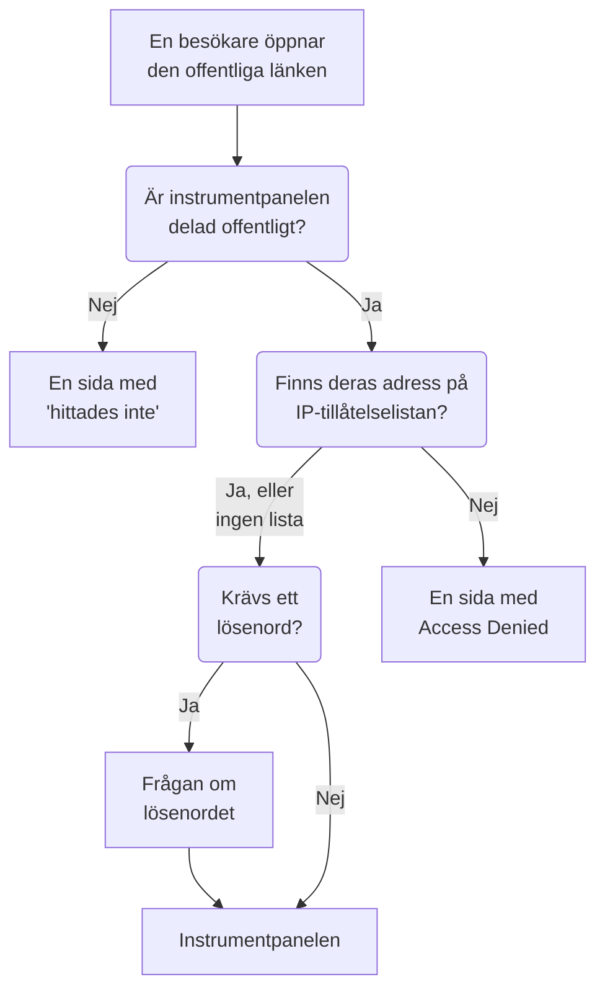

# Delning & offentliga instrumentpaneler

Som standard är en instrumentpanel privat för ditt projekt: bara personer som loggar in i ditt projekt kan se den. Du kan också dela den via en offentlig länk, skydda länken med ett lösenord, begränsa den till vissa IP-adresser och lägga den på din egen domän. Den här sidan går igenom alla fyra.

:::cards
- [Vem som kan se en instrumentpanel](#vem-som-kan-se-en-instrumentpanel): Ett val av tre, med den plan som varje val kräver.
- [Dela med ett lösenord](#dela-med-ett-lösenord): Dela länken, och sedan lösenordet, med dem som ska se den.
- [IP-tillåtelselista](#ip-tillåtelselista): Öppna den offentliga länken bara för ditt kontor eller ditt VPN.
- [Anpassade domäner](#anpassade-domäner): Visa instrumentpanelen på din egen domän, med ett gratis certifikat.
:::

## Vad en besökare går igenom

En besökare som öppnar en instrumentpanels offentliga länk möter var och en av de här kontrollerna i tur och ordning. Projektmedlemmar som loggar in i OneUptime ser instrumentpanelen inne i produkten, vad du än väljer här.



## Vem som kan se en instrumentpanel

Öppna instrumentpanelen och välj **⋯ → Dela**, eller öppna **Delning** i instrumentpanelens sidomeny. Kortet **Vem som kan se den här instrumentpanelen** är ett enda val:

- **Bara personer i det här projektet** (standard): medlemmar ser instrumentpanelen när de loggar in i OneUptime. Den har ingen offentlig länk: dess offentliga adress visar samma sida med "hittades inte" som en adress utan instrumentpanel, och ingenting om instrumentpanelen, inte ens dess namn.
- **Alla med länken**: instrumentpanelen är offentlig. Alla som har länken kan se den, utan att logga in.
- **Alla med länken och ett lösenord**: besökare öppnar länken och anger sedan ett lösenord som du delar med dem. Ingen behöver ett konto.

När du gör ett val ombeds du bekräfta, med en förklaring av vad som ändras för besökarna, och sedan gäller det direkt. Väljer du **Alla med länken och ett lösenord** frågar samma dialogruta efter lösenordet när instrumentpanelen inte har något; så länge det är valet ersätter **Ändra lösenord** det. Så länge instrumentpanelen är offentlig står adresserna som besökare öppnar den på under valet: först dess anpassade domäner, sedan dess offentliga länk, var och en med **Kopiera länk**. En anpassad domän som inte är live än är markerad med **Inte live än**, med orsaken.

Inom projektet styr ägare och etiketter vem som ser vad: se [Instrumentpanelskonfiguration & behörigheter](/docs/dashboards/configuration). Den som kan se instrumentpanelen men inte redigera den ser valet och kan kopiera den offentliga länken, men kan inte ändra valet.

På OneUptime Cloud kräver delning av en instrumentpanel planen **Growth**: på en lägre plan visar de två offentliga valen vilken plan de kräver och kan inte väljas. Att göra en instrumentpanel privat igen (**Bara personer i det här projektet**) fungerar på alla planer, så en instrumentpanel som låg kvar offentligt när en provperiod tog slut, eller efter ett byte till en lägre plan, alltid kan sluta delas; dialogrutan säger att det krävs **Growth** för att dela den igen. Att växla mellan **Alla med länken** och **Alla med länken och ett lösenord**, och att ändra lösenordet, fungerar på alla planer. En instrumentpanel som skapas via API:et eller Terraform omfattas av samma planer: skapad offentlig kräver den **Growth**, och skapad med en IP-tillåtelselista **Scale**.

Valet lagras i tre kolumner, som API:et och Terraform läser och skriver som tidigare: `isPublicDashboard`, `enableMasterPassword` och `masterPassword`. Bara en offentlig instrumentpanel har en offentlig länk, och dess besökare får ange lösenordet så länge `enableMasterPassword` är på. En offentlig instrumentpanel med `enableMasterPassword` på men utan angivet lösenord släpper inte in någon via sin offentliga länk: sidan **Delning** visar den som **Alla med länken och ett lösenord**, säger att ingen kan öppna länken ännu och erbjuder **Ange lösenord**. Att välja **Bara personer i det här projektet** stänger också av `enableMasterPassword` och behåller lösenordet, så att en ny delning med lösenord kan återanvända det.

## Offentliga instrumentpaneler

En offentlig instrumentpanel:

- Öppnas alltid för läsning. Besökare kan inte redigera den och ser aldrig dess redigeringskontroller.
- Innehåller variablerna som du har lagt till. Besökare väljer i samma väljare som ditt team använder, och kan ändra tidsintervallet, zooma, slå på automatisk uppdatering och gå till helskärm. Den öppnas med instrumentpanelens standardtidsintervall och standard för automatisk uppdatering, och varje besökares webbläsare kommer ihåg besökarens egna val.
- Låter besökare [sortera dess listor och tabeller](/docs/dashboards/widgets#sortera-listor-och-tabeller) genom att klicka på en kolumnrubrik, så som ditt team gör. Varje besökares webbläsare kommer ihåg deras egen sortering, och OneUptime sorterar själv hela listan, alltid bara efter en av widgetens egna kolumner.
- Använder varumärket som du anger på instrumentpanelens sida **Varumärke**: sidtitel, beskrivning, logotyp, tema, favicon.
- Låter varje besökare växla mellan den ljusa och den mörka instrumentpanelen med en sol- eller månknapp i dess verktygsfält; [Tema](#tema) förklarar hur.

Behandla delning av en instrumentpanel som publicering av en webbsida. Varje widget på den blir läsbar för alla med länken. Titta på vad som finns på arbetsytan innan du delar den.

Varje widget publicerar bara det den ritar, och bara för resurserna den har riktats mot. En SLO-widget publicerar till exempel det SLO:ets nyckeltal men aldrig dess definition: se [SLO](/docs/dashboards/widgets#slo). Widgetar med en extern **Data Source** är undantaget: de tas helt bort från en offentlig instrumentpanel i stället för att renderas, eftersom deras konfiguration är själva frågan. Några fler widgetar kan inte visas utan en inloggad session, och säger det på sin plats: [På en offentlig instrumentpanel](/docs/dashboards/widgets#på-en-offentlig-instrumentpanel) listar dem.

## Dela med ett lösenord

Välj **Alla med länken och ett lösenord** och ange lösenordet i dialogrutan. Besökare ser en fråga om lösenordet innan instrumentpanelen visas. Frågan visar instrumentpanelens namn, sidtitel och favicon, i instrumentpanelens tema, och inget annat: dess beskrivning, logotyp och widgetar visas när lösenordet har angetts. Lösenordet lagras som en hash: ingen kan läsa tillbaka det. Ett nytt lösenord fungerar direkt; de som angav det gamla kan fortsätta se instrumentpanelen i upp till 7 dagar.

Använd ett lösenord när:

- Du vill dela med en partner eller kund men inte vill att URL:en ska vara användbar om den läcker.
- Instrumentpanelen är "halvoffentlig": öppen nog att du inte vill bjuda in varje tittare som teammedlem, men inte så öppen att du vill lägga den på det öppna internet.

För strängare åtkomstkontroll (separata konton per tittare, ett granskningsspår över vem som såg vad) behåller du instrumentpanelen på **Bara personer i det här projektet** och bjuder i stället in tittarna som skrivskyddade teammedlemmar.

## IP-tillåtelselista

Under **Fler inställningar** på sidan **Delning** begränsar avsnittet **IP-tillåtelselista** (kolumnen `ipWhitelist`) den offentliga länken till IP-adresserna eller IPv4-intervallen som du listar, en per rad, till exempel `203.0.113.7` eller `10.0.0.0/8`. Den gäller med eller utan lösenordet; projektmedlemmar som loggar in påverkas inte. Lämna den tom för att tillåta alla adresser. Den sparas för sig, separat från valet, och att ändra den kräver planen **Scale** på OneUptime Cloud; att tömma den fungerar på alla planer. Så länge en lista gäller visar den hopfällda rubriken för **Fler inställningar** **IP-tillåtelselista** med antalet poster den innehåller. Självhostat ingår det i Enterprise Edition att ändra den: i Community Edition fortsätter en redan angiven lista att gälla och kan bara tas bort.

Använd den när:

- Instrumentpanelen bara ska kunna nås från ditt kontor eller ditt VPN.
- En leverantörsportal bara ska kunna nås från leverantörens kända IP-adresser.
- Du vill ha extra skydd utöver ett lösenord.

Förfrågningar från alla andra IP-adresser avvisas med en sida med **Access Denied** som inte visar något om instrumentpanelen: varken dess namn, dess varumärke eller dess fråga om lösenordet. En rad som varken är en IP-adress eller ett IPv4-intervall avvisas när du sparar, eftersom servern skulle hoppa över den.

## Anpassade domäner

Från början visas en offentlig instrumentpanel på sin offentliga länk, på OneUptimes egen adress. För att lägga den på din egen underdomän, till exempel `dashboard.acme.com`, öppnar du **Varumärke → Anpassade domäner** i instrumentpanelens sidomeny. Det fungerar precis som en statussidas sida **Anpassade domäner**.

Kortet heter **Anpassade domäner** och säger vad du ska göra: peka varje domäns CNAME-post mot din installations CNAME-post för instrumentpaneler, så utfärdar OneUptime domänens SSL-certifikat och förnyar det åt dig. Tabellen har två kolumner, **Domän** och **Status**.

Att lägga instrumentpanelen på din egen domän tar tre steg, och bara de två första är dina:

1. **Lägg till domänen**: en underdomän och en av dina verifierade domäner.
2. **Lägg till dess CNAME-post** hos din DNS-leverantör. Dialogrutan **DNS-inställning** öppnas med posten så snart du lägger till domänen.
3. **Det kostnadsfria SSL-certifikatet utfärdas automatiskt** så snart posten har hittats. Det finns ingen knapp att trycka på.

När den har verifierats kan instrumentpanelen nås både på din anpassade domän och på den ursprungliga URL:en.

### Lägg till domänen

Klicka på **Skapa Dashboard Domän**. Dialogrutan är en enda sida:

- **Underdomän**: bara etiketten, med platshållaren `dashboard (leave blank for root)`. Ange bara `dashboard`, inte hela värdnamnet. Lämna den tom eller ange `@` för att använda rotdomänen (apex).
- **Domän**: domänerna som har verifierats under **Projektinställningar → Avancerad → Domäner**, där du med en TXT-post bevisar att en domän är din. En domän som du inte har verifierat finns inte i listan, eftersom den skulle avvisas. Länken **Lägg till en domän** bredvid fältet öppnar den sidan i en ny flik.
- **Fler fält**: hopfällt. Så länge det är hopfällt säger rubriken vilket certifikat domänen kommer att använda: "Vi utfärdar ett gratis SSL-certifikat för den här domänen och förnyar det automatiskt." Öppna det bara för att använda ett eget certifikat (se nedan).

Klicka på **Skapa Dashboard Domän**. Dialogrutan stängs och den nya domänens **DNS-inställning** öppnas. En domäns fullständiga namn ligger fast när du lägger till den, så **Redigera** ändrar bara dess certifikat. För att använda en annan underdomän lägger du till den domänen och tar bort den gamla.

### DNS-inställning och Kontrollera nu

Dialogrutan **DNS-inställning** visar posten som du ska lägga till hos din DNS-leverantör, ett fält per rad, vart och ett med en kopieringsknapp: **Typ** `CNAME`, **Namn** den fullständiga domän som du lade till, och **Värde** din installations CNAME-post för instrumentpaneler. För en rotdomän, utan underdomän, lägger dialogrutan till en anmärkning: många DNS-leverantörer tillåter inte en CNAME-post där, så använd i stället leverantörens ALIAS-, ANAME- eller CNAME-flattening-post med samma värde.

OneUptime kontrollerar varje overifierad domän var 15:e minut, och när kontrollen hittar posten beställer den domänens kostnadsfria Let's Encrypt-certifikat i samma kontroll, oavsett om du kommer tillbaka eller inte. För att kontrollera direkt klickar du på **Kontrollera nu**:

- **Posten har inte hittats än.** Dialogrutan förblir öppen och säger vilken post den letade efter. En ny DNS-post kan ta en stund att dyka upp. Klicka på **Kontrollera nu** igen senare, eller lämna det åt kontrollen var 15:e minut.
- **Posten har hittats.** Dialogrutan säger "Din CNAME-post är verifierad." och vad som händer med certifikatet härnäst. Det kostnadsfria certifikatet beställs i det ögonblicket och är oftast aktivt inom 15 minuter.

Tills en domän har verifierats och dess certifikat är på plats har dess rad en åtgärd **DNS-inställning** som öppnar samma dialogruta. På en verifierad domän vars certifikatbeställning fortsätter att misslyckas, eller vars certifikat har gått ut, beställer **Kontrollera nu** där på nytt och visar varför den senaste beställningen misslyckades. Den beställer högst en gång per domän var 15:e minut; däremellan fortsätter OneUptime att försöka på egen hand och väntar lite längre efter varje misslyckande i rad. Förnyelsen sker automatiskt, i god tid innan certifikatet går ut, och en misslyckad DNS-kontroll tar aldrig bort ett certifikat som fortfarande är giltigt.

### Läsa kolumnen Status

Kolumnen **Status** säger var varje domän befinner sig på vägen mot HTTPS, i ett av sju tillstånd, samma som för statussidor. När en beställning har misslyckats står orsaken på raden under.

| Vad kolumnen Status säger | Vad det betyder |
| --- | --- |
| Väntar på DNS: lägg till CNAME-posten. | CNAME-posten har inte hittats än. Öppna **DNS-inställning** för att se posten, lägg till den hos din DNS-leverantör och klicka sedan på **Kontrollera nu** eller vänta på kontrollen var 15:e minut. |
| Utfärdar ett gratis certifikat, vanligtvis inom 15 minuter. | Posten är verifierad, och certifikatet beställs eller skrivs ut. Inget att göra. |
| Kunde inte utfärda ett gratis certifikat ännu. Vi fortsätter att försöka. | Posten är verifierad, men beställningen av dess certifikat misslyckades, av orsaken på raden under. Åtgärda orsaken, öppna sedan **DNS-inställning** och klicka på **Kontrollera nu** för att beställa igen direkt. |
| Certifikatet har gått ut. Vi fortsätter att försöka förnya det. | Domänens certifikat har gått ut eftersom förnyelserna misslyckades. Öppna **DNS-inställning** och klicka på **Kontrollera nu** för att förnya det direkt och se varför. |
| Certifikat utfärdat, förnyas automatiskt. | Klart. Domänen levererar sitt certifikat över HTTPS, och OneUptime förnyar det. |
| Certifikat utfärdat, men förnyelsen misslyckades. Vi fortsätter att försöka. | Domänen levererar fortfarande ett giltigt certifikat, men den senaste förnyelsen misslyckades, av orsaken på raden under. OneUptime försöker igen i god tid innan certifikatet går ut. |
| Använder ditt uppladdade certifikat. | Posten är verifierad, och domänen levereras med certifikatet som du laddade upp. |

Om en beställning misslyckas är de vanliga orsakerna en CAA-post på din domän som inte tillåter `letsencrypt.org` och, på en egeninstallation, en server som Let's Encrypt inte kan nå på port 80.

### Ditt eget certifikat, och nyutfärdande

För att i stället använda ditt eget certifikat öppnar du **Fler fält** när du lägger till domänen, slår på **Ladda upp anpassat certifikat** och klistrar in **Certifikat** och dess **Privat certifikatnyckel**. OneUptime levererar det inom 15 minuter i stället för att beställa ett Let's Encrypt-certifikat, och det ersätter alla Let's Encrypt-certifikat som domänen hade tidigare. Att förnya ett uppladdat certifikat är upp till dig: redigera domänen och klistra in det nya. Om domänen hade ett kostnadsfritt certifikat tidigare fortsätter OneUptime att förnya det medan ditt används, så att byta tillbaka går direkt.

När ett kostnadsfritt certifikat har beställts för en domän visar raden **Reissue SSL**, som ber Let's Encrypt om ett helt nytt certifikat när du vill ha ett före den automatiska förnyelsen. Varje domän kan få ett nytt certifikat en gång per 24 timmar.

På en egeninstallation slås anpassade domäner för instrumentpaneler på med miljövariabeln `DASHBOARD_CNAME_RECORD` (`dashboard.cnameRecord` i Helm-diagrammet), som är målet som dina CNAME-poster pekar mot. Utan den säger kortet och dialogrutan **DNS-inställning** "Custom Domains not enabled for this OneUptime installation" i stället för att visa en post, och OneUptime verifierar inga domäner och beställer inga certifikat för instrumentpaneler.

### Vem som kan kontrollera och utfärda på nytt

**Kontrollera nu**, beställning av en domäns certifikat och **Reissue SSL** ändrar domänen, så de kräver behörighet att redigera den: **Edit Dashboard Domain**, eller en roll som innehåller den (Project Owner, Project Admin, Project Member, Settings Admin eller Settings Member).

Den som bara kan läsa domänen, till exempel en Viewer eller en Settings Viewer, ser fortfarande kolumnen **Status** och posten som ska läggas till i **DNS-inställning**. För dem är **Kontrollera nu** och **Reissue SSL** låsta, och säger vilken behörighet som krävs. OneUptime fortsätter i vilket fall som helst att kontrollera varje domän och beställa dess certifikat på egen hand.

Samma sak gäller API-nycklar. En nyckel som bara kan läsa instrumentpanelsdomäner kan inte anropa `verify-cname`, `order-ssl` eller `reissue-ssl` på `/dashboard-domain`. Ge den **Read Dashboard Domain** och **Edit Dashboard Domain** om den behöver det.

En domän tillhör en instrumentpanel i projektet åt gången. Du kan koppla fler än en anpassad domän till en enda instrumentpanel om du visar samma innehåll för flera målgrupper: en kundinriktad instrumentpanel med ditt eget varumärke, en samprofilerad partnerpanel eller en offentlig hälsosida med en egen URL.

## Varumärke

På instrumentpanelens sida **Varumärke** kan du konfigurera:

- **Sidtitel**: det som visas i webbläsarfliken och högst upp på sidan.
- **Sidbeskrivning**: beskrivningen som sökmotorer och förhandsvisningar i sociala medier använder.
- **Logotyp**: en bild som visas i den offentliga instrumentpanelens sidhuvud.
- **Tema**: ljust, mörkt eller som varje besökares enhet är inställd; se [Tema](#tema).
- **Favicon**: den lilla ikonen i webbläsarfliken.

Logotypen och faviconen är filer som har laddats upp i instrumentpanelens eget projekt, och det kontrolleras varje gång någon av dem sparas: från instrumentpanelen, API:et, Terraform eller ett arbetsflöde. En fil som har laddats upp i ett annat projekt avvisas med samma ord som en fil som inte längre finns får: "The logo's file could not be found. Upload the logo again." eller "The favicon's file could not be found. Upload the favicon again." Den offentliga instrumentpanelen visar bara bilder från sitt eget projekt.

Sidtiteln och beskrivningen står också överst i instrumentpanelens verktygsfält för ditt team, i stället för dess namn och beskrivning. Logotypen, temat och faviconen gäller bara för den offentliga instrumentpanelen.

Besökare ser varumärket först när de får se instrumentpanelen. Innan lösenordet har angetts visar en instrumentpanel som delas med lösenord bara sin sidtitel, favicon och sitt tema, och sökmotorer och länkförhandsvisningar ser sidtiteln men inte sidbeskrivningen. En instrumentpanel med en IP-tillåtelselista visar sitt varumärke bara för adresserna i listan, och sökmotorer och länkförhandsvisningar ser inget av det.

### Tema

Kortet **Tema**, direkt under logotypen, bestämmer hur den offentliga instrumentpanelen ser ut för sina besökare. Välj ett av dess tre val så sparas det direkt; det finns ingen knapp **Redigera**.

| Val | Vad besökarna ser |
| ------ | ----------------- |
| **Ljust** | Den ljusa instrumentpanelen, hur deras enhet än är inställd. Instrumentpaneler som skapades innan inställningen fanns är **Ljust**, så de ser ut som de alltid har gjort. |
| **Mörkt** | Den mörka instrumentpanelen, hur deras enhet än är inställd. |
| **Som varje besökares enhet** | Ljust eller mörkt, som deras enhet är inställd, och instrumentpanelen växlar med enheten medan den är öppen. |

Vad du än väljer låter en sol- eller månknapp i instrumentpanelens verktygsfält varje besökare växla till den ljusa eller den mörka instrumentpanelen, eller tillbaka till det tema du har angett, och deras webbläsare kommer ihåg valet för varje offentlig instrumentpanel på den adressen. På den mörka instrumentpanelen står logotypen på en ljus bakgrund, så en logotyp som är gjord för en vit sida syns fortfarande tydligt.

En instrumentpanel som skapas från och med nu börjar med **Som varje besökares enhet**. Via API:et och Terraform heter fältet `theme`, med ett av värdena `Light`, `Dark` eller `System` (**Som varje besökares enhet**), skrivet exakt så; alla andra värden avvisas. En Terraform-konfiguration som inte anger något `theme` får `Light`, så en konfiguration som skrevs före inställningen planerar aldrig en ändring på en instrumentpanel den hanterar.

Temat finns i instrumentpanelens HTML, så instrumentpanelen ritas i det från början: en mörk instrumentpanel blinkar inte vitt medan den laddas, och dess fråga om lösenordet ritas också i det. Alla widgetar följer det; en HTML-widgets egen kod kan styla det mörka temat, som [HTML](/docs/dashboards/widgets#html) beskriver. Sidorna **Access Denied** och "hittades inte" visar ingenting av en instrumentpanel, så de följer besökaren: deras eget val, annars deras enhet.

## Inbäddning

Du kan bädda in en offentlig instrumentpanel på din egen webbplats med en iframe, på dess offentliga länk eller på någon av dess anpassade domäner:

```html title="embed.html"
<iframe
  src="https://dashboard.acme.com"
  width="100%"
  height="800"
  frameborder="0"
></iframe>
```

Om instrumentpanelen delas med ett lösenord ser besökarna frågan om lösenordet inuti iframen.

För att ge en inbäddad instrumentpanel din webbplats utseende lägger du till `?theme=light` eller `?theme=dark` i dess adress, som i `https://dashboard.acme.com/?theme=dark`: instrumentpanelen ritas då i det temat för alla som öppnar den adressen, oavsett dess eget tema och besökarens val, och dess verktygsfält har ingen temaknapp. `?theme=system` följer varje besökares enhet. Temat behålls genom frågan om lösenordet.

## Skicka en länk

Den offentliga länken öppnar instrumentpanelen med dess sparade standardvärden. För att skicka en länk som öppnas på ett visst värde lägger du till variabeln i den som `?var-<name>=<value>`, på samma sätt som adressfältet gör när en besökare väljer ett värde; flera värden åtskiljs med kommatecken. För att öppna den med ett eget tidsintervall eller en egen automatisk uppdatering lägger du till `range` och `refresh` på samma sätt: `?range=1d&refresh=1m` öppnas på det senaste dygnet och uppdateras varje minut, så som en väggskärm kan behöva. `range` tar `5m`, `15m`, `30m`, `1h`, `2h`, `3h`, `1d`, `2d`, `7d`, `14d`, `1mo` eller `3mo`, och `refresh` tar `off`, `5s`, `10s`, `30s`, `1m`, `5m` eller `15m`. De går före instrumentpanelens standarder och besökarens egna val, och besökare kan fortfarande ändra dem. För att öppna instrumentpanelen i ett tema lägger du till `theme=light`, `theme=dark` eller `theme=system`, som [Inbäddning](#inbäddning) beskriver.

## Nästa steg

:::cards
- [Instrumentpanelskonfiguration & behörigheter](/docs/dashboards/configuration): Ägare, etiketter och vem som får ändra delningen.
- [Instrumentpanelsvariabler & filter](/docs/dashboards/variables): Väljarna som besökare använder, och länkar som behåller ett urval.
- [Instrumentpanels-widgetar](/docs/dashboards/widgets): Vad varje widget publicerar på en offentlig instrumentpanel.
- [Statussidor – Översikt](/docs/status-pages/index): Berätta för kunderna om din tjänst är uppe.
:::
