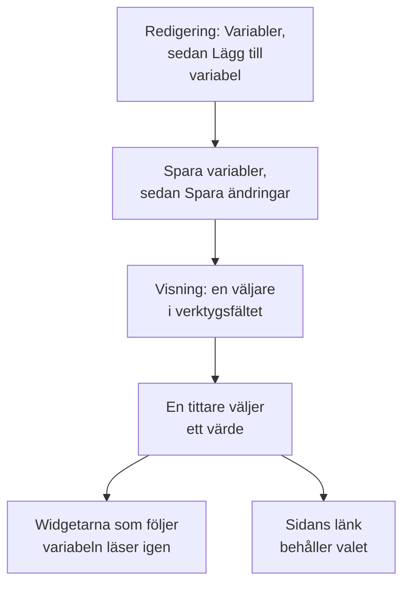

# Instrumentpanelsvariabler & filter

En variabel är en väljare i instrumentpanelens verktygsfält. Lägg till en variabel `service` så visar samma diagram `checkout`, `payments` eller `search`: tittarna väljer i verktygsfältet i stället för att du bygger tre nästan likadana instrumentpaneler.

:::cards
- [Lägg till en variabel](#lägg-till-en-variabel): Namnge den, välj var dess värden kommer ifrån och spara.
- [Variabelkällor](#variabelkällor): Telemetry Attribute, Project Labels, Custom List och Text Input.
- [Hur widgetar använder en variabel](#hur-widgetar-använder-en-variabel): Vilka widgetar som följer vilka variabler.
- [Länkar som behåller urvalet](#länkar-som-behåller-urvalet): Skicka en länk som öppnas på samma tjänst.
:::

## Så fungerar en variabel

Du definierar variabler medan du redigerar instrumentpanelen, och de sparas med den. I visningsläge är var och en en väljare i verktygsfältet. När en tittare väljer ett värde läser varje widget som följer variabeln sin data igen, och sidans länk behåller valet.



## Lägg till en variabel

:::steps
### Öppna variabeldialogen

Öppna instrumentpanelen, välj **⋯ → Redigera instrumentpanel** och klicka på **Variabler** i verktygsfältet. Dialogrutan **Instrumentpanelsvariabler** listar instrumentpanelens variabler; knappen i verktygsfältet räknar dem.

### Lägg till en

Klicka på **Lägg till variabel**. En ny variabel läser ett telemetriattribut; välj en annan **Källa** om du behöver.

### Fyll i den

Ge den ett **Namn**, som widgetar och länkar använder, till exempel `service`: bokstäver, siffror och understreck, som börjar med en bokstav eller ett understreck och skiljer sig från instrumentpanelens andra namn. Lägg till en **Etikett** för verktygsfältet om du vill, ett **Standard**-värde att börja på, och markera **Tillåt flerval** för att låta tittarna välja flera värden.

### Spara den

Klicka på **Spara variabler** och sedan på **Spara ändringar** i verktygsfältet. Variabelns väljare visas i verktygsfältet när instrumentpanelen är tillbaka i visningsläge.
:::

För att ändra eller ta bort en variabel senare öppnar du dialogrutan igen: ändra dess fält, eller klicka på papperskorgen bredvid den.

## Variabelkällor

**Källa** avgör var en variabels värden kommer ifrån, och vilka widgetar som följer den.

| Källa | Var värdena kommer ifrån | Flerval |
| --- | --- | --- |
| Telemetry Attribute | Värdena för en attributnyckel i dina mätvärden, till exempel `service.name` | Ja |
| Project Labels | Projektetiketterna som du tillåter, från 1 till 1 000 | Ja |
| Custom List | Värden som du skriver, åtskilda med kommatecken, till exempel `prod, staging` | Ja |
| Text Input | Det som tittaren skriver | Nej |

### Telemetry Attribute

Ange **Attributnyckel**, till exempel `service.name`, `host.name` eller `k8s.namespace.name`; fältet föreslår nycklarna som din telemetri har. Väljaren erbjuder upp till 100 värden för den nyckeln, lästa från dina mätvärden från det senaste dygnet, så en ny tjänst dyker upp i den utan att du redigerar instrumentpanelen.

Det här är den vanligaste källan, eftersom den inte behöver någon egen lista: värdena är de som du redan skickar.

### Project Labels

Välj befintliga projektetiketter att erbjuda som en rullgardinslista på instrumentpanelen. Skapa till exempel en variabel med namnet `UNIT`, sätt dess källa till **Projektetiketter** och välj etiketterna `0660` och `0661`.

Instrumentpanelen sparar de valda etiketternas id:n och visningsnamn. Filtreringen använder id:na, så att byta namn på en projektetikett bryter inte dess koppling. Visningsnamnen sparas med instrumentpanelen; välj en omdöpt etikett igen i variabelredigeraren för att uppdatera dess visade namn. Offentliga instrumentpaneler visar samma sparade val.

I en widget **Övervakningslista** öppnar du **Filter → Etikettvariabel** och väljer `UNIT`. När du väljer `0660` visas nu övervakarna som har den etiketten. Andra widgetar påverkas inte, om de inte uttryckligen stöder och kopplar variabeln: **SLO-lista** har samma inställning **Etikettvariabel**.

Fasta widgetfilter fortsätter att gälla. Med en fast etikett `network` och `UNIT` satt till `0660` måste en övervakare till exempel ha båda etiketterna. Flera valda enheter matchar vilken som helst av de valda enheterna. Att välja **Alla** tar bara bort variabelns villkor och behåller de fasta filtren för etikett, status och övervakartyp.

En saknad variabel eller ett val utanför dess konfigurerade alternativ visar ett fel. En vald etikett utan matchande övervakare visar den tomma listan. Ta uttryckligen bort widgetens koppling när den inte längre behövs.

### Custom List och Text Input

En Custom List erbjuder värdena som du skriver, åtskilda med kommatecken. En Text Input låter tittaren skriva vilket värde som helst, till exempel en IP-adress eller ett förfrågnings-id. Ingen av dem filtrerar en widget på egen hand: deras värden hamnar där du skriver `{{name}}` (se nedan).

En Query-variabel från en äldre instrumentpanel behålls och visar en textruta i verktygsfältet: OneUptime läser inte längre in dess värden från en fråga.

## Flerval och standardvärden

Med **Tillåt flerval** markerat väljer tittarna ett eller flera värden, och widgetarna visar vilket som helst av dem. Ett tomt urval betyder **Alla**, och en flervalsvariabel börjar alltid på **Alla**, så dess **Standard** är nedtonad.

En enkelvalsvariabel börjar på sin **Standard**, eller på **Alla** när den inte har någon. **Alla** tar bort variabelns filter, så att widgetarna visar allt.

Använd flerval för att jämföra "checkout och payments tillsammans" utan att lämna instrumentpanelen. Undvik det där talen inte går att lägga ihop mellan värden, till exempel ett medelvärde av medelvärden.

## Hur widgetar använder en variabel

Varje källa når widgetarna på sitt eget sätt:

- Variabler av typen **Telemetriattribut** filtrerar widgetar utan att du behöver ställa in något på dem: varje mätvärdesdiagram, värde, mätare och tabell; **Loggdiagram**, **Loggström**, **Spårdiagram** och **Spårtabell**; och infrastrukturlistorna vars resurser har attributet, till exempel `host.name` på värdlistor och `k8s.namespace.name` på Kubernetes-listor. Ett diagram över ett mätvärde utan attributet visar ingen data medan ett värde är valt: välj **Alla** för att se det igen. **Spårlista** och incident- och larmlistorna följer dem inte.
- Variabler av typen **Projektetiketter** filtrerar en **Övervakningslista** eller en **SLO-lista** vars **Etikettvariabel** namnger dem.
- **Vilken variabel som helst** kan skrivas in i text som `{{name}}`: i en [HTML-widget](/docs/dashboards/widgets#html), i frågan till en [extern datakälla](/docs/dashboards/data-sources), och i titeln på en **Övervakningslista** eller en **SLO-lista**. En titel som `{{UNIT}} NETWORK` visar `0660 NETWORK`, `0660, 0661 NETWORK` eller `All NETWORK`. En titel styr bara den visade texten; konfigurera **Etikettvariabel** för att filtrera övervakarfrågan.

[SLO-widgeten](/docs/dashboards/widgets#slo) kan följa en Telemetry Attribute-variabel på nyckeln `sloName`, så att tittarna väljer vilket SLO den visar.

## Länkar som behåller urvalet

Sidans länk bär varje variabels val som `?var-<name>=<value>`, med flera värden åtskilda med kommatecken, så en länk som du kopierar öppnas med samma urval, även ett uttryckligt **Alla**. En länk som den här öppnas på tjänsten payments:

```text title="A dashboard link with a variable"
https://oneuptime.com/dashboard/<project-id>/dashboards/<dashboard-id>?var-service=payments
```

Länken bär också tidsintervallet och den automatiska uppdatering du har valt, som `range` och `refresh`, så att de du skickar den till ser det du ser. [Skicka en länk](/docs/dashboards/sharing#skicka-en-länk) listar deras värden.

## Ett exempel: en instrumentpanel för varje tjänst

En tjänstepanel har oftast:

1. En variabel `service`, källa Telemetry Attribute, attributnyckel `service.name`, med din mest trafikerade tjänst som standard. Låt flerval vara av, så att diagrammen visar en tjänst i taget.
2. En variabel `namespace`, källa Telemetry Attribute, attributnyckel `k8s.namespace.name`, med flerval på för att jämföra namnrymder.
3. En variabel `environment`, källa Custom List, värden `prod, staging`, använd som `{{environment}}` i en datakällas fråga.
4. Widgetar som läser de attributen: diagram och värden för tjänstens mätvärden, en loggström och en lista över Kubernetes-poddar.

Resultatet: en instrumentpanel för varje tjänst, med tre väljare överst.

## Nästa steg

:::cards
- [Instrumentpanels-widgetar](/docs/dashboards/widgets): Vilka widgetar som följer vilka variabler.
- [Externa datakällor](/docs/dashboards/data-sources): Sätt in en variabel i en PromQL- eller SQL-fråga.
- [Delning & offentliga instrumentpaneler](/docs/dashboards/sharing): Variabler på en offentlig instrumentpanel.
- [Skapa en instrumentpanel](/docs/dashboards/authoring): Redigeringsläge, sparande och tidsintervallet.
:::
