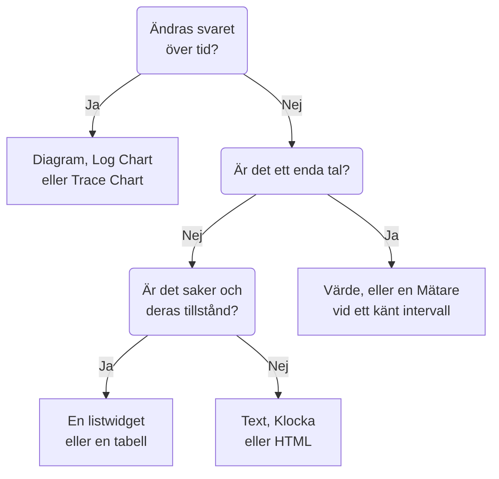

# Instrumentpanels-widgetar

En widget är en ruta på en instrumentpanel. Den här sidan går igenom varje widget i katalogen **Lägg till widget**, vad den visar och inställningarna som spelar roll, i katalogens egna grupper. För att placera widgetar i rutnätet och spara dem, se [Skapa en instrumentpanel](/docs/dashboards/authoring).

:::cards
- [Vilken widget ska jag använda?](#vilken-widget-ska-jag-använda): Välj utifrån frågan som rutan besvarar.
- [Diagram och tal](#diagram-och-tal): Diagram, Värde, Mätare och Tabell, från en mätvärdesfråga.
- [Loggar, spår och säkerhet](#loggar-spår-och-säkerhet): Volymdiagram, liveflöden och listor.
- [Sortera listor och tabeller](#sortera-listor-och-tabeller): Sortera efter en kolumn, och välj ordningen alla ser.
- [När en widget inte kan visas](#när-en-widget-inte-kan-visas): Vad en trasig widget visar, och hur du rättar den.
:::

## Vilken widget ska jag använda?

Börja med frågan som rutan ska besvara:

| Frågan | Widgeten |
| --- | --- |
| Hur har ett mätvärde förändrats över tid? | **Diagram** |
| Hur många loggar, av vilken allvarlighetsgrad, över tid? | **Loggdiagram** |
| Hur snabba är förfrågningarna, och hur många misslyckas, över tid? | **Spårdiagram** |
| Vad är ett visst tal just nu? | **Värde**, eller **Mätare** när det har ett känt intervall |
| Vilka värdar, tjänster eller slutpunkter sticker ut? | **Tabell** eller **Spårtabell** |
| Vad händer just nu? | **Loggström**, **Spårlista**, **Incidentlista** eller **Larmlista** |
| Är alla våra webbplatser uppe? | **Övervakningslista** |
| Håller vi den tillförlitlighet vi har lovat? | **SLO** eller **SLO-lista** |
| I vilket tillstånd är våra kluster och värdar? | En widget i gruppen Infrastruktur |
| Var i världen finns vårt nätverk, och vad är nere? | **Nätverkskarta** |
| En rubrik, en anteckning, tiden på ett annat kontor? | **Text** eller **Klocka** |
| Data som finns utanför OneUptime? | En widget i gruppen Externa datakällor |
| Något som ingen widget täcker? | **HTML**, när du är säker på att ingen annan widget gör det |



De flesta instrumentpaneler blandar några: ett diagram överst, ett eller två värden bredvid, en textrubrik och en eller två listor under.

## Diagram och tal

De här fyra widgetarna läser en mätvärdesfråga, byggd som mätvärdesutforskaren bygger en: välj ett mätvärde och en aggregering, lägg till attributfilter och gruppera efter ett attribut för att få en serie per värde.

### Diagram

En tidsserie med en eller flera mätvärdesfrågor över instrumentpanelens tidsintervall. **Chart Type** ritar den som ett linje-, stapel-, yt-, staplat yt- eller cirkeldiagram. **Additional Queries** lägger fler mätvärden på samma axlar, och **Formulas** kombinerar dem med `+`, `-`, `*`, `/`, `%`, `^` och parenteser, som i `(1 - a) * 100`. Varje frågas visningsinställningar lägger till en förklaring och en enhet, en färg, varnings- och kritiska linjer och en takt per sekund för räknare som bara växer.

Använd den när linjens form berättar historien: svarstid, fel, genomströmning eller ködjup.

### Värde

Ett stort tal med en sparkline: frågans värde över hela tidsintervallet, summerat för en summa eller ett antal, det högsta för ett maximum, det lägsta för ett minimum och annars medelvärdet. En pil jämför intervallets andra halva med den första, varje halva beräknad på samma sätt, färgad efter **Trend Direction**: om ett högre värde är bättre eller sämre, eller avläst från mätvärdets namn. Peka på pilen för att se båda halvornas värden, och på sparklinen för att läsa av en punkts värde och tid. **Warning Threshold** gör bakgrunden gul och **Critical Threshold** röd när värdet når dem.

Använd den när ett tal besvarar frågan: felfrekvensen, P95-svarstiden eller antalet förfrågningar som hanterats i dag.

### Mätare

En visare mellan ett minimum och ett maximum, 0 och 100 om du inte anger dem, med en gul zon från **Warning Threshold** och en röd zon från **Critical Threshold**.

Använd den när värdet lever i ett känt intervall: CPU- eller diskanvändning i procent, eller en kös kapacitet.

### Tabell

Mätvärden som rader. **Group By Attributes** ger en rad per värde, till exempel en per `host.name`; utan den är varje rad ett tidsfack. **Metrics & Columns** anger kolumnerna: mätvärden, och formler över dem, som tillgänglighet i procent. När du grupperar gör **Reduce across time** om varje rads serie till ett enda värde: det senaste värdet, medelvärdet, summan, minimum eller maximum.

Använd den för en uppdelning i stället för en trend: de mest bullriga värdarna, felen per tjänst, förfrågningarna per slutpunkt.

## Text, klocka och HTML

De här widgetarna behöver ingen datakälla.

### Text

En rad eller ett textblock, för en rubrik, en anteckning eller länkar till dina runbooks. Slå på **Markdown** för att rita rubriker, länkar, listor, kod och tabeller; annars visas texten som den är skriven, i fetstil, kursiv eller understruken om du vill.

### Klocka

Aktuell tid i valfri tidszon, som siffror eller som en analog urtavla, med en etikett som "Sydneykontoret". Utan tidszon visar den varje tittares egen. Lägg till en per kontor för att se vem som är vaken.

### HTML

Din egen HTML, CSS och JavaScript, ritad som en widget. Dess inställningar är HTML-innehållet, en valfri formatmall, ett valfritt skript och tre behörighetsbrytare.

Använd den när du behöver något som ingen inbyggd widget täcker: en inbäddad bricka från en tredje part, en tabell hämtad från ett internt API, en anpassad förklaring eller en uppsättning formaterade länkar till dina egna verktyg.

#### Vad den kan och inte kan göra

Widgeten renderas i en sandlåderam på sitt eget isolerade ursprung. Inuti den ramen kan din kod göra mer eller mindre vad som helst: bygga DOM, köra timers, hämta från valfri URL, rita på en canvas.

Det den inte kan göra är att nå OneUptime-sidan runt omkring. Den har ingen åtkomst till instrumentpanelens DOM, cookies, lokala lagring eller API-session, och den kan inte få webbläsarfliken att navigera bort. Det gäller oavsett om instrumentpanelen är privat eller delad offentligt.

Två konsekvenser som är bra att känna till innan du klistrar in något:

- En `fetch` från widgeten är en förfrågan mellan ursprung från ett ogenomskinligt ursprung, så servern du anropar måste tillåta den med CORS. Att anropa OneUptimes API härifrån stöds inte.
- Widgeten börjar genomskinlig. Ange en bakgrund på `body` i din CSS om du vill att den ska fylla kortet. I det mörka temat börjar dess text ljus, och dess element `<html>` har klassen `dark`: börja en CSS-regel med `html.dark` för att bara styla det mörka temat.

#### Använda instrumentpanelsvariabler

Skriv `{{variableName}}` var som helst i HTML, CSS eller JavaScript så ersätts det med variabelns aktuella värde innan widgeten renderas. När ett nytt värde väljs renderas widgeten om. En platshållare som namnger en variabel som inte finns lämnas som den är.

Skript får samma värden, plus instrumentpanelens tidsintervall, på `window.ONEUPTIME`:

```javascript title="window.ONEUPTIME"
window.ONEUPTIME.variables.environment; // current value, or "" if unset
window.ONEUPTIME.startDate; // ISO 8601 string, start of the dashboard's time range
window.ONEUPTIME.endDate; // ISO 8601 string, end of it
```

Widgeten laddas om varje gång instrumentpanelen uppdateras, så en widget som hämtar sin egen data håller jämna steg med uppdateringsintervallet.

#### Behörigheter

**Run JavaScript** (på som standard) kör ditt skript. Stäng av den för att bara rendera markering och stilar: skriptet utelämnas då helt från widgeten i stället för att bara blockeras.

**Open links in a new tab** (på som standard) låter länkar och `window.open` öppna en webbläsarflik. Länkar öppnas alltid i en ny flik; widgeten kan aldrig få själva instrumentpanelen att navigera.

**Allow forms to submit** (av som standard) låter ett `<form>` inuti widgeten skickas.

Den som kan redigera instrumentpanelen bestämmer vad den här widgeten kör, och alla som visar instrumentpanelen kör det: på en offentlig instrumentpanel gäller det även anonyma besökare. Behandla redigeringsåtkomst till en instrumentpanel med en HTML-widget som du skulle behandla åtkomst till all annan kod du levererar.

## Loggar, spår och säkerhet

| Widget | Vad den visar | Inställningar som spelar roll |
| --- | --- | --- |
| **Loggdiagram** | Loggvolym över tid, en serie per allvarlighetsgrad, som staplar, linjer eller ytor. | Allvarlighetsgrader, text som innehållet innehåller, attributfilter. |
| **Loggström** | De senaste loggraderna som matchar ett filter. | Allvarlighetsgrad, text som innehållet innehåller, attributfilter som `@service.name:checkout`, hur många rader. |
| **Spårdiagram** | Antal förfrågningar, antal fel eller svarstid (medel, minimum, maximum, P50 till P99) över tid. | Mätvärdet, vilka spann som räknas, och ett attribut att dela upp serierna efter. |
| **Spårlista** | De senaste spåren, med deras varaktighet och status. | Status, hur många rader. |
| **Spårtabell** | De främsta spannamnen, statusarna eller attributvärdena efter antal förfrågningar, med median-, medel-, minimi- och maximisvarstider. | Vad raderna grupperas efter, och vilka spann som räknas. |
| **Säkerhetshändelser** | De senaste säkerhetshändelserna, med allvarlighetsgrad, händelseklass och värd. | Allvarlighetsgrader, händelseklasser, text som meddelandet innehåller. |
| **Flöde av säkerhetshändelser** | Ett flöde av säkerhetshändelser från deras källa, genom deras händelseklass, till deras allvarlighetsgrad. | Allvarlighetsgrader, hur många händelser. |

Spårwidgetarna räknar bara rotspann, som spårutforskaren gör, om du inte tar med underordnade spann i deras inställningar. Ett vanligt mönster är ett svarstidsdiagram överst med en lista över långsamma spår under.

## Incidenter, larm och övervakare

| Widget | Vad den visar | Filter |
| --- | --- | --- |
| **Incidentlista** | Incidenter med deras tillstånd och allvarlighetsgrad. | Olösta, bekräftade eller lösta; allvarlighetsgrad, tillstånd, övervakare och etiketter. |
| **Larmlista** | Larm med deras tillstånd och allvarlighetsgrad. | Olösta, bekräftade eller lösta; allvarlighetsgrad, tillstånd, övervakare och etiketter. |
| **Övervakningslista** | Övervakare med deras aktuella status. | I drift eller inte, status, övervakartyp och etiketter, eller en **Etikettvariabel** som tittarna väljer i verktygsfältet. |

Som de flesta listwidgetar kan de här tre rita en bikaka av celler färgade efter status i stället för en tabell: välj det under **Visningsläge**. De visar aktuellt tillstånd, oavsett instrumentpanelens tidsintervall.

## Servicenivåmål

### SLO

Ett servicenivåmål (SLO), ritat antingen som ett enda tal eller som en linje över tid.

**Inställningar**: vilket SLO, eller det SLO som valts i en instrumentpanelsvariabel; vilket av dess tre tal (SLI, Error Budget Remaining eller Burn Rate); visning som Tile eller Diagram; och en valfri titel.

- **Tile** visar det aktuella talet, plus en andra rad där det finns en: målet under SLI:n, återstående minuter under felbudgeten. En statusbricka färgar det hela.
- **Diagram** ritar samma tal över instrumentpanelens tidsintervall, med målet markerat som en streckad linje på SLI-serien. Historiken skrivs med några minuters mellanrum av utvärderingsworkern, så ett helt nytt SLO visas som ett tomt diagram tills det har utvärderats första gången.

Använd den när instrumentpanelen svarar på "håller vi det vi lovat?" snarare än "vad händer just nu?".

SLO-widgeten fungerar på [offentliga instrumentpaneler](/docs/dashboards/sharing). Det som publiceras är SLO:ets nyckeltal (namn, mål, aktuell SLI, återstående felbudget, burn rate och status), oavsett vilket av dem widgeten ritar. Definitionen förblir privat: övervakarna det bevakar, dess etiketter, beskrivning, fråga och utvärderingsschema skickas aldrig till en offentlig tittare. En Tile-widget publicerar bara de aktuella talen; en Diagram-widget publicerar även historiken för den enda serie den ritar, och inget annat.

### SLO List

Varje SLO med dess status, SLI, felbudget och burn rate, med minst återstående budget först. Filtrera den efter status eller etiketter, eller med en **Etikettvariabel** som tittarna väljer i verktygsfältet. [SLO-metriker och -instrumentpaneler](/docs/slo/metrics) visar båda SLO-widgetarna i arbete.

## Infrastruktur

Var och en av de här widgetarna listar resurserna som en agent eller en collector rapporterar till OneUptime. Begränsa dem efter kluster, värd eller namnrymd i deras filter, och visa dem som en lista eller som en bikaka.

| Grupp | Widgetar | Fylls i av |
| --- | --- | --- |
| **Värdar** | **Värdar**, med deras anslutningsstatus, OS, CPU och minne | Valfri OpenTelemetry-collector som skickar `host.name` |
| **Kubernetes** | **Poddar**, **Noder**, **Namnrymder**, **Distributioner**, **StatefulSets**, **DaemonSets**, **Jobb**, **CronJobs** | [Kubernetes-agent](/docs/monitor/kubernetes-agent) |
| **Docker** | **Värdar**, **Behållare**, **Avbildningar**, **Nätverk**, **Volymer** | Docker-agenten |
| **Docker Swarm** | **Noder**, **Tjänster** | Docker Swarm-agenten |
| **Podman** | **Värdar**, **Behållare**, **Avbildningar**, **Nätverk**, **Volymer** | Podman-agenten |
| **Proxmox** | **Noder**, **Gäster** | Proxmox-agenten |
| **VMware** | **Värdar**, **Virtuella maskiner** | VMware-agenten, eller ett vCenter som du ansluter |
| **Ceph** | **OSD:er**, som en vägg färgad efter tillstånd, och **Pools** | Ceph-agenten |
| **Lagringsarrayer** | **Volymer**, och **Hårdvara** som en vägg färgad efter status | Storage Array-agenten |

Använd dem för en sida som blandar tillståndet i din infrastruktur med telemetrin från arbetslasterna som körs på den.

### Network Map

Dina nätverksplatser ritade på världskartan, var och en fäst på sin egen latitud och longitud och färgad efter den övervakningsstatus som sammanställts för den. Platser nära varandra delar en markör med antalet tryckt inuti; en markör som står för exakt en plats öppnar den platsen när du klickar på den.

Kartan ramar in sig själv kring platserna den ritade: ett nätverk inom ett land fyller ramen med det landet, och ett som är utspritt över kontinenter öppnas på hela världen. Det finns inga kontroller för att zooma eller panorera: en instrumentpanelsruta är en bild, och sidan Network Map under Network är där du går igenom hierarkin.

Ovanför kartan står hur många platser som är nere, eftersom en röd prick på två pixlar bland tvåhundra gröna inte är något någon läser på instrumentpanelsavstånd. Under den talar en täckningsrad om vad kartan inte visar: platser utan koordinater, och om radgränsen nåddes.

**Inställningar**: titel, kart- eller listvy, högsta antal ritade platser, om platsnamn ska skrivas ut, och filter efter platstyp och efter status. Platsnamn försvinner automatiskt när kartan blir för full för att de ska gå att läsa; verktygstipset namnger fortfarande varje markör.

En plats visas bara om den har koordinater. Lägg till latitud och longitud på platsen (eller importera dem från en CSV) för att fästa den.

## Externa datakällor

Gruppen Externa datakällor ritar ett **Diagram**, ett **Värde**, en **Mätare** eller en **Tabell** från ett system som OneUptime inte äger: Prometheus, PostgreSQL, MySQL, SQL Server, ClickHouse, Loki, Elasticsearch eller valfritt REST-API. Du ansluter systemet en gång och skriver sedan varje widgets fråga i systemets eget språk. [Externa datakällor](/docs/dashboards/data-sources) visar hur.

## Sortera listor och tabeller

Klicka på rubriken för en kolumn för att sortera en lista eller en tabell efter den: ett första klick sorterar så som tabellen nedan säger, nästa klick åt andra hållet, och klicket därefter återställer widgetens egen ordning. På kolumnen som widgeten redan är sorterad efter vänder ett klick på ordningen. En pil markerar kolumnen som raderna är sorterade efter.

| Kolumn | Första klicket | Nästa klick |
| --- | --- | --- |
| En status, ett tillstånd eller en allvarlighetsgrad | Sämsta först | Bästa först |
| En tid | Nyaste först | Äldsta först |
| Ett tal | Högsta först | Lägsta först |
| Text | A till Ö | Ö till A |

Sämst följer projektets egen ordning: en monitorstatus efter dess prioritet, allvarlighetsgrad och tillstånd för en incident eller en avisering efter den ordning du har dem i, och en resurs som är nere, inte redo eller avstängd före en frisk. En pods fas sorteras Failed, sedan Unknown, sedan Pending, sedan Running och Succeeded. En SLO:s SLI och felbudget, och en Proxmox-gästs VMID, sorteras med de lägsta först.

Hela listan sorteras, inte bara raderna på skärmen: en lista som visar 25 rader, sorterad med de sämsta först, visar de 25 sämsta av alla. Rader som är lika behåller widgetens egen ordning. En kolumn som en lista inte kan sorteras efter i sin helhet, som meddelandet i en säkerhetshändelse, sorterar inte.

### Din egen sortering

Din sortering är bara din: din webbläsare kommer ihåg den för den widgeten på den instrumentpanelen, så att en omladdning eller en omstart av en väggskärm behåller den, och ingen annan ser den. Klicket som återställer widgetens egen ordning glömmer din sortering, och widgeten följer sedan sin egen ordning, även när en redaktör ändrar den senare.

### Ordningen alla ser

För att välja den ordning en widget öppnas i för alla redigerar du den och väljer ordningen under **Sortera**, eller klickar på en kolumnrubrik i dess **Live Preview**, och klickar sedan på **Spara ändringar**. Du ser den nya ordningen direkt; en tittare som har sorterat widgeten på sitt eget sätt behåller sin sortering.

Instrumentpanelsmallarna öppnar sina listor över värdar, noder, poddar, Swarm-tjänster och nätverksenheter med de sämsta först.

Via API:et och Terraform är ordningen widgetens `arguments.sort`: en kolumn och en riktning, till exempel `status:desc`. En listwidget avvisar en kolumn den inte har, och felet räknar upp de sorteringar den har.

## På en offentlig instrumentpanel

En [offentlig instrumentpanel](/docs/dashboards/sharing) ritar de flesta widgetar för sina besökare, och var och en visar bara det den har ställts in att visa. Några få kan inte visas utan en inloggad session:

- **Loggdiagram**, **Spårdiagram**, **Spårtabell**, **Säkerhetshändelser** och **Flöde av säkerhetshändelser** säger på sin plats att de inte är tillgängliga på offentliga instrumentpaneler.
- Widgetarna i Externa datakällor utelämnas helt från en offentlig instrumentpanel, eftersom deras inställningar är själva frågan.

## När en widget inte kan visas

En widget som inte kan ritas visar **Den här widgeten kunde inte visas** på sin egen plats, och resten av instrumentpanelen fortsätter att fungera. Det händer när OneUptime inte har någon widget av den typen (en som har tagits bort, stavats fel när instrumentpanelen skrevs via API:et, eller lagts till av en nyare version), eller när widgeten misslyckas medan den ritas, till exempel för att dess sparade inställningar är ofullständiga.

Om du kan redigera instrumentpanelen klickar du på **Redigera widget** på den. Instrumentpanelen växlar till redigeringsläge med widgetens inställningar öppna: rätta dem, eller klicka på **Radera widget**, och sedan på **Spara ändringar**. En widget som misslyckades medan den ritades erbjuder också **Försök igen**, och ritas om vid nästa automatiska uppdatering eller när du ändrar tidsintervallet.

Besökare på en offentlig instrumentpanel får bara veta att widgeten inte kunde visas.

## Nästa steg

:::cards
- [Instrumentpanelsvariabler & filter](/docs/dashboards/variables): Låt tittarna rikta widgetarna mot en tjänst, en värd eller en kund.
- [Externa datakällor](/docs/dashboards/data-sources): Visa Prometheus, SQL, Loki med flera bredvid din egen data.
- [Skapa en instrumentpanel](/docs/dashboards/authoring): Lägg till, ordna och spara widgetar.
- [Delning & offentliga instrumentpaneler](/docs/dashboards/sharing): Dela instrumentpanelen utanför ditt team.
:::
