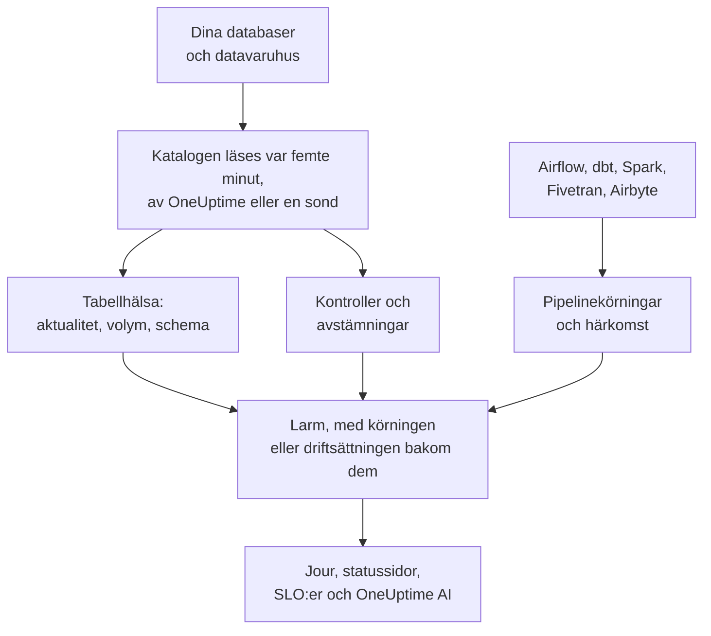

# Dataobserverbarhet

Dataobserverbarhet håller koll på tabellerna som ditt företag är beroende av, i PostgreSQL, MySQL, SQL Server, Oracle, MongoDB, Redshift, Snowflake, BigQuery, ClickHouse, Databricks och Athena, och berättar när deras data är försenade, saknas, är felaktiga eller trasiga, innan de som använder dem märker det. Den lär sig varje tabells rytm på egen hand, läser varje databas katalog och aldrig en rad, och kopplar varje dataproblem till den pipelinekörning, den driftsättning eller den uppströms tabell som ligger bakom det.

Den svarar på fyra frågor:

:::cards
- [Är data aktuella?](/docs/data-observability/table-health): Varje tabells senaste ändring, rader, storlek och kolumner, lästa var femte minut, med larm när en tabell är försenad, krymper eller byter form.
- [Är data korrekta?](/docs/data-observability/checks): Kontroller av vad en tabell innehåller, avstämningar mellan en tabell och dess kopia, och dbt:s tester, med larm när de inte går igenom.
- [Varifrån kommer de, och vad matar de?](/docs/data-observability/lineage-and-pipelines): Härkomst från dina pipelines, dbt, Fivetran, Airbyte, vyer och databasernas egen frågehistorik, så att ett problem öppnar ett enda larm.
- [Kan de som använder dem lita på dem?](/docs/data-observability/data-products): Dataprodukter med en aktualitets-SLA, på statussidor och följda som en SLO, med ett "data as of"-märke.
:::

## Så fungerar det

1. **Anslut en databas** med en inloggning som bara kan läsa. En databas som Datasäkerhet redan känner till övervakas utan att du behöver göra något, och detsamma gäller varje BigQuery-dataset som din Google Cloud-anslutning har hittat. En databas i ett privat nätverk läses av en sond som du kör där.
2. **Var femte minut** läser OneUptime varje databas katalog och statistik: varje tabell och vy, dess kolumner, rader och storlek, och när den senast ändrades. Ingen tabell skannas och ingen rad läses.
3. **Varje tabells rytm lärs in**: hur ofta den brukar ändras. En tabell som missar sin rytm är försenad; en tabell vars rader minskar, eller vars kolumner ändras, säger också till.
4. **Rekommenderade larm** gör var och en av dessa signaler till en monitor som du väljer att ha, och kontroller som du lägger till läser vad en tabell innehåller.
5. **Härkomst** visar vilka tabeller som matar vilka, så att ett larm på en tabell vars källa gick sönder först blir en följd av den källan: ett problem, inte tio.

## Vad som gör den annorlunda

- **Den är en del av resten av OneUptime.** Ett datalarm är ett vanligt larm: det når den som har jour, öppnar incidenter, visas på statussidor och räknas mot SLO:er. Tjänsterna som enligt dina spår skriver till en tabell, och deras driftsättningar, visas bredvid varje tabellarm.
- **Inget att konfigurera per tabell.** Rytmer, körscheman och vanliga körtider lärs in från vad varje tabell och pipeline gör, och en monitor som rekommenderas för en databas täcker varje tabell i den, även tabeller som skapas senare.
- **Ett larm per orsak.** Ett larm vars uppströms tabell, pipeline eller databas redan har ett öppet larm ansluter sig till det larmet som dess följd, redan bekräftat, så att en trasig laddning bara når jouren en gång.
- **OneUptime AI känner dina data.** Utredningar av datalarm utgår från tabellens skrivare, körningar och uppströms tabeller; i Fråga AI, Slack, Microsoft Teams och via AI-agenter kan du fråga om en tabell är aktuell; och en kontroll kan skrivas utifrån en mening. Se [OneUptime AI och API:t](/docs/data-observability/ai-and-api).

## Innan du börjar

- **En roll som kan sätta upp den.** Rollerna Projektägare, Projektadministratör och Telemetriadministratör ansluter databaser. Den som får redigera datatillgångar lägger till kontroller, avstämningar och dataprodukter; rollen Tittare läser vad den har hittat. Se [Behörighetsreferens](/docs/permissions/reference).
- **En inloggning som bara kan läsa i varje databas.** [Anslut en databas](/docs/data-observability/connect) listar det minsta som varje motor behöver.

## Snabbstart

:::steps
### Anslut en databas

Öppna **Dataobserverbarhet**, gå till **Databaser** och välj **Connect a Database**. Välj motor och ange en anslutningssträng med enbart läsbehörighet, eller namnet på den miljövariabel som din sond läser den från. [Anslut en databas](/docs/data-observability/connect) visar inloggningen för varje motor.

### Se dess tabeller

Inom fem minuter visas dess tabeller under **Tabeller**, var och en med sina rader, sin storlek och när den senast ändrades. En tabells aktualitet är känd när den har ändrats två gånger: **Fresh** så länge den håller sin rytm, **Late** när den missar den.

### Lägg till de rekommenderade larmen

Välj **Recommended Alerts** för databasen under **Databaser**, och lägg till de larm du vill ha: en tabell som är försenad, en vars rader faller kraftigt eller är ovanligt få, en vars kolumner ändras, och en databas som slutar rapportera. Var och en är en vanlig monitor: jour, ägare, underhållsfönster och statussidor fungerar som för vilken annan som helst.
:::

## Nästa steg

:::cards
- [Anslut en databas](/docs/data-observability/connect): Varje motors inloggning med minsta möjliga behörighet, och sonder för privata nätverk.
- [Tabellhälsa](/docs/data-observability/table-health): Aktualitet, volym, schemaändringar, oanvända tabeller och de mätvärden som varje tabell skriver.
- [Kontroller och avstämningar](/docs/data-observability/checks): Regler för en tabells värden, att jämföra en tabell med dess kopia, och dbt:s tester.
- [Härkomst och pipelines](/docs/data-observability/lineage-and-pipelines): OpenLineage, dbt, Fivetran och Airbyte, och ett larm per orsak.
- [Dataprodukter](/docs/data-observability/data-products): Aktualitets-SLA:er för dem som använder data, på statussidor och som SLO:er.
- [OneUptime AI och API:t](/docs/data-observability/ai-and-api): Utredningar, en kontroll utifrån en mening, aktualitet för AI-agenter, och varje endpoint.
:::
